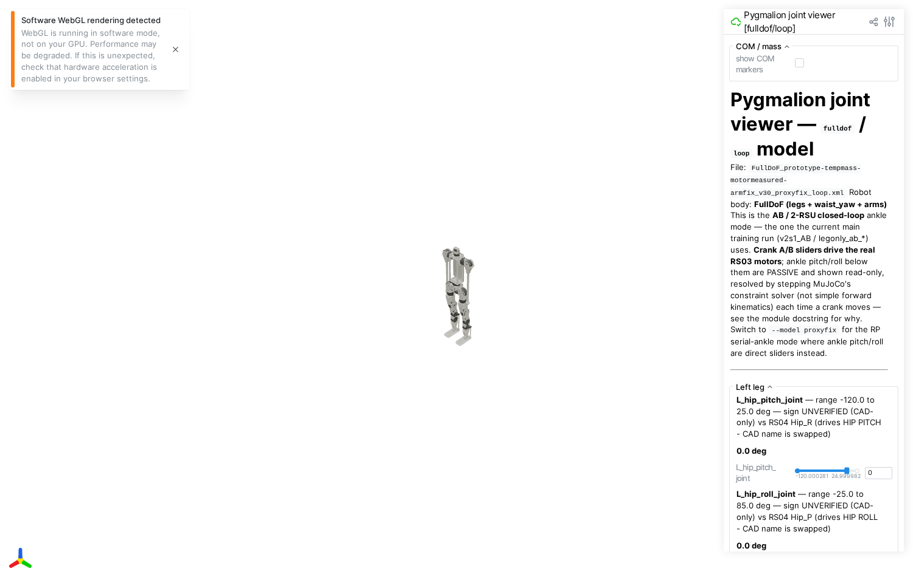
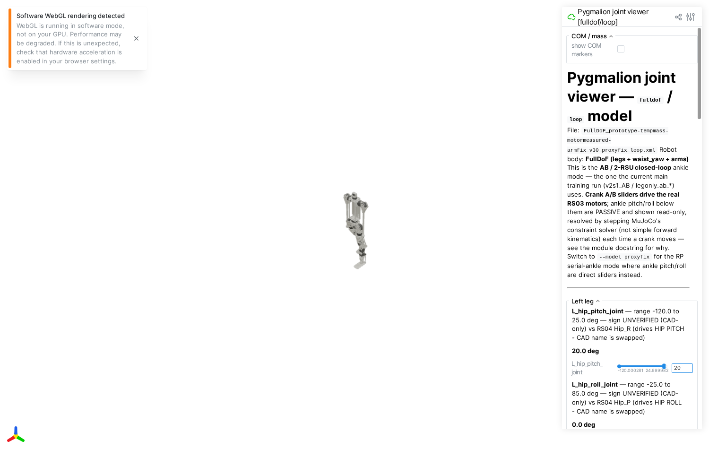
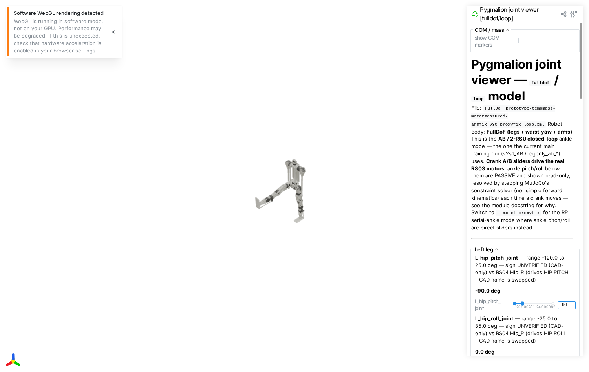

# 관절이 도는 방향을 눈으로 확인하는 도구 — 쉬운 말로 정리

2026-09-10 · 대상: `tools/viewer/mjcf_joint_viewer.py`

> 줄임말을 쓰지 않습니다. 이 로봇 프로젝트를 처음 보는 사람이 이 글만 읽고, 이 도구가 왜
> 있고 무엇을 확인해 주는지, 어떻게 켜서 쓰는지 알 수 있게 쓰는 것이 목표입니다.

---

# 1. 이 도구가 푸는 문제

컴퓨터 안의 로봇(시뮬레이터)과 진짜 로봇에는 각각 "이 관절을 +10도 돌려라"라는 숫자가
있습니다. 문제는 — **시뮬레이터의 +10도와 진짜 모터의 +10도가 같은 방향이라는 보장이
없다**는 것입니다.

CAD(설계 도면)에서 좌표축을 어느 쪽으로 잡았는지, 3D 모델 파일을 만들 때 축을 뒤집어
넣었는지는 사람이 실수하기 아주 쉬운 부분입니다. 만약 시뮬레이터에서 무릎을 +30도로
학습시킨 정책(policy)을 진짜 로봇에 그대로 옮겼는데 진짜 모터의 +30도가 반대 방향이라면,
로봇은 학습한 것과 정반대로 다리를 접습니다 — 최악의 경우 다리가 부서지는 방향으로
움직일 수 있습니다.

이 도구는 그 확인을 **눈으로, 즉시** 할 수 있게 해 줍니다. 브라우저 화면에서 슬라이더를
밀면 3D 로봇이 그 방향으로 움직이는 모습이 바로 보입니다. 이 방향이 실제 모터 도면이
말하는 "정방향"과 같은지 사람이 눈으로 대조합니다.

---

# 2. 먼저 그림으로 보기

아래는 이 도구를 브라우저로 열었을 때 화면입니다 (왼쪽 다리 엉덩이 앞뒤 각도
`L_hip_pitch_joint` 슬라이더를 다르게 움직인 세 장면):

| 각도 0도 (기본자세) | 각도 +20도 | 각도 −90도 |
|---|---|---|
|  |  |  |

숫자만 보면 +20과 −90이 뭘 뜻하는지 알 수 없지만, 그림을 보면 바로 알 수 있습니다:
**+20도는 다리를 살짝 앞으로 접고, −90도는 다리를 크게 앞으로 들어 올려 무릎이 접힌
모습**입니다. 화면 오른쪽 패널에는 그 관절의 움직일 수 있는 범위(예: −120도에서 +25도까지)와
"이 방향이 맞는지 확인됐는지"를 알려주는 짧은 문구(배지)가 함께 나옵니다 — 이 배지가
무엇을 근거로 하는지는 6절에서 설명합니다.

---

# 3. 왜 확인해야 할 경우의 수가 4가지인가

이 로봇은 두 가지 축으로 서로 다른 버전이 있고, 그 조합이 총 넷입니다.

## (가) 로봇 몸통 모양 — 상반신이 있는가 없는가

- **FullDoF** (전신): 다리 + 허리 회전 관절 + 양팔. 사람 모습을 다 갖췄습니다.
- **LegOnly** (하반신만): 다리만 있고, 허리 위로는 아예 몸체가 없습니다. 다만 허리
  회전 모터의 **무게만은** 남겨 둡니다(실제 로봇도 상체가 없어도 그 모터는 골반에 박혀
  있으니까요) — 그래서 "무게는 있는데 그 자리에서 회전하는 관절은 없다"는 조금 특이한
  상태입니다.

두 버전 모두 **다리 관절의 이름과 배치는 완전히 같습니다.** 그래서 다리 쪽 방향 확인은 둘 중
아무 버전으로 해도 결과가 같아야 합니다 — 다르게 나온다면 그 자체가 버그를 잡은 것입니다.

## (나) 발목을 움직이는 방식 — AB 방식과 RP 방식

발목은 위아래(pitch, 발끝을 들고 내리는 방향)와 좌우(roll, 발을 안팎으로 기울이는 방향)
두 방향으로 움직여야 합니다. 이걸 만드는 방법이 두 가지입니다.

- **RP 방식** (직렬): 발목 그 자리에 모터가 두 개 있어서, 하나는 pitch를 하나는 roll을
  바로 돌립니다. 자동차 핸들처럼 "돌리는 만큼 그대로 돌아가는" 가장 단순한 구조입니다.
- **AB 방식** (2-RSU 폐루프): 모터 두 개(이름이 크랭크 A, 크랭크 B입니다 — "AB"라는
  이름은 이 두 모터 이름에서 왔습니다)가 발목이 아니라 정강이 쪽에 달려 있고, 각각 막대
  (로드)로 발에 연결되어 있습니다. 두 막대를 밀고 당기는 조합에 따라 발이 pitch로도
  roll로도 기울어집니다 — 마치 사람이 양손으로 접이식 빨래건조대의 두 다리를 밀고 당겨서
  건조대의 기울기를 만드는 것과 비슷합니다. 실제 로봇에 이 방식을 쓰는 이유는 무거운 모터를
  발이 아니라 정강이(몸통에 더 가까운 곳)에 둘 수 있어서 발이 가벼워지기 때문입니다.

즉 확인해야 할 조합은 **{FullDoF, LegOnly} × {AB, RP} = 4가지**이고, 이 도구는 네
조합을 각각 다른 인터넷 주소(포트)로 동시에 띄워서 브라우저 탭 네 개로 나란히 비교할 수
있게 되어 있습니다.

---

# 4. AB 방식은 왜 "그냥 슬라이더로는" 안 되는가

RP 방식은 슬라이더를 pitch면 pitch, roll이면 roll 각도 그대로 화면에 반영하면 끝입니다.
값을 넣고 바로 그 각도로 그리면 됩니다.

AB 방식은 그렇게 할 수 없습니다. 이유는 3절에서 설명한 "두 막대가 발을 밀고 당긴다"는
구조 자체에 있습니다 — **발의 pitch·roll 각도는 크랭크 A와 크랭크 B 두 모터의 각도가
정해지고 나서, 그 결과로 저절로 정해지는 값**입니다. 발의 각도를 직접 입력할 방법이
없습니다(입력할 수 있는 건 크랭크 A, 크랭크 B 두 개뿐입니다).

더 까다로운 부분은, "크랭크 A와 B가 이 각도면 발은 이 각도"라는 계산이 간단한 공식
하나로 안 풀린다는 것입니다. 막대 두 개와 발이 서로를 잡아당기는 기구는 물리 엔진이
**여러 번 반복 계산**을 해야 정확한 답이 나옵니다(수학 공식으로 한 번에 못 풀고, 조금씩
맞춰 가며 답을 찾는 방식입니다). 그래서 이 도구는 크랭크 슬라이더를 움직일 때마다:

1. 다른 모든 관절은 그 자리에 그대로 고정하고,
2. 크랭크 A·B 모터에 "이 각도로 가라"는 부드러운 힘을 걸어서,
3. 물리 시뮬레이터를 짧게(0.4초, 400번의 아주 작은 계산 단계로) 실제로 굴려
4. 막대와 발이 자연스럽게 자리 잡을 때까지 기다립니다.

그래서 화면에는 발목 pitch·roll 칸이 **슬라이더가 아니라 "지금 몇 도인지 알려만 주는
읽기 전용 표시"**로 나옵니다 — 사람이 직접 넣을 수 있는 값이 아니라, 크랭크 A·B가 정해지고
난 결과이기 때문입니다. (처음 만들 때 이 물리 계산 없이 발목 각도를 억지로 순간이동시키는
방법을 시도했는데, 계산이 완전히 깨져버렸습니다 — 이 반복 계산 과정을 생략하면 안 되는
이유입니다.)

---

# 5. 화면 읽는 법

각 관절 줄은 이렇게 구성됩니다.

```
L_hip_pitch_joint — range -120.0 to 25.0 deg — sign OK vs RS04 Hip_R
20.0 deg                                   ← 지금 각도
[슬라이더 ============|===============]  20   ← 밀어서 각도를 바꾸는 곳
```

- **관절 이름**: `L_`/`R_`은 왼쪽/오른쪽입니다. 이어지는 이름(`hip_pitch`, `knee`,
  `crank_A` 등)이 어느 축인지를 뜻합니다.
- **range**: 그 관절이 기계적으로 움직일 수 있는 최소~최대 각도입니다.
- **배지**(sign OK / SIGN INVERTED / UNVERIFIED): 이 방향이 실제 모터 도면과 맞는지
  이미 확인된 결과입니다 — 자세한 내용은 6절.
- **각도 숫자**와 **슬라이더**: 슬라이더를 밀면(또는 오른쪽 작은 숫자 칸에 값을 직접
  입력하면) 3D 로봇이 그 자리에서 바로 그 각도로 움직입니다.
- AB 방식의 크랭크 A/B 슬라이더에는 이름 뒤에 `[driven RS03 crank]`라고 붙어서, 이
  슬라이더가 진짜로 존재하는 모터라는 것을 표시합니다. 발목 pitch/roll 줄에는
  `(passive, follows crank A/B)`라고 붙고 슬라이더 대신 숫자만 표시됩니다(4절 참고).

화면 왼쪽 위 "COM / mass" 체크박스를 켜면 각 부품의 무게중심 위치와 무게(킬로그램)도
같이 볼 수 있습니다. 왼쪽 아래의 작은 좌표축 기즈모로 시점을 돌리고, 마우스 휠로 확대·축소할
수 있습니다.

---

# 6. "방향이 맞다"는 배지는 무엇을 근거로 하는가

배지는 `tools/robot_model/motor_sign_convention.json`이라는 파일에 미리 적어 둔 감사
결과를 그대로 읽어서 보여줄 뿐입니다. **이 도구 자신이 방향을 다시 계산해서 판단하지
않습니다** — 그 파일이 틀렸으면 배지도 그대로 틀리게 나옵니다.

세 가지 배지 문구가 있습니다.

- **sign OK vs (모터 이름)** — 이 관절의 +방향이 실제 모터의 정방향(바깥에서 봤을 때
  시계 방향 회전)과 같다고 이미 확인됨.
- **SIGN INVERTED vs (모터 이름)** — 반대 방향이라고 확인됨. 이 표시가 뜬 관절은 실제
  로봇에 옮기기 전에 반드시 부호를 뒤집어야 합니다.
- **sign UNVERIFIED (CAD-only) vs (모터 이름)** — 아직 사람이 실제 모터로 직접 확인하지
  못했고, 설계 도면만 보고 짐작한 상태.

한 가지 중요한 한계: **이 감사는 왼쪽 다리·팔(그리고 몸 가운데에 있는 허리 회전)만
독립적으로 확인**됐습니다. 오른쪽 관절은 대응하는 왼쪽 관절의 결과를 그대로 가져다
씁니다(화면에 `(R inferred from L, not independently verified)`라고 덧붙습니다) — 사람
몸이 좌우 대칭이라 결과도 대칭일 거라고 가정한 것이지, 오른쪽을 따로 확인한 게 아닙니다.
왼쪽만 확인하고 오른쪽을 좌우대칭으로 미러링하는 과정에서 부호를 반대로 바꿔야 하는
관절(예: 허리처럼 좌우가 대칭이 아니라 반전되는 축)을 놓치기 쉬우니, 정말 중요한 확인
작업이라면 오른쪽도 이 도구로 따로 눈으로 봐야 합니다.

---

# 7. 이 도구를 켜는 법 (개발자용)

## 실행 명령

```bash
mujoco-sim/mjlab/.venv/bin/python3 -u tools/viewer/mjcf_joint_viewer.py \
  --variant fulldof --model loop --port 8098 --host 0.0.0.0
```

- `--variant`: `fulldof` 또는 `legonly` (2절 (가))
- `--model`: `loop`(AB 방식, 3·4절) 또는 `proxyfix`(RP 방식)
- 넷을 동시에 열려면 포트만 다르게(예: 8098~8101) 네 번 실행합니다. 이 프로젝트에서는
  아래처럼 고정해서 씁니다 (`.claude/launch.json`에도 등록되어 있습니다):

| 몸통 | 발목 방식 | 포트 |
|---|---|---|
| FullDoF | AB | 8098 |
| FullDoF | RP | 8099 |
| LegOnly | AB | 8100 |
| LegOnly | RP | 8101 |

실행 후 같은 컴퓨터의 웹 브라우저에서 `http://localhost:8098` (포트만 바꿔서) 을 열거나,
같은 랜(LAN) 안의 다른 컴퓨터에서 `http://<이 컴퓨터의 랜 주소>:8098`로 접속합니다.

## 코드가 하는 일 (한 파일, 세 부분)

`tools/viewer/mjcf_joint_viewer.py` 안에서:

1. **`build_model()`** — XML 로봇 파일을 읽어 오고, AB 방식(`loop`)일 때만 크랭크 A/B
   모터 네 개(양쪽 다리)에 "이 각도로 밀어붙이는 힘"을 추가합니다. 이 힘의 세기(비례
   상수·감쇠 상수)는 실제 감아 만든 폐루프 검증 스크립트(`loop_ankle_verify.py`)가 이미
   검증해 둔 것과 똑같은 값을 그대로 가져다 씁니다 — 숫자를 새로 지어내지 않았습니다.
2. **`main()`의 `settle_loop()`** — 4절에서 설명한 "물리를 짧게 굴려서 발목 각도를
   찾는" 부분. 크랭크가 아닌 다른 모든 관절은 매 계산 단계마다 강제로 원래 자리에 붙잡아
   두고, 크랭크 A/B에게 걸리는 힘만 목표 각도까지 서서히 커지게 합니다(순간적으로 확
   바꾸면 계산이 발산해서 결과가 엉망이 됩니다).
3. **`run_generic()`** — 이 저장소 소속이 아닌 다른 로봇 파일(예: 동료가 만든 별도
   저장소의 로봇)도 같은 화면으로 열어 볼 수 있는 부분입니다. 폐루프 처리 없이 모든
   힌지 관절을 그냥 직접 슬라이더로 잇습니다.

## 이 도구가 확인해 주지 않는 것

- **중력이나 부하가 걸렸을 때의 움직임**은 보여주지 않습니다. 중력을 일부러 꺼 두었고
  (`spec.option.gravity = [0,0,0]`), 로봇 몸통은 공중에 고정한 채로 관절 각도만
  하나씩 봅니다 — 순수하게 "이 각도가 어느 쪽인지"만 확인하는 용도입니다.
- **모터가 낼 수 있는 힘(토크)의 방향**은 확인하지 않습니다. 여기서 맞는 각도 방향이,
  실제로 로봇이 걸을 때 필요한 힘의 방향까지 맞는지는 별도로 확인해야 합니다.
- **오른쪽 관절의 독립 검증**은 하지 않습니다(6절).
