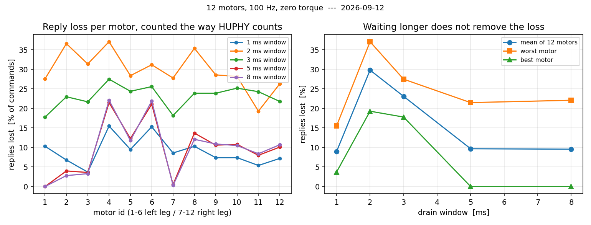

# 통신선이 응답을 얼마나 잃고 있는가 — 실측 (2026-09-12)

**한 줄로** 열두 개 모터 중 넷(4·6번, 그리고 덜하지만 8·9·10·12번)이 **기다리는
시간을 아무리 늘려도 명령의 10~22%에 답을 안 합니다.** 나머지(1·7번)는 0%입니다.
기다리는 시간의 문제가 아니라 **그 모터들 쪽 문제**입니다.

이 값을 재려고 했던 것은 통신 두절 판정의 문턱을 고르기 위해서였습니다
(`docs/132`). 문턱은 정했고(최근 20번 중 15번), 그 과정에서 위 사실이 나왔습니다.

## 어떻게 쟀나

* `System_ID/loop_timing_log.py --like-huphy`
* 열두 모터에 **세기 0 · 감쇠 0 · 토크 0** 프레임만 보냅니다
  (`7f ff 7f f0 00 00 07 ff`). **토크는 한 번도 안 나갔습니다** — 이 파일에는
  켜기(0xFC)·끄기(0xFD)·영점(0xFE) 명령이 아예 들어 있지 않습니다.
* 초당 100번. 창 1·2·3·5·8밀리초를 각각 20초씩(창 3밀리초만 60초, 6001주기).
* `--like-huphy` 는 **로봇 프로그램과 같은 셈**입니다: 주기 시작에 큐를 비우지
  않아, 늦게 온 답도 이번 주기의 답으로 칩니다. 프레임에 일련번호가 없어 로봇
  프로그램도 그렇게 셀 수밖에 없습니다. 이 셈이 아니면 "두절 판정이 언제 걸리나"
  를 못 따집니다.

## 무엇이 나왔나

모터별 손실률 (명령 대비 답이 없던 비율, %)

| 창 | 1 | 2 | 3 | 4 | 5 | 6 | 7 | 8 | 9 | 10 | 11 | 12 |
|---|---|---|---|---|---|---|---|---|---|---|---|---|---|
| 1ms | 10.3 | 6.8 | 3.7 | 15.5 | 9.5 | 15.3 | 8.6 | 10.3 | 7.4 | 7.4 | 5.4 | 7.2 |
| 2ms | 27.6 | 36.6 | 31.4 | 37.1 | 28.4 | 31.2 | 27.8 | 35.4 | 28.6 | 28.2 | 19.3 | 26.3 |
| 3ms | 17.8 | 23.0 | 21.7 | 27.5 | 24.4 | 25.6 | 18.2 | 23.9 | 23.9 | 25.2 | 24.3 | 21.8 |
| **5ms** | **0.0** | 4.0 | 3.6 | **21.5** | 12.3 | **21.1** | **0.5** | 13.7 | 10.6 | 10.8 | 8.0 | 10.1 |
| **8ms** | **0.0** | 2.8 | 3.3 | **22.1** | 11.8 | **21.9** | **0.3** | 12.1 | 10.9 | 10.5 | 8.4 | 10.7 |

읽는 법 세 가지.

**1. 창을 5밀리초까지 늘리면 손실이 크게 줍니다.** 3→5 밀리초에서 평균 23% →
9.7% 입니다. 지금 운용값 3밀리초는 **대부분의 답이 도착하기 직전에 창을 닫고**
있습니다.

**2. 5에서 8로 더 늘려도 안 줍니다.** 남은 손실은 늦게 오는 것이 아니라 **아예
안 오는 것**입니다.

**3. 남는 손실은 모터를 탑니다.** 5밀리초에서 1번 0.0% · 7번 0.5% 인데 4번 21.5%
· 6번 21.1% 입니다. 왼다리에서는 **4번과 6번만 유독 나쁘고** 2·3번은 4% 아래입니다.
오른다리는 7번만 0% 이고 나머지(8~12)가 8~14% 로 고르게 나쁩니다.

즉 **"어느 자리에 달렸느냐" 로 설명되는 단순한 무늬는 아직 안 보입니다.** 1번과
7번이 각 다리의 첫 모터라는 것만 분명합니다. 이 이상은 추측이고, 가르려면 모터를
바꿔 끼워 **번호를 따라가는지 자리를 따라가는지**를 봐야 합니다.

1밀리초가 겉보기에 좋아 보이는 것은 **착시**입니다. 창이 너무 짧아 모든 답이 다음
주기로 밀리고, 그러면 매 주기 "직전 주기의 답"을 받게 되어 로봇 프로그램 눈에는
매번 답이 온 것처럼 보입니다. 실제로는 제어가 **한 주기 늦은 측정값**으로 돌고
있습니다.

## 그래서 무엇을 했나 / 무엇이 남았나

* 통신 두절 문턱을 이 숫자 위에서 골랐습니다 — `docs/132` 2-2장, `docs/128` 장부.
* **아직 안 한 것**: 창을 3 → 5밀리초로 바꿀지. 로봇 프로그램에서 창을 5로 두면
  제어 주기가 초당 61회까지 떨어졌던 실측이 있습니다(창 3에서 68회). 손실이
  23%→9.7% 로 주는 대가로 주기가 10% 느려지는 거래입니다. **사람에게 물어보고**
  정합니다.
* **남은 진짜 문제**: 각 다리의 첫 모터(1·7번)를 뺀 나머지가 창과 무관하게
  답을 빠뜨리는 것 — 특히 4·6번이 22%. 모터를 바꿔 끼워 **번호를 따라가는지 자리를
  따라가는지** 보면 배선 문제인지 모터 문제인지 갈립니다.
