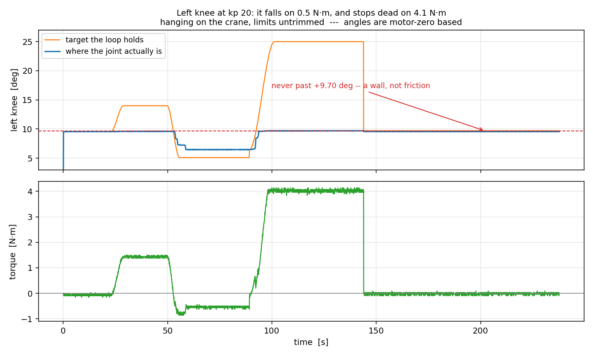

# 무릎은 세기가 모자란 게 아니라 **벽에 밀려 있었다** (2026-09-12)

**한 줄로** 두 무릎 다 **지금 앉아 있는 자리가 기구의 끝(하드스톱)** 이고, 설정에
적힌 허용 구간이 그 벽 **너머**를 가리키고 있었습니다. 그래서 안전 클리핑이 매
주기 무릎을 벽 쪽으로 밀고 있었고, 세기를 20까지 올려도 "안 움직인다" 로 보인
것입니다. 세기 문제가 아닙니다.

## 어떻게 갈랐나

세기 20에서 4.25뉴턴미터를 줘도 0.00도였습니다. 마찰이면 조금씩이라도 기어야
하는데 **정확히 0** 이라 이상했습니다. 사용자가 짚은 대로 — *"클립구간에 있어서
잘리고 있는 거 아닌가"* — 구간이 원인일 수 있어, **범위를 좁히던 것(15도)을 빼고**
왼 무릎이 구간 한가운데 오게 한 뒤 **양쪽 방향으로** 밀어 봤습니다.

| 무엇을 했나 | 토크 | 결과 |
|---|---|---|
| 목표를 +4.45도 위로 | 1.49 N·m | **0.04도** — 안 움직임 |
| 목표를 −8.9도 아래로 | −0.5 ~ −0.85 N·m | **3.1도 내려감** (9.59 → 6.47) |
| 목표를 +18.5도 위로 | 0.5 → **4.07 N·m** | 6.47 → **9.70도까지 올라오고 거기서 정지** |

읽는 법은 간단합니다. **0.5뉴턴미터로 내려가는 관절이 4뉴턴미터로 못 올라갑니다.**
그리고 올라가다가 **9.70도에서 딱 멈춰** 토크를 여덟 배로 올려도 꿈쩍하지
않습니다. 마찰은 이렇게 안 생깁니다 — 힘을 키우면 조금씩이라도 갑니다. **벽입니다.**

## 그래서 설정이 어떻게 틀렸나

| | 지금 설정의 허용 구간 | 실제로 닿는 곳 |
|---|---|---|
| 왼 무릎 | +0 ~ +120도 | **+9.7도가 끝**, 그 아래로만 움직임 |
| 오른 무릎 | −120 ~ 0도 | **≈0도가 끝** (4.19뉴턴미터로 −18도 쪽으로 못 감) |

구간은 시뮬레이터 모델(MJCF)에서 **부호를 손대지 않고 그대로** 옮긴 값이고,
캘리브레이션 파일에도 *"sign/offset 은 아직 실측 전이라 1/0"* 이라고 적혀
있습니다. 즉 **모터가 기억하는 0 = 관절의 0** 이라고 가정한 것인데, 무릎에서는 그
가정이 깨집니다 — 무릎이 실제로 굽는 방향이 설정이 말하는 방향과 **반대**입니다.

그 결과가 이렇습니다.

* 클리핑은 "구간 밖에 있으면 구간 안으로 밀어 넣는" 동작을 합니다. 무릎이 구간
  밖(벽 쪽)에 있으니 **매 주기 벽으로 밀었습니다.**
* 범위를 양쪽 15도 좁히는 안전 조치가 이 경우엔 **거꾸로 작용했습니다** — 구간
  끝이 3도에서 18도로 가면서, 벽에서 8도 더 너머를 목표로 삼게 됐습니다.
* 세기를 10 → 15 → 20 으로 올린 것은 **벽을 미는 힘만 키웠습니다** (2.1 → 3.1 →
  4.2뉴턴미터).

## 무엇을 해야 하나

1. **무릎에는 당분간 목표를 주지 않습니다.** 부호와 영점을 재기 전까지.
2. 재는 방법은 이미 HUPHY 에 있습니다 — `huphy-commission --limb <다리> sweep`.
   힘을 끈 채 사람이 관절을 끝에서 끝까지 움직이고, 그때 기계가 최소·최대를
   받아 적습니다. **사람 손이 필요합니다.**
3. 잰 뒤에는 `config/calibration/*_v1.0.json` 의 `sign`·`offset_deg`·`limits_deg`
   를 채웁니다. 지금 그 파일의 주석이 "재면 지울 것" 이라고 말하는 그 자리입니다.

## 이 일로 드러난 것 하나 더

명령하는 관절을 **둘로 줄이면 통신이 오히려 나빠집니다.** 무릎 두 개만 열고 돌렸을
때 손실률이 43.7% 로 뛰고 연속 무응답이 10에 닿아 1초 만에 멈췄습니다. 열두 개를
다 명령할 때는 같은 조건에서 8~17% 입니다. 원인은 아직 모릅니다 — 응답을 기다리는
쪽에서 "기대 개수만큼 받으면 곧장 빠져나가는" 처리(`bus.collect(expect=…)`)가
의심스럽지만 확인 전입니다. **당분간 실물은 열두 관절을 다 명령한 채로 돌립니다.**
