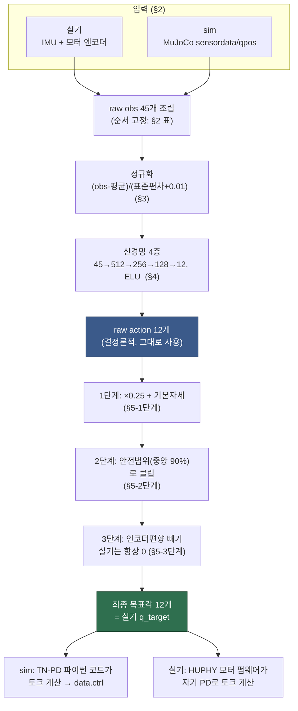

# 134. `legonly_ab_v3_keyfix` 정책이 실제로 하는 일 — ELI5 참고서

> 이 문서는 상반신 없는 다리 전용(LegOnly, 12관절) 로봇을 걷게 만든 강화학습 정책
> `legonly_ab_v3_keyfix`(체크포인트 `model_27999.pt`)가 정확히 무엇이고, 어떤 숫자를
> 받아서 어떤 숫자를 내놓는지, 그 사이에서 무슨 계산이 벌어지는지를 처음 보는 사람도
> 따라올 수 있게 설명한다. 모든 숫자는 실제로 이 체크포인트를 돌려서 뽑은 값이다
> (`tools/policy_numpy_ref/scripts/hook_live_trace.py`가 실제 롤아웃에 훅을 걸어
> 기록, 지어낸 예시 없음). 정확한 표/공식만 필요하면
> [[135_legonly_ab_v3_keyfix_schema_reference]]로, 실기와 다른 점은
> [[136_legonly_ab_v3_keyfix_sim2real_gaps]]로 가면 된다.

## 1. 학습이 만들어낸 것은 결국 "숫자 45개를 넣으면 숫자 12개가 나오는 함수"다

`mjlab`(시뮬레이터)와 `rsl_rl`(강화학습 라이브러리)이 몇만 번의 시뮬레이션 반복 끝에
만들어낸 것은, 걷는 법을 통째로 담은 어떤 복잡한 프로그램이 아니라 — **입력 45개
실수, 출력 12개 실수를 갖는 하나의 수학 함수**다. 이 함수를 "정책(policy)"이라
부른다. 배포할 때 필요한 건 이 함수 하나뿐이다(학습 중에만 쓰였던 "비평자(critic)"
네트워크는 배포에 전혀 관여하지 않는다 — §6 참고).

- 체크포인트: `mujoco-sim/mjlab/logs/rsl_rl/pygmalion_velocity/2026-09-06_11-06-27_legonly_ab_v3_keyfix_p2/model_27999.pt`
- 27,999번 반복 학습한 결과물.
- 12개 관절(엉덩이 pitch/roll/yaw, 무릎, 발목 크랭크 A/B, 좌우 각 6개)만 움직이는
  하반신 전용 로봇용.

이 함수는 매 0.02초(50Hz)마다 한 번씩 불린다 — 실기 HUPHY 쪽이 관절 목표각을
50Hz로 받는 것과 정확히 같은 속도다(§7).

## 2. 입력 45개, 하나씩 뜯어보기

로봇이 "지금 이런 상태다"라고 신경망에 알려주는 정보를 관측(observation)이라
부른다. 45개 숫자는 다음 5개 그룹을 이 순서 그대로 이어붙인 것이다(순서가 바뀌면
완전히 다른 의미가 됨 — 신경망은 몇 번째 숫자가 뭔지 스스로 알 방법이 없고, 학습
때와 똑같은 자리에 똑같은 값이 있어야만 함):

| 자리 | 그룹 | 개수 | 무엇인가 |
|---|---|--:|---|
| 1~3 | 몸통 회전 속도 | 3 | IMU(관성센서)가 재는 각속도, 라디안/초 |
| 4~6 | "아래쪽이 어디인가" | 3 | 중력방향을 몸통 좌표계로 본 단위벡터 |
| 7~18 | 관절 위치, **한 스텝 전** | 12 | 각 관절이 "기본 자세"에서 얼마나 벗어났었는지, 직전 스텝 |
| 19~30 | 관절 위치, **지금** | 12 | 같은 것, 지금 스텝 |
| 31~42 | 직전 행동 | 12 | 신경망이 바로 전 스텝에 냈던 원래(스케일 전) 출력 |
| 43~45 | 명령 | 3 | 앞으로/옆으로/회전 속도 명령 (vx, vy, ωz) |

### 왜 "관절 속도"가 아니라 "관절 위치, 두 시점"인가

실기 로봇의 모터 엔코더는 위치는 잘 재지만 속도를 그대로 재는 경우 잡음이 크다.
그래서 이 정책은 속도를 직접 관측으로 받지 않고, **위치를 두 번(방금 전과 지금)**
줘서 신경망이 그 차이에서 스스로 속도 비슷한 정보를 뽑아 쓰게 학습시켰다. 실제로
`motor_pos_history`라는 이름의 이 항목은, 순환 버퍼가 `(과거 슬롯, 현재 슬롯)`을
관절순으로 펼친 것이라, 자리 7~18이 "전체 12관절의 과거값", 자리 19~30이 "전체
12관절의 현재값"으로 **시간이 먼저 나뉘고 그 안에서 관절이 나열**된다(관절별로
과거/현재가 번갈아 나오는 게 아님). 에피소드가 막 시작한 첫 스텝은 "과거"가 없으므로
과거값 자리에 현재값을 그대로 채워 넣는다(즉 7~18과 19~30이 같아진다).

**실제 예시(정지 명령, step 0, DR 없이 깨끗한 상태로 롤아웃)**: 로봇이 학습된
"웅크린 기본자세"에 정확히 있고 막 시작한 참이라, 관절 관련 항목이 전부 0이다:

```
raw_obs[0:6]   = [ 0.,  0.,  0., -0.,  0., -1. ]   # 몸통 안 움직임, 중력은 몸통 z축 -1 방향
raw_obs[6:30]  = [0, 0, 0, 0, 0, 0, 0, 0, 0, 0, 0, 0,   0, 0, 0, 0, 0, 0, 0, 0, 0, 0, 0, 0]
                 # 기본자세 그대로라 "기본자세에서 얼마나 벗어났나"가 전부 0
raw_obs[30:42] = [0, 0, 0, 0, 0, 0, 0, 0, 0, 0, 0, 0]   # 아직 낸 행동이 없음
raw_obs[42:45] = [-1.499, 0.2156, -0.7]                  # 전진 1.5 m/s + 살짝 옆/회전 명령
```

10스텝(0.2초) 뒤엔 로봇이 이미 움직이고 있어서 관절값이 요동친다 — `raw_obs[6:18]`
(직전 스텝의 관절 상태)과 `raw_obs[18:30]`(지금)이 서로 다른 값으로 벌어져 있는 걸
볼 수 있다(예: 왼쪽 무릎 관련 자리가 `-0.30 -> -0.36`로 이동).

## 3. 정규화: "이 숫자가 평소보다 큰가 작은가"로 다시 표현

신경망에 넣기 직전, 45개 숫자 각각을 "학습 중 이 자리에 나왔던 값들의 평균/표준편차"
기준으로 다시 표현한다:

$$\text{정규화값} = \frac{\text{원래값} - \text{평균}}{\text{표준편차} + 0.01}$$

이 평균·표준편차는 학습이 끝난 뒤 체크포인트 안에 숫자로 고정 저장돼 있다(더 이상
갱신되지 않음 — 배포 때는 상수 45개짜리 표 두 장일 뿐). 예를 들어 첫 3개 자리
(몸통 각속도)의 평균은 거의 0, 표준편차는 약 0.41/0.40/0.61 — 즉 이 세 값은
"작은 흔들림" 수준의 크기로 학습됐다는 뜻이다. step 0 예시를 넣으면:

```
정규화 전(raw_obs[0:6])  : [ 0.,      0.,      0.,     -0.,      0.,     -1.     ]
정규화 후                 : [ 0.00175, -0.00171, -0.00535, 0.2807, -0.06292, -0.04135 ]
```

넷째 자리(중력 z성분, 원래 -1)가 정규화 후 0.28로 바뀐 게 이상해 보일 수 있는데,
이건 학습 데이터에서 그 자리의 평균이 약 -1.0 근처였고 표준편차가 아주 작았기
때문(로봇이 거의 항상 서 있으니 "아래가 어디냐"는 거의 안 변함) — 정규화는
"학습 중 자주 보던 값과 얼마나 다른가"를 나타내는 것이라, 절대값 -1이 상대적으로는
꽤 벗어난 값으로 읽힌 것이다.

## 4. 신경망 통과: 45 → 512 → 256 → 128 → 12

정규화된 45개 숫자가 4개 층을 통과한다. 각 층은 "행렬곱 + 벡터더하기"(=Linear)
다음에 "ELU"라는 완만한 꺾임 함수를 거친다(마지막 층만 예외 — 꺾임 없이 그대로
출력):

```
정규화된 관측(45)
   -> Linear(45→512) -> ELU
   -> Linear(512→256) -> ELU
   -> Linear(256→128) -> ELU
   -> Linear(128→12)              (여기엔 ELU 없음 — 이 값이 그대로 "행동"이 됨)
```

**실제 중간값(step 0, 앞 6개 자리만)**:

```
정규화 관측[:6]      : [ 0.00175, -0.00171, -0.00535,  0.2807, -0.06292, -0.04135]
1층 출력[:6]         : [-0.5309,   0.654,    0.5807,   0.5357,  0.1803,   0.4857]
2층 출력[:6]         : [-0.3137,  -0.837,   -0.5368,  -1.6627,  0.5409,   0.8945]
3층 출력[:6]         : [ 1.4811,  -1.4788,  -1.1799,   1.3239, -0.8464,  -2.0194]
최종 출력(=raw action, 12개 전부):
  [-0.1032, -0.2551, -0.3197, -0.4099, -1.2813,  0.9217,
   -0.5823,  0.1627,  0.2318,  0.4541,  2.4308, -3.3556]
```

이 12개 숫자가 "raw action"이다. 아직 관절각도가 아니다 — 신경망은 그냥 대략
-3~2 사이 어딘가의 실수를 뱉는 훈련을 받았을 뿐이고, 그걸 실제 각도로 바꾸는 건
다음 단계의 일이다.

**정책은 확률적이 아니라 확정적으로 배포된다는 점**: 학습 중에는 이 12개 출력을
"평균"으로 삼아 약간의 무작위성을 더해 샘플링했다(탐색을 위해서). 하지만 배포/추론
시엔 그 무작위성 부분(표준편차 파라미터)을 완전히 무시하고, 신경망의 원래 출력을
그대로 쓴다 — 이게 "결정론적 정책"이라는 뜻이다. 같은 관측을 넣으면 항상 같은 행동이
나온다.

## 5. raw action → 실제 목표각: 스케일, 오프셋, 클립

raw action 12개는 세 단계를 거쳐 "이 관절이 향해야 할 각도"로 바뀐다:

**1단계 — 스케일 + 기본자세 더하기**: 신경망 출력은 그냥 "그 관절 기본자세에서
얼마나(라디안 단위로, 0.25배 축소해서) 움직이라는 지시"로 취급된다.

$$\text{목표각(1차)} = \text{raw action} \times 0.25 + \text{기본자세각}$$

**2단계 — 안전범위로 자르기**: 이 체크포인트는 각 관절이 실제로 부러지거나 기계적
한계에 부딪히지 않도록, 그 관절 최대 가동범위의 **중앙 90%**로 목표각을 자른다
(`PYG_SAFE_TARGET_CLIP`).

**3단계 — 인코더 편향 빼기**: 시뮬레이션 학습 중에만 존재하는 "인코더가 살짝
틀리게 잰다고 가정하는" 무작위 항을 빼는데, 실기에는 대응하는 게 없어서 항상
0으로 취급한다([[136_legonly_ab_v3_keyfix_sim2real_gaps]] §4).

**실제 예시(step 10) — 클립이 진짜로 걸리는 순간**: 왼쪽 발목 크랭크 B
(`L_crank_B_joint`)의 raw action이 6.91로 유독 크게 나왔다:

```
raw_action[L_crank_B]       =  6.91198
1단계(×0.25 + 기본자세)     =  6.91198 × 0.25 + (-0.30121) = 1.42678
안전범위(L_crank_B)         =  [-1.08, 1.08]
2단계(클립 적용)             =  1.08          <- 1.42678이 상한을 넘어 잘림
인코더 편향(이번 롤아웃 0)   =  0
최종 목표각                  =  1.08
```

즉 신경망이 순간적으로 "그 관절을 아주 세게 밀어라"라고 말했지만, 안전장치가 실제
기계 한계 안으로 눌러준 것이다. **이 "최종 목표각" 12개가 바로 실기 로봇이 50Hz로
받는 `q_target`에 대응하는 지점이다.**

### 이게 MuJoCo의 `ctrl`은 아니다 — 헷갈리기 쉬운 부분

시뮬레이터 안에서는 이 목표각이 바로 모터에 흘려주는 전압/전류에 해당하는 값(MuJoCo
`data.ctrl`)이 되는 게 아니다. 이 12관절은 전부 "목표각과 지금각의 차이 + 속도
오차"로 **토크를 파이썬 코드가 직접 계산하는** 방식(TN 곡선으로 상한을 씌운 PD
제어)을 쓴다. 그래서 `ctrl`엔 라디안이 아니라 뉴턴미터(토크) 단위 숫자가 들어간다
— 같은 step 10에서 `ctrl`은 `[-23.29, 22.36, -0.18, 0.28, -0.72, -1.20, -3.30,
54.37, -4.04, -5.14, 7.43, 1.26]`처럼 전혀 다른 스케일의 숫자다. **배포 스키마가
멈춰야 하는 지점은 "최종 목표각"까지이고, 그 뒤 토크로 바꾸는 계산은 실기에서는
HUPHY 쪽 모터 펌웨어가 자기 방식대로 한다**(§7, [[136_legonly_ab_v3_keyfix_sim2real_gaps]] §3).

## 6. 배포에 관여하지 않는 것 — 비평자(critic)

학습 중엔 "비평자"라는 두 번째 신경망이 같이 훈련된다. 이건 "지금 상황이 앞으로
얼마나 좋은/나쿤 결과로 이어질지" 점수를 매겨 학습을 돕는 용도로, 시뮬레이터만
알 수 있는 특권 정보(지형 스캔, 실제 마찰계수, 도메인 무작위화 draw 등)까지
받는다. **비평자는 체크포인트 파일 안에 같이 저장돼 있지만, 배포·실기 추론에는
전혀 쓰이지 않는다** — 걷는 행동을 만드는 건 오직 §1~§5의 행위자(actor) 네트워크
하나뿐이다.

## 7. 제어 주기 — 왜 50Hz인가

시뮬레이터는 물리를 0.005초 간격으로 계산하지만, 정책은 매번 새로 부르지 않고
4번의 물리 스텝마다 한 번(0.005×4=0.02초=50Hz) 새 목표각을 낸다. 그 사이 4번의
물리 스텝 동안은 "같은 목표각을 향해 계속 힘을 써라"라는 지시가 유지된다. 이
50Hz는 우연이 아니라, 실기 쪽 통신 다리(`bridge/tx_client.py`)가 정확히 50Hz로
관절 목표를 보내도록 만들어져 있는 것과 맞춰 설계된 것이다 — 정책이 "50Hz마다
한 번씩 새 지시를 받는다"고 배운 그대로, 실기도 50Hz로 지시를 받는다.

## 8. 요약 다이어그램

### 8a. 처리과정 플로우차트



### 8b. 텍스트 다이어그램

```
[실기라면: IMU + 모터 엔코더]                    [sim이라면: MuJoCo sensordata/qpos]
        |                                                    |
        v                                                    v
   raw obs 45개 (§2) --정규화(§3)--> 신경망 4층(§4) --> raw action 12개
                                                                  |
                                                    ×0.25 + 기본자세 (§5-1단계)
                                                                  |
                                                    안전범위로 클립 (§5-2단계)
                                                                  |
                                                    인코더편향 빼기(=0, 실기)  (§5-3단계)
                                                                  |
                                                                  v
                                              최종 목표각 12개 = 실기 q_target
                                                                  |
                    [sim: TN-PD 파이썬 코드가 토크 계산 → data.ctrl]   [실기: HUPHY 모터 펌웨어가 자기 PD로 토크 계산]
```

더 필요한 것: 정확한 수치·바이트 배치는 [[135_legonly_ab_v3_keyfix_schema_reference]],
이 모든 게 실제 로봇과 어디가 다른지는 [[136_legonly_ab_v3_keyfix_sim2real_gaps]].
