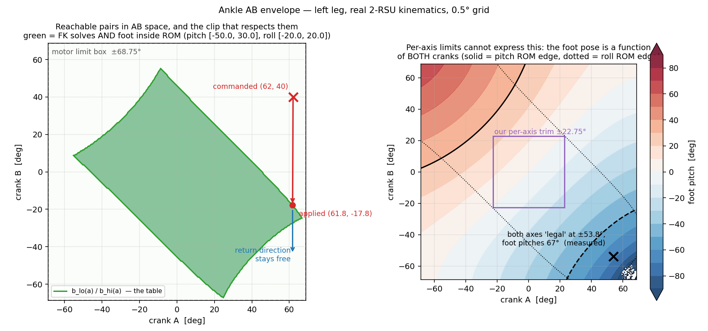
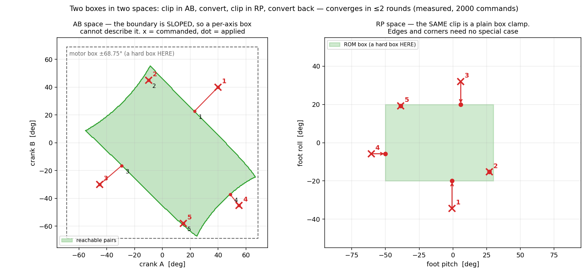

# 발목 AB 클리핑 설계 — "네 꼭지점 사이" 를 어떻게 막는가

2026-09-13 · 사용자 설계안에 대한 답. 숫자는 전부 **실제 기구학으로 계산한 것**이고,
계산에 쓴 도구는 `tools/robot_model/ankle_ab_envelope.py` 입니다.

---

## 0. 결론 먼저

**꼭지점마다 경우를 나눌 필요가 없습니다.** 제약이 **상자(box)** 로 보이는 공간에서
자르면, 꼭지점이든 모서리든 같은 한 줄로 처리됩니다.

    모터 한계   -> AB 공간에서 상자   (A ±68.75, B ±68.75)
    발판 ROM    -> RP 공간에서 상자   (숙임 -50~+30, 기울임 ±20)

두 상자가 **서로 다른 공간**에 있는 것이 이 문제의 전부입니다. 그래서 번갈아
자릅니다. **실측: 최대 2번이면 수렴합니다.**

## 1. 사용자 설계안과 무엇이 같고 무엇이 다른가

| 사용자 설계안 | 이 설계 | |
|---|---|---|
| 1. AB → RP 로 변환 | 같음 | ✔ |
| 2. Roll·Pitch 각각 ROM 넘었는지 검사 | 같음 | ✔ |
| 3. 클리핑한 입력을 리턴 | 같음 | ✔ |
| "A+ 상한일 때 B 의 상한" 표를 만들어 **네 경우로 분기** | **분기 없앰.** RP 상자에서 자르면 모서리가 저절로 처리됨 | ▲ |
| — | AB 상자와 RP 상자를 **번갈아** 자름 (한 번으로는 서로를 깨뜨림) | + |
| 표 | **여전히 필요함.** 다만 분기용이 아니라 ① 빠른 판정 ② 기구학이 못 풀 때의 대비책 | ▲ |

> 용어 하나만 맞추겠습니다. 설계안의 `IK_ankle(cmd_a, cmd_b)`(모터각 → 발판각)는
> HUPHY 에서 **`solve_fk`** 이고, `FK_ankle(clip_r, clip_p)`(발판각 → 모터각)가
> **`solve_ik`** 입니다. 아래에서는 HUPHY 이름을 씁니다.

## 2. "사이 영역" 이 무엇인가 — 그림으로



왼쪽 초록색이 **두 크랭크가 함께 만들 수 있는 자리** 전부입니다 (기구학이 풀리고,
그 결과 발판 자세가 ROM 안). 모터 상자(점선 ±68.75) 안에서 **35.3%** 뿐이고, 모양이
**기울어진 사각형**입니다.

핵심은 이것입니다: **경계의 대부분이 모터 한계가 아니라 조합 한계입니다.**
경계의 기울기는 A 1도당 B **−2.0 ~ +2.0도** 로 변합니다. 그러니

* "A 가 자기 상한(+68.75)에 걸렸을 때" 만 보면 → 오른쪽 꼭지점 부근만 막습니다
* 실제로 자주 부딪히는 곳은 **아무 모터도 자기 한계에 안 걸린 기울어진 모서리**입니다

## 3. 그래서 어떻게 막는가 — 두 상자를 번갈아



오른쪽 그림이 답입니다. **RP 공간에서는 그 기울어진 경계가 그냥 네모입니다.**

```python
def clip_ab(a, b, guess_pitch, guess_roll):
    # 1) 모터 상자에서 자른다 (AB 공간의 하드 한계)
    a = clamp(a, A_LO, A_HI)
    b = clamp(b, B_LO, B_HI)

    for _ in range(MAX_ROUNDS):            # 실측 2 로 충분
        # 2) 발판 자세로 옮긴다
        p, r = fk(a, b, guess_pitch, guess_roll)      # 표 보간 (아래 5절)
        # 3) ROM 상자에서 자른다 (RP 공간의 하드 한계) -- 모서리·꼭지점 구분 없음
        pc, rc = clamp(p, ROM_P), clamp(r, ROM_R)
        if (pc, rc) == (p, r):
            return a, b                    # 이미 안. 손대지 않음
        # 4) 다시 모터각으로
        a2, b2 = ik(pc, rc)                # 닫힌 해, 17us
        # 5) 모터 상자에서 또 자른다 -- 4) 가 상자를 벗어날 수 있다
        a2, b2 = clamp(a2, A_LO, A_HI), clamp(b2, B_LO, B_HI)
        if close(a2, a) and close(b2, b):
            break
        a, b = a2, b2
    return a, b
```

**왜 번갈아야 하는가**: 3)에서 ROM 안으로 넣은 자세가 4)를 거치면 모터 상자 밖으로
나갈 수 있고, 5)에서 다시 상자로 넣으면 그 자세가 또 ROM 밖일 수 있습니다. 두 상자를
번갈아 투영하면 교집합으로 들어갑니다(POCS). **실측: 무작위 명령 2,000개에서 평균
1.78회, 최대 2회.**

### 실측 결과

| 명령 (A, B) | 자른 결과 | 반복 | 안에 들었나 |
|---|---|---|---|
| (+62, +40) | (+30.04, +15.72) | 2 | 예 |
| (0, +60) | (−4.88, +51.38) | 2 | 예 |
| (−40, −50) | (−19.25, −26.56) | 2 | 예 |
| (+80, +80) | (+19.42, +26.41) | 2 | 예 |
| (+5, +5) | (+5.00, +5.00) | 1 | 예 (안 건드림) |

무작위 2,000개: **안에 듦 1,993 · 밖 0 · 기구학이 못 푼 것 7.**

## 4. 왜 "축마다 자르기" 로는 안 되는가 — 숫자로

사용자 설계안의 "A 를 자르고, 그 A 에서의 B 구간으로 B 를 자른다" 를 그대로 재 봤습니다.
막기는 막습니다(항상 영역 안에 듭니다). 그런데 **엉뚱한 자세로 갑니다.**

| 명령 | 축순차 결과 | 두 상자 방식 | 발판 자세 차이 |
|---|---|---|---|
| (+62, +40) | (+62.0, **−17.8**) | (+30.0, +15.7) | **숙임 31.0도** |
| (−40, −50) | (−40.0, −5.8) | (−19.3, −26.6) | 숙임 21.6도 |
| (+30, +45) | (+30.0, +15.8) | (+16.6, +29.2) | 숙임 14.5도 |

A 를 그대로 두고 B 만 끌어내리면, 경계가 기울어져 있어 **발판이 전혀 다른 곳**을
봅니다. 사람이 "앞으로 조금 더" 를 시켰는데 발이 옆으로 도는 식입니다.

**볼록 껍질로 가장 가까운 점을 찾는 방법도 안 됩니다** — 영역이 볼록하지 않습니다
(껍질의 **5.32%** 가 허용 밖). 껍질에 투영하면 못 가는 자리로 보낼 수 있습니다.

## 5. 표는 여전히 필요합니다 — 다만 다른 일에

`solve_fk` 는 **뉴턴 반복**이라 비쌉니다. 직전 자세를 추정으로 줘도 **223마이크로초**
입니다 (`solve_ik` 는 닫힌 해라 17마이크로초). 발목 두 개에 왕복 두 번이면 한 주기에
**약 960마이크로초** — 10밀리초 예산의 **9.6%** 이고, 지금도 주기를 못 지키는
형편이라 그대로는 못 씁니다.

그래서 `ankle_ab_envelope.py` 가 **격자 표**를 굽습니다.

| | 정확 FK | 1도 격자 보간 |
|---|---|---|
| 한 번 비용 | 223마이크로초 | **17.8마이크로초** |
| 숙임 오차 | — | 중앙 0.000도 · **최대 0.001도** |
| 기울임 오차 | — | 중앙 0.000도 · 최대 0.000도 |

즉 **FK 를 표로 대신**하고 IK 만 정확히 풀면, 한 주기 비용이 약 70마이크로초로
내려갑니다. 표는 다리마다 따로 굽습니다(기구학이 좌우 거울상).

표에는 사용자 설계안의 "A+ 상한일 때 B 의 상한" 도 그대로 들어 있습니다:

    b_lo[a], b_hi[a]    A 를 고정했을 때 B 가 갈 수 있는 최소·최대
    a_lo[b], a_hi[b]    반대 방향

이것을 **① 빠른 판정**(기구학 없이 "이 쌍이 안에 있나" 를 두 번 비교로) 과
**② 대비책**(기구학이 못 푸는 7/2000 의 경우 표만으로 자르기)에 씁니다.

★ 표로 두 숫자만 적어도 되는 근거: **A 를 고정했을 때 갈 수 있는 B 가 하나의 이어진
구간**이어야 합니다. 격자 76,176칸을 전수 확인했고 **끊긴 곳이 0개**였습니다. 표를
다시 구울 때마다 이 검사가 같이 돕니다.

## 6. "한쪽이 한계에 걸려도 복귀는 되게" — 어떻게 보장되는가

사용자가 짚은 요구입니다. 이 방식은 **구조적으로** 그렇게 됩니다.

* 명령이 영역 **안**이면 아무것도 안 합니다 (`(+5,+5)` 가 그대로 나간 이유).
* 명령이 밖일 때만 경계로 옮깁니다. **직전 자리로 후퇴하지 않습니다.**
* 그러므로 경계에 붙어 있어도, 안쪽을 향하는 명령은 **손대지 않고 그대로** 나갑니다.

지금 우리 `AnklePairGuard` 는 **직전에 받아들인 자리 쪽으로 반씩 물러나는** 방식이라
이 성질이 없습니다. 한 번 경계에 붙으면 직전 자리에 매입니다. **이번 설계로 교체하면
그 결함이 사라집니다.**

## 7. 대비책과 세는 값

| 상황 | 어떻게 | 세기 |
|---|---|---|
| 기구학이 안 풀림 (실측 7/2000) | 표만으로 `b ← clamp(b, b_lo[a], b_hi[a])` | `kin_failed` |
| 표 범위 밖의 A (허용 A 는 −55.2~+66.8) | 표의 양 끝으로 | `outside_table` |
| 2회 반복 뒤에도 밖 | **직전에 통과한 쌍을 유지** (최후) | `not_converged` |
| 정상 클리핑 | — | `clipped_box` / `clipped_rom` |

전부 관측으로 내보내 화면과 기록에 남깁니다. **조용히 자르지 않습니다.**

## 8. 어디에 넣나 · 어떻게 검사하나

* 자리: `tools/pygviewer/pygviewer/bridge/guards.py` 의 `AnklePairGuard` 를 이 방식으로
  **교체**합니다 (지금은 반씩 후퇴하는 방식).
* 표: `tools/robot_model/ankle_ab_envelope_{left,right}.json`, 굽는 도구는
  `ankle_ab_envelope.py`. 모델이나 ROM 이 바뀌면 다시 굽습니다.
* 검사 (하드웨어 없이):
  1. 영역 안 명령은 **한 글자도 안 바뀐다**
  2. 영역 밖 명령은 항상 영역 안으로 나온다 (무작위 2,000개)
  3. 경계에 붙은 상태에서 **안쪽 명령이 그대로 통과**한다 (복귀 보장)
  4. 표 보간과 정확 FK 의 차이가 0.01도 이내
  5. 표를 구울 때 끊긴 구간이 0개
  6. 기구학을 일부러 실패시키면 대비책으로 넘어가고 세어진다

## 9. 아직 안 정한 것

* **ROM 을 무엇으로 둘 것인가.** 지금 표는 MJCF 값(숙임 −50~+30, 기울임 ±20)으로
  구웠습니다. 브링업 동안 더 좁히려면(예: 사용자가 정한 축 ±22.75 같은 여유) 그 값으로
  다시 구우면 됩니다.
* **오른다리 표**: 아직 왼다리만 구웠습니다. 기구학이 거울상이라 따로 구워야 합니다.
* **속도 제한과의 순서**: 지금은 HUPHY 의 한 주기 이동량 제한이 이 클리핑 **뒤에**
  걸립니다. 클리핑이 목표를 크게 옮기면 그 이동량 제한이 실제 속도를 잡아 주므로
  순서는 이대로가 맞다고 보지만, 실물에서 한 번 확인할 값입니다.
