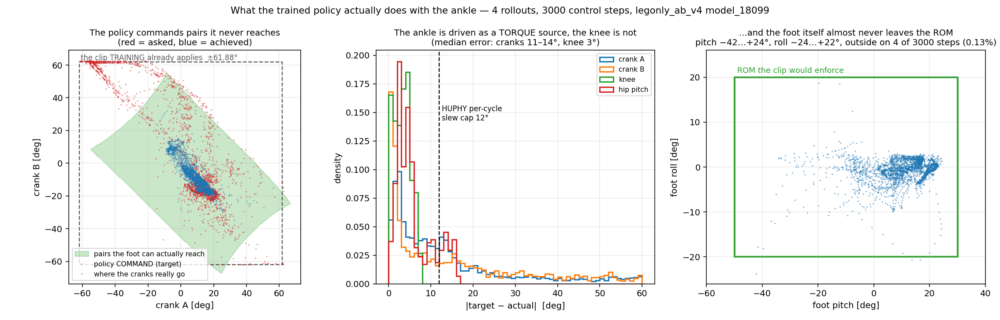

# 각도 클리핑을 **명령**에 걸어도 되나 — 학습된 정책의 실제 출력으로 확인

2026-09-13 · 사용자 질문:

> *"근본적인 질문인데, 지금 이 각도 클리핑을 '명령'에 걸어도 되나? 실제로는 Policy
> 에서 나오는 위치값이 모터 범위보다 한참 커서 심에서는 그 순간에 의사적인
> 토크제어로서 동작하도록 학습되었다면, 클리핑하면 Sim/Real 거동이 달라질거같아."*

**맞습니다. 실측으로 확인했습니다.** 그리고 그 결과로 `docs/139` 설계의 적용 위치를
바꿔야 합니다.

---

## 1. 결론 먼저

| 무엇 | 결과 |
|---|---|
| 정책이 발목 크랭크를 **토크원처럼** 쓰는가 | **그렇습니다.** 추종오차 중앙값 11~14도, 절반가량(46~54%)이 12도 초과. 같은 롤아웃에서 무릎은 3.0도, 엉덩이앞뒤는 3.5도 |
| 학습이 이미 명령을 자르는가 | **자릅니다.** 크랭크 ±61.88도(±1.08 rad) 등 관절마다. 그러니 **관절별 클립은 심과 같게** 두면 됩니다 |
| 우리 ROM 쌍 클리핑을 명령에 걸면 | **22.4%의 주기에서 값이 바뀌고**, 최대 **47도**까지 바뀝니다 (예: 명령 A+61.7/B−62.7 → A+28.4/B−29.5) |
| 그렇게 잘라도 되는가 | **안 됩니다.** 심에서 발판은 ROM 밖으로 거의 안 나갑니다 — 3,000스텝 중 **4번(0.13%)**. 즉 그 큰 명령들은 "발을 그 자세로 보내 달라"가 아니라 **"그 방향으로 밀어 달라"** 입니다 |

## 2. 무엇을 어떻게 쟀나

* 정책: `legonly_ab_v4_motorparams_p2` 의 `model_18099` (지금 학습의 최종본)
* 자료: `mujoco-sim/mjlab/analysis/out/gait_v4f_s13~s16.npz` — 롤아웃 4개, **3,000 제어스텝**
  (측정 자체는 다른 세션이 돌린 것을 읽기만 했습니다)
* 비교한 것: 정책이 낸 목표(`qtarget_*`)와 시뮬레이터에서 실제로 간 값(`qpos_*`),
  그리고 그 목표를 `tools/robot_model/ankle_clip.py` 에 그대로 넣었을 때의 결과

## 3. 정책은 발목을 토크로 쓴다

| 관절 | 추종오차 중앙 | 12도 초과 비율 | 실제 토크 중앙 |
|---|---|---|---|
| 왼 크랭크 A | **10.7도** | **46.2%** | 3.76 N·m |
| 왼 크랭크 B | **14.4도** | **53.5%** | 5.81 N·m |
| 왼 무릎 | 3.0도 | 1.0% | 7.47 N·m |
| 왼 엉덩이앞뒤 | 3.5도 | 11.2% | 6.22 N·m |
| 오른쪽 네 관절 | 위와 같은 무늬 (크랭크 11.3~11.7도 / 무릎 3.2도) | | |

무릎·엉덩이는 목표를 3도 안쪽으로 따라갑니다. **크랭크만 10~14도씩 벌어진 채로
돕니다.** 위치제어라면 오차가 이렇게 유지될 이유가 없습니다 — 시뮬레이터의 크랭크
세기가 22.27이므로 12도 오차는 약 4.7 N·m 이고, 그것이 **정책이 원하는 힘**입니다.

우리 쌍 클리핑이 자를 만한 극단 구간만 따로 보면 더 뚜렷합니다: 그 주기의 추종오차
중앙값은 **A 54.5도 · B 68.4도**, 크랭크 토크 중앙 **20.0 N·m** (다른 주기는 1.5 N·m).

## 4. 그런데 발판은 ROM 밖으로 안 나간다

3,000스텝에서 발판 자세는 숙임 **−42.2~+24.4도**, 기울임 **−23.8~+21.5도** 였고,
ROM(숙임 −50~+30, 기울임 ±20) **밖은 4번(0.13%)** 뿐입니다.

이것이 핵심입니다. **명령은 영역 밖이지만 결과는 영역 안입니다.** 크랭크 두 개가
서로 반대로 당기고 기구가 그것을 풀어내면서, "말도 안 되는 쌍" 이 멀쩡한 발 자세를
만듭니다. 그러니 **명령을 보고 "이 쌍은 발을 못 만든다" 고 자르는 것은 전제가
틀렸습니다** — 그 쌍은 자세 요청이 아니라 힘 요청입니다.

## 5. 그래서 어디에 걸어야 하나

| | 명령에 건다 (지금 `docs/139` 안) | 측정에 건다 (바꿀 안) |
|---|---|---|
| 심과 같은가 | **아니오** — 22%의 주기가 달라짐 | 예 — 정상 구간에서는 아무것도 안 함 |
| 무엇을 막나 | 발이 못 가는 자세로 가는 명령 | **발이 실제로 ROM 끝에 닿는 것** |
| 헛동작 | 잦음 (위 22%) | 심 자료 기준 0.13% |

**바꿀 안**: 관절별 클립(모터 한계, 심과 동일)은 명령에 그대로 걸고, **쌍/ROM 조건은
실측 발판 자세를 보고** 판단합니다. 발판이 ROM 경계에 다가가면 그때 그 방향의 크랭크
명령만 제한합니다. 이러면 정상 보행에서는 심과 완전히 같고, 진짜로 발이 끝에 닿을
때만 개입합니다.

**남는 위험**: 심에서 발이 ROM 안에 머무는 이유가 **기구의 구속** 때문인지 **정책이
그렇게 배운 것** 인지 아직 못 갈랐습니다. 후자라면 실물에서 학습 분포 밖으로 나갈 때
발이 하드스톱을 칠 수 있습니다. 그래서 측정 기반 가드가 필요합니다.

## 6. 더 큰 문제 하나 — 슬루 제한이 토크 요청을 잘라 버린다

HUPHY 는 명령을 **직전 측정에서 한 주기 최대 12도** 안으로 자릅니다
(`max_delta_deg`). 정책은 크랭크에 **10~14도의 정상 오차**를 유지하고 있고 절반이
12도를 넘습니다. 즉 **HUPHY 를 그대로 쓰면 정책이 요청한 힘의 절반쯤이 잘려 나갑니다.**

지금 우리 실물 설정은 여기에 더해 세기가 **10** 입니다 (심은 22.27). 두 가지를 같이
보면:

    심:            오차 12도 x 세기 22.27  ->  약 4.7 N·m
    실물(지금):    오차 12도 x 세기 10     ->  약 2.1 N·m

정책을 실물에서 돌리기 전에 **세기와 슬루 제한을 심과 맞추는 것**이 클리핑보다 먼저
할 일입니다.

## 7. 그러면 `docs/139` 설계는 버리나

아닙니다. **알고리즘과 표는 그대로 쓰고, 적용 지점만 옮깁니다.**

* `ankle_clip.py` 의 판정(영역 안/밖, 표, 두 상자 번갈아 투영)은 **측정 자세를 볼
  때도 그대로** 필요합니다.
* 사람이 화면에서 손으로 발목을 움직일 때는 **명령에 걸어도 됩니다** — 그때 명령은
  진짜로 자세 요청이고, 정책 분포와 무관합니다. 지금 만든 화면이 그 경우입니다.
* 정책을 돌릴 때만 명령 클리핑을 **끕니다.**

즉 **모드에 따라 다릅니다**: 손 조작 = 명령 클리핑 켬 / 정책 주행 = 측정 기반 감시만.

## 8. 아직 안 한 것

* 정책 주행 중 **측정 기반 가드**의 문턱을 정하는 것 (ROM 경계에서 몇 도부터?)
* 심에서 발이 ROM 안에 머무는 이유 가르기 (구속 vs 학습) — 발목 구속을 풀고 같은
  정책을 돌려 보면 갈립니다
* 실물 세기·슬루를 심과 맞춘 뒤 같은 롤아웃을 재현해 보는 것
