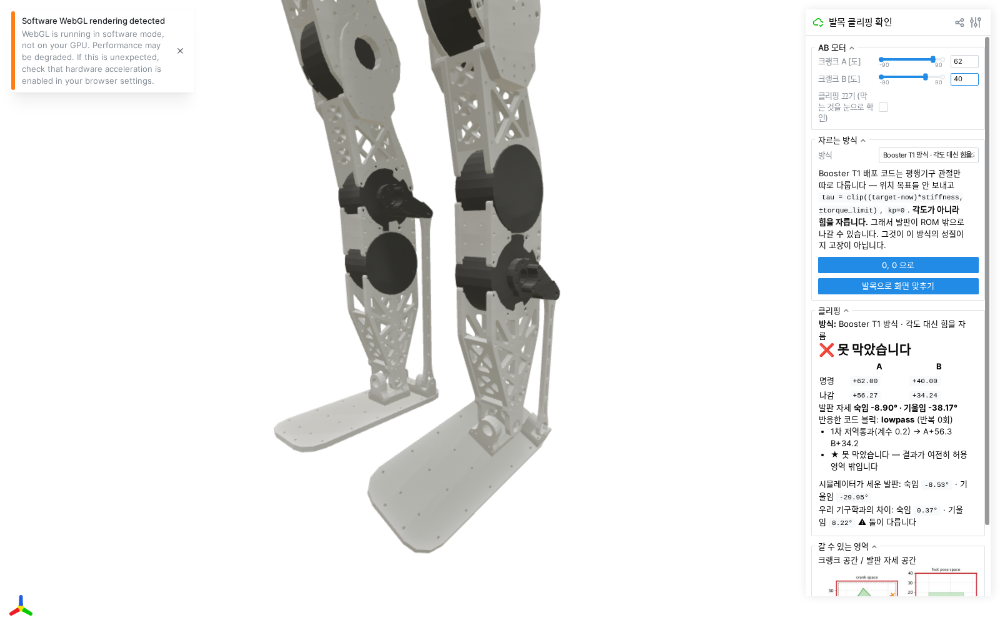

# 남들은 이 문제를 어떻게 풀었나 — Unitree G1 · Booster T1 배포 코드를 직접 읽고

2026-09-13 · 사용자 지시 네 가지에 대한 답입니다.

> 1. ROM 벗어나는 전 영역에 대해 Clipping 로직이 잘 막는지 영상으로 정리
> 2. 이 로직을 학습할때도 넣어두어야 할까?
> 3. Unitree G1 / Booster Robotics deploy code 는 우리의 이 고민들을 어떻게 해결했나?
>    구체적으로 코드보고 분석해줘.
> 4. 그쪽 로직들도 구현해서, 이전 만든 분석기에서 비교가능하게 드롭다운으로 추가.
>    + 안전장치도 뭐가 더 있는지 검토 및 리스팅

---

## 0. 결론 네 줄

1. **전 영역 3,721개 명령을 다 넣어 봤고, 우리 방식은 하나도 안 놓쳤습니다** (영상 있음).
2. **각도 자르기는 학습에 넣으면 안 되고, 힘 자르기는 넣어야 합니다.** 두 회사 코드가
   똑같이 그렇게 되어 있습니다 — 각도는 **벌점**과 **물리적 하드스톱**으로, 힘은
   **학습·실물 양쪽에서 clip** 으로.
3. **Unitree G1 배포 코드에는 자르는 코드가 한 줄도 없습니다.** 발목 평행기구 변환을
   펌웨어가 하기 때문입니다. **Booster T1 은 평행기구 관절만 따로 떼어, 각도가 아니라
   토크를 자릅니다.**
4. 두 방식을 구현해 화면 드롭다운에 넣었고, 우리에게 없는 안전장치 8개를 §6 에
   정리했습니다.

---

## 1. 전 영역 훑기 영상

`tools/robot_model/ankle_clip_sweep_video.py` · 결과: `docs/img/2026-09-13_ankle_clip_sweep.mp4`

크랭크 A·B 명령을 **±90도 네모 전체**에 3도 간격 격자로 깔았습니다 (61×61 = **3,721개**).
한 줄씩 넣으면서, 왼쪽에는 명령이 들어온 자리를, 오른쪽에는 잘린 결과가 실제로 세우는
발판 자세를 찍습니다.

| 방식 | 손댈 것 없음 | 잘라서 안으로 | ★ 못 막음 |
|---|---|---|---|
| **우리 방식** (두 상자 번갈아) | 756 | 2,965 | **0 (0.00%)** |
| Unitree G1 방식 (자세 공간 한 번) | 756 | 2,828 | **137 (3.68%)** |
| Booster T1 방식 (힘 자르기) | 0 | 970 | 2,751 (73.9%) |

* 우리 방식이 **전 영역에서 0건**입니다. 이전 무작위 2,000개 시험과 같은 결과인데,
  이번엔 빈틈없는 격자라 "안 훑은 구석" 이 없습니다.
* Unitree 방식이 놓치는 137개는 전부 **A 가 +55~+69도인 구석**입니다. 한 번만 자르고
  되풀이가 없어서, 자세를 네모로 자른 뒤 되돌린 크랭크가 다시 영역 밖으로 나갑니다.
  우리 방식의 `a_reach`(그 A 로는 어떤 B 도 못 간다) 판정이 없는 것도 같은 이유입니다.
* Booster 방식이 73.9% 라는 것은 **고장이 아닙니다.** 이 방식은 애초에 발판을 ROM 안에
  넣어 주지 않습니다 — 힘의 상한만 정합니다. 이 숫자는 "각도 안전과 힘 안전은 다른
  것" 이라는 사실을 눈으로 보여 주는 값입니다.

> **주의:** 이 영상이 지키는 "허용 영역" 은 우리 기구학이 그린 것인데, **그 기울임 축이
> 지금 틀렸습니다** (`docs/141` 3절: 실제보다 약 1.6배 작게 봅니다). 영상은 "로직이
> 자기가 믿는 영역을 잘 지키는가" 를 보여 줍니다. 영역 자체를 고치는 것은 별건입니다.

---

## 2. 이 로직을 학습에도 넣어야 하나

**각도 자르기는 넣지 말고, 힘 자르기는 넣으십시오.** 두 회사 코드가 정확히 그렇게
되어 있습니다.

### 2-1. 남들이 학습에서 무엇을 자르나

`unitree_rl_gym` 의 학습 쪽 (`legged_gym/envs/base/legged_robot.py`):

* **토크는 자릅니다** — 330번 줄, PD 로 만든 토크를 URDF 의 effort 한계로 clip 합니다.
* **각도는 안 자릅니다** — 대신 `_reward_dof_pos_limits` (678번 줄) 로 **벌점**을 줍니다.
  G1 설정은 관절 가동범위의 **90% 지점부터** 벌점, 가중치 **−5.0** 입니다.
* 행동 자체의 clip 은 `clip_actions = 100` — 사실상 안 거는 값입니다.

`booster_gym` 도 같습니다. 배포 쪽에서 자르는 `clip_actions` 는 학습 설정
(`policy.normalization.clip_actions`) 과 **같은 키**를 읽고, 목표에 거는 1차 저역통과도
학습 설정의 `filter_weight` 와 짝입니다. **배포에만 있는 처리는 없습니다.**

### 2-2. 왜 그 구분이 맞나

| | 각도 자르기 | 힘 자르기 |
|---|---|---|
| 심에서 이미 있나 | **있습니다** — MJCF 의 발목 관절 한계(숙임 −50~+30, 기울임 ±20)를 물리 엔진이 지킵니다 | **있습니다** — 액추에이터 forcerange 60 N·m |
| 실물에 그대로 있나 | **있습니다** — 같은 기구의 하드스톱 | **아니오** — 우리는 실물에 토크 상한을 안 걸고 있습니다 |
| 명령에 걸면 | 심에 없던 처리가 실물에만 생김 → `docs/140` 실측 **주기의 22.4%, 최대 47도** 어긋남 | 심과 같아짐 |

즉 **각도는 이미 양쪽에 물리로 들어 있습니다.** 명령에 또 거는 것은 **실물에만 없던
층을 하나 더 얹는 일**이라 sim/real 이 벌어집니다 (그것이 `docs/140` 의 결론이었고,
이제 남의 코드가 같은 말을 하고 있습니다).

반대로 **힘 상한은 지금 심에만 있고 실물에 없습니다.** 이쪽을 맞추는 것이 순서입니다.

### 2-3. 그래서 할 일 (권고)

| 어디 | 무엇 | 지금 | 권고 |
|---|---|---|---|
| 학습 | 크랭크 토크 상한 | forcerange 60 | **실물에 걸 값과 같게** 낮춤 (RS03 정격 20 을 쓸 거면 20) |
| 학습 | 관절 한계 벌점 | `dof_pos_limits` 가중치 **−1.0** | G1 은 −5.0. 발목이 하드스톱을 치는 게 걱정이면 **올릴 것** |
| 학습 | 목표 저역통과 | 없음 | 실물에 걸 거면 **학습에도 같은 계수로** |
| 실물 (정책 주행) | 각도 쌍 자르기 | 지금 설계 | **끄기.** 심에 없는 층입니다 |
| 실물 (정책 주행) | 토크 상한 | 없음 | **Booster 방식으로 추가** |
| 실물 (손 조작) | 각도 쌍 자르기 | 지금 설계 | **켜기.** 이때 명령은 진짜 자세 요청입니다 |

---

## 3. Unitree G1 배포 코드 — 자르지 않는다, 펌웨어가 한다

읽은 것: `refs/unitree_rl_gym` (`unitreerobotics/unitree_rl_gym`, 커밋 `276801e`)
`deploy/deploy_real/deploy_real.py` · `deploy/deploy_real/common/command_helper.py` ·
`deploy/deploy_real/cpp_g1/Controller.cpp` · `deploy/deploy_real/configs/g1.yaml`

### 3-1. 정책 출력에서 모터까지 — 중간에 아무것도 없다

`deploy_real.py` 의 `run()` 은 이렇게 끝납니다.

```python
target_dof_pos = self.config.default_angles + self.action * self.config.action_scale
...
self.low_cmd.motor_cmd[motor_idx].q  = target_dof_pos[i]
self.low_cmd.motor_cmd[motor_idx].kp = self.config.kps[i]
self.low_cmd.motor_cmd[motor_idx].kd = self.config.kds[i]
```

**한계 확인도, 속도 제한도, 쌍 판정도 없습니다.** C++ 판(`Controller.cpp`)도 같습니다 —
그 파일 전체에서 `clamp` 는 시작 램프의 진행도(0~1) 하나뿐입니다.

`action_scale` 은 0.25 rad(=14.3도), 게인은 엉덩이·무릎 100~150, **발목 40**, 감쇠
발목 2 입니다.

### 3-2. 발목은 어떻게 하나 — PR 모드

`command_helper.py` 에 답이 있습니다.

```python
class MotorMode:
    PR = 0  # Series Control for Pitch/Roll Joints
    AB = 1  # Parallel Control for A/B Joints
```

그리고 배포 코드는 `mode_pr = MotorMode.PR` 로 둡니다 (C++ 도 `mode_pr() = 0`).

**즉 정책은 발판의 숙임·기울임을 명령하고, 그것을 크랭크 A·B 로 바꾸는 일은 로봇
펌웨어가 합니다.** Unitree 문서도 PR 이 기본값이고 AB 모드를 쓰려면 "평행기구
기구학을 사용자가 직접 계산해야 한다" 고 적고 있습니다.

**우리와 무엇이 다른가**: 우리 정책은 **AB 를 직접** 냅니다. 그리고 우리에게는 그
펌웨어 층이 없습니다. 그러니 Unitree 를 그대로 베낄 수는 없고, 그들의 **자세 공간에서
생각한다**는 원칙만 가져올 수 있습니다 — 화면의 `unitree_pr` 방식이 그것입니다.

### 3-3. 그 대신 무엇이 있나

| 무엇 | 코드 |
|---|---|
| 단계식 시작 | 토크 0 → START 누름 → 2초에 걸쳐 기본자세로 램프 → A 누름 → 주행 |
| 조작자 정지 | 무선 조종기 `select` 버튼이면 루프 탈출 |
| 종료 상태 | **토크 0 이 아니라 감쇠**: `kp=0, kd=8`. 로봇이 픽 쓰러지지 않고 물속처럼 내려앉음 |
| 프레임 무결성 | 모든 명령에 `CRC` 계산해 붙임 |
| 상태기 확인 | 명령에 로봇이 보내 준 `mode_machine` 을 되돌려 실어 보냄 |
| 펌웨어·하드웨어 | 관절 한계 보호, 하드웨어 토크 제한, 열 차단, 통신 두절 대비 (문서 기준) |

---

## 4. Booster T1 배포 코드 — 평행기구만 따로, 각도가 아니라 힘을 자른다

읽은 것: `BoosterRobotics/booster_gym` `deploy/deploy.py` · `deploy/utils/policy.py` ·
`deploy/configs/T1.yaml` · `envs/T1.yaml`

### 4-1. 핵심 — 평행기구 관절은 위치 목표를 안 보낸다

T1 도 발목이 평행기구입니다 (`mech.parallel_mech_indexes: [15, 16, 21, 22]` — 발목 두
쌍, 우리와 같은 구조). 보통 관절은 위치 목표를 그대로 보내는데, **이 네 개만** 다르게
다룹니다.

```python
for i in self.cfg["mech"]["parallel_mech_indexes"]:
    motor_cmd[i].q   = self.dof_pos_latest[i]          # 목표 = 지금 위치
    motor_cmd[i].tau = np.clip(
        (self.filtered_dof_target[i] - self.dof_pos_latest[i]) * stiffness[i],
        -torque_limit[i], torque_limit[i])
    motor_cmd[i].kp  = 0.0                              # 모터의 위치 고리를 끔
```

읽는 법:

1. 모터의 위치 제어를 **끕니다** (`kp = 0`, 목표를 지금 위치로).
2. 위치 오차 × 세기 = 원하는 토크를 **호스트에서** 계산합니다. 세기는 학습 때 쓴 값과
   같습니다 (T1 발목 50 N·m/rad).
3. 그 **토크를** 상한으로 자릅니다 (T1 발목 24 / 15 N·m).

**이것이 `docs/140` 에서 제가 실측으로 발견한 것과 정확히 같은 인식입니다** — 평행기구
발목에서 정책의 위치 명령은 자세 요청이 아니라 **힘 요청**이라는 것. Booster 는 그것을
전제로 아예 토크로 바꿔 보냅니다.

### 4-2. 목표에 1차 저역통과

```python
self.filtered_dof_target = self.filtered_dof_target * 0.8 + self.dof_target * 0.2
```

우리의 `max_delta_deg` 같은 **딱딱한 상한이 아니라 부드러운 필터**입니다. 그리고 같은
필터가 학습 설정에도 있습니다 (`filter_weight`). 그래서 심과 실물이 안 벌어집니다.

### 4-3. 두 속도로 도는 루프

* 명령 송신: `common.dt = 0.002` → **500 Hz**
* 정책 추론: `action_decimation = 10` → **50 Hz**

정책이 한 번 늦어도 **명령 흐름은 안 끊깁니다.** 우리 루프는 하나라, 추론이 늦으면
명령도 같이 늦습니다.

### 4-4. 그 밖의 안전장치

| 무엇 | 코드 |
|---|---|
| 넘어짐 감지 | IMU 의 롤·피치가 **1.0 rad(약 57도)** 를 넘으면 `running = False` 로 루프 정지 |
| 단계식 시작 | `kPrepare` 게인(최대 450, 주행 게인보다 훨씬 셈)으로 기본자세 → 조작자 확인 → `kCustom` → 다시 확인 → 주행 |
| 종료 | `RobotMode.kDamping` 으로 전환 |
| 행동 clip | `np.clip(actions, ±clip_actions)` — 학습과 같은 설정값 |

---

## 5. 화면에 드롭다운으로 넣었습니다

`tools/robot_model/ankle_clip_strategies.py` (새 파일) 에 네 방식을 같은 입출력으로
맞춰 놨고, `ankle_clip_viewer.py` 의 **"자르는 방식"** 서랍에서 골라 끼웁니다.
`http://192.168.20.177:8112`

    우리 방식 · 두 상자 번갈아 자르기          (ours_pocs)
    Unitree G1 방식 · 발판 자세로 한 번만 자름  (unitree_pr)
    Booster T1 방식 · 각도 대신 힘을 자름       (booster_torque)
    안 자름 (막는 것을 눈으로 보려고)           (none)

고를 때마다 **그 방식이 왜 그렇게 하는지** 한 문단이 같이 뜹니다. 같은 명령
(A +62 / B +40) 을 세 방식에 넣으면:

| 방식 | 나가는 값 | 발판 자세 | 판정 |
|---|---|---|---|
| 우리 방식 | A +30.04 / B +15.72 | 숙임 −7.59 · 기울임 −20.00 | ✅ 막았습니다 (`rom_box`, 2회) |
| Booster 방식 | A +56.27 / B +34.24 | 숙임 −8.90 · 기울임 **−38.17** | ❌ 못 막았습니다 (`lowpass`) |

**어느 방식을 골라도 판정은 우리 기구학으로 다시 합니다** — 방식이 스스로 "안전하다"
고 말하게 두지 않습니다.



---

## 6. 우리에게 없는 안전장치 — 목록

읽은 두 코드에 있고 우리에겐 없는 것들입니다. **위에서부터 값싸고 효과가 큰 순서.**

| # | 무엇 | 어디서 봤나 | 우리 지금 | 왜 필요한가 |
|---|---|---|---|---|
| 1 | **단계식 시작 상태기** (토크 0 → 확인 → 기본자세 램프 → 확인 → 주행) | 둘 다 | 없음. 바로 명령을 넣음 | 사람이 두 번 확인할 자리가 생깁니다. 지금은 실수 한 번이 곧 동작입니다 |
| 2 | **종료를 토크 0 이 아니라 감쇠로** (`kp=0, kd=8`) | 둘 다 | 토크 0 (`can_off.py`) | 매달린 다리가 툭 떨어지지 않습니다 |
| 3 | **자세 이탈 차단** (롤·피치 > 1.0 rad → 정지) | Booster | 없음 (IMU 가 루프에 없음) | 넘어지는 중에 계속 명령을 넣지 않게 |
| 4 | **호스트에서 토크 상한** | Booster | 없음 | 각도 상한과 달리 심과 같아집니다 (§2) |
| 5 | **명령 송신과 정책 추론을 분리** (500 Hz / 50 Hz) | Booster | 한 루프 | 추론이 늦어도 명령 흐름이 안 끊깁니다 |
| 6 | **주행 게인과 준비 게인 분리** | Booster | 하나 | 일어설 땐 세게, 걸을 땐 부드럽게 |
| 7 | **프레임 무결성 (CRC)** | Unitree | 없음 | 지금은 깨진 바이트가 그대로 명령이 됩니다 |
| 8 | **상태기 번호 되돌려 싣기** (`mode_machine`) | Unitree | 없음 | 로봇이 다른 상태일 때 온 명령을 거를 수 있음 |

우리가 **이미 가진 것** (없다고 오해하지 않도록): 유한값 확인 · 위치 한계 clamp(여유
3도) · 직전 측정 기준 점프 clamp · 통신 건강 판정(끊김/샘) · 열 차단(브리지) · 접속 후
enable 재시도.

**아직 아무것도 구현하지 않았습니다.** 1~3, 7, 8 은 모터에 힘을 넣지 않고 만들 수
있고, 4~6 은 제어 경로를 바꾸는 일이라 보고하고 정한 뒤에 하겠습니다.

---

## 7. 근거 (읽은 자료)

* `unitreerobotics/unitree_rl_gym` — 로컬 `refs/unitree_rl_gym`, 커밋 `276801e`.
  <https://github.com/unitreerobotics/unitree_rl_gym>
* `BoosterRobotics/booster_gym` — <https://github.com/BoosterRobotics/booster_gym>
  (`deploy/deploy.py`, `deploy/utils/policy.py`, `deploy/configs/T1.yaml`, `envs/T1.yaml`)
* Unitree G1 개발자 문서 · 발목 관절 제어 모드 (PR 기본 / AB 는 사용자 계산)
  <https://support.unitree.com/home/en/G1_developer/basic_motion_routine>
* Booster Gym 논문 <https://arxiv.org/html/2506.15132v1>
* 우리 쪽: `docs/139`(설계) · `docs/140`(명령에 걸어도 되나) · `docs/141`(기울임 기구학 오차)
