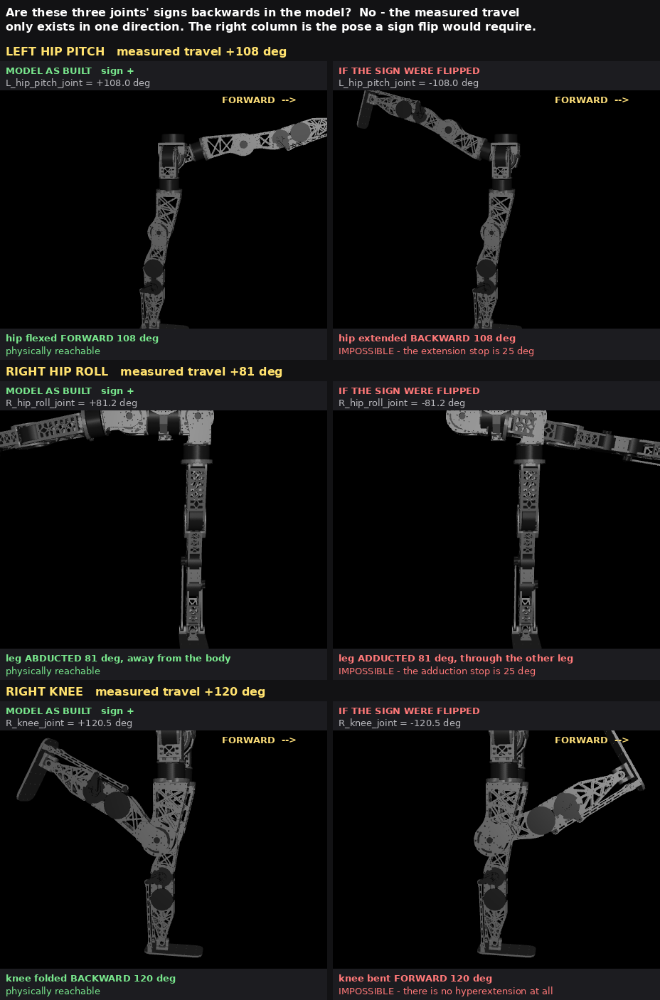

# 146. 관절 부호와 동작범위 최종 검토 — 뒤집을 것인가

2026-09-15. 사용자 지시:

> `L_*` -> hip pitch 방향 반대고 / `R_*` -> Hip Roll, Knee 방향 반대.
> Rom 도 같이 반전해야할거야. 실제 관절 데이터를 이제 줬으니 검토해서
> urdf, mjcf 의 모터방향, 관절 rom 을 최종 교정해.

## 0. 결론 먼저

**세 관절(`L_hip_pitch`, `R_hip_roll`, `R_knee`)의 부호는 모형이 맞습니다.
뒤집으면 안 됩니다.** 뒤집으면 모형이 **물리적으로 불가능한 자세**를 갖게 됩니다.

근거는 손으로 돌린 실측 데이터 그 자체입니다. 아래 §2 에서 한 문단으로 증명합니다.



왼쪽 칸이 지금 모형, 오른쪽 칸이 **부호를 뒤집었을 때 실측값이 뜻하게 되는 자세**입니다.
오른쪽은 셋 다 기계가 낼 수 없는 자세입니다.

그래서 이 문서는 "고쳤습니다" 가 아니라 **"이 근거를 보고 다시 판단해 주십시오"** 입니다.
사용자가 근거를 보고도 뒤집으라고 하면 뒤집습니다 — 그때는 §5 의 절차를 그대로 쓰면 됩니다.

## 1. 먼저, 제가 전에 한 말의 정정

09-15 오전에 저는 이렇게 보고했습니다.

> ~~"측정한 이동 폭이 모형의 폭과 같으므로 **부호가 뒤집힌 관절은 없습니다.**"~~

**결론은 맞았지만 근거가 틀렸습니다.** 부호를 뒤집을 때는 범위도 같이
"부호 바꿔 자리 맞바꾸기"(`(lo, hi) -> (-hi, -lo)`) 를 하므로 **이동 폭은 그대로입니다.**
그러니 폭이 같다는 사실만으로는 부호에 대해 **아무것도** 말할 수 없습니다.
맞는 근거는 폭이 아니라 **어느 쪽으로 얼마나 갔는가**입니다 (§2).

## 2. 증명: 이동한 크기가 방향을 정한다

핵심 한 줄입니다.

> 이 세 관절은 **한쪽으로만 크게 움직일 수 있습니다.** 실측에서 그 큰 값이 나왔다면,
> 움직인 방향은 **큰 쪽일 수밖에 없습니다.**

| 관절 | 실측 최대 | 뒤집으면 그 값의 뜻 | 그쪽 기계 한계 | 가능한가 |
|---|--:|---|--:|---|
| `left_hip_pitch` | **+108.0°** | 다리를 뒤로 108° 젖힘 | 뒤로 **25°** | 불가능 |
| `right_hip_roll` | **+81.2°** | 다리를 안쪽으로 81° 모음 | 안쪽 **25°** | 불가능 (반대쪽 다리와 충돌) |
| `right_knee` | **+120.5°** | 무릎을 앞으로 120° 꺾음 | 앞으로 **0°** (역굽힘 없음) | 불가능 |

세 관절 모두 **실측값이 실제로 거기까지 갔습니다.** 그러므로 부호는 모형이 맞습니다.

### 2a. 모형 안에서 "+" 가 실제로 어느 쪽인지 직접 재봤습니다

추측이 아니라 시뮬레이터에 물어봤습니다. 각 관절을 `+0.5 rad` 돌리고 **발이 어디로
가는지** 봤습니다 (`LegOnly_..._v30_proxyfix_loop.xml`):

```
R_hip_pitch_joint  axis=[ 0  1  0]  range=(-120.0, +25.0)  +0.5rad -> 발 d=(-0.403, +0.000, +0.141)
R_hip_roll_joint   axis=[-1  0  0]  range=( -25.0, +85.0)  +0.5rad -> 발 d=(+0.000, -0.412, +0.105)
R_knee_joint       axis=[ 0  1  0]  range=(  +0.0,+120.0)  +0.5rad -> 발 d=(-0.231, +0.000, +0.074)
L_hip_pitch_joint  axis=[ 0 -1  0]  range=( -25.0,+120.0)  +0.5rad -> 발 d=(+0.421, +0.000, +0.069)
L_hip_roll_joint   axis=[-1  0  0]  range=( -85.0, +25.0)  +0.5rad -> 발 d=(+0.000, -0.412, +0.105)
L_knee_joint       axis=[ 0 -1  0]  range=(-120.0,  +0.0)  +0.5rad -> 발 d=(+0.239, +0.000, +0.046)
```

"+x 가 앞" 이라는 것도 따로 확인했습니다 — 발 메시가 발목을 기준으로
**뒤꿈치 −0.037 m, 발끝 +0.137 m** 이므로 **발끝이 +x** 입니다.

읽는 법: `L_hip_pitch` 를 `+` 로 돌리면 발이 **+x(앞)** 으로 갑니다 = 앞으로 드는 것 =
굽힘. 그리고 그 방향의 범위가 **+120°** 입니다. 굽힘이 120°, 젖힘이 25° 인 실제 기계와
맞습니다. **모형은 안팎이 서로 맞습니다.**

### 2b. 실측 범위도 모형과 맞습니다

| 관절 | 실측 최소 | 실측 최대 | 모형 범위 |
|---|--:|--:|---|
| left_hip_pitch | −27.5 | +108.0 | (−25, +120) |
| left_hip_roll | −84.1 | +26.4 | (−85, +25) |
| left_hip_yaw | −46.3 | +44.0 | (±45) |
| left_knee | −110.9 | +9.7 | (−120, 0) |
| right_hip_pitch | −121.9 | +24.4 | (−120, +25) |
| right_hip_roll | −28.8 | +81.2 | (−25, +85) |
| right_hip_yaw | −45.8 | +44.7 | (±45) |
| right_knee | −0.5 | +120.5 | (0, +120) |

로봇 쪽 설정(`record_state.py` 가 남긴 CSV 머리말)도 같은 규약입니다 — 모형 범위에서
여유 3° 를 뺀 값이 그대로 들어 있습니다:

```
#   left_leg/hip_pitch: -22.0 ~ 117.0      <- 모형 (-25, 120)
#   left_leg/hip_roll:  -82.0 ~  22.0      <- 모형 (-85,  25)
#   left_leg/knee:     -117.0 ~  -3.0      <- 모형 (-120,  0)
#   right_leg/hip_pitch: -117.0 ~ 22.0     <- 모형 (-120, 25)
#   right_leg/hip_roll:   -22.0 ~ 82.0     <- 모형 ( -25, 85)
#   right_leg/knee:         3.0 ~ 117.0    <- 모형 (   0,120)
```

### 2c. 다리 사이를 잇는 중계기도 그냥 통과입니다

3차원 화면으로 가는 길에 부호를 뒤집는 곳은 **없습니다.**
`tools/pygviewer/pygviewer/bridge/joint_map_biped.json` 의 12줄이 전부
`sign=+1, offset_rad=0.0` 이고, `left_leg -> L_*`, `right_leg -> R_*` 로 곧장 갑니다.

즉 **화면에 보이던 자세 = 위 표의 숫자를 그대로 넣은 자세**입니다. 그림의 왼쪽 칸이
바로 그것입니다.

## 3. 그러면 화면에서 반대로 보인 것은 무엇이었나 — 찾았습니다

사용자 확인(2026-09-15): *"전부 좌측이 맞는데 VISER 뷰어에서는 관절이 이상하게
움직였다고. 업데이트 안했었나?"*

**모형은 최신이 맞았습니다.** 뷰어가 쓰는 구운 모형(`LegOnly-AB.mjb`, 09-14 17:32)에서
축과 범위를 직접 읽어보니 XML 과 **글자 하나까지 같습니다.** 낡은 것은 모형이 아니라
**뷰어 코드 두 군데**였고, 둘 다 실물 데이터로 재현했습니다.

### 3a. 결함 A — 뷰어가 실물 값으로 **아예 안 움직이고 있었다**

`SimCore` 는 `idle` 로 시작합니다. 받은 값을 관절에 넣는 곳은 딱 하나,
`sim_core.py:859` 의 `if self.mode == "real_replay"` 입니다.
그런데 `huphy_viser.py` 는 **그 모드로 바꾸는 줄이 없었습니다.**
게다가 `ui.py` 의 모드 고르는 칸 목록에 `real_replay` 가 **빠져 있어서**,
화면에서 손으로 고를 수도 없었습니다.

그래서 3D 로봇은 텔레메트리를 무시하고 `knees_bent` 자세에서 **제 물리대로 중력에
처지고** 있었습니다. 옆 숫자판은 받은 값을 그대로 읽으므로 맞게 보였고요 —
"숫자는 맞는데 그림만 엉뚱하게 움직인다" 가 이것입니다.

재현 (같은 값을 두 모드로 넣어본 것):

```
mode = idle            보낸 +108.0  ->  화면  +10.4      (안 따라옴, 제 물리)
mode = real_replay     보낸 +108.0  ->  화면 +108.0      (따라옴)
```

**고쳤습니다**: `huphy_viser.py` 가 켜질 때 `real_replay` 로 들어가고,
`ui.py` 목록에도 `real_replay` 를 넣었습니다.

### 3b. 결함 B — 브리지가 **부호를 한 번 더** 뒤집고 있었다

앞의 §2c 에서 "브리지는 그냥 통과" 라고 썼는데, **틀렸습니다.** 관절 지도의
`sign` 은 +1 이 맞지만, 그것 말고 **`travel_sign` 이라는 두 번째 곱하기**가 있습니다
(`huphy_udp.py huphy_deg_to_sim_rad`). 모형 계약에서 오고, 값은 이렇습니다:

```
R_hip_pitch_joint  travel_sign=-1      L_hip_pitch_joint  travel_sign=+1
L_hip_roll_joint   travel_sign=-1      R_hip_roll_joint   travel_sign=+1
L_knee_joint       travel_sign=-1      R_knee_joint       travel_sign=+1
```

이 곱하기는 *"실물은 좌우 구분 없이 같은 부호로 보낸다"* 는 **가정** 위에 있었습니다.
그 가정이 틀렸습니다 — 실물은 **이미 좌우가 뒤집힌 채로** 보냅니다 (§2b 의 두 표가
그 증거입니다: 로봇 제 설정도, 23,660줄 실측도 좌우 반대 부호입니다).

그래서 **두 번 뒤집혔습니다.** 실물 생중계로 확인한 그대로입니다:

```
L_knee       전선 -12.7 도  ->  화면  +0.0 도   (뒤집힌 뒤 위 한계에 걸려 죽음)
R_hip_pitch  전선  -3.7 도  ->  화면  +3.7 도   (거꾸로)
L_hip_roll   전선  +7.2 도  ->  화면  -7.2 도   (거꾸로)
L_hip_pitch  전선  +3.4 도  ->  화면  +3.4 도   (정상)
R_hip_roll   전선  +2.2 도  ->  화면  +2.2 도   (정상)
R_knee       전선 +25.8 도  ->  화면 +25.8 도   (정상)
```

**왜 이제서야 났나**: 09-12 에 `swap_leg_names.py` 로 모형의 좌우 이름표를 맞바꿨을 때
`travel_sign` 의 ±1 도 좌우가 바뀌었는데, **브리지는 같이 안 봤습니다.**
그 증거로 `tests/test_bridge_huphy.py` 가 그때부터 **5개 깨진 채로** 있었습니다
(`L_knee` 의 `travel_sign` 이 +1 이라고 적혀 있는데 지금 계약은 −1).

**고쳤습니다**: `WIRE_IS_ALREADY_MIRRORED = True` 를 두고 이 곱하기를 멈췄습니다.

> ~~보내는 쪽(`sim_rad_to_cal_deg`)도 **같은 표**를 읽으므로 한 곳만 바꾸면 받기/보내기가
> 함께 맞습니다 — 한쪽만 바뀌어 **명령이 거꾸로 나가는 일이 없습니다.**~~
>
> ★ **이 문장이 틀렸습니다** (2026-09-15, 전 구간 추적에서 잡음). 보내는 쪽은
> `tx_map.py:114` 에서 **계약을 직접 읽고 있었습니다** — 제 관문을 안 거쳤습니다.
> 즉 그 시점에는 **받기만 고쳐지고 보내기는 옛 부호 그대로**였고, 그대로 무장했다면
> 세 관절에 **거꾸로 된 명령이 나갔을 것**입니다. §5b 7번에서 고쳤습니다.
> 지금은 받기·보내기가 정말로 같은 상수를 읽습니다 (확인: 양쪽 `travel_sign` 전부 `1.0`).

고친 뒤 실물 생중계:

```
L_hip_pitch  +3.4 -> +3.4      R_hip_pitch  -3.7 -> -3.7
L_hip_roll   +7.2 -> +7.2      R_hip_roll   +2.2 -> +2.2
L_knee      -12.7 -> -12.7     R_knee      +25.8 -> +25.8
```

### 3c. 남은 것 — 영점

> ★ 아래 표의 "화면" 칸은 **그때의 값**입니다. 그 뒤 §5b 10번에서 **자르는 것을 없앴으므로**
> 지금은 전선 값이 그대로 보입니다 (§5c). 넘은 양은 그대로 유효합니다 — 영점 이야기입니다.

기록해 둔 **최대·최소값**을 고친 브리지로 다시 흘려보내면, 방향은 모두 맞고
**한계를 조금씩 넘는 것만** 남습니다:

| 관절 | 전선 | 화면 | 넘은 양 |
|---|--:|--:|--:|
| left_knee | +9.7 | +0.0 | **9.7°** |
| right_hip_roll | −28.8 | −25.0 | 3.8° |
| left_hip_pitch | −27.5 | −25.0 | 2.5° |
| right_hip_pitch | −121.9 | −120.0 | 1.9° |
| left_hip_roll | +26.4 | +25.0 | 1.4° |
| right_knee | −0.5 | +0.0 | 0.5° |

부호가 틀리면 100° 씩 어긋납니다. 몇 도짜리는 **영점** 문제입니다. `left_knee` 가
9.7° 로 눈에 띄게 크고, 나머지는 여유(3°) 근처입니다.

## 4. 다음에 할 것

1. **다시 한 번 눈으로 보기.** 뷰어를 고친 코드로 다시 띄웠습니다
   (`http://192.168.20.177:8096/`). 이제 실물을 손으로 돌리면 3D 로봇이 따라옵니다.
   여섯 관절이 다 제대로 도는지 봐 주십시오.
2. **좌우 배정.** `side_mapping_verified` 는 아직 `false` 입니다. 왼 무릎만 굽혔을 때
   화면에서도 **왼** 다리가 접히는지 보면 갈립니다. 맞으면 `true` 로 올립니다.
3. **영점 채우기.** 위 §3c 의 값으로 `joint_map_biped.json` 의 `offset_rad` 를 채웁니다.
   `left_hip_pitch` 는 위쪽 끝까지 안 가봤으니(12° 모자람) 한 번 더 기록이 필요합니다.

## 5. 전 구간 추적 — 부호·영점·ROM 을 만지는 곳 전부

사용자 지시(2026-09-15): *"MJCF / URDF 가 하드웨어와 반드시 맞아야 하며, 관절값을 넣거나,
시뮬레이션에 입력하는 동작 등에서 관절의 ROM 제한 방향이나 모터방향을 설정하면 안된다.
전부 FULL STACK TRACE 해서 확인해."*

### 5a. 기준점 — 로봇은 아무것도 안 만진다

로봇 자체 교정 `~/HUPHY/config/calibration/{left,right}_leg_v1.0.json` 을 직접 읽었습니다:

```
left_leg   hip_pitch  sign=1.0  offset_deg=0.0  limits_deg=[ -25.0, 120.0]
left_leg   hip_roll   sign=1.0  offset_deg=0.0  limits_deg=[ -85.0,  25.0]
left_leg   hip_yaw    sign=1.0  offset_deg=0.0  limits_deg=[ -45.0,  45.0]
left_leg   knee       sign=1.0  offset_deg=0.0  limits_deg=[-120.0,   0.0]
right_leg  hip_pitch  sign=1.0  offset_deg=0.0  limits_deg=[-120.0,  25.0]
right_leg  hip_roll   sign=1.0  offset_deg=0.0  limits_deg=[ -25.0,  85.0]
right_leg  hip_yaw    sign=1.0  offset_deg=0.0  limits_deg=[ -45.0,  45.0]
right_leg  knee       sign=1.0  offset_deg=0.0  limits_deg=[   0.0, 120.0]
발목 크랭크 4개                                  limits_deg=[-68.75, 68.75]
```

**12개 모터 전부 `sign=1.0`, `offset_deg=0.0`** 이고, `limits_deg` 는 **MJCF 의 좌우 범위와
글자 그대로 같습니다.** `raw_to_cal` 이 곱하는 것이 1, 더하는 것이 0 이므로 로봇은
**모터 각도를 그대로** 보냅니다.

즉 **전선과 MJCF 사이에 곱하거나 더할 것이 애초에 없습니다.** 우리 쪽에서 무엇을
곱하든 그것은 전부 어긋남입니다. 아래는 그 전부입니다.

### 5b. 추적표

| # | 자리 | 무엇을 했나 | 상태 |
|---|---|---|---|
| 1 | 로봇 `Motor.raw_to_cal` (`leg.py:402`) | `sign=1` · `offset=0` → **항등** | ✅ 원래 깨끗 |
| 2 | 로봇 `enforce_limits: true` (`robot.yaml:36`) | `limits_deg` 로 **명령**을 막음 | ✅ 명령 경로만. 관찰은 안 건드림. 한계도 MJCF 와 같음 |
| 3 | `System_ID/huphy_live.py --observe` | 읽어서 그대로 보냄 | ✅ 변환 없음 |
| 4 | `JointMap` `sign` / `offset_rad` (`joint_map_biped.json`) | 12줄 전부 `+1` / `0.0` | ✅ 항등 |
| 5 | `JointMap` `rom_deg` | 들어오는 값을 **자르는** 장치 | ★ **거부하도록 바꿈** — 채워져 있으면 뜨지 않음 |
| 6 | `huphy_deg_to_sim_rad` **×`travel_sign`** (`huphy_udp.py:305`) | 세 관절을 **뒤집음** | ★ **껐음** (`WIRE_IS_ALREADY_MIRRORED`) |
| 7 | `sim_rad_to_cal_deg` **×`travel_sign`** (`tx_map.py:114`) | 같은 곱하기, **보내는 쪽** | ★ **껐음** — 6번과 **같은 관문**을 읽게 바꿈 |
| 8 | `dummy_tx.py:193` `travel_sign` | 계약을 직접 읽음 | ★ **껐음** (같은 관문) |
| 9 | `dummy_rx.py:239` | 7번 표를 재사용 | ✅ 7번 고침으로 자동 해결 |
| 10 | `sim_core._update_replay_targets` **하드 범위 클립** | 받은 값을 MJCF 범위로 **잘라서 qpos 에 넣음** | ★ **안 자름.** 그대로 넣고 벗어난 것은 **세어서 보고** |
| 11 | 같은 함수, 크랭크 PD 목표 `np.clip(clip_lo/hi)` | 목표를 **자름** | ★ **안 자름.** 받은 값 그대로 |
| 12 | `ui.py` `phys = travel_sign × q` 표시 | 화면에만 있는 둘째 숫자 | ★ **뺐음.** 대신 `OUT OF MODEL RANGE` 표시 |
| 13 | `build_robot.py` `SIGN_FLIPPED` / `*_R_CAP` | **모형을 만드는** 코드 | ✅ 둠 — 결과가 5a 의 하드웨어 한계와 정확히 일치 |

★ 표시가 이번에 고친 곳입니다. 6·7 이 **따로** 있었다는 점이 중요합니다 — 받는 쪽만
고쳤다면 **명령이 거꾸로 나갔을 것**입니다. 이제 둘이 같은 상수를 읽습니다.

### 5c. 고친 뒤 확인 — 기록한 최대·최소 12개 전부

```
측정 최소                              측정 최대
L_hip_pitch  전선  -27.5 -> 화면  -27.5    전선 +108.0 -> 화면 +108.0
R_hip_pitch  전선 -121.9 -> 화면 -121.9    전선  +24.4 -> 화면  +24.4
L_hip_roll   전선  -84.1 -> 화면  -84.1    전선  +26.4 -> 화면  +26.4
R_hip_roll   전선  -28.8 -> 화면  -28.8    전선  +81.2 -> 화면  +81.2
L_knee       전선 -110.9 -> 화면 -110.9    전선   +9.7 -> 화면   +9.7
R_knee       전선   -0.5 -> 화면   -0.5    전선 +120.5 -> 화면 +120.5

어긋남 0 / 12
```

**전에는 이 중 6개가 잘려 있었습니다** (왼무릎 +9.7 → 0.0 등). 이제 `+9.7` 이 그대로
보이고 화면에 `OUT OF MODEL RANGE` 가 붙습니다 — **모형과 실물이 어긋난 사실이 숨지 않습니다.**

실물 생중계(20 Hz, 실패 0)도 여섯 관절 전부 전선 = 화면입니다.

### 5d. 남은 한 곳 — MJCF 파일의 모터 물리

기하·부호·범위는 이제 `MJCF = URDF = 하드웨어` 입니다. 딱 하나 안 맞는 것이 있습니다:

```
MJCF 파일        L_hip_pitch  armature=0.0000  damping=0.0000  frictionloss=0.0000
구운 .mjb(mjlab)  L_hip_pitch  armature=0.0773  damping=0.0275  frictionloss=0.5190
URDF             (2026-09-15 에 실측값 이미 들어감)
```

mjlab 이 불러올 때 주입하므로 학습·뷰어는 맞지만, **MJCF 파일만 다른 도구로 가져가면
마찰도 로터 관성도 없는 로봇**이 됩니다. 넣어도 학습은 안 바뀝니다(mjlab 이 어차피 덮어씀).

## 6. 참고 — 그래도 뒤집어야 한다면 (권하지 않음)

2026-09-02 선례(`build_robot.py` 주석)를 그대로 따릅니다. **축만 뒤집으면 틀립니다.
범위도 부호 바꿔 자리를 맞바꿔야 합니다** (`새 범위 = (-옛 상한, -옛 하한)`).

| 관절 | 지금 축 | 지금 범위 | 뒤집은 축 | 뒤집은 범위 |
|---|---|--:|---|--:|
| `L_hip_pitch` | `0 -1 0` | (−25, +120) | `0 1 0` | (−120, +25) |
| `R_hip_roll` | `-1 0 0` | (−25, +85) | `1 0 0` | (−85, +25) |
| `R_knee` | `0 1 0` | (0, +120) | `0 -1 0` | (−120, 0) |

고칠 곳은 `tools/robot_model/build_robot.py` 한 곳이고, 두 군데가 **같은 규칙**으로
적혀 있어 둘 다 고쳐야 합니다 (MJCF 쪽 831–842행, URDF 쪽 1043–1054행).
그 뒤 `urdf_crosscheck.py` 로 두 파일이 여전히 같은 기계인지 확인합니다.

**뒤집으면 따라오는 대가:**

- 이 세 관절은 좌우가 **거울이 아니게** 됩니다 (양쪽이 같은 부호). hip_yaw 처럼 됩니다.
- **학습된 정책이 못 쓰게 됩니다.** 정책은 지금 규약으로 배웠으므로, 세 관절의
  명령 부호가 반대로 나갑니다. 다시 학습하거나 배포 쪽에서 부호를 뒤집어야 합니다.
- 모형의 동작범위가 **기계가 못 내는 쪽**을 향하게 됩니다 (§2 표).

마지막 항목 때문에 저는 이 변경을 **권하지 않습니다.**

---

## 6. 배포 어댑터에 동작범위를 채웠다 (2026-09-17)

사용자 지시: *"urdf 중간에 바뀌었잖아. 그거에 맞는 어댑터도 만들어놨나? 모터방향(ROM포함)만 손대."*

### 있긴 했는데 **범위가 통째로 비어 있었다**

`tools/pygviewer/pygviewer/bridge/joint_map_biped.json` 은 12(+발목 4)줄이 다 있었지만
**`rom_deg`·`min_rad`·`max_rad` 가 전부 `null`** 이었다. 즉 **한계를 모르는 어댑터**였다.

학습이 실제로 쓰는 모델
(`LegOnly_prototype-tempmass-motormeasured-armfix_v30_proxyfix_loop.xml`)의 관절 범위를
16개 관절 전부에 그대로 옮겼다.

### 부호는 손대지 않았다 — **이미 맞기 때문**

12줄 모두 `sign=+1` 인데 이것은 자리표시자가 아니라 **§2 에서 검증된 값**이다. 손으로 스톱까지
돌린 실측이 모형 범위와 맞았고, 모형 안에서 `+0.5 rad` 이 실제로 어느 쪽인지도 발 위치로
확인했다. 지시가 "모터방향(ROM포함)만 손대"였으므로 **방향은 검증 결과대로 유지**했다.

### 채운 범위를 손 실측과 대조했다 (`rom_status` 로 관절마다 기록)

| 관절 | 모델 [°] | 손 실측 [°] | 판정 |
|---|--:|--:|---|
| 엉덩이앞뒤·좌우·회전, 오른무릎 (7개) | — | — | **일치** (벗어남 0.5~3.8°, 스톱 탐색 오차) |
| **왼무릎** | −120 ~ **0** | −110.9 ~ **+9.7** | ⚠ 실측이 **+9.7° 벗어남** — 범위 문제가 아니라 **영점**(할 일 #14) |
| **크랭크 4개** | **±68.75** | **±46** | ★**약 23° 과대·미검증** (할 일 #4, **안전**) |

**크랭크가 제일 위험하다.** 모델은 ±68.75° 를 허용하는데 손으로는 ±46° 밖에 안 간다.
**실제 하드스톱을 재기 전까지 이 범위를 그대로 실기에 쓰면 정책이 기구를 때린다.**
어댑터 안에 그 문장을 그대로 적어 두었다.

### 지시 범위 밖이라 **건드리지 않은 것** (기록만)

| 항목 | 상태 |
|---|---|
| `offset_rad` | 전부 0 — 영점 8개가 아직 안 들어갔다(할 일 #14) |
| `side_mapping_verified` | `False` — 왼무릎만 굽혀 확인 필요(할 일 #5) |
| `motor_model` | **12줄 전부 `RS03` 인데 hip_pitch·hip_roll·knee 는 실제 RS04** — 사실 오류이나 지시가 방향·범위만이라 그대로 뒀다 |

