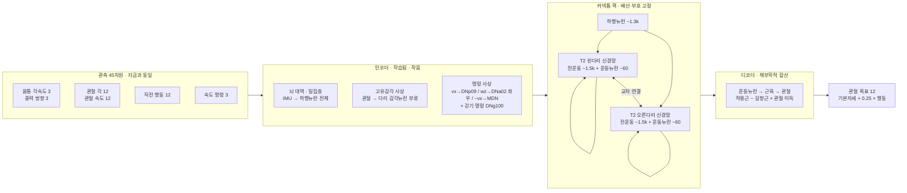

# 151 · 파리의 신경 배선도로 우리 두 발 로봇을 걷게 할 수 있는가 — 조사·제안·구현·검증 계획

> [!abstract] 한 줄 결론
> **구조적으로는 된다 — 그것도 사소하게.** 2026년에 나온 선행 연구(FlyGM)의 설계는 "파리 뇌의 배선도 = 고정된 성긴 행렬, 그 앞뒤에 학습되는 작은 변환기"라서, 몸을 바꾸는 일은 **앞뒤 변환기와 물리 환경을 바꾸는 일**이다. 어려운 것은 그 다음 질문 — *"파리의 배선이 두 발 로봇에게 무엇을 사 주는가?"* — 이고, 이것은 실험으로만 답이 나온다. 그래서 이 문서는 **2주짜리 첫 관문**을 두고, 통과하면 6팔 × 3씨앗의 정식 비교로 가는 계획이다.
>
> 한 가지를 먼저 바로잡는다: 질문에 링크된 두 자료는 **"파리 배선도를 강화학습으로 학습시킨 것"이 아니다.** 하나는 배선도(데이터), 다른 하나는 몸 모델(배선도를 쓰지 않은 보통 신경망)이다. 그 둘을 실제로 합친 연구는 따로 있고(§1), 그 결과는 "탁월"보다는 "무작위 배선보다는 낫고, 보통 신경망과는 비긴다"에 가깝다.

작성 2026-09-18. 부모 세션과 분리된 세션에서 작성. 0·1단계(데이터·모델·시험)는 같은 날 끝냈고(§5b), 첫 관문(2단계)은 그래픽카드가 비기를 기다린다.

---

## §0 이 문서가 답하려는 질문

1. 링크된 두 프로젝트가 **실제로 무엇인가** (전제 확인).
2. 파리의 신경계 중 **어느 조각**을 옮겨야 두 발 로봇과 맞는가.
3. **어떤 구조**로 짜야 하는가 — 무엇을 고정하고 무엇을 학습시키는가.
4. 그것이 **효과가 있었는지 아닌지를 어떻게 알아내는가** (통제군 설계).
5. **단계·관문·비용**.

용어를 처음 보는 사람을 위해 — **커넥톰(connectome)** 은 "어느 신경세포가 어느 신경세포와 몇 개의 시냅스로 이어져 있는가"를 전부 적은 배선도다. 배선도에는 **세기(시냅스 개수)와 방향**은 있지만, 그 연결이 **흥분(+)인지 억제(−)인지**는 따로 예측해야 하고, **시간에 따라 어떻게 동작하는지**는 들어 있지 않다. 그래서 "커넥톰을 돌린다"는 말은 항상 "배선도 + 누군가 정한 신경세포 모형 + 누군가 정한 입출력"을 뜻한다.

---

## §1 전제 바로잡기 — 링크된 두 자료가 무엇인가

### 링크 1 · Janelia 수컷 중추신경계 커넥톰 (male CNS)

- **무엇**: 수컷 초파리 **한 마리**의 뇌 + 배쪽신경삭(ventral nerve cord, 곤충의 척수에 해당)을 **목 연결까지 끊지 않고** 통째로 재구성한 배선도. 뇌와 다리 운동 회로가 **같은 개체**에서 이어져 있는 첫 데이터다.
- **크기**: "166,691 neurons (including sensory axons) across the entire volume", "46 million presynapses connected to 312 million PSDs"; "11,691 unique cell types across the optic lobes, central brain and VNC" ([bioRxiv 2025.10.09.680999](https://www.biorxiv.org/content/10.1101/2025.10.09.680999v1)).
- **판본**: v0.9 2025-10-03, **v1.0 2026-06-08**. 허가 **CC-BY 4.0** (인용만 하면 상업·비상업 모두 가능).
- **신경전달물질 예측 포함** — 흥분/억제 부호를 주는 핵심 자료. 내려받기 목록 ([male-cns.janelia.org/download](https://male-cns.janelia.org/download/)):
  - `body-annotations-male-cns-v1.0-minconf-0.5.feather` (13 MB) — "Curated neuron annotations (classes, types, sides, etc.)"
  - `body-neurotransmitters-male-cns-v1.0.feather` (42 MB) — "Aggregate neurotransmitter predictions for each neuron"
  - `connectome-weights-male-cns-v1.0-minconf-0.5.feather` (1.1 GB) — "segment-to-segment connection strengths", 열은 `(body_pre, body_post, weight)`
  - 프로그램 접근: `neuprint-python`, 데이터셋 이름 `male-cns:v1.0`
- **주의**: 이 페이지 어디에도 "스파이크 신경망으로 재현"이라는 말은 없다. 배선도만 있다. 스파이크 시뮬레이션은 **별개 프로젝트**들이다 — Shiu 등 2024 Nature (암컷 뇌 FlyWire, 누출 적분발화 모형, 12만 5천 뉴런, 먹이·몸단장 회로 예측), 그리고 취미 프로젝트 [fly-brain](https://github.com/Mineplix/fly-brain) ("165,122 neurons, 104 million synapses" 누출 적분발화 + flybody, 학습 없음).

### 링크 2 · bioRxiv 2024.03.11.584515 — 배선도가 아니라 **몸** 모델이다

- **제목**: *Whole-body simulation of realistic fruit fly locomotion with deep reinforcement learning* (Vaxenburg 등, Janelia + Google DeepMind; 나중에 Nature 2025). 흔히 **flybody** 라 부른다.
- **무엇을 했나** (원문): "Here we contribute an anatomically-detailed biomechanical whole-body model of the fruit fly *Drosophila melanogaster* in the MuJoCo physics engine." — MuJoCo 안의 **파리 몸** (102 자유도, 다리 6개, 날개, 평형곤).
- **제어기는 보통 신경망이다** (원문): "The flight controller consisted of two parts: a fixed wing beat pattern generator (WPG) and a trainable fully-connected MLP." 알고리즘은 "We used the implementation of DMPO from the acme reinforcement learning python library".
- **커넥톰은 안 썼다** (원문, 저자 스스로 미래 과제로 남김): "The black-box artificial neural network controllers we trained using imitation learning can be made more realistic by introducing connectome constraints based on recent measurements of connectivity."

즉 **링크 1은 배선도, 링크 2는 몸**이고, 둘 다 "배선도를 강화학습으로 학습시켜 여러 과제를 잘 한다"는 주장을 하지 않는다.

### 그러면 그 주장은 어디서 왔나 — 실제로 둘을 합친 연구 두 개

**(A) FlyGM — "Whole-Brain Connectomic Graph Model Enables Whole-Body Locomotion Control in Fruit Fly"** (Jin, Zhu, Zhang, Sui; Georgia Tech / 칭화; [arXiv 2602.17997](https://arxiv.org/abs/2602.17997), 2026-02-20, v3 2026-06-14). 질문이 가리키는 것은 아마 이것이다.

- 배선도: **FlyWire** (암컷 **뇌만**, 배쪽신경삭 없음). 몸: flybody (걷기 행동 59차원). 학습: 모방학습 → PPO.
- 구조 (원문): "the synaptic weight matrix W∈ℝ|V|×|V| acts as a fixed, recurrent state-transition operator that dictates the information flow through the network." 부호는 신경전달물질로: "Wvu = Nexc(u,v) − Ninh(u,v)". 감각은 "encoded by an encoder Encθ and injected into afferent neurons via a gating map", 운동은 "at = Decϕ(Ht+1[Ve])".
- **통제군을 제대로 두었다** — 같은 학습 절차로 (i) 차수 보존 재배선 그래프, (ii) 에르되시–레니 무작위 그래프, (iii) 보통 다층 신경망. 회전 과제 결과:

| 모형 | 위치 오차 | 각도 오차 |
|---|---|---|
| 커넥톰(FlyGM) | 0.0364 ± 0.002 | **8.29 ± 0.21** |
| 차수 보존 재배선 | 0.0370 ± 0.002 | 13.55 ± 0.69 |
| 무작위 그래프 | 0.6278 ± 0.040 | 125.36 ± 8.96 |

- 저자 주장: "the connectome exhibits a markedly superior sample efficiency, converging faster and getting lower MSE than the non-connectome models". 한계 (원문): "Compared to MLP-based controllers, our model requires longer per-step computation and higher memory usage".
- **다른 몸·로봇으로의 이전은 다루지 않았다.** 코드는 익명 저장소 (`anonymous.4open.science/r/flygm`)로만 공개.
- ★ 읽을 때 주의: FlyWire 뇌에는 다리 운동뉴런이 없다. 그들의 "출력 뉴런"은 뇌의 운동 부류 **106개**(목·주둥이 운동뉴런과 하행뉴런 부류)이고, 거기서 59차원 다리 명령까지는 **학습되는 해독기**가 만든다. 즉 실제 다리 회로는 쓰이지 않았다.

**(B) nfly — male CNS v1.0 을 순환 신경망으로 만들어 Gymnasium 게임을 시킨 프로젝트** ([github.com/zhengxuyu/nfly](https://github.com/zhengxuyu/nfly), MIT). 질문의 데이터셋을 **정확히** 쓴 유일한 공개 코드다.

- 뉴런 모형 (원문): `h[t+1] = (1 - alpha) * h[t] + alpha * min( ReLU( W h[t] + b + u[t] ), h_max )` — 스파이크 없는 발화율 모형, 시간상수 학습.
- 가중치 (원문): `W[post, pre] = sign(pre) * (syn / sum_in syn) * exp(g_edge)`, "g_edge learnable, initialised to 0". 부호는 "ACh / DA / 5-HT / OA are +, GABA / Glu / His are -".
- 입출력: 광수용체 5,494개에 화면을, 하행뉴런 1,314개 + 운동뉴런에서 행동을 읽음.
- **결과와 저자의 정직한 평가** (원문): "at equal parameter count the fly is not cheaper and does not score higher than a conventional network" … "Whether the wiring buys sample efficiency, transfer or robustness is untested. The claim is a platform for asking those questions on real wiring, not a better controller." 비용: "35 to 57x the CPU time per env step".

**정리** — 오늘까지의 증거는 "**무작위 배선보다는 확실히 낫다**, 보통 신경망 대비는 **표본 효율에서 조금 낫거나 비긴다**, 계산은 **수십 배 비싸다**"이다. 두 발 로봇 계획은 이 기대치 위에 세운다.

---

## §2 파리의 어느 조각을 옮기는가 — 뇌가 아니라 다리 회로

### 2-1 다리를 걷게 하는 회로는 뇌가 아니라 배쪽신경삭에 있다

MANC(수컷 배쪽신경삭 커넥톰, Cheong 등 2024 [eLife 96084](https://elifesciences.org/articles/96084)) 원문:

- "In total, ~23,500 neurons were reconstructed and annotated in this dataset, which comprises 13,066 INs, 1328 DNs, 1862 ANs, 733 MNs, 92 ENs, 9 EAs, 5927 SNs, and 535 SAs."
- "In the MANC dataset, we find 392 leg MNs (142 in T1, 119 in T2, 131 in T3)." — 다리 운동뉴런은 앞·중간·뒷다리 마디(T1·T2·T3)별로 나뉜다.
- "One community per leg neuropil per side that largely corresponds to local leg networks" — **다리 하나마다, 좌우마다 하나의 지역 회로**가 있다.
- "Most MNs receive a relatively low proportion of their input from DNs (MN groupwise mean of 7%)" — 뇌에서 내려오는 명령(하행뉴런)은 운동뉴런 입력의 7 %뿐이고, 나머지는 **배쪽신경삭 안의 지역 회로**가 만든다. 걷기의 리듬과 관절 조율은 여기서 나온다.

다리 하나의 운동뉴런 수 (Azevedo 등 2024, 암컷 FANC): "We identified and proofread all of the T1 MNs in the FANC EM dataset (69 in left T1, 70 in right T1)." Lesser 등 2024: "less than 10% of synapses to each leg and wing motor neuron coming from descending neurons", 그리고 전운동 회로는 "cluster into modules that link motor neurons innervating muscles with related functions" — **관절별 모듈** 구조.

### 2-2 배선도 시뮬레이션이 실제로 걷기 리듬을 만든다 — 그러나 다리 사이 조율은 못 만든다

Pugliese 등 2025 (Tuthill·Brunton, [bioRxiv 2025.09.12.675944](https://www.biorxiv.org/content/10.1101/2025.09.12.675944v1)) 는 배쪽신경삭 배선도를 **발화율 모형**으로 돌려 걷기 리듬 회로를 찾았다:

- 규모: "The full simulated network consisted of 4,604 neurons" = "1,318 descending neurons (DNs), 144 leg motor neurons, and 3,142 premotor neurons" (앞다리), "3,780,908 synapses".
- 가중치: "Each element |wij| was the number of synapses detected from neuron j to neuron i", 부호는 "positive or negative weights for excitatory (cholinergic) or inhibitory (GABAergic, glutamatergic) cells".
- 발화율 모형을 고른 이유 (우리도 같은 선택을 할 근거): "We chose a rate model in part because some neurons in the insect VNC, including premotor neurons active during walking, are nonspiking."
- 결과: 걷기 명령 뉴런 DNg100 이 리듬을 만들고, **세 뉴런짜리 최소 리듬 회로**(흥분 2 + 억제 1)가 "repeated in the neuropils of all six legs of both connectomes".
- ★ **한계 (원문)**: "Our DNg100 simulations did not produce the tripod inter-leg coordination pattern characteristic of hexapod walking." 그리고 "the naturalistic pattern of muscle activation likely relies on additional factors, including proprioceptive feedback, mechanical coupling…" — **몸이 없는 배선도는 다리 사이 조율을 못 만든다.** 저자의 다음 과제: "coupling VNC connectome simulations to control and receive feedback from biomechanical models of the fly body".
- 코드 공개: [github.com/smpuglie/Pugliese_cpg_2025](https://github.com/smpuglie/Pugliese_cpg_2025) (JAX). **이것이 우리 부분그래프 추출의 출발점이다.**

→ 이 한계가 바로 우리 계획의 근거다. **몸과 강화학습을 붙이면** 리듬 회로 + 감각 되먹임 + 기계적 결합이 한 고리 안에서 닫힌다. FlyGM 이 뇌로 한 것을 우리는 **다리 회로**로 한다.

### 2-3 왜 두 발 로봇과 맞는가 — 해부학적 대응

**다리 하나의 자유도**. flybody 모델 XML 에서 왼쪽 앞다리: 관절 11개 = 엉덩이관절(coxa) 3 (`coxa_abduct`, `coxa_twist`, `coxa`), 넓적다리 2 (`femur_twist`, `femur`), 정강이 1 (`tibia`), 발 5 (tarsus 1 + 작은 마디 4), 구동기 8개 + 발 흡착. 우리 다리 하나: 엉덩이 3(피치·롤·요) + 무릎 1 + 발목 2(크랭크 두 개) = **6**.

| 파리 다리 관절 | 우리 다리 관절 | 비고 |
|---|---|---|
| coxa (abduct / twist / extend) 3 | hip (roll / yaw / pitch) 3 | 둘 다 몸통에 붙은 3축 관절 |
| femur extend 1 | knee 1 | 한 축 굽힘 |
| tibia extend 1 | ankle pitch (크랭크 합) | 한 축 |
| femur twist 1 | ankle roll (크랭크 차) | 대응이 약함 — 학습 변환기에 맡김 |
| tarsus 1 + 흡착 | (없음) | 버림 |

**다리 사이 위상**. 파리는 모든 속도에서 세다리 걸음(tripod)을 쓰고, **같은 마디의 좌우 다리는 반대 위상**이다 — 위상 0.5 ± 0.05 ([DeAngelis 등 2019](https://elifesciences.org/articles/46409), [Mendes 등 2013](https://elifesciences.org/articles/00231)). 두 발 로봇이 필요로 하는 좌우 교대는 **한 마디의 좌우 다리 쌍 안에 이미 배선되어 있다.** 그래서 옮기는 단위는 "다리 6개 회로 전체"가 아니라 **한 마디(예: 중간다리 T2)의 좌우 다리 신경망 + 그 둘을 잇는 교차 연결 + 거기에 닿는 하행뉴런**이다.

**명령 주입 자리**. 속도 명령(vx, vy, wz)은 아무 곳에나 넣지 않고 **하행뉴런**에 넣는다 — 생물학에서 실제로 그 역할을 하는 자리다: DNp09 전진, DNa02 회전(좌우 발화율 차가 회전 속도를 예측), MDN 후진, DNg100 걷기 리듬 명령 ([eLife 102230](https://elifesciences.org/articles/102230), [Cell 2024](https://www.cell.com/cell/fulltext/S0092-8674(24)00962-0), Pugliese 2025).

### 2-4 정직한 한계 — 파리는 균형을 잡지 않는다

파리(약 1 mg)는 세다리 걸음으로 **정적으로 안정**하다. 넘어지는 문제를 다리 회로가 풀어 본 적이 없다. 우리 로봇(23.6 kg)의 핵심 문제는 **역진자 균형**이고, 몸통 각속도·중력 방향(IMU) 입력은 파리 다리 회로에 대응하는 감각이 없다(평형곤은 비행용). 따라서 **이 배선도는 "리듬과 관절·다리 조율의 사전지식"이지 "균형의 사전지식"이 아니다.** 균형은 앞뒤 변환기와 학습되는 이득이 떠맡을 것이고, 그 몫이 크면 배선도의 효과는 씻겨 나갈 수 있다. 이 위험은 §4 의 통제군이 그대로 측정한다.

---

## §3 아키텍처 제안



### 3-1 핵 (고정되는 것과 학습되는 것)

| 요소 | 값 | 출처·근거 |
|---|---|---|
| 뉴런 모형 | 발화율, 누출 적분: `h ← (1−α)h + α·clip(ReLU(W h + b + u), 0, h_max)` | nfly 그대로. 스파이크 안 씀 — Pugliese: 걷기 전운동뉴런 일부는 비스파이크성 |
| 배선(마스크) | **고정**. 시냅스 ≥ 3인 쌍만 | nfly 기본값 |
| 부호 | **고정**. 신경전달물질 예측: 아세틸콜린 +, GABA·글루탐산 − (Dale 법칙) | Pugliese·nfly·FlyGM 공통 |
| 크기 | 시냅스 수 ÷ 시냅스후 뉴런 총 입력 (정규화) | nfly |
| 학습되는 이득 | **1안** 세포유형별 하나 (Lappalainen 2024 방식, 매개변수 수천 개) / **2안** 시냅스별 하나 `exp(g)` (nfly, 수백만 개) | 1안이 과학적으로 깨끗하고 가볍다. 2안은 통제군으로 |
| 학습되는 뉴런 상수 | 시간상수 α, 편향 b (뉴런마다) | nfly |
| 시간 적분 | 제어 주기 20 ms 안에 부분단계 2~4 (파리 뉴런 시간상수 대략 10~50 ms) | 부분단계 수는 매개변수로 두고 스모크에서 정함 |
| 되먹임 | 은닉상태 h 를 환경 스텝마다 넘김, 에피소드 끝에서 0으로 초기화 | rsl_rl 순환 정책 규약 |

### 3-2 인코더 (관측 → 감각뉴런)

- **관절 각·속도** → 해당 다리 신경망에 들어오는 **고유감각 뉴런 부류**(현음기관, 종상감각기, 털판)에 학습되는 작은 사상으로 주입. 부류 단위로 묶어 "어느 뉴런에 무엇이 들어가는가"를 사람이 읽을 수 있게 유지.
- **몸통 각속도·중력 방향** → 파리에 대응 감각이 없으므로 **"뇌 대역" 밀집층**을 두어 하행뉴런 전체에 주입. 이 층이 균형을 떠맡는다. **뗄 수 있게 만들어** 그 기여를 재는 것이 §4 의 절제 하나.
- **속도 명령** → 특정 하행뉴런 유형에 이득 하나씩 (DNp09·DNa02 좌/우·MDN·DNg100). 나머지 하행뉴런에 가는 밀집 경로는 별도 스위치.
- **직전 행동** → 파리에 깨끗한 대응이 없다. 1차에서는 인코더의 자유 입력으로 두고, 절제로 빼 본다.

### 3-3 디코더 (운동뉴런 → 관절 목표)

- **해부학적 합산**: 운동뉴런 → 근육 → 관절 작용근/길항근 표(Azevedo·Lesser 2024 의 운동뉴런 지도)를 고정하고, `목표 = 기본자세 + 0.25 × Σ이득 × (작용근 발화 − 길항근 발화)`. 관절마다 이득 하나만 학습.
- **자유 선형 디코더**를 통제군으로 둔다 — 두 디코더의 차이가 "해부학이 정보를 주는가"를 답한다.
- 발목 두 축 ↔ 크랭크 두 개의 대응은 이미 있는 발목 변환(2-RSU 기하)에 맡긴다.

### 3-4 크기 계층과 계산 비용 추정 (추정 — 스모크에서 실측)

| 계층 | 뉴런 | 시냅스 | 은닉상태 (16,384 환경) | 비고 |
|---|---|---|---|---|
| **A · 한 마디 좌우 + 하행뉴런** | 약 4~5k | 약 3~4M | 5k × 16,384 × 4 B ≈ **330 MB** | Pugliese 앞다리 모형(4,604 뉴런·3.78M 시냅스)이 본보기. **여기서 시작** |
| B · 배쪽신경삭 전체 | 23.5k | 수십 M | 1.5 GB | A 가 효과 있을 때만 |
| C · 중추신경계 전체 | 166.7k | 10.5M(≥3 시냅스 쌍) | 11 GB | nfly. 우리 카드로는 환경 수를 크게 줄여야 함 |

계층 A 의 성긴 행렬곱: 4M 비영 원소 × 16,384 환경 × 부분단계 3 ≈ 2 × 10¹¹ 곱셈/제어스텝 — 수치상 3090 에서 수 ms 이지만 **메모리 대역폭에 묶인다**(nfly: "the product is memory-bound"). PPO 갱신 5회 × 순환 미니배치의 시간 역전파가 곱해진다. 정직한 기대: **반복당 시간이 MLP 의 3~10배.** 그래서 첫 관문(§5 Phase 2)의 첫 숫자가 "반복당 초" 다.

### 3-5 왜 스파이크가 아니라 발화율인가 (그리고 언제 스파이크로 가는가)

- 발화율: 미분 가능 → 지금 PPO 그대로. Pugliese 가 같은 선택으로 리듬을 재현했고, 누출 적분발화로도 확인했다.
- 스파이크(누출 적분발화): 대리 기울기(surrogate gradient)가 필요하고 제어스텝 20 ms 안에 1 ms 부분단계 20개 — 비용 10배 이상. **발화율 판이 효과를 보인 뒤**의 5단계다. 그때는 GPU 누출 적분발화 시뮬레이터([annel0/flybrain](https://github.com/annel0/flybrain))를 검토한다.

### 3-6 지금 학습 스택에 어떻게 끼우는가 (읽어 둔 것)

- rsl_rl 의 모델은 `class_name` 문자열로 고른다: `resolve_callable` 이 `"module.path:ClassName"` 형식을 받는다 (`rsl_rl/utils/utils.py:97`). → 새 클래스 `mjlab.rl.connectome_policy:ConnectomeActor` 를 설정 한 줄로 끼운다.
- 순환 정책의 규약은 `rsl_rl/models/rnn_model.py` 에 있다: `is_recurrent = True`, `get_latent(obs, masks, hidden_state)`, `reset(dones)`, `get_hidden_state()`, `detach_hidden_state(dones)`, `as_onnx()`. 롤아웃 저장소는 이미 은닉상태와 궤적 마스크를 지원한다 (`storage/rollout_storage.py:59-123`).
- 우리 PPO 변형 `SmoothPPO` 도 순환 분기를 갖고 있다 (`src/mjlab/rl/smooth_ppo.py:268-295`).
- 지금 기준 정책: `hidden_dims=(512, 256, 128)`, ELU, 관측 정규화, 24 스텝/환경, 30,001 반복, 엔트로피 0.01, 학습률 1e-3 (`config/pygmalion/rl_cfg.py`). **비평자(critic)는 그대로 MLP 로 둔다** — 바꾸는 것은 행위자(actor) 하나.
- 배포: 지금 `deploy_contract.py` 는 `mlp.{2i}.weight` 배치를 가정한다(`analysis/deploy_contract.py:72`). 순환 정책은 은닉상태를 입출력으로 갖는 ONNX 가 필요 — `_OnnxRNNModel` 이 GRU/LSTM 용으로 있으니 그 틀을 따라 만든다. **실기 전 필수**, 1차에서는 불필요.
- 데이터 도구: `neuprint-python`·`navis` 는 venv 에 없고, venv 에 pip 도 없다(`uv` 로 관리; 이 셸에는 uv 가 경로에 없음). 1.1 GB feather 세 개를 직접 받는 쪽이 빠르다 — nfly 가 정확히 그 세 파일만 읽는다.

---

## §4 검증 설계 — 이것이 "장식"이 아니라 "과학"이 되려면

이 프로젝트의 규칙 그대로: **단일 변인**, **씨앗 반복**, **같은 판정 도구**.

### 4-1 단일 변인
바꾸는 것은 **행위자 클래스 하나**. 비평자·관측·보상·무작위화·커리큘럼·환경 수 16,384·씨앗 배정은 모두 v7 계보와 **바이트 단위로 동일** (`env.yaml` diff = 0, 발사 직후 확인).

### 4-2 통제군 (FlyGM 이 보여 준 최소 집합 + 우리 것 둘) — **없으면 "커넥톰"은 장식이다**

| 팔 | 무엇 | 답하는 질문 |
|---|---|---|
| ① 커넥톰 | 진짜 배선·진짜 부호 | — |
| ② 차수 보존 재배선 | 뉴런마다 연결 수는 같고 상대만 섞음 | "누가 누구와"가 중요한가 |
| ③ 무작위 그래프 | 같은 밀도, 완전 무작위 | 성김만으로 되는가 |
| ④ 부호 섞기 | 배선은 진짜, 흥분/억제만 섞음 | Dale 법칙이 중요한가 |
| ⑤ 같은 매개변수 수의 보통 순환망(GRU) | 배선 없음 | 배선이 매개변수 대비 이득을 주는가 |
| ⑥ 지금 MLP (v7 계보) | 기준선 | — |

추가 절제: 해부학적 디코더 ↔ 자유 디코더; "뇌 대역" 밀집층 유·무.

### 4-3 판정 지표 (있는 도구 그대로)
- 정지 `analysis/standing_verdict.py` · 보행 `analysis/walking_verdict.py` · 제자리 회전 `analysis/measure_turn.py` · 하중 `measure_loads.py` · 배포 계약.
- 사전지식이 사 줘야 하는 것: **표본 효율**(보상 문턱·게이트 통과까지의 반복 수), **밀치기 견딤**(8101 뷰어의 밀기 + 무작위 교란 배터리), **무작위화 일반화**.
- 이 방식만이 주는 것: **뉴런 단위 해석** — 파리의 어느 세포유형이 지지상/유각상에 켜지는가, DNg100 아래 세 뉴런 회로가 실제로 진동하는가. 이것이 논문의 그림이다.

### 4-3b "배선이 사전지식이었는가, 초기값이었는가" — 2026-09-18 추가 (사용자 질문에서)

파리는 역전파로 배선을 고치지 않는다. 우리는 강화학습이 15만 개 볼륨을 마음대로 돌리게
두므로, 학습이 끝난 그물이 파리 배선과 전혀 다른 동작점에 가 있을 수 있다 — 그러면
"커넥톰"은 사전지식이 아니라 초기값이었을 뿐이다. 두 가지로 가른다:

- **볼륨 이탈도**: 학습 후 `exp(g)` 의 분포(중앙값·사분위·10배 이상 바뀐 비율). 통제군
  (재배선·무작위)과 비교 — 진짜 배선이 덜 움직이고도 같은 성능이면 배선이 일을 한 것.
- **정규화 강도 훑기**: 볼륨을 원래 값에 묶는 벌점 λ·‖g‖² 를 0 → 큰 값으로 올리며
  "얼마나 꽉 붙들어도 걷는가" 곡선. 이 곡선이 이 실험에서 가장 날카로운 그림이다.

같은 자리에서 잴 것 둘: **리듬 회로의 진동수** — DNg100 아래 세 뉴런 모티프가 학습 뒤
실제로 몇 Hz 로 도는가(파리 10~15 Hz 대 로봇 1.5~2 Hz 의 시간 척도 불일치를 뉴런별
시간상수가 흡수했는지) — 와 **적응 변수 변형판**(뉴런마다 상태 하나 추가: 오래 켜지면
스스로 꺼지는 성질. 발화율 모형이 버린 리듬 생성기의 재료 중 가장 싸게 되살릴 수 있는
것). 조절성 뉴런은 이 부분그래프에 2개뿐(세로토닌 하행뉴런)이라 부호 ±1 근사의 피해는
없다(아세틸콜린 3,266 / GABA 757 / 글루탐산 557 / 미상 125).

### 4-4 씨앗
팔마다 **≥ 3 씨앗**. 이것이 2080 Ti 가 맡을 일이다(docs/10 §세 번째 카드).

### 4-5 짧은 학습 선별
2,000 반복 선별(보상·게이트 통과 시점) — 할 일 #45 에서 만드는 짧은 검증법을 그대로 쓴다.

---

## §5 단계별 계획 · 관문 · 비용

| 단계 | 일 | 산출물 | 관문 (숫자) |
|---|---|---|---|
| **0 · 데이터** (2~3일) | feather 3개 내려받기 → 배쪽신경삭 T2 좌우 다리 신경망 + 교차 연결 + 닿는 하행뉴런 + 다리 감각뉴런 부류 추출 (Pugliese 코드의 부분그래프 규칙 차용). 부호·정규화·마스크 생성 | `analysis/connectome/extract_vnc_leg_graph.py`, 뉴런·시냅스 수 표, 그래프 그림, 세포유형별 목록 | 뉴런 3~6k, 시냅스 2~5M, 운동뉴런 좌우 각 55~70개가 나올 것. 벗어나면 추출 규칙 재검토 |
| **1 · 모델** (3~4일) | `mjlab.rl.connectome_policy:ConnectomeActor` (rsl_rl 순환 규약 구현, torch.sparse CSR), 인코더·디코더·통제군 생성기 | 단위시험: 이득 0·변환기 항등이면 선형계와 일치, done 에서 은닉 초기화, 스텝 모드 = 배치 모드, 기울기 흐름 | 시험 전부 통과 |
| **2 · 첫 관문** (2일) — **통과 2026-09-18, §5c** | 1,024 환경 스모크: 서기 학습 + 반복당 초 측정 (MLP 대비) | 표 | **서기 판정 통과** 그리고 **반복당 시간 ≤ MLP 의 10배**. 둘 중 하나라도 못 하면 계층 A 를 더 줄이거나(한 다리 쌍의 전운동만) 세포유형별 이득으로 바꾸고 재시도. 두 번 실패하면 **중단하고 기록** |
| **3 · 사다리** (2~3주 벽시계) | 3 팔(①커넥톰·②재배선·⑥MLP) × 2 씨앗 먼저 → 효과가 보이면 6 팔 × 3 씨앗 | 정식 노트 6+개, 대장·계보도 | ①이 ② 보다 게이트 통과가 빠르거나 밀치기 견딤이 좋음(씨앗 간 겹치지 않음). 아니면 "배선은 장식" 으로 결론 |
| **4 · 분석** (1주) | 판정 도구 전부 + 표본 효율 곡선 + 뉴런 단위 활동 읽기(지지상/유각상 튜닝, 리듬 회로 진동) | 비교 노트, 그림 | — |
| **5 · 조건부** | 스파이크 판(대리 기울기) · 순환 ONNX + 배포 계약 확장 · 계층 B | — | 4단계 결론이 긍정일 때만 |

**GPU 시간**: 3 팔 × 2 씨앗 = 6 런 × (MLP 1.1~1.6일, 커넥톰 3~10배) — 커넥톰 팔이 3090 에서도 며칠씩 걸린다. 2~3주는 이 이유다. 반복당 시간이 관문에 있는 이유이기도 하다.

**사람 시간**: 0~2단계 약 2주(한 사람). 이것이 "계속할지 결정하는 데 드는 값"이다.

---

## §5b 진행 기록 — 0·1단계 완료 (2026-09-18 새벽, 그래픽카드 없이)

사용자 승인("자원 빌 때 해보자") 뒤 그래픽카드가 필요 없는 단계를 먼저 끝냈다.

**0단계 · 데이터** — 수컷 중추신경계 v1.0 평면 파일 세 개(주석 14 MB, 신경전달물질 43 MB,
연결 1.05 GB)를 `~/pyg_data/malecns/` 에 받았다. 주석에는 필요한 열이 전부 있다:
`somaNeuromere`(T1/T2/T3), `exitNerve`(MesoLN = 중간다리 신경), 운동뉴런 유형 이름
(`Ti extensor MN`, `Tr flexor MN` …), 감각 부류(`mechanosensory_proprioceptive` /
`_tactile`, `chordotonal organ`, `campaniform sensilla`, `hair plate`), 그리고 명령
뉴런이 이름 그대로(DNg100·DNa02·DNp09·MDN, 각각 좌우).

`analysis/connectome/extract_vnc_leg_graph.py` 가 중간다리 부분그래프를 자른다
(Pugliese 규칙 + 감각뉴런). 시냅스 5개 이상 문턱에서:

| | 개수 |
|---|---|
| 뉴런 | **4,709** (운동 116 = 좌 58·우 58 / 전운동 2,243 / 하행 1,063 / 감각 1,287) |
| 연결 | 153,455 (시냅스 3,185,648) |
| 억제성 뉴런 | 1,316 (신경전달물질 미상 125개는 흥분으로 둠) |
| 명령 뉴런 | DNg100 2 · DNa02 2 · DNp09 2 · MDN 4 · DNb08 4 · DNa03 2 |

Pugliese 의 앞다리 모형(4,604 뉴런·3.78 M 시냅스)과 크기가 거의 같다. 운동뉴런 116개 중
25가지 유형이 근육 이름을 달고 있고, 그 가운데 16가지를 관절에 대응시켰다(엉덩이 3축 ↔
가슴-엉덩이관절 근육 6종, 무릎 ↔ 전자 굴근/신근·대퇴 reductor, 발목 피치 ↔ 경골
굴근/신근, 발목 롤 ↔ 장건근). 이름 없는 `MNml29·76~83` 9종은 "미배정 풀"로 두고 작은
학습층이 읽는다. `analysis/connectome/make_controls.py` 가 통제군 세 개(차수 보존 재배선
1,534,550회 교환·무작위·부호 섞기)를 같은 뉴런 순서로 만든다.

**1단계 · 모델** — `mjlab.rl.connectome_policy:ConnectomeActor` (rsl_rl 순환 모델 규약
구현, CSR 성긴 행렬곱, 학습 매개변수 **211,571** 개 — 기존 MLP 와 같은 자릿수).
`rl_cfg.py` 는 `PYG_CONNECTOME=1` 일 때만 이 클래스를 고르고, 아니면 글자 하나 다르지
않다. 단위시험 10개 전부 통과(`tests/test_connectome_policy.py`, CPU 13초): 스텝 모드 =
배치 모드, done 환경만 초기화, 모든 학습 그룹에 기울기 도달, 디코더 투명성, ONNX 뷰 일치.

시험이 잡아낸 것 둘: ① 문턱 0.1·편향 0 으로 두면 **운동뉴런이 전부 잠들어** 기울기가
0 이었다 — `relu(tanh(x))` 는 x ≤ 0 에서 기울기가 0 이라 조용한 뉴런은 영영 못 배운다.
문턱 0·휴지 편향 0.02 로 바꿔 모든 세포가 문턱 바로 위에서 시작하게 했다. ② 관측
정규화기가 갓 만들어진 상태(퍼짐 0)면 입력이 100배로 부풀어 포화된다 — 학습에서는 첫
롤아웃 전에 갱신되므로 문제없고, 시험에서 같은 순서를 밟게 했다.

**비용 실측 (CPU 4스레드, 진짜 그래프)** — 롤아웃 한 스텝 256 환경 139 ms; 학습 배치
(궤적 256 × 24 스텝 × 부분단계 4) 전진+역전파 **6.5 초, 유지 메모리 2.5 GB**. 메모리는
부분단계마다 N-벡터 여섯 개쯤이 남는 구조라 미니배치 궤적 수에 비례한다 — 16,384
환경·미니배치 4 면 4,096 궤적 = 약 **40 GB 로 불가**. 첫 관문(1,024 환경, 256 궤적)은
문제없고, 본 사다리 전에 미니배치를 16 으로 올리거나(1,024 궤적, 약 10 GB) 부분단계를
벡터 하나만 저장하는 사용자 정의 역전파로 바꿔야 한다. `torch.utils.checkpoint` 는
먼저 시도했고 **성긴 연산과 만나 오히려 나빠졌다**(유지 4.8 GB·4.5배 느림) — 기본 끔.

**첫 관문 발사 준비** — `analysis/connectome/smoke.py`: 그래픽카드 잠금을 잡고, v7 발사
매니페스트의 환경 플래그 그대로, 1,024 환경 × 300 반복을 커넥톰 → MLP 순으로 돌린 뒤
반복당 초(수집/학습 분리)·보상·에피소드 길이·낙상을 나란히 찍는다. `--variant`
로 통제군을 고른다. **그래픽카드가 비면 실행한다** — 지금은 두 장 모두 학습 중.

## §5c 진행 기록 — 2단계 첫 관문 **통과** (2026-09-18 오후) + 실시간 활동 뷰어

**어떻게 돌렸나** — 학습 세션이 원격 3090 의 v8 런을 15:27 에 얼려 주었다(SIGSTOP, 반복
25,652 에서 정지, 17:30 에 재개). 그 사이 `analysis/connectome/smoke.py` 가 v7 발사
매니페스트의 환경 플래그 그대로 **1,024 환경 × 300 반복**을 커넥톰 → MLP 순으로 돌렸다
(씨앗 42, 두 팔 완전히 같은 조건, 다른 것은 배우 클래스 하나).

### 관문 표 (`analysis/out/connectome_smoke_0918_1538.json`)

| | 커넥톰 배우 (진짜 배선) | MLP 배우 | 관문 |
|---|---|---|---|
| 반복당 시간 | **7.72 s** (수집 1.11 + 학습 6.61) | 0.93 s (0.86 + 0.07) | 비율 **8.3배 ≤ 10배 → 통과** |
| 벽시계 300반복 | 40.5 분 | 5.2 분 | |
| 평균 보상 처음 50 → 마지막 50 | 1.3 → **31.9** | 0.5 → 28.8 | 오르기 → 통과 |
| 에피소드 길이 (마지막 50) | **926** 스텝 | 620 | |
| 넘어짐 (마지막 50) | 0 | 0 | |

![[connectome_smoke_0918_1538.png]]

수집 시간은 1.3배(정책 한 스텝이 성긴 행렬곱 4번), 학습 시간이 **92배** — 예상대로
역전파가 비용의 전부다. 반복당 6.6초는 3090 에서 30,000 반복이면 **55시간**, MLP 의
7.8시간 대비. 본 사다리(§5 3단계)의 GPU 예산은 이 숫자로 다시 잡는다.

보상 곡선에서 눈에 띄는 것: 커넥톰 팔이 **반복 130 근처에서 보상 35·에피소드 930** 에
닿았고 그때 MLP 는 11·280 이었다. **처음엔 이것을 초반 표본 효율로 읽었는데, 걷기 시험이
그 해석을 뒤집었다**(아래). `mean_reward` 는 에피소드 합계라 넘어지지 않고 가만히 서
있기만 해도 커진다 — 커넥톰 팔은 명령을 무시하고 서 있었고, MLP 는 걸으려다 더 자주
넘어졌을 뿐이다.

### 걷기 시험 — 300반복 커넥톰은 서기만 배웠다 (2026-09-18 18:30)

같은 저장본에 앞으로 0.6 m/s 명령을 10초 주고 이동 거리를 쟀다(CPU, 환경 1개):

| 저장본 | 10초 이동 | 평균 전진 속도 | 넘어짐 |
|---|---|---|---|
| MLP model_299 | +3.44 m (옆으로 +2.29 m) | **0.34 m/s** | 없음 |
| 커넥톰 model_299 | +0.01 m | **0.00 m/s** | 없음 |

즉 사용자 지적대로 **"서는 것"까지만 왔고 "걷는 것"은 아직이다**. 명령이 어디까지
닿는지는 아래 활동 분석이 보여 준다: 뇌 대역(하행뉴런)까지는 닿는데 다리(운동뉴런)까지
안 내려온다. 걷는 커넥톰 정책을 만들려면 **더 긴 학습**이 필요하다(§5c 끝 "다음").

### 서기 판정 (저장본 model_299, 씨앗 4개씩, `standing_verdict.py --settle 3.0`)

| 지표 (27초 창) | MLP (n=4) | 커넥톰 (n=4) |
|---|---|---|
| 발 뗀 시간 / 들림 횟수 | 0.00 s / 0 | 0.00 s / 0 |
| 엉덩이 요 왼/오른 (도) | +1.7 / +0.3 | +0.7 / +0.4 |
| 요 포화 | 0 % | 0 % |
| 이동 거리 (m) | 0.075 ± 0.049 | 0.200 ± 0.152 |
| 기저 높이 (m) | 0.8931 ± 0.0006 | 0.8938 ± 0.0013 |
| 높이 띠 (mm) | 1.6 ± 2.1 | 3.1 ± 2.0 |

둘 다 선다(발 안 뗌, 안 넘어짐). 커넥톰 쪽이 27초 동안 0.2 m 흘러가고 높이 흔들림이 두 배
— 300 반복짜리 저장본이라 어느 쪽도 "완성된 서기"는 아니고, 관문이 묻는 것(서는가)만
답한 것이다. 원본 `analysis/out/connectome_smoke_standing_0918.txt`.

### 실시간 활동 뷰어 — 신경계 전체 + 회로 활동, 포트 8102 / 감싼 페이지 8103

유사 프로젝트들(ffrep 의 뉴런 점구름, malecns-asteroids, DesktopFly 류 브라우저 데모)을
참고해 **로봇과 파리 신경계 전체를 한 화면에** 놓았다.
`analysis/connectome/viser_connectome.py`:

- 회색 점 **138,399개** = 수컷 중추신경계 주석에 세포체 좌표가 있는 뉴런 전부(회로 밖).
  위가 뇌, 아래가 배쪽신경삭, 키 1.5 m 로 축척. 정적.
- 그 안의 색점 **4,709개** = 로봇을 모는 가운뎃다리 회로. 색은 지금 이 순간의 발화율
  (어두운 파랑 0 → 주황 → 노랑 1), 매 제어 스텝 갱신. 하행뉴런은 뇌에서, 운동·전운동뉴런은
  둘째 가슴마디(T2)에서 켜진다. 세포체가 신경계 밖인 감각뉴런은 다리별 원판.
- 패널: **걷기 명령(0.6 m/s) / 서기 명령(0)** 단추(뷰어의 조이스틱을 켜고 값을 넣음),
  명령 뉴런 10개 발화율 표, 가장 켜진 유형 10개, 집단 평균 시계열, 밀기 단추, 전체/연결선
  켜고 끄기.
- `--page-port 8103` 이 **iframe 으로 감싼 HTML 페이지**를 같이 띄운다(설명 머리글 +
  뷰어). 두 서버 모두 0.0.0.0 — 다른 PC 에서 `http://192.168.20.177:8103`.

![[connectome_viewer_0918.png]]

```bash
cd mujoco-sim/mjlab && MUJOCO_GL=egl CUDA_VISIBLE_DEVICES="" .venv/bin/python3 analysis/connectome/viser_connectome.py \
  --manifest analysis/out/v2_scratch_legonly_ab_v7_heading_revert.json \
  --run-dir logs/rsl_rl/pygmalion_velocity/2026-09-18_15-38-20_cnx_real_0918_1538 --checkpoint model_299.pt --port 8102 --page-port 8103
```

만들면서 잡은 것: ① 처음엔 4 FPS 였다 — 정책 한 스텝이 단독 측정 2.7 ms 인데 뷰어 안에서
113 ms. 원인은 스레드 과다(부하 11 인 8코어 기계에서 OpenMP 스레드 8개가 서로 기다림).
스레드 2개로 못 박자 6 ms, 10~12 FPS(나머지는 시뮬레이션과 전송). ② **추출기 버그**:
세포체 좌표 배열을 뉴런 표를 정렬하기 *전에* 만들어, 모든 뉴런의 자리가 뒤섞여 있었다
("전운동 뉴런 1,200개가 뇌 높이" 는 이것이었다). 표 열로 넣어 정렬을 따라가게 고치고
그래프 4개를 다시 만들었다(뉴런 순서·연결은 그대로라 저장본은 그대로 유효, 시험 12개 통과).
고친 뒤 검증: 운동뉴런 세포체 z ≈ 91,000 복셀(T2), 전운동 97,000(T2), 하행뉴런 28,500(뇌);
DNg100 좌우가 x 60,800 / 36,300 으로 정중선 대칭. 데이터셋의 z 는 뇌에서 꼬리로 자라므로
화면에서 뒤집는다. 좌표 단위는 데이터셋 복셀(8 nm 로 가정해 µm 로 저장, 절대 크기는
미검증 — 상대 배치만 쓴다).

### 어떤 뉴런이 걷기/서기에 반응하나 — `analysis/connectome/activity_walk_vs_stand.py`

저장본 하나를 서기 15초 → 걷기 명령 15초 → 서기 15초로 돌리며 뉴런 4,709개의 발화율을
전부 기록하고, (위) 집단 평균과 명령, (가운데) 걷기/서기 차이가 가장 큰 40개 뉴런의 시간
래스터, (아래) 세포유형별 차이를 그린다. 300반복 저장본 결과:

![[connectome_activity_smoke_0918.png]]

- **명령은 뇌 대역까지는 닿는다**: DNpe005 (0.05 → 0.78), AN07B025 (0.22 → 0.89), DNp54,
  DNg64, DNp101 이 걷기 명령에 켜지고 DNg36_a (0.97 → 0.23), IN27X004 가 꺼진다 — 뇌
  대체 선형층이 명령을 하행뉴런 패턴으로 바꾸는 법은 배웠다.
- **다리까지는 안 내려온다**: 운동뉴런 집단 평균 0.075 → 0.085, 로봇은 15초에 0.03 m.
  전운동·하행 집단은 명령 구간에서 진동이 생기지만(래스터 가운데 블록) 리듬이 발까지
  이어지지 않는다.
- 하행뉴런 수십 개가 **1.00 에 붙어 있다** — `relu(tanh(·))` 의 천장. §4-3b 정규화 스윕
  (포화 벌점)이 필요한 이유를 그림이 보여 준다. 좌우 비대칭(DNp09 왼 0.00 / 오른 1.00)도
  같은 층의 산물.

이 도구는 걷는 저장본이 나오면 그대로 다시 돌린다 — 그때 "걸을 때 켜지는 뉴런" 이 처음
으로 의미를 갖는다.

### 다음 — 걷는 커넥톰 정책 (그래픽카드 필요)

MLP 는 300반복에 이미 걷기 시작했고 커넥톰은 아니었다. 커넥톰 팔에 **1,024 환경 ×
2,000 반복**(3090 에서 7.7 s/반복 → 약 4.3시간, 5060 Ti 에서 약 6.3시간)을 주고 걷기
시험·활동 분석·뷰어를 다시 한다. 발사 명령은 준비됐다:

```bash
cd mujoco-sim/mjlab && .venv/bin/python3 analysis/connectome/smoke.py --only connectome --iters 2000 --envs 1024
```

**발사함 — 2026-09-18 19:13, 원격 3090, 2,048 환경 × 1,500 반복** (사용자 지시 두 번:
"vram 남았으면 써라" → 18:47 에 1,024 환경으로 v8 옆에 발사; "연산을 다 써라" → v8 이
19:08 에 다른 세션에 의해 다시 동결돼 카드가 비어 있길래 환경 수를 올려 재발사).
4,096 환경은 **메모리 초과**(학습 배치가 17 GB 를 넘김 — §5b 의 "미니배치 궤적 수에
비례" 그대로), 2,048 환경은 11.3 GB 로 들어감. `--no-gpu-lock`,
`PYTORCH_CUDA_ALLOC_CONF=expandable_segments:True`, 로그
`analysis/out/connectome_smoke_cnx_real_0918_1913.log`. 반복당 **15.0 s**(수집 1.6 +
학습 13.4; 1,024 환경일 때 8.0 — 학습 시간이 환경 수에 정비례하므로 카드는 이미 표본당
꽉 차 있었고, 환경을 늘린 것은 반복당 표본을 두 배로 늘린 것) → 1,500 반복 ≈ 6.2시간,
**새벽 1시 30분께 완료** 예상. 카드 이용률 80 %, 메모리 18.1 / 24.6 GB(동결된 v8 6.8 포함).
끝나면 걷기 시험(0.6 m/s
10초) → 활동 분석 → 뷰어 저장본 교체. 걷는 저장본이 나오면 §5 3단계(재배선·무작위 통제군)를
같은 2,000 반복으로.

### 왜 안 걷나 — 운동뉴런 절반이 잠들어 있다 (2026-09-18 20:20, 학습 로그 + 활동 기록으로 확인)

2,048 환경 런의 반복 300 저장본도 **0.00 m/s**(명령 0.6). 학습 로그를 MLP 와 나란히 놓으면
원인이 보인다:

| 항목 (반복 300 근처, 50회 평균) | 커넥톰 1,024 | 커넥톰 2,048 | MLP 1,024 |
|---|---|---|---|
| 전진 진척 보상 `track_lin_vel_progress` | 0.03 | 0.03 | **0.24** (반복 207 에서 0.1 돌파) |
| 정지 벌점 `stand_still_penalty` | -0.59 | -0.61 | -0.14 |
| 에피소드 길이 | 926 | 950 | 620 |

커넥톰은 정지 벌점을 매 스텝 받으면서도 움직이지 못한다 — 못 움직이는 것이지 안 움직이는
것이 아니다. 활동 기록(`cnx_activity_smoke_0918.npz`)의 바닥·천장 통계:

| 집단 | 발화율 ≤ 0.01 인 스텝 비율 | 한 번도 0.01 을 넘지 않은 뉴런 | ≥ 0.99 인 스텝 비율 |
|---|---|---|---|
| 운동뉴런 116 | **70 %** | **49 %** | 0 % |
| 전운동 2,243 | 55 % | 28 % | 0.4 % |
| 하행 1,063 | 41 % | 2 % | 7.6 % |

천장(포화)이 아니라 **바닥**이 문제다. 발화율 모형 `relu(tanh(x))` 는 x ≤ 0 에서 기울기가
0 이라, 억제를 받아 문턱 아래로 밀린 세포는 정책 기울기로는 영영 다시 못 켠다.
운동뉴런 절반이 그 상태이니 디코더가 읽을 것이 없고, 다리로 큰 동작을 낼 수 없다.
1단계 시험이 잡았던 "문턱 0.1 이면 전부 잠든다" 와 같은 병이 학습 중에 다시 생긴 것이다.

**고침 — `PYG_CONNECTOME_LEAK=0.05`** (mjlab `0c569bff`): 전진 계산은 Pugliese 모형 그대로
(발화율 0~1), 역전파에만 문턱 아래 작은 기울기(leaky ReLU 와 같은 발상)를 준다. 시험 14개
통과(잠든 세포에 기울기가 닿는지 확인하는 시험 추가). **A/B 발사** 20:21, 이 PC 5060 Ti 의
남는 메모리(v7 옆, 6.0 GB), 1,024 환경 × 300 반복, 씨앗·플래그는 15:38 스모크와 동일 —
단일 변인 = leak. 반복당 20 s(공유 카드) → 22:00 께 끝남. 판정: `track_lin_vel_progress`
가 0.1 을 넘고 걷기 시험에서 이동 거리가 나오면 통과. 그러면 2,048 환경 걷기 런을 leak 으로
다시 돌린다(원격 런은 "정확한 모형" 팔로서 그대로 완주시킨다 — 1,500 반복에 스스로
빠져나오는지가 그것대로 답이다).

### leak A/B 중간 결과와 두 가지 추가 단서 (2026-09-18 21:40)

leak 팔은 반복 200 에서 전진 진척 0.032·정지 벌점 -0.65 — **leak 없는 팔과 같은 궤적**
(150 에서 0.034/-0.54). **확정 (21:55)**: 300 반복 완주(반복당 17.7 s, 공유 카드), 보상
29.8·에피소드 913·낙상 0, 걷기 시험 **-0.00 m/s**(0.6 명령, 10초에 -0.03 m). 잠든
운동뉴런에 기울기를 흘려 주는 것만으로는 안 빠져나온다 — 가설 기각. 무작위 배선 통제군은
21:55 에 같은 자리에서 발사됐다(`cnx_random_0918_2155`). 같은 시간에 잰 것 둘:

| 단서 | 커넥톰 (2,048 환경, 반복 300) | MLP (반복 299) | 읽기 |
|---|---|---|---|
| 관측 → 행동 민감도 `|dA/d obs|` (관절 이력 블록) | 6.5 | 19.6 | 커넥톰이 3배 덜 듣는다 |
| 같은 것, 명령 블록 | 0.61 | 2.26 | 명령에는 3.7배 덜 듣는다 |
| 행동 크기 mean |a| | 0.48 | 0.36 | 크기는 부족하지 않다 |
| 적응 학습률 (반복 50~300) | **1.3e-3 ~ 4.4e-3** | 1.1e-4 ~ 3.8e-4 | 10~40배 |
| 엔트로피 (반복 50) | 6.6 | 11.3 | 초반 탐색이 빨리 죽는다 |

학습률 단서가 가장 크다. rsl_rl 의 적응 규칙은 갱신 전후 정책의 KL 이 목표 0.01 의 절반
아래면 학습률을 1.5배 올리고, 두 배 위면 1.5로 나눈다. MLP 는 KL 이 목표를 넘어 학습률이
1e-4 대로 내려가 있고, 커넥톰은 **매개변수를 크게 바꿔도 출력 분포가 거의 안 변해서**
학습률이 계속 올라가 있다(4.4e-3 까지). 즉 이 매개변수화(정규화된 배선 × exp(이득), tanh
포화, 부호 고정)는 출력 공간에서 **뻣뻣하다** — 정지 해에 한번 앉으면 근처를 벗어날 만큼
출력을 바꾸기 어렵다. 이득 자체는 움직였다(전체 간선의 47 % 가 |이득| > 0.1, 최대 2.0;
입력 배율 b 는 2 → 3.85) — 학습이 안 되는 게 아니라 **학습해도 출력이 안 바뀌는** 것이다.

이것이 배선(파리)의 성질인지 매개변수화(우리 모형)의 성질인지는 §4-2 의 통제군이
가른다. 그래서 leak 팔이 끝나는 대로 같은 자리(이 PC)에서 **무작위 배선 통제군**(같은
뉴런 수·간선 수·부호 비율, 연결만 무작위)을 1,024 × 300 으로 돌린다. 무작위도 못 걸으면
모형 클래스 문제(→ 세포별 이득·선형 디코더·초기 배율 스윕), 무작위는 걷고 진짜는 못 걸으면
배선이 방해한다는 뜻(→ §6 의 "장식" 결론 쪽), 둘 다 못 걸으면 반복 수 문제(→ 1,500 런 결과
대기).

## §6 위험과 기대치 (미리 적어 두는 예측)

1. **가장 있음직한 결과**: ① ≈ ②(재배선) > ③(무작위), ① 이 ⑥(MLP) 을 표본 효율에서 조금 앞서거나 비김. FlyGM 의 직진 결과(0.0364 대 0.0370)가 딱 그 크기였고, 회전에서만 벌어졌다(8.29 대 13.55). 두 발 로봇에선 균형이 지배해 그 차이가 씻길 수 있다.
2. **계산**: 반복당 3~10배. 완주 하나에 일주일이면 사다리 전체가 한 달이다. → 첫 관문에서 잰다.
3. **부분그래프 경계**: 하행뉴런 1.3k 를 다 넣으면 대부분이 다리 회로와 무관한 입력이 된다. T2 에 실제로 시냅스를 두는 하행뉴런만 남기는 규칙이 필요하다(Pugliese 의 선택을 따름).
4. **디코더가 다 한다** 위험: 자유 디코더가 크면 핵이 무엇을 하든 학습이 된다 → 디코더를 관절 이득 12개로 못 박는 이유.
5. **실기**: 5k 뉴런 성긴 스텝 × 부분단계 3 ≈ 1~2 × 10⁷ 곱셈/스텝 — 로봇 CPU 에서 50 Hz 가능. 다만 순환 ONNX 와 배포 계약 확장이 먼저다.
6. **허가**: 데이터 CC-BY(인용), nfly MIT, Pugliese 코드는 저장소 허가 확인 필요.

---

## §7b 적용 사례 조사 (2026-09-18, 사용자 요청) — 무엇을, 어떻게 했나

### 논문·연구 프로젝트

| 사례 | 배선도 | 몸 | 무엇을 학습했나 | 결과·교훈 |
|---|---|---|---|---|
| **FlyGM** (Jin 등, arXiv 2602.17997, 2026) | FlyWire 뇌(배쪽신경삭 없음) | flybody 59차원 | 뉴런별 기술자·인코더·디코더; 배선·부호 고정 | 회전 오차 커넥톰 8.29 / 재배선 13.55 / 무작위 125. 직진은 재배선과 2 % 차이. **통제군을 제대로 둔 첫 사례** |
| **Pugliese 등 2025** (Tuthill·Brunton) | MANC·FANC 앞다리 4,604뉴런 | 없음 | 학습 없음(발화율 시뮬 + 하행뉴런 자극 스크리닝) | DNg100 → 3뉴런 리듬 모티프. **세다리 조율은 안 나옴** — "몸과 결합" 이 다음 과제 |
| **NCAP 사족보행** (Bhattasali·Pinto·Lindsay, arXiv 2410.07174, 2024) | 배선도가 아니라 **포유류 척수 회로 모티프**(반중심 리듬 생성기·뇌간 명령·패턴 형성·구심성 되먹임)를 손으로 배선 | Unitree A1 시뮬 + **실기** | 리듬 생성기·명령은 고정, 패턴 형성·되먹임 층만 학습 — **매개변수 92개**(MLP 79,372) | "Bumpy/Run 에서 MLP 보다 8 M 스텝 먼저 수렴", 무작위화 없이 실기 보행 성공(MLP 는 즉시 넘어짐), 평지에서는 MLP 보다 조금 낮음(정규화 효과). **우리 질문에 가장 가까운 선례** |
| **Lappalainen 등 2024** (flyvis) | FlyWire 시각계 | 없음 | 세포유형별 이득·시간상수 (수천 개) | 배선 + 과제 최적화만으로 뉴런 활동 예측 — "세포유형별 이득" 방식의 원조 |
| **Shiu 등 2024** | FlyWire 뇌 12.5만 | 없음 | 학습 없음(누출 적분발화) | 먹이·몸단장 회로 예측을 광유전학으로 검증 |
| **NeuroMechFly v2** (EPFL) | 시각계만 커넥톰 제약 | 자체 몸 모델 | 시각 추적 등 | 다리는 손으로 짠 리듬 생성기 |
| **Neural Circuit Policies** (Lechner 등 2020) / 액체 신경망 드론 (Science Robotics 2023) | 선충 302뉴런 **배선 양식**(수를 흉내, 실제 배선 아님) | 자율주행·DJI 드론 실기 | 전부 학습 | 19뉴런으로 차선 유지, 드론 목표 도달 90 % 이상·분포 밖 일반화. **"작은 회로 + 시간상수 동역학" 이 실기에서 통한 선례** |

### 회사·기사

| 사례 | 무엇을 | 어떻게 | 기사가 부풀린 것 |
|---|---|---|---|
| **Eon Systems "파리 업로드"** (2026-03, [발표문](https://eon.systems/updates/embodied-brain-emulation)) | FlyWire 뇌 14만 뉴런 누출 적분발화 + NeuroMechFly v2 몸 | 미각·촉각·시각을 해당 감각뉴런에 주입, 하행뉴런 몇 개(DNa01·DNa02·aDN1·oDN1·거대섬유·MN9)를 "손잡이"로 삼아 **기존 걷기 제어기**에 넘김. 15 ms 동기. 학습 없음 | 기사는 "학습 데이터 한 줄 없이 걷는다"고 썼으나 발표문 원문: "**many of the mappings between brain and body were chosen by hand rather than derived from the connectome**", 걷기는 "slight modifications to existing NeuroMechFly controllers, trained to imitate the walking behavior". 배쪽신경삭 없음 — **우리가 채우는 자리가 정확히 그 빈칸** |
| **OpenWorm 레고 로봇** (Busch, 2014) | 선충 302뉴런 배선도 | 초음파 → 코 감각뉴런, 근육뉴런 좌/우 합산 → 두 바퀴. 학습 없음 | 코를 건드리면 멈추고 먹이 센서에 전진 — **"배선도 → 로봇" 의 최초 시연**이지만 행동은 반사 두 개 |

### GitHub (2025-10 male CNS 공개 뒤 폭발적으로 늘어남 — [awesome-fly](https://github.com/cobanov/awesome-fly) 목록에서 우리 질문과 닿는 것만)

| 저장소 | 무엇을 | 우리와의 거리 |
|---|---|---|
| [nfly](https://github.com/zhengxuyu/nfly) | male CNS v1.0 전체 → 발화율 순환망, Gymnasium PPO | 우리 뉴런 모형·가중치 공식의 출처. 저자 결론 "같은 매개변수면 보통 신경망보다 낫지 않다" |
| [FlyDoom](https://github.com/eganeganegan/flydoom) | male CNS 부분그래프(1k~10k) → ViZDoom PPO, **통제군 5종**(무작위·재배선·MLP·GRU·LSTM), 고정/학습 모드 | **우리 통제군 설계와 같은 발상**. 결과 미공개 — "영·부정 결과도 답" 이라 명시 |
| [fly-craftax](https://github.com/liuzihe02/fly-craftax) | 커넥톰 시뮬 + 하행뉴런 선형 판독기만 PPO | "판독기만 학습" 극단 |
| [AxonWeave](https://github.com/dhakalnirajan/axonweave) | male CNS 를 PyTorch/Keras 층으로(엣지 이득 학습, 위상 고정) | 도구. 제어 예제 없음 |
| [NeuroFly](https://github.com/seven-monarchs/NeuroFly) | FlyWire 누출 적분발화 + NeuroMechFly, 하행뉴런 좌우차 → **flygym 의 손으로 짠 리듬 생성기**에 회전 편향 | 배쪽신경삭 없음을 명시 — "CPG 하드코딩" |
| [CHIMERA](https://github.com/caparison1234/chimera) | 유충 커넥톰 1,373뉴런 누출 적분발화 → MuJoCo 12구동기 | 언어모델이 감각 JSON 을 만들어 넣음 — 규칙 기반이 본체 |
| Doomfly·Fly64·FlyPong·Connectome Fighter·Flyhard 등 | male CNS 부분그래프를 게임에 연결(대개 학습 없음 또는 판독기만) | 시연 위주. 정량 비교 없음 |
| [fly-brain (Eon)](https://github.com/eonsystemspbc/fly-brain) · [FastFly](https://github.com/eonfathom/FastFly) · [flybrain (annel0)](https://github.com/annel0/flybrain) | GPU 누출 적분발화 시뮬레이터 | 5단계(스파이크 판)에서 검토 |

### 한국 개인 프로젝트 (2026-09-18 추가, 사용자가 가져온 링크)

| 사례 | 무엇을 | 어떻게 | 확인된 것 / 없는 것 |
|---|---|---|---|
| **초파리 재구체화 프로젝트 ffrep** ([heavyrain39.github.io/ffrep](https://heavyrain39.github.io/ffrep/), 야차완 — 웹소설가·인디 개발자) | male CNS **166,700 뉴런 전부를 실시간으로** 돌리며 몸 둘을 붙임: 4족 메카 **SHOKI**("4족은 초파리 신경계의 중간 다리와 뒷다리 부위에 각각 연결"), 인간형 아바타 **YUMEKA** | 배선 유지·가중치만 변경("연결 구조를 유지한 상태에서 가중치에 변경"), 뉴런 1,024개짜리 확장망 **공허엽** 추가, "머신러닝 방법론"으로 목표 지향 이동 보상("기어가기, 뒹굴기, 질질 끌기 등 어떤 이동법이든") | **공개된 것은 FAQ 페이지뿐** — 엔진·뉴런 모형·입출력 대응·학습 알고리즘·통제군·수치 전부 없음, 코드 없음(저장소는 정적 사이트 소스). 저자의 X 게시물: 인간형은 "12시간 넘게 훈련했는데 적응할 기미가 전혀 안 보이는군", 4족은 "보상에 서서히 접근하나 걷는 형태는 아직" |
| **malecns-asteroids** ([dohun1214](https://github.com/dohun1214/malecns-asteroids)) | male CNS 166,700 뉴런 누출 적분발화, 학습 없음, 아스테로이드 게임 | LC4 시각 → DNp02/DNp11 → 배쪽신경삭 운동세포 507개(회피), LC10a → DNa02 등(추적). Triton 커널로 실시간 7.3배 | **통제군이 있다**: 같은 입력·같은 매개변수의 무작위 MLP 오차 81.9~88.5°(우연 90°) 대 파리 47.6° — "방향 정보는 배선에서 나온다"; 지도학습한 MLP 43.6° 가 파리 56.2° 를 이기지만 "파리는 정답을 본 적이 없다". DNp11 두 세포 침묵 → 정확도 100→57.4 % |
| **FlyOhtani** ([gitwub5](https://github.com/gitwub5/FlyOhtani)) | NeuroMechFly 몸 + male CNS 루밍 회로 311뉴런(LC4·LPLC2 → 하행 12) → 오른앞다리 5관절로 배트 스윙 | 현재 스윙은 **스크립트** ("학습된 동작이 아니다"), 동역학은 "가정한 것" | 타구 740 mm/s, 비거리 29.9 mm(사람 크기 15 m) — 시연 |

ffrep 는 우리와 **같은 목표**(파리 신경계로 인간형 몸)를 가장 먼저 시도한 사례이나, 방법이 공개되지 않아 배울 수 있는 것은 결과의 방향뿐이다 — **뉴런 16.7만 개 전부를 돌리며 인간형에 12시간 이상 훈련해도 적응 없음.** 우리 계획과의 차이: 우리는 다리 회로 4,709개만 자르고(뇌의 나머지 16만 개는 걷기와 무관한 입력), 감각·명령을 이름 있는 뉴런에 주입하며, 운동뉴런을 근육 단위로 읽고, 통제군 5팔과 첫 관문(비용·서기)을 둔다. ffrep 가 "적응 없음"에서 멈춘 원인 후보는 우리 계획이 피하도록 설계한 것들과 겹친다: 뇌 전체를 넣으면 다리 회로가 잡음에 묻힘, 입출력을 어디에 붙였는지에 따라 기울기가 닿지 않음(우리 시험이 잡은 "잠든 운동뉴런"), 학습 알고리즘 미상.

### 조사에서 얻은 결론 셋

1. **몸을 커넥톰의 다리 회로로 움직인 사례는 아직 없다.** Eon·NeuroFly 는 뇌 커넥톰 → 손잡이 몇 개 → **손으로 짠 걷기 제어기**, FlyGM 은 뇌 커넥톰 → 학습 디코더 → 다리. 배쪽신경삭 다리 회로를 몸에 붙인 것은 Pugliese 가 "다음 과제"로 남긴 그대로 비어 있다.
2. **"배선이 사전지식인가" 를 통제군으로 물은 것은 FlyGM 하나**(재배선·무작위·MLP)이고, FlyDoom 이 같은 설계를 준비했으나 결과가 없다. 우리 6팔 설계는 여기에 **부호 섞기·같은 매개변수의 GRU** 를 더한 것이다.
3. **다리 로봇에서 회로 사전지식이 실제로 이긴 것은 NCAP** — 단 배선도가 아니라 **교과서 회로 모티프**를 손으로 배선한 것이고, 리듬 생성기를 고정하고 되먹임만 학습시켰다. 92개 매개변수로 무작위화 없이 실기에 올랐다. 우리 계획의 "볼륨을 원래 값에 묶는 정규화 훑기"(§4-3b)는 NCAP 의 "고정 리듬 생성기" 와 FlyGM 의 "전부 학습" 사이를 잇는 축이다.

## §7 자료 (읽은 것 · 발췌는 본문에)

- 수컷 중추신경계 커넥톰: [Janelia 소개](https://www.janelia.org/project-team/flyem/male-cns-connectome) · [논문 bioRxiv 2025.10.09.680999](https://www.biorxiv.org/content/10.1101/2025.10.09.680999v1) · [내려받기](https://male-cns.janelia.org/download/)
- flybody(몸 모델): [bioRxiv 2024.03.11.584515](https://www.biorxiv.org/content/10.1101/2024.03.11.584515v1.full) · [Nature 2025](https://www.nature.com/articles/s41586-025-09029-4) · [코드](https://github.com/TuragaLab/flybody)
- FlyGM(뇌 커넥톰 + flybody + PPO): [arXiv 2602.17997](https://arxiv.org/abs/2602.17997) · [프로젝트 페이지](https://sites.google.com/view/flygm)
- nfly(male CNS v1.0 → 순환망 + PPO): [GitHub](https://github.com/zhengxuyu/nfly)
- 배쪽신경삭 커넥톰 MANC: [Cheong 등 2024 eLife](https://elifesciences.org/articles/96084) · Azevedo 등 2024 Nature [FANC](https://www.nature.com/articles/s41586-024-07389-x) · Lesser 등 2024 Nature [전운동 회로](https://www.nature.com/articles/s41586-024-07600-z) ([PMC](https://pmc.ncbi.nlm.nih.gov/articles/PMC10312524/))
- 배선도 시뮬레이션으로 찾은 걷기 리듬 회로: [Pugliese 등 2025 bioRxiv](https://www.biorxiv.org/content/10.1101/2025.09.12.675944v1) · [코드](https://github.com/smpuglie/Pugliese_cpg_2025)
- 하행 명령 뉴런: [eLife 102230 조향 회로](https://elifesciences.org/articles/102230) · [Cell 2024 조향의 세밀한 하행 제어](https://www.cell.com/cell/fulltext/S0092-8674(24)00962-0) · [Current Biology 2026 걷기 방향](https://www.cell.com/current-biology/fulltext/S0960-9822(26)00791-8)
- 세다리 걸음·좌우 반대위상: [DeAngelis 등 2019 eLife](https://elifesciences.org/articles/46409) · [Mendes 등 2013 eLife](https://elifesciences.org/articles/00231) · [모든 속도에서 tripod, eLife 2021](https://elifesciences.org/articles/65878)
- 누출 적분발화 뇌 모형: Shiu 등 2024 Nature [PMC](https://www.ncbi.nlm.nih.gov/pmc/articles/PMC11446845/) · [코드](https://github.com/philshiu/Drosophila_brain_model)
- 시각계 커넥톰 제약 모형(세포유형별 이득 방식의 원조): Lappalainen 등 2024 Nature [flyvis](https://turagalab.github.io/flyvis/)
- 배선도 영감 소형 제어기 선례: [Lechner 등 2020 Neural Circuit Policies](https://www.nature.com/articles/s42256-020-00237-3) (선충 배선, 자율주행)
- 이 프로젝트 안: 두 카드 비교·세 번째 카드 [[10_gpu_perf_tuning]] · 판정 도구 `analysis/standing_verdict.py`·`walking_verdict.py`·`measure_turn.py` · 배포 계약 `analysis/deploy_contract.py`
