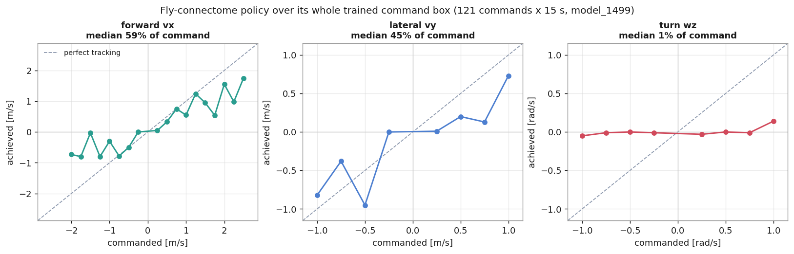
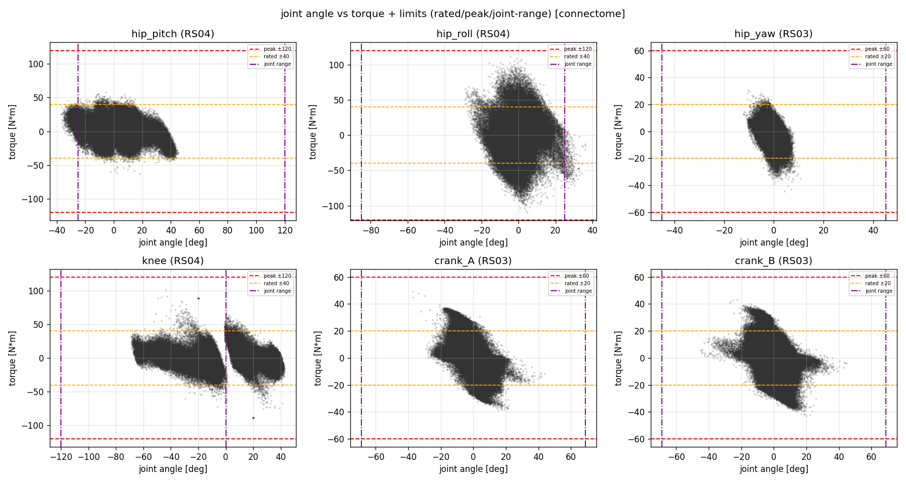
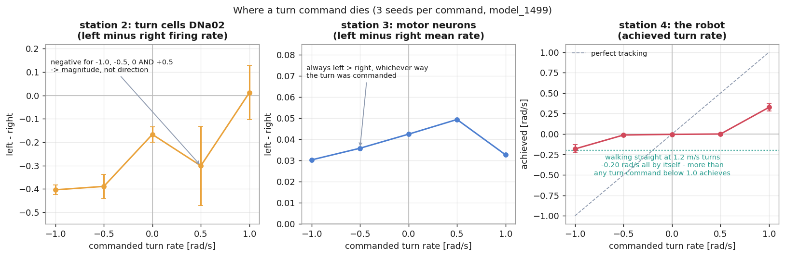
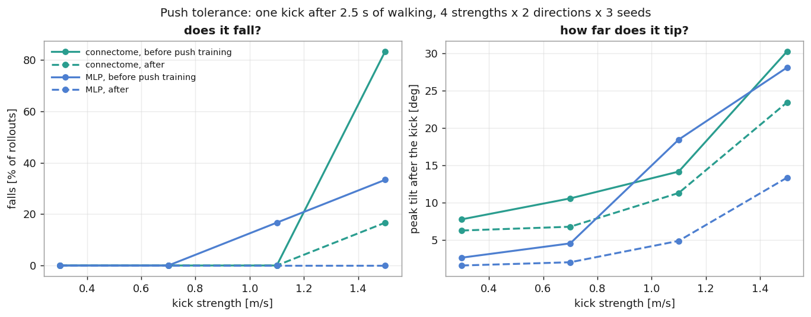
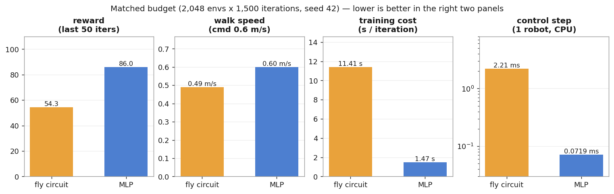

# 파리 커넥톰으로 두 발 로봇 걷기 — 그림으로 보는 결과 (2026-09-21)

> 약어를 쓰지 않는다. 처음 보는 사람도 읽을 수 있게 쓴다.
> 계획과 방법: [[151_fly_connectome_to_biped_plan]] · 런별 정식 리포트는 각 노트
> 그림은 전부 `analysis/connectome/figures.py` 가 **이미 측정된 파일에서** 그린다 —
> 새 굴림을 하지 않으므로 문서의 숫자와 그림의 숫자가 어긋날 수 없다.
> (그림 라벨이 영어인 이유: 이 프로젝트의 플롯 글꼴은 한글을 네모로 그린다.)

---

## §1 한 문단 요약

초파리 수컷 중추신경계 공개 자료에서 **가운뎃다리 회로**(뉴런 4,709개 · 연결 153,455개)를
떼어다 두 발 로봇의 정책으로 썼다. **배선은 파리 것 그대로 고정**하고, 연결의 세기와
입·출력 어댑터만 강화학습으로 바꿨다. 결과는 세 줄이다.

1. **걷는다.** 명령 0.6 m/s 에 0.49 ± 0.02 m/s. 배선을 섞은 통제군 둘은 같은 예산에서
   **걷지 못한다**(0.01 / 0.00 m/s) — 걷게 만드는 것은 **특정 배선**이다.
2. **성능으로는 진다.** 같은 예산의 보통 신경망이 보상·속도·비용 전부 앞선다.
3. **회전을 못 한다.** 회전 명령 달성률이 명령 상자 전체에서 **1 %** 다. 왜 그런지는
   §4 에서 신호를 네 지점에서 재어 자리를 좁혔다.

---

## §2 명령을 얼마나 따라가나 — 학습한 명령 범위 전체

정책이 학습한 명령 범위를 **121개 명령**으로 훑고 각 명령을 **15초씩** 유지했다
(90,750 스텝 = 로봇 시간 30분). 짧게 재면 과도상태만 보여 결론이 뒤집힌 전례가 있어,
이 프로젝트의 표준은 명령당 15초다.

| 축 | 달성률 중앙값 | 읽는 법 |
|---|--:|---|
| 앞뒤 vx | **59 %** | 점선(완벽 추종)보다 계속 아래. 게다가 **단조롭지 않다** — 0.75 는 100 % 인데 1.75 는 31 % |
| 좌우 vy | **45 %** | 같은 모양 |
| 회전 wz | **1 %** | 가로로 누워 있다. 명령을 바꿔도 결과가 안 변한다 |

가운데 칸의 −0.5 가 190 % 로 튀는 것처럼 **군데군데 되는 지점**이 있는 모양이지,
명령 크기에 비례해 속도가 올라가는 모양이 아니다.

> 원자료 `analysis/out/cnx_real_fc.npz` (112 MB) · 추종표 `analysis/out/cnx_real_fc_track.txt`

---

## §3 모터에 걸리는 힘

*관절 각도(가로) 대 토크(세로). 주황 점선이 연속 정격, 빨강 점선이 순시 최대, 보라 일점쇄선이 관절 가동범위다. **그림은 시뮬레이터 원값이고, 아래 표는 실물 환산 계수 ×1.15 를 적용한 값**이라 표 쪽이 조금 크다.*

같은 측정에서 관절 6종의 토크를 보면 **엉덩이 좌우 관절(hip_roll)이 순시 최대치를 꽉
채운다** — 120.3 N·m 대 한계 120. 다만 발열 쪽은 여유가 있어(64 °C) 지속 과부하가 아니라
**순간 첨두**다.

| 관절 | 모터 | 실효값/정격 | 순시/최대 | 열 |
|---|---|--:|--:|--:|
| hip_pitch | RS04 | 11.4/40 (29 %) | 62.7 (52 %) | 35 °C |
| **hip_roll** | RS04 | 22.8/40 (57 %) | **120.3 (100 %)** | 64 °C |
| hip_yaw | RS03 | 5.8/20 (29 %) | 44.6 (74 %) | 35 °C |
| knee | RS04 | 11.2/40 (28 %) | 100.7 (84 %) | 34 °C |
| crank_A | RS03 | 9.7/20 (49 %) | 49.5 (82 %) | 53 °C |
| crank_B | RS03 | 11.8/20 (59 %) | 43.2 (72 %) | 67 °C |

> ★ **이 숫자를 하드웨어 설계에 쓰지 않는다.** 커넥톰 가지는 연구 질문용이고, 설계 하중은
> 본선 학습(v7/v8 계열, 16,384환경 × 30,000반복)에서만 뽑는다. 여기 100 % 는 "이 정책이
> 그렇게 움직인다"는 **정책 특성**이지 설계 요구가 아니다.

---

## §4 ★ 회전 명령은 어디서 죽는가

회전이 1 % 라는 것만으로는 고칠 수 없다. 그래서 같은 신호를 **네 지점**에서 쟀다 —
명령 → 회전 지령세포 → 좌우 운동뉴런 → 로봇. 명령 8개 × **시드 3회** × 8초.

**왼쪽 칸 — 지령세포는 반응한다, 그런데 방향을 못 싣는다.**
회전을 지시하는 세포(DNa02)는 이 회로에 **왼쪽 1개, 오른쪽 1개뿐**이다. 4,709개 중 둘이
회전 전체를 나른다. 전진·후진·보행구동 신호도 얇지만 그쪽은 **좌우가 같은 신호**라 한
통로로 족하다 — 회전만이 **좌우 차이**를 실어야 한다. 그런데 좌−우 값이 −1.0, −0.5, 0,
**그리고 +0.5 에서도 모두 음수**다. 즉 명령의 **세기**에는 반응하고 **방향**에는 반응하지 않는다.

**가운데 칸 — 운동뉴런 단계에서 명령 의존성이 사라진다.**
좌−우가 어느 명령에서나 +0.03 ~ +0.05 이고 **항상 왼쪽이 더 밝다**. 명령이 만드는 차이가
아니라 **고정된 치우침**이다.

**오른쪽 칸 — 그래서 실제로 도는 것은 양 끝뿐이다.**
−1.0 에서 −0.18, +1.0 에서 +0.33. 가운데(±0.5)는 0 이다. 그리고 점선(teal)이 이 그림의
핵심이다 — **똑바로 1.2 m/s 로 가라고만 해도 −0.20 rad/s 로 돈다.** 회전 명령 0.5 가
만들어 내는 −0.013 보다 **15배 크다**.

> **이 정책에서 몸통 회전은 명령이 만드는 것이 아니라 걸음의 부산물이다.**
> 지금까지 "직진 명령에 몸이 돈다"고 적어 온 것보다 정확한 진술이다.

### 원인은 아직 고르지 않았다

세 가설이 남고, 이 측정만으로는 고를 수 없다.

| 가설 | 내용 | 이 측정과 맞는 점 |
|---|---|---|
| ⓐ 통로가 얇다 | 뉴런 2개로 좌우 차이를 싣는 것이 학습으로 닿을 수 있는 해가 아니다 | 통로가 실제로 2개 |
| ⓑ 디코더가 평균한다 | 운동뉴런을 근육별로 묶어 읽으면서 좌우 차이가 지워진다 | 운동뉴런 좌−우가 명령과 무관하게 일정 |
| ⓒ 학습이 거기까지 안 갔다 | 1,500반복이 전진을 얻는 데 다 쓰였다 | 전진은 되고 회전만 안 됨 |

**가장 싸게 가르는 방법**: 배선과 인코더는 그대로 두고 **디코더만 자유 선형으로 바꾼
단일 변인 비교**(`PYG_CONNECTOME_DECODER=linear`, 같은 예산 1,500반복). ⓑ 가 맞으면
회전이 살아나고, 아니면 ⓐ·ⓒ 로 좁혀진다. 할일 #69.

> 원자료 `analysis/out/turn_probe_s3.json` · 도구 `analysis/connectome/turn_probe.py`

---

## §5 밀어도 버티나

명령 0.6 m/s 로 2.5초 걷게 한 뒤 **한 번 민다**(학습이 쓰는 것과 같은 방식으로 몸통 속도에
충격을 더한다). 세기 0.3 / 0.7 / 1.1 / 1.5 m/s × 앞·옆 × 시드 3회, 민 뒤 4초를 지켜본다.

| 정책 | 모든 방향 무낙상 한계 | 전체 낙상 | 1.5 m/s 앞밀기 기울어짐 |
|---|--:|--:|--:|
| 파리 회로 · 밀기학습 **전** | **1.1 m/s** | 5/24 | 35.7° |
| 파리 회로 · 밀기학습 **후** | 1.1 m/s | **1/24** | 29.3° |
| 보통 신경망 · **전** | 0.7 m/s | 3/24 | 35.2° |
| **보통 신경망 · 후** | **1.5 m/s** | **0/24** | **18.6°** |

두 가지가 보인다.

1. **밀기를 배우기 전에는 파리 회로가 더 튼튼하다** — 1.1 대 0.7 m/s. 속도·보상에서 진 것과
   **반대 방향**이다.
2. **같은 훈련이 보통 신경망에 훨씬 크게 남는다** — 한계가 두 배 이상 오르고 낙상이 0 이 되며,
   걷는 속도까지 0.60 → 0.64 로 좋아진다. 파리 회로는 낙상만 5/24 → 1/24 로 줄고 한계는
   제자리, 속도는 0.49 → 0.43 으로 **오히려 12 % 내렸다**.

즉 **학습 후에는 순서가 뒤집힌다.** "파리 배선이 외란에 강하다"는 **학습 전 한정** 주장이다.

---

## §6 보통 신경망과 정면 비교 (같은 예산)

같은 환경·보상·커리큘럼·씨앗으로 **2,048환경 × 1,500반복**씩 돌린 둘을 나란히 놓는다.

| | 파리 회로 | 보통 신경망 | |
|---|--:|--:|---|
| 학습 파라미터 | 211,571 | 189,336 | 비슷 (+12 %) |
| 고정 배선(시냅스) | 153,455 | 0 | — |
| 보상 | 54.3 | **86.0** | 신경망 +58 % |
| 걷기 (명령 0.6) | 0.49 m/s | **0.60 m/s** | 신경망 +22 % |
| 10초간 방향 틀어짐 | **−35°** | +46° | 파리 회로 (약간) |
| 학습 반복당 | 11.41 s | **1.47 s** | 신경망 7.8배 싸다 |
| 제어 한 걸음(로봇 1대) | 2.21 ms | **0.072 ms** | 신경망 30.7배 |

> ★ **정정 기록**: 2026-09-19 이전 문서에는 "파리 회로가 더 빠르다(0.65 대 0.38)"고 적혀
> 있었다. 그때 비교한 신경망은 **예산이 8분의 1**(1,024환경 × 300반복)이었다. 같은 예산으로
> 다시 돌려 얻은 것이 위 표이고, 옛 주장은 철회했다.

**파라미터로는 더 크지 않다**(+12 %). 느린 이유는 크기가 아니라 **시간 깊이** — 제어 주기
한 번마다 15만 개 연결 위를 네 번 훑는다. 그리고 **실기에는 들어간다**: 제어 주기 20 ms 에
한 걸음 2.21 ms 로 예산의 11 % 다.

---

## §7 그럼 왜 이걸 하나

성능이 아니다. 두 가지다.

1. **된다는 사실 자체** — 실제 동물의 다리 회로가 사람이 만든 두 발 로봇을 걷게 한다.
   그리고 그 공은 **배선에 있다**: 뉴런·연결 수·차수 분포까지 똑같이 두고 **연결 상대만**
   섞은 통제군이 같은 예산에서 걷지 못한다(0.01 m/s).
2. **들여다볼 수 있다** — 학습이 끝난 정책을 **이름 붙은 세포 단위**로 본다. §4 가 그 예다.
   보통 신경망이었다면 "회전이 안 된다"에서 멈췄을 텐데, 여기서는 **DNa02 두 개가 방향을
   못 싣고 운동뉴런까지 가지 못한다**까지 말할 수 있고, 그래서 **다음에 뭘 바꿀지**가 나온다.

회로를 잘라 본 시험도 같은 이유로 가능했다 — 시냅스를 끊으면 0.9초 만에 넘어지고,
운동뉴런 배정을 섞어도 같다([[151_fly_connectome_to_biped_plan]] §5d).

---

## §8 다음

| 순서 | 무엇 | 왜 |
|---|---|---|
| 1 | 디코더만 자유 선형으로 바꾼 단일 변인 비교 (#69) | 회전 원인 세 가설 중 ⓑ 를 가장 싸게 가른다 |
| 2 | 최대 무작위화 유지 구간을 늘린 팔 (#61) | 밀기 학습에서 덜 얻은 것이 **예산**인지 **자유도**인지 |
| 3 | 영상 2종 (#53) | 학습 경과 누적 + 최종 정책 시연, 실시간·부하 가시화 |

## 관련 문서

- 계획·통제군 설계·학습 구조 설명: [[151_fly_connectome_to_biped_plan]]
- 런별 정식 리포트: [[2026-09-18_cnx_real_0918_1913]] · [[2026-09-19_cnx_rewired_0919_0116]] ·
  [[2026-09-19_cnx_random_0919_0631]] · [[2026-09-19_mlp_pre_0919_1121]] ·
  [[2026-09-19_mlp_push_0919_1121]] · [[2026-09-19_cnx_push_0919_1121]]
- 그림 생성: `mujoco-sim/mjlab/analysis/connectome/figures.py`
