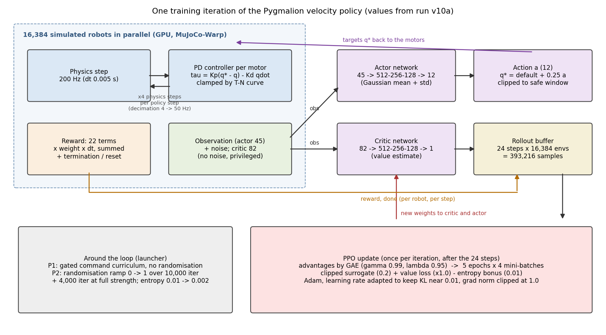
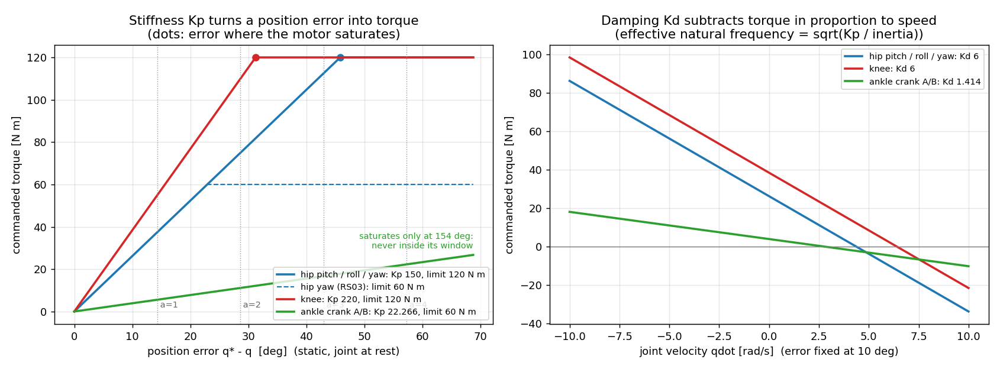
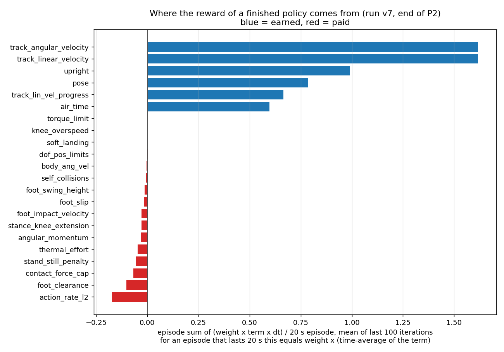
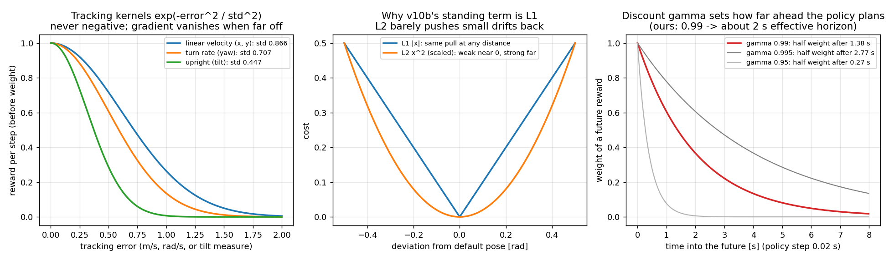
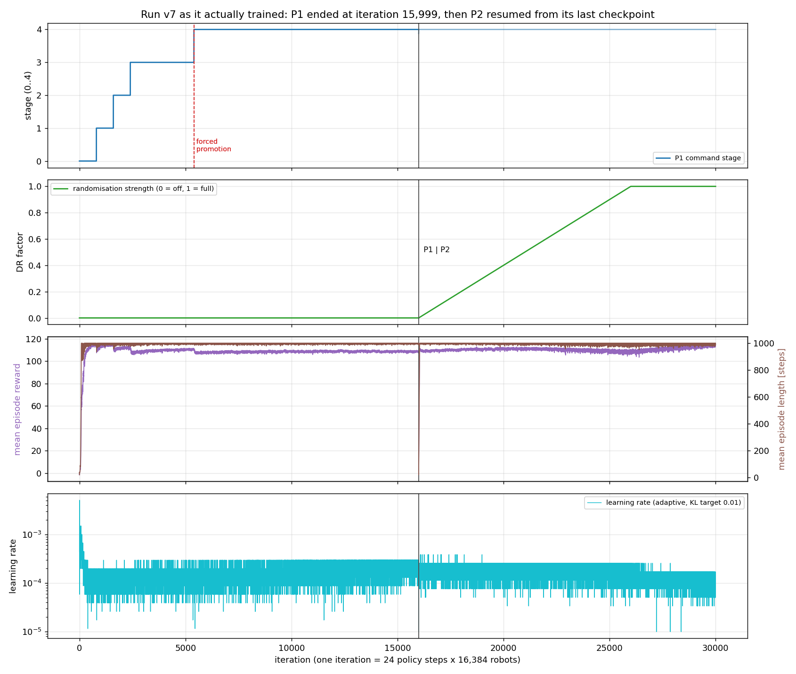

# 155. 학습 전 과정 안내서 — 무엇이, 어떻게, 왜 들어가는가

작성: 2026-09-25 · 사용자 요청: *"학습 전 과정과 학습에 필요한 파라미터들에 무엇이 어떻게 왜 들어가는지
학습과 이해해 응용할 수 있도록 도와줘"*

> 약어를 쓰지 않습니다. 처음 나오는 전문 용어는 한국어 풀이 + 표준 영어 용어를 함께 적습니다.
> **모든 숫자는 지금 돌고 있는 v10a 의 실제 설정 파일**(`logs/rsl_rl/pygmalion_velocity/2026-09-25_16-56-05_legonly_ab_v10a_stand01_p1/params/{env,agent}.yaml`)
> **과 v7 의 실제 학습 기록에서 뽑았습니다.** 그림은 `tools/notes/training_guide_figures.py` 로 다시 그릴 수 있습니다.

---

## 0. 이 문서를 읽는 법

세 층으로 되어 있습니다. 순서대로 읽으면 됩니다.

| 층 | 절 | 얻는 것 |
|---|---|---|
| ① 큰 그림 | §1 ~ §2 | 한 번의 학습 반복 안에서 무슨 일이 일어나는지, 시간 척도 |
| ② 부품별 사전 | §3 ~ §11 | 파라미터 하나하나가 **무엇이고, 어떻게 쓰이고, 왜 이 값인지**, 그리고 **틀리면 어떤 증상이 나는지** |
| ③ 응용 | §12 ~ §15 | 학습이 건강한지 읽는 법, 평가하는 법, 바꾸고 싶을 때의 절차, 연습문제 |

한 줄 요약: **"시뮬레이션 안의 로봇 16,384 대가 20초짜리 시도를 반복하며, 보상 점수를 더 받는 쪽으로
신경망을 조금씩 고친다. 처음엔 쉬운 명령만 주다가(1단계), 다 배우면 세상을 일부러 흔들어(2단계)
실물에서도 버티게 만든다."**

---

## 1. 큰 그림 — 학습 반복 한 번

학습은 **반복(iteration)** 의 연속입니다. 반복 한 번은 두 부분입니다.

1. **데이터 모으기(rollout)** — 16,384 대의 로봇이 각자 24 걸음(정책 단계)씩 움직입니다.
   매 걸음마다
   - 로봇이 자기 상태를 **관측(observation)** 하고,
   - **행동 신경망(actor, 정책 policy)** 이 12 개 모터의 **목표 각도**를 정하고,
   - 모터 안의 **비례-미분 제어기(PD controller)** 가 그 목표를 향해 토크를 내고,
   - 물리 엔진이 4 번(0.005 초 × 4 = 0.02 초) 계산하고,
   - 그 결과로 **보상(reward)** 점수와 "넘어졌나(done)" 가 나옵니다.
   → 24 × 16,384 = **393,216 개의 (관측, 행동, 보상) 묶음**이 쌓입니다.
2. **고치기(update)** — 모은 묶음으로 **근접 정책 최적화(Proximal Policy Optimization, PPO)** 가
   두 신경망을 고칩니다.
   - **가치 신경망(critic)** 은 "이 상태에서 앞으로 받을 보상 합이 얼마쯤일까"를 맞히도록 배우고,
   - **행동 신경망(actor)** 은 "평소보다 결과가 좋았던 행동"을 더 자주 하도록 조금 움직입니다.
   그 다음 반복은 고쳐진 신경망으로 다시 데이터를 모읍니다.

우리 학습은 이것을 **1단계 16,000 회 이하 + 2단계 14,000 회 ≈ 3만 회** 합니다.
3만 회 × 393,216 = **약 118억 걸음 ≈ 로봇 한 대로 7.5 년**어치 경험입니다.

### 왜 신경망이 둘인가 — 비대칭 행동자-비평자 (asymmetric actor-critic)

| | 행동 신경망 (actor) | 가치 신경망 (critic) |
|---|---|---|
| 입력 크기 | **45** | **82** |
| 실물에 올라가나 | **예** — 실물 센서로 얻을 수 있는 것만 봄 | 아니오 — 학습 중에만 씀 |
| 입력에 잡음 | 있음 (실물 센서 흉내) | 없음 |
| 더 보는 것 | — | 몸통 선속도, 발 높이·체공시간·접촉·접촉힘, **이번 판에 뽑힌 마찰·질량·무게중심·밀기** |

가치 신경망은 "정답지"를 보고 채점만 하는 선생님입니다. 실물에는 행동 신경망만 올라가니 가치 신경망이
무엇을 봐도 배포에는 문제가 없고, 채점이 정확할수록 행동 신경망이 빨리 배웁니다. 이 구조를 우리는
`PYG_STUDENT_TEACHER=1`, `PYG_CRITIC_DR_OBS=1` 로 켭니다.

**왜 1단계부터 가치 신경망에 무작위화 값을 넣는가**: 2단계에서 입력 크기가 바뀌면 2단계가 1단계의
가치 신경망과 최적화기 상태를 그대로 이어받지 못하고(행동 신경망만 옮겨 담고) 가치 함수를 버려야 합니다.
처음부터 82 로 고정하면 2단계가 **전부 이어받습니다** (`analysis/run_v2_scratch.py` 머리말).

---

## 2. 시간 척도 — 숫자 다섯 개

| 이름 | 값 | 어디서 | 왜 이 값 |
|---|---|---|---|
| 물리 시간 간격 (`sim.mujoco.timestep`) | **0.005 초 (200 Hz)** | env.yaml | 접촉·폐루프 발목 구속이 안정적으로 풀리는 크기. 더 키우면 발이 바닥을 뚫거나 튄다 |
| 제어 주기 배수 (`decimation`) | **4** → 정책 **50 Hz** (0.02 초) | env.yaml | 사람 보행 한 걸음(약 1 초)에 50 번 결정. 실물 제어 루프와 같아야 배포 때 어긋나지 않음 |
| 시도 길이 (`episode_length_s`) | **20 초 = 1,000 정책 단계** | env.yaml | 명령이 3~8 초마다 바뀌므로 한 시도에 명령 서너 개를 겪음 |
| 명령 재추첨 (`resampling_time_range`) | **3 ~ 8 초** | env.yaml | 명령 전환(출발·정지·방향 바꾸기)도 배워야 함 |
| 반복당 걸음 (`num_steps_per_env`) | **24 단계 = 0.48 초** | agent.yaml | 짧게 자주 고친다. 대신 16,384 대라 표본 수는 충분 |

**응용**: 제어 주기를 바꾸면(예: 실물이 100 Hz 로만 돈다면) `decimation` 을 2 로 — 그러면 할인율(§11)과
보상의 시간 척도도 같이 봐야 합니다. 모든 보상에는 시간 간격이 곱해지므로(`scale_rewards_by_dt: True`)
"초당 얼마" 단위로 맞춰져 있어 주기를 바꿔도 가중치 균형은 유지됩니다.

---

## 3. 로봇과 모터 — 행동이 토크가 되기까지

### 3-1. 행동 → 목표 각도

행동 신경망이 내는 값 $a$(관절당 한 숫자, 12 개)는 **각도 변화량의 단위**입니다.

$$q^{*} = q_{\text{default}} + 0.25 \cdot a \qquad (\text{그 다음 안전 창으로 자름})$$

| 파라미터 | 값 | 왜 |
|---|---|---|
| 행동 크기 (`actions.joint_pos.scale`) | **0.25 rad (14.3°) / 단위** | 표준 보행 설정(Isaac Lab G1, Unitree)과 같음. 2026-07-02 전에는 `0.25 × 한계토크 / 강성`이라 관절마다 0.8~1.8 이었고, 정책이 1 만 내도 100° 넘게 움직이라는 명령이 되어 동작이 거칠고 토크 요구가 부풀었음 (`pygmalion_constants.py` 1128행 주석) |
| 기준 자세 (`use_default_offset`) | 행동 0 = 기본 자세 | 신경망 출력 0 근처가 "서 있는 자세"가 되어 학습 초기가 안정 |
| 안전 창 (`PYG_SAFE_TARGET_CLIP=1`) | 관절 범위 중심 ± 0.5 × 범위 × 0.9 | 정책이 모델 관절 한계에 목표를 박지 못하게. 시뮬레이터의 소프트 한계와 **같은 공식** — 정책이 지나는 자르기와 시뮬레이터가 강제하는 자르기가 한 계약 (무릎 [0,120]° → [6,114]°) |

### 3-2. 목표 각도 → 토크: 비례-미분 제어

$$\tau = K_p (q^{*} - q) - K_d \dot{q}, \quad \text{그 뒤 } |\tau| \le \min(\text{한계 토크}, \text{토크-속도 곡선})$$

| 관절 | 모터 | $K_p$ 강성 | $K_d$ 감쇠 | 한계 토크 | 행동 1 단위(14.3°)가 만드는 정지 토크 |
|---|---|--:|--:|--:|--:|
| 엉덩이 앞뒤(pitch)·좌우(roll) | RS04 | 150 | 6 | 120 N·m | 37.5 N·m |
| 엉덩이 비틀기(yaw) | RS03 | 150 | 6 | 60 N·m | 37.5 N·m |
| 무릎 | RS04 | **220** | 6 | 120 N·m | 55 N·m (행동 2.2 단위에서 포화) |
| 발목 크랭크 A/B | RS03 | 22.3 | 1.41 | 60 N·m | 5.6 N·m |

- **강성이 뜻하는 것**: 목표와 실제가 1 rad 벌어지면 몇 N·m 로 당기는가. 크면 목표를 잘 따라가지만
  작은 잡음에도 큰 토크 → 떨림·충격. 작으면 물렁해서 중력에 처짐.
- **감쇠가 뜻하는 것**: 움직이는 속도에 비례해 브레이크. 없으면 목표를 지나쳐 출렁임.
- **무릎이 더 센 이유**: 웅크린 자세에서 몸무게를 가장 많이 받는 관절.
- **크랭크 값이 작은 이유**: 발목은 크랭크 두 개가 막대로 함께 미는 구조(2-RSU)입니다. 발목에서 원하는
  강성(G1 급 28.5)을 지렛대 비율 1.25 를 거쳐 크랭크 쪽으로 옮기면 가상일 원리로
  $K_{\text{crank}} = K_{\text{ankle}} \cdot r^2 / 2 = 28.5 \times 1.25^2 / 2 = 22.3$ 이 됩니다
  (`pygmalion_constants.py` 714~721행). 그래서 창 안에서는 강성만으로 포화하지 않습니다.
- **토크-속도 곡선 (`PYG_TN=1`)**: 실제 모터는 빨리 돌수록 낼 수 있는 토크가 줄어듭니다. 실측 곡선
  (RS03 37 점, RS04 22 점)으로 매 순간 상한을 깎습니다. RS04 무부하 속도는 **실측 19.9 rad/s** 입니다
  (시뮬레이터 기본값 33 이 아님 — 그래서 `knee_overspeed` 벌점의 문턱도 19.9).
- **모터 실측값 (`PYG_MOTOR_MEAS=1`)**: 회전자 관성(armature) 0.064~0.077, 쿨롱 마찰 0.25~0.52 N·m,
  점성 0.025~0.028 — 모터 벤치에서 잰 값. 이게 틀리면 시뮬레이터의 관절이 실물보다 가볍게 움직여
  배포 때 어긋납니다.

**우리가 겪은 실패**: 강성·감쇠를 회전자 관성만으로 계산했더니 엉덩이의 실효 대역폭이 0.56 Hz 로 너무
물렁해 몸이 흔들렸습니다. 지금 값(150/220)은 그 뒤 G1 급으로 올린 것입니다.

### 3-3. 우리 로봇에만 있는 것 — 폐루프 발목

발목 관절(pitch·roll)은 **수동**입니다 — 모터가 없고, 크랭크 A·B 가 막대로 밀어 움직입니다
(`PYG_ANKLE_MODE=AB`). 시뮬레이터에서는 `equality/connect` 구속으로 막대 연결을 표현합니다. 그래서
정책은 "발목 각도"가 아니라 **크랭크 각도**를 명령하고, 관측도 **모터(크랭크) 각도**를 봅니다 —
실물 엔코더가 있는 곳이 모터 쪽이기 때문입니다.

---

## 4. 관측 — 로봇이 무엇을 보는가

### 4-1. 행동 신경망 입력 45 개 (실물에 올라가는 것)

| 항목 | 개수 | 잡음 (균등분포 ±) | 왜 필요 | 왜 이 잡음 |
|---|--:|---|---|---|
| 몸통 각속도 | 3 | 0.2 rad/s | 기울어지는 중인지 | 관성측정장치(IMU) 자이로 잡음 흉내 |
| 중력 방향 (몸통 기준) | 3 | 0.05 | 얼마나 기울었는지 | IMU 자세 추정 오차 |
| 모터 각도 이력 (지금 + 직전) | 2 × 12 = 24 | 0.01 rad | 자세 + **두 값의 차이로 속도를 스스로 계산** | 엔코더 오차 |
| 직전 행동 | 12 | 없음 | 자기가 무엇을 명령했는지 (부드러움) | 자기 출력이라 정확 |
| 명령 (앞뒤·좌우·회전 속도) | 3 | 없음 | 무엇을 하라는지 | 명령은 정확 |

**행동 신경망에 관절 속도가 없는 이유**: 실물 관절 속도는 엔코더를 미분한 값이라 잡음이 큽니다.
대신 각도 두 개를 주면 신경망이 필요한 만큼 알아서 씁니다. **몸통 선속도도 없습니다** — 실물에서 IMU 로
정확히 재기 어렵기 때문입니다. 이 둘은 가치 신경망만 봅니다.

### 4-2. 가치 신경망 입력 82 개

위의 것들(잡음 없이) + 몸통 선속도, 관절 각도·속도, 발 높이, 발 체공시간, 발 접촉 여부, 발 접촉힘,
**이번 시도에 뽑힌 마찰·질량·무게중심·밀기·무작위화 세기**.

### 4-3. 입력 정규화 (`obs_normalization: true`)

입력마다 평균·분산을 학습 내내 추적해 **평균 0, 분산 1** 로 맞춘 뒤 넣습니다. 각속도(수 rad/s)와 각도
(0.1 rad)처럼 크기가 다른 값을 신경망이 공평하게 다룹니다. 이 통계는 저장본(checkpoint)에 같이 들어가고,
**배포 때도 같은 통계로 정규화해야** 합니다(배포 계약 `analysis/deploy_contract.py` 가 검사).

**응용**: 관측을 하나 더하려면 — ① 실물에서 그 값을 **같은 주기·같은 좌표계·같은 단위**로 얻을 수 있는가,
② 잡음 크기는 실측 기반인가, ③ 입력 크기가 바뀌므로 기존 저장본에서 이어 학습할 수 없다(처음부터),
를 먼저 확인합니다.

---

## 5. 명령 — 무엇을 하라고 시키는가

| 파라미터 | 값 | 뜻 |
|---|---|---|
| 앞뒤 속도 범위 | 시작 ±0.8 m/s → 마지막 −2.0 ~ +2.5 | 커리큘럼이 넓힘 (§8) |
| 좌우 속도 범위 | ±0.5 → ±1.0 m/s | 〃 |
| 회전 속도 범위 | ±0.5 → ±1.0 rad/s | 〃 |
| 서 있는 환경 비율 (`PYG_REL_STANDING`) | **0.1** (v7 은 0.3) | 명령 0 을 받는 환경의 비율 |
| 방향유지 환경 비율 (`PYG_REL_HEADING`) | **0.3** (v5·v6b 는 0.8) | "저쪽을 봐라"를 받는 환경. 회전 명령 = 0.5 × 방향 오차 |

### ★ 이 두 비율이 지난 열흘을 결정했다 (2×2 실험의 결론)

- **방향유지 0.8** 이면 80 % 환경이 "특정 방향을 봐라"만 받고, 그 방향에 가까워지면 회전 명령이 0 에
  가까워집니다. **"이 속도로 돌아라"를 배울 표본이 부족** → v5·v6b·v8 의 제자리 회전이 명령의 12~16 % 만
  됨. 0.3 으로 되돌린 v7 은 46 %.
- **서 있기 0.3** 이면 서기는 좋아지지만, 커리큘럼 게이트(§8)가 **서 있는 환경까지 포함한 평균 오차**로
  판정합니다. 서 있는 환경은 오차가 거의 0 이라 **초반 기준은 쉽게 낮아지고, 명령 상자가 넓어진 후반에는
  그 낮은 기준을 못 넘어** 막힙니다 (`curriculums.py` 270~281행 주석이 정확히 이 현상을 적고 있음).
  v6b·v7·v8 모두 3→4 단계에서 3,000 회 최대 체류 후 **강제 승급** — 그림 §8 의 빨간 점선.
- 그래서 지금 A/B v10 은 서 있기를 0.1 로 되돌리고, 서기 품질은 **보상 항 하나**(서 있을 때만 켜지는
  L1 자세 편차)로 지킬 수 있는지 봅니다.

**교훈**: 명령 분포는 보상만큼 강력한 설계 변수입니다. "무엇을 얼마나 자주 시키는가"가 곧 "무엇을
배우는가"입니다.

---

## 6. 보상 — 무엇을 잘했다고 칠 것인가

### 6-1. 구조

$$r_t = \sum_i w_i \cdot f_i(\text{상태}) \cdot \Delta t$$

- 22 개 항, 각자 가중치 $w_i$. 양수 = 상, 음수 = 벌.
- $\Delta t = 0.02$ 를 곱하므로 가중치는 "초당" 단위입니다.
- 학습 기록의 `Episode_Reward/<항>` = 한 시도에서 그 항의 합 ÷ 20 초. **20 초를 다 채운 시도라면 = 가중치 ×
  그 항의 시간 평균.** 예: `track_linear_velocity` 1.62 ÷ 가중치 2 = 평균 추종 점수 0.81.

완성된 정책(v7 끝)은 점수의 대부분을 **추종(속도·회전) + 직립 + 자세**에서 벌고, 벌점은 대부분 작습니다.
**벌점 항이 상보다 커지면** 정책은 "아무것도 안 하고 넘어지지 않기"를 배웁니다 — 그래서 벌점은 작게
시작합니다.

### 6-2. 세 종류의 항

**① 목표 항 (task)** — 무엇을 하라는가.

| 항 | 가중치 | 모양 | 왜 이 모양 |
|---|--:|---|---|
| `track_linear_velocity` | +2 | $\exp(-e^2/0.866^2)$ | 오차 0 에서 최대 1, 항상 0 이상 → 넘어지는 것보다 나쁘게 걷는 게 낫다 |
| `track_angular_velocity` | +2 | $\exp(-e^2/0.707^2)$ | 〃. 폭(std)이 좁을수록 정밀하게 요구 |
| `track_lin_vel_progress` | +1 | 명령 방향 실제 속도, 명령 크기에서 상한 | 빠른 명령에서 "그냥 서 있기"가 국소 최적이 되는 것 방지 |
| `stand_still_penalty` | −1 | 진행률 < 30 % 면 고정 벌점 | 〃 |

주의 — 지수 모양의 약점: 오차가 폭의 두 배를 넘으면 기울기가 거의 0 이라 "어느 쪽으로 가면 나아지는지"
신호가 사라집니다. 그래서 커리큘럼으로 **쉬운 명령부터** 줍니다.

**② 생존·자세 항 (regularization)** — 몸을 제대로 가누라.

| 항 | 가중치 | 무엇 |
|---|--:|---|
| `upright` | +1 | 몸통 직립, $\exp$ 모양 (폭 0.447) |
| `pose` | +1 | 기본 자세에서의 L2 편차 (걷는 중/빠를 때 문턱을 달리 둠) |
| `dof_pos_limits` | −1 | 관절 한계 넘으면 L1 |
| `self_collisions` | −1 | 자기 몸끼리 닿으면 (10 N 이상) |
| `stance_knee_extension` | −2 | 딛고 있는 다리 무릎이 25° 넘게 굽으면 초과분² — 웅크린 걸음 방지 |
| `body_ang_vel` −0.05, `angular_momentum` −0.02 | | 몸통 흔들림·쓸데없는 회전 |

**③ 동작 품질·하중 항 (shaping)** — 이 프로젝트가 **하중을 재기 위해** 특히 신경 쓰는 것.

| 항 | 가중치 | 무엇 | 왜 |
|---|--:|---|---|
| `action_rate_l2` | −0.1 | 행동 변화량² | 떨림 억제. 완성 정책에서 가장 큰 벌점(−0.17) |
| `air_time` | +1 | 발 체공 0.05~0.5 초, 명령 > 0.5 에서만 | 발 질질 끌기 방지 |
| `foot_clearance` −2, `foot_swing_height` −0.25 | | 스윙 발 목표 높이 0.1 m | 걸려 넘어짐 방지 |
| `foot_slip` | −0.1 | 딛은 발 미끄러짐 | |
| `foot_impact_velocity` | −0.5 | 착지 직전 하강 속도² | 쿵쿵 걷기 → 충격 하중 ↓ |
| `contact_force_cap` | −0.01 | 발 반력 **420 N 초과분**(560 N 에서 상한) | 사뿐 착지. 상한이 있어 한 번의 큰 충격이 학습을 망치지 않음 |
| `soft_landing` | −1e-5 | 첫 접촉 반력 | 매우 약하게 |
| `thermal_effort` | −0.02 | $\sum (\tau / \tau_{\text{정격}})^2$ | **정격 토크로 나눠** 약한 관절이 과로하지 않게 부하를 나눔 |
| `knee_overspeed` | −0.5 | 무릎 속도 19.9 rad/s 초과분² | 실측 무부하 속도 넘는 걸음 금지 |
| `torque_limit` | 0 (꺼짐) | | |

> **설정 파일이 정본입니다.** 실험 노트 §1b 표의 "어떻게" 설명 문구는 자동 생성된 옛 문장이라 틀릴 수
> 있습니다 — 예: `contact_force_cap` 은 노트 문구에 600/800 이라 적혀 있지만 실제 설정은 **420/560**.
> 숫자는 언제나 `params/env.yaml` 에서 확인합니다.

### 6-3. 우리가 실제로 겪은 보상 실패 — 응용할 때 가장 중요한 부분

| 한 일 | 일어난 일 | 교훈 |
|---|---|---|
| 직접 설계한 보상 묶음 vs Unitree G1 기본 보상 | **G1 기본이 이김** | 검증된 기준선에서 시작하고, 한 번에 한 항씩 바꾼다 |
| 관절 각도 참조 궤적 추종(DeepMimic 식) | 위상이 안 맞아 오히려 나빠짐, 반복 실패 | 사람 궤적을 정답으로 박지 말 것 |
| 발끝 토크 직접 보상 | 수동 스프링 발끝을 정지 상태로 말아 **점수만 챙김** | 쉽게 흉내 낼 수 있는 양을 보상하면 흉내만 낸다 |
| 발목 밀기 일(토크×각속도) 보상, 상한 없이 | 반력 **11.5 배 체중**, 무릎·엉덩이 토크 한계에 붙음 | 곱으로 된 보상은 한쪽을 폭주시켜 해킹된다. 충격 상한을 **먼저** 넣을 것 |
| 속도 밴드 안에서 선형 벌점 | 속도와 무관한 벌점이 사실상 **거리 벌점**이 되어 해킹 | 벌점의 단위가 무엇에 비례하는지 끝까지 따져볼 것 |
| 몸통 높이 기준 없음 | 무릎 꿇기·까치발 같은 퇴화 자세 | 기본 자세 기준(anchor)은 필요 |

**원칙 (docs/62 의 12 확정원칙 중 보상 관련 요지)**: ① 목표 항이 점수의 대부분이어야 한다
② 벌점은 작게 시작해 필요한 만큼만 ③ 곱·일률 형태는 상한과 함께 ④ 보상을 바꾸기 전에 원인 조사 노트부터
(`docs/reward_research/` — 훅이 강제) ⑤ 한 번에 한 변인.

---

## 7. 종료와 재시작 — 언제 시도를 끝내는가

| 조건 | 값 | 왜 |
|---|---|---|
| 시간 끝 (`time_out`) | 20 초 | 정상 종료. **실패가 아니므로** 가치 신경망은 "그 뒤에도 계속 보상이 있었을 것"으로 계산 |
| 넘어짐 (`fell_over`) | 몸통 기울기 > **70°** (1.22 rad) | 복구 불가 |
| 몸통 낮음 (`low_base`) | 몸통 높이 < **0.7 m** | 주저앉음 |

재시작 때: 위치 ±0.5 m, 방향 아무 쪽(±180°), 높이 +0.01~0.05 m 에서 **기본 자세**로 시작
(`PYG_INIT_BENT=1`, `PYG_INIT_MID=1` — 무릎을 약간 굽힌 중간 자세).

**응용**: 종료 조건이 너무 엄하면(예: 30° 기울면 끝) 정책은 조금만 기울어도 끝나 **회복 동작을 배울 기회가
없습니다**. 너무 느슨하면 바닥을 기는 것도 "살아 있음"이 됩니다.

---

## 8. 커리큘럼 — 쉬운 것부터 (1단계의 핵심)

명령 상자를 5 단계로 넓힙니다. **시간이 아니라 성적표로** 승급합니다 (`PYG_GATED_CURRICULUM=1`).

| 단계 | 앞뒤 [m/s] | 좌우 [m/s] | 회전 [rad/s] |
|--:|---|---|---|
| 0 | ±0.8 | ±0.5 | ±0.5 |
| 1 | ±1.2 | ±0.6 | ±0.8 |
| 2 | ±1.6 | ±0.7 | ±1.0 |
| 3 | ±2.0 | ±0.85 | ±1.0 |
| 4 | −2.0 ~ +2.5 | ±1.0 | ±1.0 |

**승급 조건** — 최근 100 반복 동안 끝난 시도들로 판정 (`commands_vel_gated`):

| 조건 | 값 | 뜻 |
|---|---|---|
| 최소 체류 | 800 회 | 넓힌 직후 운 좋은 구간으로 승급하지 않게 |
| 추종 오차 | 정착 오차 ≤ **직전 단계 정착 오차 × 1.1** | "상자를 넓히기 전 실력으로 돌아왔는가" |
| 넘어짐 비율 | ≤ **0.5 %** | |
| 최소 표본 | 끝난 시도 64 개 이상 | |
| 최대 체류 | **3,000 회** → 조건과 무관하게 **강제 승급** | 게이트가 영영 안 열려 학습이 멈추는 것 방지 |

**왜 시간이 아니라 성적인가**: 예전에는 단계마다 4,000 회씩 고정이었는데, 상자를 넓힌 뒤 실제로 적응하는
데는 4~20 회면 충분했습니다. 나머지 약 3,980 회 × 4 단계는 이미 아는 것을 재확인하는 낭비였습니다.

**그림 읽기**: v7 은 0→3 단계를 약 2,400 회 안에 자력으로 통과했지만 3→4 에서 막혀 5,400 회에 강제
승급했습니다(§5 의 서 있는 비율 원인). 1단계 끝(15,999)에서 선이 끊기는 것은 2단계가 저장본에서 이어
시작했기 때문입니다.

---

## 9. 도메인 무작위화 — 일부러 세상을 흔든다 (2단계의 핵심)

시뮬레이터는 실물과 **반드시 다릅니다**. 그래서 학습 중에 물리값을 매번 바꿔, 정책이 "어떤 세상에서도
통하는" 동작을 배우게 합니다 — **도메인 무작위화(domain randomization)**.

| 무엇 | 최대 범위 | 언제 뽑나 | 왜 |
|---|---|---|---|
| 밀기 (속도 충격) | 앞뒤·좌우 ±0.7 m/s, 상하 ±0.4, 기울기 ±0.52 rad/s, 비틀기 ±0.78 | **1~3 초마다** | 부딪힘·실수 회복 |
| 발바닥 마찰 | 0.3 ~ 1.2 | 시도 시작 | 바닥 재질 모름 |
| 엔코더 영점 오차 | ±0.015 rad (0.86°) | 시도 시작 | 실물 영점은 완벽하지 않음 |
| 무게중심 | ±2.5 cm (수평), ±3 cm (수직) | 시도 시작 | 조립·배선 차이 |
| 링크별 질량·관성 (`PYG_INERTIAL_DR=1`) | `mass_dr_..._prototype-tempmass.json` 이 링크별로 정한 범위 | 시도 시작 | 3D 프린팅 밀도·볼트 무게 불확실 |

### 왜 1단계에서는 끄고, 2단계에서 천천히 켜는가

§8 그림의 두 번째 줄이 실제 세기입니다: 1단계 동안 0, 2단계 10,000 회에 걸쳐 0→1, 그 뒤 4,000 회 최대로 유지.

- 처음부터 세게 흔들면 **걷는 법 자체를 못 배웁니다** (어려운 문제를 처음부터 주는 셈).
- 1단계에서 걷기를 다 배운 뒤, 무작위화 세기를 **선형으로 올립니다** (`dr_levels`). 1단계가 언제 끝날지는
  성적에 달려 있어 미리 모르므로, 런처가 **1단계 실측 길이를 보고 2단계 무작위화 창을 계산**합니다
  (`PYG_DR_START_ITER = 1단계 끝`, `END = 끝 + 10,000`). 옛날에는 이걸 상수로 박았다가 1단계가 12,000 에서
  끝났는데 시작 시점이 20,000 으로 적혀 있어 **2단계 내내 세기가 0.33 에 머문 사고**가 있었습니다.
- 1단계에서 질량 무작위화 스위치(`PYG_INERTIAL_DR`)는 런처가 **일부러 뺍니다** — 1단계 플래그 표에
  `PYG_MASS_DR_JSON` 만 있고 `PYG_INERTIAL_DR` 이 없는 것은 정상입니다. 2단계 기록(v7·v8 의 2단계)에는
  둘 다 있고 설정 파일에 `inertial_dr_*` 항이 14 개 들어가 있습니다.
- 2단계 동안 **탐험 보너스(엔트로피 계수)를 0.01 → 0.002 로 줄입니다** — 이제 새로운 걸 찾기보다
  배운 걸 다듬을 때이기 때문입니다.

**응용**: 무작위화 범위는 **실측에 근거**해야 합니다. 너무 좁으면 실물에서 무너지고, 너무 넓으면 정책이
지나치게 조심스러워져(느리고 뻣뻣하게) 성능을 잃습니다. 새 항목을 넣을 때는 "실물에서 이 값이 실제로
얼마나 흔들리는가"부터 잽니다.

---

## 10. 신경망

| 파라미터 | 값 | 왜 / 틀리면 |
|---|---|---|
| 은닉층 (`hidden_dims`) | 512 → 256 → 128 | 보행 표준 크기. 작으면 복잡한 명령 조합을 못 담고, 크면 느리고 과적합 |
| 활성함수 | ELU | 음수 쪽이 부드러워 기울기가 안 죽음 |
| 행동 분포 | 가우스, **초기 표준편차 1.0**, 관절 공통이 아니라 관절별(12) 학습 | 처음엔 크게 탐험 → 학습되며 줄어듦. 기록의 `noise std` 가 이것. **너무 빨리 줄면 조기 수렴, 안 줄면 떨림** |
| 순환 신경망 | 없음 (`rnn_type: null`) | 모터 각도 이력 2 개로 충분하다고 판단. 기억이 필요한 과제(예: 접촉 추정)면 고려 |

---

## 11. 근접 정책 최적화 (PPO) — 고치는 방법의 손잡이들

| 파라미터 | 값 | 무엇 | 왜 이 값 | 틀리면 |
|---|---|---|---|---|
| 할인율 $\gamma$ (`gamma`) | **0.99** | 미래 보상을 얼마나 깎나 | 0.02 초 단위로 반감 약 1.4 초 — **한 걸음~두 걸음 앞**을 봄 (§6 그림 오른쪽) | 낮으면 근시안(당장 안 넘어지기만), 높으면 학습이 느리고 불안정 |
| 일반화 이점 추정 $\lambda$ (`lam`, GAE) | 0.95 | 이점 계산에서 실제 보상과 가치 추정의 섞는 비율 | 표준 | 1 에 가까우면 분산 ↑, 낮으면 가치 신경망 오차가 그대로 들어감 |
| 자르기 범위 (`clip_param`) | 0.2 | 한 번 고칠 때 행동 확률이 최대 ±20 % 만 바뀌게 | PPO 의 핵심 — 한 번에 너무 많이 바꿔 무너지는 것 방지 | 크면 불안정, 작으면 느림 |
| 학습률 (`learning_rate`, `schedule: adaptive`) | 시작 1e-3, **자동 조절** | | 한 번의 고침 전후 정책 차이(KL 발산)가 **목표 0.01** 을 넘으면 줄이고, 한참 밑이면 늘림 (§8 그림 네 번째 줄) | 기록에서 학습률이 바닥(1e-5)에 붙어 있으면 정책이 매번 너무 크게 변하려 한다는 신호 |
| 한 반복당 반복 학습 (`num_learning_epochs`) | 5 | 같은 데이터로 5 번 훑음 | | 많으면 오래된 데이터에 과적합 |
| 미니배치 수 (`num_mini_batches`) | 4 | 393,216 을 4 조각(각 98,304) | GPU 메모리와 기울기 잡음의 균형 | |
| 가치 손실 계수 (`value_loss_coef`) | 1.0 | 가치 신경망을 얼마나 세게 고치나 | | |
| 잘린 가치 손실 (`use_clipped_value_loss`) | 예 | 가치 추정도 한 번에 크게 못 바뀌게 | | |
| 엔트로피 계수 (`entropy_coef`) | 0.01 (2단계에서 → 0.002) | 무작위하게 행동하는 것에 주는 작은 상 | 탐험 유지 | 크면 끝까지 떨고, 0 이면 일찍 굳음 |
| 기울기 크기 상한 (`max_grad_norm`) | 1.0 | 한 번의 기울기가 너무 크면 잘라냄 | 드문 큰 사건(큰 충격 벌점)이 신경망을 망치지 않게 | |
| 씨앗 (`seed`) | 42 | 난수 시작점 | 재현성. **A/B 두 팔은 같은 씨앗** | GPU 연산 순서 때문에 비트 단위 재현은 원래 안 됨 |

**감 잡기**: PPO 파라미터는 거의 **표준값 그대로** 둡니다(Isaac Lab·rsl_rl 기본). 보행 결과를 바꾸는 것은
대부분 **보상·명령·무작위화·모터 모델**이지 PPO 손잡이가 아닙니다. PPO 를 만져야 하는 신호는 §12 의
건강도 지표가 이상할 때뿐입니다.

---

## 12. 학습이 건강한지 읽는 법

리뷰 루프가 게이트마다 노트 §2c 에 스냅샷을 적습니다 (`docs/27_training_review_loop.md` 체크리스트). 열마다 보는 법:

| 지표 | 건강한 모습 | 경고 신호 |
|---|---|---|
| 평균 보상 | 초반 급상승 후 완만. 단계가 바뀔 때 잠깐 떨어졌다 회복 | 계속 하락, 또는 갑자기 급등(해킹 의심 — 어느 항이 뛰었나 `Episode_Reward/*` 확인) |
| 시도 길이 | 1,000 단계(20 초)에 붙음 | 줄어듦 = 넘어짐 증가 |
| 행동 잡음 표준편차 | 1.0 에서 서서히 감소 | 너무 빨리 0.1 아래 = 조기 수렴 / 줄지 않음 = 학습 안 됨 |
| 가치 손실 | 초반 크고 이후 작고 안정 | 급등 = 보상 크기가 갑자기 바뀜(무작위화 램프, 새 항) |
| 학습률 | 1e-4 근처에서 오르내림 | 바닥에 붙음 = 매 고침이 너무 큼 |
| 넘어짐 / 낮은 몸통 | 0 근처 | 무작위화 램프 중 약간 증가는 정상 |
| 추종 오차 (앞뒤·회전) | 단계마다 기준 이하로 회복 | 한 단계에서 3,000 회 머묾 = 강제 승급 예고 |
| 열 부하 지표 | 3.0 감시선 아래 | 넘으면 모터 과열 걸음 |

---

## 13. 평가 — 학습 점수로 판정하지 않는다

학습 중 보상은 **무작위화·잡음이 섞인 평균**이라 "실제로 잘 걷는가"의 답이 아닙니다. 끝난 정책은 따로 잽니다.

| 원칙 | 왜 |
|---|---|
| **같은 도구, 같은 씨앗, 같은 조건** 으로 두 정책 비교 | 도구를 바꾸면 차이가 도구에서 나온 건지 정책에서 나온 건지 모름 (실제로 한 번 틀렸음) |
| **씨앗을 정해 여러 번 반복** | 관절값은 결정적이어도 무작위화 추첨은 아님 — 같은 저장본이 0.00 대 4.58 초 차이를 낸 적 있음 |
| **명령마다 15 초 이상 유지** | 2.4 초로 쟀다가 결론이 뒤집혀 전면 재측정한 적 있음 |
| **학습 때와 같은 `PYG_*` 스위치** 를 측정에도 지정 | 기본 자세 등이 바뀌어 평가 무효 (`PYG_INIT_BENT` 누락 사고) |
| 하중은 **열(RMS×1.15)·순시(P99×1.25)** 로 설계, 최대값 단독 금지 | 최대값은 한계 토크에 잘린 흔적일 수 있음 (docs/65) |

판정 도구: `analysis/standing_verdict.py`(서기), `walking_verdict.py`(보행), `turn_verdict.py`(회전),
`measure_full.py`(전 명령상자 하중), `deploy_contract.py`(배포 계약).

---

## 14. 응용 — 무언가를 바꾸고 싶을 때의 절차

실제 사례(A/B v10: "서기를 보상으로 지킬 수 있나")를 그대로 따라 적습니다.

1. **증상을 숫자로** — "v6b·v7·v8 이 3→4 단계에서 5,400 회에 강제 승급, 서 있는 비율 0.3 이후부터".
2. **원인 조사 노트 먼저** — `docs/reward_research/<날짜>_<주제>.md`. 다른 사람은 어떻게 풀었나
   (여기선 Menlo Research 의 Asimov 코드 분석: 서 있을 때만 켜지는 L1 자세 편차). 보상 파일은 이 노트
   없이는 훅이 수정을 막습니다.
3. **스위치로 구현, 기본은 꺼짐** — `PYG_STAND_L1=<가중치>`. 끄면 예전과 완전히 같아야 기존 실험이 안 깨짐.
4. **값 확인(스모크)** — CPU 에서 관절을 일부러 틀어 보고 서 있는 환경 비용 = 12 × 편차, 걷는 환경 = 0
   임을 확인.
5. **단일 변인 A/B** — 대조 팔과 처리 팔의 차이는 **한 줄**. 발사 직후 두 팔의 `env.yaml` 을 비교해
   실증(v10: 새 항 블록 하나).
6. **예측을 발사 전에 적기** — "틀렸다고 볼 조건"까지 (v10 비교노트 §2 의 P1~P5). 결과를 보고 해석을
   맞추는 것을 막습니다.
7. **같은 도구로 판정** — §13.

### 자주 쓰는 손잡이 요약

| 이렇게 하고 싶다 | 먼저 볼 손잡이 | 조심할 것 |
|---|---|---|
| 서기를 더 안정적으로 | 서 있는 비율, 서기 전용 자세 항 | 비율을 올리면 커리큘럼 게이트가 막힘(§5) |
| 회전 추종 개선 | 방향유지 비율, 회전 추종 폭(std) | 0.8 에서 망가진 이력 |
| 충격 하중 줄이기 | `contact_force_cap`, `foot_impact_velocity` | 너무 세면 발을 안 떼는 끌기 걸음으로 해킹 |
| 관절 간 부하 분산 | `thermal_effort`(정격으로 나눈 제곱) | 가중치가 크면 걷기 자체를 피함 |
| 떨림 줄이기 | `action_rate_l2`, 감쇠 $K_d$ | 크게 하면 반응이 굼뜸 |
| 실물에서 버티게 | 무작위화 범위 (실측 근거) | 넓히면 성능 손실 |
| 빨리 학습 | 환경 수(16,384 권장, 24,576 이상 메모리 부족), 게이트 최대 체류 | 반복당 걸음을 늘리면 표본은 늘지만 고침 횟수 감소 |

---

## 15. 연습문제 (답은 아래)

1. 반복 한 번에 모이는 표본 수는? 미니배치 하나의 크기는?
2. 무릎이 목표보다 20° 뒤처져 있고 정지해 있다. 명령 토크는? 행동 몇 단위의 오차인가?
3. $\gamma = 0.99$ 일 때 미래 보상의 가중치가 절반이 되는 데 몇 초 걸리나? 0.995 로 바꾸면?
4. 학습 기록에서 `track_linear_velocity` 가 1.2 로 떨어졌다. 평균 추종 점수는? 속도 오차로는 대략 얼마인가?
5. 서 있는 비율을 0.5 로 올리면 커리큘럼 게이트에 어떤 일이 생길까? 게이트 쪽에서 막을 방법은?
6. 1단계에 무작위화를 켜면 왜 안 되나? 반대로 2단계를 무작위화 없이 하면 무엇을 잃나?
7. 새 관측(발목 각도)을 행동 신경망에 추가하려 한다. 확인할 세 가지는?
8. "발이 땅에 닿는 힘"에 양의 보상을 주면 어떤 해킹이 예상되나?

답

1. 24 × 16,384 = **393,216**. 미니배치 = 393,216 / 4 = **98,304**.
2. 220 × 0.349 rad = **76.8 N·m** (한계 120 N·m 안). 20° / 14.3° = **1.4 단위**.
3. $\ln 0.5 / \ln 0.99 = 69$ 단계 × 0.02 = **1.38 초**. 0.995 면 138 단계 = **2.77 초**.
4. 1.2 / 2 = **0.6**. $\exp(-e^2/0.75) = 0.6$ → $e^2 = 0.383$ → **약 0.62 m/s** (시간 평균이라 대략값).
5. 서 있는 환경(오차 ≈ 0)이 평균 오차를 끌어내려 **초반 기준이 쉽게 낮아지고**, 상자가 넓어진 후반에는
   그 낮은 기준을 못 넘어 **강제 승급**이 늘어남. 게이트 지표를 **움직이는 환경만 채점**하는
   `error_vel_xy_steady_moving` 으로 바꾸는 방법이 이미 코드에 있음 (`metric` 인자).
6. 켜면: 걷는 법을 배우기 전에 어려운 세상을 줘서 학습이 느리거나 실패. 없이 하면: 시뮬레이터에만 맞춘
   정책 — 실물 마찰·질량·영점이 조금만 달라도 무너짐.
7. ① 실물에서 같은 주기·좌표계·단위로 얻을 수 있나(우리 발목은 수동이라 엔코더가 없음 — 크랭크에서
   역산해야 함) ② 잡음 크기 실측 ③ 입력 크기가 바뀌므로 기존 저장본에서 이어 학습 불가, 배포 계약도 갱신.
8. 발을 땅에 **세게 누르기만 하는** 정지 자세, 또는 양발을 계속 붙인 끌기 걸음. (발끝 토크 보상이 정적
   말기로 해킹된 것과 같은 유형.)

---

## 16. 용어 대응표

| 이 문서의 말 | 표준 영어 용어 | 코드/설정 이름 |
|---|---|---|
| 반복 | iteration | `max_iterations` |
| 시도 | episode | `episode_length_s` |
| 행동 신경망 / 정책 | actor / policy | `actor` |
| 가치 신경망 | critic / value function | `critic` |
| 근접 정책 최적화 | Proximal Policy Optimization (PPO) | `class_name: PPO` |
| 일반화 이점 추정 | Generalized Advantage Estimation (GAE) | `lam` |
| 할인율 | discount factor | `gamma` |
| 도메인 무작위화 | domain randomization | `events`, `dr_levels` |
| 커리큘럼 | curriculum learning | `curriculum.command_vel` |
| 비례-미분 제어 | proportional-derivative (PD) control | `stiffness`, `damping` |
| 강성 / 감쇠 | stiffness / damping ($K_p$ / $K_d$) | |
| 회전자 관성 | armature (reflected rotor inertia) | `armature` |
| 토크-속도 곡선 | torque-speed (T-N) curve | `PYG_TN` |
| 비대칭 행동자-비평자 | asymmetric actor-critic | `PYG_STUDENT_TEACHER` |
| 특권 관측 | privileged observation | `PYG_CRITIC_DR_OBS` |
| 저장본 | checkpoint | `model_<n>.pt` |

---

## 17. 더 읽을 곳 (이 저장소 안)

- 학습 계획 원본: `docs/103_v2_training_plan.md` (1·2단계 설계 이유)
- 보상·설계 전수검사: `docs/62_policy_reward_design_review.md` (12 확정원칙, 실패 목록)
- 학습 중 점검표: `docs/27_training_review_loop.md` (리뷰 루프가 쓰는 체크리스트)
- 하중 설계 기준: `docs/65_design_value_uncertainty.md` (열 RMS×1.15, 순시 P99×1.25)
- 관절 범위: `docs/107_joint_rom_table.md`
- 진행 중 실험: `docs/experiments/2026-09-25_ab_v10_stand_l1_compare.md`
- 코드: 런처 `mujoco-sim/mjlab/analysis/run_v2_scratch.py`, 환경 `.../config/pygmalion/env_cfgs.py`,
  신경망·PPO `.../config/pygmalion/rl_cfg.py`, 보상 `.../mdp/rewards.py`, 커리큘럼 `.../mdp/curriculums.py`,
  모터 `mujoco-sim/mjlab/src/mjlab/asset_zoo/robots/pygmalion/pygmalion_constants.py`
