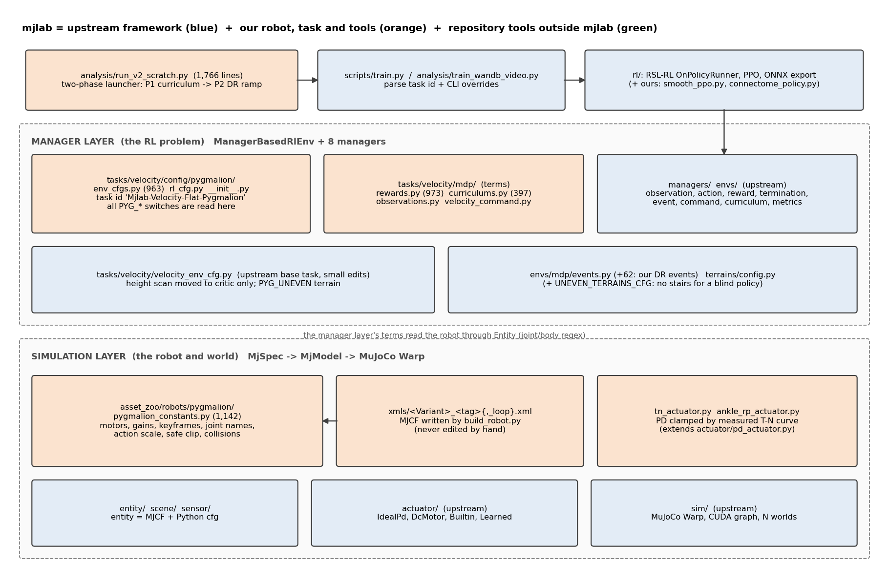
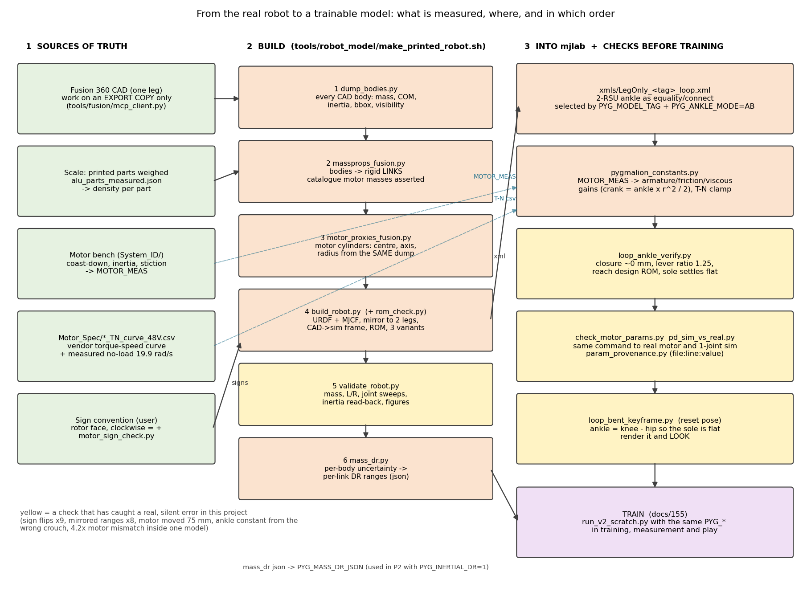
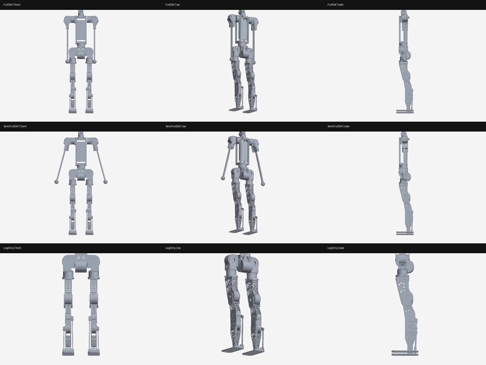
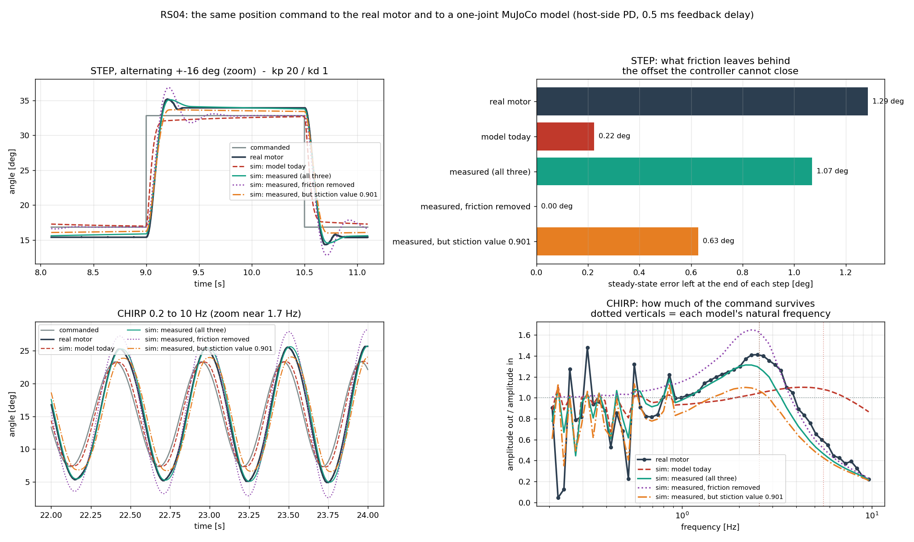

# 156. mjlab 과 실물 로봇 모델링 — 처음부터 다시 만드는 안내서

작성: 2026-09-25 · 사용자 요청: *"mjlab 의 구성과 구조, 그리고 학습을 위해 수정하거나 작성 많이 했던
코드들을 고려해서, mjlab 에 대한 가이드와, 실제 실물 로봇을 시뮬레이션에 모델링하는 과정까지 전부
포함해서, scratch build 를 고려한 가이드"*

> 짝 문서: [[155_training_pipeline_guide]] — 학습 반복·보상·파라미터(이 문서의 **한 층 위**).
> 이 문서는 그 아래 — **학습이 올라서는 프레임워크(mjlab)와 로봇 모델이 어떻게 만들어졌는가**를 다룹니다.
> 약어를 쓰지 않습니다. 파일 경로·줄 수·버전·커밋은 전부 2026-09-25 저장소에서 확인한 값입니다.
> 그림: `tools/notes/mjlab_guide_figures.py` 로 다시 그림(줄 수는 그릴 때 파일에서 셈).

---

## 0. 한눈에

| 부 | 무엇 | 다 읽으면 할 수 있는 것 |
|---|---|---|
| **A** | mjlab 의 구조와 우리가 바꾼 곳 | 어떤 파일을 열어야 할지 안다. 새 보상·관측·무작위화 항을 넣는다 |
| **B** | 실물 → 시뮬레이션 모델 | CAD·저울·모터 벤치에서 로봇 모델 파일을 **다시 생성**하고, 학습 전에 검증한다 |
| **C** | 처음부터 다시 만들기 | 빈 컴퓨터에서 첫 학습까지의 순서, 각 단계의 "끝났다" 기준, 우리가 다르게 할 것 |

**가장 중요한 원칙 세 개** (이 프로젝트가 비싸게 배운 것):
1. **모델 파일(XML)은 손으로 고치지 않는다.** 원천(CAD·저울·벤치 측정)을 고치고 **다시 생성**한다.
2. **값은 한 곳에만 둔다.** 같은 숫자를 두 파일이 들고 있으면 반드시 한쪽만 바뀐다(실제로 모터 값이
   한 모델 안에서 4.2 배 어긋난 채 학습됨 — §B6).
3. **숫자가 아니라 그림으로 확인한다.** 관절 부호 9건, 범위 뒤집힘 8건, 발목 리셋 자세 오류는 전부
   **렌더를 눈으로 보고** 잡았다.

---

# A 부 — mjlab

## A1. mjlab 이란

**mjlab**(`github.com/mujocolab/mjlab`, Kevin Zakka 외)은 **MuJoCo 물리 엔진 위에 Isaac Lab 식
"관리자 기반" 강화학습 환경**을 얹은 프레임워크입니다. 물리 계산은 **MuJoCo Warp**(MuJoCo 의 GPU 판)가
수천 개의 세계를 한 번에 돌리고, 학습은 **RSL-RL**(ETH 의 근접 정책 최적화 구현)이 합니다.

우리는 2026-07 에 Isaac Lab 에서 mjlab 으로 옮겼습니다(Isaac 쪽은 휴면, `docs/01_install.md` 는 옛 Isaac 설치
문서). 지금 작동하는 조합:

| 항목 | 이 컴퓨터 (2026-09-25 확인) |
|---|---|
| Python | 3.13.5 (`mujoco-sim/mjlab/.venv`) |
| mujoco / mujoco-warp / warp-lang | 3.10.0 / 3.10.0.1 / 1.14.0 |
| torch | 2.9.0 + CUDA 12.8 |
| rsl-rl-lib | 5.4.0 |
| 그래픽카드 / 드라이버 | RTX 5060 Ti (Blackwell, sm_120) / 570.195.03 · 원격 RTX 3090 |

## A2. 두 층 구조



mjlab 원본 문서(`docs/source/architecture_overview.rst`)의 설명 그대로:

- **시뮬레이션 층** — 로봇과 세계. 로봇(entity) 하나 = **MJCF 파일 + 파이썬 설정**(액추에이터·충돌·초기
  자세). 여러 entity 를 `MjSpec` 으로 합쳐 CPU 에서 `MjModel` 로 컴파일한 뒤 MuJoCo Warp 로 GPU 에 올립니다.
  `MjData` 하나에 **세계 N 개**가 앞 차원으로 들어 있고, 한 걸음 계산은 **CUDA 그래프**로 한 번 녹화해
  재생합니다(파이썬 호출 비용 제거).
- **관리자 층** — 강화학습 문제. 보상·관측·무작위화 같은 것을 작은 **항(term)** 으로 만들어 8 개의 관리자에
  등록합니다: 관측·행동·보상·종료·사건(event, 무작위화 포함)·명령·커리큘럼·지표.

### 한 정책 걸음의 실행 순서 (원본 문서 그대로)

```text
action_manager.process_action(action)       # 행동 → 목표 각도 (스케일·오프셋·자르기)
for _ in range(decimation):                 # 우리: 4 번
    action_manager.apply_action()           #   PD 제어기 → 토크
    sim.step()                              #   물리 0.005 초
    scene.update()
termination_manager.compute()               # 넘어졌나
reward_manager.compute()                    # 보상 (× 시간간격)
metrics_manager.compute()
[reset terminated envs]                     # 끝난 세계만 리셋 (reset 사건 = 초기 자세·무작위화)
sim.forward()
command_manager.compute()                   # 명령 재추첨
event_manager.apply(mode="interval")        # 주기 사건 (예: 1~3 초마다 밀기)
sim.sense()
observation_manager.compute()               # 다음 관측
```

**응용**: 보상 항이 읽는 상태는 **리셋 전**, 관측은 **리셋 후**의 상태입니다. "끝난 순간의 값"을 보상에
쓰려면 보상 항에서, "새 시도의 첫 값"은 관측에서 봅니다. 커리큘럼 관리자는 리셋 안에서 사건 관리자보다
**먼저** 돕니다 — 그래서 무작위화 세기(`dr_levels`)를 바꾸면 **같은 리셋의 추첨부터** 새 세기가 적용됩니다.

## A3. 폴더 지도

| 폴더 (`src/mjlab/`) | 하는 일 | 원본 / 우리 |
|---|---|---|
| `sim/` | MuJoCo Warp 모델·데이터, CUDA 그래프, 세계별 무작위화 필드 확장 | 원본 |
| `entity/`, `scene/`, `sensor/` | 로봇 = MJCF + 설정, 장면 조립, 센서(접촉·레이캐스트·지형 높이) | 원본 |
| `actuator/` | 이상적 PD, DC 모터, 내장, 학습된 액추에이터 | 원본 |
| `managers/`, `envs/` | 8 개 관리자와 `ManagerBasedRlEnv`, 공용 항(`envs/mdp/`) | 원본 (+ `events.py` 62 줄 우리) |
| `terrains/` | 지형 생성 | 원본 (+ `UNEVEN_TERRAINS_CFG` 우리) |
| `rl/` | RSL-RL 연결, 러너, ONNX 내보내기 | 원본 (+ `smooth_ppo.py`, `connectome_policy.py` 우리) |
| `tasks/velocity/` | 속도 추종 보행 과제 (G1·Go1 예제 포함) | 원본 **위에 우리가 크게 확장** |
| `tasks/velocity/config/pygmalion/` | **우리 과제**: 환경 설정·PPO 설정·등록 | 우리 |
| `asset_zoo/robots/pygmalion/` | **우리 로봇**: 상수·액추에이터·모델 XML | 우리 |
| `scripts/` | `train`, `play`, `demo`, `list-envs` 명령 | 원본 |
| `viewer/` | 기본 뷰어·viser 웹 뷰어·오프스크린 렌더 | 원본 |
| `analysis/` (저장소 루트) | 발사·측정·판정·영상·표 도구 **153 개, 32,750 줄** | 전부 우리 |

## A4. 우리가 바꾼 것 — 원본 대비

원본 기준점: `20f10e96` (2026-06-28, 원본 작성자의 마지막 커밋). 그 뒤 `src/` 에 **48 개 파일, +7,462 줄**
(모델 XML 제외). 큰 것부터:

| 파일 | 추가 줄 | 무엇 |
|---|--:|---|
| `asset_zoo/robots/pygmalion/pygmalion_constants.py` | 1,142 | 로봇 정의 전부 — 모터 실측값, 게인, 토크-속도 곡선, 모델 선택, 키프레임, 관절 이름, 행동 스케일, 안전 창, 충돌 |
| `tasks/velocity/config/pygmalion/env_cfgs.py` | 963 | 과제 조립 — 모든 `PYG_*` 스위치가 여기서 읽힘 |
| `tasks/velocity/evaluation/*` | 약 2,400 | 평가 틀(지표·시각화·보고서·시나리오) |
| `tasks/velocity/mdp/rewards.py` | 507 | 보상 항 (열 부하, 접촉력 상한, 무릎 과속, 서기 전용 L1 등) |
| `rl/connectome_policy.py`, `rl/smooth_ppo.py` | 504 / 439 | 초파리 회로 정책(다른 세션), 매끄러움 PPO 실험 |
| `tasks/velocity/mdp/curriculums.py` | 289 | 성적표 커리큘럼(`commands_vel_gated`), 무작위화 램프(`dr_levels`) |
| `tasks/velocity/mdp/observations.py` | 154 | 모터 각도 이력, 무작위화 값 관측(가치 신경망용) |
| `asset_zoo/robots/pygmalion/tn_actuator.py` | 113 | 실측 토크-속도 곡선으로 자르는 PD 액추에이터 |
| `asset_zoo/robots/pygmalion/ankle_rp_actuator.py` | 89 | 발목 직렬 근사(RP 방식)용 액추에이터 |
| `tasks/velocity/config/pygmalion/delayed_action.py` | 96 | 행동 지연 모사 |

**★ 원본 핵심부의 표류 — 업그레이드 때 주의**: `sim/sim.py`, `utils/spec_config.py`, `entity/entity.py` 는
원본 최신과 다릅니다(예: 원본은 `ls_parallel` 을 폐기했는데 우리 트리는 되살려 씀, 원본의 `MeshCfg` 가 빠짐).
이 차이는 `d0c85448` — "legonly_ab_v2 가 학습한 코드 상태를 통째로 봉인"한 스냅샷(2026-09-05, 사용자 결정으로
파일별 검토 없이 봉인)에서 들어왔습니다. **원본을 새 버전으로 올릴 때 이 세 파일은 따로 비교**해야 합니다.

## A5. 과제가 연결되는 방식 — 그리고 스위치의 함정

```text
tasks/velocity/config/pygmalion/__init__.py
  register_mjlab_task(task_id="Mjlab-Velocity-Flat-Pygmalion",
                      env_cfg=pygmalion_flat_env_cfg(), rl_cfg=pygmalion_ppo_runner_cfg(), ...)
        │
        ├─ env_cfgs.py: 원본 공통 속도 과제 make_velocity_env_cfg()(G1 도 같은 바탕) 위에 우리 로봇·보상·명령·무작위화를 끼움
        │     os.environ.get("PYG_...") 로 스위치를 읽음
        └─ pygmalion_constants.py: 모듈을 불러올 때 PYG_MODEL_TAG, PYG_ANKLE_MODE, PYG_MOTOR_MEAS … 를 읽음
```

**★ 함정: 스위치는 프로그램이 시작될 때 한 번 읽힙니다.** 과제 등록이 `import` 시점에 설정을 만들기 때문에,
`PYG_*` 는 **파이썬이 뜨기 전에** 환경변수로 줘야 하고, 도중에 바꿔도 소용없습니다. 그리고 **학습·측정·재생이
같은 스위치를 받아야** 합니다 — 기본 자세·관측 크기·모델 파일이 스위치로 바뀌기 때문입니다(측정에서
`PYG_INIT_BENT` 를 빠뜨려 평가가 무효가 된 사고). 그래서 런처가 모든 스위치를 `repro/launch_manifest.json` 에
적어 둡니다. ★ 단, **측정 도구는 이 파일을 자동으로 읽지 않습니다**(읽는 것은 런처와 노트 표 생성기
`run_spec_tables.py` 뿐) — 측정할 때는 그 목록을 보고 스위치를 **직접 같은 값으로** 줘야 합니다. v7 측정
스크립트(`analysis/run_v7_*.sh`)가 스위치를 전부 명시해 넘기는 이유입니다. 자동으로 읽게 만드는 것이 §C1 의
"스위치를 한 설정 객체로" 권고와 같은 방향입니다.

### 새 항 하나를 넣는 전형 — 실제 사례 (A/B v10 의 서기 전용 L1 항, mjlab `6b72dc43`)

1. `mdp/rewards.py` 에 함수 추가 — `(env, asset_cfg, …) -> torch.Tensor[num_envs]`. 관절은 **이름 정규식**
   (`asset_cfg.joint_names`)으로 고르고, 인덱스는 관리자가 초기화 때 풀어 줍니다.
2. `env_cfgs.py` 에 스위치 — `PYG_STAND_L1=<가중치>` 가 있을 때만 `RewardTermCfg` 를 추가. **꺼져 있으면 예전과
   바이트 단위로 같아야** 기존 실험이 안 깨집니다.
3. CPU 스모크 — 관절을 일부러 틀어 값이 예상(12 × 편차, 걷는 환경 0)과 같은지.
4. 발사 직후 두 팔의 `params/env.yaml` 비교로 **차이가 그 항 하나**임을 실증.

관측 항은 `mdp/observations.py` + `env_cfgs.py` 의 `observations["actor"|"critic"].terms`, 무작위화는
`envs/mdp/events.py` 의 사건 항 + `events` 사전, 커리큘럼은 `mdp/curriculums.py` + `curriculum` 사전 — 모양이 같습니다.

## A6. `analysis/` 도구 상자 (153 개 중 자주 쓰는 것)

| 묶음 | 파일 | 하는 일 |
|---|---|---|
| 발사·감시 | `run_v2_scratch.py`(1,766 줄) `.sh`, `train_wandb_video.py`, `review_loop.sh`, `snapshot_review.py`, `watchdog.sh` | 2 단계 학습, 사전점검(디스크·메모리·그래픽 메모리·게이트), 게이트마다 노트에 스냅샷, 죽으면 이어 달리기 |
| 측정 | `measure_full.py`, `measure_stand.py`, `measure_turn.py`, `gait_kinematics_probe.py`(995), `measure_loads.py`(658) | 명령 상자 전체 하중, 서기, 회전, 보행 운동학 |
| 판정 | `standing_verdict.py`, `walking_verdict.py`, `turn_verdict.py`, `deploy_contract.py` | 같은 도구·같은 씨앗으로 합격/불합격 |
| 설계 선도 | `actuator_eval.py`, `tn_design.py`, `regime_scatter.py`, `wrench3d.py`, `design_plots.py` | 모터 활용·토크-속도 설계선·링크 힘 |
| 노트 표 | `run_spec_tables.py`(617), `reward_gains_table.py` | 실험 노트 §1b 표 자동 삽입 |
| 영상·뷰어 | `accum_video.py`, `render_loads.py`, `viser_policy_switch.py`, `viser_load_panel.py`, `viser_generations.py` | 학습 경과 영상, 하중 가시화 영상, 웹 뷰어 |
| 발목 설계 연구 | `ankle_opt_de_v*.py`, `ankle_rsu_optimize*.py`, `ankle_2rsu_*` | 2-RSU 발목 기하 최적화(차분 진화) |

## A7. mjlab 에서 겪은 함정

| 증상 | 원인 | 해결 |
|---|---|---|
| 액추에이터가 폭주 | `MjSpec` 으로 위치 액추에이터를 만들 때 `biastype` 를 안 줘서 `biasprm` 이 무시됨 → 순수 토크 모터 | `biastype=mjBIAS_AFFINE` |
| 폐루프(발목)가 튐 | 가벼운 중간 몸체 + 큰 시간 간격 | 회전자 관성(`armature`)을 주고, 검증 단계는 1 ms 로 |
| 점성을 넣었는데 떨림 | `damping` 이름 충돌 — 액추에이터 `damping` = 제어 이득 $K_d$, 수동 점성은 `viscous_damping` | §B6 |
| `import mjlab` 실패 | 시스템 파이썬으로 실행 | 항상 `mujoco-sim/mjlab/.venv/bin/python3` (원본 규칙은 `uv run`) |
| CPU 측정이 그래픽카드를 잡음 | | `CUDA_VISIBLE_DEVICES=""` |
| 오프스크린 렌더 종료 때 `EGLError` | 소멸자 뒷정리 잡음 — 렌더 자체는 성공 | 어느 단계의 오류인지 확인 (`MUJOCO_GL=egl`) |
| 원격에서 학습이 곧바로 죽음 | 그 기계에 wandb 로그인이 없음 | `--logger tensorboard` (학습 내용과 무관) |

---

# B 부 — 실물 로봇을 시뮬레이션 모델로



세 원천(CAD, 저울, 모터 벤치)에서 값을 뽑고, 한 줄짜리 빌드 스크립트로 모델 파일을 **생성**하고, 학습 전에
노란 상자의 검사를 통과시킵니다. 노란 상자는 전부 **이 프로젝트에서 조용한 오류를 실제로 잡은** 검사입니다.

## B1. CAD — 원본은 절대 건드리지 않는다

- CAD 는 **Fusion 360** 에 있고(사용자 Windows 컴퓨터), 이 컴퓨터는 MCP 연결(`tools/fusion/mcp_client.py`)로 읽습니다.
- **작업은 내보내기용 사본에서만** (`260819_HumanMesh_wUpper_URDFexport_v30`). 원본 lineage 와 저장 시각을 기록해
  둡니다(`docs/111` §1).
- ★ **이 Fusion 판은 스크립트가 출력한 내용을 빈 문자열로 돌려줍니다.** 그래서 읽기 결과는 오류 경로로
  받아 옵니다(`mcp_client.script()`). 그런데 **예외가 나면 문서 편집이 되돌려집니다** — 밀도 수정이 조용히
  사라진 적이 있습니다. 설계를 **바꾸는** 스크립트는 반드시 정상 종료(`run_script()`)하고, 다른 읽기로 확인합니다.
- 기성 변환기 `fusion2urdf` 는 비교용으로만 씁니다. 우리 CAD 는 부품 627 개, 중첩 깊이 5, `base_link` 없음이라
  평평한 트리를 가정하는 구형 변환기는 축·부모·폐루프를 잃습니다. **최종 파일은 우리 빌더가 만듭니다.**

**부품 → 링크 묶기**: CAD 의 나사 하나까지 관절로 만들면 시뮬레이터가 무거워집니다. **같이 움직이는 부품을
한 덩어리(링크)** 로 묶고, 덩어리 사이의 회전축만 관절로 둡니다. 어느 부품이 어느 링크인지는 규칙으로
적어 두고(`massprops_fusion.py`) 사람이 검토합니다 — 실제로 부품 귀속 6 건을 고쳤습니다(`docs/117` §0).

**CAD 에는 다리가 하나뿐입니다.** 빌더가 좌우로 미러링합니다. 그래서 최종 렌더에 **두 다리가 온전히** 보여야
합니다(하나만 보이면 빌더 오류).

## B2. 좌표계와 부호 — 가장 많이 틀린 곳

```text
sim = (−CAD_y, CAD_x, CAD_z)       +X = 앞, +Y = 로봇 왼쪽, +Z = 위
```

- **링크 원점은 관절점에**: 몸통 중심, 엉덩이점(세 엉덩이 축이 한 점에서 만남 — 모터 원통에서 측정), 무릎, 발목.
- **모터 양의 방향**(사용자 약속, 2026-09-02 재확인): 회전자 면(M4 나사 6 개, 핀 3 개)을 바깥에서 볼 때
  **시계 방향 = +**. 이것을 관절 부호로 옮기는 대수는 `motor_sign_check.py` 머리말에 풀어 적혀 있습니다 —
  회전자/고정자 기준과 URDF 의 자식/부모 기준이 달라 **부착 방향 부호**를 따로 곱해야 합니다.
- 관절마다 뷰어(`tools/viewer/mjcf_joint_viewer.py`)로 **직접 돌려 보며** 6 라운드에 걸쳐 확정한 것
  (`docs/117` §0): **부호 반전 9 건, 범위 뒤집기 8 건**(부호를 뒤집을 때 범위도 음수·교환해야 하는 경우),
  좌우 미러링 버그 2 건(좌표 변환 **이후**에 미러해야 함).
- ★ **좌우 이름이 2026-09-12 에 바뀌었습니다**(`a98d0d9`, 모델 67 개). 그 전에는 `L_` 가 물리적 **오른**다리였습니다.
  그 전 측정 기록의 L/R 는 전부 반대로 읽어야 합니다(`docs/136`).

**응용**: 새 로봇이면 **첫날** 좌표계·부호·좌우 이름 규칙을 정하고, 관절마다 "+ 로 돌리면 화면에서 어느
쪽으로 굽는가"를 영상으로 남깁니다. 나중에 고치면 그 전 데이터가 전부 반대가 됩니다.

## B3. 질량 — 순서가 중요하다

`docs/111` §4 의 순서:

1. Fusion 에서 몸체별 질량·무게중심·원점 기준 관성 (Fusion 은 관성을 **루트 원점 기준**으로 줌 → 텐서를 그대로
   더하고, 평행축 이동은 마지막에 한 번)
2. **3D 프린트 부품 밀도 보정** — 실물을 저울에 달아 부품별 비율을 구함(`alu_parts_measured.json`,
   `alu_parts_ratio.py`). CAD 는 고치지 않고 JSON 에서 적용
3. 알루미늄 부품 임시 질량(`prototype-tempmass`)
4. 사양값으로 교체할 것 교체 (예: 전원장치 CAD 1.677 → 사양 1.95 kg)
5. 같은 모양·균일 밀도 가정으로 관성을 질량비만큼 스케일, 무게중심은 유지

**자리표시자(모터·베어링)는 이름이 아니라 모양부터 잰다** — 카탈로그를 찾기 전에 bbox 와 몸체 구성을
먼저 봅니다. 두 번 결론이 뒤집혔습니다: 로드엔드라 생각한 것이 실은 구면 베어링 인서트(이미 맞는 13 g),
"축소 모형"이라 생각한 RS04 가 실은 치수가 카탈로그와 같은 **속 빈 껍데기**. 모터 자리표시자는 강철 밀도의
덩어리이므로 질량은 카탈로그 값으로 바꾸되 **모양에서 나온 관성 텐서는 질량비로만** 스케일합니다.

**모델 세 종류** — 같은 하드웨어에서 세 설명서를 만듭니다:



| 모델 | 움직이는 관절 | 상체 | 전체 질량 | 용도 |
|---|--:|---|--:|---|
| `FullDoF_` | 17 | 허리 + 양팔 | 34.654 kg | 전체 기구 검증 |
| `SemiFullDoF_` | 13 | 허리만, 팔은 −15° 에 고정 | 34.654 kg | 상체 질량을 가진 하체 보행 |
| **`LegOnly_`** (지금 학습) | **12** | 허리 플랜지부터 위는 **질량까지** 삭제 | **21.086 kg** | 하체 정책 |

★ LegOnly 에서 상체 링크만 지우고 **몸통 질량을 그대로 두는 조용한 오류를 금지**합니다 — 플랜지와 허리 모터
1.484 kg 을 몸통에서 정확히 뺍니다(허리 **모터 질량은 남김**: 실물에서 몸통에 박혀 있으므로).

**질량 무작위화 범위도 측정에서 유도**합니다(`mass_dr.py`) — "±10 %" 를 짐작하지 않고, 부품마다 출처에 따른
불확실성(저울로 단 프린트 부품 3 %, 평균 비율을 쓴 부품 10 %, …)을 주고 수천 대를 뽑아 **링크별** 질량·무게중심·
관성의 흩어짐을 구합니다 → `mass_dr_*.json` → 학습 2 단계에서 `PYG_INERTIAL_DR=1` 로 적용.

## B4. 형상 — 보이는 것과 부딪히는 것을 나눈다

| | 무엇 | 도구 |
|---|---|---|
| 보이는 메시 | 구조 부품만. 모터·베어링·나사는 **제외**(질량은 링크에 남음), 모터는 **해석적 원통**으로 그림 | `meshes_fusion_full.py`, `meshes_step.py` |
| 모터 원통 | 중심 = 몸체 무게중심, 축 = bbox 가 **가장 얇은** 방향(모터는 납작한 원판), 반지름은 같은 계열의 축 정렬된 모터에서 | `motor_proxies_fusion.py` |
| 충돌 형상 | 캡슐·볼록 껍질 — 계산이 가벼운 것 | `build_robot.py`, `docs/117` §1 |
| 관절 가동범위 | 관절마다 돌려 가며 **실제 삼각형 메시끼리** 처음 부딪히는 각도(FCL). 볼록 껍질로 하면 허벅지-정강이가 105 mm 겹친다고 잘못 나옴 | `rom_check.py` → `rom_measured.json` |

★ 모터 위치는 **지금 CAD** 에서 읽습니다. 한 판 늦은 STEP 에서 읽었더니 엉덩이 모터가 **75 mm** 틀려 있었습니다
(`proxyfix` 라는 이름표가 그 수정입니다).

★ gmsh 는 RobStride 자리표시자 STEP 에서 몇 분씩 멈춥니다 — 모터 STEP 은 메시하지 말고 원통으로 그립니다.

## B5. 폐루프 발목 (2-RSU) — 우리 로봇에만 있는 것

실물 발목은 모터가 발목에 직접 붙어 있지 않습니다. 정강이 위쪽의 크랭크 A·B 두 개가 막대로 발을 밀고 당깁니다.
MJCF 에서는 막대 끝과 발의 공 관절을 `equality/connect` 구속 4 개(다리당 2 개)로 붙입니다 — 이게 `_loop` 파일입니다.

**`loop_ankle_verify.py` 의 네 검사** (정강이를 세계에 고정하고 발목만):
1. **닫힘** — 모든 동작에서 막대 끝과 발 공 사이 거리 ≈ 0 (구속이 유지되는가)
2. **전달** — 크랭크 (A, B) → 발 (앞뒤, 좌우) 격자 스윕, 중앙 지렛대 비율 ≈ **1.25**
3. **도달** — 설계 가동범위(앞뒤 −50/+30°, 좌우 ±20°)에 필요한 크랭크 각과 그때의 닫힘 오차
4. **바닥** — 정강이를 0.47 m 에 들고 바닥 위에 발을 두면 발바닥이 평평하게 앉고(모서리 4 개 접촉), 크랭크를
   움직이면 루프가 풀리지 않고 발이 기울어야 함

**게인은 발목에서 크랭크로 옮깁니다** — 두 크랭크가 함께 움직여 발목 각 $\theta = r\,\theta_c$ 를 만들면 가상일로
$K_{\text{ankle}} = 2K_c / r^2$, 그래서 $K_c = K_{\text{ankle}} r^2/2 = 28.5 \times 1.25^2/2 = 22.3$
(`pygmalion_constants.py` 714~721 행).

**직렬 근사(RP 방식)** 도 있습니다(`PYG_ANKLE_MODE=RP`): 발목 앞뒤·좌우 관절에 직접 토크를 주되, 크랭크 공간의
토크 한계를 루프 야코비안으로 옮겨 자세에 따라 변하는 평행사변형 한계를 씁니다(`ankle_rp_actuator.py`). 지금
학습은 폐루프(AB)입니다.

## B6. 모터 — 벤치에서 재고, 한 곳에 넣고, 같은 명령으로 대조한다

### 무엇을 재는가 (`docs/130` 쉬운 설명)

모든 측정이 식 하나를 돌려 쓴 것입니다:

$$\tau = J\,\dot\omega + f_c\,\mathrm{sign}(\omega) + b\,\omega$$

| 값 | 뜻 | 재는 법 | 왜 그 방법 |
|---|---|---|---|
| 쿨롱 마찰 $f_c$, 점성 $b$ | 방향만 거스르는 일정한 토크 / 속도 비례 저항 | **타성 감속** — 토크를 정확히 0 으로 두고 굴러가게 → 속도별 감속률 × 관성 = 마찰 + 점성 × 속도, 직선의 절편·기울기 | 시킨 토크가 식에 안 들어가 모터 보고값을 믿을 필요가 없음 |
| 회전자 관성 $J$ | 돌리기 시작할 때의 무게 | **같은 속도 구간을 다른 토크 두 개로** 지나가게 해 빼기 → 마찰이 통째로 소거 | 모터가 몰래 더하는 치우침까지 빠짐 |
| 정지 마찰 | 붙어 있는 힘 | 토크를 초당 0.1 N·m 씩 올려 **위치가 0.2° 움직이는** 순간 | 속도로 판정하면 정지 상태에서도 속도가 초당 6.5° 튀어 오검출 |

**측정 규칙**: 미분하지 말고 적분 꼴로(잡음), 모터 보고값 중 믿을 것만(속도는 초당 859° 에서 포화 → 위치를
이어 붙여 씀, 토크는 한 점은 못 씀), **맞출 때 쓰지 않은 실험으로 검산**(삼각파 지연 예측 1.487° 대 실측 1.49°),
5 분 데워 온도 맞추기, 10 회 반복.

### 어디에 넣는가 — 딱 한 곳

`pygmalion_constants.py` 의 `MOTOR_MEAS` (2026-09-09 실측):

```python
MOTOR_MEAS = {
  "RS04": dict(armature=0.0773, damping=0.0275, frictionloss=0.519),
  "RS03": dict(armature=0.0638, damping=0.0252, frictionloss=0.250),
}
```

- `_motor()` 가 이것을 `armature` / `viscous_damping` / `frictionloss` 로 옮깁니다.
- ★ **여기의 `damping` 은 수동 점성**이고, 액추에이터 설정의 `damping` 은 **제어 이득 $K_d$** 입니다. 0.0275 를
  $K_d$ 자리에 넣으면 안 됩니다(mjlab 원본 `actuator/actuator.py` 의 `viscous_damping` 설명문도 같은 경고: *"Unlike `damping` (the PD derivative gain kv, which is active control), this is a passive property."*).
- ★ 옛 값에서 관성이 **4.7 배** 커졌습니다(RS04). 관성만 바꾸고 게인을 그대로 두면 덜 감쇠되어 출렁이고
  정책이 "더 나빠진 것처럼" 보입니다 — **게인을 다시 사이징**(같은 감쇠비면 $K_d$ 는 $\sqrt{4.7} = 2.2$ 배)한 뒤 학습.
- ★ **같은 숫자를 다른 파일이 손으로 들고 있으면 안 됩니다.** 2026-09-10 에 `MOTOR_MEAS` 를 고쳤는데 발목 값을
  만드는 프로그램(`ankle_rp_envelope.py`)이 옛 숫자를 따로 들고 있어서, 엉덩이 비틀기는 새 값·같은 종류 모터인
  발목은 옛 값 — **한 모델 안에서 4.2 배 어긋난 채 오류 없이** 돌았습니다. 그래서 `check_motor_params.py` 가
  생겼습니다(학습 전 대조).

토크-속도 곡선은 제조사 곡선(`Motor_Spec/*_TN_curve_48V.csv`)을 쓰되, **무부하 속도는 실측 19.9 rad/s**
(시뮬레이터 기본 33 이 아님). 구동 방향에서는 곡선으로 자르고, 제동 방향에서는 최대 토크까지 허용합니다(`tn_actuator.py`).

### 맞는지 — 같은 명령을 실물과 시뮬레이터에 동시에



`System_ID/pd_sim_vs_real.py`: 같은 위치 명령(계단 ±16°, 0.2~10 Hz 처프)을 **실제 모터**와 **관절 하나짜리
MuJoCo 모델**에 넣어 겹쳐 봅니다. 위 그림에서 "model today"(옛 값)는 계단 끝 오차 0.22° 로 실물(1.29°)과
크게 다르고, 실측 세 값을 다 넣으면 1.07° 로 가까워집니다. 마찰을 빼면 0.00° — 계단 끝에 남는 오차가
**마찰 때문**임을 보여 줍니다. 처프의 공진 자리도 실측 2.48 Hz 대 예측 2.31 Hz.

## B7. mjlab 에 연결 — 로봇 설정

**파일 이름 계약** (`build_robot.py`, 사용자 계약 2026-09-01):

```text
<Variant>_<revision tag>[_loop].xml
LegOnly_prototype-tempmass-motormeasured-armfix_v30_proxyfix_loop.xml
│       │                  │             │      │   │        └ 2-RSU 폐루프 발목 구속 포함
│       │                  │             │      │   └ 모터 원통 위치를 지금 CAD 에서 다시 (75 mm 수정)
│       │                  │             │      └ Fusion 개정판 v30
│       │                  │             └ 팔 하우징 수정 반영
│       │                  └ 모터 값 벤치 실측
│       └ 알루미늄 부품 임시 질량
└ 모델 종류 (FullDoF / SemiFullDoF / LegOnly)
```

`PYG_MODEL_TAG=<Variant>_<revision>` + `PYG_ANKLE_MODE=AB` 로 고르면 `pygmalion_constants.py` 가 `_loop.xml` 을
엽니다(태그는 파일 이름 글자만 허용 — 임의 경로로 모델 폴더를 벗어나지 못하게).

`pygmalion_constants.py` 가 MJCF 위에 얹는 것:

| 무엇 | 어디 | 주의 |
|---|---|---|
| 액추에이터 (PD + 토크-속도 곡선 + 모터 실측값) | `PYG_ARTICULATION` (1055 행) | 크랭크 게인은 발목에서 유도 |
| 초기 자세(키프레임) | `KNEES_BENT_KEYFRAME`, `_bent_joint_pos()` | ★ **발목 = 무릎 − 엉덩이** 로 유도해야 발바닥이 평평. 깊은 웅크림용 상수 0.36 이 얕은 웅크림에 박혀 있어 v2~v6 이 **발끝을 45 mm 든 채** 리셋됨(지지 폭 0 mm). 사용자가 그림을 보고 잡음 |
| 관측·자세 관절 이름 | `OBS_JOINT_NAMES`, `MOTOR_OBS_JOINT_NAMES`, `POSE_JOINT_NAMES` | 실물 엔코더가 있는 곳 = 모터(크랭크) 쪽 |
| 행동 스케일 | `PYG_ACTION_SCALE` = 0.25 rad | 옛 식은 관절마다 0.8~1.8 이라 너무 거칠었음 |
| 안전 창 | `safe_target_clip()` | 시뮬레이터 소프트 한계와 **같은 공식** |
| 충돌 | `FULL_COLLISION` 등 | 발만 켤지 자기충돌까지 켤지 |
| 팔 벌림(용접 전) | `get_spec()` + `PYG_ARM_ABD_DEG` | 좌우 부호가 모델 세대마다 달라 순운동학으로 확인 |

## B8. 학습 전 검증 체크리스트

| 검사 | 도구 | 이 프로젝트에서 잡은 것 |
|---|---|---|
| 총 질량·링크 질량·좌우 대칭 | `validate_robot.py` | LegOnly 몸통 질량 잔류 방지 |
| 관절을 하나씩 돌려 **눈으로** | `tools/viewer/mjcf_joint_viewer.py` | 부호 9 건, 범위 8 건 |
| URDF 와 MJCF 가 같은가 | `urdf_crosscheck.py` (MuJoCo 의 URDF 로더로 읽어 관절마다 스윕해 몸체 위치 비교), 세 종류 일괄은 `validate_urdf_variants.py` | LegOnly v30 루프: 모든 관절에서 차이 0 mm |
| 다른 저장소의 축과 같은가 | `crosscheck_huphy_mjcf.py` (축 **선**을 비교, 앵커 점은 비교하지 않음) | 앵커 좌표 비교가 만든 거짓 경보 |
| 폐루프 | `loop_ankle_verify.py` | 닫힘·지렛대·도달·바닥 |
| 모터 값 한 곳에서 왔나 | `check_motor_params.py` | 4.2 배 어긋남 |
| 모터 동특성 | `System_ID/pd_sim_vs_real.py` | 관성 4.7 배 |
| 파라미터 출처 | `param_provenance.py` → `docs/145` | 값마다 `파일:줄:변수:지금 값` — 문장이 아니라 코드에서 읽음 |
| 리셋 자세 | `loop_bent_keyframe.py` + 렌더 | 발끝 45 mm 들림 |
| 행동 창 | `analysis/preflight_action_window.py` | 런처 사전점검에 포함 |

---

# C 부 — 처음부터 다시 만들기

## C1. 우리가 지금 다시 한다면 다르게 할 것

| 우리가 한 것 | 다시 한다면 | 이유 |
|---|---|---|
| mjlab 저장소 **안에** 로봇·과제를 넣고 핵심부도 고침 | 원본 권장 **방법 1** — 내 프로젝트가 mjlab 을 **의존성**으로 쓰고(`uv add mjlab`), 로봇·과제·도구는 내 패키지에 | 원본 업그레이드 때 핵심부 표류(A4)가 안 생김 |
| 스위치를 환경변수로, 여러 파일이 각자 읽음 | 스위치를 **한 설정 객체**로 모으고 학습·측정·재생이 같은 파일을 읽음 | 측정에서 스위치 누락 사고 |
| 같은 숫자를 여러 도구가 손으로 들고 있음 | 값은 한 모듈, 나머지는 **불러다** 씀 | 4.2 배 어긋남 |
| 좌우 이름·부호를 도중에 교정 | **첫날** 규칙을 정하고 관절별 영상 기록 | 교정 전 기록이 전부 반대 |
| 직접 설계한 보상 묶음으로 시작 | 원본 G1 속도 과제의 **기본 보상 그대로** 먼저 걷게 한 뒤 한 항씩 | G1 기본이 우리 커스텀을 이김 |

## C2. 순서 — 각 단계의 "끝났다" 기준

| # | 단계 | 산출물 | 끝났다 = |
|--:|---|---|---|
| 1 | **환경** — NVIDIA 드라이버, `uv`, mjlab 설치 (원본 `docs/source/installation.rst`) | `.venv` | 원본 예제가 돈다: `uv run train Mjlab-Velocity-Flat-Unitree-G1 --env.scene.num-envs 4096` 에서 보상이 오름. Blackwell(RTX 50) 이면 CUDA 12.8 판 torch |
| 2 | **규칙 정하기** — 좌표계, 모터 + 방향, 좌우 이름, 파일 이름 계약 | 한 쪽짜리 규칙 문서 | 관절마다 "+ 면 어느 쪽"이 그림으로 있음 |
| 3 | **CAD 정리** — 내보내기용 사본, 부품 → 링크 귀속표 | 귀속 규칙 코드 + 검토 표 | 모든 몸체가 정확히 한 링크에 속함, 자리표시자는 모양부터 잼 |
| 4 | **질량** — 몸체별 질량·무게중심·관성 → 링크 합산, 프린트 밀도·카탈로그 교체 | `robot_massprops_*.json` | 총 질량이 저울과 맞음(허용 오차를 먼저 정함) |
| 5 | **형상** — 보이는 메시, 모터 원통, 충돌 형상, 메시 충돌로 가동범위 | STL, `rom_measured.json` | 렌더에서 두 다리가 온전, 가동범위가 설계 표와 맞음 |
| 6 | **모델 생성** — URDF + MJCF (폐루프가 있으면 `_loop`) | `<Variant>_<tag>.xml` | 뷰어에서 관절 하나씩 돌려 부호·범위 확인, URDF 대 MJCF 차이 0 |
| 7 | **모터 벤치** — 타성 감속·관성·정지 마찰, 토크-속도 곡선 | `MOTOR_MEAS`, 곡선 CSV | 같은 명령 대조(계단·처프)에서 실물과 겹침 |
| 8 | **폐루프 검증** (있다면) | 검증 JSON·영상 | 닫힘 ≈ 0, 지렛대 비율이 설계와 같음, 바닥에서 평평 |
| 9 | **로봇 설정** — `asset_zoo/robots/<robot>/`: 액추에이터, 키프레임(유도식), 관측 관절 이름, 행동 스케일 0.25, 안전 창, 충돌 | `<robot>_constants.py` | 리셋 자세 렌더에서 발바닥 평평, 서 있을 때 관절 토크가 모터 한계 안 |
| 10 | **과제 설정** — 원본 `make_velocity_env_cfg()` 바탕에 로봇만 끼우고, 보상은 G1 과제 값 그대로 시작 | `config/<robot>/` + 등록 | `list-envs` 에 과제가 보임, 100 회 짧은 학습에서 NaN 없음·관측 크기 예상대로 |
| 11 | **질량 무작위화 범위** | `mass_dr.json` | 링크별 범위가 출처별 불확실성에서 나옴 |
| 12 | **본 학습** — 1 단계(커리큘럼, 무작위화 끔) → 2 단계(무작위화 램프) | 저장본 | `docs/155` §12 건강도 정상 |
| 13 | **측정·판정** — 같은 도구·씨앗·스위치, 명령당 15 초 | 판정 JSON | 서기·보행·회전 기준 통과 |
| 14 | **배포 계약** — 관측 순서·정규화 통계·행동 스케일·기본 자세를 실물 코드와 대조 | `deploy_contract.py --emit/--verify` | 실물 제어 코드가 같은 계약을 읽음 |

단계 1~11 은 **학습 없이** 끝낼 수 있고, 여기서 틀린 것은 학습이 절대 고쳐 주지 못합니다. 이 프로젝트의
시간 대부분은 단계 2~9 의 오류를 학습 뒤에 발견해서 다시 돌리는 데 들었습니다.

---

## D. 용어 대응표

| 이 문서의 말 | 표준 영어 | 코드 |
|---|---|---|
| 로봇 기술 파일 | MJCF / URDF | `*.xml`, `*.urdf` |
| 링크 / 관절 | link / joint (body / joint in MJCF) | |
| 회전자 관성 | armature (reflected rotor inertia) | `armature` |
| 쿨롱 마찰 / 점성 / 정지 마찰 | Coulomb friction / viscous damping / stiction | `frictionloss` / `viscous_damping` / — |
| 타성 감속 | coast-down test | |
| 시스템 식별 | system identification | `System_ID/` |
| 폐루프 구속 | equality constraint (connect) | `<equality><connect>` |
| 토크-속도 곡선 | torque-speed (T-N) curve | `Motor_Spec/*_TN_curve_48V.csv` |
| 가동범위 | range of motion (ROM) | `range` |
| 관리자 / 항 | manager / term | `managers/`, `*TermCfg` |
| 세계 (병렬 환경) | world / environment instance | `num_envs` |

## E. 더 읽을 곳

- mjlab 원본 문서: `mujoco-sim/mjlab/docs/source/` — `architecture_overview.rst`, `installation.rst`,
  `migration_isaac_lab.rst`, 관리자별 페이지
- 모델 재구축 기록: `docs/111_fusion_v30_urdf_rebuild.md`, `docs/117_model_finalization_and_oneleg_training_plan.md`
- 모델 파일 지도와 **수정 이력 표**: `docs/181_mjcf_urdf_models.md` (D455 카메라판: `docs/180_d455_camera_on_legonly.md`)
- 질량 감사: `docs/120_design_vs_measured_mass_audit.md`, `docs/82_final_design_mass_review.md`
- 모터: `docs/129_mujoco_motor_parameters.md`(넣는 법), `docs/130_system_id_eli5.md`(재는 법),
  `docs/144_urdf_motor_params_portability.md`
- 파라미터 출처 전수표: `docs/145_model_parameter_provenance.md`
- 좌우 이름 역사: `docs/136_left_right_naming_history.md`
- 발목: `docs/45_g1_parallel_ankle_modeling.md`
- 학습 쪽: [[155_training_pipeline_guide]]
