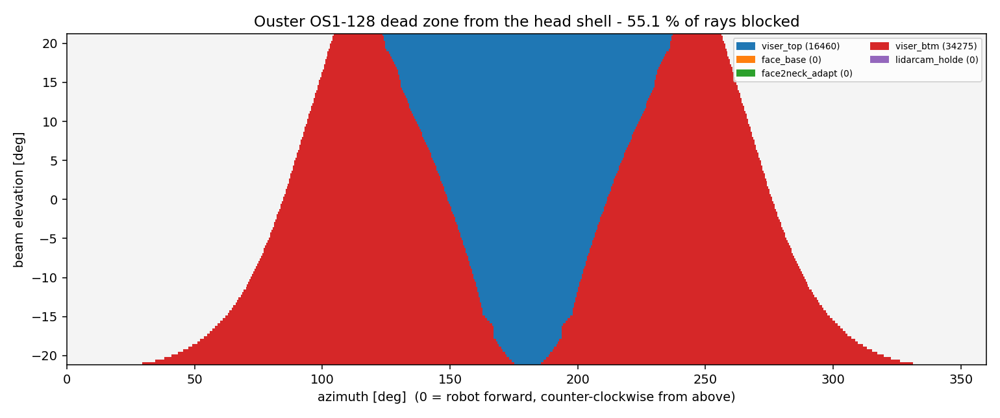
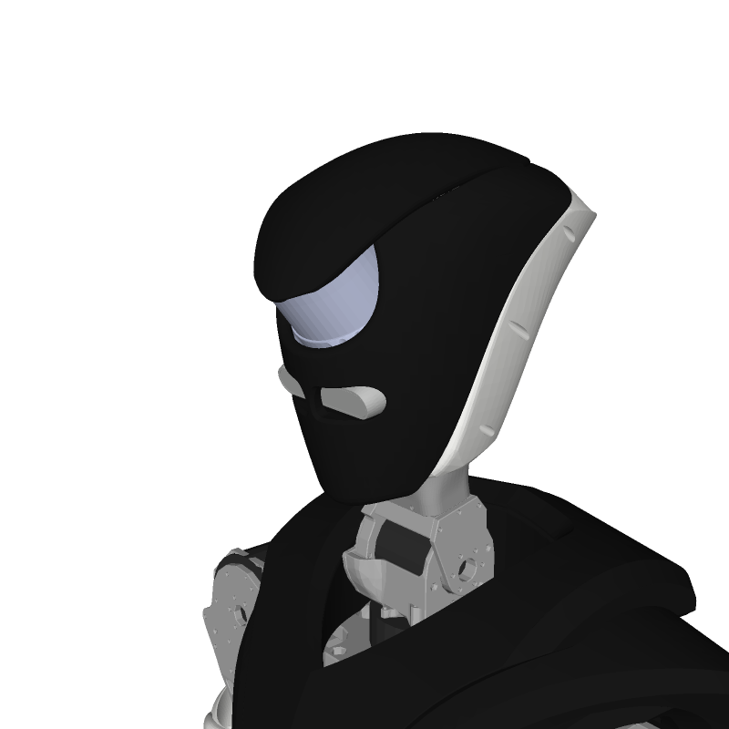
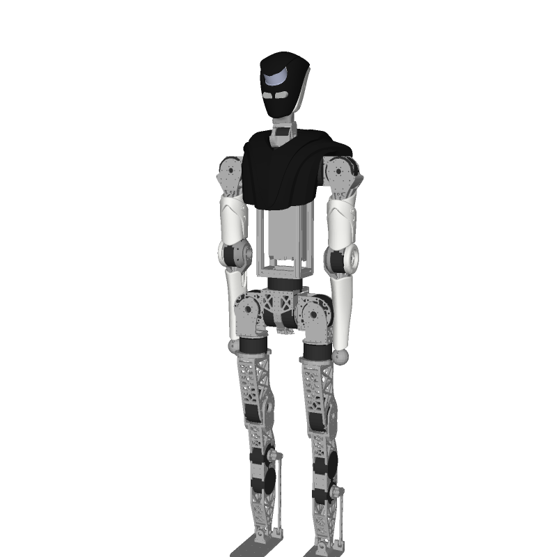
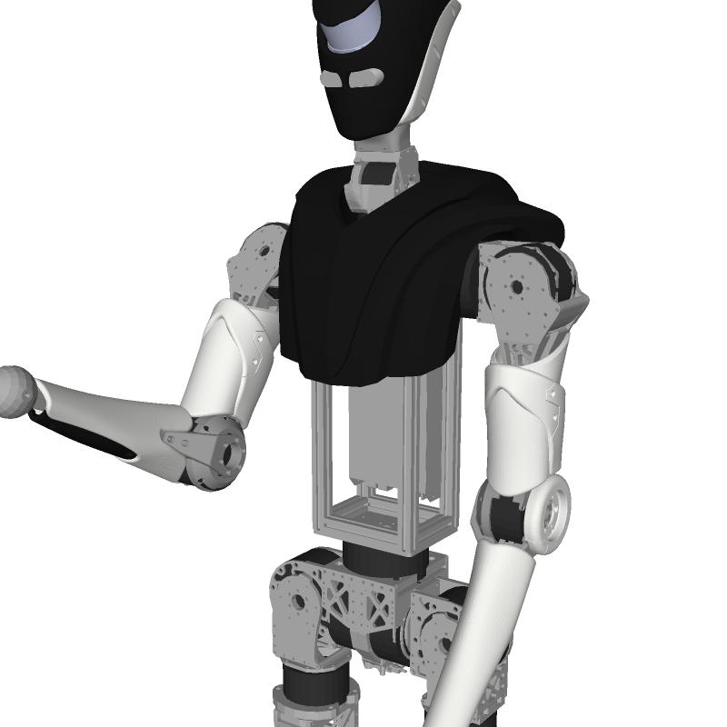
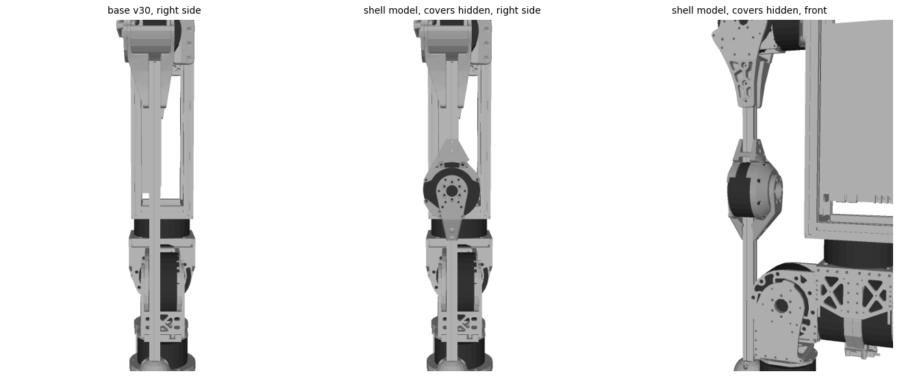

# 157. Shell · 라이다 · 카메라를 단 상체 모델 — 설계 결정과 진행 기록

시작: 2026-10-06 · 사용자 요청: *"Fusion MCP 로 만든 URDF 에 Lidar, Shell 파츠 일부를 추가해 Lidar Mapping 을
할 수 있는 로봇으로 만든다 … 이미 있는 v30 기반 URDF 최신 검증버전에 쉘만 추가해서 업데이트하고 싶다 …
isaacsim / mujoco / rviz / gazebo 에서 활용 가능하게."* 그리고 *"Obsidian / docs 에 문서화 잘 하면서 진행."*

> 상태: **구현·검증 끝, 사용자 검토 대기** (2026-10-06 23:30, 실제 CAD v27 로 **두 번째 생성** — 사용자 답변 6건과 Ouster 문서 확인 반영). §11 에 결과, §12 에 첫 생성 이후 바뀐 것, §9 체크리스트가 현재 상태.
> 짝 문서: [[111_fusion_v30_urdf_rebuild]] (v30 에서 URDF 를 만든 방법), [[146_joint_sign_and_rom_final_check]]
> (관절 부호 규칙), [[156_mjlab_and_robot_modeling_guide]] (모델은 손으로 고치지 않고 다시 생성한다).
> 약어를 최대한 풀어 씁니다. 값은 전부 2026-10-06 에 읽은 것입니다.

## ELI5

지금 쓰는 로봇 설명서(URDF/MJCF)는 한 달 전 CAD(v30)에서 만든 것이라 **머리·몸통·팔 겉껍데기와 라이다가 없습니다.**
새 CAD 에는 그것들이 이미 그려져 있습니다. 원점과 자세가 같은 것을 확인했으므로, **검증된 기존 모델은 그대로 두고**
새 CAD 에서 겉껍데기와 센서의 **모양만 읽어와서 붙입니다.** 질량은 CAD 에 적힌 값(전부 강철로 가정해서 20~40 배 무겁다)을
쓰지 않고, 사용자가 알려준 실제 값으로 바꿉니다. 라이다는 머리 쉘에 가려지는 방향이 있으니, 가려지는 방향을 계산해서
"이 방향의 점은 버려라" 표를 같이 만듭니다.

## 1. 출처 — 어느 CAD 에서 왔나

| 항목 | 값 | 근거 |
|---|---|---|
| 현재 URDF/MJCF 가 나온 CAD | `260819_HumanMesh_wUpper_OMAKASE_RrecoverFromCrash v30` (2026-09-01 21:12 저장, lineage `GWnH8zg_RXG-AvybBDXcbQ`) | [[111_fusion_v30_urdf_rebuild]] §1 |
| 그 CAD 의 작업 사본 | `260819_HumanMesh_wUpper_URDFexport_v30 v1` (lineage `lNAVK_XkSE2q1eyNqGIu9w`) — Hip Pitch 모터 위치를 2026-09-02 에 여기서 다시 읽어 `proxyfix` 가 됨 | [[114_huphy_proxyfix_rotation_dr_audit]] §4 |
| 최신 모델 파일 | `*_v30_proxyfix` 계열 (Full / SemiFull / LegOnly, 각각 `_loop` 있음), 2026-09-15 | mjlab `asset_zoo/robots/pygmalion/xmls/` |
| **이번에 읽는 CAD** | `260923_Huphy_1.0_wShell (v27~recovered)` — 프로젝트 Humanoid Pygmalion, 2026-09-23 생성, v27 = 2026-09-29, 저장 안 된 수정 있음 | Fusion 읽기 전용 조회 (2026-10-06) |
| 두 CAD 의 원점·자세 | 기준 부품 8개 중 찾은 6개의 바운딩 박스가 **0.0 mm 차이** (골반·허벅지 플레이트·발·토르소 프레임·허리·목) | 같은 날 읽기 전용 비교 |

두 부품(HipPitchRotor, Knee2Ankle_RotorSide_1)은 새 CAD 에서 이름이 바뀌어 못 찾았다. 위치가 어긋난 것은 아니고,
**두 CAD 의 부품 구성이 완전히 같지는 않다**는 뜻이다. 그래서 이번에는 새 CAD 에서 **새 파츠의 모양만** 가져오고, 기존 링크의
질량·관성·모양은 v30 에서 만든 것을 그대로 쓴다.

Fusion 은 **읽기만** 했다 (저장·편집·재질 변경 없음). 접속 방법: CAD 컴퓨터 `192.168.20.161:27182`, 요청 헤더의 Host 를
`127.0.0.1:27182` 로 지정해야 한다 (`tools/fusion/mcp_client.py` 의 `FUSION_MCP_HOST`).

## 2. 사용자 결정 (2026-10-06)

| # | 질문 | 결정 |
|---|---|---|
| 1 | 목 | **용접 유지.** 나중에 풀 수 있게 주석으로 남긴다. 고개 숙이는 쪽(=모터 −): 40°, 반대 35°. 카메라가 오른쪽을 보는 쪽(=모터 +): ±70° |
| 2 | 팔꿈치 | 범위 0~135°, Semi 에서는 0° 로 고정 |
| 3 | 팔꿈치 링크 분할 | 2020 프로파일 `DR2020-375L (1)` = 상완, `DR2020-375L (1) (1) (1)` = 하완 |
| 4 | 숨김/미언급 파츠 | 추정 질량 사용 |
| 5 | Torso-Half_Temp | 350 g 은 **한쪽**, 미러한 왼쪽도 350 g (합 700 g) |
| 6 | 케이블 질량 분산 | 점질량 3개 (머리 0.25 / 목 0.20 / 몸통 0.30 kg) |
| 7 | 무작위화 범위 | 제안대로 (§5) |
| 8 | CAD 의 새 재질 | **오프라인** 오버라이드 (CAD 는 건드리지 않는다) |
| 9-1 | 라이다 센서 프레임 | 바닥 중앙이 CAD 전역 원점에서 **(X 0.00, Y 15.86409, Z 828.21834) mm**, **40° 기울어져** 있음 |
| 9-2 | 센서 +X | 로봇 전방 = 센서 +X |
| 9-3 | 데드존 | **머리 쉘만** 라이다 점을 가린다고 보고 그 방향을 걸러낸다 |
| — | 좌우 한쪽만 있는 파츠 | 좌우 반전해서 양쪽 |
| — | CAD 에서 안 보이는 파츠 | 추가하지 않는다 |
| — | 외관(색) | CAD 의 Appearance 를 최대한 맞춰서 URDF/MJCF 에 |
| — | 로봇 방향 | CAD 의 모든 파츠를 시뮬레이터 방향으로 돌린다 (`sim = (−CAD_y, CAD_x, CAD_z)`) |
| — | 활용처 | **Isaac Sim / MuJoCo / RViz / Gazebo** 에서 모두 쓸 수 있게 |
| 2차-1 | DummyHand | **원래 것을 보존.** 출력물(플라스틱)이므로 CAD 의 ABS 1.06 g/cm³ 대신 출력물 밀도 0.887 → 더 가볍게 (한쪽 0.102 → 85.6 g) |
| 2차-2 | 팔꿈치 브래킷 | **출력물 맞음** (0.887 g/cm³ 가정 확정) |
| 2차-3 | Face2Neck_Adapt | **출력물 맞음** → 알루미늄 110 g 가정을 버리고 36.2 g (0.887 g/cm³ × 40.74 cm³) |
| 2차-4 | Ouster 문서 | PDF 를 찾아 확인하고 `docs/datasheets/ouster/` 에 저장 (§12) |
| 2차-5 | LidarCam_Holde | 포함 맞음 (CAD 에서 숨겨져 있어도) |

## 3. 어디에 붙이나

| 파츠 (CAD 안 이름) | 붙는 링크 | 비고 |
|---|---|---|
| Face_Chassis (Viser_Top, Viser_BTM, Face_Base, Face2Neck_Adapt), Ouster_Lidar, D435, RPi4, RPI_Mount | **목 끝**. 목이 용접이므로 지금은 `torso` 링크에 강체 결합 | 목 관절을 풀면 목 끝 링크로 옮긴다 (§3.1 주석) |
| Torso_Shell / Torso-Half_Temp | `torso` (알루미늄 프로파일에 강체 결합) | 오른쪽 한 쪽만 있음 → 왼쪽 미러 |
| Toshi_ArmUp 4개, Elbow_Shell | 어깨 두 자유도의 끝 링크 (`arm`) | 오른쪽만 있음 → 왼쪽 미러 |
| Toshi_ArmDo (InnerShell, OuterShell) | 팔꿈치 다음 링크 (**새 링크** `forearm`) | 오른쪽만 있음 → 왼쪽 미러 |

중심선(|x| < 5 mm)에 있는 파츠(얼굴·라이다·D435)는 미러하지 않고 한 번만 그린다 (기존 빌더 규칙).

### 3.1 방향 규칙 — 사용자가 알려 준 말에서 유도한 값

시뮬레이터 좌표: +X 앞, +Y 왼쪽, +Z 위. 오른손 법칙. 모터 양(+)은 시계 방향(`docs/146`).

| 관절 | 사용자 말 | 유도한 축 | 범위 |
|---|---|---|---|
| 오른쪽 팔꿈치 | 손을 앞으로 드는 방향 = 모터 − | 축 `+Y` (+ 이면 손이 뒤로) | **[−135°, 0°]** |
| 왼쪽 팔꿈치 | 손을 드는 방향 = 모터 + (미러) | 축 `−Y` | **[0°, +135°]** |
| 목 pitch (주석) | 고개 숙임 = 모터 − | 축 `−Y` (+ 이면 고개가 뒤로 젖혀짐) | **[−40°, +35°]** |
| 목 yaw (주석) | 카메라가 오른쪽을 봄 = 모터 + | 축 `−Z` (+ 이면 시계 방향 = 오른쪽) | **[−70°, +70°]** |

팔꿈치 축이 `+Y`/`−Y` 인 근거: 팔이 아래로 늘어진 상태에서 `+Y` 둘레로 +θ 돌리면 손 끝 `(0,0,−1)` 이 `(−sinθ, 0, −cosθ)` 로
가서 **뒤로** 간다. 그래서 앞으로 드는 것은 −θ. 모터 위치는 CAD `ArmR_Dummy/Elbow/Robstride RS03 - Elbow (1)`
(바운딩 박스 x −223.0~−166.4, y 35.7~135.3, z 200.7~299.3 mm — 가장 얇은 방향이 x 이므로 회전축은 CAD x = 시뮬레이터 Y).
**CAD 의 조인트는 전부 강체**라서 축은 CAD 에서 읽은 것이 아니라 위 유도다. 만들고 나서 `docs/146` 의 방법(관절을 +0.5 rad 돌려
손이 가는 방향을 시뮬레이터에 물어봄)으로 다시 확인한다 (§9).

목 모터: RS02 `Neck_Yaw` (x −41.8~41.8, y 33.2~116.8, z 574.6~620.0 mm), RS00 `Neck_Pitch` (x −27.4~24.0, y 34.7~115.3,
z 616.7~697.3 mm). 이 값은 주석 처리한 확장용 관절의 대략 위치이다.

## 4. 질량 — CAD 값과 실제 값

CAD 의 재질이 전부 기본값 강철이라 부품이 20~40 배 무겁게 계산된다. 사용자가 준 실제 값으로 **밀도를 새로 정하고**
(새 전용 재질 = 오프라인 JSON), 링크 관성은 그 질량으로 다시 계산한다.

| 파츠 | CAD 질량 | 사용할 질량 | 유효 밀도 (g/cm³) | 근거 |
|---|---:|---|---:|---|
| Ouster OS1-128 | 0.286 kg | **447 g** | 1.657 | 사용자 실측 |
| D435 | 0.358 kg | **75 g** | 1.642 | 사용자 |
| Face_Base | 4.512 kg | **210 g** | 0.365 | 슬라이서 |
| Viser_BTM | 3.671 kg | **143 g** (136~150) | 0.291~0.321 | 슬라이서 |
| Viser_Top | 1.520 kg | **125 g** (100~150) | 0.516~0.775 | 슬라이서 |
| LidarCam_Holde | 0.500 kg | **45 g** | 0.707 | 슬라이서 (**CAD 에서 현재 숨김** — §8) |
| Torso-Half_Temp (한 쪽) | 21.210 kg | **350 g** × 2 쪽 | **0.130** | 슬라이서 (다른 출력물의 1/3~1/5 — §8) |
| Toshi_ArmDo OuterShell | 1.809 kg | **100 g** 이상 | 0.434 이상 | 슬라이서 |
| 케이블·커넥터 | — | **0.75 kg** (0.5~1.0) | — | 사용자 추정, 실측 안 함 |

**추정 질량**(사용자가 알려주지 않은 파츠): 슬라이서 값이 있는 출력물 다섯 개(Face_Base, Viser_BTM, Viser_Top, LidarCam_Holde,
ArmDo OuterShell)의 유효 밀도 **중앙값 0.434 g/cm³** × CAD 부피. (Torso-Half 는 너무 낮아서 중앙값에서 뺐다.)

> **정정:** 사용자에게 제안할 때 "유효 밀도 약 0.36"이라고 했는데, 그것은 Face_Base 한 개의 값이었다. 다섯 개의 중앙값은 0.434 이다.
> 이 문서와 빌더는 0.434 를 쓴다. 값은 매니페스트 한 곳에 있다.

| 추정 파츠 | CAD 부피 | 추정 질량 | 방법 |
|---|---:|---:|---|
| Toshi_ArmUp_Inner | 90.91 cm³ | 39.5 g | 0.434 × 부피 |
| Toshi_ArmUp_Inner (1) | 115.57 cm³ | 50.2 g | 〃 |
| Toshi_ArmUp_Outer_A | 33.29 cm³ | 14.4 g | 〃 |
| Toshi_ArmUp_Outer_B | 155.90 cm³ | 67.7 g | 〃 |
| ElbowCap_A | 100.80 cm³ | 43.8 g | 〃 |
| Toshi_ArmDo InnerShell | 46.76 cm³ | 20.3 g | 〃 |
| RPI_Mount | 16.53 cm³ | 7.2 g | 〃 |
| RPi4 PCB | — | 46 g | 제품 사양 근사 |
| Face2Neck_Adapt | 40.74 cm³ | 36.2 g | **출력물**(사용자 확인 2차-3) × 출력물 밀도 0.887 g/cm³. 처음에는 알루미늄 110 g 으로 가정했다 (§12) |

오른쪽·왼쪽 팔 쉘은 각각 위 값을 가진다. **정정:** 처음에 "추가는 대략 3 kg"이라고 말했지만 팔꿈치 RS03 모터 두 개(1.84 kg)를 빠뜨린 추정이었다. 실제 합은 **+5.363 kg** 이다 (§11.2).

## 5. 무작위화(Domain Randomization) 범위

이 범위는 **Full / SemiFull 학습용**이다. 하체만 학습하는 LegOnly 에는 상체 질량이 없으므로 영향이 없다.
형식은 기존 질량 무작위화 파일(`tools/robot_model/mass_dr_*.json`)과 같게 만든다.

| 대상 | 범위 | 이유 |
|---|---|---|
| 슬라이서 질량이 있는 출력물 | 질량 × 0.95 ~ 1.30 | 아래쪽은 작은 오차, 위쪽은 나사 등이 더해져 더 무거움 (구간 값은 하한 × 0.95, 상한 × 1.30) |
| 부피로 추정한 출력물 | × 0.6 ~ 1.6 | 유효 밀도가 0.29~0.77 로 퍼져 있음 |
| Ouster, D435 | × 0.98 ~ 1.05 | 실측·제품 값 |
| 케이블·커넥터 | 0.5 ~ 1.0 kg 균일 | 사용자 추정 |

## 6. 라이다 — 센서 프레임과 데드존

- 이름은 Ouster 규약을 따른다: `os_sensor` (바닥 중앙), `os_lidar` (그 위 **+38.195 mm**, 광학 중심, Z 축 둘레 180° 회전). 이 값은 Ouster 공식 문서
  (펌웨어 사용자 매뉴얼 v3.1.0 §4.1.6, OS-1-128 메타데이터 예시)에서 확인했다 — 처음에 쓴 36.18 mm 는 **틀린 기억**이었다 (§12).
- `os_sensor` 의 원점 = CAD 전역 (0, 15.86409, 828.21834) mm → 시뮬레이터 `(−15.86409, 0, 828.21834)` mm.
- 40° 기울기의 방향과 크기는 라이다 모델 메시의 주축(PCA)으로 **측정해서** 확인한다 (사용자 말은 "40도"뿐이라 앞/뒤 방향을 모른다).
- `os_sensor` 의 +X = 로봇 전방(기울어진 상태의 앞), +Z = 라이다 회전축.
- **데드존**: 머리 쉘 부품(Viser_Top, Viser_BTM, Face_Base, Face2Neck_Adapt, 보이는 홀더)만 광선을 가린다고 보고,
  `os_lidar` 에서 방위 × 고각(OS1-128: 128 줄, 수직 시야 **±21.2° = 42.4°**, OS1 Rev7 데이터시트)으로 광선을 쏴서 부품에 맞는 방향을 표로 만든다.
  결과는 JSON(방위·줄별 막힘)과 그림. 몸통·팔은 자세에 따라 달라지므로 넣지 않는다 (사용자 지시 9-3).
  D435·RPi 가 얼마나 더 가리는지는 **참고 숫자**로만 기록한다.

## 7. 다른 시뮬레이터에서 쓰려면 (이식성)

- URDF: 메시 경로는 **상대 경로**(`meshes/...`), 색은 `<material>` rgba, 모든 링크에 양의 질량·양정부호 관성. 라이다·카메라는
  **고정 관절 링크**(`os_sensor`, `os_lidar`, `d435_link`)로 두어 RViz/Gazebo/Isaac 에서 센서 위치로 바로 쓴다.
- MJCF: 같은 위치에 `site`. MuJoCo 는 라이다 센서를 기본 제공하지 않으므로 `rangefinder` 배열은 이번 범위가 아니다 (데드존 표만 제공).
- 시뮬레이터별 센서 플러그인(Gazebo 의 `<sensor>` 블록, Isaac 의 RTX 라이다)은 **이번에 넣지 않는다** — 넣으면 요청하지 않은 내용이다.
  필요하면 `os_lidar` 링크에 붙이면 되도록 위치만 맞춘다.

## 8. 아직 확인이 필요한 것 (정직하게)

1. ~~LidarCam_Holde 포함 여부~~ — 사용자가 포함 확정 (2차-5).
2. **Torso-Half_Temp** 350 g 은 CAD 부피(2,702 cm³)로는 유효 밀도 0.13 이라 다른 출력물보다 3~5 배 가볍다. 사용자가 맞다고 했으므로 따르되
   CAD 모양이 속이 꽉 찬 덩어리인지(출력물은 속이 빔) 눈으로 확인한다.
3. ~~Face2Neck_Adapt 재질~~ — 출력물로 확정 (2차-3).
4. **오른쪽 팔 쉘의 CAD 자세**가 URDF 영점과 같은지 (SemiFull 은 어깨 roll −15° 기준). 빌드 후 렌더로 확인.
5. 팔꿈치 모터의 고정자/회전자 쪽 부품 나누기 — `Elbow:1` 안 22개 부품을 어느 링크에 줄지 (§9 에서 결정하고 기록).
6. CAD 의 `v27~recovered` 문서는 **저장 안 된 수정**이 있다 (Fusion 은 `isModified = True` 만 알려 주고 **무슨 수정인지는 API 로 알 수 없다**. 부품 보이기/숨기기일 가능성이 높지만 확인 못 함). 재현성을 위해 사용자가 저장한 뒤 다시 읽어 문서 버전을 매니페스트에 기록한다.

## 9. 진행 체크리스트

- [x] 출처 확인 (§1), 두 CAD 원점 비교
- [x] 사용자 결정 기록 (§2)
- [x] 매니페스트 작성 — `tools/robot_model/shell_overlay/manifest.json` (파츠·부모 링크·질량·범위·색·라이다·관절)
- [x] **회귀 검증** — v30 몸체 파일 `bodies_printed_prototype_tempmass.json` 에서 토르소(8.05712 kg)와 팔(0.91188 kg)을 다시 만들면
      지금 출하된 Full 모델과 질량 차 0.00002 kg, COM 차 1.5e-7 m, 관성 상대오차 2e-6 으로 일치 (`overlay_core.py`)
- [x] 빌드·데드존·무작위화·검증·렌더 스크립트 작성 (§10)
- [x] **가짜 데이터로 코드 시험** (CAD 의 실제 질량·부피·바운딩 박스 + 상자 메시 + 40° 기울인 원통 라이다). 4개 변형 모두 컴파일·로드되고,
      추가 질량이 URDF 와 MJCF 에서 같고(+5.3645 kg, 가짜 데이터 값), 팔꿈치 방향이 사용자 규칙과 맞음(R 은 q = -0.5 에서 손이 앞으로,
      L 은 +0.5), 라이다 축 기울기를 메시에서 40.00° 로 복원. **이 숫자들은 코드 검증용이고 실제 모델의 값이 아니다.**
- [x] 새 CAD 에서 대상 파츠 30개와 팔꿈치 나사 20개의 질량 정보·메시 읽기 (읽기 전용, v27, 저장 안 된 수정 있음)
- [x] 모델 생성 (Full·Semi × 직렬·루프 = 4개, URDF + MJCF + 모터 사이드카)
- [x] 목 확장용 주석 블록 (URDF 와 MJCF 에 들어 있음)
- [x] 라이다 프레임 + 40° 기울기 측정 (메시에서 40.00°, 사용자 기준점과 메시 바닥 중심 차 3.99 mm)
- [x] 데드존 계산과 그림
- [x] 팔꿈치 방향 검증 (±0.5 rad → 손 방향), 렌더 확인
- [x] 질량·관성 검증 (양정부호 등), 총 질량 기록 (+5.363 kg)
- [x] 무작위화 파일 생성
- [x] MuJoCo 컴파일, URDF 로드 확인, 렌더 그림 첨부
- [x] 브리핑 마무리
- [x] **2차 생성** (2026-10-06 23:30): 사용자 답변 6건 + Ouster PDF 값 반영, 어깨 커넥터 5개 추가, 손 복원 (§12)
- [ ] **사용자 검토** (§11.5 의 확인 항목)
- [x] Isaac Sim 데모 (창고 걷기 + RTX 라이다 + D435 + 웹 조이스틱) — [[158_isaac_warehouse_lidar_demo]]; D435 쉘 간섭 분석은 거기 §8

## 10. 도구와 실행 방법

모두 `tools/robot_model/shell_overlay/` 에 있다. 실행은 **177 서버의 mjlab venv** 에서 한다 (메시 심볼릭 링크와 홈 입력 파일이 거기 있음).

| 파일 | 하는 일 |
|---|---|
| `manifest.json` | 이 작업의 모든 숫자의 단일 출처. 파츠마다 CAD 경로·부모 링크·질량 규칙·무작위화 등급 |
| `extract_parts.py` | Fusion 에서 대상 몸체의 질량·COM·관성·재질·외관·바운딩 박스와 삼각형 메시를 **읽기 전용**으로 가져옴 → `fusion_snapshots/shell_overlay_20261006/` |
| `wait_then_extract.py` | Fusion 이 명령 실행 중이면 끝날 때까지 기다렸다가 추출 시작 (§10.2) |
| `overlay_core.py` | 질량·관성 계산과 **회귀 검증** |
| `build_overlay.py` | 기존 `*_v30_proxyfix[_loop]` 를 건드리지 않고 `*_v30_proxyfix_shell[_loop].{urdf,xml}` 와 `meshes_v30_armfix_shell/` 생성 |
| `lidar_deadzone.py` | 머리 쉘이 가리는 방위·줄을 광선 투사로 계산 → JSON, 마스크, 그림 |
| `make_dr.py` | 토르소·팔·전완의 질량·COM·관성 무작위화 범위 (`mass_dr.py` 와 같은 형식) |
| `validate_overlay.py` | 생성물 검증: MuJoCo 컴파일, URDF 로드, 메시 파일 존재, 관성 물리성, **추가 질량이 URDF 와 MJCF 에서 같은지**, **팔꿈치 방향(±0.5 rad 에서 손이 가는 쪽)**, Semi 에 팔꿈치 관절 없음, 렌더 |
| `render_sw.py` | OpenGL 없이 그림을 그리는 작은 렌더러 (깊이 버퍼 + 조명). 177 과 3090 VM 모두 헤드리스 EGL 이 안 되어서 만들었다 |

```bash
cd ~/MikuchanRemote/Human-Pygmalion
PY=mujoco-sim/mjlab/.venv/bin/python3 ; S=tools/robot_model/fusion_snapshots/shell_overlay_20261006
export FUSION_MCP=http://192.168.20.161:27182/mcp FUSION_MCP_HOST=127.0.0.1:27182 CUDA_VISIBLE_DEVICES=""
$PY tools/robot_model/shell_overlay/overlay_core.py                       # 회귀 검증 (Fusion 불필요)
$PY tools/robot_model/shell_overlay/extract_parts.py --out $S             # Fusion 읽기
$PY tools/robot_model/shell_overlay/build_overlay.py --snapshot $S        # 모델 생성
$PY tools/robot_model/shell_overlay/lidar_deadzone.py --snapshot $S --out $S
$PY tools/robot_model/shell_overlay/make_dr.py --snapshot $S --out $S/mass_dr_shell_overlay.json
```

### 10.1 Fusion MCP 를 쓸 때 알아 둘 것

- CAD 컴퓨터 `192.168.20.161:27182`. 접속하려면 요청 헤더 Host 를 `127.0.0.1:27182` 로 줘야 한다 (`FUSION_MCP_HOST`). 177 과 이 PC 모두 접속된다.
- 스크립트는 **4 KiB 를 넘으면 조용히 실행되지 않는다** (`tools/fusion/mcp_client.py` 머리말). 이번 스크립트는 모두 2 KB 이하.
- **어댑터 출력 캡처 누수 (이번에 원인을 찾았다).** 스크립트를 한 번 실행할 때마다 어댑터가 `sys.stdout` 과 `sys.stderr` 를
  `_NsSanitizedWriter` 로 **한 겹 더 감싸고 벗기지 않는다.** 이번 세션에서 123 겹이 쌓였고, 그 순간부터
  **가장 단순한 스크립트도 `{"success": true, "message": ""}` 를 돌려줬다** (캡처한 글자를 꺼내는 속성 조회가 겹을 따라
  재귀하다가 파이썬 재귀 한도 1000 을 넘는 것으로 보인다 — 코드에 적힌 "`__getattr__` 이 이름마다 재귀한다"와 같은 현상).
  겹마다 `_written` 이 이후 모든 호출의 바이트를 세어서, 1 MiB 를 넘으면 큰 응답(메시 조각 85 KB)이
  `[output truncated: exceeded 1 MiB]` 로 잘리는 증상도 같은 뿌리다.
  - 예외로 값을 돌려받는 채널(`mcp_client.script`)은 영향이 없다. 그 채널로 겹을 원래 객체(`CatchOut`/`CatchErr`)까지 벗기면
    정상 채널이 즉시 살아난다 (123 겹 제거 후 확인). 이것은 어댑터의 파이썬 스트림만 건드리고 CAD 문서는 건드리지 않는다.
  - `extract_parts.py` 는 **호출마다 먼저** 이 정리를 한다 (`HEAL_SRC`). 40 번마다로는 모자랐다 (남은 겹이 1 MiB 를 넘김).
  - **다른 도구도 같은 위험이 있다**: `tools/fusion/*.py` 와 `upper_meshes_fusion.py` 는 호출이 수백 번이라 같은 방식으로 멈출 수 있다.
    `mcp_client.py` 에 이 정리를 넣는 것을 권한다 (이 작업에서는 공용 파일을 고치지 않았다).
- ~~Measure 명령 때문에 스크립트가 무시된다~~ — **틀린 진단.** 21:10~22:22 에 Measure 가 켜져 있었지만, 끝난 뒤에도 같은 증상이었다.
  원인은 위 누수였고 Measure 와는 우연히 겹쳤을 뿐이다. (`fusion_mcp_read activeCommand` 는 여전히 상태 확인에 쓸 만하다.)
- **177 과 3090 VM 모두 헤드리스 EGL 이 안 된다** (`Cannot initialize a EGL device display`, `MUJOCO_EGL_DEVICE_ID=0` 을 줘도 마찬가지, 2026-10-06).
  그래서 `render_sw.py` 로 그린다. 예전 영상 도구(`rom_sweep_video.py` 등)가 지금은 안 돌 수 있다는 뜻이기도 하다.
- 기존 루프 모델은 **URDF 가 MJCF 보다 0.004 kg 무겁다** (원래부터, 오버레이와 무관). 검증은 "추가된 질량이 같은가" 로 한다.
- 'Normal' 품질 메시 계산이 너무 무거운 몸체는 'Low' 로 내려가도록 했지만, 출력 캡처를 매번 정리한 뒤에는 `Viser_BTM` 도 Normal 로 받아졌다.
- CAD 의 보이기/숨기기는 사용자가 작업 중에 계속 바꾼다 (Viser_Top·Viser_BTM 이 몇 시간 사이에 켜짐→꺼짐→켜짐). 그래서
  **사용자가 이름과 질량을 직접 준 파츠(`explicit`)는 숨겨져 있어도 포함**하고, 나머지는 읽는 순간 보이는 것만 포함한다.
  `LidarCam_Holde` 는 읽을 때 숨겨져 있었지만 사용자가 질량(45 g)을 줬으므로 포함됐다.

## 11. 결과 (2026-10-06 23:30 두 번째 생성, CAD `260923_Huphy_1.0_wShell (v27~recovered)`, 저장 안 된 수정 있음)

### 11.1 만들어진 파일 (기존 `*_v30_proxyfix*` 는 그대로)

| 종류 | 위치 | 이름 |
|---|---|---|
| URDF ×4, 모터 사이드카 ×4 | `pygmalion_locomotion/assets/pygmalion_v2/` | `{FullDoF,SemiFullDoF}_prototype-tempmass-motormeasured-armfix_v30_proxyfix_shell[_loop].{urdf,motor_params.json}` |
| MJCF ×4 | `mujoco-sim/mjlab/src/mjlab/asset_zoo/robots/pygmalion/xmls/` | 같은 이름 `.xml` (메시는 심볼릭 링크 `assets_v30_armfix_shell` → 아래 폴더) |
| 메시 (기존 전부 + 새 것, 105 개, 24 MB) | `pygmalion_locomotion/assets/pygmalion_v2/meshes_v30_armfix_shell/` | 새 파츠는 `shell_<id>[_R/_L].stl` — **URDF 가 이 폴더만 보므로 폴더째 옮기면 된다** |
| 무작위화 범위 | `tools/robot_model/fusion_snapshots/shell_overlay_20261006/mass_dr_shell_overlay.json` | |
| 라이다 데드존 | 같은 폴더 `lidar_deadzone.json`, `lidar_deadzone_mask.npz` | 그림은 `docs/img/shell_overlay/lidar_deadzone.png` |
| 파츠별 질량표 | 같은 폴더 `mass_report.md` | |
| 확인용 그림 | `docs/img/shell_overlay/shell_*.png` | |

### 11.2 질량 — 추가 **+5.488 kg** (Full 35.674 → 41.162 kg)

| 묶음 | 추가 kg |
|---|---:|
| 머리 쉘 (Viser_Top, Face_Base, Face2Neck_Adapt 36 g, Viser_BTM, LidarCam_Holde, RPI_Mount) | 0.566 |
| 라이다 447 g + D435 75 g + 라즈베리파이 46 g | 0.568 |
| 토르소 쉘 (350 g × 2) | 0.700 |
| 팔 쉘 (양팔) | 0.431 |
| 전완 쉘 (양팔) | 0.241 |
| 팔꿈치 구조 + RS03 모터 (양팔; 모터만 1.839, 나사 포함) | 2.866 |
| **더미 핸드 (출력물 밀도, 양팔)** | 0.171 |
| 케이블·커넥터 (공칭 0.75, 범위 0.5~1.0) | 0.750 |
| 뺀 것: v30 전체 길이 프로파일 + v30 손 몸체 (양팔) | −0.805 |
| **합계** | **+5.488** |

링크별 새 질량: 토르소 8.057 → 10.641 kg, 팔 0.912 → 1.853 kg, 새 전완 0.511 kg (한쪽, 손 포함). 모든 관성은 양정부호이고 삼각부등식을 만족한다.
파츠별 표는 `mass_report.md`. URDF 와 MJCF 의 추가 질량은 같다 (+5.4876 kg, 4개 변형 모두).
어깨 커넥터 5개(`arm_connector_*`, `arm_bearing_cap`)는 **모양만** 추가이고 질량은 이미 v30 팔에 들어 있다 (§12.3).

### 11.3 검증 (`validate_overlay.py`, `check_urdf_portable.py`)

- 4개 모두 MuJoCo 에서 MJCF 컴파일, URDF 로드, 누락 메시 없음, 루트 하나, 중복 이름·정의 안 된 재질 없음.
- **팔꿈치 방향** (docs/146 방식, ±0.5 rad 에서 전완 질량중심의 앞뒤 이동): R 은 q = −0.5 에서 +61.8 mm (앞), L 은 q = +0.5 에서 +61.8 mm (앞).
  사용자 규칙(R: 손 올리기 = 모터 −, L: = 모터 +)과 일치. 범위는 R [−135°, 0°], L [0°, 135°]. Semi 에는 팔꿈치 관절이 없다.
- 복원한 라이다 축 기울기 **40.00°** (사용자 40°), 사용자가 준 바닥 중심과 메시 바닥 캡 중심의 차 **3.99 mm**.

### 11.4 라이다 프레임과 데드존

- `os_sensor`: `torso_link` 기준 위치 (0.0541, 0, 0.6507) m, 앞으로 40° 기울임 (`rpy = 0 0.698 0`, 센서 +Z 가 앞쪽으로 기움, +X = 로봇 앞쪽 방향의 기울어진 면).
  `os_lidar`: `os_sensor` 위 **+0.038195 m** (Ouster 문서). `d435_link`: 토르소 기준 (0.0759, 0, 0.6135) m (몸체 중심, 축은 로봇과 같음, 광학 프레임 아님).
- 머리 쉘이 가리는 광선: 전체의 **55.05 %** (첫 생성 58.8 % 는 틀린 오프셋·시야각으로 계산한 값이었다). **모든 줄이 막히는 방위 구간은 104.5° ~ 256.0°**
  (0° = 앞, 반시계, 즉 뒤쪽 약 151.5°). 막는 부품은 Viser_BTM (34,275 광선), Viser_Top (16,460). Face_Base·Face2Neck_Adapt·LidarCam_Holde 는 0.
  D435·파이·마운트는 추가로 막지 않는다 (0.00 %).
- 한계: 줄 고도를 ±21.2° 에 균일하게 두었다 (실제 OS1-128 표는 약간 불균일), 막힘 판정은 0.6 m 이내 첫 충돌.






### 11.5 사용자가 확인해 주세요

1. 팔꿈치 고정자/회전자 나눔: `ElbowStopper` 를 고정자(상완) 쪽에 두었고, 나사는 가장 가까운 브래킷 쪽으로 배정했다.
2. `v27~recovered` 문서의 **저장 안 된 수정** (§8-6). 저장한 뒤 알려 주세요 → 다시 읽어 버전을 기록합니다.
3. 케이블 0.75 kg 과 토르소 반쪽 350 g (유효 밀도 0.13) 은 사용자 값 그대로이고, 실측으로 바뀌면 `manifest.json` 한 줄만 고치면 된다.

## 12. 첫 생성(22:35) 이후 바뀐 것 — 정정 기록

### 12.1 Ouster 공식 문서로 확인 (PDF 3개, `docs/datasheets/ouster/`)

| 확인한 것 | 문서 | 이전에 쓴 값 | 문서 값 |
|---|---|---|---|
| `os_sensor` → `os_lidar` 높이 | Firmware User Manual v3.1.0 §4.1.6 + OS-1-128 `lidar_to_sensor_transform` 예시 | **36.18 mm (기억값, 틀림)** | **38.195 mm**, Z 둘레 180° 회전 |
| OS1 수직 시야 | OS1 Rev7 데이터시트 | ±22.5° | **±21.2° (42.4°)** |
| 센서 프레임 원점·축 | 같은 매뉴얼 | 바닥 중앙, X 앞 | 하우징 바닥 중앙, X 앞(커넥터는 −X) — 일치 |

매니페스트 (`lidar.lidar_frame_offset_mm`, `vertical_fov_deg`) 와 데드존 계산을 고쳐 다시 돌렸다 (§11.4). 데드존 숫자가 58.8 % → 55.05 % 로 바뀌었다.

### 12.2 사용자 2차 답변 반영
DummyHand 보존(출력물 밀도), Face2Neck 출력물, 팔꿈치 브래킷 출력물, LidarCam_Holde 포함. 질량은 §11.2.

### 12.3 어깨→팔꿈치 구간 메시가 빠졌던 버그 (사용자 발견)

사용자: *"전신 URDF 에 있던 어깨 → 팔꿈치 부분 메시가 없다."* 원인: v30 의 `arm.stl` 은 `Shoulder-Pitch2Roll` 커넥터 몸체
(`Arm_ConnectorA/B/B_alpha/MIDCOnnect`, 베어링 캡)를 **포함**하고 있었는데, 오버레이는 새 전완/팔 구조를 만들면서 v30 `arm.stl` 의 이 부분을
통째로 걷어내고 **질량만 남겼다.** 그 결과 모양 없이 질량만 있는 부품이 생겼다. 고침: 이 5개 몸체를 CAD 에서 읽어 **모양 전용 파츠**
(`arm_connector_a/b/b_alpha/mid`, `arm_bearing_cap`)로 추가 (질량 0 g, v30 질량이 이미 들어 있으므로 이중 계산 없음).
`compare_arm_render.py` 로 쉘을 숨긴 구조만 그려 확인: 어깨 아래 쐐기형 커넥터가 돌아왔다 (`docs/img/shell_overlay/arm_structure_only.png`).



### 12.4 그 밖의 정정
- 첫 생성의 "DummyHand 제외" 는 사용자 의도와 달랐다 (§12.2). `split_v30_arm` 은 이제 v30 손 몸체만 버리고 CAD 의 손(출력물 밀도)을 새로 넣는다.
- 손 몸체의 CAD 외관(ABS)이 매니페스트에 없어서 빌드가 멈추던 문제 → `appearance_for` 가 `Opaque(r,g,b)` 를 직접 해석하고, 그 밖의 이름은 매니페스트에 없으면 멈추게 했다.
- `mass_report.py` 의 묶음에 `hand`/`neck`/`torso` 를 추가했다 (합계가 빌드 로그와 같음: +5.488).

### 12.5 두 번째 정정 (2026-10-07, 사용자 지적): "원본에 쉘만 **추가** — 최소 수정만"

사용자: *"urdf 원본에 쉘 일부만 추가한 거 맞나? 모터도 사라져 있고, 어깨 부분 메시 넣으라 한 거 반영도 안 되어 있다"*, 이어서 *"Rebuild 하는 게 아니라 최소 수정 필요한 것들만 하라"*.
점검해 보니 두 가지가 원본 대비 **빠져 있었다**.

| 문제 | 원인 | 고침 (최소) |
|---|---|---|
| 팔 링크의 원본 메시(어깨→팔꿈치 옆판·프로파일·손)가 사라짐 | `build_overlay.py` 가 원본 `arm.stl`/`arm_hull.stl` 을 **지우고** CAD 에서 다시 읽은 부분들로 바꿔 놓았다. CAD v27 의 커넥터는 v30 의 긴 옆판과 모양이 달라서 옆판이 통째로 없어짐 | 원본 `arm.stl`(좌는 `R_arm.stl`)과 충돌용 hull 을 **그대로 두고 팔꿈치 평면(링크 z = −0.29 m)에서 자르기만** 한다: 위쪽은 `arm` 링크에, 아래쪽(프로파일 하단·손)은 `forearm` 링크에 (프레임 이동만). 그 위에 쉘·팔꿈치 구조 CAD 부품만 **추가**. 같은 모양을 CAD 에서 다시 그리던 8개 부품(`arm_connector_*` 5개, `profile_upper/lower`, `dummy_hand`)은 `draw: none` — **질량은 그대로 유지** |
| 모터가 안 보임 (Isaac/URDF) | 원본 URDF 에는 모터 시각 요소가 **아예 없다**. 모터는 원본 MJCF 에만 검은 원통 19개(클래스 visual)로 그려져 있다. 그래서 URDF 기반 뷰어(Isaac Sim, RViz)에서는 모터가 없었다 | 원본 MJCF 의 원통 19개를 같은 위치(링크 좌표계 그대로)로 URDF 에 `<visual>` 로 추가 (`add_base_motor_visuals`). 팔꿈치 모터 2개와 합쳐 21 |

질량·관성·관절은 바뀌지 않았다 (모두 +5.4876 kg, 4개 변형 점검 통과). 위 변경은 **시각/충돌 메시만**이다.
충돌은 원본 hull 을 팔꿈치에서 잘라 각 조각의 볼록 껍질을 쓰고, MJCF 의 캡슐은 그 껍질에서 다시 맞춘다 (원본 캡슐은 팔 전체 길이 하나였음).
확인 그림: `docs/img/shell_overlay/arm_structure_only.png` (쉘을 숨기면 원본 옆판이 보인다), `arm_compare.png`.
교훈: 쉘 "추가"는 원본 링크의 메시를 지우면 안 된다. 대체가 필요한 경우만 지우고(전체 길이 프로파일 → 팔꿈치 분할) 사용자에게 먼저 확인한다.
