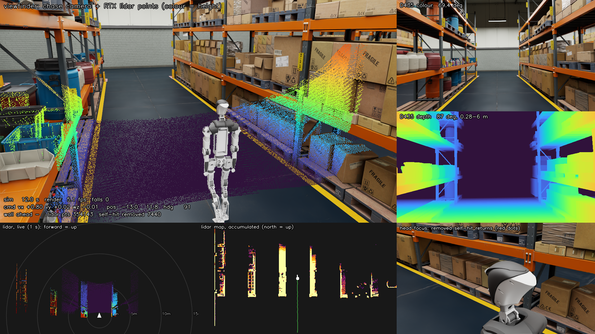
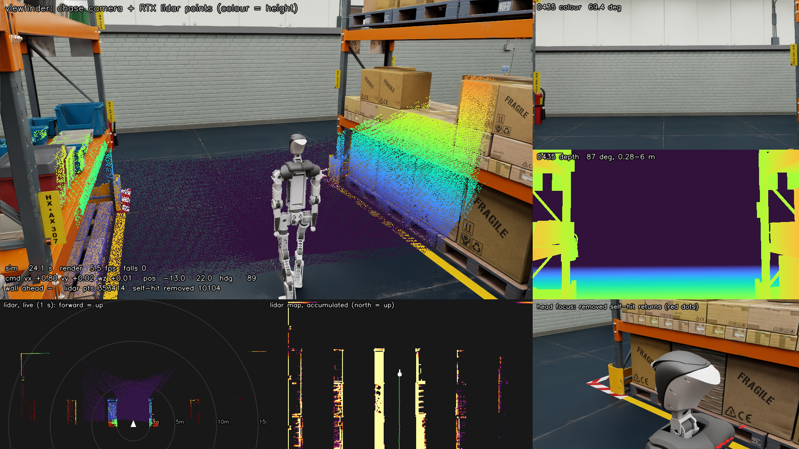
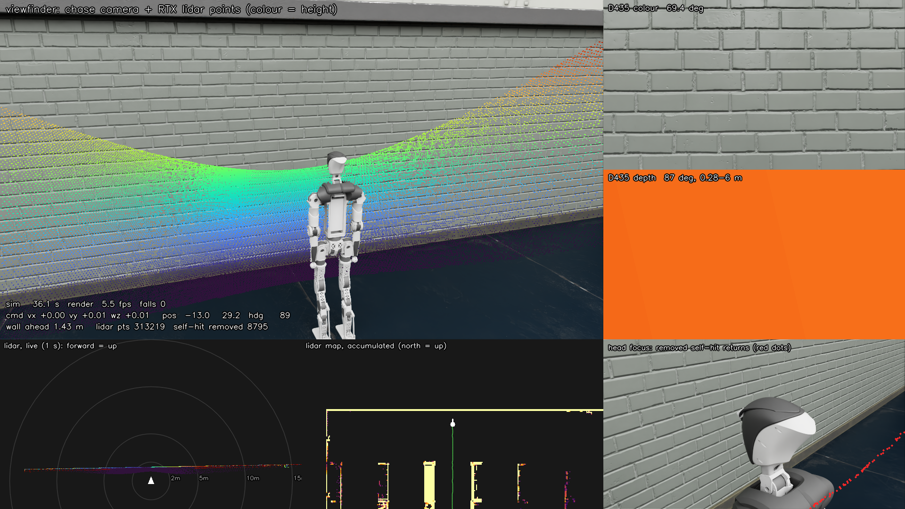
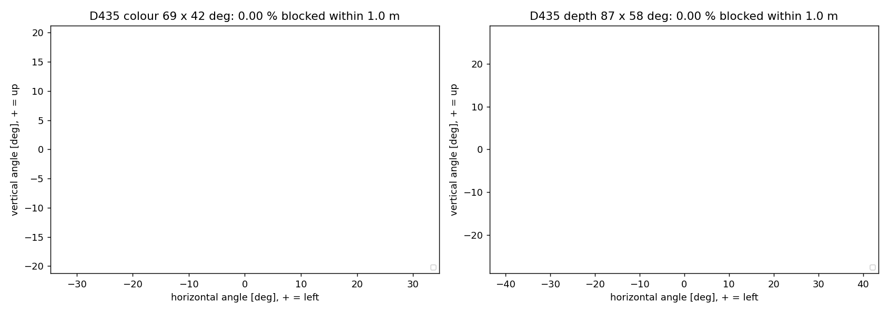
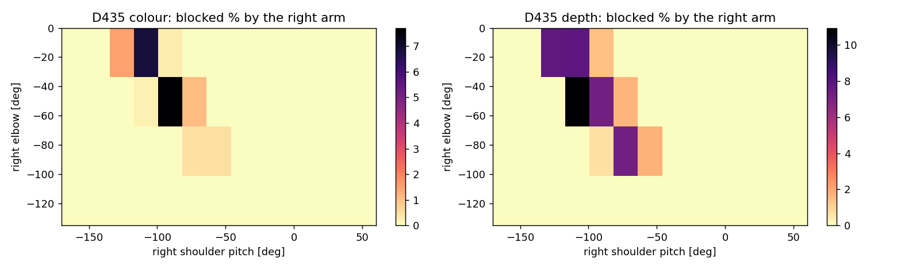

# 158. Isaac Sim 창고 데모 — 걷는 Huphy 1.0 + Ouster 라이다 + D435

시작: 2026-10-06 · 짝 문서: [[157_shell_lidar_upper_body_overlay]] (쉘·라이다·팔꿈치 모델),
[[154_pygviewer_v11a_packaging]] 계열의 v11a 정책(`deploy_asset/pyg_v11a_stand01/`).
사용자 요청: *"Huphy 1.0 에 전신 Policy(안되면 하체 Policy 넣고 각도 고정) 로 isaacsim 창고에서 걸어가면서, 라이다 점이 뷰파인더에 잡히고,
별도 창에서 realsense · lidar 포인트클라우드 시각화 … 영상은 단순 직진, 키보드로 조작."* 그리고 *"isaacsim 은 3090 에 설치해서 사용."*


## 0. 결과 (2026-10-07)

- **영상:** `docs/media/huphy_warehouse_walk.mp4` (1920×1080, 30 fps, 46 초, 88 MB). 선반 통로 `(−13, 3)` 에서 +Y 로 단순 직진, 북쪽 벽 1.43 m 앞에서 자동 정지.
  통로 중심선에서 벗어난 폭 ≤ 0.04 m (차선 유지 적용), 쓰러짐 0 번, 라이다 점은 최근 0.6 초에 약 30~40 만 개.
- **걷기**: v11a 정책 (하체), 명령 0.8 m/s. 걷기 시험은 §2.
- **웹 + 조이스틱**: §9. 0.0.0.0:8080. 영상 모드에서 조이스틱을 건드리면 `driver=joystick/keys` 로 바뀌어 직접 운전, 놓으면 직진 스크립트가 이어받는 것을 확인했다.
- **D435**: §4 (숫자 검증), 쉘·팔 간섭은 §8.
- 라이다 가려짐: §3.





처음 만든 영상(차선 유지 없음)은 걷다가 통로 왼쪽으로 1.3 m 밀려 통로 안에 놓인 작업대(병 상자) 앞 1.3 m 에서 멈췄다. 정책이 20 m 가면서 방향이 약 4° 틀어지기 때문이다.
그래서 직진 스크립트에 **약한 차선 유지**(옆 이동 명령 ±0.15 m/s, 회전 ±0.12 rad/s 상한, 시작 직선 기준)를 넣었다 (`--no-lane-keep` 으로 끔).

## ELI5

로봇이 걷는 **물리 계산**은 지금까지 쓰던 MuJoCo 가 하고, Isaac Sim 은 **그림만** 그립니다. 걷는 법은 하체만 배운 정책(v11a)이 하므로
팔과 머리는 "굳은 채 따라오는" 상태입니다. MuJoCo 가 계산한 관절 각도를 매 순간 Isaac Sim 의 쉘 모델에 복사하고, Isaac Sim 은 그 모델에 달린
Ouster 라이다와 D435 카메라 위치에서 창고를 "찍습니다".

## 1. 구성

| 부분 | 무엇 | 비고 |
|---|---|---|
| 걷기 물리 | MuJoCo, `pygviewer` 의 `SimCore`, `LegOnly-AB` 모델 + v11a ONNX | mjlab 에서 bake 한 것 (`bake model/policy`). 177 에서 만들어 3090 VM 으로 복사 |
| 그림 | Isaac Sim 5.0.0 (pip, Python 3.11) on **3090 VM** `~/isaac/venv311` | 헤드리스 RTX. 처음 켤 때 셰이더 컴파일 약 4 분, 이후 약 50 초 |
| 로봇 모델 | `FullDoF_..._v30_proxyfix_shell_loop.urdf` → Isaac URDF 가져오기 (34 관절) | 모델 가져오기 성공. PhysX 는 쓰지 않고 링크 위치만 덮어씀 |
| 라이다 | RTX 라이다 `OS1_REV7_128ch10hz1024res`, `os_sensor` 에 붙임 | 광학 중심 +38.195 mm (§3) |
| 카메라 | D435 컬러 69.4° (1280×720), D435 깊이 87° (1280×720), 추적 카메라 70° | §4 에서 숫자로 검증 |
| 창고 | `/Isaac/Environments/Simple_Warehouse/full_warehouse.usd` (S3) | 처음 250 초, 이후 17 초 |

관절 복사: MuJoCo 두 개를 쓴다. 정책용(`LegOnly-AB`, 하체 24 관절)과 그림용(전신 쉘 MJCF). 하체 관절값과 몸통 자세를 그림용 모델에 넣고
`mj_kinematics` 로 모든 링크의 위치를 얻어 USD 의 `xformOp:translate/orient` 에 쓴다. URDF 의 고정 링크(`os_sensor`, `os_lidar`, `d435_link`)는 URDF 의
고정 관절 변환으로 계산한다. 팔·허리·팔꿈치는 0 (팔을 내린 자세, 팔꿈치 펴짐).

## 2. 걷기가 실제 viser(pygviewer) 와 같은가 — 확인 결과

| 항목 | 데모 | 핸드아웃 (README §3.2) |
|---|---|---|
| 명령 1.2 m/s 일 때 전진 속도 | **1.205 m/s** (15 s, 안 쓰러짐) | 1.214 ± 0.002 m/s |
| 옆으로 벗어남 | 16.5 m 가는 동안 0.47 m | 방향 어긋남 8.5° ± 4.3° |
| 명령 0.8 m/s | 0.845 m/s (12 s) | — |

bake 때의 환경 토글 (`PYG_V2, INIT_BENT, INIT_MID, MOTOR_MEAS, TN, SAFE_TARGET_CLIP, STUDENT_TEACHER, ARM_ABD_DEG=15, ANKLE_MODE=AB, MODEL_TAG=LegOnly…v30_proxyfix`) 는
`train_env_manifest.json` 의 같은 이름과 같다. 학습에만 쓰는 토글(질량 무작위화·커리큘럼·보상)은 물리와 무관하다.
**한계:** 정책은 하체만 배웠다. 쉘·팔꿈치·라이다의 추가 질량(+5.49 kg)은 걷기 물리에 들어 있지 않다. v11a 는 제자리 회전이 약해서(중앙값 17 %)
Q/E 회전 키는 켜 두되 권하지 않는다.

## 3. 라이다 점이 머리 쉘에 가려지는 부분은 빠지는가 — 확인 결과

사용자 질문: *"간섭 나는 부분들이 날아가도록 맞춘 게 맞나?"* 두 겹으로 확인했다.

1. **Isaac 의 광선 자체가 쉘에 막힌다.** 한 바퀴(102,443 점)를 저장해 센서 좌표(0° = 센서 +X = 로봇 앞, 반시계)로 보니
   방위 **110°~250° 에는 점이 하나도 없다.** 오프라인으로 계산한 "모든 줄이 막히는 방위" 104.5°~256.0° (docs/157 §11.4) 와 같다.
2. **오프라인 마스크와 비교.** 마스크가 막는 칸 50,735 개 중 점이 있는 칸은 441 개 (0.9 %), 마스크 밖 칸의 93.1 % 에는 점이 있다.
   즉 Isaac 이 이미 거의 같게 막고 있고, 데모는 **나머지 1.06 % (1,082 점, 중앙값 거리 13.8 m — 쉘 모서리를 스친 광선)** 를 마스크로 한 번 더 지운다.
3. 로봇 몸에 맞은 가까운 점(0.6 m 안)은 **0 개** — OS1 의 최소 거리 0.5 m 때문에 그런 반환은 점으로 나오지 않는다. 그래서 "쉘에 맞은 점"이 시야에 박히지 않는다.

그림에서 확인하려면 오른쪽 아래 **머리 확대 창**: 지워진 반환점(빨강 점). 광선(선)은 사용자 요청으로 기본에서 껐다 (`--rays` 로 켬).

센서 프레임 오프셋: Isaac 의 OS1 설정은 자식 프리미티브가 부모보다 36.22 mm 위에 있다. `os_lidar` 는 38.195 mm 이므로 부모를 +1.975 mm 올려 맞췄다.

**라이다 기울기 결과:** 센서 축이 앞으로 40° 기울어져 있어(docs/157 §3.1) 정면 수평선은 시야 밖(앞쪽 광선은 수평 아래 18.8°~61.2°) 이다.
그래서 앞의 벽은 약 4.5 m 안으로 들어와야 찍히고, 바닥은 앞 약 4.5 m 까지, 위쪽(뒤쪽 광선)은 천장을 본다. 자동 정지는 이 특성을 쓴다 (벽 1.6 m 앞에서 정지).

### 3.1 렌더링 때 찾은 함정 (RTX 라이다)
- `orchestrator.step()` 한 번은 렌더를 3 번 돌리고, 라이다 데이터는 **마지막 1/60 초 조각만** 돌려준다. 처음에는 점의 2/3 를 버리고 있었다.
  지금은 `app.update()` 한 번 = 타임라인 1/60 초 = 라이다 조각(회전 60°) 하나로 맞춰 모든 조각을 읽는다 (초당 약 60 조각 → 0.6 초에 약 40 만 점).
- 점은 센서 좌표로 온다. 같이 오는 `info.transform` (행벡터 규약) 으로 세계 좌표로 바꾼다.
- 점 표시는 Isaac 의 점 프리미티브를 쓰면 라이다가 그 점을 다시 맞히므로, 영상 위에 직접 그린다 (깊이 가려짐 반영).

### 3.2 내장 시각화(debug draw) 와 점이 로봇 앞에 모여 보이는 이유 (사용자 질문)

**내장 기능을 쓰는가?** 점 데이터는 Isaac Sim 내장 RTX 라이다(`OS1_REV7_128ch10hz1024res`)와 내장 어노테이터(`IsaacExtractRTXSensorPointCloudNoAccumulator`)에서 읽는다.
화면에 그리는 것만 내가 직접 영상 위에 그렸다 (깊이로 가려짐 반영, 최근 0.6 초 누적). 내장 시각화(`LidarRtx.enable_visualization()` = 쓰기 도구 `RtxLidarDebugDrawPointCloud`)도 시험했다
(`--builtin-vis --no-overlay`): 헤드리스 카메라 영상에도 **그려지지만 매 갱신의 최신 조각(약 60° 부채꼴) 하나만, 한 색으로** 그린다. 실시간 GUI 에서는 조각이 빠르게 돌아 한 바퀴로 보이지만
오프라인 영상(프레임당 2 갱신)에서는 부채꼴 조각이 듬성듬성 보인다. 그래서 영상은 내 누적 표시를 기본으로 두고, `--builtin-vis --no-overlay` 로 내장 표시를 선택할 수 있게 했다.

**점이 로봇 앞에 모이는 이유는 표시가 아니라 센서가 40° 앞으로 기울어 있기 때문이다.** 기울기 방향은 CAD 라이다 메시의 축에서 쟀다 (축 `(0, −0.643, 0.766)` CAD = 시뮬레이터에서 앞쪽으로 40°).
고각 ±21.2° 로 계산하면:

| 방향 | 광선이 가는 곳 |
|---|---|
| 정면(방위 0°) | 수평선 아래 **18.8° ~ 61.2°** → 지면만 본다. 눈높이 약 1.5 m 이므로 지면 약 **0.8 ~ 4.5 m 앞**에 맞는다 (앞쪽 점이 모이는 원인) |
| 옆(방위 약 62° ~ 117°, 좌우) | 수평선이 시야 안에 들어옴 → 선반·벽 |
| 뒤(방위 180°) | 수평선 위 18.8° ~ 61.2° → 천장 (그리고 머리 쉘이 방위 110°~250° 를 가림) |

그래서 앞의 벽은 4.5 m 안으로 들어와야 점이 맺히고, 앞쪽 바닥에 점이 조밀하게 모인다. 이것은 사용자가 준 "40° 기울기"와 CAD 방향을 그대로 반영한 결과다. 방향(앞/뒤)이 실제 장착과 반대이면 알려 주세요 —
`manifest.json` 의 `lidar.tilt_deg` 와 `lidar_frames()` 의 기울기 부호만 바꾸면 모델·데드존·데모가 같이 바뀐다.

수평 360° 스캔으로 비교해 보려고 `--lidar-pitch-deg -40` (기울기 상쇄) 옵션을 넣었지만 **한 번 시험했을 때 점이 거의 안 나왔다** (20,585 / 522 / 0 / 28,582 개, 원인을 못 찾음). 아직 쓸 수 없는 실험 옵션이다.

## 4. D435 설정 — 숫자로 검증

사용자: *"D435 가 시야가 너무 좁아 보인다. 설정이 정확한지 확인하라."*

| 항목 | 이전 | 지금 | 근거 |
|---|---|---|---|
| 컬러 시야 | 69.4° × 42.6° | **69.4° × 42.6°** (변경 없음) | D435 데이터시트 69.4° × 42.5° |
| 깊이 시야 | **69.4° (컬러와 같게 잘못 사용)** | **87° × 56.2°** | 데이터시트 87° × 58° |
| 컬러 해상도 | 640×360 | 1280×720 (16:9 의 렌더 크기) | 실제 1920×1080 도 16:9 |

검증(`warehouse_demo.py --d435-test`): 3 m 앞 벽에 −30°…+40° 기둥 8 개를 세우고 컬러 영상에서 열 위치를 찾았다.

| 기둥 각 | 기대 열 (카메라가 몸통보다 8.8 cm 앞이라 보정) | 찾은 열 |
|---|---:|---:|
| −30° | 87 | 83.5 |
| −20° | 289 | 281 / 289 |
| −10° | 470 | 469.5 |
| 0° | 640 | **639.5** |
| +10° | 811 | 810 |
| +20° | 991 | 991 |
| +30° | 1193 | 1183 / 1196 |
| +40° | 화면 밖 | 없음 |

기둥은 수직(기울기 없음)이고 중앙 기둥이 정확히 중앙이다. 깊이 카메라는 같은 벽에서 열 0~1279 전체를 본다. **초점 거리 15.131 mm / 센서 20.955 mm** (컬러),
**11.041 mm** (깊이). 즉 설정은 데이터시트와 맞다. "좁아 보이는" 이유는 (1) 컬러 69.4° 는 원래 그만큼이고 (2) 이전에는 깊이도 69.4° 로 그려서 실제보다 좁았다.
컬러를 더 넓게 보고 싶으면 `D435_HFOV` 를 바꾸면 되지만 실제 센서와 달라진다.

D435 의 CAD 위치: 몸통 `(0.0759, 0, 0.6135)` m, 축은 로봇과 같다. 광학창은 몸체 중심에서 앞으로 12.5 mm 로 두었다 (추정값, CAD 로 확인 안 함).

## 5. 실행 방법 (3090 VM)

```bash
ssh syaro@10.8.0.14
cd ~/pyg_demo && source ~/isaac/venv311/bin/activate
python warehouse_demo.py --mode video --seconds 46 --out demo.mp4     # 헤드리스, 단순 직진, 약 8 분 (--stream 을 붙이면 웹으로도 본다)
python warehouse_demo.py --mode web --port 8080                      # 브라우저 + 조이스틱·키보드 (http://10.8.0.14:8080/, 0.0.0.0 에 묶임)
python warehouse_demo.py --d435-test                                 # D435 시야각 숫자 검증
```

키: `W S` 앞뒤, `A D` 좌우, `Q E` 회전(약함), `Space` 정지, `R` 초기화, `Shift` 빠르게. 별도 창 링크: `/view/main`, `/view/rgb`, `/view/depth`, `/view/bev`, `/view/map`, `/view/head`.

시작 위치는 선반 통로 `(−13, 3)` 에서 +Y 방향 (창고 지도: 선반은 x≈−25.8, −20.8, −15.5, −10.5, −5.5, −0.25, +5 에 Y 방향으로 길게, 통로는 그 사이). 북쪽 벽은 y≈31.

파일: `tools/isaac_demo/` — `walk_probe.py`(걷기 시험), `warehouse_demo.py`(데모), `selfhit_check.py`(§3 의 비교), `isaac_probe*.py`·`isaac_map.py`(탐색 시험).
3090 VM 의 `~/pyg_demo/` 에 `assets/`(URDF·메시·MJCF·마스크), `pyg_demo_cache/`(bake 된 모델과 v11a), `tools/pygviewer/` 가 있다.

## 6. 화면 구성 (1920×1080)

| 위치 | 내용 |
|---|---|
| 왼쪽 위 큰 화면 | 추적 카메라 (뷰파인더). 라이다 점(높이 색), 상태 글자 |
| 오른쪽 위 | D435 컬러 (69.4°) |
| 오른쪽 가운데 | D435 깊이 (87°, 0.28~6 m) |
| 왼쪽 아래 | 라이다 새 점, 로봇 기준 위에서 본 모양 (최근 0.6 초) |
| 가운데 아래 | 누적 라이다 지도 (북쪽이 위) + 지나온 길 |
| 오른쪽 아래 | 머리 확대: 지워진 반환점(빨강 점). 광선은 `--rays` 일 때만 |

## 7. 알려진 한계 · 하지 않은 것 (정직하게)

- 상체는 따라오기만 한다. 팔 흔들기·팔꿈치 굽힘 없음. 전신 정책은 아직 없다.
- 라이다 줄 각도는 Isaac 의 OS1 REV7 설정(방위마다 줄 오프셋이 다른 실제 표 근사)이고, 오프라인 마스크는 균일 고각 근사다. 둘이 99 % 일치.
- 마스크는 CAD 머리 쉘만 쓴다(사용자 규칙). 몸통·팔에 닿는 광선은 Isaac 이 자연스럽게 막는다 (자세에 따라 달라짐).
- 렌더 속도: 처음에는 시뮬레이션 1 초에 약 8.5 초(4.2 fps). 광선을 기본에서 뺀 것은 속도와 무관했다(그리는 시간 ms 단위). 진짜 비용은 D435 를 1280×720 으로 그린 것과 뷰파인더 깊이 영상이었다 → D435 640×360 + 깊이 영상 반해상도(`--full-res` 로 되돌림)로 **약 5 초(6.9~7.4 fps)** 로 줄였다. 웹 모드는 실시간이 안 된다 (해상도를 낮추거나 패널을 줄여야 함).
- 창고에서 로봇이 지면과 닿는 높이는 MuJoCo 바닥(0) 기준이라 창고 바닥 z≈0 과 맞다. 실제 접촉은 Isaac 에서 계산하지 않는다.
- v11a 는 제자리 회전이 약하다. 키보드 회전은 시험용.

## 8. D435 와 쉘·팔의 간섭 (후순위 분석, 사용자 요청)

방법 (`tools/robot_model/shell_overlay/d435_occlusion.py`, MuJoCo `mj_ray`): 전신 쉘 모델의 **눈에 보이는 면**만 대상으로 D435 창(몸체 중심 앞 12.5 mm, 거기서 2 cm 더 앞에서 출발)에서 광선을 쏘아
1 m 안에서 로봇 몸에 맞으면 "가려짐". 컬러 69.4° × 42.5°, 깊이 87° × 58°. 자세는 영점(팔을 내림, 팔꿈치 0).

**영점 자세: 컬러·깊이 모두 가려지는 곳 0 %.** 정면에서 벗어나도 처음 막히는 각도는 위쪽 **76°** (몸통 위 머리 쪽), 아래쪽 **86°**, 좌우 90° 이상이다 (필요한 시야는 위 ±29°, 좌우 ±43.5°). 즉 머리·몸통 쉘 때문에 D435 시야가 가려지지는 않는다.

**팔을 움직이면 가려진다** (오른팔, 어깨 pitch 와 팔꿈치 격자, 왼팔은 거울):

| 어깨 pitch (앞으로 들기 = −) | 팔꿈치 | 컬러 가려짐 | 깊이 가려짐 |
|---|---|---:|---:|
| 영점(+2.5°, 팔 내림) | 0° ~ −135° | 0 % | 0 % |
| −93° (거의 수평 앞으로) | −45° | **7.7 %** | 7.3 % |
| −112° | −45° | 0.2 % | **10.95 %** (최대) |
| −112° | 0° (팔 쭉 뻗음) | **6.85 %** | 7.8 % |
| −75° ~ −55° | −90° | 0.5 % | 7.3 % / 1.8 % |
| −35° 이상(팔을 몸 쪽) | 전부 | 0 % | 0 % |
| −170° ~ −150° (머리 위로) | 전부 | 0 % | 0 % |

→ 팔을 앞으로(어깨 pitch −55° ~ −130°) 들어올리는 동작에서 **영상 오른쪽 가장자리**가 최대 약 8 %(컬러)·11 %(깊이) 가려진다. 거울 대칭이라 왼팔은 영상 왼쪽 가장자리.
팔이 몸 옆에 있거나 머리 위로 올라가면 가려지지 않는다. 그림: `docs/img/shell_overlay/d435_occlusion.png`(영점), `d435_occlusion_arm_sweep.png`(팔 격자). 수치: `d435_occlusion.json`.
한계: 팔 격자는 오른팔 하나, 어깨 roll 0 에서만 계산했다. 카메라 창 위치는 몸체 중심 + 12.5 mm 로 가정했고 CAD 로 확인하지 않았다. 컬러 렌즈는 실제로는 몸체 가운데에서 약간 비껴 있다 (무시).
이 데모에서는 팔이 움직이지 않으므로 해당 없음.




## 9. 웹 스트리밍 + 조이스틱

`--mode web` (키보드·조이스틱으로 직접 운전) 와 `--mode video --stream` (영상을 녹화하면서 같은 화면을 웹으로 내보냄; 조이스틱·키를 건드리면 스크립트 직진 대신 그 입력을 따르고, 놓으면 다시 직진) 모두
**`0.0.0.0:8080`** 에 묶인다 (`--port` 로 변경). 브라우저에서 `http://10.8.0.14:8080/` 접속.

- 화면 왼쪽 위 **가상 조이스틱 2 개**: 왼쪽 = 앞뒤(위/아래)·좌우 평행이동, 오른쪽 = 회전(좌우). 마우스·터치 모두 됨. 게임패드를 꽂으면 자동으로 읽는다 (왼 스틱 = 이동, 오른 스틱 가로 = 회전).
- 입력은 0.1 초마다 `/joy?lx=&ly=&rx=` 로 전달되고, 0.8 초 동안 새 입력이 없으면 정지 (끊김 안전). 속도: 앞 최대 0.8 m/s (Shift 1.0), 뒤 0.4, 옆 0.25, 회전 0.3 rad/s.
- 전면 벽 1.6 m 앞에서는 앞으로 가는 명령이 자동으로 줄어 멈춘다 (`--stop-dist 0` 이면 끔).
- 별도 창: `/view/main` `/view/rgb` `/view/depth` `/view/bev` `/view/map` `/view/head` (각각 MJPEG).
- 웹 모드는 실시간이 아니다 (렌더 약 5 fps → 로봇이 느리게 보임). 영상 모드 렌더가 시뮬레이션 1 초당 약 8 초라서, 조이스틱 반응도 그만큼 느리다.

## 10. 남은 일 · 한계 (정직하게)

- mp4 는 OpenCV(`mp4v`)로 쓰면 386 MB 라서 177 의 `ffmpeg -c:v libx264 -crf 24` 로 88 MB 로 줄였다 (3090 VM 에는 ffmpeg 가 없다).
- **머리 확대 창** 은 카메라가 라이다 뒤-왼쪽 0.8 m 에서 보는데 광선이 화면을 덮어 머리 쉘이 잘 안 보인다. 더 가까운 각도나 광선 수 줄이기가 필요하다.
- 웹 모드는 렌더가 약 4~5 fps 라 조이스틱 반응이 느리다. 해상도·패널을 줄인 `--lite` 는 만들지 않았다.
- D435 광학창 위치 12.5 mm, 컬러 렌즈의 좌우 비껴섬은 CAD 로 확인하지 않았다.
- 라이다 줄 각도 표는 Isaac 의 OS1 REV7 설정을 그대로 쓴다. 실제 센서의 줄 표와 같은지는 확인하지 않았다.
- 전신 정책으로 걷는 것은 아직 없다 (하체 정책 + 상체 고정).
