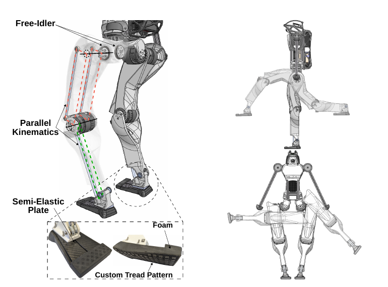
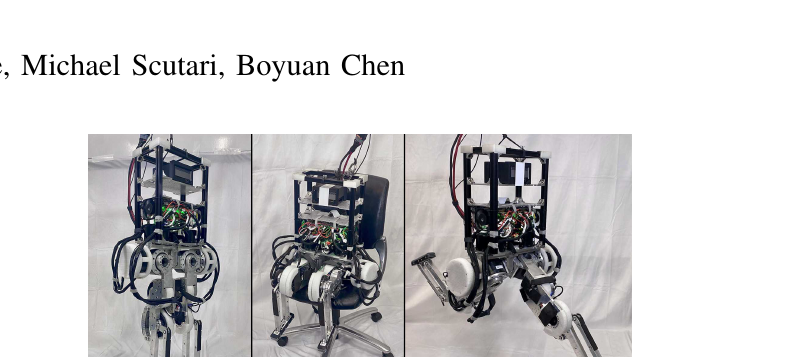
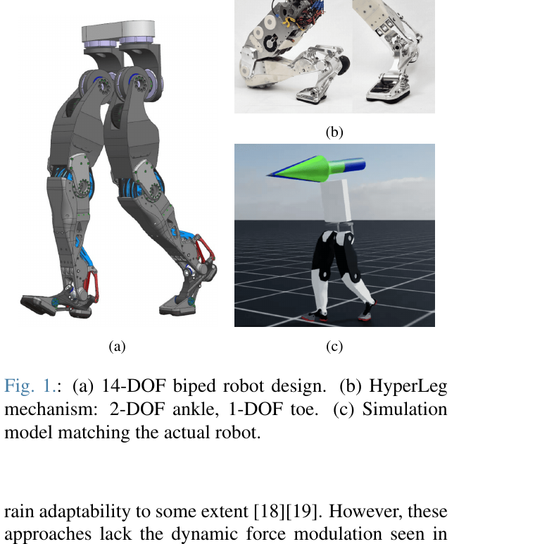
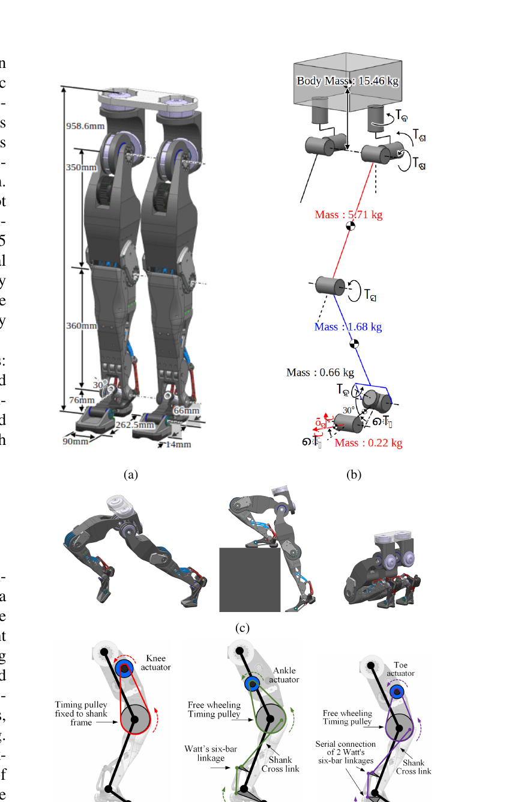
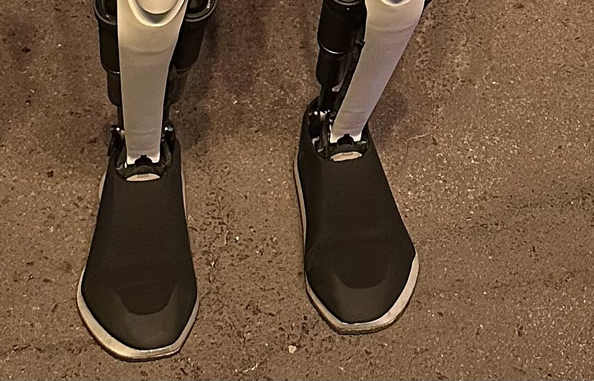
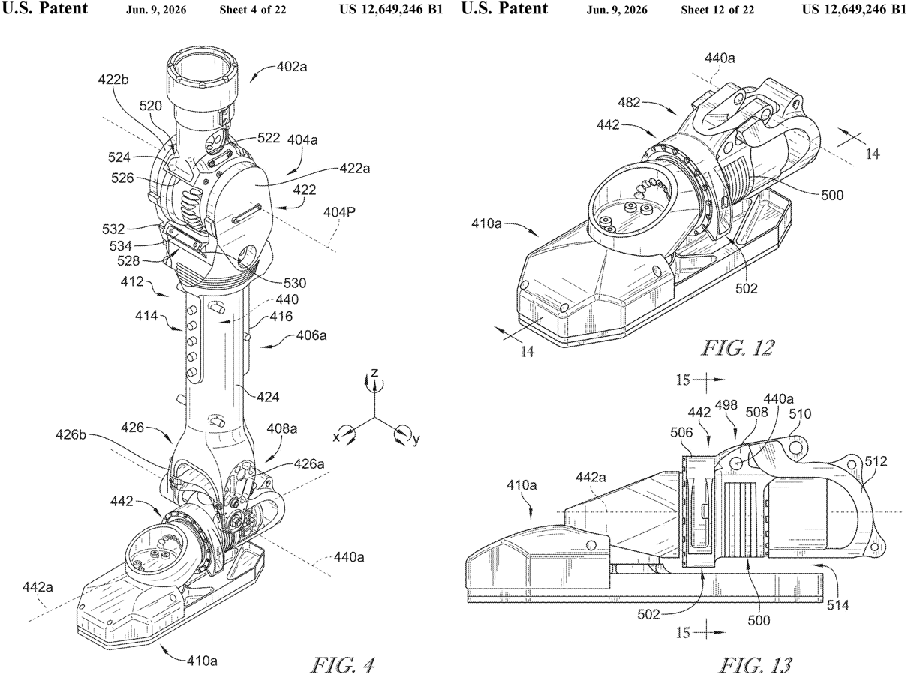
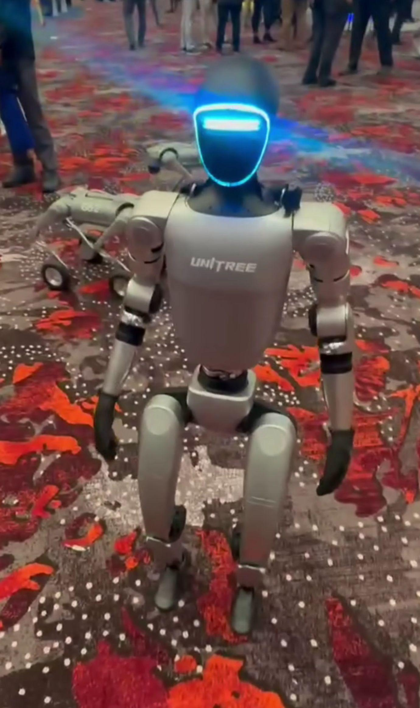
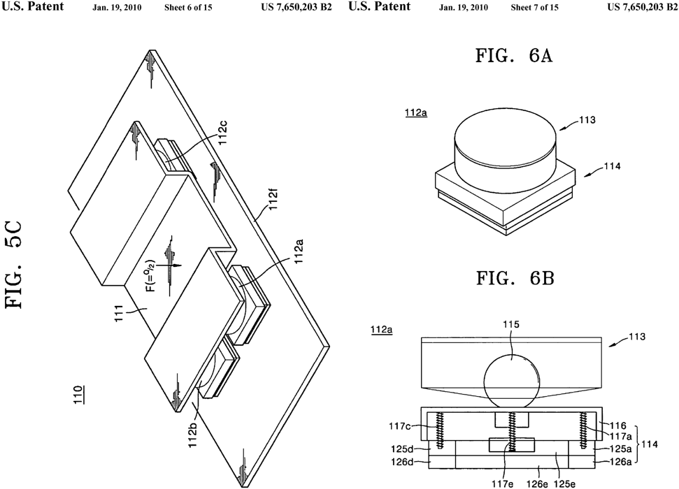
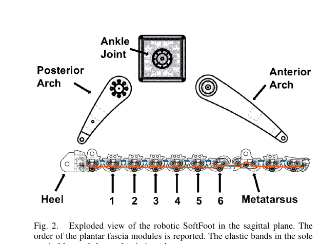

# 160. 휴머노이드 발·발바닥 설계 서베이 — QDD 계열 최신 세대 로봇은 발을 어떻게 만드는가

작성 2026-10-13 · 목적: Huphy 1.0 의 **발바닥 설계(지면 마찰 + 충격 흡수)** 를 시작하기 전에, 비슷한 액추에이터(QDD / 저감속 고토크 / 프로프리오셉티브)를 쓰는 휴머노이드가 발을 **구체적으로** 어떻게 구성하는지 모은다.
짝 문서: [[119_legonly_collision_review]] (Huphy 발바닥 충돌 박스), [[40_foot_edge_ankle_roll]] (발 가장자리·발목 roll), [[145_model_parameter_provenance]].
모든 웹 자료는 **2026-10-13 에 확인**했다. 출처는 §8, 그림 라이선스는 §9.

## 0. 결론 먼저 (5줄)

1. **QDD 계열 연구용 휴머노이드의 발은 대부분 "단단한 판 + 얇은 탄성 층" 의 단순한 구조**다. 능동 발가락(toe)·복잡한 충격 흡수기는 소수다. 이유는 논문들이 같다: 시뮬레이션에서 다루기 쉽고, 고장이 적고, 정책이 *강체 접촉* 으로 학습되기 때문이다 (Berkeley Humanoid: 작은 평평한 발, 발 센서 없음).
2. **발바닥 재질이 숫자까지 공개된 예는 드물다.** 확인된 것: AGILOped (varioShore TPU 발포 + 반탄성 판 + 트레드, 3D 프린트), EcoWalker-2 (2 mm 실리콘, Shore 00-50, 뒤꿈치), Digit (Vibram 과 공동 개발한 직사각형 하이킹화형 밑창, 압연 콘크리트 대응), Atlas (딱딱한 구조 + 신발형 밑창, 다방향 트레드). Unitree·Figure·Apptronik·Tesla 는 **발바닥 재질 공개 자료를 찾지 못했다** (§3.7~3.9).
3. **마찰은 "재질 + 트레드 + 시뮬레이션 랜덤화 범위" 를 같이 정해야** 한다. 학습 쪽 범위는 Berkeley Humanoid 0.2~1.25, Unitree G1 설정 0.1~1.25, 우리 현재 0.3~1.2 (`velocity_env_cfg.py`). 하한이 높으면 미끄러운 바닥을 학습하지 못한다.
4. **충격 흡수의 정석적 딜레마**: 고무를 말랑하게 하면 몸통이 흔들리고(발이 스프링처럼 동작), 딱딱하게 하면 충격이 몸으로 간다 (Samsung 특허가 Honda 식 고무 밑창+부싱을 이 이유로 비판). 그래서 최신 연구는 *얇은 감쇠 층* (2 mm 실리콘, 발포 TPU) 정도에 그치거나, 구조 쪽에서 해결한다 (판 스프링, 아치).
5. **Huphy 제안(§6)**: 지금의 알루미늄 판 위에 *교체 가능한* 얇은 고무 아웃솔(트레드) + 선택적 얇은 감쇠 중층을 먼저 붙이고, 접촉 강성은 시뮬레이션에 넣지 않고 **마찰 범위만 실측으로 맞춘다.** 시뮬레이션 모델과의 간극을 키우는 큰 두께의 말랑한 밑창은 지금 단계에서 권하지 않는다.

## 1. 조사 범위와 한계 (정직하게)

- **범위**: "QDD 액추에이터를 쓰는 최신 세대" 를 넓게 잡았다 — Berkeley Humanoid / Lite, Duke Humanoid, AGILOped, KAIST HyperLeg, Digit(Cassie 계열 프로프리오셉티브 액추에이션), 그리고 비교 기준으로 Atlas, Optimus, Figure, Unitree.
  Berkeley Humanoid 논문에 따르면 **Tesla Optimus 는 QDD 가 아니라 선형 액추에이터 + 하모닉 드라이브**다 (§3.7). 즉 Optimus 는 *참고용* 이다.
- **근거 등급**
  - **A** = 논문·특허·공식 모델 파일 본문을 내가 직접 읽음.
  - **B** = 회사 공식 글/신뢰할 만한 매체를 읽음.
  - **C** = 검색 요약만 봤거나 2차 매체의 설명. 사실로 쓰지 말고 단서로만.
- **찾지 못한 것**: 상용 휴머노이드(Unitree G1/H1/H2, Figure 02/03, Apptronik Apollo, Booster T1, 1X, Fourier)의 **발바닥 재질·두께·경도**. 분해(teardown) 자료나 공식 사양에 없었다. 이 부분은 *실물 사진·영상으로 직접 확인해야* 하며 §7 에 방법을 적었다.
- **Agility 의 "Designing Robot Footwear" 페이지는 2026-10-13 에 404 였다.** 그 내용은 검색 결과 요약(등급 C)과 Agility 영상 페이지(등급 B, 날짜 2022-08-09)로 확인했다.
- 한 가지 정정: 검색 결과 중 "Honda 시대 특허"로 요약된 *US 7,650,203* 은 실제로 **Samsung** 특허이고, Honda 는 그 특허가 비판하는 선행 기술로만 나온다 (§4.2).

## 2. 한눈에 보기

| 로봇 | 액추에이터 계열 | 발 구조 | 밑창/표면 | 발가락 | 발 센싱 | 근거 |
|---|---|---|---|---|---|---|
| **AGILOped** (U. Bonn, 2025) | 시판 액추에이터 10개 | 길쭉한 발, 비스듬한 반탄성 판 2장이 발목에 직결 (내·외측 아치 흉내) | **varioShore TPU 발포 밑창 3D 프린트 + 일체형 트레드** | 없음 | — | A |
| **Duke Humanoid** (Duke, 2024) | Motorevo BLDC + 유성 감속기 | 롤 축이 없어서 **롤 방향으로 곡선인 "선 접촉면"** 발 | 모터 덮개 TPU (밑창 재질은 미기재) | 없음 | **토 2 + 힐 2 로드셀** | A |
| **Berkeley Humanoid** (UC Berkeley, 2024) | 자체 제작 QDD | **작은 평평한 발** + 발목 pitch(링크 전동) + **발목 roll 능동** | 미기재 | 없음 | **없음**(접촉 힘은 모멘텀 관측기로 추정) | A |
| **HyperLeg** (KAIST·WIRobotics, 2026) | BLDC + 7:1 유성 (+ 벨트·링크) | 2 DoF 발목 + **1 DoF 능동 발가락**, 발 0.66 kg·발가락 0.22 kg | 미기재 | **능동 1 DoF** | — | A |
| **Digit** (Agility) | 프로프리오셉티브 | v2 에서 **발 roll DoF 추가·발 확대**, 수동 판스프링 + 4절 링크, 발가락은 막대로 구동 | **Vibram 공동 개발 직사각 밑창**, 콘크리트용 트레드 | 있음(정책은 고정 PD) | — | B / C |
| **Atlas** (Boston Dynamics) | 전기식 (최신) | **좌우 대칭 발, 발목이 중앙**, 단단한 구조 + 신발형 밑창, 큰 접지 면적 | **다방향 트레드**, 충격 흡수·미끄럼 방지 | 힐-토 형상 | — | B |
| **Optimus** (Tesla) | 선형·하모닉(QDD 아님) | Gen 2 부터 **관절형 발가락**, 발 F/T 센싱 (회사 발표) | 겉면은 검은 신발형 덮개 + 밝은 밑창 띠 (사진 관찰) | 있음(스프링 복귀로 보인다는 외부 의견) | 힘/토크 (회사 발표) | B / C |
| **Figure** | 미확인 | 특허(Figure AI): **발목 pitch+roll, 발-roll 액추에이터, 6축 F/T, 휘는 발가락부** | 미확인 | 있음(특허) | 6축 F/T | A(특허) / C |
| **Unitree G1/H1** | 저감속 계열로 알려짐 | 공식 MJCF: 발당 **구 4개(반지름 5 mm) 접촉점** | 공개 자료 없음 | 없음 | 미확인 | A(모델) / C |
| **EcoWalker-2** (참고) | BLDC | 뒤꿈치·발가락 짧게, 발가락 비틀림 스프링 | **2 mm 실리콘(Shore 00-50)을 뒤꿈치에 접착** | 수동 | — | A |

## 3. 사례별 상세

### 3.1 AGILOped — 가장 구체적인 "발 레시피" (3D 프린트 중심, A)

Ficht, Denninger, Behnke, *AGILOped: Agile Open-Source Humanoid Robot for Research*, ARM 2025 (arXiv 2509.09364). 10 DoF, 대부분 3D 프린트, 시판 부품. 다리 움직이는 부분 3.51 kg (액추에이터 1.77 kg), 정강이~발~평행 막대 합 **0.56 kg** (다리 질량의 84 % 가 엉덩이 근처).

발 구성 (논문 본문을 요약, 직접 인용 아님):
1. **길쭉한 발** — 4 DoF 다리의 점발(point foot)과 달리 정적으로 설 수 있게 한다.
2. **탄성 판(semi-elastic plate) 2장**을 비스듬히 세워 발목에 직결 — 세로 방향 강성·에너지 저장 + 판을 둘로 나눠 *내·외측 아치* 를 흉내 내 **옆 방향 유연성**을 얻는다. 영감: 생체 + 달리기 신발의 세로 휨 강성 연구.
3. 판을 **3D 프린트 발포 TPU 밑창**에 끼운다. 사용 재료는 *varioShore TPU* 로, 프린트 온도가 문턱 아래면 엘라스토머처럼 거동하고, 문턱을 넘으면 **발포되어 Shore 경도가 내려간다.** 즉 프린터 온도로 경도를 조절한다.
4. 밑창에 **일체형 트레드 무늬**(접지 마찰 증가)를 넣었다.
5. 평행 링크 발목 때문에 발이 "지면에 어느 정도 적응하면서도 로봇을 받칠 만큼 단단해야" 한다는 요구에서 위 구조가 나왔다고 설명한다.
6. 구조: PLA 로 시제품, **Nylon 권장**(내구·내열). 알루미늄 로드, 충격이 닿는 곳(어깨 마운트 등)은 TPU 로 "선택적 순응(selective compliance)".

→ **Huphy 에 주는 힌트**: 발 *전체*를 말랑하게 하지 않고, **단단한 판 + 방향별로 다른 강성 + 얇은 탄성 밑창** 으로 나눈다.

### 3.2 Duke Humanoid (A)

Xia, Li, Lee, Scutari, Chen, arXiv 2409.19795 (v2 2025-03-14). 10 DoF, 어린이 크기, 정강이 0.235 m · 대퇴 0.285 m. 발목은 pitch 하나뿐.

- **발목에 roll(내·외번) 축이 없다. 이를 보상하려고 발을 "선 접촉면(linear contact surface)" 으로 설계**해서 롤 각도와 상관없이 접촉이 일정하게 유지된다고 한다.
- 센서: **발가락 로드셀 2개 + 뒤꿈치 로드셀 2개**, Teensy 4.0 으로 읽는다 (IMU 와 함께).
- 모터 바깥은 **3D 프린트 TPU** 로 덮어 충돌로부터 보호한다 (밑창이 아니라 모터 덮개).
- 학습 보상에 **발 공중 시간, 발 방향, 발 높이** 항이 있다 (보상 표).

### 3.3 Berkeley Humanoid (A) — 발에 대한 *설계 철학* 이 가장 명확

Liao et al., *Berkeley Humanoid: A Research Platform for Learning-based Control*, arXiv 2407.21781 (2024-07-31). 중형(어린이 크기), 자체 제작 **QDD** 액추에이터, 감속비 9:1 (표).
- "소형 로봇은 큰 평발 + 서보로 풀었지만, 우리는 **더 작은 평평한 발 + 더 강한 액추에이터**" 로 동적 운동을 택했다고 명시한다.
- 발목: pitch 는 **링크 전동** (큰 토크), **roll 도 능동** (정적 자세 안정, 한 발 서기 가능성).
- **발 센서 없음.** 대신 *일반화 모멘텀 관측기* 로 발의 접촉 렌치(6 DoF)를 추정한다.
- 발 가동 범위: 굴곡/신전 [−30°, 70°], 내·외전 [−30°, 30°] (사람 범위 대비 100 % 커버).
- 시뮬레이션: **지면 마찰 0.2~1.25, 반발 0.0~0.1 로 랜덤화**, 보상에서 "발이 미끄러지지 않게" 와 "접촉력이 문턱을 넘지 않게(감속기 보호)" 항을 쓴다.
- 경사 약 20° 흙길에서 발목 pitch 상향 범위가 모자라 몸을 세우려면 뒤로 물러서야 했다 (Fig. 5b) — 발·발목 가동 범위의 실제 한계 사례.
- *Berkeley Humanoid Lite* (arXiv 2504.17249): 3D 프린트 사이클로이드 기어, 하드웨어 비용 < $5,000. **발에 대한 서술은 찾지 못했다.**

### 3.4 KAIST·WIRobotics HyperLeg — 능동 발가락의 정량 비교 (A)

Kim 외, *Comparative Study on Agility, Efficiency, and Impact Absorption of Bipedal Robots with Active Toes*, arXiv 2606.19699 (2026-06-18). **14 DoF** 이족: 엉덩이 3, 무릎 1, **발목 2, 발가락 1**. 총 32.0 kg, 다리당 8.27 kg, 질량: 골반 15.46 · 허벅지 5.71 · 정강이 1.68 · **발 0.66 · 발가락 0.22 kg.** 무거운 액추에이터는 모두 허벅지에 두고 **벨트·링크**로 전달 (정강이 이하 가볍게). 무릎·발목·발가락 액추에이터는 **7:1 유성 + 인러너 BLDC** (저마찰·역구동성 강조).

- 시뮬레이션 결과(발가락 있음 vs 제거, 같은 보상·학습): **1.33 m/s 걷기에서 CoT −17.5 %, 뒤꿈치 충격 지면반력 −5.0 %**, 민첩성 시험에서 경로 이탈 평균 −25.0 %, 최대 −34.0 %.
- **시뮬레이션만의 결과**이며 밑창 재질은 다루지 않는다. 발가락의 가치(충격·효율)는 보이지만, **구조가 복잡하고 약해지기 쉽다**는 서론의 설명이 핵심이다 ("실제 구현이 제한적인 이유: 복잡성과 구조적 취약성").

### 3.5 Digit (Agility Robotics) — 상용 이족에서 밑창을 *전문 업체* 와 만든 사례 (B)

- 2019-10 (IEEE Spectrum): v2 는 **발에 roll DoF 추가** → 옆 힘에 옆걸음 없이 버틴다, **한 발 정적 균형** 가능 (v1·Cassie 불가). **발이 커져서 면적당 하중이 줄어** 모래 같은 무른 지면에 유리, 쿵쿵 소리도 감소. **힐-토 걸음은 당시 "개발 중"**.
- 2022-08-09 (Agility 영상 페이지): **Vibram 과 새 밑창 개발**, "variable surfaces 에서 안정성 증가, 마모 감소".
- (등급 C, 검색 요약) 트레드와 고무 배합을 **먼지 낀 매끈한 콘크리트**에 맞췄고, 밑창은 하이킹화 밑창 같은 무늬를 *직사각형* 으로 만들어 발 모양에 맞췄다. Vibram 디자이너가 처음 물은 것은 **"이 로봇의 걸음이 뒤꿈치 착지인가 발끝 착지인가"** 였다.
- 구조(A, Radosavovic 외 arXiv 2303.03381): 정강이·타르수스는 **판스프링 + 4절 링크로 연결된 수동 관절**, **발가락 관절은 타르수스에 붙은 막대로 구동**. 이 정책은 *발가락 모터 4개를 학습하지 않고 고정 PD 로 기본 위치*를 유지한다 (시뮬레이터가 닫힌 연쇄를 못 다뤄 높은 강성 가상 스프링을 썼다).

→ 발바닥을 **신발 전문 업체**와 개발한 점, **걸음 방식(힐/토)이 먼저 질문**이라는 점이 Huphy 의 밑창 설계 순서(§6)에 직접 쓰인다.

### 3.6 Boston Dynamics Atlas (B)

BD 블로그 "Ask a Roboticist — Meet Chastity" (페이지에 날짜 없음, 2026 업로드 이미지): Atlas 발 담당 기계 설계자 인터뷰.
- 새 발은 **좌우 대칭, 발목이 중앙**, 무릎이 뒤로 접혀 앞·뒤 보행이 가능.
- 발은 **두 구조**: **딱딱한 물리 구조 + 신발형(shoe-like) 밑창 구조**. 밑창은 **충격 흡수, 관절 보호, 공장 바닥 미끄럼 방지**.
- **큰 접지 면적**이 균형에 유리, **뒤꿈치·발끝 형상**이 힐-토 걸음을 돕고, 겉창(outsole) **트레드는 다방향** — 앞뒤 모두 그립, **모래·액체에서는 표면을 밀어내며 접촉을 유지**.
- **컴플라이언스(순응)는 제어팀과 함께 최적화**, 시제품은 3D 프린트로 빨리 만들고 고장은 원인 분석.
- *재질·경도·두께 수치는 공개되지 않았다.* CES 2026 의 양산형 Atlas 사양에도 발 정보는 없었다 (Engadget).

### 3.7 Tesla Optimus (B / C)

- Gen 2 (2023-12): Tesla 가 **발 힘/토크 센싱, 관절형(articulated) 발가락, 사람 발 형상**을 개선점으로 발표.
- Humanoids Daily: 걸음에서 뒤꿈치 착지→평평→**발끝 밀어냄**, 발가락은 *힌지 + 스프링*(수동에 가까운 복귀)이라는 외부 분석가(Scott Walter)의 의견. 발목을 더 아래로 펴야 푸시오프가 낫다는 주장은 **한 사람의 의견**이다.
- Berkeley Humanoid 논문: Optimus 는 **선형 액추에이터 + 하모닉 드라이브(일부는 로드셀 포함)** 로 *QDD 에서 벗어난* 설계.
- 사진(CC BY 2.0, 2024-10): 발이 **검은 신발형 덮개, 아래에 밝은 색 밑창 띠**로 보인다. (사진으로 본 관찰일 뿐 재질은 모른다.)

### 3.8 Figure AI — 특허로 본 발목·발 (A: 특허 / C: 본문 인용)

미국 특허 **US 12,649,246 B1 "Humanoid robot with an ankle region"** (출원인 Figure AI Inc., 출원 2024-10-14, 등록 2026-06-09, 도면 22장). 초록 확인(A): 양쪽 **발목 어셈블리가 pitch 와 roll 을 제어**하고, **발-roll 액추에이터**가 발과 발-굴곡 액추에이터에 결합된다.
검색 결과가 인용한 본문(C, 도면 설명만 확인): 발 베이스 구조에 **센서부 · 발가락부 · 액추에이터 인터페이스부**, 센서는 **6축 힘/토크 센서**로 *정강이에서 지면으로 가는 하중 경로*에 위치, **발가락부는 걸을 때 휘며 굴러 넘어가도록 곡면**.

주의: 특허는 *제품 사양이 아니다.* 밑창 재질은 이 특허의 도면 설명에서 확인하지 못했다.

### 3.9 Unitree G1/H1, Figure 02, Apptronik Apollo (C)

- **Unitree G1 공식 MJCF** (`unitree_mujoco/unitree_robots/g1/g1_29dof.xml`, A): 발목 roll 링크의 충돌은 **구 4개(반지름 5 mm)** — 위치(m) (−0.05, ±0.025, −0.03), (0.12, ±0.03, −0.03). 마찰 등 접촉 파라미터는 지정하지 않아 MuJoCo 기본값. 발목 pitch 범위 −0.873~+0.524 rad, roll ±0.262 rad, 토크 한계 ±50 N·m. **이는 시뮬레이션 모델이지 실물 발바닥 정보가 아니다.** 우리 학습 설정의 주석은 G1 설정이 마찰 범위를 [0.1, 1.25] 로 둔다고 적고 있다.
- Humanoids Daily (등급 C): Figure 02, Apollo, Unitree H1 은 *발목 구동 + 부드러운 고무 패드*에 의존하고 발 자체는 단순·견고를 우선한다고 서술하지만, 같은 기사의 Apollo 영상 설명은 "rigid feet" 로 **서로 어긋난다.** 수치·재질은 없다.
- **G1 사진 (CC0)**: 발바닥 세부는 안 보임.

### 3.10 EcoWalker-2 — 얇은 감쇠층의 실제 숫자 (A)

arXiv 2411.13289 (수동 무릎 굽힘 연구). 사람 걸음의 "스윙 다리 캐터펄트"를 재현하는 이족. 발 제원: 뒤꿈치 32 mm(48→32), 발가락 17 mm(24→17) 로 줄여 **스윙 때 발끝 간격** 확보, **뒤꿈치 아래에 2 mm 실리콘 층 (Shore 00-50) 을 접착해 착지를 감쇠**, 발가락 관절에 **회전 스프링 8.04 N·mm/deg**, 발목 스프링 4.5 N/mm·1.4 N/mm. (BLDC SOLO 모듈 구동 — QDD 휴머노이드는 아니지만 *얇고 무른 층* 의 실제 값으로 유용.)

## 4. 요소 기술 정리

### 4.1 층 구조 (전 사례의 공통 형태)
`단단한 구조(알루미늄/나일론/프린트) → (선택) 탄성 판 또는 감쇠 중층(발포 TPU, 실리콘) → 겉창(고무, 트레드)`
- AGILOped: 반탄성 판 + 발포 TPU 밑창 + 트레드. Atlas: 딱딱한 구조 + 신발형 밑창. Digit: 구조 + Vibram 밑창. EcoWalker-2: 구조 + 2 mm 실리콘(뒤꿈치).

### 4.2 충격 흡수 — 역사적 딜레마
**Samsung US 7,650,203 B2** (우선일 2004-02-06, 등록 2010-01-19, 현재 유지료 미납으로 소멸) 는 휴머노이드 발의 충격·진동 문제를 정리한다.
- **선행 기술(Honda)**: *고무 밑창 + 안내형 고무 부싱*이 충격을 흡수하고 저역 필터처럼 동작. 그러나 상체를 안정시키려면 고무를 높은 탄성(=딱딱하게)으로 해야 해서 전체 발 강성이 올라가고, **뒤꿈치 착지 후 진동을 효과적으로 줄이지 못한다**고 비판.
- **Samsung 해법**: 발목 지지부 + 아래쪽 구조 여러 개 — 위 부재(본체·덮개·**접시 스프링**), 아래 부재(**선형 스프링 + 금속/고무 독립 부분**), 회전 관절. 발바닥이 지면에 수직으로 독립 이동 → 울퉁불퉁한 땅에 부드럽게 접촉. 캐리어 판 약 235×150×50 mm.

#### 4.2.1 Samsung 특허 자세히 (본문 직접 확인, A)

**① 선행 세 가지와 각각의 문제** (특허 배경 설명)

| 선행 기술 | 구성 | 특허가 지적한 문제 |
|---|---|---|
| **Honda (Hirai 외, FIG. 1)** | 고무 밑창 + 안내형 고무 부싱 → 발이 수직으로 변형하며 **기계적 저역 필터** | 상체 안정과 밑창 밀착을 위해 고무를 높은 탄성으로 써야 하므로 "발 전체 강성이 올라가고 **지면 힘 크기와 거의 무관하게 일정**"해진다 → 뒤꿈치 착지 뒤 **진동을 못 줄인다**. (수치 없음) |
| **Kaneko 외 (FIG. 2)** | 6축 힘센서 + 고무 부싱 + 발바닥 판. 부싱이 roll·pitch 순응을 주고 센서로 발바닥 토크를 제어 | 거친 지형에서 발바닥 토크 제어가 "매우 중요"하다는 설명만 있고 구체적 단점은 적지 않음 |
| **WAF-2 (Yamaguchi 외, FIG. 3)** | 위·아래 발판 + 충격 흡수재 + 듀랄루민·우레탄 고무·테플론·실리콘 폼 스토퍼 + 스파이크 + 전위차계 4개 | ① 사람 같은 비선형 강성이 **약 110 kg 로봇, 6 mm 이동, 공칭 하중에서만** 성립 ② **최대 강성 91.7 N/mm** 를 넘으면 위·아래 발판이 완전히 맞닿아 금속의 높은 강성·낮은 감쇠가 지배 ③ 충격 흡수 폼(M-36)의 **탄성이 온도에 따라 변해서 히터로 약 40 °C 를 유지** ④ 무겁고 복잡 ⑤ 발가락 관절이 없어 **푸시오프 때 접촉 유지 불가** (고속 보행·달리기·짐 운반 제약) |

**② 새 구조 — "발 전체를 말랑하게" 가 아니라 "작은 모듈 4개를 2단 강성으로"**
- **발 전체**: 235 × 150 × 50 mm. 알루미늄 합금 **캐리어 판**에 6축 힘센서와 발목 관절이 붙고, 그 아래에 **SASM(충격 흡수·안정화 기구) 4개**(각 60 × 60 × 50 mm).
- **SASM 하나**
  - **위 부재**: 본체 + 덮개 + **티타늄 접시 스프링**(바깥지름 약 60 mm, 안지름 약 14 mm). 본체 속은 고감쇠 연질 폼.
  - **아래 부재**: 독립 부분 5개(가운데 1 + 가장자리 4) + **선형 스프링 5개**. 독립 부분은 위쪽 **알루미늄 5 mm + 아래쪽 열가소성 고무 5 mm = 높이 10 mm**. 가운데 부분 이동량 5 mm, 가장자리 10 mm.
  - **구형 관절** 반지름 10 mm + 회전 스프링 4개로 아래 부재를 안정화.
  - SASM 하나가 **수동 자유도 8개**(병진 5 + 회전 3), 발 전체로 **수동 자유도 32개** → 울퉁불퉁한 바닥에 독립적으로 접촉.
- **강성 설계식** (직렬 연결 = 두 스프링이 한 선에 있음)
  - 예 하중: 로봇 무게 Q = 1000 N, 양발 지지에서 한 발이 Q/2 = 500 N → SASM 하나가 **P = 125 N**.
  - 선형 스프링 Clin = **5 N/mm**, 아래 부재 Clower = 5 × Clin = **25 N/mm**.
  - 공칭 변위 Dnom = **5 mm**: 변위 d < 5 mm 에서는 **Ceqv(d) = Clower · Cdisk(d) / (Clower + Cdisk(d))** (아래 부재와 접시 스프링 직렬 → 부드러움), d ≥ 5 mm 에서는 **Ceqv(d) = Cdisk(d)** (아래 부재가 바닥을 쳐서 **딱딱한 접시 스프링만** 남음). 접시 스프링 강성 곡선은 ANSYS 6.0 비선형 유한요소 해석(FIG. 11)이고 수치 표는 없다.

**③ 핵심 아이디어를 풀어 쓰면** (본문 숫자에서 내가 확인한 일관성)
- 25 N/mm × 5 mm = **125 N = SASM 하나의 공칭 하중.** 즉 **정지·공칭 하중에서 아래 부재가 정확히 바닥(5 mm)에 닿도록** 맞춘 것이다.
- 그래서 하중이 작을 때(착지 직후) 발은 **부드럽게 눌리며**(충격·고주파 진동 흡수, 지면 적응), 하중이 공칭을 넘으면 **티타늄 접시 스프링이 단단하게 받친다**(몸통이 출렁이지 않음).
- 이것이 Honda 식의 문제 — "강성이 하중과 무관하게 거의 일정" — 를 푸는 방법이다. **강성이 하중에 따라 변하게 만든 것(비선형, 2단)** 이 요점이다.
- 발가락 관절 대신 **"준(準) 발가락 관절"**: 발바닥 독립 부분들이 따로 움직여 푸시오프 때도 접촉을 유지한다고 주장.

**④ 검증과 한계 (정직하게)**
- 시험은 **시뮬레이션(ADAMS 모델)** 뿐: 울퉁불퉁한 바닥에 **초기 수직 속도 100 mm/s** 로 착지 → FIG. 14(캐리어 판 힘), FIG. 15(발끝·발목·뒤꿈치 수직 변위), FIG. 16(뒤꿈치 접촉력). **본문에 피크 힘 등 수치는 없고** 그래프만 있다. 선행 기술과의 **비교 시험도 없다.** 장점은 출원인의 주장이다.
- 청구항: 1항(발 구조: 발목 지지부 + 아래 구조 여러 개, 위 부재 + 독립 부분과 선형 스프링을 가진 아래 부재 + 회전 관절), 10항(1항을 적용한 로봇), 18항(접시 스프링과 직렬 강성식 Ceqv(d)). 청구항은 "회전 관절(revolute)", 설명은 "구형 관절(spherical)" 이라 해석 차이가 있을 수 있다.
- 우선일 2004-02-06, 등록 2010-01-19, **2022-02-21 유지료 미납으로 소멸** (미국 특허만 확인. 다른 나라 패밀리나 다른 특허는 확인하지 않았다. 법률 자문이 아니다).

**⑤ 우리에게 주는 시사점 (내 추론)**
- *설계 규칙*: **"공칭 하중 ÷ 부드러운 단계 변위 = 부드러운 단계 강성"**. Huphy 는 한 발이 약 200 N(41 kg ÷ 2 ≈ 20.5 kg × 9.81, 쉘 포함 질량 기준), 부드러운 단계 변위를 5 mm 로 잡으면 약 **40 N/mm** (Samsung 은 SASM 당 25 N/mm × 4 모듈이므로 발 전체 약 100 N/mm 대, 로봇이 약 100 kg 급이었다). 이 숫자는 *비율을 가져온 예시*이지 권장값이 아니다.
- *WAF-2 의 교훈*: 온도에 민감한 폼은 히터가 필요했다 → **밑창 후보(EVA, PU 폼, 실리콘)의 온도·습도 특성**을 시험 항목에 넣어야 한다.
- *2단 강성은 시뮬레이션에 넣기 어렵다*: 시뮬레이션이 강체 접촉이면 부드러운 단계(수 mm)가 학습에 없다. 그래서 §6 에서 얇은 층(수 mm)이 강체와 가까운 안(A, B)부터 권한다.
- *6축 힘센서*는 SASM 위, 캐리어 판에 있다 → 센서가 충격 흡수층 **위쪽**에 위치해 과부하를 막는다 (4.4 의 US 11,813,742 지적과 일치).

- 이후 연구들(검색 요약, 등급 C): HRP-2 의 **발목마다 고무 부싱 3개 + 댐퍼**, COMAN 의 **점성 공기 댐핑 밑창**(Choi 외, IROS 2015), 사람 아치를 흉내 낸 **DARFT-1**(Lee·Joe 2023, DRC-HUBO+ 에서 지면 반력 평균 9.8 %·10.02 % 감소).
- **SoftFoot**(Pisa/IIT, arXiv 2412.03191, A): 뒤꿈치 + 사슬형 모듈 5개로 된 **변형 밑창**(탄성 밴드 + 힘줄 + 풀리), COMAN+ 에서 5 mm / 10 mm 장애물 통과 개선. 그러나 **MuJoCo 디지털 트윈이 0.1 ms 시간 간격이 필요하고 복잡해 시뮬레이션이 느려진다.** 밴드 강성은 Shore A 에서 Gent 식으로 환산.

→ **시뮬레이션 호환성 vs 순응성** 이 실제 의사결정축이다 (§6).

### 4.3 마찰
- **시뮬레이션 랜덤화 범위**: Berkeley Humanoid 0.2~1.25 (반발 0~0.1), Unitree G1 설정 [0.1, 1.25], **Huphy 현재 [0.3, 1.2]** (`velocity_env_cfg.py` 의 `foot_friction`, 시작 때 한 번, 발 지오메트리 공유). 우리 설정 주석이 이미 "하한 0.3 은 미끄러운 바닥을 아예 안 겪는다" 고 적고 있다.
- **재질 일반 수치 (등급 C, 2차 자료라 지표로만)**: 한 블로그는 겉창 최적 경도를 **Shore A 65~75, 건조면 마찰 > 0.90**, 85 이상에서 약 0.50 으로 보고. 연구는 오염·젖은 조건에서 **더 무르고 거칠수록 COF 가 높다**, 마찰계수는 하중과 경도가 올라가면 감소한다고 정리.
- **보행 유지 기준(일본 연구, 등급 C)**: 신발-바닥 계면에서 **SCOF·DCOF > 0.4** 가 미끄러짐 없이 평지를 걷기 위한 값. 한 밑창 특허의 선호 범위는 건조 동적 COF > 0.5(선호 > 0.7), 젖은 동적 COF > 0.25(선호 > 0.30) — *법적 기준이 아니다.* 신발 표준(ASTM F2913, ISO 13287)의 시험면·합격선은 **확인하지 못했다** (직접 표준 문서를 봐야 한다).
- 정책 쪽 영향: 동역학(마찰·발 지오메트리 포함) 랜덤화 없이 학습한 정책은 실물에서 흔들렸다는 보고 (Ji 외, arXiv 2202.05481, 검색 요약, C).

### 4.4 발 센싱
- **센서 없음 + 추정**: Berkeley Humanoid (모멘텀 관측기).
- **로드셀 4개 (토 2 + 힐 2)**: Duke Humanoid.
- **6축 F/T 를 하중 경로에**: Figure 특허, Tesla(발 힘/토크 센싱 발표). 한 특허(US 11,813,742, 일본)는 *하중이 센서에 직접 걸리면 과부하 내성이 큰 센서가 필요*하다고 지적 — 발에 충격 흡수층을 두는 이유이기도 하다.

### 4.5 발가락: 능동 vs 수동
- 능동 1 DoF (HyperLeg): 시뮬레이션에서 CoT −17.5 %, 뒤꿈치 GRF −5.0 %. 단 복잡·취약.
- 수동/스프링 (EcoWalker-2: 8.04 N·mm/deg, Optimus 는 스프링 복귀로 *보인다*는 외부 의견).
- 발가락 없음 (Berkeley Humanoid, Duke, AGILOped, Digit 은 있으나 정책이 사용 안 함): 단순·견고·정책 단순화.
- 관련 연구 방향(검색, C): Disney Research 는 **뒤꿈치·발끝이 곡면이고 중간이 평평한 발**이 사람 같은 속도를 가능케 한다고 보고.

## 5. Huphy 현재 상태 (이미 repo 에 있는 사실)

| 항목 | 값 | 출처 |
|---|---|---|
| 발 길이 × 폭 × 높이 (visual 메시) | **260 × 115 × 57.8 mm** | docs/119 §3 |
| 충돌 모델 | 3-box (합 260 × 100 × 58 mm), 폭이 한쪽 7.5 mm 모자람 | docs/119 §3 |
| 발바닥 위치 | 발목 축 **43 mm 아래** | `pygmalion_constants.py` |
| 마찰 랜덤화 | **[0.3, 1.2]** (G1 설정은 [0.1, 1.25]) | `velocity_env_cfg.py` |
| 발 구조 | 알루미늄 판 (구멍 격자), 발목 2-RSU | 발표 슬라이드 사진·docs/40 |
| 실물에서 본 고장 | 약한 부품이 하나씩 부러짐 → 알루미늄 교체 진행 | 2026-10-13 발표 |
| 정책 | v11a (하체), 접촉은 강체로 학습 | docs/154 |

## 6. Huphy 발바닥 설계 제안 (이 문서의 *추론* — 아직 검증 안 함)

> 아래는 위 사례를 바탕으로 한 **제안**이다. 수치는 시험으로 정할 값이지 정답이 아니다.

### 6.1 먼저 정해야 할 질문 (Digit/Vibram 방식)
1. **어떤 바닥에서 걷는가**: 실내 평지(연구실 바닥) → 나무 계단 → 야외(붉은광장) → 관악산 (발표 ToDo). 바닥별 마찰계수 목표가 다르다.
2. **걸음이 뒤꿈치 착지인가 발끝 착지인가**: v11a 는 두 가지 중 어느 쪽인지 **로그로 확인**해야 한다 (착지 때 발 지오메트리별 접촉 위치).
3. **발 질량 한도**: 발이 무거우면 정강이 이하 관성이 커진다 (AGILOped: 정강이~발 합 0.56 kg, HyperLeg: 발 0.66 kg).

### 6.2 후보 3안

| 안 | 구성 | 장점 | 단점 | 참고 사례 |
|---|---|---|---|---|
| **A. 고무 아웃솔 직부착** | 알루미늄 판 + 얇은 고무(Shore A 60~70대, 트레드) | 가장 단순, 마찰 즉시 개선, 시뮬레이션과 가까움(강체에 가까움) | 충격 흡수는 거의 없음 | Digit(Vibram), Atlas 의 겉창 |
| **B. A + 얇은 감쇠 중층** | A 아래 EVA·PU 폼이나 실리콘 수 mm (뒤꿈치 쪽 우선) | 착지 충격·소음 감소 | 두께·경도 선택, 접촉 강성이 시뮬레이션에 없음 | EcoWalker-2(2 mm 실리콘 Shore 00-50), AGILOped(발포 TPU) |
| **C. 단단한 샤시 + 교체형 신발형 밑창** | 샤시(알루미늄)에 밑창 모듈을 볼트로 | 마모 시 교체, 바닥별 밑창 교체 | 부품 수·높이 증가(발목 축에서 바닥까지 43 mm 가 바뀜) | Atlas(두 구조) |

**권장 순서 (제안)**: A → 필요하면 B(뒤꿈치만) → 마모·바닥 다양성이 문제가 되면 C. 이유: v11a 는 **강체 접촉으로 학습**됐고, 순응이 큰 밑창은 시뮬레이션 간극을 키운다 (SoftFoot 이 0.1 ms 스텝·복잡성 문제를 겪은 것, Digit 정책이 닫힌 연쇄를 가상 스프링으로 근사한 것).

### 6.3 확인 시험 (이 순서로)
1. **마찰 측정**: 실제 바닥 위에서 발(또는 시편) 끌기 시험으로 **μ = 끄는 힘 / 수직 하중** — 건조·먼지·젖음. 목표는 시뮬레이션 랜덤화 범위 [0.3, 1.2] 안에 *현실 μ 가 들어오는지*. (밑창 시편 3종 비교.)
2. **착지 충격**: 발 판에 가속도계를 붙이고 일정 높이 낙하 → 후보 안별 피크 가속도·진동 감쇠 시간 비교.
3. **마모/강성**: 걷기 시험 후 트레드 마모, 압축 강성(가벼운 하중에서 변형).
4. **정책 영향**: 같은 정책으로 시뮬레이션 마찰 하한을 0.1~0.2 로 낮춰 보고(미끄러운 바닥) 안전한지 확인 — 하한 0.3 은 낮은 마찰을 학습하지 못한다.
5. **발 센서**: 6축 F/T 를 쓰려면 *충격 흡수층 위치*가 중요(센서 과부하 방지, 4.4). 현재 계획이 없으면 Berkeley 식 추정 우선.

### 6.4 모델·학습 쪽에 반영할 것
- 밑창을 붙이면 **발목 축~바닥 43 mm 가 바뀐다**: `pygmalion_constants.py` 의 발바닥 높이, 충돌 박스, 시작 높이(`base_z`)를 **같이** 갱신해야 한다 (docs/106 의 31 mm 묻힘 사고 참고).
- 충돌 박스 폭 100 mm vs 실제 115 mm (docs/119) 정정과 함께 해야 시뮬레이션과 실물 접지 면적이 맞는다.
- 마찰 하한을 **0.1~0.2** 까지 넓히는 것은 밑창과 별개로 이득이다 (Berkeley 0.2, G1 0.1).

## 7. 아직 모르는 것 · 다음 조사
- **상용 로봇 발바닥 재질**: Unitree G1/H1/H2, Figure 02/03, Apptronik Apollo, Booster T1, 1X Neo, Fourier GR-3 — 공개 사양에 없음. **방법**: 전시·영상에서 발바닥 클로즈업 사진(밑면·트레드)을 구해 비교; 판매사 문의(교체 밑창 판매 여부); 부품 목록에서 "foot pad" 검색; 특허 검색(회사명 + foot/sole).
- **Agility "Designing Robot Footwear" 원문**(404): 캐시/Wayback 으로 확보해 트레드·배합 서술 확인.
- **신발 표준**(ASTM F2913, ISO 13287)의 시험면과 합격선 — 로봇 밑창 시험 방법의 기준으로 쓸 수 있는지 확인.
- **HRP-2 부싱 / COMAN 점성 공기 댐핑 / DARFT-1** 논문 원문 (봇 차단으로 열람 못 했다. 지금은 검색 요약 수준).
- **HyperLeg 구조 상세**(원 논문 [20], Staccatoe/Hyperleg): 발가락 구동 방식이 Huphy 의 2-RSU 발목과 호환되는지.

## 8. 출처

논문·특허·모델 (직접 읽음, A)
1. Ficht, Denninger, Behnke, *AGILOped: Agile Open-Source Humanoid Robot for Research*, arXiv:2509.09364 (2025-09-11), https://arxiv.org/abs/2509.09364
2. Xia, Li, Lee, Scutari, Chen, *The Duke Humanoid*, arXiv:2409.19795 v2 (2025-03-14), https://arxiv.org/abs/2409.19795
3. Liao 외, *Berkeley Humanoid: A Research Platform for Learning-based Control*, arXiv:2407.21781 (2024-07-31), https://arxiv.org/abs/2407.21781
4. Chi 외, *Demonstrating Berkeley Humanoid Lite*, arXiv:2504.17249 (2025-04-24), https://arxiv.org/abs/2504.17249
5. Kim 외, *Comparative Study on Agility, Efficiency, and Impact Absorption of Bipedal Robots with Active Toes*, arXiv:2606.19699 (2026-06-18), https://arxiv.org/abs/2606.19699
6. Radosavovic 외, *Real-World Humanoid Locomotion with Reinforcement Learning*, arXiv:2303.03381 v2 (2023-12-14), https://arxiv.org/abs/2303.03381
7. *EcoWalker-2 / Passive knee flexion increases forward impulse…*, arXiv:2411.13289 (2024-11), https://arxiv.org/abs/2411.13289
8. Crotti 외, *Soft Adaptive Feet for Legged Robots: An Open-Source Model for Locomotion Simulation*, arXiv:2412.03191 (2024), https://arxiv.org/abs/2412.03191
9. Cervettini 외, *A Framework for Optimal Ankle Design of Humanoid Robots*, arXiv:2509.16469 (2025) — 목록 확인만, 본문 미분석
10. Samsung Electronics, US 7,650,203 B2 *Foot structure for humanoid robot and robot with the same*, https://patents.google.com/patent/US7650203
11. Figure AI Inc., US 12,649,246 B1 *Humanoid robot with an ankle region*, https://image-ppubs.uspto.gov/dirsearch-public/print/downloadPdf/12649246 (본문 인용은 검색 요약, 초록·도면은 직접 확인)
12. Unitree, `unitree_mujoco/unitree_robots/g1/g1_29dof.xml`, https://github.com/unitreerobotics/unitree_mujoco

회사 글·매체 (B/C)
13. Boston Dynamics, *Ask a Roboticist: Meet Chastity*, https://bostondynamics.com/blog/ask-a-roboticist-meet-chastity/
14. Agility Robotics, *Vibram × Agility Robotics* (2022-08-09), https://www.agilityrobotics.com/videos/vibram-x-agility-robotics ; *Designing Robot Footwear*, https://agilityrobotics.com/content/designing-robot-footwear (2026-10-13 404, 검색 요약 사용)
15. E. Ackerman, IEEE Spectrum, *Agility Robotics Digit v2* (2019-10-14), https://spectrum.ieee.org/agility-robotics-digit-v2-biped-robot
16. Humanoids Daily, *Stepping forward: the debate over active vs passive toes in humanoid robotics*, https://www.humanoidsdaily.com/news/stepping-forward-the-debate-over-active-vs-passive-toes-in-humanoid-robotics
17. Tesla Optimus Gen 2 소개 기사, https://notateslaapp.com/news/1821/tesla-unveils-optimus-robot ; Notebookcheck, https://www.notebookcheck.net/Tesla-outs-faster-Optimus-Gen-2-humanoid-robot-with-new-hands-and-foot-force-sensing.782872.0.html
18. Engadget, *Boston Dynamics unveils production-ready version of Atlas at CES 2026*, https://engadget.com/big-tech/boston-dynamics-unveils-production-ready-version-of-atlas-robot-at-ces-2026-234047882.html
19. 마찰·경도 관련 2차 자료: https://scienceinsights.org/what-makes-a-shoe-slip-resistant-rubber-and-tread/ ; 일본 NIOSH, https://www.jniosh.johas.go.jp/en/indu_hel/doc/IH_52_5_414.pdf ; 밑창 특허 US 4,777,738, https://image-ppubs.uspto.gov/dirsearch-public/print/downloadPdf/4777738
20. HRP-2 / COMAN / DARFT-1 / Disney 발 형상: 검색 요약만 (등급 C) — https://hal-lirmm.ccsd.cnrs.fr/lirmm-00536303 , https://la.disneyresearch.com/publication/effect-of-foot-shape-on-locomotion-of-active-biped-robots/

우리 repo: `docs/119_legonly_collision_review.md`, `docs/40_foot_edge_ankle_roll.md`, `mujoco-sim/mjlab/src/mjlab/tasks/velocity/velocity_env_cfg.py`, `mujoco-sim/mjlab/src/mjlab/asset_zoo/robots/pygmalion/pygmalion_constants.py`.

## 9. 그림 목록과 라이선스 (`docs/img/foot_survey/`)

| 파일 | 내용 | 출처 / 라이선스 |
|---|---|---|
| `f01_agiloped_foot_fig3.png` | AGILOped 다리·발 (Fig. 3a) | arXiv:2509.09364, 논문 그림을 잘라 인용 (저자 권리, 내부 조사용) |
| `f02a/b_hyperleg_*.png` | HyperLeg 설계·구동 (Fig. 1, 2) | arXiv:2606.19699, 같은 조건 |
| `f03_samsung_patent_*.png` | Samsung 특허 도면 (FIG. 5C, 6A, 6B) | 미국 특허 도면 (공개 문서) |
| `f04_figureai_patent_*.png` | Figure AI 특허 도면 (FIG. 4, 12, 13) | 미국 특허 도면 (공개 문서) |
| `f05_softfoot_fig2.png` | SoftFoot 분해도 (Fig. 2) | arXiv:2412.03191, 논문 그림 |
| `f06_optimus_feet_*.png` | Optimus 발 (잘라냄) | Steve Jurvetson, CC BY 2.0, Wikimedia Commons "Latest Tesla Optimus Humanoid Robot.jpg" |
| `f07_duke_humanoid_fig1.png` | Duke Humanoid 사진 (Fig. 1) | arXiv:2409.19795 |
| `f08_unitree_g1_*.jpg` | Unitree G1 | Sayanesy, CC0, Wikimedia Commons "Unitree G1.jpg" |

논문 그림은 **내부 조사 문서에서 출처를 밝히고 인용한 것**이다. 포스터·기사·공개 자료에 쓰려면 저자 허가나 직접 다시 그린 그림이 필요하다.
