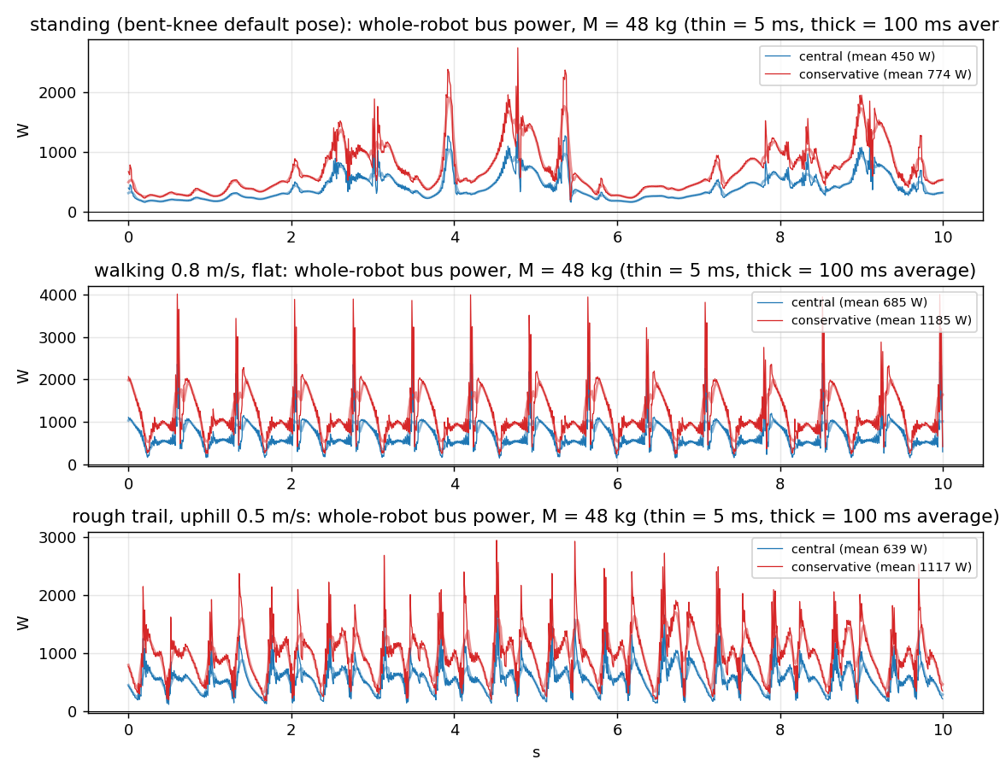
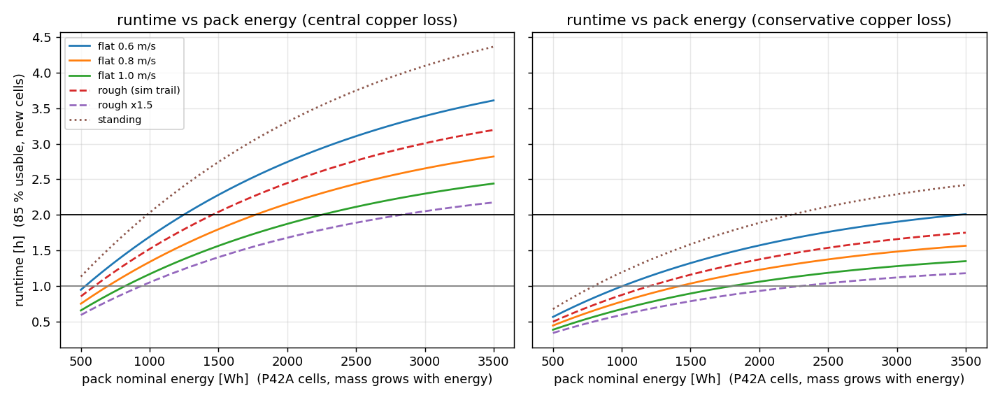
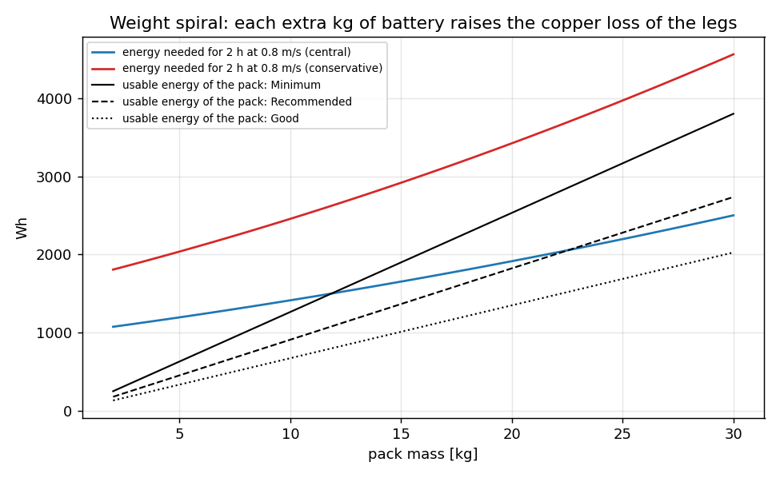

# 161. 전신 배터리·BMS 설계 — 평지 2시간 / 험지 1시간 조건의 정량 검토와 단계별 설계안

작성 2026-10-13 · 짝 문서: [[21_motor_power_weight]] (모터 정격·T-N 곡선), [[82_final_design_mass_review]] (질량표, 배터리 행 없음), [[120_design_vs_measured_mass_audit]] (PSU 1.95 kg 계량), [[157_shell_lidar_upper_body_overlay]] (전신 쉘 모델 41.16 kg), [[158_isaac_warehouse_lidar_demo]] (센서 전력), [[160_humanoid_foot_sole_survey]].
**그림 해설(쉬운 문장): [[165_battery_visual_guide_ste]]** · **동종 로봇 비교 검증: [[164_humanoid_battery_peer_benchmark]]** (G1·T1·H1·H2·Optimus·Figure·Atlas·Digit 등과 전압·에너지·W/kg·CoT 대조).
요청: *"전신, 런타임 2시간 — 평지 걷기 2시간, 험지 1시간 내외가 되는 배터리 용량, 험지에서 굴러도 역기전력을 흡수하는 BMS, S/P 구성, rms·peak 전류·전압, 조건이 양립하기 어려우면 시나리오를 나눠 minimum/recommended/good 표로."*
재현 코드: `tools/power_budget/` (§11). 그림: `docs/img/battery/`.

## 0. 결론 먼저

1. **전압은 13S Li-ion(NMC/NCA) 으로 정한다.** Robstride RS03/RS04 의 입력 범위가 15~60 V 이므로 만충 54.6 V 가 한계에 가장 가까이 가면서 회생 여유(5.4 V)를 남기는 최대 직렬 수다. 14S(58.8 V)는 회생 때 60 V 를 넘길 위험이 커서 **제외**, 16S Li-ion(67 V)은 **불가**.
2. **전력의 대부분은 "움직이는 일"이 아니라 "서 있는 구리 손실"이다.** 정책이 걷는 동안 12개 다리 모터의 *기계적 일* 은 평균 약 85 W(0.8 m/s, 41 kg) 인데 전기 입력은 약 480 W 다. 차이의 대부분은 무릎·엉덩이가 체중을 받치려고 흘리는 전류(copper loss, I²R) 때문이다. 그래서 **런타임은 거리가 아니라 시간에 비례**하고, 서 있기만 해도 0.6 m/s 걷기 전력의 약 80 % 를 먹는다 (§3).
3. **현재 모터 구성 + 정책 + 쉘 로봇(배터리 없이 39.2 kg)** 에서, 중심 추정으로 **평지 0.8 m/s 2시간 = 사용 에너지 약 1.4 kWh → 13S7P(21700 50E) 1.64 kWh, 팩 9.1 kg, 로봇 48 kg** 이다 (Minimum). 평지 0.6 m/s 2시간은 13S6P 1.40 kWh / 7.8 kg.
4. **조건 "평지 2 h + 험지 1 h" 는 Minimum 수준에서만 한 팩으로 양립**한다 (13S9P P42A 1.77 kWh, 11.9 kg, 순간 전류 약 130 A). 마진(+25 %)과 노화(90 %)를 얹은 Recommended 는 **약 24 kg**, 마진 +50 %·노화 80 % 인 Good 은 **해가 없다** — 배터리 1 kg 이 늘 때마다 다리 구리 손실이 더 늘어 **"무게 나선(weight spiral)"** 이 닫히지 않는다 (§6.3, 그림 3). 그래서 조건을 **시나리오로 나눠** 표로 정리했다 (§7).
5. **저항 해석은 기존 노트로 정리됐다 (정정, 164 검증).** `docs/raw/robstride-datasheet.md` 는 0.16/0.39 Ω 을 *line R* 로 기록하고 "per-phase R = line/2 (wye)" 로 해석했고, [[21_motor_power_weight]] 식도 같다 → **중심 모델이 정본**이다. 보수 모델(구리 손실 2배)은 동종 대비 비전력이 ASIMO급(16~24 W/kg)이어서 **설계 기준에서 뺀다**. 남는 불확실성은 리셀러 단일 출처 ±10 %, P_idle, 질량 외삽이다. 그래도 **실물 서 있을 때 버스 전력 1회 측정**(§8.3)은 필요하다. 그 전에는 배터리를 **Phase 1(정찰용 소형 팩)** 로 먼저 만들고 Phase 2 를 연다.
5-1. **동종 비교(164)**: 전압 13S/48 V급은 업계 표준, 우리 Minimum 의 로봇 질량당 에너지 35 Wh/kg 는 상용 상위권(Figure 32, Optimus 40, Atlas 41)과 같고 Recommended 56 Wh/kg 이상은 동종에 없다. 소비전력은 동종 걷기(6~9 W/kg)보다 높아 우리는 1.3~2배(서 있기는 약 2배), CoT 1.65~1.9 는 ASIMO·Durus급(Cassie 0.7). 동종 효율(8.6 W/kg)에 도달하면 13S8P 로 평지 3 h 이상이 가능하다.
6. **가장 큰 개선 지렛대는 자세다.** 같은 계산에서 관절 토크를 30 % 줄이면 (무릎을 덜 굽히는 기본 자세 등) 평지 2시간용 Recommended 팩이 **15.1 → 7.0 kg** 으로 줄어든다 (§6.4).
7. **역기전력(회생)**: 정상 걷기에서는 전체 버스 전력이 **거의 음수가 되지 않는다**(회생해도 다른 모터가 바로 쓴다). 위험은 **넘어짐·구름**이다. 한 번 넘어질 때 풀 수 있는 에너지는 약 0.3~0.5 kJ(무게중심 낙하 + 경사 구름)이고 순간 1~5 kW 가 버스로 역류할 수 있다. **BMS 가 충전 FET 를 끊으면 전압이 즉시 치솟는다** → BMS 에 회생을 맡기지 말고 **하드웨어 제동 초퍼(dump)가 먼저 동작**해야 한다 (§5, §6.6).

## 1. 조건 정리와 양립성 판단

| 요구 | 구체화 (이 문서의 해석) |
|---|---|
| 런타임 2시간 | **평지 걷기 2시간** 이 기준. "그냥 걸으면" = 속도 0.6~1.0 m/s (v11a 가 학습한 범위), 서 있는 시간 포함 아님 |
| 험지 1시간 | 산길 시뮬레이션(남태령 스캔 트레일, 경사 약 5 %, roughmain 정책) 0.5 m/s 의 전력 × 계수. 계단·급경사 데이터가 없어 **계수 1.0 / 1.5 / 2.0** 으로 갈라 가정 |
| 현재 모터 구성 | 다리 12 + 허리 yaw 1 + 어깨 4 + 팔꿈치 2 = 19개, **RS04 7개(허리 + 엉덩이 pitch·roll 4 + 무릎 2), RS03 12개(엉덩이 yaw 2 + 발목 크랭크 4 + 어깨 4 + 팔꿈치 2)**. 목은 용접(미장착) |
| 현재 정책 | v11a(평지, 하체만 학습) · roughmain(험지, 상자 지형 학습). 둘 다 **23.6 kg 하체 모델로 학습** |
| 역기전력 흡수 | 험지에서 넘어지거나 굴러도 버스·배터리·모터가 손상되지 않는 BMS + 보호 회로 |

**양립성**: 에너지만 보면 "평지 2 h" 가 "험지 1 h" 보다 크다(험지는 속도가 0.5 m/s 로 낮고 시간이 절반). 그러나 **전류 피크**는 험지가 훨씬 크고, **정책이 전신 질량에서 아직 학습되지 않았다.** 아래를 같이 놓으면 "한 팩으로 평지 2 h + 험지 1 h" 는 **Minimum 에서만** 닫힌다.

## 2. 현재 하드웨어와 전기 모델

### 2.1 모터 (Robstride, 출력축 환산)

| 모델 | 정격/피크 토크 | 전압 | Kt (N·m/A_rms) | 저항 | 정격/최대 상전류 | 무부하 전류 | 근거 |
|---|---|---|---|---|---|---|---|
| RS04 | 40 / 120 N·m | 48 V (15~60 V) | 2.1 | 0.16 Ω | 27 / 90 A_pk | 0.7 A_rms | 판매 자료(등급 B) + docs/21 |
| RS03 | 20 / 60 N·m | 48 V (15~60 V) | 2.36 | 0.39 Ω | 12 / 43 A_pk | 0.6 A_rms | 같음 |
| 학습 때 쓴 마찰(정책이 본 값) | RS04: 쿨롱 0.519 N·m + 점성 0.0275 | RS03: 0.251 + 0.0252 | | | | | `motor_params.json` |

- **공식 매뉴얼을 직접 열지 못했다** (검색은 판매 사이트를 반환). 과전압·저전압 보호 임계와 회생 요구는 **미확인**. 같은 회사의 *Power-Board* 액세서리 자료에는 저전압 < 20 V(복구 가능), 과전압 > 65 V(복구 불가) 가 있으나 **모터 자체의 값이 아니다.** → §8.3 에서 실측으로 확인.
- 이 로봇은 48 V 계열 **PSU-RSP-2000-48(AC-DC 48 V 2 kW, 1.95 kg)** 로 구동되는 유선 시제품이다 (docs/82). 배터리는 이 PSU 를 **대체**한다. 질량 계산은 **39.2 kg(쉘 41.16 kg − PSU 1.95 kg) + 배터리** 로 한다.

### 2.2 전기 모델 (`power_model.py`)

관절별 시간 함수 τ(t), ω(t)(시뮬레이션 200 Hz, 20초~150초)에서:
- **모터 토크** τ_m = τ_cmd + τ_마찰(ω) — 시뮬레이션이 마찰을 따로 계산하므로, 실제 모터는 그만큼 더 낸다.
- **상전류** I_rms = |τ_m| / Kt, **구리 손실** P_cu = 3·I_rms²·R.
- **버스 전력** P_bus = τ_m·ω + P_cu + P_idle + 3 %·(|τ_m·ω| + P_cu) (인버터 손실). 음수 = 회생.
- **P_idle**(모터 1개를 켜 놓고 토크 0 일 때 전력) = **3 W 가정** (공개값 없음, 최악 8 W).
- **R 해석**: 레포 노트(`raw/robstride-datasheet.md`: "line R, per-phase R = line/2")에 따라 판매 자료의 저항은 단자 간(line-to-line) 값이고 상저항은 절반이다 → **중심 모델 P_cu = 1.5·I_rms²·R 이 정본**(= docs/21 식). 참고로 상저항 그대로(P_cu = 3·I_rms²·R)를 *보수 모델* 로 같이 계산했으나 동종 비교(164)에서 비현실적으로 높아 설계 기준에서 제외한다 (정격 점 RS04: 중심 88 W, 보수 175 W; 정격 출력 약 700 W 이면 효율 88 %, 80 %). 판매 자료 단일 출처 ±10 % 오차는 남는다.
- 상체: 7개 모터는 영점 자세에서 거의 토크가 없어 **P_idle 만** 계산(구리 손실 < 1 W, 어깨 abduction 15° 의 중력 모멘트로 계산).
- 전자 장비: 연산 + IMU + CAN 15 W, **Ouster OS1-128 16 W(공칭, 12~24 V, 저온 시동 28 W — 공식 데이터시트)**, D435 약 3 W, DC-DC 효율 90 % → 합 약 38 W.

## 3. 전력 프로파일 — 정책 시뮬레이션에서 얻은 숫자

**방법**: 3090 VM 에서 pygviewer `SimCore`(MuJoCo, 200 Hz 물리, 50 Hz 정책)로 다리 12개의 인가 토크·각속도를 기록 (`rollout_log.py`).
- **평지**: v11a, 속도 0.4~1.2 m/s, 40 s, 질량 23.6 / **41.1(= 현재 쉘 로봇 − PSU 없이 + 17.5 kg)** / 48.6 kg. 서 있기(vx=0) 20 s 포함.
- **험지**: roughmain, 남태령 트레일 오르막·내리막 각 150 s, 0.5 m/s 지령 (실제 0.48 m/s).
- 질량은 베이스 링크에 얹은 하중이다 (실제 상체는 더 높아서 관성이 더 크다 → 약간 낙관적).

**질량 한계**: 두 정책 모두 **23.6 kg 하체 모델로 학습**됐다. 41.1 kg 까지는 평지에서 안 넘어지고(모든 속도), **48.6 kg 은 0.8 m/s 이상에서 6~10초 만에 넘어졌고**(서 있기도 15초 후 넘어짐), 험지는 41.1 kg 에서도 **1.4~7.5 초 만에 넘어졌다.** 즉 **전신 질량(배터리 포함 약 47~50 kg)에서는 정책을 다시 학습해야 한다.** 따라서:
- 평지: 41.1 kg 실제 롤아웃을 쓰고, 다른 질량은 **토크를 M/41.1 배** 해서 외삽.
- 험지: 23.6 kg 롤아웃의 토크를 **M/23.63 배**. 검증: 같은 방식으로 41.1 kg 평지를 23.6 kg 로그에서 외삽하면 0.4~0.6 m/s 에서 실측 대비 +0~10 %(좋음), **0.8 m/s 이상에서 +50 %(과대)**. 험지 0.5 m/s 는 앞 구간이므로 신뢰할 만하다. 외삽이 과대인 경향은 *보수적* 방향이다.

### 3.1 결과 (중심 모델, 질량 41.1 kg 롤아웃에서 직접 계산 · 다리 12개 모터의 버스 전력)

| 상황 | 평균 [W] | 비고 |
|---|---|---|
| 서 있기 (기본 웅크린 자세) | 298 | 기계적 일 28 W, 나머지 구리 + 대기 |
| 평지 0.4 m/s | 336 | |
| 평지 0.6 m/s | 368 | |
| 평지 0.8 m/s | 477 | 기계적 일(+) 85 W, (−) 13 W, 구리 약 353 W |
| 평지 1.0 m/s | 554 | |
| 평지 1.2 m/s | 670 | |
| 험지 오르막 0.5 m/s (23.6 kg → 41 kg 외삽) | 약 420 | |
| 험지 내리막 0.5 m/s | 약 370 | 오르막이 내리막의 1.1배 — 경사 5 % 라 위치 에너지 일은 10 W 이하 |

- **관절별 몫** (0.8 m/s, 47 kg): **무릎 35 %, 엉덩이 roll 26 %, 엉덩이 yaw 18 %, 엉덩이 pitch 17 %**, 발목 크랭크 4 %. 한쪽(오른쪽) 무릎이 평균 19 A_rms 로 가장 큰 하나다 (좌우 비대칭은 질량 얹은 방식과 정책 편향 때문일 수 있다).
- 정책 자체는 서 있는 자세가 **무릎이 굽은 상태**(`knees_bent` 키프레임)라서 정적 토크가 크다. **같은 로봇이 곧게 서면 훨씬 적게 먹는다** (§6.4).



### 3.2 순간(피크) 전력과 회생 — 전신 47 kg, 보수·중심 모델

| 구간 | 평균 [W] (중심) | rms | **5 ms 피크** | **100 ms 피크** | 1 s 피크 | 100 ms **최소**(회생 쪽) |
|---|---|---|---|---|---|---|
| 서 있기 | 436 | 479 | 1,868 | 1,098 | 671 | **+164** (회생 없음) |
| 평지 0.6 m/s | 523 | 573 | 2,580 | 1,422 | 696 | +209 |
| 평지 0.8 m/s | 663 | 737 | 2,810 | 1,072 | 762 | +311 |
| 평지 1.0 m/s | 760 | 819 | 2,753 | 1,168 | 839 | +368 |
| 험지 오르막 | 618 | 690 | 3,726 | 2,445 | 1,113 | +198 |
| 험지 내리막 | 549 | 612 | 2,993 | 2,019 | 971 | +228 |
| (같은 구간, **보수** 모델 평균) | 746 / 895 / 1,142 / 1,320 / 1,077 / 962 | | 2,833~6,138 | 1,986~4,396 | | |

→ **"최소" 가 모두 양수**: 정상 걷기에서는 버스 전체가 **배터리로 충전 전류를 흘리지 않는다.** 모터 하나하나는 회생하지만 다른 모터의 구리 손실이 먼저 쓴다. 회생은 **정상 운전의 문제가 아니라 사고(넘어짐) 때의 문제**다.



## 4. 서베이 — 셀·팩

### 4.1 화학 계열 비교 (등급 B/C — 판매·블로그 자료, 셀 데이터시트로 재확인 필요)

| 계열 | 셀 에너지 밀도 | 고출력 | 수명/안전 | 13~16S 공칭·만충 | 이 로봇에서의 판단 |
|---|---|---|---|---|---|
| **Li-ion NMC/NCA 21700** | 200~260 Wh/kg (P42A 230 Wh/kg, 615 Wh/L) | 고출력형 30~45 A 연속 | 수백~천 사이클, 중간 | 13S 46.8 / **54.6 V**, 14S 50.4 / 58.8 V, 16S 57.6 / 67.2 V | **채택.** 에너지·출력·수명의 균형 |
| **LiPo (파우치)** | 150~200 Wh/kg | 높은 C 율(고출력) | 150~300 사이클, 화재 위험 높음 | 13S 48.1 / 54.6 V, 14S 51.8 / 58.8 V | 순간 전류가 크게 필요하면 대안. 수명·안전 때문에 **기본으로는 비권장** |
| **LiFePO4** | 90~120 Wh/kg | 26650 등 큰 셀은 70 A 가능 | 가장 안전·수명 김 | **16S 51.2 / 58.4 V**(3.65 V/셀) | 같은 에너지에서 **약 1.8~2배 무겁다**(1.6 kWh 에 약 16 kg). 안전 우선 정적 시험용에만 |
| 고체/반고체 | 300+ Wh/kg(광고) | 미확인 | 미확인 | — | 구매·인증 경로 확인 전 제외 |

**직렬 수(S)**: 모터 허용 15~60 V 에서 만충 전압이 60 V 보다 낮아야 하고 회생 여유가 있어야 한다.
- **13S Li-ion 만충 54.6 V → 여유 5.4 V (9 %)**, 사용 상한을 4.15 V/셀(53.95 V)로 두면 6 V.
- 14S 58.8 V 는 여유 1.2 V 라 회생 순간 60 V 초과 위험. 16S 는 불가.
- 12S(44.4 V 공칭, 만충 50.4 V)는 여유 큼. 대신 **같은 출력에서 전류가 약 5 % 크고**, 무부하 속도가 낮다(전압에 비례, 12S 가 약 7 % 낮음).
- **전압-속도 영향**(선형 근사, 무부하 200 rpm @ 48 V): 54.6 V → 227 rpm, 46.8 V → 195 rpm, **부하 시 42 V → 175 rpm**, 39 V(방전 하한) → 162 rpm. docs/21 이 이미 무릎이 속도 한계에 가깝다(106 %)고 기록했다 → **방전 하한과 부하 시 전압 강하를 키우면 정책이 속도 포화**한다. 전압 강하를 작게 하려면 **병렬 수(P)를 키워 내부 저항을 줄여야 한다** (§6.5).
- 참고(휴머노이드 상용): Unitree **G1 13S, 9 Ah, 421 Wh, 46.8 V (만충 54.6 V)**, **H1 8S 15 Ah 팩 2개 = 864 Wh**, H2 75.6 V·0.97 kWh(21S 추정). Tesla Optimus 2.3 kWh / 52 V(보고), Figure 02 2.25 kWh. 모두 판매 자료·언론, 비교용.

### 4.2 셀 후보 (소매점·리뷰 사이트 재현값, 제조사 데이터시트 미확인 → 등급 B/C)

| 셀 | 용량 | 질량 | 연속 방전 | 펄스 | 최대 충전 | 에너지 밀도(셀) |
|---|---|---|---|---|---|---|
| **Molicel INR21700-P42A** | 4.2 Ah (15.5 Wh) | 70 g | 45 A(80 °C 감시 조건, 30 A 일정부하) | 약 70 A | 표준 4.2 A, 최대 8.4 A | 230 Wh/kg, 615 Wh/L |
| Samsung INR21700-40T3 | 4.0 Ah | 67 g | 35 A | 35 A | (미확인, 6 A 가정) | 약 215 Wh/kg |
| Samsung INR21700-50E | 5.0 Ah (18 Wh) | 69 g | 15 A(소매점) | 15 A | (4.9 A 가정) | 약 260 Wh/kg |
| Murata/Sony US21700VTC6A | 4.0 Ah | 72.7 g | 30 A | — | — | — |

**팩 질량 환산**: 셀 질량 × **1.45**(셀 홀더, 니켈 스트립, 퓨즈, BMS, 케이스, 커넥터 — 상용 팩 광고값 145~250 Wh/kg 의 보수적 중간). P42A 팩 ≈ 152 Wh/kg, 50E 팩 ≈ 180 Wh/kg.

## 5. 서베이 — BMS 와 회생(역기전력)

**등급 C 근거가 많다 (포럼·특허·벤더 글)**. 확인된 사실만 정리한다.
1. **BMS 가 충전 FET 를 끊으면 회생 에너지가 갈 곳이 없어 전압이 거의 즉시 치솟는다.** 만충 배터리에서 회생이 셀 과전압을 만들고 BMS 가 끊으면 모터 코일 전류가 남아 FET 내압을 넘긴다는 보고 (VESC·전동 보드 포럼). 방전 포트와 충전 포트가 분리된 BMS 는 방전 FET 의 바디 다이오드로 회생이 들어갈 수 있으나, **공통 포트 + 백투백 FET 구조는 충전 FET 가 꺼지면 양방향 모두 차단**될 수 있다.
2. **임계 순서**: ① 제동 초퍼(저항)가 ON → ② 구동기의 회생 컷오프 → ③ BMS 과전압 트립 (낮은 순서). 초퍼는 ON 임계보다 1~2 % 낮게 OFF(히스테리시스). 저항은 **에너지(kJ)와 피크 전력(kW) 둘 다** 맞춘다. R ≈ V_임계² / P_피크.
3. **TI BQ76952**(최대 16S, 충전 펌프로 CHG/DSG FET 구동, 예제: 16S, 최소 40 V, 충전 8 A, 방전 피크 20 A, 셀 과전압 4.30 V/500 ms 지연). 충전 FET 가 꺼졌을 때 **충전 방향 전류가 임계를 넘으면 DSG FET 를 다시 켜 바디 다이오드를 보호**하는 기능이 있다(병렬 FET 구성에서는 비활성). **회생용 충전 과전류(OCC) 한계와 지연은 별도로 설정해야 한다** — 기본값(예: 8 A)을 그대로 쓰면 회생이 들어오는 순간 끊긴다.
4. **프리차지(precharge)**: 큰 입력 커패시터가 있는 모터 구동기 앞에서 돌입 전류를 제한. BQ76952 는 PCHG/PDSG FET 제어 기능이 있다.
5. **표준**: Unitree 팩은 **IEC 62133-2** 표기. UL 2271(경(輕)운송용), IEC 62619(산업용), **UN38.3**(운송)은 인증 경로 확인 필요(문서 직접 확인 못 함, 등급 C).
6. **한계**: 제동 초퍼 크기 산정의 숫자 예(산업용 780 V 계)는 이 로봇(55 V)과 직접 비교할 수 없다. **모터 구동기의 과전압 한계·회생 동작은 Robstride 매뉴얼로 확인해야 한다** (§8.3).

## 6. 단계별 설계

### 6.1 Step 1 — 버스 전압 (S)
**13S Li-ion.** 동작 창: 방전 하한 3.0 V/셀 = **39 V**, 만충 상한 **4.15 V/셀 = 53.95 V**(저장·정적 시험에서는 4.2 V = 54.6 V 허용). 구동기 허용 15~60 V 에 대해 상단 여유 6 V, 하단 24 V.
전압 레일: Ouster OS1(12~24 V, 최대 입력 34 V) 은 **24 V 강압(48 → 24 V, 60 W)**, 연산/카메라는 5 V·12 V 강압 (입력 허용 ≥ 60 V). **전원 입력 허용 범위가 60 V 인 부품만 쓴다** (회생 순간 대비).

### 6.2 Step 2 — 에너지 (P 와 용량)
`E_nominal = E_사용 × (1 + 마진) / (사용 창 0.85 × 노화 잔존율)`. 사용 창 0.85 = 4.15 → 3.2 V/셀 구간. E_사용 = 시나리오 평균 전력 × 시간, 평균 전력은 **전체 질량 M = 39.2 + 팩 질량** 에서 계산(§6.3).

### 6.3 무게 나선 (weight spiral)
다리 구리 손실이 질량의 거의 제곱으로 늘기 때문에, 팩이 무거워지면 로봇이 먹는 전력도 같이 는다.
- 중심 모델, 평지 0.8 m/s: M = 39.2 kg → 500 W, **47.2 kg → 663 W**: 배터리 8 kg 이 늘 때 전력이 **+33 %**.
- 그래서 에너지 요구선(파랑·빨강)이 팩이 공급하는 에너지 선(검정)과 만나는 점이 있고, **마진이 크면 만나지 않는다** (그림 3).



### 6.4 효율 지렛대 (what-if) — 토크를 줄이면
관절 토크를 κ 배(자세·걸음 개선으로 정적 토크 감소) 해서 다시 푼 팩 질량(50E 셀, 중심 모델):

| κ | 평지 0.6 m/s 2 h: Min / Rec / Good | 평지 0.8 m/s 2 h: Min / Rec / Good |
|---|---|---|
| 1.00 (현재) | 6.6 / 10.2 / 16.8 kg | 9.0 / 15.1 / 33.1 kg |
| 0.85 | 5.0 / 7.4 / 11.1 kg | 6.5 / 10.0 / 16.2 kg |
| **0.70** | 3.8 / 5.4 / 7.8 kg | **4.7 / 7.0 / 10.4 kg** |
| 0.55 | 2.9 / 4.1 / 5.7 kg | 3.5 / 5.0 / 7.0 kg |

→ **토크 30 % 감소가 Recommended 팩을 절반으로 줄인다.** 방법(제안, 미검증): 기본 자세의 무릎 굽힘 감소(학습 `knees_bent` 대신 `HOME` 계열 높은 자세), 발 위치·무게중심 정렬로 한쪽 무릎 편중 해소(오른쪽 무릎이 19 A_rms 인 반면 왼쪽 8 A), 걷기 보상에 **전류 제곱 항** 추가. 이 가운데 어느 것이든 **재학습 + 실물 확인** 이 필요하다.

### 6.5 Step 3 — 전류 (rms / peak) 와 P 수
`전류 = 전력 / 부하 시 전압(42 V)`. 보호 설계는 **보수 모델**(구리 2배), 에너지는 중심 모델.
- 정격(rms) 설계 전류 = 1.25 × P_rms / 42 V, 순간 전류 = 1.1 × P_피크(100 ms) / 42 V.
- 셀 요건: 연속 전류는 셀 연속 정격의 50 % 이하, 100 ms 순간은 펄스 정격의 80 % 이하.
- **팩 저항·전압 강하(가정)**: 셀 DCIR 약 16 mΩ (P42A 판매 목록, 10 A·1 s 직류, 164 §8.3) → 13S8P ≈ 13×16/8 = 26 mΩ + 버스바·퓨즈 5 mΩ = **31 mΩ**. 150 A 에서 4.7 V 강하(부하 시 약 43 V). 병렬 수를 키우면 같은 전류의 강하가 줄어 속도 포화를 막는다.
- 열: I_rms 17~25 A → I²R = 8~18 W (13S8P). 폐쇄 공간 약 10 W 급 → 팬 없이 가능, 외기 40 °C 에서 셀 55 °C 이하를 목표(온도 센서 4개 이상).

### 6.6 Step 4 — BMS·보호 회로(회생 포함)
**구성**: `팩 → 퓨즈 → 주 접촉기/솔리드스테이트 스위치(프리차지 병렬) → 버스(대용량 커패시터) → 모터 구동기 19개 + DC-DC` 와 병렬로 **제동 초퍼(dump)**.

| 항목 | 설계 값 | 이유 |
|---|---|---|
| 셀 전압 계측 | 13채널, 정확도 ±5 mV, 밸런싱 ≥ 100 mA(패시브 가능) | 1.6~2.8 kWh 팩 |
| 방전 연속 / 1 s / 100 ms / 5 ms | **레벨표 §7** (60~100 A / 120~200 A / 150~350 A / 210~480 A) | 보수 모델 피크 ×1.1 |
| **충전(회생) 과전류 트립** | 지연 ≥ 100 ms 에 ≥ 80 A, 또는 **주행 중 CHG 과전류 트립 비활성** | 기본값(8 A 등)이면 회생에서 끊김 |
| 셀 과전압 | **4.30 V, 지연 500 ms**(TI 예제 값). **정상 충전 상한은 4.15 V** | 사용 상한과 트립 사이에 여유 |
| **제동 초퍼 ON / OFF** | **55.0 V / 54.2 V** (하드웨어 비교기, 응답 ≤ 50 µs) | 만충 54.6 V·상한 53.95 V 사이에서 시작, BMS 트립·구동기 한계(60 V) 이전 |
| 초퍼 저항 | **0.6~1.0 Ω 펄스 정격**, 순간 **≥ 5 kW**, 에너지 **≥ 2 kJ / 1 s**, 연속 ≥ 50 W | §5, 아래 낙하 에너지 |
| 버스 커패시터 | 외부 **≥ 2×1,000 µF / 80 V** 저ESR 를 팩 가까이 | 스파이크 완충. **에너지 흡수는 초퍼·배터리가 한다** (커패시터 10 mF 가 흡수하는 에너지는 수 J) |
| 프리차지 | 저항 + 릴레이, 버스 전압 90 % 에서 접촉기 투입 | 구동기 입력 커패시터 돌입 |
| 비상정지 | **모터 토크 오프(구동기 명령)** 를 기본으로, 배터리 차단은 정지 후. 가능하면 제동 저항 경유 약한 동적 제동 (Kawasaki US12113469B2, 164 §8.2) | 주행 중 배터리를 끊으면 역기전력 경로가 사라진다. 토크 오프만 쓰면 관절이 풀려 무너진다 |
| 절연·퓨즈 | 주 퓨즈 **정격 전류 ≥ 순간 피크 × 0.6, 60 V DC 이상 차단 용량**, 커넥터 **QS8 급 안티스파크 150 A+** | 저압 DC 아크 |
| 인증 | IEC 62133-2 시험 가능한 셀·팩, 운송 UN38.3 | 사내 사용도 상업 팩 수준의 문서화 |

**회생 에너지 상한 (사고 시나리오, 내 계산)**: 무게중심 높이 0.85 m 에서 0.25 m 로 낙하 시 위치 에너지 M·g·0.6 = **47 kg 에서 277 J**, 52 kg 에서 306 J. 20° 경사를 3 m 구르면 추가 **473~523 J**, 1.5 m/s 구름 운동 에너지 약 55 J. 즉 **한 사건에 약 0.3~0.9 kJ**. 이 중 모터가 발전기로 버스에 되돌리는 비율은 미지(제동 토크·속도에 달림)지만, 0.2~0.5 s 안에 몰리면 **평균 1~5 kW**. 설계 기준을 **피크 5 kW / 2 kJ** 로 잡는다 (여유 2배).
- **배터리가 흡수 가능한 양**: P42A 8P 표준 충전 4.2 A/셀 → 34 A × 50 V = **1.7 kW**(지속), 최대 8.4 A/셀 → 3.4 kW(펄스, 저온·고 SOC 에서는 리튬 도금 위험). 따라서 5 kW 급 펄스의 **초과분은 초퍼가 태워야** 한다.

### 6.7 Step 5 — 기구·열·안전
- **체적**: 21700 셀 1개 약 25 cm³ → 104셀(13S8P) = 2.6 L + 홀더·버스바 30 % ≈ 3.4 L. 토르소 내부 가용 체적은 **CAD 로 확인 필요**(PSU 1.95 kg 자리 + 쉘 내부). 질량 위치는 **토르소 상부 중앙**이 좋다(docs/21 : 말단 질량이 발목 roll 을 먼저 포화).
- **교체형**: Atlas·Unitree 와 같이 퀵 릴리스 팩(G1 421 Wh). 안전을 위해 **팩 내부 퓨즈 + 커넥터 핀 순서(프리차지 핀)**.
- **셀 압축·충격**: 낙하·구름 시 셀 보호(알루미늄 케이스 + 쉘 위 충격 흡수), 셀 홀더는 불연성.

## 7. 시나리오별 Minimum / Recommended / Good 스펙 (13S, 중심 전력 모델, 에너지 마진·노화 포함)

**수준 정의** (모든 수준에서 사용 창 85 %, 센서 전부 장착 = 전자 38 W)
- **Minimum** = 새 셀, 마진 0 %, **중심 모델** (모델이 맞으면 딱 도달)
- **Recommended** = 노화 90 %(300 사이클급), **마진 +25 %**
- **Good** = 노화 80 %(수명 말기), **마진 +50 %**
- 험지 계수: S4 = 시뮬레이션 트레일 그대로, S5 = ×1.5, S6 = ×2.0 (**가정**: 계단·급경사 데이터 없음).
- 셀은 시나리오별로 팩 질량이 가장 작은 것(P42A / 40T3 / 50E)을 골랐다. 전류는 **보수 모델**(구리 2배) 기준, 열 = 정격 전류 rms ×1.25.
- "해 없음" = 팩이 30 kg 를 넘어도 닫히지 않음(무게 나선).

| 시나리오 | 수준 | 구성 (13S·P·셀) | 에너지 [Wh] / 용량 [Ah] | 팩 / 로봇 질량 [kg] | 평균 전력 [W] | 연속 전류 (rms×1.25) [A] | 100 ms 피크 [A] | 5 ms 피크 [A] | 셀 피크 |
|---|---|---|---|---|---|---|---|---|---|
| S1 평지 0.6 m/s 2 h | Minimum | 13S6P 50E | 1,404 / 30 | 7.8 / 47.0 | 520 | 28 | 62 | 96 | 2.1C (10 A) |
| | Recommended | 13S8P 50E | 1,872 / 40 | 10.4 / 49.6 | 565 | 32 | 71 | 109 | 1.8C (9 A) |
| | Good | 13S13P 50E | 3,042 / 65 | 16.9 / 56.1 | 687 | 40 | 90 | 138 | 1.4C (7 A) |
| S2 평지 0.8 m/s 2 h | Minimum | 13S7P 50E | 1,638 / 35 | 9.1 / 48.3 | 687 | 39 | 54 | 110 | 1.6C (8 A) |
| | Recommended | 13S12P 50E | 2,808 / 60 | 15.6 / 54.8 | 842 | 48 | 68 | 133 | 1.1C (6 A) |
| | Good | **해 없음** | | | | | | | |
| S3 평지 1.0 m/s 2 h | Minimum | 13S9P 50E | 2,106 / 45 | 11.7 / 50.9 | 859 | 47 | 60 | 113 | 1.3C (7 A) |
| | Recommended | 13S16P 50E | 3,744 / 80 | 20.8 / 60.0 | 1,131 | 64 | 83 | 149 | 1.0C (5 A) |
| | Good | **해 없음** | | | | | | | |
| S4 험지(트레일 시뮬) 1 h | Minimum | 13S4P 40T3 | 749 / 16 | 5.1 / 44.3 | 528 | 29 | 98 | 138 | 6.1C (25 A) |
| | Recommended | 13S5P 40T3 | 936 / 20 | 6.3 / 45.5 | 551 | 32 | 107 | 150 | 5.3C (21 A) |
| | Good | 13S7P P42A | 1,376 / 29 | 9.2 / 48.4 | 608 | 35 | 120 | 167 | 4.1C (17 A) |
| S5 험지 ×1.5 1 h | Minimum | 13S5P P42A | 983 / 21 | 6.6 / 45.8 | 805 | 47 | 161 | 225 | 7.6C (32 A) |
| | Recommended | 13S8P 40T3 | 1,498 / 32 | 10.1 / 49.3 | 908 | 54 | 186 | 259 | 5.8C (23 A) |
| | Good | 13S13P P42A | 2,555 / 55 | 17.2 / 56.4 | 1,137 | 68 | 235 | 324 | 4.3C (18 A) |
| S6 험지 ×2.0 1 h | Minimum | 13S7P P42A | 1,376 / 29 | 9.2 / 48.4 | 1,157 | 70 | 239 | 333 | 8.1C (34 A) |
| | Recommended | 13S12P P42A | 2,359 / 50 | 15.8 / 55.0 | 1,437 | 88 | 304 | 419 | 6.0C (25 A) |
| | Good | 13S30P 50E | 7,020 / 150 | 39.0 / 78.2 | 2,689 | 101 | 351 | 480 | 2.3C (12 A) |

### 7.1 "한 팩으로 평지 2 h(0.8 m/s) + 험지 1 h" (사용자 원 조건) — S2 와 S4/S5/S6 의 큰 쪽

| 수준 | 험지 계수 | 구성 | 에너지 / 용량 | 팩 / 로봇 | 100 ms 피크 | 판단 |
|---|---|---|---|---|---|---|
| **Minimum** | ×1.0 | **13S9P P42A** | 1,769 Wh / 37.8 Ah | 11.9 / 51.1 kg | 약 134 A | **닫힘.** 모델이 맞을 때 딱 도달, 마진 없음 |
| Recommended | ×1.5 | 13S18P P42A 또는 13S19P 50E | 3,538~4,446 Wh | 23.8~24.7 / 63~64 kg | 224~286 A | **비현실적**(전신 64 kg) |
| Good | ×2.0 | 해 없음 / 13S43P 50E 10 kWh, 56 kg | | | 514 A | **불가능** |

→ **현재 모터·정책·자세에서는 사용자의 두 조건을 마진 있게 동시에 만족하는 팩이 없다.** 선택지: (a) Minimum 으로 가고 모델 확인 후 조정, (b) 토크 감소(§6.4) 후 Recommended, (c) 조건 완화(평지 0.6 m/s 2 h = S1, 험지 1 h = S4).

### 7.2 후보 팩의 **런타임 [h]** (새 셀, 85 % 창 | 중심 / 보수)

| 팩 | Wh | 팩 kg | 로봇 kg | 서 있기 | 평지 0.6 | 평지 0.8 | 평지 1.0 | 험지 ×1.0 | 험지 ×1.5 |
|---|---|---|---|---|---|---|---|---|---|
| 13S4P P42A | 786 | 5.3 | 44.5 | 1.7/1.0 | 1.4/0.8 | 1.1/0.6 | 1.0/0.6 | 1.3/0.7 | 0.9/0.5 |
| 13S6P P42A | 1,179 | 7.9 | 47.1 | 2.3/1.3 | 1.9/1.1 | 1.5/0.9 | 1.3/0.8 | 1.7/1.0 | 1.2/0.7 |
| **13S8P P42A** | 1,572 | 10.6 | 49.8 | 2.8/1.6 | **2.4/1.4** | **1.9/1.1** | 1.6/0.9 | **2.1/1.2** | 1.4/0.8 |
| 13S10P P42A | 1,966 | 13.2 | 52.4 | 3.3/1.9 | 2.7/1.6 | 2.1/1.2 | 1.9/1.1 | 2.4/1.4 | 1.7/0.9 |
| 13S5P 50E | 1,170 | 6.5 | 45.7 | 2.4/1.4 | 2.0/1.2 | 1.6/0.9 | 1.4/0.8 | 1.8/1.0 | 1.2/0.7 |
| 13S7P 50E | 1,638 | 9.1 | 48.3 | 3.1/1.8 | 2.6/1.5 | 2.0/1.2 | 1.8/1.0 | 2.3/1.3 | 1.6/0.9 |
| 13S9P 50E | 2,106 | 11.7 | 50.9 | 3.7/2.1 | 3.0/1.8 | 2.4/1.4 | 2.1/1.2 | 2.7/1.5 | 1.9/1.0 |

중심 모델이 맞으면 **13S8P P42A(1.57 kWh, 10.6 kg)** 가 평지 0.6 m/s 2.4 h, 0.8 m/s 1.9 h, 험지 2.1 h 로 사용자 조건(평지 2 h·험지 1 h)에 **가깝다.** 보수 모델이 맞으면 모든 칸이 약 60 % 로 줄어 평지 0.8 m/s 1.1 h.


## 8. 권장 설계 (단계적) 와 결정 게이트

### 8.1 Phase 1 — 지금 만든다 (정찰·정적 시험, 질량 5~8 kg)
- **13S6P Molicel P42A (1.18 kWh, 약 7.9 kg)** 또는 13S4P(0.79 kWh, 5.3 kg).
- 목적: **실물에서 서 있기·낮은 이득 보행·sim2real 시험**(서 있기 2.3/1.3 h, 평지 0.6 m/s 1.9/1.1 h).
- BMS: 13S, **연속 60 A / 1 s 100 A / 100 ms 120 A** (동종 피크 예산 약 2 kW 대비 여유 확인, 164 §4; 5 ms 급은 버스 커패시터가 받음), 회생 충전 OC 비활성, 셀 OV 4.30 V/500 ms, **제동 초퍼 55.0/54.2 V · 0.6~1.0 Ω · 5 kW/2 kJ**, 프리차지, 퓨즈 150 A, 방전 하한 3.0 V.
- 충전기: 13S CC-CV 4.15 V/셀 (53.95 V), **0.5C = 15~20 A** 이하, 온도 0~45 °C 에서만.
- **PSU 병행**: 케이블 연결 시험은 기존 PSU 로 하고 배터리는 이동 시험에만 쓴다.

### 8.2 Phase 2 — 측정 후 확정 (목표: 평지 2 h / 험지 1 h)
- 결정 변수: ① 모터 저항 실측 확인(§8.3, 해석은 line R 로 정리됨), ② 전신 질량에서 재학습한 정책의 실제 토크, ③ 자세 개선 여부(κ).
- **중심 모델이 맞고 κ=1** 이면: **13S9P P42A (1.77 kWh, 11.9 kg)** (§7.1 Minimum).
- **κ ≤ 0.85 달성** 이면: **13S8P P42A(1.57 kWh)** 로도 마진 +25 % (표 §6.4 와 §7.2).
- **실측이 중심 모델보다 나쁘면**(동종 비교상 가능성 낮음, 164): 평지 2 시간은 **불가**에 가깝다. 조건 완화(0.6 m/s·1.5 h)나 자세 개선이 선행.

### 8.3 결정 게이트 — 실물에서 하루 안에 할 수 있는 측정
1. **저항 확인**: LCR 로 모터 U-V, V-W, W-U 단자 간 저항을 재서 line R(0.16/0.39 Ω ±10 %)과 일치하는지 확인 (RS04, RS03 각 1개). 상저항 = 단자 간/2 로 이미 반영되어 있다.
2. **서 있기 전력**: 로봇이 현재 자세로 서 있을 때 **PSU 출력(또는 배터리 연결 시 버스) 전압·전류를 전력계로 5 분 기록**. 예상: 중심 약 300~440 W, 보수 약 530~750 W (§3, 전신 질량 41~47 kg).
3. **대기 전력**: 모터 19개를 enable 하고 토크 0 일 때의 총 전력 → P_idle 확정 (가정 3 W).
4. **회생 시험**: 로봇을 매달고 한 관절을 손으로 빠르게 돌려 버스 전압 상승을 오실로스코프로 관찰, 초퍼 임계 설정(구동기 OVP 가 어디서 동작하는지).
5. **Robstride 매뉴얼**에서 과전압·저전압 보호, 회생 동작, 최대 입력 전압을 확정 (공식 GitHub `RobStride/Product_Information` 의 사용 설명서).

## 9. 한계 (정직하게)
- **정책이 전신 질량에서 학습되지 않았다.** 48.6 kg 에서 0.8 m/s 이상은 넘어졌고 험지는 41.1 kg 에서도 넘어졌다. 질량·전력은 외삽이다. 외삽은 0.8 m/s 이상에서 최대 +50 % 과대(보수 방향).
- **험지 계수 ×1.5, ×2.0 은 가정.** 계단·급경사 시뮬레이션은 시도하지 않았다 (rough_box 정책의 상자 지형 롤아웃은 하지 않음).
- 저항은 리셀러 단일 출처(±10 %)이고 line R 해석은 기존 노트 근거다 (§2.2). **P_idle**, 인버터 3 % 손실, 팩 오버헤드 1.45, 셀 DCIR 16 mΩ(판매 목록 값)은 가정이다.
- 셀 정격은 소매점·리뷰 사이트 재현값이다 (Molicel·Samsung 데이터시트 미확인). 펄스 전류의 지속 시간·온도 조건은 데이터시트로 확인해야 한다.
- 상체 7개 모터는 영점 자세에서 구리 손실 0 으로 가정(팔을 움직이면 추가). 팔 동작·들기·계단 손 짚기 같은 임무 전력은 포함하지 않았다.
- 회생 에너지 상한은 사고 시나리오의 에너지 보존 계산이지 시험이 아니다. 실제 되돌아오는 비율·피크는 §8.3-4 로 확인.
- 열·체적·무게중심(질량 위치)은 CAD 와 실측으로 확인해야 한다 (§6.7). 팩 질량 1.45 배 환산은 상용 팩 광고 범위의 보수적 값.
- UL/IEC/UN 인증 요구는 문서를 직접 열어 확인하지 못했다.

## 10. 출처 (2026-10-13 확인)
- **내부**: `deploy_asset/pyg_v11a_stand01/motor_params.json` (T-N 곡선, 마찰), `docs/21_motor_power_weight.md` (모터 표, 전기 전력식), `mujoco-sim/.../pygmalion_constants.py` (모터 배정), `docs/82`·`120` (PSU 1.95 kg, 질량), `docs/datasheets/ouster/datasheet-rev7-v3p1-os1.pdf`·`hardware-user-manual-rev7-os1.pdf` (OS1 16 W 공칭, 12~24 V, 최대 입력 34 V).
- **Robstride 사양(판매 자료, 등급 B)**: https://openelab.io/da/products/robstride04-qdd-120n-m-integrated-joint-motor-module , https://openelab.io/es/products/robstride03-qdd-60n-m-integrated-joint-motor-module , https://aifitlab.com/products/robstride-power-board (Power-Board OVP/UVP).
- **셀**: Molicel P42A https://www.akkuteile.de/en/molicel-inr21700-p42a-4200mah-30a-to-max-45a-li-ion-battery-3-6v-3-7v_100813_2558 , https://lygte-info.dk/review/batteries2012/Molicel INR21700-P42A 4200mAh (Gray) UK.html ; Samsung 40T3 https://nkon.nl/en/samsung-inr21700-40t3-4000mah-50a.html ; VTC6A https://nkon.nl/en/sony-murata-us21700vtc6a-4000mah-40a.html ; 50E https://www.kaufland.de/product/358140754/ 등.
- **상용 로봇 배터리**: Unitree G1 https://www.camera-warehouse.com.au/unitree-g1-battery-9000-mah , H1 https://robostore.com/products/unitree-h1-humanoid-high-performance-battery , H2 https://megadron.pl/en/products/unitree-h2-standard-battery-33427.html ; Optimus/Figure https://media.monolithicpower.cn/mps_cms_document/m/p/mps_powers_humanoid_robots_9-23-2025.pdf , https://technologies.org/the-humanoid-robot-bottleneck-is-the-battery-why-two-kilowatt-hours-caps-the-whole-industry/ ; 로봇용 21700 팩 사례 https://cmbatteries.com/project/21700-robot-battery , LG에너지솔루션 https://inside.lgensol.com/en/2026/06/humanoid-robots-are-changing-everyday-life-why-do-batteries-matter/ .
- **화학 비교(블로그, 등급 C)**: https://www.simpower.co.nz/knowledge-base/21700-li-ion-rechargeable-battery-guide/ , https://ecotreelithium.co.uk/news/lifepo4-battery-energy-density/ .
- **BMS·회생**: TI BQ76952 데이터시트 https://www.ti.com/document-viewer/BQ76952/datasheet/GUID-D034FD74-7C81-426F-B00A-29AF3F76A30E , 기술 참조 https://www.ti.com/document-viewer/lit/html/SLUUBY2B/GUID-20200911-BM0T-BGP0-DMCL-769020000007 ; 회생 중 BMS 차단 사례(포럼, C) https://endless-sphere.com/sphere/threads/overvoltage-protection.111644/latest , https://forum.esk8.news/t/warning-reminder-for-users-of-bms-for-discharge/2197 ; 제동 초퍼 설계 https://industrialmonitordirect.com/blogs/knowledgebase/sizing-regenerative-braking-resistors-for-ac-drives , https://forum.allaboutcircuits.com/threads/brake-chopper-control-algo.194220/ , 특허 https://image-ppubs.uspto.gov/dirsearch-public/print/downloadPdf/7012392 .
- **표준**: IEC 62133-2 (Unitree 팩 표기), UL 2271, IEC 62619, UN38.3 — 문서 직접 확인 못 함.

## 11. 재현 방법
```bash
# 3090 VM (isaac venv) 에서 롤아웃 기록 (~/pyg_demo/rollout_log.py, repo: tools/power_budget/)
PYTHONPATH=~/pyg_demo/tools/pygviewer python rollout_log.py flat  --cache ~/pyg_demo/pyg_demo_cache --vx 0.8 --seconds 40 --add-mass 17.5 --out power/flat_v0.8_m17.5.npz
PYTHONPATH=~/pyg_demo/tools/pygviewer python rollout_log.py trail --cache ~/pyg_demo/cache_trail --nav ~/pyg_demo/nav --policy roughmain --vx 0.5 --seconds 150 --reverse --out power/trail_up_m0.npz
# 이 PC: 전력 모델 → 팩 크기 → 그림
python tools/power_budget/power_model.py <log.npz> ...
python tools/power_budget/size_pack.py <log dir> docs/img/battery        # 시나리오 x 수준 x 셀 표
python tools/power_budget/report_numbers.py ; python tools/power_budget/runtime_matrix.py ; python tools/power_budget/make_figs.py
```
- `rollout_log.py`: 롤아웃 + 인가 토크 기록 · `power_model.py`: 모터 전기 모델 · `size_pack.py`: 질량 되먹임 포함 팩 크기 · `report_numbers.py`: 민감도·조합·회생 상한 · `runtime_matrix.py`: 후보 팩 런타임 · `make_figs.py`: 그림 3장.
- 중간 로그(`flat_*.npz`, `trail_*.npz`, `stand_*.npz`)는 VM `~/pyg_demo/power/` 에 있다.
