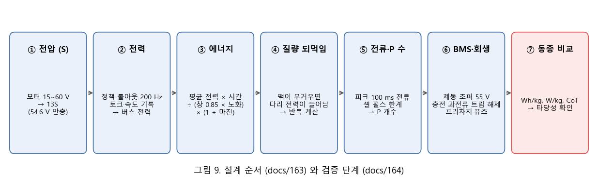
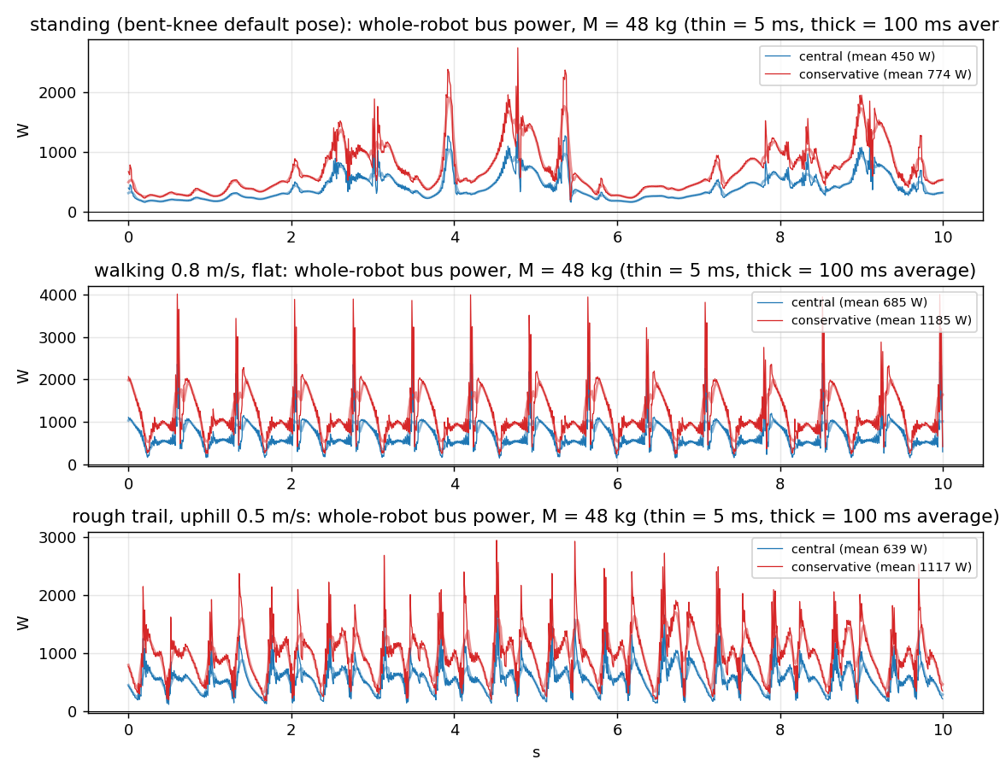
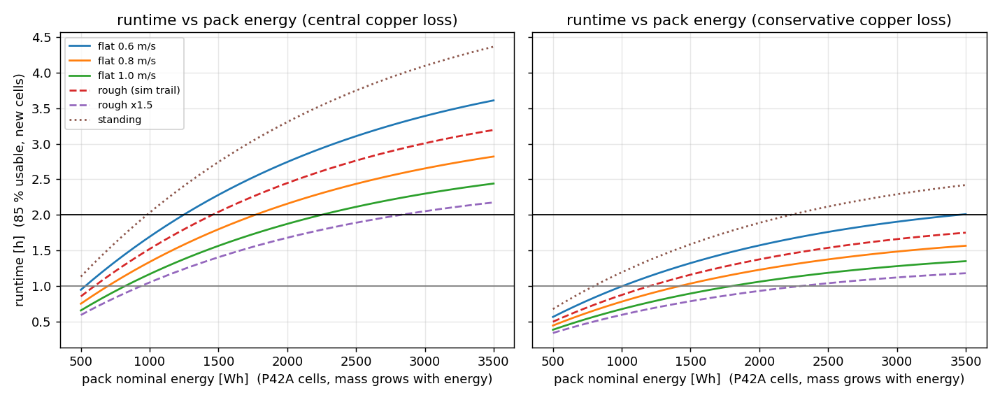
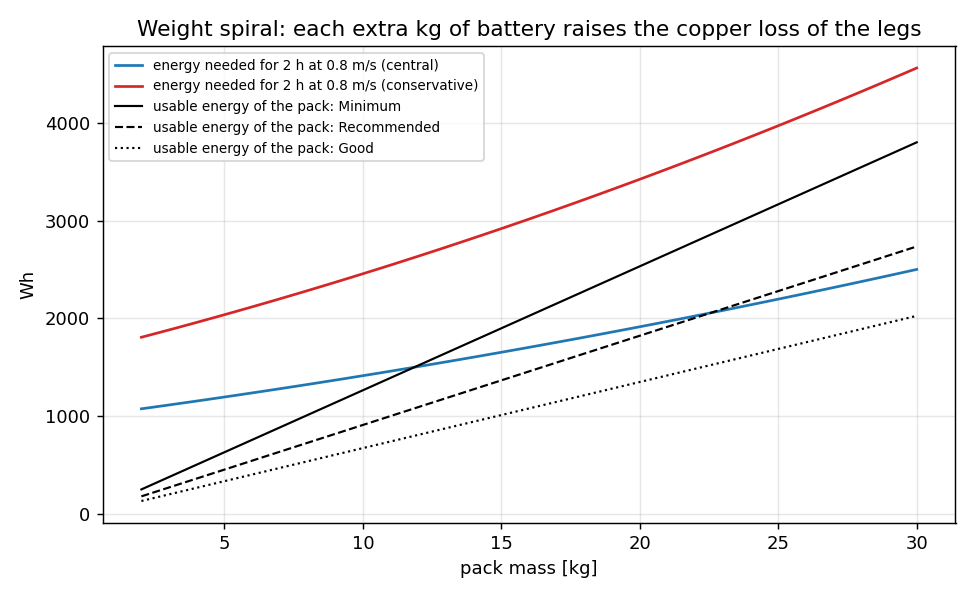
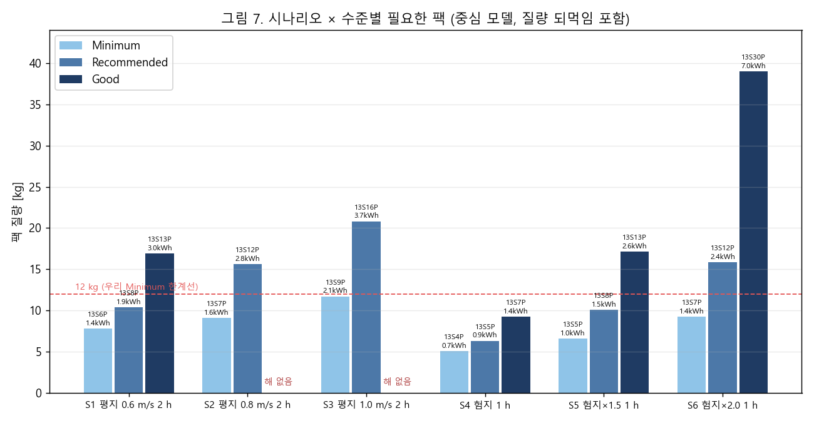
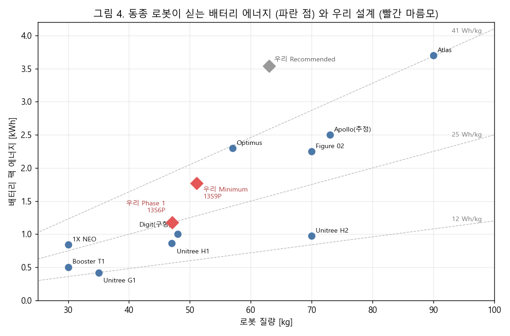
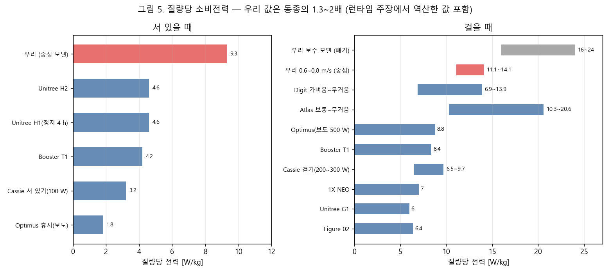
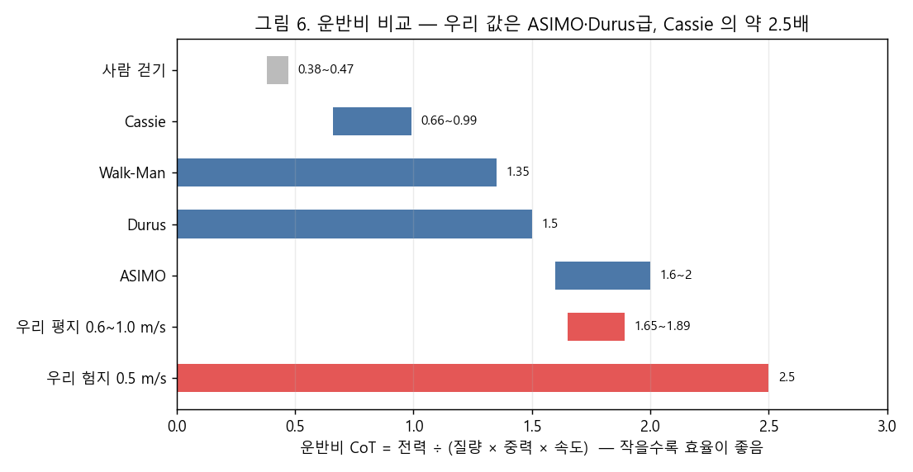
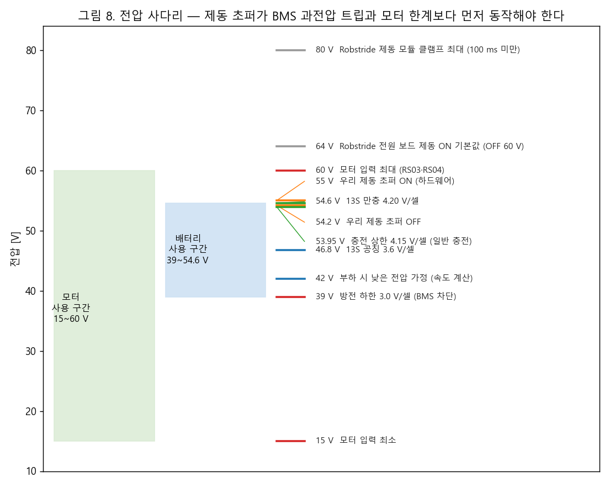

# 165. 배터리 설계 그림 해설 (ASD-STE100 규칙을 적용한 한국어)

작성 2026-10-13 · 근거 문서: [[163_battery_bms_design]] (설계), [[164_humanoid_battery_peer_benchmark]] (동종 비교) · 그림 코드: `tools/power_budget/make_figs.py`, `make_figs2.py`

## 0. 이 문서의 쓰기 규칙

ASD-STE100 (Simplified Technical English) 은 영어 규격이다. 한국어 규격은 없다. 이 문서는 그 규격의 **쓰기 규칙**을 한국어에 맞게 적용한다.

| 규칙 | 이 문서에서 하는 일 |
|---|---|
| 한 문장에 한 가지 내용 | 설명문은 25 어절 이하. 지시문은 20 어절 이하 |
| 한 단어는 한 뜻 | 아래 용어표의 단어만 쓴다. 같은 것에 다른 이름을 붙이지 않는다 |
| 능동태 | "측정한다". "측정된다"는 쓰지 않는다 |
| 지시는 명령형, 번호를 붙임 | "측정하십시오." 한 번호에 한 동작 |
| 경고와 주의는 지시 앞에 씀 | **경고**는 사람이 다치는 위험. **주의**는 장비가 망가지는 위험 |
| 숫자는 아라비아 숫자, 단위 앞에 띄어쓰기 | 54.6 V, 1.77 kWh |
| 약어는 처음에 한 번 풀어 씀 | BMS (배터리 관리 장치) |
| 비유와 줄임말을 쓰지 않음 | "무게 나선" 같은 비유는 뜻을 풀어 쓴다 |

## 1. 용어표 (이 문서의 고정 단어)

| 쓰는 단어 | 뜻 | 쓰지 않는 단어 |
|---|---|---|
| 셀 | 배터리 한 개. 이 설계는 21700 규격 원통형 셀을 쓴다 | 전지, 배터리 알 |
| 팩 | 셀을 묶은 한 덩어리. 케이스와 BMS 를 포함한다 | 배터리 (팩의 뜻일 때) |
| S (직렬) | 셀을 한 줄로 이어 전압을 높이는 수. 13S 는 셀 13개를 한 줄로 잇는다 | 직렬 수 |
| P (병렬) | 같은 줄을 나란히 이어 용량과 전류를 높이는 수. 13S9P 는 13개 줄 9개를 병렬로 잇는다 | 병렬 수 |
| 버스 | 팩에서 모터 드라이버까지 이어진 전원선 | 전원 레일 |
| BMS (배터리 관리 장치) | 셀 전압·전류·온도를 보고 위험하면 팩을 끊는 장치 | 보호 회로 |
| 제동 초퍼 | 버스 전압이 높아지면 저항으로 에너지를 태우는 회로 | 덤프, 브레이크 초퍼 |
| 회생 | 모터가 발전기가 되어 에너지를 버스로 돌려보내는 일 | 역기전력 에너지 |
| 평균 전력 | 시간 평균 전력 [W] | 소비전력 |
| 피크 전력 | 짧은 시간(5 ms 또는 100 ms) 동안의 최대 평균 전력 [W] | 순간 전력 |
| 비전력 | 평균 전력 ÷ 로봇 질량 [W/kg] | — |
| 에너지 밀도 (로봇) | 팩 에너지 ÷ 로봇 질량 [Wh/kg] | — |
| 운반비 (CoT) | 전력 ÷ (질량 × 중력 × 속도). 작을수록 효율이 높다 | 에너지 효율 지수 |
| 중심 모델 | 모터 저항을 단자 간 값의 절반으로 계산한 전력 모델. 기준 모델이다 | 보수 모델과 섞어 부르지 않는다 |
| 보수 모델 | 구리 손실을 2배로 계산한 모델. 지금은 쓰지 않는다 | — |
| Minimum / Recommended / Good | 마진 0 % / 25 % / 50 % 로 계산한 3개 수준 | — |

## 2. 한 장 요약

1. 전압은 13S 로 정한다. 모터는 15~60 V 에서 동작한다. 13S 만충 전압은 54.6 V 다.
2. 평균 전력은 걷는 정책을 시뮬레이션해서 얻는다. 서 있어도 전력이 든다.
3. 에너지는 평균 전력에 시간을 곱해서 구한다. 사용 창 0.85, 노화, 마진을 적용한다.
4. 팩이 무거우면 다리 모터가 더 많은 전력을 쓴다. 그래서 질량과 전력을 반복해서 계산한다.
5. 전류는 100 ms 피크 전력에서 구한다. 셀 펄스 한계를 넘으면 P 를 늘린다.
6. BMS 는 회생 전류를 막지 않게 설정한다. 제동 초퍼는 55 V 에서 켜진다.
7. 동종 로봇과 비교해서 값이 맞는지 확인한다.

**결과**
- 정한 전압: 13S.
- Phase 1 팩: 13S6P (Molicel P42A). 에너지 1.18 kWh. 질량 7.9 kg.
- Minimum 팩: 13S9P. 에너지 1.77 kWh. 질량 11.9 kg. 평지 2 시간과 험지 1 시간을 한 팩으로 맞춘다.
- Recommended 이상은 한 팩으로 맞출 수 없다.

## 3. 그림 해설

### 3.1 서 있어도 전력이 든다 (그림 1)

- 이 그림은 로봇 전체의 버스 전력을 시간에 따라 그린다. 위는 서 있을 때, 가운데는 평지 걷기, 아래는 험지 오르막이다.
- 파란 선은 중심 모델이다. 빨간 선은 보수 모델이다.
- 서 있을 때 평균 전력은 436 W 다. 0.6 m/s 로 걸을 때는 523 W 다. 서 있을 때도 걸을 때의 80 % 를 쓴다.
- 이유는 무릎이 굽은 자세다. 무릎 모터가 체중을 받치려고 전류를 계속 흘린다. 이 전류가 열로 변한다.
- 전력은 거의 0 W 아래로 내려가지 않는다. 정상 걷기에서 팩으로 들어오는 회생 전류는 없다.

### 3.2 런타임은 팩 에너지에 비례한다 (그림 2)

- 이 그림은 팩 에너지에 따른 런타임을 그린다.
- 같은 에너지에서 서 있기가 가장 오래 간다. 평지 1.0 m/s 가 가장 짧다.
- 13S8P (1.57 kWh) 는 평지 0.8 m/s 에서 1.9 시간 동안 동작한다 (중심 모델).

### 3.3 팩을 키우면 로봇이 더 많은 전력을 쓴다 (그림 3)

- 팩이 1 kg 늘면 로봇 질량도 1 kg 는다. 다리 모터는 질량이 늘면 더 많은 전력을 쓴다.
- 그래서 필요한 에너지가 팩이 줄 수 있는 에너지보다 더 빨리 늘어난다.
- 마진이 크면 두 선이 만나지 않는다. 이때 "해 없음"이다.

### 3.4 시나리오와 수준별 팩 (그림 7)

- 이 그림은 6개 시나리오와 3개 수준에서 필요한 팩 질량을 보인다.
- 평지 0.8 m/s 2 시간은 Minimum 에서 13S7P (9.1 kg) 다. Good 은 해가 없다.
- 험지 1 시간은 Minimum 에서 13S4P (5.1 kg) 로 충분하다.
- 12 kg 선은 우리 Minimum 한계다. 이 선을 넘는 팩은 로봇 질량이 51 kg 을 넘는다.

### 3.5 동종 로봇이 싣는 에너지 (그림 4)

- 파란 점은 다른 휴머노이드다. 빨간 마름모는 우리 설계다.
- 점선은 로봇 질량 1 kg 당 에너지다 (12, 25, 41 Wh/kg).
- 동종 로봇은 12~41 Wh/kg 를 싣는다. Atlas 와 Optimus 가 가장 높다.
- 우리 Minimum 은 35 Wh/kg 다. 동종 범위 안이다.
- 우리 Recommended 는 56 Wh/kg 다. 이 값을 싣는 로봇은 없다.

### 3.6 우리 로봇은 전력을 더 많이 쓴다 (그림 5)

- 왼쪽은 서 있을 때, 오른쪽은 걸을 때의 질량당 전력이다.
- 동종 로봇은 서 있을 때 1.8~4.6 W/kg 를 쓴다. 우리는 9.3 W/kg 를 쓴다. 약 2 배다.
- 동종 로봇은 걸을 때 6~10 W/kg 를 쓴다. 우리는 11~14 W/kg 를 쓴다. 약 1.3~2 배다.
- 회색 막대는 보수 모델이다. 이 값은 동종 범위를 벗어난다. 그래서 쓰지 않는다.
- 주의: 동종 값의 대부분은 제조사가 말한 런타임에서 거꾸로 계산한 값이다. 측정값이 아니다.

### 3.7 운반비 (그림 6)

- 운반비는 같은 거리를 가는 데 드는 에너지다. 값이 작을수록 효율이 높다.
- 사람은 0.38~0.47 이다. Cassie 는 0.66~0.99 다.
- ASIMO 는 1.6~2.0 이다. 우리 로봇은 평지에서 1.65~1.89 다.
- 우리 값은 ASIMO 와 Durus 에 가깝다. Cassie 의 약 2.5 배다.
- 이 값은 설계가 틀렸다는 뜻이 아니다. 아직 최적화하지 않은 첫 세대라는 뜻이다.

### 3.8 전압 사다리와 제동 초퍼 (그림 8)

- 이 그림은 전압 값을 높이 순서로 놓는다.
- 모터는 15~60 V 에서 동작한다. 팩은 39~54.6 V 에서 동작한다.
- 제동 초퍼는 55.0 V 에서 켜지고 54.2 V 에서 꺼진다.
- 제동 초퍼의 ON 전압은 팩 만충 전압(54.6 V)과 모터 한계(60 V) 사이에 있다.
- Robstride 전원 보드의 기본 ON 전압은 64 V 다. 이 값은 모터 한계 60 V 보다 높다. 그대로 쓰지 마십시오.

## 4. 넘어질 때 일어나는 일

- 넘어질 때 모터가 발전기가 되어 최대 5 kW 를 버스로 돌려보낸다. 한 번에 약 0.3~0.9 kJ 다.
- 팩은 이 전력을 받을 수 없다. 지속 충전 한계는 약 1.7 kW 다.
- BMS 가 충전 FET 를 끄면 전압이 바로 올라간다.
- 그래서 제동 초퍼가 먼저 켜져야 한다. 순서는 아래와 같다.

| 순서 | 동작 | 전압 |
|---|---|---|
| 1 | 제동 초퍼가 켜진다 | 55.0 V |
| 2 | 모터 드라이버가 회생을 줄인다 | 모터 한계 60 V 미만 |
| 3 | BMS 가 셀 과전압을 보고 차단한다 | 셀 4.30 V (500 ms 지연) |

- 비상정지는 모터 토크를 끄기만 하지 않는다. 다리가 풀려 무너진다. 가능하면 제동 저항을 거쳐 약하게 제동한다 (Kawasaki 특허 US12113469B2).

## 5. 실물에서 확인하는 절차

**경고**: 48 V 팩은 사람에게 위험하다. 절연 장갑을 끼십시오. 로봇을 매달아 바닥에서 띄우십시오. 비상정지 스위치를 손 닿는 곳에 두십시오.

**주의**: 팩을 연결하기 전에 프리차지 회로를 확인하십시오. 확인하지 않으면 돌입 전류가 드라이버를 망가뜨린다.

### 5.1 서 있기 전력을 측정한다

1. 로봇을 기존 PSU 에 연결하십시오.
2. PSU 출력에 전력계를 설치하십시오. 전압과 전류를 함께 기록하십시오.
3. 로봇을 `knees_bent` 자세로 세우십시오.
4. 5 분 동안 기록하십시오.
5. 평균 전력을 계산하십시오.
6. 결과를 아래 표와 비교하십시오.

| 평균 전력 (47 kg) | 뜻 |
|---|---|
| 200 W 이하 | 동종 수준 (4~5 W/kg). 13S6P 로 충분하다 |
| 300~440 W | 중심 모델과 같다. 163 설계를 그대로 쓴다 |
| 530 W 이상 | 중심 모델보다 나쁘다. 자세와 정책을 먼저 고친다 |

### 5.2 모터 저항을 확인한다

1. 모터 전원을 끄십시오.
2. LCR 계측기로 U-V, V-W, W-U 단자 간 저항을 측정하십시오.
3. RS04 는 0.16 Ω (±10 %) 인지 확인하십시오. RS03 은 0.39 Ω (±10 %) 인지 확인하십시오.
4. 값이 크게 다르면 163 의 전력 계산을 다시 하십시오.

### 5.3 회생 전압을 확인한다

**주의**: 이 시험은 제동 초퍼를 설치한 뒤에만 하십시오.

1. 로봇을 매다십시오.
2. 오실로스코프로 버스 전압을 보십시오.
3. 한 관절을 손으로 빠르게 돌리십시오.
4. 버스 전압이 55 V 에서 멈추는지 확인하십시오.
5. 60 V 를 넘으면 즉시 중단하십시오. 초퍼 임계 전압을 낮추십시오.

## 6. 이 해설이 믿을 수 있는 범위

- 전력은 시뮬레이션에서 계산한 값이다. 정책은 23.6 kg 로봇으로 학습했다. 전신 질량의 토크는 외삽한 값이다.
- 험지 계수 1.5 와 2.0 은 가정이다. 계단과 급경사 데이터가 없다.
- 동종 로봇 값은 제조사 홍보 런타임에서 역산했다. 부하 조건을 알 수 없다.
- Robstride 공식 매뉴얼, 셀 공식 데이터시트, 특허 본문은 읽지 못했다. 판매 자료와 검색 발췌를 썼다.
- 서 있기 전력을 실측하면 가장 큰 불확실성이 사라진다. 5.1 절을 먼저 실행하십시오.
