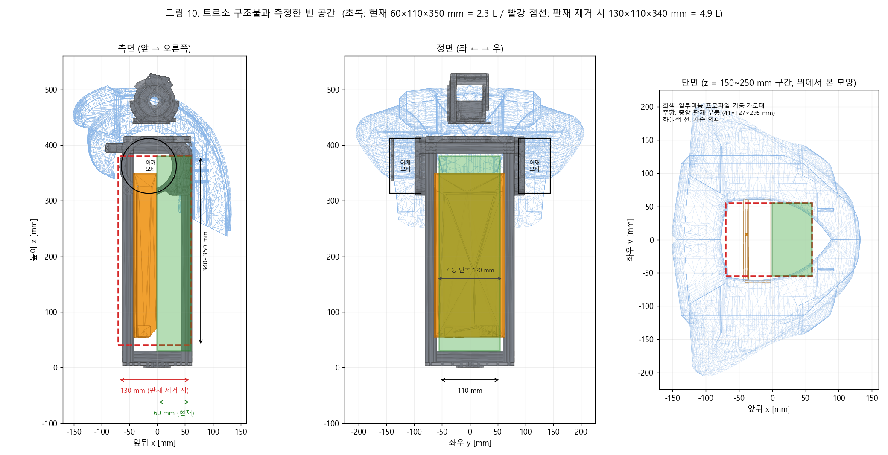

# 배터리 팩 사양 문의서 — 2족 보행 휴머노이드 연구용 시제품

작성 2026-10-13 · 문의처: 파워크래프트 · 내부 근거: [[163_battery_bms_design]], [[164_humanoid_battery_peer_benchmark]], [[166_battery_regen_and_commercial_packs]]
이 문서는 프로젝트를 모르는 사람이 읽도록 썼다. 시뮬레이션·계산값은 "계산값"으로 표시했다. 측정하지 못한 항목은 "미확정"으로 표시했다.

## 1. 요청

- **받고 싶은 것 (필수)**: 아래 요구를 만족하는 배터리 팩의 **질량 [kg]** 과 **외형 치수 (가로 × 세로 × 높이) [mm]**.
- **같이 받고 싶은 것**: 셀 모델, 직렬·병렬 구성 (S·P), 정격 용량 [Ah, Wh], BMS 정격, 납기, 수량별 가격, 인증 (UN38.3, IEC 62133-2 등).
- 요구 사양은 §6, 설치 공간은 §5, 로봇 부하는 §4 에 있다.

## 2. 로봇 개요

| 항목 | 값 |
|---|---|
| 종류 | 2족 보행 휴머노이드 연구용 시제품 (서울대학교 ARILab, 프로젝트 Pygmalion, 로봇 Huphy 1.0) |
| 구성 | 다리 12축, 허리 1축, 어깨 4축, 팔꿈치 2축 = **모터 19개**. 목은 고정 |
| **총 무게 (배터리 제외)** | **약 39.2 kg** (CAD 질량 + 3D 프린트 외피 + 센서. 현재 쓰는 AC-DC 전원장치 1.95 kg 제외) |
| 총 무게 (배터리 포함 목표) | **47~51 kg** (팩 질량 8~13 kg 가정) |
| 현재 전원 | 유선. AC-DC 전원장치 (48 V, 2 kW, 1.95 kg) 를 토르소에 실음. 배터리가 이를 대체한다 |
| 전원 구조 | 팩 → 단일 DC 버스 → 모터 드라이버 19개 (모터에 내장) + DC-DC 변환기 |

## 3. 모터

제조사: Robstride. 모터에 드라이버가 내장되어 있다. 입력은 DC 15~60 V, **공칭 48 V** 이다.

| 모델 | 개수 | 위치 | 정격 / 최대 토크 [N·m] | **정격 상전류** | **최대 상전류** | 무부하 전류 | 정격 출력 |
|---|---|---|---|---|---|---|---|
| RS04 | **7** | 엉덩이 피치 2, 엉덩이 롤 2, 무릎 2, 허리 요 1 | 40 / 120 | 27 A (피크값) = **19.1 A rms** | 90 A (피크값) = **63.6 A rms** | 0.7 A rms | 700 W |
| RS03 | **12** | 엉덩이 요 2, 발목 크랭크 4, 어깨 4, 팔꿈치 2 | 20 / 60 | 13 A (피크값) = **9.2 A rms** | 43 A (피크값) = **30.4 A rms** | 2 A rms (공식) | — |

- 상전류 표기: "피크값" 은 사인파 최대값이다. rms = 피크값 ÷ √2.
- 출처: Robstride 공식 사용 설명서와 판매처 사양서. 판매처 값과 공식 값이 다른 항목은 공식 값을 썼다.
- 무릎은 RS04 를 감속기 없이 직접 쓴다고 가정했다 (시뮬레이션 모델 기준). 외부 벨트 감속을 추가하면 무릎 전류는 작아진다. **하드웨어 확정 시 갱신한다.**
- 상체 모터 (허리·어깨·팔꿈치) 의 모델 배정은 설계 기준이다. 시뮬레이션 모델에는 팔꿈치가 없다.

**기타 전원 부하 (계산값)**
| 부하 | 전력 | 입력 전압 |
|---|---|---|
| LiDAR (Ouster OS1) | 16 W (공칭), 저온 시동 28 W | 12~24 V |
| 깊이 카메라 (RealSense D435) | 약 3 W | 5 V |
| 연산 보드·IMU·CAN | 약 15 W | 5~12 V |
| 합계 (DC-DC 효율 90 % 포함) | 약 38 W | 팩에서 강압 |

## 4. 시뮬레이션 부하

### 4.1 방법
- 보행 제어기 (강화학습으로 학습한 정책) 를 물리 시뮬레이터 (MuJoCo) 에서 실행했다. 200 Hz 로 관절 토크와 속도를 기록했다.
- 모터 상수 (토크 상수, 상 저항, 마찰) 로 **모터 전기 전력**을 계산했다. 상체 모터 대기 전력 (모터당 3 W) 과 §3 전자 부하를 더해 **로봇 전체 버스 전력**으로 했다.
- 전류는 버스 전력 ÷ 46.8 V (13S 공칭 전압) 이다. 시뮬레이터는 버스 전압을 계산하지 않는다. 팩 전압이 42 V 로 낮아지면 전류는 약 11 % 늘어난다.
- 용어: **평균**, **p95·p99** (5 ms 샘플의 95·99 번째 백분위수), **100 ms 피크** (100 ms 이동 평균의 최대), **5 ms 피크** (한 샘플의 최대).
- 로봇 질량은 47.1 kg 로 환산했다. 평지는 41.1 kg 롤아웃을, 험지는 23.6 kg 롤아웃을 질량비로 환산했다 (**외삽값**).
- 정책은 23.6 kg 하체 모델로 학습했다. 48.6 kg 에서는 0.8 m/s 이상에서 넘어졌다. 전신 질량용 정책은 아직 없다.
- **달리기 정책은 없다.** 가장 빠른 동작은 1.2 m/s 걷기다.

### 4.2 서기·걷기·험지 — 로봇 전체 버스 (질량 47.1 kg)
| 시나리오 | 평균 [W] | p95 [W] | p99 [W] | 100 ms 피크 [W] | 5 ms 피크 [W] | 평균 [A] | p95 [A] | p99 [A] | **100 ms 피크 [A]** | **5 ms 피크 [A]** |
|---|---|---|---|---|---|---|---|---|---|---|
| 서 있기 | 434 | 799 | 1,121 | 1,093 | 1,862 | 9.3 | 17.1 | 24.0 | 23.4 | 39.8 |
| 걷기 0.4 m/s | 482 | 739 | 976 | 712 | 1,173 | 10.3 | 15.8 | 20.9 | 15.2 | 25.1 |
| 걷기 0.6 m/s | 522 | 919 | 1,371 | 1,416 | 2,571 | 11.1 | 19.6 | 29.3 | 30.3 | 54.9 |
| 걷기 0.8 m/s | 660 | 1,061 | 2,095 | 1,068 | 2,800 | 14.1 | 22.7 | 44.8 | 22.8 | 59.8 |
| 걷기 1.0 m/s | 758 | 1,100 | 2,145 | 1,164 | 2,744 | 16.2 | 23.5 | 45.8 | 24.9 | 58.6 |
| 걷기 1.2 m/s (최고) | 906 | 1,259 | 2,270 | 1,418 | 2,604 | 19.4 | 26.9 | 48.5 | 30.3 | 55.6 |
| 험지 오르막 0.5 m/s | 615 | 1,218 | 1,622 | 2,435 | 3,712 | 13.2 | 26.0 | 34.7 | **52.0** | **79.3** |
| 험지 내리막 0.5 m/s | 547 | 1,067 | 1,535 | 2,011 | 2,982 | 11.7 | 22.8 | 32.8 | 43.0 | 63.7 |

- 험지: 산길 지형 (경사 약 5 %) 을 걷는 시뮬레이션. 계단·급경사 데이터는 없다.
- **음의 전력 (팩으로 되돌아오는 전력)**: 걷기·서기에서는 거의 없다. 최소값은 험지 내리막의 −51 W (약 1 A) 이다. 한 모터가 회생해도 다른 모터가 바로 쓴다.
- 한계 전압 42 V 에서의 5 ms 피크 전류: 서기 44 A, 걷기 0.8 m/s 67 A, 험지 오르막 88 A.

### 4.3 넘어질 때 (계산값)
- 시뮬레이션에서 정책이 균형을 잃고 넘어진 4건 (질량 48.6 kg). 넘어지기 직전 2 s 구간을 보았다. **기록은 몸이 60° 기울면 끝난다. 지면 충돌 구간은 포함하지 않는다.**

| 상황 | 5 ms 피크 [W] | 5 ms 피크 [A] | 가장 큰 음의 전력 [W] |
|---|---|---|---|
| 0.8 m/s 걷다가 | 3,541 | 76 | −42 |
| 1.0 m/s 걷다가 | 5,268 | 113 | 없음 |
| 1.2 m/s 걷다가 | 5,023 | 107 | −452 (약 10 A) |
| 서 있다가 | 3,909 | 84 | 없음 |

- 시뮬레이션의 회생은 작다. **실제 낙하의 회생 전력은 시뮬레이션이 다루지 못한 충돌 구간에서 더 클 수 있다.**
- 설계 상한 (에너지 보존 계산): 몸이 넘어지며 모터가 발전기가 되어 **최대 5 kW (약 100 A), 0.3 s, 약 2 kJ** 가 버스로 되돌아올 수 있다고 본다 (질량 47~52 kg, 무게중심 낙하 0.6 m + 20° 경사 3 m 구름: 0.3~0.9 kJ 의 2배 여유).

### 4.4 모터별 상전류 (A rms, 같은 그룹 모터를 합친 분포)
| 모터 그룹 (개수) | 걷기 0.8 m/s 평균 | p95 | p99 | 최대 | 험지 오르막 평균 | p99 | 최대 | 정격 | 최대 정격 |
|---|---|---|---|---|---|---|---|---|---|
| 엉덩이 피치 (RS04 ×2) | 8.1 | 18.7 | 21.6 | 25.3 | 6.7 | 22.8 | 32.1 | 19.1 | 63.6 |
| 엉덩이 롤 (RS04 ×2) | 14.2 | 31.2 | 36.1 | 39.8 | 17.5 | 44.6 | 72.2 | 19.1 | 63.6 |
| 무릎 (RS04 ×2) | 12.0 | 35.9 | 42.2 | 57.4 | 7.4 | 32.8 | 71.5 | 19.1 | 63.6 |
| 엉덩이 요 (RS03 ×2) | 6.6 | 20.0 | 21.5 | 23.8 | 4.5 | 19.6 | 37.4 | 9.2 | 30.4 |
| 발목 크랭크 (RS03 ×4) | 2.3 | 7.0 | 8.3 | 9.5 | 4.1 | 16.8 | 30.8 | 9.2 | 30.4 |

- 험지의 일부 최대값이 모터 최대 정격을 넘는다. 질량비 환산 때문이다. 이 질량에서는 실제 모터가 포화한다는 뜻이다.
- 팩 선정에는 §4.2 의 버스 전류가 직접 필요하다. 이 표는 참고용이다.

## 5. 설치 공간 (토르소)

**측정 방법**: 로봇 모델(URDF)의 토르소 3D 메시에서, 구조물·모터·외피가 차지하는 부분을 빼고 남은 빈 공간 중 가장 큰 **직육면체**를 찾았다 (격자 10 mm). CAD 서버는 꺼져 있어 CAD 직접 측정은 못 했다. 모델에 배선·보드·전원장치는 없다. **치수 오차는 ±10 mm 이상이다.**

| 조건 | 가장 큰 빈 직육면체 (앞뒤 × 좌우 × 상하) | 체적 |
|---|---|---|
| 현재 구조 그대로 | **60 × 110 × 350 mm** | 2.3 L |
| 구조물 안의 판재 부품 1개 (41 × 127 × 295 mm, 중앙을 가로지름) 를 빼면 | **130 × 110 × 340 mm** | 4.9 L |

- 위치: 알루미늄 프로파일 구조물 안쪽 중앙. 몸통 중심선 가까이, 허리 위 30~380 mm 구간.
- 구조물: 4개 기둥 (20 × 20 mm) 이 125 × 160 mm 단면을 이룬다. 기둥 사이 안쪽 폭은 앞뒤 85 mm, 좌우 120 mm.
- 가슴 외피 (285 × 410 × 272 mm) 안에서는 이보다 큰 직육면체가 나오지 않았다. 어깨·목 모터가 막는다.
- 참고 외형: 구조물 155 × 240 × 529 mm, 외피 (좌우 합) 285 × 410 × 272 mm.
- **팩이 들어가는가 (우리 추정)**: 21700 셀 (지름 21.7 mm, 길이 70 mm) 을 홀더 포함 22.5 mm 간격으로 채우면 4.9 L 칸에 약 80개 (13S6P 78개 정도) 가 들어간다. 2.3 L 칸에는 13S3P 정도다. **13S8P (104개, 약 3.4 L) 는 이 칸에 안 들어갈 가능성이 높다.** 분할 팩이나 외부 추가 공간이 필요할 수 있다.
- 현재 이 공간에는 AC-DC 전원장치 (1.95 kg) 가 들어간다. 모델에는 전원장치가 없다. 전원장치를 빼면 공간이 더 생기는지는 CAD 로 확인해야 한다.
- 질량 위치: 가능하면 **토르소 중앙, 몸통 축 가까이**. 말단 질량은 발목 모터를 먼저 포화시킨다.
- **확인 후 전달할 값**: CAD 로 잰 내부 가용 가로 × 세로 × 높이, 판재 부품 제거 가능 여부, 케이블 경로, 고정 방식.

## 6. 우리가 조사한 사양 (요구 사양 초안)

### 6.1 전압
- **13S 리튬이온 (NMC/NCA)**. 만충 54.6 V, 공칭 46.8 V, 방전 하한 39 V.
- 이유: 모터 입력 한계가 60 V 다. 14S (만충 58.8 V) 는 회생 때 60 V 를 넘길 위험이 있다.
- 일반 운전 충전 상한은 4.0~4.15 V/셀 (52~53.95 V). 회생을 팩이 받으려면 운전 중 SOC 를 약 80 % (4.0 V/셀) 이하로 제한한다.

### 6.2 규모 (계산값, 질량·시간 요구에 따라 3단계)
| 수준 | 목표 | 구성 | 에너지 | 팩 질량 (우리 추정) |
|---|---|---|---|---|
| 최소 (시험용) | 서 있기·저속 보행 약 2 h | 13S6P, P42A 급 | 약 1.2 kWh (25 Ah) | 약 7.9 kg |
| 권장 | 평지 0.6~0.8 m/s 약 2 h | 13S8P | 약 1.6 kWh (34 Ah) | 약 10.6 kg |
| 여유 (회생 흡수 + 마진) | 평지 2 h + 험지 1 h | 13S10~12P | 약 2.0~2.4 kWh | 약 13~16 kg |

- 에너지 = 평균 전력 × 시간 ÷ (사용 창 0.85 × 노화) × (1 + 마진). 팩이 무거울수록 로봇이 더 많은 전력을 쓴다 (질량 되먹임).
- 질량 한계: 팩 질량이 12 kg 를 넘으면 로봇이 51 kg 를 넘는다.

### 6.3 전기 요구
| 항목 | 요구 |
|---|---|
| 전압 범위 | 39~54.6 V (모터 한계 60 V) |
| 연속 방전 전류 | 60 A 이상 |
| 방전 1 s / 100 ms | 100 A / 120 A 이상 (험지 오르막 100 ms 피크 52 A, 5 ms 피크 79 A, 설계 여유 포함) |
| 5 ms 급 피크 | 버스 커패시터 (약 2 × 1,000 µF, 80 V) 로 받는다. 팩 정격 요구 아님 |
| **회생 (충전) 전류** | **최대 100 A, 0.3 s 펄스 (5 kW)**. 평소에는 거의 0 A |
| 셀 | 고출력 21700 (예: Molicel P42A, Samsung 40T3, 50E) |
| 셀 충전 한계 | P42A: 표준 4.2 A (1 C), 펄스 8.4 A (공식 값 미확인). 13S8P 에서 100 A 는 셀당 12.5 A (약 3 C) 다 |
| 팩 직류 저항 | 가능한 작게 (우리 추정: 13S8P 약 31 mΩ, 100 A 에서 전압 상승 3.1 V) |
| 충전 | 13S CC-CV, 0.5 C 이하, 0~45 °C |

### 6.4 BMS 요구
1. **충전·방전 공통 포트** 또는 충전 경로가 운전 중 열리지 않는 구조. 충전 FET 가 열리면 회생 때 전압이 즉시 오른다.
2. **충전 과전류 트립**을 변경 가능해야 한다. 기본값 (예: 8 A) 으로는 회생에서 끊긴다. 목표: 100 ms 에서 100 A 이상, 또는 운전 중 비활성.
3. 셀 단위 과전압 트립 4.30 V, 지연 500 ms. 저전압 3.0 V/셀. 과온도 차단.
4. 셀 밸런싱 100 mA 이상. 셀 13채널 전압, 온도 센서 4개 이상.
5. **CAN 통신**: 팩 전압, 전류, SOC, 온도, **충전 가능 전류 한계**.
6. 프리차지 회로, 주 퓨즈 (60 V DC 이상 차단 용량), 안티스파크 커넥터 (150 A 이상).
7. 비상정지: 팩 차단은 모터 토크 오프 이후에 한다. 주행 중 팩이 끊기면 회생 경로가 사라진다.

### 6.5 회생(제동) 보호 — 팩과 별도 (우리 쪽에서 설치)
- 제동 초퍼 + 방전 저항: 버스 전압이 높아지면 켜진다. 팩 흡수 모드 ON 56.5 V / OFF 55.5 V, 만충 모드 ON 55.0 V / OFF 54.2 V (우리 추정). 모터 한계 60 V, 셀 과전압 4.30 V 보다 먼저 동작한다.
- 팩이 모든 회생을 받아도 이 회로를 안전용으로 둔다.

## 7. 참고: 동종 휴머노이드 배터리 (공개 자료)

| 로봇 | 질량 | 팩 에너지 | 전압 | 런타임 주장 |
|---|---|---|---|---|
| Unitree G1 | 약 35 kg | 421 Wh (9 Ah) | 13S, 54.6 V 만충 | 약 2 h |
| Booster T1 | 약 30 kg | 504 Wh | 13S3P (10.5 Ah) | 걷기 약 2 h |
| Unitree H1 | 약 47 kg | 864 Wh | 최대 67.2 V | 공식 미표기 |
| Figure 02 | 약 70 kg | 2,250 Wh | — | 약 5 h |
| Tesla Optimus | 약 57 kg | 약 2,300 Wh | 52 V | 걷기 약 500 W |
| 우리 (권장 13S8P) | 약 50 kg | 1,570 Wh | 13S | 계산값 평지 0.8 m/s 약 1.9 h |

- 출처: 각 제조사 페이지와 판매·보도 자료. 런타임은 제조사 주장이며 부하 조건을 모른다.
- 우리 로봇의 서 있기·걷기 전력은 계산값으로 동종보다 1.3~2배 높다. 동종 수준이면 같은 팩으로 더 오래 간다.

## 8. 문의 사항 (답변 요청)
1. §6 의 요구 (최소·권장 2종) 를 만족하는 팩의 **질량 [kg]** 과 **외형 치수 [mm]**.
2. 셀 모델 (P42A 급) 사용 가능 여부와 셀 공급 상황. 셀 직류 내부 저항, 충전 전류 한계 (펄스 100 ms, 온도·SOC 별) 의 공식 값.
3. BMS: 공통 포트 여부, 충전 과전류 트립 설정 가능 범위, CAN 프로토콜, 셀 단위 과전압.
4. 팩 직류 저항 [mΩ], 연속·펄스 방전 정격, 100 A 0.3 s 충전 펄스 보증 여부.
5. 형상 자유도: 직육면체, L자형, 2분할 팩 가능 여부. 토르소 내부 치수 확정 후 맞출 수 있는가.
6. 인증 (UN38.3, IEC 62133-2) 과 납기, 시제품 1~2개 가격, MOQ.
7. 커넥터 (대전류, 안티스파크) 와 충전기 제공 여부.

## 9. 알려둘 한계
- 모든 부하 값은 **시뮬레이션 기반 계산값**이다. 실측하지 않았다. 서 있기 전력 실측은 로봇에 배터리를 달기 전에 할 계획이다.
- 정책이 전신 질량으로 학습되지 않아 질량 환산 (외삽) 값이다. 실제 부하는 이 값보다 낮을 수도, 높을 수도 있다.
- 모터 상수 (저항 등) 는 판매처·공식 문서 값이며 ±10 % 오차가 있다.
- 토르소 내부 공간, 팔꿈치 모터 형번, 무릎 외부 감속은 확정되지 않았다.
- 낙하의 회생 전력은 에너지 보존 계산 (설계 상한) 이며 실측이 아니다.
