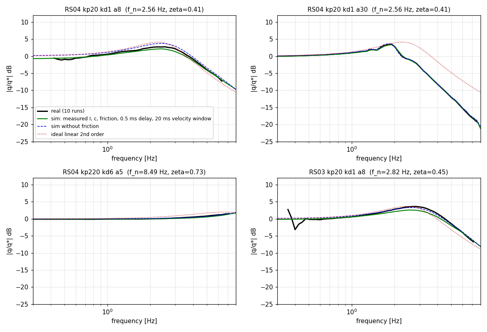
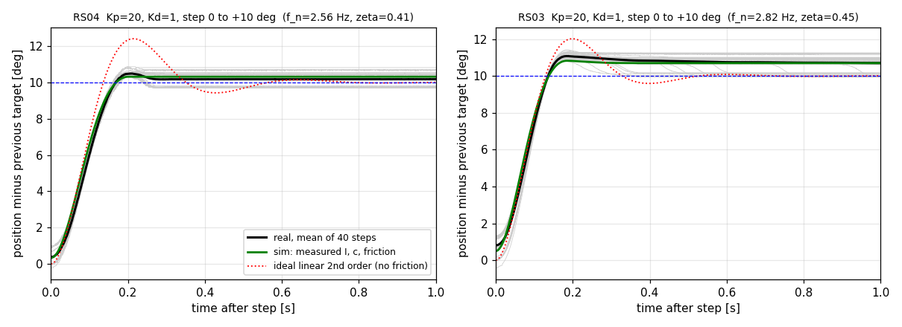

# 172. 실물 모터로 위치 게인을 맞추는 방법 — 서베이, 절차, 학습 경로 (2026-10-16)

> 사용자 지시 (2026-10-16): "실제 모터를 돌려보면서 적절한 PD 게인을 찾으려는데 방법을 서베이해서 어떻게 해야 할지 알려줘."
> 같은 날 추가 지시: "해당 작업을 위해 필요한 지식이 있다면 습득할 수 있게 도와줘."
> 원자료: `docs/research_raw/2026-10-16_real_motor_pd_tuning_sources.md`. 본문의 [S숫자] 는 그 파일의 출처 번호이다.
> 관계: 169 문서 §10-3 (디딤 유효 관성) 과 §11 (유도 예시, 실물 검증 5단계) 을 다시 유도하지 않고 인용한다. 이 문서는 그 5단계 앞에 모터 한 대 단계 (단계 A) 를 더하고, 합격 기준을 문헌과 대조한다.
> 쓰기 규칙: ASD-STE100 을 한국어에 적용 (한 문장에 사실 하나, 25어절 이하, 정의한 용어만 사용, 숫자에 단위).
> 이 문서를 쓰는 동안 모터에는 아무것도 보내지 않았다. 5절은 기존 기록 파일을 읽기만 한 오프라인 분석이다.

## 0. 결론 먼저

> ★★ **질문을 바꿨다.** 실물 모터를 돌려서 학습 게인 ($K_p$, $K_d$) 을 "찾는" 방법은 문헌에 없다.
> 문헌의 순서는 반대이다. 게인은 정책 쪽 기준으로 먼저 정한다. 그다음 실물 관절의 응답을 재고, 시뮬레이션 관절이 같은 응답을 내도록 시뮬레이션 모델을 고친다 [S1, S2, S3].
> 그래서 이 문서는 "실물 응답에 시뮬레이션을 맞추는 방법" 에 답한다. 실물 시험이 직접 정하는 값은 둘이다. 하나는 진동이 없는 게인의 상한이다. 다른 하나는 게인 무작위화 폭이다.

### 권장 절차

1. 목표 게인을 고정한다. 값은 169·171 문서의 권장값이다: 엉덩이 135/6, 엉덩이 비틀기 75/4, 무릎 130/6, 크랭크 60/2.7. 시험 중에 바꾸지 않는다.
2. 힘 0 으로 통신, 영점, 보고값 눈금을 검사한다 (3.1절).
3. 모터 한 대를 축에 아무것도 달지 않고 낮은 게인 $K_p$ 20, $K_d$ 1 로 모터 안쪽 제어식 (MIT 모드) 에 올린다. 계단과 처프를 받는다. 기존 호스트 계산 자료 (5절) 와 겹친다. 둘이 다르면 그 차이가 모터 안쪽의 지연과 속도 필터이다.
4. 같은 모터에서 목표 게인의 0.3 배부터 한 번에 50 % 씩 목표 게인까지 올린다 (169 문서 §11-4 의 단계 0 과 같은 시작). 단계마다 계단과 처프를 받는다.
5. 단계마다 같은 명령을 시뮬레이션에 넣어 응답을 겹친다. 합격 기준 (3.6절) 을 통과해야 다음 단계로 간다.
6. 관성, 마찰, 점성, 지연을 최소제곱으로 식별한다. 식별값을 시뮬레이션 모델에 적는다 (4.1절).
7. 다리 한 개를 매달고 관절 하나씩 계단과 처프를 받는다. 이것이 169 문서 §11-4 의 단계 1 과 2 이다. 유효 관성이 MuJoCo 값과 맞는지 본다 (3.7절).
8. 크레인으로 받치고 두 발 하중 유지 (169 문서 단계 3), 정책과 게인 배율 0.6·0.8·1.0 (단계 4), 무작위화 모서리 게인의 진동 시험을 한다 (3.8절).
9. 측정한 흩어짐에서 게인 무작위화 폭을 정한다 (4.2절).
10. 정책을 올리기 전에 2~5 단계의 짧은 판을 다시 돌려 기록한다.

### 문헌의 게인 무작위화 폭 (자세한 표는 4.2절)

- Cassie: 모든 관절 $\pm 30$ % [S14, S15].
- Booster T1: 강성과 감쇠 $\pm 5$ % [S16].
- Guan 외: $K_p$ 는 $\pm 2$ N·m/rad (약 $\pm 10$ %), $K_d$ 는 $\pm 0.05$ N·m·s/rad (약 $\pm 11$ %) [S1].
- Berkeley Humanoid: 게인은 무작위화하지 않는다. 식별한 값을 쓰고 마찰 $\pm 10$ %, 회전자 관성 $+0$ ~ $+5$ % 만 흔든다 [S3].

### 지금 모르는 것 세 가지

- RobStride 모터 안쪽 제어 루프의 속도와 속도 필터를 매뉴얼에서 찾지 못했다 [S9]. 시험 3단계가 이 값을 드러낸다.
- MIT 프레임의 $K_p$ 가 모터 쪽 단위인지 출력축 쪽 단위인지 문서에 없다 [S9, S12]. 무게추 시험 (3.2절) 이 답한다.
- Katz 학위논문 (S11) 은 접속 제한 (HTTP 429) 때문에 열지 못했다. 컨트롤러 설명은 공개 펌웨어 [S10] 로 대신했다.

---

## 1. 정의

| 용어 | 뜻 | 영어 표준 용어 | 단위 |
|---|---|---|---|
| 위치 게인 $K_p$ | 목표 각도와 실제 각도가 1 rad 다를 때 내는 토크 | proportional gain | N·m/rad |
| 속도 게인 $K_d$ | 각속도 1 rad/s 마다 내는 제동 토크 | derivative gain | N·m·s/rad |
| 목표 각도 $q^*$ | 정책이 50 Hz 로 내는 관절 목표 | joint position target | rad |
| 위치 제어식 | $\tau = K_p (q^* - q) + K_d (\dot q^* - \dot q) + \tau_{ff}$ | PD control law | N·m |
| MIT 모드 | 명령 한 프레임에 목표 각도, 목표 속도, $K_p$, $K_d$, 보조 토크를 담는 모터 안쪽 제어 모드 | MIT mode (impedance mode) | — |
| 호스트 계산 | 위치 제어식을 컴퓨터에서 계산하고 모터에는 토크만 보내는 방식 | host-side control | — |
| 회전자 관성 | 회전자가 출력축에 반영된 관성. MuJoCo 의 `armature` | reflected rotor inertia (armature) | kg·m² |
| 유효 관성 $I$ | 관절이 실제로 느끼는 관성. 회전자와 붙은 다리를 합친 값 | effective inertia | kg·m² |
| 쿨롱 마찰 $F_c$ | 움직이는 방향만 거스르는 일정한 토크. MuJoCo 의 `frictionloss` | Coulomb friction | N·m |
| 점성 마찰 $c$ | 속도에 비례하는 제동 토크. MuJoCo 의 `damping` | viscous friction | N·m·s/rad |
| 지연 $T$ | 명령을 보낸 뒤 상태가 바뀌어 읽히기까지 걸리는 시간 | delay (latency) | ms |
| 고유진동수 $f_n$ | $\sqrt{K_p / I}/(2\pi)$. 마찰이 없을 때 스스로 떠는 진동수 | natural frequency | Hz |
| 감쇠비 $\zeta$ | $(K_d + c) / (2\sqrt{K_p I})$. 1 이상이면 진동 없이 도달한다 | damping ratio | — |
| 오버슈트 | 계단 응답이 목표를 넘어간 최대 비율 | overshoot | % |
| 상승 시간 | 응답이 최종값의 10 % 에서 90 % 까지 가는 시간 | rise time (10-90 %) | ms |
| 정착 시간 | 응답이 최종값 주위 2 % 또는 5 % 띠 안에 들어와 머무는 시간 | settling time | ms |
| 계단 응답 | 목표를 한 번에 바꿨을 때의 응답 | step response | — |
| 처프 | 진동수가 시간에 따라 올라가는 사인파 목표 | chirp (swept sine) | — |
| 주파수 응답 | 사인 목표에 대한 응답의 크기비와 위상차를 진동수별로 나타낸 것 | frequency response | dB, ° |
| 보드 선도 | 주파수 응답을 크기 (dB) 와 위상 (°) 두 그림으로 그린 것 | Bode plot | — |
| 일관성 | 입력과 출력의 선형 관계 정도. 1 이면 완전한 선형 | coherence | — |
| 대수 감쇠율 | 이웃한 두 봉우리 크기비의 자연로그 | logarithmic decrement | — |
| 시스템 식별 | 측정한 입출력에서 모델의 값을 구하는 일 | system identification | — |
| 도메인 무작위화 | 학습 중 시뮬레이션 값을 매번 흔드는 일 | domain randomization | — |
| 준직접구동 | 감속비가 낮아 출력축에서 전류로 토크를 조절하는 구동 방식 | quasi-direct drive | — |
| 코깅 | 자석 때문에 회전 각도마다 생기는 토크 요철 | cogging | N·m |

---

## 2. 서베이 요약

| 방법 | 무엇을 재는가 | 무엇을 정하는가 | 비용 | 출처 |
|---|---|---|---|---|
| 계단 응답 시험 | 오버슈트, 상승 시간, 정착 시간, 남는 오차 | 작은 계단은 마찰, 중간 계단은 관성과 점성 | 낮음. 모터 한 대와 기록 | [S24], 5절 |
| 처프와 보드 선도 맞춤 | 닫힌 고리의 크기 응답. 0.1~25 Hz | 시뮬레이션 $K_p$, $K_d$, 회전자 관성, 무작위화 폭 | 중간. 관절당 한 번 20~60 s | [S1] |
| 처프와 시간영역 식별 (PACE) | 위치 궤적 전체 | 관성, 점성, 마찰, 바이어스, 지연 ($4n+1$ 개) | 중간. 최적화 계산 | [S2] |
| 무토크 감속, 두 토크 가속 (자체 도구) | 마찰, 회전자 관성 | `armature`, `frictionloss`, `damping` | 낮음. 도구와 자료가 이미 있음 | `docs/experiments/2026-09-10_motor_value_validity.md` |
| 액추에이터 네트워크 | 오차 이력에서 토크로 가는 함수 | 시뮬레이션 액추에이터 모델 | 높음. 토크 센서가 필요 | [S4] |
| 신경망 PD 액추에이터 | 토크를 못 잴 때 상태에 따른 $K_p$, $K_d$ | 시뮬레이션 액추에이터 모델 | 중간에서 높음 | [S6] |
| 직류 모터 모델과 지연 모델링 | 전압, 전류, 제어 지연 | 시뮬레이션 액추에이터 모델 | 중간 | [S5] |
| 식별 우선, 게인 무작위화 생략 | 설계 도면과 식별값 | 좁은 무작위화 | 설계 단계부터 필요 | [S3] |
| 게인 무작위화 | 정책의 강건성 | $\pm 5$ ~ $\pm 30$ % | 학습 비용 | [S14]-[S20] |
| 손으로 만져 보는 조정 | 강성의 느낌, 놓았을 때의 감쇠 | 시작 $K_p$, $K_d$ | 가장 낮음 | [S21] |
| 로그 감쇠율 | 감쇠비 | $\zeta$ | $\zeta > 0.5$ 에서 부정확 | [S24] |
| Ziegler-Nichols | 지속 진동이 생기는 게인 | PID 세 값 | 높음. 진동까지 올려야 함 | [S23] |

Ziegler-Nichols 를 쓰지 않는다. 이유는 셋이다.

- 방법이 게인을 지속 진동이 생길 때까지 올린다 [S23]. 사람 크기 다리를 단 모터에서 위험하다.
- 설계 목표가 4분의 1 감쇠비이다. 결과 고리의 감쇠가 나쁘다 [S23].
- 우리 게인은 정책 기준 (169 문서) 으로 이미 정했다. PID 세 값을 새로 구할 일이 없다.

---

## 3. 단계별 시험 절차

### 3.1 시험 전 점검

아래는 사용자가 정하는 권고이다. 코드에 자동 장치로 넣지 않는다.

| 점검 | 이유 | 근거 |
|---|---|---|
| 영상 녹화 | 프로젝트 규칙: 모터에 힘이 들어가는 모든 순간을 녹화한다. 2026-10-15 벤치는 사용자가 면제했다 | `emf_bench/README.md` 10절 |
| 힘 0 으로 상태 읽기 | 힘을 넣기 전에 통신과 보고값을 확인한다 | `emf_bench/README.md` 5절 |
| 영점 점검 3 ms 시험 | 목표를 보고 각도와 같게 주고 3 ms 만 켠다. 토크가 0 근처면 제어 기준과 보고 각도가 맞다 | `docs/experiments/2026-09-11_bench_a1_a3.md` |
| 낮은 게인에서 시작 | 목표 게인의 4분의 1 에서 시작해 50 % 씩 올린다. 진동이 나면 직전 값의 절반으로 내린다 | [S21] |
| 첫 계단은 작게 | 계단 크기 2° 에서 시작한다. 토크 $K_p \times$ 오차 가 정격 40 N·m 를 넘지 않게 한다. $K_p$ 135 이면 오차 17° 가 정격이다 | [S9] 정격값 |
| 전원 전압 감시 | 모터가 발전기로 일하면 전원 전압이 오른다. 매뉴얼이 경고한다 | [S9] |
| 하드스톱 확인 | 무릎은 0° 가 하드스톱이다. 가동 범위에서 3° 안쪽을 쓴다 | `docs/experiments/2026-09-12_zero_pose_hold.md` |
| 매다는 장비 | 한 다리와 전신 시험은 크레인이나 안전줄로 매단다 | [S3], [S22] |
| 끄는 길 | 비상 정지에 손이 닿는 거리에 선다. 호스트가 죽으면 모터가 마지막 명령을 계속 붙든다. `canTimeout` 은 기본이 꺼짐이다. 켤지는 사용자가 정한다 | `emf_bench/README.md` 8절 |

### 3.2 단계 A: 모터 한 대, 축에 아무것도 없음

- 먼저 단위를 확인한다. 축에 반지름 $r$ 인 팔과 질량 $m$ 인 추를 단다. 목표를 $\theta$ 만큼 어긋나게 준다. 정상 상태 오차가 $m g r / K_p$ 이어야 한다.
- 모터 쪽 단위이면 오차가 감속비 9 의 제곱 (81 배) 만큼 다르다. 한 번에 구별된다.
- 같은 시험에서 토크 눈금도 확인한다. 보고 토크와 $m g r$ 을 비교한다.

시험 신호는 다섯 가지이다.

| 번호 | 신호 | 값 | 이유 |
|---|---|---|---|
| T1 | 힘 0 정지 기록 | 10 s | 위치 잡음과 온도 기준을 잡는다 |
| T2 | 계단 $0 \to +A \to 0 \to -A \to 0$ | $A$ = 2, 5, 10°. 구간마다 1.5 s. 4 주기. 10 회 | 작은 계단은 마찰, 중간 계단은 관성과 점성이 드러난다 (`docs/experiments/2026-09-10_step_size_sweep.md`) |
| T3 | 로그 처프 | 0.2~20 Hz. 40 s. 진폭 2° 와 8°. 목표 속도 0. 5~10 회 | 상한 20 Hz 는 정책 50 Hz 의 나이퀴스트 주파수 25 Hz 에 맞춘다 [S1] |
| T4 | 속도 지연 시험 | $K_p$ = 0, $K_d$ = 1. 목표 속도를 0 에서 2 rad/s 로 | 모터 안쪽 속도 추정의 지연을 드러낸다 |
| T5 | 무게추 정지 시험 | 추 세 가지, 온도 세 가지 | 토크 눈금과 단위, 온도에 따른 실효 게인을 잰다 |

- 진폭 2° 는 마찰 죽은구간의 9 배이다. 죽은구간은 $F_c / K_p$ 이다. RS04 는 $0.519 / 135 = 0.0038$ rad $= 0.22$° 이다.
- 처프는 진폭 두 가지로 받는다. 크기에 따라 응답이 달라지면 비선형 (마찰, 토크 포화) 이다.
- 목표 속도는 배포 때와 같게 0 으로 준다. Booster 도 같다 [S16]. 속도 목표를 넣으면 응답식에 $K_d s$ 항이 생겨 다른 시스템이 된다.
- 기록 속도는 500 Hz 이상으로 한다. 한 모터의 왕복은 0.53 ms 이다 (`docs/experiments/2026-09-12_loop_timing.md`). 벤치 기본 200 Hz 는 20 Hz 처프에 빠듯하다. 먼저 `rate_test.py` 로 프레임 손실이 없는지 확인한다.

### 3.3 기록할 것

| 항목 | 이유 |
|---|---|
| 호스트 단조 시계 시각 (마이크로초) | 시계 어긋남을 막는다 |
| 보낸 시각과 받은 시각 | 왕복 지연과 흔들림을 본다 |
| 목표 각도, 목표 속도, 보조 토크, $K_p$, $K_d$ | 시뮬레이션에 같은 명령을 넣는다 |
| 보고 각도 | 기본 신호. 해상도는 0.022° 이다 [S9] |
| 보고 속도 | $\pm 15$ rad/s (859°/s) 에서 잘린다 [S9]. 위치 차분 속도를 따로 계산한다 |
| 보고 토크, q축 전류 | 토크 눈금 검사용 |
| 온도, 전원 전압 | 열과 회생을 본다 |

### 3.4 맞추는 방법

**계단 응답.** 평균 응답에서 오버슈트 $M_p$, 첫 봉우리 시각 $t_p$, 상승 시간을 읽는다. 감쇠비는 아래 식으로 구한다.

$$\zeta = \frac{-\ln M_p}{\sqrt{\pi^2 + \ln^2 M_p}}$$

- 마찰이 오버슈트를 깎는다. 우리 RS04 자료에서 선형 이론은 24 % 인데 실물은 5~9 % 이다 (5절).
- 대수 감쇠율은 $\zeta > 0.5$ 에서 부정확하다 [S24]. 목표 게인에서는 $\zeta \ge 0.9$ 이므로 계단 지표는 보조 수단이다.

**처프 주파수 응답.** 반복 $r$ 마다 목표 $U_r(f)$ 와 위치 $Y_r(f)$ 의 푸리에 변환을 구한다. 아래 식으로 평균한다.

$$H(f) = \frac{\sum_r Y_r U_r^*}{\sum_r |U_r|^2}$$

- 일관성이 0.9 이상인 구간만 쓴다.
- 목표 속도가 0 일 때 이상적인 모델은 $H(s) = K_p e^{-sT} / (I s^2 + (K_d + c) s + K_p)$ 이다.
- 크기는 고유진동수 근처에서 맞춘다. 위상은 지연이 시뮬레이션과 실물에서 다르게 나타나므로 보조로만 쓴다 [S1].

**시간영역 식별.** 변수 $[I, c, F_c, T]$ 와 속도 추정 창을 위치 궤적의 제곱오차로 맞춘다. 최적화 도구는 CMA-ES 를 쓴다 [S2]. 마찰이 있으면 모델이 비선형이므로 이 방법이 주파수 맞춤보다 낫다.

**독립 교차 검증.** 마찰과 회전자 관성은 PD 없이 따로 잰다.

- `System_ID/accel_id.py`: 두 토크로 가속시켜 마찰을 식에서 지운다.
- `System_ID/coast_max.py`: 토크 0 감속으로 마찰 곡선을 얻는다.
- `System_ID/friction_id.py`: 정지 마찰과 점성 계수를 얻는다.

**흩어짐.** 같은 시험을 10 회 반복해 회차마다 적합한다. 평균과 표준편차를 4.2절의 입력으로 쓴다.

### 3.5 MuJoCo 와 비교하는 방법

1. 기록한 목표 배열 $q^*(t)$, $\dot q^*(t)$ 를 같은 시각으로 시뮬레이션에 넣는다.
2. 같은 $K_p$, $K_d$, 토크 상한, 지연, 보고 속도 처리 방식을 쓴다.
3. 관절 하나짜리 모델에 `armature`, `damping`, `frictionloss` 를 넣는다. 기존 파일은 `System_ID/pd_sim_vs_real.py` 와 `System_ID/fit_motor.py` 이다.
4. 학습 설정 (물리 걸음 5 ms) 과 미세 설정 (0.5 ms 이하) 두 번 돌린다. 둘의 차이가 학습이 받아들이는 이산화 오차이다.

학습의 위치 제어식은 물리 걸음마다 한 번 계산된다 (5 ms, 200 Hz). MuJoCo 는 `kv` 를 `implicit` 이나 `implicitfast` 적분기에서만 암묵적으로 적분한다 [S27]. 실물 구동기는 훨씬 빠르게 계산한다. 기준 펌웨어는 40 kHz 이다 [S10].

아래는 내 수치 모델로 본 이산화 영향이다 (예비). 계단 5.7° 응답의 오버슈트와 도달 시간 $t_{90}$ 이다.

| 관절 (회전자만) | 연속 (0.1 ms) | 5 ms 명시적 | 5 ms 암묵적 감쇠 |
|---|---|---|---|
| 엉덩이 135/6 | 0.0 %, 85 ms | 0.0 %, 80 ms | 2.9 %, 75 ms |
| 크랭크 60/2.7 | 5.0 %, 85 ms | 3.2 %, 75 ms | 10.7 %, 80 ms |
| 무릎 130/6 (다리 포함) | 29.2 %, 119 ms | 32.4 %, 110 ms | 34.6 %, 115 ms |

크랭크처럼 $\zeta$ 가 0.7 근처인 관절에서 오버슈트가 최대 5.7 퍼센트포인트 달라진다. 이 오차는 지연 문제와 별개이다.

### 3.6 합격 기준

문헌에 수치 허용치는 거의 없다. 아래 세 가지가 전부이다.

- Guan 외는 크기 그림의 일치를 눈으로 판정하고 수치 허용치를 적지 않았다 [S1].
- Bjelonic 외는 식별한 관성이 해석값과 회전자 2 %, 접합부 6 %, 붙인 질량 15 % 안에서 맞았다고 보고한다 [S2]. 이것은 식별 정확도이며 합격선이 아니다.
- 같은 논문에서 높은 게인은 식별을 개선하지 못했다. 게인을 올리면 닫힌 고리 극점이 가진 대역폭 밖으로 밀렸다 [S2]. 그래서 식별은 중간 게인에서 하고 목표 게인은 확인에 쓴다.

그러므로 허용치는 두 겹으로 둔다. 모터 한 대 (단계 A) 는 우리 자료에 맞춘 좁은 값이다. 매단 다리 (단계 B, 169 문서 §11-4) 는 메인 세션이 정한 넓은 값이다.

| 항목 | 단계 A: 모터 한 대 (제안) | 단계 B: 매단 다리 (169 문서 §11-4) | 우리 기존 자료 (단계 A) |
|---|---|---|---|
| 크기 차이 | 0.5 Hz 에서 $\min(1.5 f_n, 8)$ Hz. 제곱평균 1 dB, 최대 1.5 dB 이하 | 3 Hz 까지 $\pm 3$ dB | 제곱평균 0.1~0.6 dB, 최대 1.2 dB |
| 위상 차이 | 제곱평균 10°, 최대 15° 이하 | 3 Hz 까지 $\pm 20$° | 제곱평균 0.4~4.4° |
| 계단 | $t_{90}$ 10 %, 오버슈트 5 퍼센트포인트 이내 | 넘침, 흔들림 주파수, 정착 시간 $\pm 20$ % | $t_{90}$ 1~4 %, 오버슈트 2~6 퍼센트포인트 |
| 공진 봉우리 | 진동수 10 %, 높이 1.5 dB 이내 | 정하지 않음 | 0.1~1.0 dB |
| 남는 오차 | 0.3° 이내 또는 $F_c / K_p$ 의 30 % | 오차 = 토크 ÷ $K_p$ 가 시뮬레이션 대비 $\pm 20$ % | 0.1~0.5° |
| 적합한 지연 | 1 ms 이내 | 정하지 않음 | 5.4절 |
| 지속 진동 | 진폭 0.1° 미만 | 떨림 없음 | — |

단계 B 의 허용치가 무엇을 뜻하는지 계산했다. 아래는 이상적인 이차 계 (목표 속도 0) 에서 $f_n$ 이나 $\zeta$ 가 어긋났을 때 3 Hz 까지의 최대 차이이다.

| 어긋남 | 엉덩이 앞뒤 (1.27 Hz, 0.18) | 무릎 (2.52 Hz, 0.36) | 크랭크 (4.76 Hz, 0.67) |
|---|---|---|---|
| $f_n$ +5 % | 1.6 dB, 15° | 0.8 dB, 8° | 0.1 dB, 3° |
| $f_n$ +10 % | 3.1 dB, 30° | 1.5 dB, 15° | 0.1 dB, 6° |
| $\zeta$ +20 % | 1.6 dB, 5° | 1.6 dB, 5° | 1.1 dB, 5° |
| $\zeta$ +40 % | 2.9 dB, 10° | 2.9 dB, 10° | 2.1 dB, 10° |

- $f_n$ 은 관성의 제곱근에 반비례한다. $f_n$ 10 % 는 유효 관성 약 20 % 이다. 그러므로 3 dB 와 20° 는 엉덩이 앞뒤에서 관성 약 15~20 % 오차에 해당한다. 169 문서의 계단 $\pm 20$ % 와 일관되고 Bjelonic 의 붙인 질량 15 % 와 같은 크기이다.
- 엉덩이 앞뒤는 감쇠비가 낮아 공진이 뾰족하다. 같은 허용치가 $f_n$ 에 가장 엄격하다. 크랭크는 허용치가 느슨하다. 단계 B 에서 크랭크의 위상 허용치를 10° 로 줄여도 된다 (제안).
- 단계 A 의 좁은 값은 관성 한 가지가 아니라 마찰과 지연까지 확인하기 위한 것이다. 다리가 달리면 코깅, 케이블, 중력이 더해져 넓은 값이 알맞다.
- 처프는 단계 B 에서 진폭 2~3°, 0.5~10 Hz 로 받는다 (169 문서). 진폭이 작아도 마찰 죽은구간 $F_c / K_p$ 보다 커야 한다.

### 3.7 단계 B: 다리 한 개

- 다리를 매단다. 발은 땅에서 뗀다. 관절 하나만 움직이고 나머지는 같은 게인으로 고정 자세에 둔다.
- 입력, 판정, 불합격 처리는 169 문서 §11-4 를 그대로 쓴다. 단계 1 은 계단 $\pm 5$° 각 3 회이다. 단계 2 는 처프 2~3°, 0.5~10 Hz 이다.
- 예측값은 169 문서 §11-3 이다. 엉덩이 앞뒤는 감쇠비 0.18, 넘침 57 % 이다. 무릎은 0.36, 29 % 이다. 크랭크는 0.67, 6 % 이다. 정확한 비교값은 같은 명령을 MuJoCo 에 재생해서 얻는다.
- 내 독립 계산 (영자세, 몸통 고정) 은 엉덩이 앞뒤 2.20 kg·m² 와 무릎 0.52 kg·m² 이다. 169 문서 §10-1 과 같은 크기이다 (엉덩이 비틀기는 자세 차이로 다르다).
- 이 단계의 목적은 두 가지이다. 식별한 유효 관성이 MuJoCo 값과 맞는지 본다. 중력 아래 남는 오차 $\tau_g / K_p$ 가 시뮬레이션과 같은지 본다.
- 이전 $K_p$ 10 기록에서 중력이 큰 관절은 지령의 24 % 만 따랐다 (5.1절). 같은 시험을 목표 게인으로 되풀이한다.

### 3.8 단계 C: 하중 아래

한 번 식별한 관성은 디딤 상태에 쓸 수 없다. 169 문서 §10-3 의 값이 이유를 보인다.

- 발목 앞뒤의 관성은 흔드는 상태 0.006 kg·m² 이고 디딤 상태 10.31 kg·m² 이다. 약 1,700 배이다.
- 무릎은 디딤에서 중력 강성이 +34.6 N·m/rad (불안정 쪽) 이다. 발목은 +134.9 이다.
- 그러므로 매단 다리에서 맞춘 모델이 디딤에서도 맞는다고 가정하지 않는다. 디딤은 169 문서의 단계 3 과 4 로 따로 확인한다.

절차는 아래와 같다.

1. 단계 3: 크레인을 내려 두 발로 선다. 정책은 없다. 기본 자세를 유지한다. 관절 오차가 토크 ÷ $K_p$ 와 맞는지 본다. 합격은 시뮬레이션 대비 $\pm 20$ % 이고 떨림이 없는 것이다.
2. 단계 4: 크레인으로 받치고 정책을 올린다. 게인 배율 0.6, 0.8, 1.0 에서 서기 유지 시간, 무릎 흔들림, 행동 상위 1 % 를 본다.
3. 무작위화 모서리 게인 (4.2절 폭의 양끝 네 조합) 에서 진동 시험을 한다. 진동이 나는 가장 낮은 조합이 "진동 없는 게인의 상한" 이다. 상한은 목표 게인보다 충분히 높아야 한다.
4. 열두 관절을 동시에 움직이는 처프도 낮은 진폭으로 한 번 받는다.

---

## 4. 결과를 학습 설정으로

### 4.1 시뮬레이션 모델에 넣을 값

| 값 | 현재 | 위치 | 갱신 방법 |
|---|---|---|---|
| 회전자 관성 | RS04 0.0773, RS03 0.0638 kg·m² | `pygmalion_constants.py` 111~112행 | 3.4절 식별값이 $\pm 10$ % 안이면 유지한다 |
| 쿨롱 마찰 | RS04 0.519, RS03 0.251 N·m | 같음 | 같음 |
| 점성 마찰 | RS04 0.0275, RS03 0.0252 N·m·s/rad | 같음 | 같음 |
| 지연 | 명령 지연 무작위화. 환경 변수로 켠다 (기본 꺼짐). 최대 1.0 걸음 (20 ms) | 환경 변수 `PYG_ACTION_DELAY` | 식별한 지연 (1~5 ms 안팎) 은 20 ms 걸음보다 훨씬 짧다. 걸음 단위 장치는 거칠다 |
| 속도 추정 | 시뮬레이션은 정확한 속도를 쓴다 | `BuiltinPositionActuator` | 모터 안쪽 속도 창이 길면 시뮬레이션에도 넣어야 한다 |

식별값이 현재 값과 $\pm 10$ % 이상 다르면 모델을 고친다. 이어서 정책을 다시 학습할지는 계획자가 정한다.

### 4.2 게인 무작위화 폭

MIT 모드에서 명령한 $K_p$, $K_d$ 는 숫자 그대로 계산된다. 양자화 오차는 $K_p$ 에서 0.9~2.0 %, $K_d$ 에서 0.4~0.9 % 이다 [S9]. 그러므로 게인 무작위화는 게인 오차가 아니라 **실효 응답의 불확실성** 을 대신한다. 불확실성의 원천은 넷이다.

- 첫째는 토크 상수와 전류 눈금 오차이다. T5 로 잰다.
- 둘째는 온도에 따른 토크 감소이다. T5 의 온도 세 가지로 잰다.
- 셋째는 지연과 속도 필터의 차이이다. T4 와 T3 으로 잰다.
- 넷째는 양자화이다. 위 숫자를 쓴다.

문헌의 폭은 아래와 같다.

| 출처 | 로봇 | $K_p$ 폭 | $K_d$ 폭 | 정당화 |
|---|---|---|---|---|
| [S14] Li 외 2024 | Cassie | $\pm 30$ % | $\pm 30$ % | 모터 응답의 다양성. 독립 샘플 |
| [S15] Li 외 2023 | Cassie | $\pm 30$ % | $\pm 30$ % | 같음. 감쇠는 최대 4 배 (모터 노화) |
| [S16] Booster Gym | T1 | $\pm 5$ % | $\pm 5$ % | 논문에서 수치 근거를 찾지 못했다 |
| [S1] Guan 외 | 사족 로봇 | $\pm 2$ N·m/rad (약 $\pm 10$ %) | $\pm 0.05$ (약 $\pm 11$ %) | 맞춘 게인 쌍의 흩어짐 |
| [S7] Xie 외 | 사족 로봇 | $\pm 20$ N·m/rad ($K_p$ 40 에서 $\pm 50$ %) | 없음 | 문제가 되는 변수만 흔든다 |
| [S3] Berkeley Humanoid | 휴머노이드 | 흔들지 않음 | 흔들지 않음 | 식별한 것은 무작위화하지 않는다 |
| [S17] Walk These Ways (코드) | 사족 로봇 | 0.8~1.3배 | 0.5~1.5배 | 코드의 기본값 꺼짐. 논문에서 켰는지는 미확인 |
| [S18] Isaac Lab (다리 예제) | 다리 | 0.8~1.2배 | 0.8~1.2배 | 예제이지 권고가 아니다 |
| [S8] Peng 외 | 팔 | 0.5~2배 (로그) | 같음 | 사족 로봇이 아니다 |
| [S19] Siekmann 외 | Cassie | 흔들지 않음 | 관절 감쇠 0.3~4배 | 감쇠만 흔든다 |
| [S20] Humanoid-Gym | 휴머노이드 | 모터 강도 95~105 % | 같음 | 게인 행이 따로 없다 |

우리 환경의 현재 기본값은 $K_p$ 0.8~1.2배, $K_d$ 0.7~1.3배이다 (`PYG_PD_GAIN_DR` 의 기본, `env_cfgs.py` 769행). `docs/148` 의 문헌 요약은 $K_p$ 0.9~1.1배, $K_d$ 0.5~1.5배이다.

폭을 정하는 방법은 아래와 같다. 이것은 후보이며 결정은 계획자가 한다.

1. T5 와 T3 반복에서 실효 $K_p$ 와 $K_d$ 의 흩어짐 (회차 간, 온도 간, 모터 간) 을 구한다.
2. 가장 큰 흩어짐을 반올림해 반폭으로 삼는다.
3. 흩어짐이 5 % 이하이면 $\pm 5$ ~ $\pm 10$ % (Berkeley, Booster, Guan 방식) 를 쓴다. 5~15 % 이면 $\pm 15$ % 를 쓴다. 원천을 식별하지 못했으면 $\pm 30$ % (Cassie 방식) 를 쓴다.

폭이 넓을수록 감쇠비가 크게 달라진다. 독립 샘플일 때 회전자만의 엉덩이 ($\zeta_0 = 0.93$) 와 크랭크 ($\zeta_0 = 0.69$) 는 아래처럼 변한다.

| 폭 ($K_p$ / $K_d$) | 엉덩이 회전자만 $\zeta$ | 크랭크 회전자만 $\zeta$ | 엉덩이 다리 포함 $\zeta$ |
|---|---|---|---|
| $\pm 5$ % / $\pm 5$ % | 0.86~1.00 | 0.64~0.74 | 0.16~0.19 |
| $\pm 10$ % / $\pm 10$ % | 0.80~1.08 | 0.59~0.80 | 0.15~0.20 |
| 현재 기본 (0.8~1.2 / 0.7~1.3) | 0.59~1.35 | 0.44~1.00 | 0.11~0.25 |
| $\pm 30$ % / $\pm 30$ % | 0.57~1.44 | 0.42~1.07 | 0.11~0.27 |

### 4.3 어떤 게인을 배포하는가

- 배포 게인은 학습의 기준 게인과 같게 한다. Booster 도 "시뮬레이션 설정에 맞춘다" [S16].
- 기준 게인에서 실물이 진동하면 순서대로 확인한다. 먼저 지연과 속도 필터 모델이 맞는지 본다. 다음으로 169 문서 기준으로 학습 게인을 낮춰 다시 학습한다.
- 로봇에서만 게인을 낮추지 않는다. 정책이 낮은 게인을 모르면 성능이 나빠진다 [S16].

---

## 5. 기존 자료가 보여 주는 것 (예비 결과)

모든 5절 숫자는 읽기 전용 오프라인 분석이다. 스크립트는 `tools/sysid/pd_prelim_analysis.py` 이다. 모터에는 아무것도 보내지 않았다.

### 5.1 가진 것

| 자료·도구 | 내용 | 비고 |
|---|---|---|
| `System_ID/pd_profiles.py` | 계단, 한쪽씩 계단, 처프, 삼각파. **호스트에서 PD 를 계산해 토크만 보낸다** | 2026-09-09~10. 모터 안쪽 PD 길은 그때 고장이었다 |
| `System_ID/data/pd_pmstep_{3,4}_kp20_kd1_a10_r*` | 한쪽씩 계단 ±10°. 모터마다 10 회 × 24 s. 메타 파일 있음 | RS03, RS04. 축에 아무것도 없음 |
| `System_ID/data/pd_chirp_*` | 처프. RS04 $K_p$ 20, $K_d$ 1 (진폭 8° 20 s, 30° 45 s), RS04 $K_p$ 220, $K_d$ 6 (진폭 5° 45 s), RS03 $K_p$ 20, $K_d$ 1 (8°). 각 10 회 | 기록 속도 약 3.5 kHz |
| `System_ID/data/pd_step_*` | 계단 여덟 크기 (1.5~45°) × 10 회, $K_p$ 20/150, $K_d$ 1/6 | `docs/experiments/2026-09-10_step_size_sweep.md` |
| `System_ID/accel_id.py`, `coast_max.py`, `friction_id.py`, `inertia_id.py` | 회전자 관성과 마찰 측정 | RS04 77.3 ± 0.6, RS03 63.8 ± 0.5 g·m². 세 방법이 1.6 % 안에서 합친다 |
| `System_ID/fit_motor.py`, `pd_sim_vs_real.py`, `pd_2x2.py` | 한 모터 MuJoCo 모형, 같은 명령 재생 | 지연 0.5 ms 를 가정 |
| `System_ID/backlash_probe.py` | 감속기 헐거움. 카메라 | 카메라 정밀도 부족으로 못 잼 |
| `System_ID/internal_gain_probe.py` | 모터 안쪽 PD 가 보낸 목표를 쓰는지 | 영점 재설정이 원인이었다. 3 ms 점검이 나왔다 (A1) |
| `System_ID/emf_bench/bench_server.py` | 모터 한 대, 웹 화면, MIT 모드. 목표·$K_p$·$K_d$ 슬라이더, 사인, 전류·전압 그래프, CSV | 처프·계단 신호 없음. 상한 장치 없음. 기본 200 Hz |
| `System_ID/data/2026-09-12_*.csv`, `2026-09-13_operator.csv` | 로봇 프로그램 (MIT 모드) 으로 다리 열두 관절. $K_p$ 10 (일부 20), $K_d$ 1 | 중력이 큰 관절은 지령의 중앙 24 % 만 따랐다 |
| `System_ID/FIRMWARE_RUNBOOK.md` | 통신 어댑터 펌웨어 교체 절차. 열두 모터 한 주기 6.28 ms (초당 159 회) | 2026-09-12 기준 보류. 이후 `can_link` 작업이 있었으나 현재 상태는 확인하지 않았다 |

### 5.2 분석 방법

- 실물 처프를 반복 평균해 주파수 응답을 구했다 (3.4절 식, 해닝 창 (Hann window), 일관성 0.9 이상 구간).
- 같은 목표를 관절 하나짜리 모델에 넣었다. 값은 측정한 관성, 점성, 마찰, 지연 0.5 ms 이다. 호스트 루프와 같은 20 ms 차분 속도 추정을 넣었다.
- 계단은 실물 40 개 모서리의 평균 응답과 모델 응답을 비교했다.
- 지연 맞춤은 지연 0~3 ms 와 관성 배율 0.9~1.1 의 격자에서 위치 오차의 제곱평균 제곱근을 비교했다.

### 5.3 결과 1: 처프 주파수 응답

| 모터와 게인 | $f_n$ 이론 | $\zeta$ 이론 | 봉우리 실물 | 봉우리 모델 | 크기 차이 제곱평균 | 위상 차이 제곱평균 |
|---|---|---|---|---|---|---|
| RS04 $K_p$ 20, $K_d$ 1, 진폭 8° | 2.56 Hz | 0.41 | +2.7 dB, 2.53 Hz | +2.1 dB, 2.39 Hz | 0.45 dB | 4.1° |
| RS04 $K_p$ 20, $K_d$ 1, 진폭 30° | 2.56 Hz | 0.41 | +3.5 dB, 1.90 Hz | +3.4 dB, 1.90 Hz | 0.09 dB | 3.5° |
| RS04 $K_p$ 220, $K_d$ 6, 진폭 5° | 8.49 Hz | 0.73 | +1.5 dB, 7.15 Hz | +1.4 dB, 7.15 Hz | 0.13 dB | 0.4° |
| RS03 $K_p$ 20, $K_d$ 1, 진폭 8° | 2.82 Hz | 0.45 | +3.6 dB, 2.84 Hz | +2.6 dB, 2.53 Hz | 0.63 dB | 4.4° |

- 구간은 0.5~6 Hz 이다. 일관성 0.9 이상이다. 8 Hz 이상은 처프 끝 효과가 커서 쓰지 않았다.
- 진폭 30° 에서 봉우리가 2.56 Hz 에서 1.9 Hz 로 내려간다. 토크 상한 8 N·m 에 닿아 실효 게인이 줄기 때문이다. 모델도 같은 자리로 내려간다.
- 무릎 게인에 가까운 $K_p$ 220, $K_d$ 6 에서 일치가 가장 좋다 (0.13 dB, 0.4°). 이 점이 목표 게인 방향의 첫 증거이다.

### 5.4 결과 2: 계단 응답과 지연

| 모터 | 구간 | $t_{90}$ 실물 / 모델 | 오버슈트 실물 / 모델 | 첫 봉우리 시각 실물 / 모델 |
|---|---|---|---|---|
| RS04 | $0 \to +10$° | 144.5 / 140.0 ms | 4.9 / 3.1 % | 208 / 202 ms |
| RS04 | $+10 \to 0$° | 140.5 / 139.0 ms | 9.1 / 4.5 % | 208 / 202 ms |
| RS03 | $0 \to +10$° | 120.5 / 118.0 ms | 10.8 / 8.2 % | 184 / 184 ms |
| RS03 | $+10 \to 0$° | 118.5 / 118.5 ms | 16.1 / 10.3 % | 181 / 185 ms |

- 도달 시간은 4 % 안에서 맞는다. 오버슈트는 실물이 2~6 퍼센트포인트 크다. 모델이 방향에 대칭인 마찰만 가지기 때문이다.
- 마찰이 오버슈트를 깎는다. 마찰 없는 이론은 RS04 에서 24 % 이다.
- 지연 격자 결과는 아래와 같다.

| 시험 | 20 ms 차분 속도 창 없이 | 20 ms 차분 속도 창을 넣고 |
|---|---|---|
| RS04 $K_p$ 220, $K_d$ 6 (진폭 5°) | 최적 지연 3 ms, 관성 0.9 배. 오차 0.444° | **최적 지연 0.5 ms, 관성 1.0 배. 오차 0.136°** |
| RS04 $K_p$ 20, $K_d$ 1 (진폭 8°) | 최적 지연 3 ms. 오차 0.781° | 최적 지연 3 ms. 오차 0.734° (0.5 ms 에서 0.797°) |

- **발견: 호스트 루프의 속도 추정이 20 ms 차분이다** (`pd_profiles.py` 에서 확인). 이 창이 약 10 ms 의 낡은 속도를 $K_d$ 항에 넣는다.
- 창을 모델에 넣으면 $K_p$ 220, $K_d$ 6 응답이 진폭 5° 의 2.7 % 안에서 맞는다. 지연 0.5 ms 와 관성 0.0773 이 그때 그대로 확인된다.
- $K_p$ 20 에서는 오차 최소가 평평하다. 지연을 가를 수 없다. 높은 게인이 지연에 더 민감하므로 지연 식별에는 목표 게인 근처가 낫다.
- **모터 안쪽 PD (MIT 모드) 의 속도 추정은 이 창이 아니다.** 기준 펌웨어는 0.475 ms 창이다 [S10]. RobStride 는 미확인이다. 그러므로 위 지연값을 MIT 모드에 옮기면 안 된다.

### 5.5 결과 3: 다리를 달면 관절이 달라진다

값은 169 문서 §10-1 과 §11-3 에서 가져왔다. 같은 값을 `LegOnly_prototype-tempmass-motormeasured-armfix_v30_proxyfix.xml` (질량 23.63 kg) 영자세의 MuJoCo 질량행렬로도 확인했다. 엉덩이 앞뒤 2.20, 엉덩이 좌우 2.17, 무릎 0.52 kg·m² 이다. 169 문서와 같은 크기이다.

| 관절 | 게인 | 회전자만 $\zeta$ | 다리 포함 $\zeta$ (169 문서) | 매단 다리 $f_n$ | 넘침 예측 |
|---|---|---|---|---|---|
| 엉덩이 앞뒤 (RS04) | 135/6 | 0.93 | **0.18** | 1.27 Hz | 57 % |
| 엉덩이 좌우 (RS04) | 135/6 | 0.93 | **0.18** | 1.31 Hz | 56 % |
| 엉덩이 비틀기 (RS03) | 75/4 | 0.91 | 0.50 | 3.01 Hz | 16 % |
| 무릎 (RS04) | 130/6 | 0.95 | 0.36 | 2.52 Hz | 29 % |
| 크랭크 (RS03) | 60/2.7 | 0.69 | 0.67 | 4.76 Hz | 6 % |

- 엉덩이 앞뒤는 다리가 달리면 감쇠비가 0.93 에서 0.18 로 내려간다. 단계 A 의 회전자만 값과 크게 다르다.
- 그러므로 단계 A 가 확인하는 것은 회전자 관성, 마찰, 지연, 모터 안쪽 PD 이다. 다리가 달린 응답은 단계 B 에서 따로 확인한다. Guan 외도 다리가 달린 관절에서 처프를 받는다 [S1].
- 영자세 한 자세의 값이다. 자세에 따라 달라진다.

### 5.6 해석과 남은 일

- 한 줄 요약: 축에 아무것도 없는 모터에서, 호스트 계산 PD 의 응답은 측정한 관성·마찰·점성·지연 모델과 0.1~0.6 dB, 0.4~4.4° 안에서 맞는다.
- 아직 없는 것은 넷이다. 모터 안쪽 PD (MIT 모드) 의 같은 시험이 없다. 다리가 달린 시험이 없다. 목표 게인 (135/6 등) 의 시험이 없다. 처프 신호를 만드는 벤치 화면이 없다.
- 첫 시험은 3단계 (단계 A, 낮은 게인) 이다. 기존 호스트 계산 자료와 겹치면 모터 안쪽 PD 의 속도 처리가 드러난다.

---

## 6. 학습 경로

순서는 기초에서 응용으로 간다. 각 항목에 배울 것, 필요한 이유, 자료, 우리 자료로 하는 실습이 있다. 교재의 장 번호는 판마다 다르므로 목차에서 확인한다 (교재는 열어 보지 못했다).

### 6.1 이차 계와 시간 응답

- **배울 것.** 질량-스프링-댐퍼 식 $I\ddot q + c \dot q + K q = 0$ 을 배운다. 이 식에서 고유진동수, 감쇠비, 오버슈트, 상승 시간, 정착 시간을 읽는다.
- **필요한 이유.** 관절 하나는 이차 계이다. 계단 응답과 처프 봉우리를 읽으려면 이 식이 필요하다.
- **자료.**
  - Franklin, Powell, Emami-Naeini, *Feedback Control of Dynamic Systems*, 8판. 동적 응답을 다루는 장 (이차 계의 시간 응답 지표).
  - MIT OpenCourseWare 2.004 *Dynamics and Control II*: https://ocw.mit.edu/courses/2-004-dynamics-and-control-ii-spring-2008/
- **실습.** `System_ID/data/pd_pmstep_4_kp20_kd1_a10_r0_pm.csv` 에서 $0 \to +10$° 모서리를 하나 골라 오버슈트와 첫 봉우리 시각을 읽는다. $I$ = 0.0773 으로 $f_n$ 과 $\zeta$ 를 손으로 계산해 5.4절 표와 비교한다.

### 6.2 PD 제어와 감쇠비

- **배울 것.** $K_p$ 는 스프링이고 $K_d$ 는 댐퍼이다. $K_p = I\omega_n^2$ 이고 $K_d = 2 I \zeta \omega_n$ 이다. 마찰이 오버슈트를 깎는 이유도 배운다.
- **필요한 이유.** 게인 선정 기준 (169 문서) 의 네 번째 기준이 감쇠비이다.
- **자료.**
  - Åström, Murray, *Feedback Systems*, 2판, PID 제어를 다루는 장. 공식 사이트는 https://fbsbook.org 이다.
  - 핵심 논문: BeyondMimic (arXiv 2508.08241). 식 $k_p = I\omega_n^2$ 를 쓴다 ([S25]).
- **실습.** 4.2절 표의 $\zeta$ 를 직접 계산한다. 엉덩이 135/6, $I$ = 0.0773 에서 $\zeta$ 를 구한다. 다리를 포함한 $I$ = 2.20 에서 다시 구한다. 차이의 의미를 한 문장으로 적는다.

### 6.3 라플라스 변환과 보드 선도

- **배울 것.** 전달함수 $H(s)$ 를 배운다. 주파수 응답은 $s = j\omega$ 일 때의 $H$ 이다. 크기, 위상, 대역폭을 읽는다. 지연은 $e^{-sT}$ 이다.
- **필요한 이유.** 처프 시험의 결과가 보드 선도이다. 합격 기준 (3.6절) 이 크기 차이와 위상 차이이다.
- **자료.**
  - Brunton, *Control Bootcamp* (YouTube, 워싱턴대): https://www.youtube.com/playlist?list=PLMrJAkhIeNNR20Mz-VpzgfQs5zrYi085m
  - Åström, Murray, *Feedback Systems*, 2판, 전달함수와 주파수 영역 분석을 다루는 장.
  - MIT OpenCourseWare 2.14 *Analysis and Design of Feedback Control Systems*: https://ocw.mit.edu/courses/2-14-analysis-and-design-of-feedback-control-systems-spring-2014/
- **실습.** `tools/sysid/pd_prelim_analysis.py` 를 실행한다. `--out` 폴더의 `chirp_bode.png` 를 연다. 이상적인 이차 계의 봉우리 높이 $1/(2\zeta\sqrt{1-\zeta^2})$ 를 계산한다. 그림의 봉우리와 비교한다.

### 6.4 샘플링과 지연

- **배울 것.** 나이퀴스트 주파수와 영차 유지 (한 주기 동안 값 고정) 를 배운다. 지연은 위상을 $-360^\circ f T$ 만큼 민다. 이산화는 오차를 만든다.
- **필요한 이유.** 정책은 50 Hz, 학습 물리 걸음은 5 ms, 모터 안쪽 루프는 훨씬 빠르다. 세 속도가 다르다.
- **자료.**
  - Åström, Wittenmark, *Computer-Controlled Systems*, 3판. 표본화와 이산화를 다루는 장.
  - Tan 외 2018 (arXiv 1804.10332): 지연이 불안정의 주원인이라는 설명과 3 ms, 15~19 ms 측정 ([S5]).
- **실습.** `System_ID/emf_bench/rate_test.py` 와 `docs/experiments/2026-09-12_loop_timing.md` 를 읽는다. 20 Hz 처프에서 1 ms 지연이 위상을 몇 도 미는지 계산한다 (답: 7.2°). 3.5절 표의 이산화 영향과 비교한다.

### 6.5 시스템 식별과 최소제곱

- **배울 것.** 선형 최소제곱을 배운다. 주파수 응답 추정은 교차 스펙트럼과 일관성을 쓴다. 비선형 모델은 시간영역 최적화로 푼다. 식별 가능성도 확인한다.
- **필요한 이유.** 3.4절의 맞춤 방법 전부가 이 내용이다. 마찰이 모델을 비선형으로 만든다.
- **자료.**
  - Ljung, *System Identification: Theory for the User*, 2판. 비모수 주파수 응답 추정을 다루는 장.
  - Bjelonic 외 2025 (arXiv 2509.06342): 처프와 CMA-ES 로 관성, 점성, 마찰, 지연을 식별한다 ([S2]).
  - 최소제곱 복습: Stanford EE263 (Boyd) 강의 자료 https://web.stanford.edu/class/ee263/
- **실습.** `System_ID/accel_id.py` 의 머리말을 읽는다. 토크 두 개를 뺄셈해 마찰을 식에서 지우는 방법을 한 문단으로 설명한다. 이어서 `System_ID/data/accel_4_*` 파일 중 하나에서 토크 대 가속도 직선의 기울기를 직접 구한다.

### 6.6 MIT 모드 구동기 내부

- **배울 것.** 전류 루프와 토크 루프를 배운다. 토크는 $\tau = K_t i_q$ 이다 ($K_t$ 는 토크 상수). 속도는 위치 차분과 필터로 추정한다. MIT 프레임은 12비트로 양자화한다. 감속비 때문에 모터 쪽 단위와 출력축 쪽 단위가 다르다.
- **필요한 이유.** 모터 안쪽 PD 의 지연과 속도 필터를 모르면 지연 식별값을 해석할 수 없다 (5.4절).
- **자료.**
  - RobStride RS04 사용자 매뉴얼의 "MIT Communication Protocol" 절과 "Operation control mode" 절 ([S9]).
  - Ben Katz 의 공개 펌웨어 `bgkatz/motorcontrol` 의 `foc.c` `torque_control()` 함수 ([S10]). 학위논문 (MIT 2018) 은 열지 못했다 ([S11]).
  - Wensing 외 2017 (IEEE T-RO): 준직접구동 설계 ([S13]).
- **실습.** `System_ID/emf_bench/emf_frames.py` 를 읽는다. $K_p$ = 135 를 12비트로 부호화했을 때 되돌린 값과 오차를 계산한다 (답: 눈금 하나 1.22 는 135 의 0.9 % 이다).

### 6.7 시뮬레이션에서 실물로의 전이와 도메인 무작위화

- **배울 것.** 식별과 무작위화의 차이를 배운다. 게인 무작위화는 불확실성을 대신한다. 과도한 무작위화는 정책을 보수적으로 만든다.
- **필요한 이유.** 4.2절에서 폭을 정한다.
- **자료.**
  - Xie 외 2021 (arXiv 2011.02404): 문제가 되는 변수만 흔든다 ([S7]).
  - Liao 외 2024, Berkeley Humanoid (arXiv 2407.21781): 식별 우선 ([S3]).
  - Li 외 2024 (arXiv 2401.16889): Cassie 의 $\pm 30$ % ([S14]).
- **실습.** 4.2절 표에서 문헌 세 곳을 골라 우리 로봇의 엉덩이 게인 135 에 적용한 $K_p$ 범위를 계산한다. `PYG_PD_GAIN_DR` 기본값과 비교한다.

---

## 부록: 이 문서가 확인하지 못한 것

- Katz 학위논문 본문 (S11). 접속 제한 때문에 열지 못했다.
- RobStride 모터 안쪽 루프 속도, 속도 필터, $K_p$ 단위 (S9, S12). 매뉴얼에 없다.
- 교재의 장 번호와 판 (S26). 열어 보지 못했다.
- 5절은 호스트 계산 PD 의 기록이다. 모터 안쪽 PD 의 자료가 없다.
- 5.5절의 다리 관성은 영자세 한 자세의 값이다.
