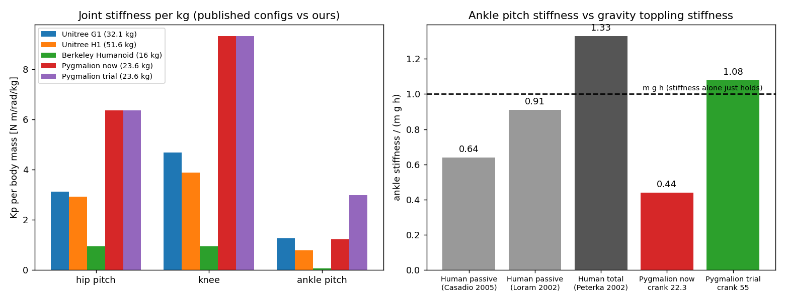

# 174. 지금까지 알아낸 사실 종합 — 다른 세션을 위한 인수인계 (2026-10-17)

## 0. 이 문서를 읽는 법

이 문서는 **결론만 모은 색인**입니다. 근거와 계산 과정은 각 항목에 적은 원본 문서에
있습니다. 이 문서만 읽고도 "무엇이 확정이고 무엇이 아직 모르는 것인지" 알 수 있게
쓰는 것이 목적입니다.

표기 규칙 셋입니다.

* **확정** — 측정했고 숫자가 있습니다. 숫자와 출처를 같이 적습니다.
* **가설** — 그럴듯하지만 아직 재 보지 못했습니다. 무엇을 재면 가려지는지 적습니다.
* **정정** — 한 번 틀리게 적었다가 바로잡은 것입니다. 취소선으로 남깁니다.

용어는 처음 나올 때 풀어 씁니다. 줄임말은 쓰지 않습니다.

---

## 1. 지금 서 있는 자리

**이 프로젝트의 목적**은 두 발 로봇을 시뮬레이션 안에서 걷게 학습시키고, 걸을 때 관절과
뼈대에 걸리는 **힘을 재서 실제 하드웨어를 어떤 크기로 만들지 정하는 것**입니다.

지금 열려 있는 줄기는 셋입니다.

| 줄기 | 지금 상태 |
|---|---|
| **관절 게인 고르기** | 권장값을 정했고, 한 항목씩 떼어 내는 비교 학습 네 개(A·B·C·D) 중 C 가 진행 중 |
| **통신선(CAN) 품질** | 원인 분석과 개선판 구현 완료. 실물 재측정만 남음 (모터 전원이 꺼져 있어 대기) |
| **실기와 시뮬의 차이** | 실물 서기 기록에서 차이 후보 하나를 찾음 (관성 측정 장치 값 멈춤) |

---

## 2. 확정된 사실

### 2-1. 관절 게인 — "겨우 서는 최소 게인"은 기준이 아니다

**용어**: 관절 게인은 두 개입니다. **위치 게인**(`Kp`)은 "목표 각도에서 1 라디안 벗어나면
토크를 얼마나 낼까", **속도 게인**(`Kd`)은 "관절이 빨리 움직이면 얼마나 말릴까" 입니다.

**확정 ① — 문헌 어디에도 "최소 게인"을 적정값 기준으로 쓰지 않습니다.**
58 편을 훑었습니다([[169_pd_gain_selection_criteria]] §0~§3). 가장 가까운 개념이 사람 균형
연구의 **중력 넘어짐 강성** `m g h` 인데, **사람조차 그 값보다 무르게 섭니다** — 반사 없이 잰
발목 강성이 `m g h` 의 0.91 배(Loram 2002), 0.64 배(Casadio 2005)입니다. 모자란 몫은 신경계가
계속 고쳐 잡습니다. 즉 기준은 **위아래로 막힌 범위**이고, 중간에 최적점이 있습니다.

**확정 ② — 공개된 로봇들의 게인을 설명하는 규칙은 하나뿐입니다.**
G1·H1·Berkeley Humanoid 를 같은 시뮬레이터에 올려 재 봤습니다([[170_other_robots_gain_analysis]]).
질량 비례도 관성 비례도 설명하지 못했고, **"정책 출력 1 이 그 모터 최대 토크의 17 ~ 28 %"**
한 줄만 네 로봇을 모두 설명했습니다.

**확정 ③ — 우리 발목 크랭크 게인이 유독 낮았습니다.**

| 관절 (모터, 최대 토크) | 지금까지 쓰던 Kp | 출력 1 = 최대 토크의 | 걷기 99 백분위 위치 오차 | **권장 Kp** |
|---|--:|--:|--:|--:|
| 엉덩이 앞뒤·좌우 (RS04, 120 N·m) | 150 | 31 % | 22.6° | **120** |
| 엉덩이 비틀기 (RS03, 60 N·m) | 150 | **62 %** | 14.6° | **75** |
| 무릎 (RS04, 120 N·m) | 220 | **46 %** | 10.7° | **130** |
| **발목 크랭크 (RS03, 60 N·m)** | **22.3** | **9 %** | **59.1°** | **55 ~ 64** |

발목 크랭크만 네 기준이 전부 같은 방향(올려라)을 가리킵니다. 걷는 동안 목표에서 **59도**
어긋난 채로 돌고 있었다는 뜻입니다. 등반(관악산) 기준으로 다시 계산한 값은 엉덩이 135,
크랭크 60 입니다([[169_pd_gain_selection_criteria]] §7~§8).

**확정 ④ — 한 항목씩 떼어 낸 비교 학습 결과 (2026-10-17 현재)**

묶음으로 한꺼번에 바꾼 시험 런에서 **제자리 회전이 45 % 에서 23 % 로 떨어졌습니다.**
무엇이 범인인지 가르려고 한 번에 하나씩만 바꿔 다시 학습시키는 중입니다.

| 팔 | 바꾼 것 (단일 변인) | 결과 |
|---|---|---|
| **A** `rough_gain_crank60_v11a` | 크랭크 게인만 60 | 기준선. 제자리 회전 **53.5 %**, 넘어짐 종료 0.0134, 직진 치우침 **+4.48 도/초** |
| **B** `rough_gain_mountain_v11a` | 등반 권장 게인 **전부** | **채택 보류.** 등반은 좋아짐(오르막 넘어짐 3.9 %·계단 3.1 % 대 A 의 9.8 %·9.8 %, 무릎 토크 실효값 11~12 대 15 N·m), 회전은 퇴보(**31.3 %**). 사전 등록 6개 중 합격 3·불합격 2·판정 없음 1 |
| **C** `rough_gain_crank60_gaindr_v11a` | 크랭크 60 **+ 게인 무작위화만** | **학습 중.** 8,000 회에서 회전 추종 보상 **0.752** (A 0.824, 묶음 0.628) → **게인 무작위화가 묶음 손실의 약 3분의 1** |
| **D** (대기열) | 크랭크 60 **+ 명령 지연 무작위화만** | C 가 끝나면 자동 시작 |

★ **주의**: 직진 치우침의 **부호**(A 는 +4.48, B 는 −2.05 도/초)는 학습마다 우연입니다.
방향을 결론으로 쓰면 안 됩니다. 그리고 **학습 씨앗이 하나씩**이라 회전 차이의 원인은
아직 확정이 아닙니다.

### 2-2. 통신선(CAN) — 선이 붐비는 게 아니라 전달 방식이 병목이다

**확정 ① — 선은 한가합니다.**
모터 하나를 초당 200 번 제어하며 6 분 14 초(74,837 주기) 깨끗하게 쟀습니다
([[171_can_bus_budget_6motors]] §1).

| 항목 | 값 |
|---|---|
| 상태 응답 손실 | **7 회 (0.009 %)** |
| 주기 간격 평균 / 99 백분위 / 최대 | 5.00 / 7.87 / **13.8 ms** |
| 선 사용률 | **9 ~ 11 %** |

손실은 1 만 번에 1~2 번뿐입니다. 주기 흔들림(최대 13.8 밀리초)은 **선이 아니라 가상 머신과
파이썬의 일정 문제**입니다.

**확정 ② — 병목은 USB 전달 방식입니다.**
어댑터가 `slcan` 펌웨어인데, 모터 6 개에 한 주기 4.07 밀리초가 드는 동안 **선은 18 % 만**
쓰이고 나머지는 응답을 기다리는 시간입니다. `gs_usb`(candleLight) 방식으로 바꾸면 이 대기가
줄어듭니다([[171_can_bus_budget_6motors]] §2).

**확정 ③ — HUPHY 수신·송신 계층에서 결함 6 개를 찾았습니다** (`System_ID/can_link/README.md`).
가장 큰 것 셋입니다.

| 심각도 | 무엇이 | 증거 |
|---|---|---|
| ★★★ | 수거가 **프레임 개수**로 끝나서, 응답이 **한 번만 늦어도 한 주기 밀림이 영구히** 이어짐 | 가짜 버스 재현 54주기 중 54주기 밀림 → 개선판 0주기. 실물 기록에도 59~71주기 연속 구간 |
| ★★ | **모터 12 개가 전부 같은 응답 번호 `0xFD`** 로 답함 (호스트 번호를 바꾸는 코드도 절차도 없음) | 실물 손실 2.2~3.5 % 대 모터 1 개 벤치 0.009 % — **가설** |
| ★★ | 모터는 응답 없는 명령이 3 개를 넘으면 버리는데 **호스트가 그 한도를 모름** | 2026-09-09 실측 + 재현 시험 |

개선판 두 파일(`canbus.py`, `robstride/bus.py`)은 **HUPHY 자체 시험을 그대로 통과**합니다
(기본값 1,265 통과, 환경 탓 실패 4 개는 개선 전후 동일).

**주의 — HUPHY 는 우리 저장소가 아닙니다.** 커밋하지 않습니다. 그리고 `biped` 가
`2fdc139` 로 11 커밋 진행하며 같은 문제의 일부를 자체 수정했으므로, 우리 패치는
`bus.py` 에서 더 이상 그대로 붙지 않습니다(할 일 #157).

### 2-3. 실기와 시뮬의 차이 — 찾은 후보 하나

**확정 — 가만히 서 있을 때 관성 측정 장치(IMU) 값이 멈춥니다.**
실물 서기 기록에서 정책 한 주기마다 여섯 값(각속도 3, 중력 방향 3)이 **직전 주기와 완전히
같은** 비율을 쟀습니다([[sim2real/2026-10-17_real_stand_logs_gain031_051]] §9).

| 기록 | 구간 | 값이 그대로인 주기 비율 |
|---|---|--:|
| 051 | 조용히 서기 (3~17 초) | **64.2 %** |
| 04 1 | 3~200 초 | **70 ~ 90 %** |
| 051 | 흔들림이 커짐 (17~30 초) | 1.5 % |

가장 긴 멈춤은 **230 주기(약 5.5 초)** 입니다. 실제 센서는 가만히 있어도 잡음 때문에 값이
조금씩 바뀌므로, 이것은 **자료가 갱신되지 않는 것**으로 보입니다. 시뮬레이션에서는 정책이
매 주기 새 값을 받으므로 **실기에만 있는 차이**입니다.

★ 다만 **이것만으로 밀었을 때의 발산을 설명할 수는 없습니다** — 흔들림이 큰 구간에서는
관성 측정 장치가 정상으로 갱신되기 때문입니다.

### 2-4. 실물 하드웨어에서 겪은 것 (같은 함정을 또 밟지 않도록)

**확정 ① — 모터 전원이 끊기면 통신이 통째로 조용해집니다.**
2026-10-15 21:40:19 기록에서 버스 전압이 20 V → 5.1 V 로 내려가며 고장값
`0x80000002`(구동 집적회로) 를 남기고 응답이 0 이 되었습니다([[171_can_bus_budget_6motors]] §0).
**통신선 쪽을 뒤지기 전에 전압부터 봅니다.**

**확정 ② — USB 통신 어댑터의 장치 번호는 다시 꽂을 때마다 바뀝니다.**
`/dev/ttyACM0` 이 `ttyACM2` 로 바뀐 적이 있습니다. 일련번호로 찾는
`can_up.sh` 를 쓰되, **그 스크립트도 켤 때 한 번만 번호를 풀어 넘기므로** 어댑터를 다시
꽂았으면 **반드시 다시 실행**해야 합니다.
★ `can_up.sh` 와 `can_map.json` 은 **로봇(`maido@10.8.0.17:~/System_ID/`)에만 있고 우리
저장소에는 없습니다.** 로봇을 다시 설치하면 사라집니다.

**확정 ③ — 명령의 일곱째 바이트 하나가 뜻을 통째로 바꿉니다.**
`0xFD` 는 일곱째 바이트가 `0xFF` 면 "힘 빼기" 이고, 다른 값이면 **"다음 전원부터 다른 방식으로
말해라"** 입니다. 2026-09-12 에 이것을 모터 12 개에 세 번씩 보낸 적이 있고, **증상이 전원을
다시 넣을 때까지 안 나타났습니다**(`System_ID/can_off.py` 의 `STOP_FRAME` 주석에 경고로 박아 두었습니다).

**정정** — ~~"상태 조회에 응답이 없으면 모터에 힘이 꺼져 있다는 뜻"~~.
`docs/124` 에 이 해석을 실측으로 철회한 기록이 있습니다: *"꺼진 모터도 정상적으로 답합니다.
응답 여부로는 전원 상태를 알 수 없습니다."* **무응답은 정상이 아니라 고장 신호입니다.**

---

## 3. 아직 모르는 것 (가설 또는 미측정)

| 무엇 | 어떻게 가리나 |
|---|---|
| 묶음 시험의 회전 손실 중 **명령 지연의 몫** | 팔 D 학습 (대기열에 있음) |
| 엉덩이·무릎 게인을 낮춘 효과 | **학습해 본 적 없습니다.** 지금 권장값은 표 계산만입니다 |
| 같은 응답 번호 `0xFD` 가 정말 손실을 만드는가 | 로봇에서 모터마다 응답 번호를 나누고 손실 재측정 (도구·절차는 준비됨) |
| 관성 측정 장치 값이 멈추는 원인 | 센서 출력 설정인지 읽기 코드인지 아직 안 봤습니다 |
| 실물 모터가 정말 RS04 인가 | **RS03 이면 엉덩이·무릎 권장값이 반 토막**이고, 걷기 토크 59 N·m 가 RS03 최대 60 에 닿아 게인이 아니라 **설계 문제**가 됩니다 (할 일 #138 의 0 번) |
| 회전 차이가 게인 때문인가 우연인가 | 학습 씨앗이 하나씩입니다. 씨앗을 늘려야 합니다 |

---

## 4. 사람이 해야 하는 것

1. **벤치 모터 전원 복구** — 이것이 없으면 통신선 실물 재측정(할 일 #155)이 막혀 있습니다
2. **실물 모터 종류 확인** (RS03 인지 RS04 인지) — 게인 권장값의 전제입니다
3. **공유 저장소 여유 확인** — 하루 만에 114 GB → 60 GB 로 줄었고, 우리 쪽에서 새로 생긴
   큰 파일은 없습니다. 저장 장치 관리 화면을 봐야 합니다 (할 일 #46)
4. **이 가상 머신에 그래픽카드가 안 붙어 있습니다** — 2026-09-29 재부팅 뒤 사라졌고,
   지금 학습은 전부 원격 3090 에서 돌고 있습니다 (할 일 #88)

---

## 5. 문서 지도

| 알고 싶은 것 | 문서 |
|---|---|
| 게인을 무엇으로 정하나 (문헌·기준·권장값) | [[169_pd_gain_selection_criteria]] |
| 다른 로봇 게인을 우리 시뮬에 올려 재 본 결과 | [[170_other_robots_gain_analysis]] |
| 게인 선정 과정 전체를 처음부터 | [[171_pd_gain_selection_process_overview]] |
| 실물 모터로 게인을 맞추는 절차 | [[172_real_motor_pd_tuning_guide]] |
| 통신선 실측·예산·HUPHY 구현 검토 | [[171_can_bus_budget_6motors]] |
| 통신선 개선판과 개발자 전달 내용 | `System_ID/can_link/README.md` |
| v11a 계열 개선안 전체 | [[168_v11a_improvement_plan]] |
| 다음 할 일 | [[173_next_actions_2026-10-17]] |
| 실기 서기 기록 분석 | [[sim2real/2026-10-17_real_stand_logs_gain031_051]] |
| 실기·시뮬 관절 명령 비교 준비와 실행 기록 | [[150_real_vs_sim_joint_response_plan]] |
| 런별 정식 기록 | `docs/experiments/` · 대장 [[66_experiment_registry]] · 계보도 `docs/experiment_map.canvas` |

> ★ **번호가 겹칩니다**: `171_can_bus_budget_6motors.md` 와
> `171_pd_gain_selection_process_overview.md` 가 둘 다 171 입니다. 내용은 서로 다릅니다.
> 가리킬 때는 **번호가 아니라 파일 이름**을 쓰십시오.
