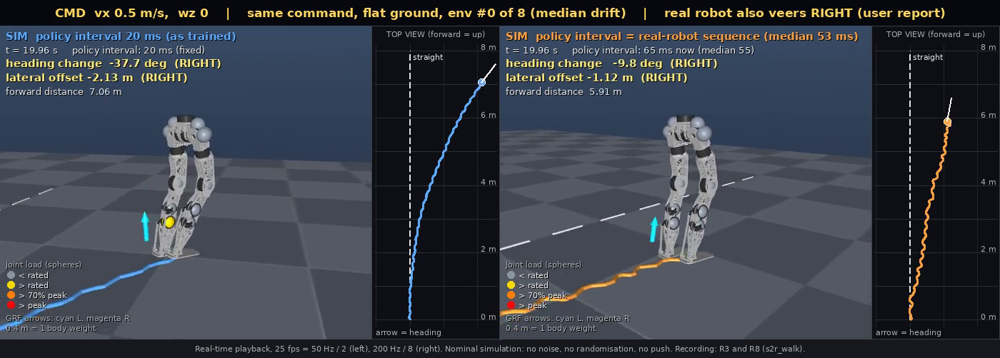
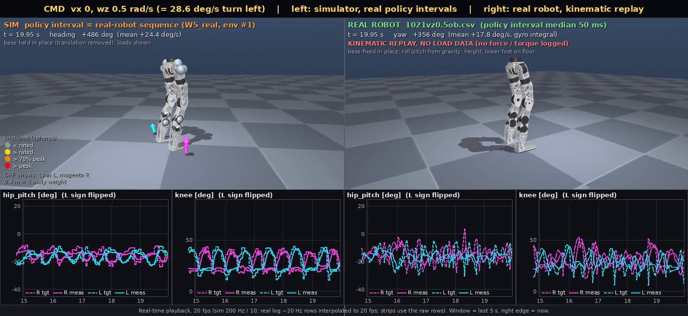
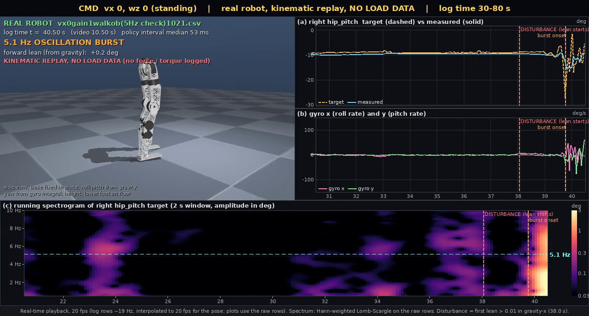

# 177. 실기 걷기의 시뮬레이터–실기 차이 연구 (2026-10-22 시작)

> 상태: **1~6 단계 끝, 7 단계 보고 초안 (2026-10-22, 2 차 감사 전).** §4 판정, §5 하드웨어, §6 제어단, §7 정책 제작자, §7-1 다음 실기 시험.
> 쓰기 규칙: ASD-STE100 을 한국어에 적용한다.
> 대상 정책: `terrain10_2048_model_37400.pt` (SHA-256 `7bbd5cbc…fe0fbe00`). 우리 저장소 `vibecoded-audit-20261012` 가지 `deploy/generalized_walk/` 에 있다. HUPHY `biped` 가지 `e787347` 이 이 정책을 `generalized_walk` 로 넣었다.
> 학습 계약: `deploy/generalized_walk/README.md` (입력 44 칸, 출력 12 칸, 50 Hz, 동작 = 기본 자세 + 0.25 × 행동, 게인 엉덩이 135/6, 엉덩이 비틀기 75/4, 무릎 130/6, 크랭크 60/2.7).

## 0. 문제

실기에서 걷기를 확인했다 (사용자, 2026-10-22). 세 가지 문제가 남아 있다.

| 번호 | 증상 | 측정할 양 |
|---|---|---|
| S1 | 직진 명령에서 한쪽으로 계속 쏠린다 | 방향각 변화율 (도/초), 옆 방향 이동 (m) |
| S2 | 걸음새가 시뮬레이터와 다르다 | 걸음 주파수, 디딤 비율, 관절각 궤적, 보폭 |
| S3 | 떨림이 있다 | 관절각·행동·토크의 주파수 성분 |

## 1. 단계 계획

각 단계 뒤에 **감사**를 한다. 감사는 다른 에이전트가 원본 데이터에서 숫자를 다시 계산해 맞는지 확인하는 것이다. 감사를 통과하지 못한 숫자는 다음 단계에서 쓰지 않는다.

| 단계 | 내용 | 산출물 | 감사 |
|---|---|---|---|
| 1 | 자료 모으기: 실기 걷기 기록, 제어단 코드, 정책 묶음, 학습 계약 | 기록 목록, 기록 열 정의 | 기록 열과 단위가 코드와 맞는가 |
| 2 | 제어단 감사: 실기 코드가 학습 계약과 같은가 | `docs/sim2real/2026-10-22_walk_control_stack_audit.md` | 지적마다 양쪽 파일·행 확인 |
| 3 | 배포 경로 재현: 실기 기록의 입력 44 칸을 정책에 다시 넣어 기록된 행동과 같은지 본다 | 행동 차이 (최대·평균) | 같은 입력 → 같은 출력이어야 한다 |
| 4 | 시뮬레이터 기준 데이터: 같은 명령으로 시뮬레이터에서 걷기 | `docs/sim2real/2026-10-22_sim_walk_reference.md` | 계약 게인·지연이 실제로 들어갔는가 |
| 5 | 응답 비교: 주파수 분석, 전달 함수, 걸음 위상 평균, 좌우 대칭 | 그림과 표 | 같은 창·같은 방법으로 두 데이터 처리 |
| 6 | 가설 검증: 가설마다 시뮬레이터에 차이를 하나씩 넣어 실기 증상이 재현되는지 본다 | 가설별 판정 | 단일 변인인가 |
| 7 | 보고: 하드웨어 수정, 제어단 결함, 정책 제작자 전달 사항 | 이 문서 §5~§7, HUPHY 전달은 `docs/124` | 주장마다 숫자와 출처 |

## 2. 분석 방법

| 방법 | 무엇을 보나 | 증상 |
|---|---|---|
| 전력 스펙트럼 밀도 (Welch 방법) | 관절각, 목표값, 행동, 토크, 자이로의 주파수 성분. 떨림 주파수를 찾는다 | S3 |
| 스펙트로그램 | 떨림이 걸음 위상이나 속도에 따라 바뀌는가 | S3 |
| 목표값 → 관절각 전달 함수 추정 ($H(f) = S_{xy}/S_{xx}$) 과 결맞음 | 실기와 시뮬레이터의 관절 응답 대역폭·위상 지연 비교 | S2, S3 |
| 상호 상관 | 명령에서 응답까지의 시간 지연 | S2, S3 |
| 걸음 위상 평균 | 한 걸음 주기 안의 평균 궤적을 실기와 시뮬레이터에서 겹쳐 본다 | S2 |
| 좌우 대칭 지표 | 같은 관절의 왼쪽·오른쪽 평균, 진폭, 디딤 시간 차이 | S1, S2 |
| 방향각 분해 | 자이로 z 적분, 명령, 정책 입력의 자이로 치우침 | S1 |
| 정책 민감도 (입력에 대한 행동의 기울기) | 어떤 입력의 잡음이 행동을 가장 크게 흔드는가 | S1, S3 |
| 주기 시간 분포 | 실제 정책 주기와 지연의 분포가 학습 범위(0~20 ms) 안인가 | S2, S3 |

## 3. 가설 목록

가설마다 "실기 기록에서 볼 것" 과 "시뮬레이터에서 넣어 볼 것" 을 적는다. 판정은 §4 에 적는다.

### 3-1. 한쪽 쏠림 (S1)

| 번호 | 가설 | 실기 기록에서 볼 것 | 시뮬레이터 시험 |
|---|---|---|---|
| H1 | 정책 자체에 방향 치우침이 있다 | — | 명목 조건 직진에서 방향각 변화율 |
| H2 | 좌우 영점 오차 (재보정 뒤 1~5°, 오른 발목 A −5.6°) | 디딤 중 관절 평균각 좌우 차이 | 관절별 영점 오차를 넣고 쏠림 민감도 (도/초 per 도) |
| H3 | IMU 자이로 z 치우침 또는 부착각 | 서 있을 때 자이로 평균, 중력 방향 평균 | 자이로·중력 치우침을 넣고 쏠림 |
| H4 | 한쪽 구동기 응답이 다르다 (마찰, 응답 유실, 버스 차이) | 관절별 추종 오차, 전달 함수, 무응답 비율 좌우 비교 | 한 관절의 마찰·지연·게인만 바꿈 |
| H5 | 질량중심이 옆으로 치우쳤다 | 서 있을 때 엉덩이 좌우 토크 | 질량중심 옆 오프셋 |
| H6 | 바닥 기울기, 안전줄이 옆으로 당김 | 영상, 자세 | 바닥 기울기·옆 힘 |

### 3-2. 걸음새 차이 (S2)

| 번호 | 가설 | 실기 기록에서 볼 것 | 시뮬레이터 시험 |
|---|---|---|---|
| H7 | 관절 응답 대역폭이 다르다 (마찰, 게인 양자화, 크랭크 연결부 유격) | 목표값 → 관절각 전달 함수 | 마찰·관성·유격 변화 |
| H8 | 실제 지연과 주기 흔들림이 학습 범위 밖이다 | 주기 시간·응답 나이 분포 | 지연 분포를 실기 값으로 |
| H9 | 행동 경로가 다르다 (자르기, 속도 제한, 기본 자세, 크랭크 변환) | 제어단 감사 (단계 2), 배포 경로 재현 (단계 3) | 실기 행동 경로를 그대로 흉내 |
| H10 | 안전줄이 무게를 받친다 | 발 접촉 시간, 무릎 토크 | 위로 당기는 힘 |
| H11 | 발과 바닥 접촉이 다르다 (발바닥 재질, 마찰) | 디딤 중 발 미끄러짐 | 마찰·접촉 강성 |

### 3-3. 떨림 (S3)

| 번호 | 가설 | 실기 기록에서 볼 것 | 시뮬레이터 시험 |
|---|---|---|---|
| H12 | 센서 잡음을 정책이 키운다 | 행동 스펙트럼 vs 자이로 스펙트럼, 결맞음 | 실측 잡음을 넣고 행동 스펙트럼 |
| H13 | 지연과 PD 가 만든 한계 순환 | 떨림 주파수와 지연의 관계 | 지연을 키우며 떨림 주파수 |
| H14 | 응답 유실·IMU 값 멈춤이 계단 입력을 만든다 | 같은 값 반복 구간과 행동 급변의 시간 일치 | 유실·멈춤 넣기 |
| H15 | 모터 내부 속도 추정 잡음과 $K_d$ (모터가 자기 속도로 D 항을 계산) | 토크 스펙트럼 고주파 | 속도 잡음 넣기 |
| H16 | 크랭크 연결부 유격·탄성 | 크랭크 A/B 와 발목 출력의 차이 | 유격 모델 |

## 4. 판정 (2026-10-22, 2 차 감사 전)

판정 기호: **원인** = 실기·시뮬레이터 양쪽 숫자가 맞는다. **기여** = 효과는 있으나 주원인은 아니다. **작음** = 측정했으나 효과가 작다. **미정** = 시험하지 못했다.

### 4-1. 한쪽 쏠림 (S1, 실기는 오른쪽)

| 가설 | 판정 | 근거 |
|---|---|---|
| H1 정책 자체의 치우침 | **원인** | 시뮬레이터 명목 조건(20 ms, 무작위화 끔)에서도 오른쪽 −1.8 °/s (vx 0.5), −2.6 °/s (vx 1.0). 씨앗 3 개, 환경 8 개 모두 같은 방향. 실기도 오른쪽 |
| H2 좌우 영점 오차 | 작음 | 영점 오프셋을 지워도 서기 엉덩이 비틀기 좌우 차이가 절반만 준다 (열린 고리). 시뮬레이터는 영점 오차 없이도 쏠린다 |
| H3 IMU 치우침·부착각 | 작음 | 자이로 치우침 0.0017 rad/s 이하, 기울기 0.57°. 불감대 없음 |
| H4 한쪽 구동기 응답 | 작음 | 응답 유실 0 %. 응답 차이(§11)는 양쪽 다리에 같이 있다 |
| 정책 간격 52 ms | 기여 | 쏠림의 방향을 만들지 않는다. 환경마다 흩어짐을 키운다 (±0.55~1.23 °/s). vx 1.0 에서 +3.6 ± 2.4 °/s |
| H5 질량중심 옆 치우침, H6 바닥·잡는 손 | 미정 | 기록에 없다 |

### 4-2. 걸음새 차이 (S2)

| 가설 | 판정 | 근거 |
|---|---|---|
| H8 정책 간격 (실기 52 ms, 학습 20 ms) | **원인** | 시뮬레이터에 52 ms 를 넣으면 행동 변화량이 0.218 → 0.439 (실기 0.453), 3 Hz 이상 봉우리 3.3~3.4 Hz (실기 3.0~3.6), 걸음 1.43 → 1.07 Hz, vx 1.0 넘어짐 0/8 → 2/8 |
| H7 관절 응답 차이 | 기여 (가설) | 걸음 주파수 1.3 Hz 에서 엉덩이 앞뒤가 실기에서 약 38° (약 80 ms) 더 늦다. 발목 크랭크 A 이득이 실기에서 절반 (0.30 대 0.51~0.66). 무릎은 맞다 (§11) |
| H9 행동 경로 차이 | 작음 | 기록 재현 차이 3.2e-5. 목표값 속도 제한·필터 없음. 명령 가드가 자르기 범위를 3° 좁힌다 (감사 F6) |
| H10 손으로 잡음 | 기여 (가설) | 시뮬레이터에 옆 방향 스프링(1000 N/m 이상)을 넣으면 정책 되먹임 진동이 이어진다 (§8 단계 6) |
| H11 발·바닥 접촉 | 미정 | — |
| 발목 크랭크 정지 오차 | 원인 아님 | 시뮬레이터에도 같은 부호·크기로 있다. 정책이 요구하는 자세이다 |

### 4-3. 떨림 (S3, 실기 5.1 Hz, 외란 뒤 구간에만)

| 가설 | 판정 | 근거 |
|---|---|---|
| 정책 되먹임 순환 (몸통 → 자이로 → 정책 → 명령) | **원인 (경로)** | 관절각 입력을 고정해도 5 Hz 가 남는다. 자이로·직전 행동 입력이 경로다. 목표값이 관절보다 3.5~4 배 크다 |
| 게인 1.0 (높은 되먹임 이득) | 기여 | 실기: 게인 0.6 에서 없음, Kd ×1.5 에서 약함. 시뮬레이터 잡는 손 진동도 게인 0.6 에서 35~57 %, Kd ×1.5 에서 29 % 준다 |
| 손으로 잡음 (H10) | 기여 (가설) | 시뮬레이터에서 진동을 이어 가게 하는 유일한 조건이다. 단 진동수가 2~3 Hz (실기 간격) 로 실기 5.1 Hz 와 다르다 |
| 실기에만 있는 구동·구조 응답 (H7, H16) | 미정 (유력) | 시뮬레이터가 5.1 Hz 를 못 만든다. §11 의 엉덩이 지연·크랭크 이득 차이가 진동수를 바꿀 수 있다 |
| H12 센서 잡음 증폭 | 원인 아님 | 실기 잡음은 학습 잡음의 1/30~1/100 |
| H13 순수 지연 진동 | 원인 아님 | 간격 31 → 53 ms 에 진동수가 10 % 만 바뀐다. 시뮬레이터에서 간격을 20 ms 로 줄여도 잡는 손 진동이 사라지지 않는다 |
| H14 응답 유실·IMU 멈춤 | 원인 아님 | 유실 0 %. IMU 0 출력은 정지 때만 |
| H15 모터 속도 추정 잡음 | 미정 | 속도가 기록에 없다 |

## 5. 하드웨어에서 고칠 것·잴 것

| 순서 | 할 일 | 이유 |
|---|---|---|
| 1 | **안전줄을 느슨하게 두고, 손으로 잡지 않고 시험한다** | 손의 지지 강성이 정책 되먹임 진동을 이어 가게 한다 (시뮬레이터 단계 6). 잡는 손이 걸음새와 쏠림 측정도 흐린다 |
| 2 | **발목 크랭크 A 쪽 연결부 점검**: 막대 끝 유격, 베어링 마찰, 체결 | 걸음 주파수에서 크랭크 A 이득이 시뮬레이터의 절반이다. B 는 맞다 |
| 3 | **저울로 질량 측정**: 하체 전체, 발 하나 | 모델 하체 23.6 kg, 발 0.618 kg. 실측 발판은 0.182 kg 이다. 엉덩이 앞뒤 지연의 후보이다 |
| 4 | **발목 연결부 마찰 토크 측정** (모터 끈 상태) | 시뮬레이터에서 이 값은 0 이다 (할 일 #20) |
| 5 | **관절 영점 실측** | 보정 파일의 영점이 모두 0 이고 "측정 안 함" 으로 적혀 있다 (감사 F2). 쏠림의 주원인은 아니지만 2° 오차는 학습 범위의 3.5 배이다 |
| 6 | **IMU 설정 확인**: 정지 시 0 출력 옵션, 장착 위치 표기 (`robot.yaml` 의 `right_leg`), 115200 baud 에서 약 9.6 ms 전송 지연 | 정지 때 세 축이 정확히 0 이 된다. 학습에는 없는 입력이다 |
| 7 | **MIT 게인 실제 단위 확인** (무게추 시험, docs/172) | Kp·Kd 의 실제 값이 설정과 같은지 아직 실측하지 않았다 |

## 6. 제어단 결함 (HUPHY `biped` `32dd6e6`)

| 심각도 | 결함 | 위치 | 고치는 방법 |
|---|---|---|---|
| ★★★ | **정책을 시간이 아니라 주기 수로 부른다.** `--hz 200` 에서 제어 주기가 12.4 ms 로 늘어 정책 간격이 약 52 ms 가 된다 (`--hz 100` 은 31 ms). 걸음새 차이의 주원인이다 | `control/loop.py:192-196` (`held()`) | 당장: `--hz 50` 으로 돌린다 (정책을 매 주기 호출, 이전 기록 20.0 ms). 근본: 경과 시간으로 정책을 부르고, 주기 초과를 기록·경고한다. 한 주기 12 ms 를 프로파일링한다 (발목 순기구학을 주기마다 4 번 푸는 불필요 계산, 감사 §3.3) |
| ★★ | **ROS 경로에서 크랭크 각도 4 개가 0.0 으로 정책에 들어간다** (이번 실험과 무관) | `control_node.py:141,254`, `leg.py:92`, `policy_node.py:227`, `generalized_walk.py:170` | `control_node` 가 `motor_names` 를 발행한다. 정책 쪽은 없는 키를 0.0 으로 채우지 말고 오류를 낸다 |
| ★★ | **기록에 모터 속도·토크·IMU 나이가 없다** | `telemetry/policy_log.py` | MIT 응답의 속도·토크, IMU 패킷 시각, 주기 시간을 정책 기록에 넣는다. 시스템 식별 확인에 필요하다 |
| ★ | 영점 보정 확인이 자리표시자 `"0"` 으로 통과된다 | `calibration/store.py:246-255`, 커밋 `394f5d3` | 실측 기록이 있을 때만 통과하게 한다 |
| ★ | 명령 가드가 학습의 자르기 범위를 3° 좁힌다 (무릎 6° → 9°) | 감사 F6 | 학습 범위와 맞춘다 |
| ★ | IMU 값의 나이·유효성을 확인하지 않는다 | 감사 F5 | 패킷 시각을 확인하고 오래된 값을 표시한다 |

## 7. 정책 제작자에게 전달할 것

1. **정책 자체가 오른쪽으로 쏠린다.** 명목 시뮬레이터(20 ms, 무작위화 끔)에서 vx 0.5 −1.8 °/s, vx 1.0 −2.6 °/s 이다. 씨앗과 무관하다. 실기도 오른쪽이다. 회전 명령 0.5 rad/s 는 실기에서 58 % 만 된다. 제안: 직진 방향 변화율을 합격 기준에 넣는다. 좌우 거울 데이터 보강(대칭 증강)이나 방향 오차 보상을 검토한다. 학습 명령에서 방향 유지 모드가 꺼져 있어 작은 회전 오차가 쌓인다.
2. **실기 정책 간격이 학습과 다르다.** 하드웨어가 고쳐지기 전까지 실기 간격은 31~70 ms 이다. 이 간격에서 정책은 걸음이 느려지고 행동 변화량이 두 배가 되며 vx 1.0 에서 넘어진다. 하드웨어 수정(§6 ★★★)이 먼저이다. 그래도 남으면 정책 호출 간격을 무작위화(20~60 ms)해서 학습하는 것을 검토한다.
3. **정책 되먹임이 외란 뒤 5 Hz 순환을 만든다.** 경로는 자이로와 직전 행동 입력이다. 게인 1.0 에서 생기고 게인 0.6·Kd ×1.5 에서 약해진다. 제안: 행동 변화 벌점 강화나 매끄러움 손실(CAPS 류)을 검토한다. 단 CAPS 는 이전에 다리 벌어짐 부작용이 있었다 (docs/176 §3-14).
4. **명령 0 에서 시뮬레이터는 서 있고 실기는 발을 구른다.** 학습에서 서기 명령 비율은 5 % 이다. 서기 구간의 실기 재현성을 높이려면 서기 비율과 정지 벌점을 검토한다.
5. **모델 수정 요청:** 발 질량 (0.618 → 실측값), 발목 연결부 마찰. 크랭크 응답(이득·지연)을 무작위화 대상에 넣는 것을 검토한다 (실기 크랭크 A 이득이 시뮬레이터의 절반).

## 7-1. 다음 실기 시험 순서 (값이 큰 것부터)

1. `--hz 50` 으로 같은 시험을 다시 한다. 기록의 정책 간격이 20 ms 근처인지 먼저 본다. 걸음새·행동 변화량이 시뮬레이터 20 ms 와 가까워지는지 본다.
2. 손으로 잡지 않고 (안전줄 느슨) 서기와 직진 10 초 이상을 기록한다. 5 Hz 구간이 생기는지, 쏠림이 −1.8 °/s 근처인지 본다.
3. 정책 없이 관절별 처프·계단 시험을 한다 (크랭크 A·B, 엉덩이 앞뒤 먼저). 매단 상태와 선 상태 둘 다.
4. 질량·발목 연결부 마찰·유격·영점을 잰다.
5. 기록에 모터 속도·토크를 넣는다.

## 8. 진행 기록

- 2026-10-22: HUPHY `biped` `32dd6e6` 까지 받음. 저장소 안에서 걷기 기록을 찾지 못했다 (`archivedlogs/` 는 10-19 에 지워졌고, 지워진 22 개는 10-16 이전 서기 기록이다). 사용자에게 기록 위치를 물었다.
- 2026-10-22: 단계 2 (제어단 감사) 와 단계 4 (시뮬레이터 기준 데이터) 를 시작했다.
- 2026-10-22: 사용자가 기록 위치를 알려 주었다: `Expr_Data/` (10-19 서기 4 개, 10-20 걷기 1 쌍, 10-21 걷기 11 쌍). 걷는 동안 손으로 약하게 잡았다. 파일 이름 규칙: `vx`/`vz` 뒤가 명령, `gain` 뒤가 (발목 제외 배율)(발목 배율).
- 2026-10-22 **첫 발견 (단계 1, 감사 전):** 10-21 기록은 모두 `--hz 200` 으로 돌았다. 제어 주기 목표는 5 ms 이나 중앙값이 12.4 ms 이다. 정책은 정확히 4 주기마다 불린다 (관측 3,852 행 × 4 = 제어 15,408 주기). 그래서 **정책 호출 간격 중앙값이 50~63 ms** 이다. 학습은 20 ms 이다. 10-20 기록(`--hz 100`)은 31 ms 이다. 이것은 제어단 감사 F4 ("주기 수로 세고 시간으로 세지 않는다") 의 결과이다. 10-21 의 앞선 분석(`docs/sim2real/2026-10-21_generalized_walk_jitter_analysis.md`)은 33 ms 에서 서 있기만 시험했다. 50 ms 의 걷기는 시험하지 않았다.
- 2026-10-22: 응답 유실은 0 % 이다 (10-21 진동 확인 기록, 관절당 15,407 응답 모두 제때). 응답 지연 중앙값 0.6~0.9 ms.
- 2026-10-22: 단계 2 감사 결과 `docs/sim2real/2026-10-22_walk_control_stack_audit.md` (F1~F11). 실기 기록 분석(갈래 R)과 배포 경로 재현·민감도(갈래 P)를 시작했다. 시뮬레이터 기준 데이터에 정책 간격 52 ms 와 실기 간격 순서를 넣은 조건을 더했다.
- 2026-10-22 **배포 경로 재현 (갈래 P, 중간):** 로봇은 이 정책을 기록된 입력 그대로 돌렸다. 10-20·10-21 기록 11 개에서 기록된 입력을 정책에 다시 넣으면 기록된 행동과 최대 3.2e-5 차이이다 (기록 자릿수 한계). 그러므로 ROS 경로의 발목 입력 0 문제(감사 F1)는 이 기록에 해당하지 않는다. 10-19 서기 기록 4 개는 이전 45 칸 정책이다.
- 2026-10-22 **정책 민감도 (갈래 P, 중간):** 엉덩이 좌우(hip_roll) 관절각 입력 1° 에 목표값이 3~5° 바뀐다. 부호가 번갈아 바뀌는 입력에는 5~10° 로 커진다. 정책 간격이 52 ms 이면 두 관절각 기록의 차이(속도 단서)가 학습의 2.5~3 배가 된다.
- 2026-10-22 **IMU 값 멈춤 재확인 (메인 세션):** 바로 앞 주기와 같은 자이로 값을 받은 정책 주기 비율이 최대 20.7 % 이다 (`1021ob061vx0`, 가장 긴 멈춤 138 주기 ≈ 7 초). 다른 기록: 13.0 %, 12.1 %, 5.6 %, 4.6 %. 중력 값은 3~18 %. 그래서 "조용한 구간의 자이로 치우침 1e-5 rad/s" 는 멈춘 구간에서 잰 값일 수 있다. 두 갈래 에이전트에게 멈춘 구간을 빼고 다시 재게 했다.
- 2026-10-22 **실기 기록 분석 (갈래 R, 감사 전)** `docs/sim2real/2026-10-22_real_walk_log_analysis.md`:
  - 기록 자체는 일관된다: `q_prev(k) = q(k-1)`, `last_act(k) = act(k-1)` 이 정확히 맞는다. `pos(k)` 는 `obs/q(k)` 와 같은 표본이다.
  - **떨림:** 서 있는 진동 확인 기록에서 12 관절 모두 **5.09 Hz** 에 봉우리가 있다. 행동과 관절각의 결맞음이 0.98 (엉덩이 앞뒤·무릎) 이다. 즉 정책 출력 자체가 5 Hz 로 흔들린다. 5.09 Hz 에서 목표값 → 관절각 이득은 0.2~0.3 이다. 10-20 기록(정책 간격 31 ms)은 5.56 Hz 이다.
  - **발목 크랭크:** 목표값 − 관절각 평균이 1.9~7.8° 이다. 좌우 거울 대칭이고 10 기록 모두에서 나온다 (정상 상태 추종 오차).
  - **엉덩이 비틀기 좌우 차이:** 서 있는 5 기록 모두 +0.6~+2.2° (같은 부호).
  - **방향:** 명령 0 기록의 방향 변화율 −0.49~+0.70 °/s (부호 섞임). 걷기 명령 기록(vx 0.3·0.5)은 3.7 초·5.0 초로 짧아 쏠림을 판정할 수 없다. 회전 명령 wz 0.5 (28.6 °/s) 에서 실제 16.7 °/s (58 %).
  - **IMU 멈춤:** 명령 0 기록 5 개에서만 나온다 (4.6~20.6 %). 멈춘 값은 늘 0 이고 몸이 거의 멈춘 때와 겹친다. 그러므로 센서의 "정지 시 0 고정" 동작일 가능성이 높다. 원인은 이 기록으로 가릴 수 없다.
- 2026-10-22 **IMU 멈춤 정정 (갈래 P 재계산 + 메인 세션):**
  - 멈춘 자이로 값은 늘 정확히 (0, 0, 0) 이다. 명령 0 기록 5 개에서만 나온다. 관절이 움직이는 주기에서는 나오지 않는다.
  - **불감대는 아니다.** 0 이 아닌 가장 작은 |자이로 z| 는 0.000175 rad/s (0.01 °/s, 양자화 한 칸) 이다. 느린 회전도 읽힌다. 세 축이 동시에 0 이 되는 것은 센서나 드라이버의 "정지 시 0 출력" 동작으로 보인다. 원인 확인은 IMU 설정·드라이버 담당이다.
  - 멈춘 행을 뺀 치우침: 자이로 (−0.0008, −0.0005, +0.0017) rad/s, 기울기 0.57° (앞뒤 +0.16°, 좌우 +0.55°). 학습 잡음(±0.2 rad/s, ±0.05) 보다 훨씬 작다.
  - 자이로 치우침·중력 기울기·관절 영점을 모두 지우면 서기 엉덩이 비틀기 좌우 차이가 절반으로 준다 (−0.33~−0.58° → −0.12~−0.32°). 0 이 되지는 않는다 (열린 고리 계산).
  - 자이로·중력을 5·20·100 주기 전 값으로 바꾸면 12 목표값이 평균 3.4° 바뀐다. 좌우 차이 평균 변화는 0.14° 미만이다. 그러므로 IMU 멈춤은 떨림·자세에는 영향이 있을 수 있으나 한쪽 쏠림의 원인은 아닐 가능성이 높다.

- 2026-10-22 **시뮬레이터 기준 (단계 4, 중간, 감사 전):** 같은 정책을 명목 조건(정책 간격 20 ms, 무작위화·잡음 끔)으로 시뮬레이터에서 직진시켰다. **시뮬레이터에서도 한쪽으로 돈다.** 방향 변화율 −1.81 ± 0.26 °/s (vx 0.5, 20 초, 환경 8 개), −2.56 ± 0.62 °/s (vx 1.0). 20 초 동안 방향이 −32.5° 와 −46.4° 바뀐다. 보폭 좌우 차이는 vx 0.5 에서 +24~29 % (오른발이 길다). 그러므로 쏠림(S1)의 첫 후보는 **정책 자체의 치우침(H1)** 이다. 실기 쏠림 방향과 같은지 확인이 필요하다.
- 2026-10-22: 이전 세션이 끝나며 시뮬레이터 작업과 1 차 감사가 멈췄다. 두 작업을 이어서 돌렸다. 3090 의 그래픽카드는 다른 사용자 프로그램(22 GB)이 쓰고 있어 시뮬레이터는 이 PC 의 CPU 로 돌린다.
- 2026-10-22 **1 차 감사 결과:** 주장 14 개 중 확인 11, 정정 3 (C3 진동 구간·관절 수, C10 Kd ×1.5·게인 0.6 해석, C11 진폭). 정정 내용은 §9-5 에 반영했다. 추가 사실: (1) 크랭크의 "목표 − 실제" 오차는 대부분 정책이 기본 자세보다 5~9° 떨어진 목표를 요구하고 관절은 1~2° 만 움직인 결과이다. (2) 명령 0 기록의 방향 변화율 (−0.49~+0.70 °/s) 은 표본 잡음 안이다. 회전 명령 58 % 달성은 확실하다.
- 2026-10-22 **단계 5 결과 — 시뮬레이터와 실기를 같은 도구로 비교** (`docs/sim2real/2026-10-22_sim_walk_reference.md`, 감사 전):
  - **걸음새 차이(S2) 는 정책 간격 52 ms 로 대부분 설명된다.** vx 0.5 에서 20 ms → 52 ms 로 바꾸면 행동 변화량 제곱평균제곱근이 0.218 → 0.439 로 두 배가 된다. 실기 값은 0.453 이다. 걸음 주파수는 1.43 → 1.07 Hz, 발 닿는 빈도는 2.98 → 2.36 Hz, 앞 속도는 0.374 → 0.308 m/s, 엉덩이 좌우 진폭은 1.4 → 2.4° 가 된다. 걷기 중 3 Hz 이상 가장 큰 봉우리는 20 ms 에서 3.9~4.3 Hz, 52 ms 에서 3.3~3.4 Hz 이고 실기는 3.0~3.6 Hz 이다. vx 1.0 · 52 ms 에서는 8 개 중 2 개가 넘어진다 (20 ms 는 0 개). 실기 간격 순서(평균 55 ms)는 52 ms 고정과 거의 같다.
  - **발목 크랭크 오차는 시뮬레이터에도 있다.** 명령 0 에서 시뮬레이터 오른 A/B −3.2/+9.1°, 왼 +2.7/−7.5°. 실기 게인 1.0 은 −4.5/+7.5°, +2.7/−6.5°. 부호와 크기가 같다. 정책 간격과 무관하다. 그러므로 **실기만의 차이가 아니다** (정책이 요구하는 자세이다).
  - **쏠림(S1):** 20 ms 에서 −1.81, −1.60, −1.85 °/s (씨앗 3 개, 환경 간 ±0.2) 로 일정하다. 52 ms 와 실기 간격에서는 평균이 −0.6~+0.3 °/s 로 줄고 환경마다 부호가 바뀐다 (±0.55~1.23). vx 1.0 · 52 ms 는 +3.6 ± 2.4 °/s 이다. 명령 0 에서는 간격과 무관하게 −0.7~−0.8 °/s 이다. 그러므로 정책 자체의 치우침이 있고, 52 ms 는 쏠림을 무작위하게 키운다.
  - **떨림(S3):** 시뮬레이터는 20 ms, 52 ms, 실기 간격 어디에서도 5 Hz 를 만들지 않는다. 명령 0 에서 시뮬레이터 로봇은 두 발을 땅에 붙이고 서 있을 뿐이다 (관절 진폭 0.2~0.6°). 실기는 같은 명령에서 발을 구르고 5 Hz 구간이 생긴다.
- 2026-10-22: **단계 6 시작** — 시뮬레이터에서 5 Hz 를 재현하는 조건 찾기 (외란, 손으로 잡은 지지, IMU 지연·0 출력, 구동기 토크 지연, 구조 유연성). 재현되면 게인 0.6, Kd ×1.5, 정책 간격 20 ms 로 실기 결과와 맞는지 본다.
- 2026-10-22 **쏠림 방향 확인 (사용자):** 실기는 **오른쪽**으로 쏠렸다. 시뮬레이터 명목 조건(20 ms)도 오른쪽이다 (방향 변화율 −1.8 °/s, 옆 이동 음수 = 오른쪽, 환경 8 개 모두, 씨앗 3 개 모두). 그러므로 **쏠림(S1)의 주된 원인은 정책 자체의 치우침(H1)** 으로 판정한다. IMU·영점은 열린 고리 계산에서 작은 몫이다. 52 ms 간격은 쏠림을 무작위하게 키울 수 있으나 방향을 만들지는 않는다. (단계 6 가설 판정 1 번)
- 2026-10-22: 사용자 요청으로 분석 영상 3 개 렌더를 시작했다 (쏠림 비교, 걸음새 비교, 5 Hz 실기 재생).
- 2026-10-22 **단계 6 결과** (`docs/sim2real/2026-10-22_stage6_5hz_reproduction.md`, 2 차 감사 전): 실기 간격(53 ms)에서 5.1 Hz 를 재현하는 시뮬레이터 조건은 없다. 외란(실기와 같은 7.6° 기울기·128 °/s), IMU 10 ms 지연·정지 0 출력, 토크·위치 지연, 발목 막대 유연화, 마찰 2·4 배는 모두 약 2 초 안에 가라앉는다. **옆 방향 스프링(잡는 손, 1000 N/m 이상)만 진동을 이어 간다** (실기 간격 2.7~3.2 Hz, 20 ms 에서 4.1 Hz). 이 진동은 게인 0.6 에서 35~57 %, Kd ×1.5 에서 29 % 준다 (실기 경향과 같다). 정책 간격 20 ms 로 바꿔도 사라지지 않는다. 3 N·m 토크 처프(2~8 Hz)에서 5 Hz 공진은 없다. 시뮬레이터의 서기 3~8 Hz 성분은 실기 조용한 구간의 76 배이다 (원인 미상).
- 2026-10-22: 사용자 질문으로 시스템 식별을 점검했다 (§11). 7 단계 보고 초안 §4~§7 을 썼다. 5·6 단계와 §11 을 2 차 감사에 맡겼다.

## 9. 동료 질문에 대한 답 (2026-10-22, 찬희·renkiniut_sushi 의견 반영 재분석)

### 9-1. "ROS 에서 발목이 0 으로 들어간다" — 정확히 어디인가, 돌려 봤는가

- **결론:** 지적은 맞다. 단 **이번 실험과는 무관**하다. 이번 기록은 `huphy-run` 직접 경로로 남았다 (§8 의 재현 결과: 기록된 입력으로 기록된 행동이 다시 나온다).
- **경로 (HUPHY `biped` `32dd6e6`):**
  1. `ros/huphy_ros/huphy_ros/control_node.py:141` — `self.names = tuple(self.robot.joint_names)`.
  2. `src/huphy/robots/leg.py:92,315` — `joint_names` 는 `JOINT_NAMES = (hip_pitch, hip_roll, hip_yaw, knee, ankle_pitch, ankle_roll)` 이다. 크랭크 모터 이름 `ankle_a`, `ankle_b` 가 없다.
  3. `control_node.py:254` — 이 이름 목록으로만 `/huphy/joint_states` 를 발행한다. 그래서 `ankle_a.pos`, `ankle_b.pos` 는 발행되지 않는다.
  4. `policy_node.py:134` — 받은 이름으로 관측 사전을 만든다.
  5. `policy_node.py:227` 와 `src/huphy/control/generalized_walk.py:170` — `observation.get(f"{j}.pos", 0.0)` 로 `ankle_a`, `ankle_b` 를 찾는다. 키가 없으므로 **오류 없이 0.0** 이 들어간다.
- **재현:** ROS 를 띄우지 않고 HUPHY 의 `convert.py` 그대로 확인했다 (`tools/sim2real/walk/ros_ankle_key_repro.py`). 모든 모터를 10.0° 로 넣으면 정책이 보는 값은 엉덩이·무릎 10.0°, 크랭크 4 개 0.0° 이다. 실제 ROS 노드를 띄워 확인한 것은 아니다.
- **고치는 방법 (제안):** `control_node` 가 `robot.motor_names` (크랭크 `ankle_a/b` 포함) 를 발행한다. 그리고 `policy_node` 는 없는 키를 0.0 으로 채우지 말고 오류를 낸다.

### 9-2. "3.2e-5 는 자릿수 기록 차이 아닌가"

- **맞다. 그것이 요점이다.** 이 값은 실기와 시뮬레이터의 차이가 아니다.
- 방법: 실기 기록의 입력 44 칸을 학습 쪽 torch 정책에 그대로 다시 넣었다. 나온 행동을 실기 기록의 행동과 비교했다.
- 뜻: 차이가 기록 자릿수 수준이므로 로봇의 numpy 정책, 입력 순서, 단위, 정규화가 학습과 **완전히 같다.** 정책 파일이나 입력 조립에는 문제가 없다. 문제는 그 바깥(시간, 하드웨어 응답, 자세)에 있다.

### 9-3. "IMU 멈춤 20 % 는 그냥 멈춰 있어서 아닌가, 다리가 움직이는데 IMU 가 그대로였나"

- **다리가 움직일 때 멈춘 경우는 없다.** 멈춘 행의 관절 움직임은 중앙값 0.022°/주기 이다. 움직이는 행보다 43~210 배 작다. 움직이는 기록 6 개(vx 0.3·0.5, wz 0.5 세 개, 실패 기록)에는 멈춘 행이 0 개이다.
- **그러나 "가만히 있어서" 만으로는 설명되지 않는 점이 하나 있다.** 멈춘 값이 세 축 모두 **정확히 0.000** 이다. 가만히 있는 자이로라도 보통 작은 치우침과 잡음이 남는다. 이 센서의 해상도는 0.01 °/s 이고, 멈추지 않은 정지 구간의 치우침은 약 0.1 °/s (해상도의 약 10 칸) 이다. 그런데 138 주기 연속 정확히 0 이 나왔다. 그래서 센서 설정이나 드라이버가 "정지로 판단하면 0 을 낸다" 고 본다.
- **영향 판단:** 낮다. 정지 때만 일어나고, 열린 고리 계산에서 좌우 차이 변화가 0.14° 미만이다.
- **내일 시험 제안 (동료 계획에 더해):** (1) 계속 흔들며 기록해 0 이 다시 나오는지 본다. (2) 완전히 가만히 두고 기록해 정확한 0 이 나오는지 본다. (3) EBIMU 설정에 정지 감지·영점 출력 옵션이 있는지 본다.

### 9-4. "주기 보장이 안 된다는 것도 기록에서 나온 것인가"

- **그렇다. 두 기록에서 나왔다.**
  - 응답 지연 기록(`*laten*.csv`): `--hz 200` 인데 제어 주기 중앙값 12.4 ms (목표 5 ms), p95 22.3 ms, 최대 106 ms.
  - 정책 기록(`*ob*.csv`) 의 시간 열: 정책 호출 간격 중앙값 49.7~62.6 ms. 관측 3,852 행 × 4 = 제어 15,408 주기로 정확히 맞는다. 즉 정책은 시간이 아니라 **4 주기마다** 불린다 (`control/loop.py:192-196`, `held()`).
  - 10-20 기록(`--hz 100`) 은 30.9 ms 이다.
- **고치는 방법 (제안):** `--hz 50` 으로 돌려 정책을 매 주기 부른다 (이전 서기 기록에서 20.0 ms, p99 약 21 ms 확인). 또는 `held()` 를 주기 수가 아니라 경과 시간 기준으로 바꾼다. 한 주기 12 ms 중 무엇이 시간을 쓰는지 프로파일링이 필요하다 (감사 문서 §3.3).

### 9-5. "5.09 Hz 는 정책에서 나오는가, 하드웨어 강성의 고유진동수인가"

새로 계산했다 (`Lomb-Scargle`, 1 초 이동평균 제거, 목표값 → 관절각 진폭비와 시간차).

| 기록 | 게인 (몸통/발목) | 정책 간격 | 5 Hz 대 성분 | 엉덩이 앞뒤 목표값 진폭 → 관절 진폭 |
|---|---|--:|---|---|
| 진동 확인 (10-21) | 1 / 1 | 53 ms | **5.10 Hz, 6 관절 모두** | 0.44° → 0.12° (비 0.28) |
| 10-20 | 1 / 1 | 31 ms | **5.66~5.96 Hz** | 0.50° → 0.12° (비 0.24) |
| Kd ×1.5 | 1 / 1 | 53 ms | 오른 엉덩이 앞뒤에만 약하게 4.93 Hz | 0.29° → 0.04° |
| 게인 0.6 (두 기록) | 0.6 / 1 | 55~63 ms | **없음** (1.0~1.5 Hz 만) | — |

- **판단: 둘 다 관여한다.** 진동 에너지는 정책 되먹임이 넣는다. 진동수는 하드웨어 쪽 동역학이 정하는 것으로 보인다.
  - 목표값이 관절보다 3.5~4 배 크게 흔들린다. 구조 공진이 매끄러운 명령에 의해 흔들리는 것이라면 관절이 목표값보다 크게 흔들려야 한다. 그러므로 진동은 명령 안에 있고, 명령은 정책이 센서 값을 보고 만든다.
  - 정책 간격이 31 → 53 ms 로 1.7 배 바뀌어도 진동수는 5.7 → 5.1 Hz 로 10 % 만 바뀐다. 순수한 지연 진동이라면 진동수가 간격에 거의 반비례해야 한다. 그러므로 진동수는 정책 시간보다 **관절·구조의 동역학**이 정한다.
  - 게인을 0.6 으로 낮추거나 Kd 를 1.5 배로 올리면 사라진다. 되먹임 고리의 이득이 1 아래로 내려간 것으로 해석한다.
  - 10-21 의 다른 세션 시뮬레이션은 실기 타이밍(33 ms)을 넣고 서 있게 해도 떨림이 0.01° 였다. 시뮬레이터에 없는 요소(구조 강성, 감속기 유격, 모터 내부 전류 제어, 발바닥 접촉 강성)가 5 Hz 근처에서 응답을 키우는 것으로 본다. **동료의 "하드웨어 강성" 가설과 맞는다.**
- **가르는 실험 (제안):** 정책을 끄고 같은 게인의 PD 로 기본 자세를 유지한 채 다리를 가볍게 친다. 5 Hz 근처에서 울리다가 사라지면 그것이 하드웨어 고유진동이다. 정책을 켰을 때만 계속되면 정책 되먹임이 에너지를 넣는 것이다. 시뮬레이터에서도 같은 시험을 해 차이를 본다.
- **1 차 감사 뒤 정정 (2026-10-22, `docs/sim2real/2026-10-22_audit1_real_log_claims.md`):**
  - 겹침(aliasing)이 아니다. 실제 5.1 Hz 이다.
  - 정책 출력은 12 관절 모두, 관절각은 8 관절에서 5.1 Hz 가 보인다.
  - **진동은 계속되지 않는다.** 진동 확인 기록의 39~115 초와 130~192 초 두 구간에만 있다. 진동 구간 안의 진폭은 목표값 2.6°, 관절각 0.7° 이다 (비 0.28). 앞 표의 0.44° 는 전체 평균이라 작게 나왔다.
  - **진동은 외란 뒤에 시작한다.** 시작 직전에 몸통이 7.8° 기울고 자이로가 124 °/s 까지 튄다 (손으로 잡거나 밀린 순간으로 보인다).
  - **에너지는 자이로 입력과 직전 행동 입력을 거쳐 들어간다.** 관절각 입력을 모두 고정해도 5 Hz 성분이 그대로이다 (1.06 배). 그러므로 "엉덩이 좌우 관절각 민감도가 원인" 은 아니다 (열린 고리 계산). 되먹임 고리는 몸통 흔들림 → 자이로 → 정책 → 명령 → 몸통이다.
  - 따라서 5 Hz 는 **몸 전체의 흔들림 모드**와 정책이 만드는 순환으로 본다. 관절 하나의 PD 고유진동은 아니다. 손으로 잡은 상태의 지지 강성도 이 진동수에 들어갈 수 있다.
  - Kd ×1.5 기록에도 5 Hz 근처 성분이 세 관절에 약하게 있다 (60~80 초 구간). 게인 0.6 기록 하나는 외란이 있었는데도 깨끗했다. 다른 하나는 외란이 없어서 증거가 아니다.
  - 정책 간격 31 → 53 ms 에서 주기가 175 → 196 ms 로 바뀐다. 순수 지연 진동이라면 훨씬 크게 바뀌어야 한다. 단, 두 기록은 간격 말고도 다른 조건이 다르므로 이 논리는 약한 증거이다.

### 9-6. "기본 자세에서 시뮬레이터와 각도가 같은지 확인" (renkiniut_sushi)

- 지금 있는 것: 정책으로 서 있을 때 관절각 − 학습 기본 자세 평균이 가장 큰 관절에서 약 1.8° 이다 (왼 크랭크 A +1.83°, 오른 엉덩이 앞뒤 +1.17°). 크랭크는 목표값보다 1.9~7.8° 덜 간다 (좌우 대칭).
- 아직 없는 것: (1) 같은 정책을 시뮬레이터에서 세웠을 때의 같은 값 (시뮬레이터 기준 데이터 작업 중). (2) 정책 없이 고정 자세 명령(fix stand)으로 세운 실기 기록. 이 기록이 있으면 "모터가 목표 각도에 실제로 가는가" 를 정책 없이 볼 수 있다. **fix stand 기록을 요청한다.**

## 10. 분석 영상 (2026-10-22)

세 영상은 S1 (오른쪽으로 쏠림), S2 (걸음새 차이), S3 (5 Hz 떨림) 을 눈으로 보이게 한 것이다. 새로 시뮬레이션하지 않았다. 기록된 상태를 다시 재생했다.

**공통 규칙**
- 영상은 실시간이다. fps = 자료 주파수 ÷ 다운샘플이다. `ffprobe` 로 (프레임 수 ÷ fps) = 영상 길이 = 자료 길이를 확인했다. 느리게 한 구간은 없다.
- 화면 글자는 영어다. 맨 위 띠에 명령을 적었다. 왼쪽 위에 이름, 시각 t, 정책 호출 간격을 적었다.
- 시뮬레이터 화면에는 부하가 보인다. 관절 구는 회색 (정격 미만), 노랑 (정격 이상), 주황 (최대 토크의 70 % 이상), 빨강 (최대 토크 이상) 이다. 지면반력 화살표는 청록 (왼발), 자홍 (오른발) 이고 0.4 m 가 몸무게 1 배이다.
- 실기 화면에는 힘·토크 기록이 없다. 그래서 화면에 `KINEMATIC REPLAY, NO LOAD DATA` 를 적었다.
- 실기 자세는 이렇게 만들었다. 몸통의 기울기는 중력 벡터에서 구했다. 방향 (yaw) 은 자이로 z 를 적분해서 구했다. 위치는 고정이다. 높이는 낮은 발이 바닥에 닿도록 매 프레임 맞췄다. 약 52 ms 간격의 불균일한 행은 균일한 20 fps 로 보간했다 (20 fps = 실시간).
- 자이로 적분의 오차를 시뮬레이터에서 재 봤다. `W5_real` 의 정책 행 (불균일 간격) 으로 적분하면 20 초에 477° 이다. 실제 방향은 486° 이다 (2 % 낮음).
- 수동 발목 관절과 막대 관절은 크랭크 각도에서 고리 구속식을 풀어 구했다. 시뮬레이터 프레임에서 이 값은 기록된 발목 각도와 0.1° 안에서 맞는다.
- 코드: `tools/sim2real/walk/render_s2r_videos.py`. 실행: `CUDA_VISIBLE_DEVICES="" MUJOCO_GL=egl LD_PRELOAD=/usr/lib/x86_64-linux-gnu/libstdc++.so.6 nice -n 10 mujoco-sim/mjlab/.venv/bin/python3 tools/sim2real/walk/render_s2r_videos.py --video all --out docs/video`. (`LD_PRELOAD` 는 conda 의 오래된 `libstdc++` 가 mesa 소프트웨어 렌더러를 막기 때문에 필요하다. 이 기계는 지금 NVIDIA 드라이버가 올라와 있지 않다.)

| 영상 | 길이 | fps | 프레임 | 크기 | 자료 |
|---|--:|--:|--:|--:|---|
| `veer` | 20.0 s | 25 | 500 | 2.5 MB | R3 (50 Hz ÷ 2), R8 (200 Hz ÷ 8) |
| `gait` | 20.0 s | 20 | 400 | 4.7 MB | W5_real (200 Hz ÷ 10), `1021vz0.5ob.csv` 0~20 s |
| `5hz` | 50.0 s | 20 | 1000 | 7.1 MB | `vx0gain1walkob(진동확인용)1021.csv` 30~80 s |

### 10-1. S1 오른쪽 쏠림 (`veer`)

![[2026-10-22_s2r_walk_veer.mp4]]

[2026-10-22_s2r_walk_veer.mp4](video/2026-10-22_s2r_walk_veer.mp4) · 정지 화면: 

- 명령은 둘 다 vx 0.5 m/s 이다. 왼쪽은 학습 때와 같은 20 ms 간격 (R3), 오른쪽은 실기의 정책 호출 간격 순서 (R8) 이다. 환경 0 번을 골랐다. 이 환경은 8 환경 중 방향 변화가 두 run 모두에서 중앙값 근처이다 (R3 −37.9°, 중앙값 −37.1°. R8 −10.5°, 중앙값 −11.0°).
- 오른쪽 지도의 점선은 직진선이다. 두 쪽 모두 20 초 동안 점선의 오른쪽으로 휜다. 20 ms 는 방향 −38°, 옆 이동 오른쪽 2.14 m 이다 (앞으로 7.07 m). 실기 간격은 방향 −10°, 옆 이동 오른쪽 1.12 m 이다 (앞으로 5.92 m).
- 실기 간격 쪽이 약하게 휘는 것에 주의한다. R8 은 8 환경이 모두 음의 방향 변화이다 (−55.1° ~ −0.2°). 환경마다 크기가 많이 다르다.
- **프레임 확인:** 14.0 s 와 19.96 s 프레임을 열어 보았다. 추적 카메라는 로봇을 뒤쪽 비스듬히 잡는다. 점선과 궤적 선이 바닥에서 읽힌다. 화살표는 디딘 발 옆에서 위로 선다. 구는 무릎에서 노랑으로 바뀐다. 글자가 깨지지 않는다. 처음 렌더에서 화살표가 아래를 향했다. 기록된 힘이 "발이 땅을 미는 힘" (합 −1 몸무게) 이기 때문이다. 부호를 뒤집어 다시 렌더했다.

### 10-2. S2 걸음새 차이 (`gait`)

![[2026-10-22_s2r_walk_gait.mp4]]

[2026-10-22_s2r_walk_gait.mp4](video/2026-10-22_s2r_walk_gait.mp4) · 정지 화면: 

- 명령은 둘 다 wz 0.5 rad/s (28.6 deg/s, 왼쪽 회전) 이다. 왼쪽은 시뮬레이터 `W5_real` (환경 1) 이다. 오른쪽은 실기 `1021vz0.5ob.csv` 의 처음 20 초 재생이다. 두 쪽 모두 몸통을 제자리에 고정했다. 같은 카메라이다.
- 먼저 회전 속도를 본다. 20 초 동안 시뮬레이터는 +486° (24.4 deg/s), 실기는 +356° (17.8 deg/s, 자이로 적분) 돈다. 시뮬레이터가 명령보다 덜 돌고, 실기는 더 덜 돈다.
- 아래 띠는 hip_pitch 와 knee 의 목표값 (점선) 과 측정값 (실선) 이다. 최근 5 초 창이다. 왼다리는 부호를 뒤집어 겹쳤다. 시뮬레이터 목표값은 계단이고 매끄럽다. 실기 목표값은 들쭉날쭉하다. 목표−측정 RMS (2~20 s) 는 시뮬레이터 2.3~5.7°, 실기 5.4~9.5° 이다 (hip_pitch 와 knee, 좌우). 무릎의 주파수는 둘 다 약 1.1 Hz 이다.
- **프레임 확인:** 8.0 s 와 19.95 s 프레임을 열어 보았다. 두 화면의 카메라와 바닥 격자가 같다. 시뮬레이터 화면에만 구와 화살표가 있다. 실기 화면에는 빨간 `NO LOAD DATA` 글자가 있다. 띠의 범례가 잘리지 않는다. (처음 렌더에서 범례 끝이 잘려 글자를 줄였다.)

### 10-3. S3 5 Hz 떨림 (`5hz`)

![[2026-10-22_s2r_walk_5hz.mp4]]

[2026-10-22_s2r_walk_5hz.mp4](video/2026-10-22_s2r_walk_5hz.mp4) · 정지 화면: 

- 실기 기록 `vx0gain1walkob(진동확인용)1021.csv` 의 30~80 초 재생이다. 명령은 0 (서 있기) 이다. 시작 시각은 자료에서 찾았다. 앞 기울기가 시작되는 때는 38.0 s 이다 (중력 x 가 기준값에서 0.01 벗어남). 최대 앞 기울기는 7.8° 이다. 떨림이 시작되는 때는 39.75 s 이다 (자이로 크기가 30 deg/s 를 넘음). 자이로는 39.86 s 에 124 deg/s 까지 튄다.
- 세 곳을 본다. (a) 목표 (점선) 가 먼저 크게 흔들리고 측정값 (실선) 이 작게 따라온다. (b) 자이로 x, y 가 같은 때 진동한다. (c) 스펙트로그램에서 에너지가 39.75 s 뒤에 5.1 Hz 선 (청록 점선) 근처로 모인다. 4.8~5.4 Hz 대의 진폭은 30~38 s 에 최대 0.14° 이고, 40~50 s 에 중앙값 1.9° (최대 3.9°), 50~80 s 에 중앙값 2.7° 이다. 빨간 점선이 외란이고 주황 점선이 떨림 시작이다.
- 스펙트로그램의 창은 2 s 이다. 창이 짧아서 주파수 해상도가 0.5 Hz 이다. 시작 직후 (39.75~42 s) 에는 넓게 퍼진다. 그 뒤 5 Hz 근처가 남는다.
- **프레임 확인:** 30.0 s, 40.5 s, 55.0 s 프레임을 열어 보았다. 로봇은 옆면에서 보이고 앞 기울기가 읽힌다. 외란선과 시작선이 세 그림 모두에 같은 시각으로 선다. 5.1 Hz 라벨이 색 막대와 겹치지 않는다. (처음 렌더에서 두 표시 글자가 겹쳐 위아래로 어긋나게 했다.)

## 11. 시스템 식별이 틀렸을 가능성 (2026-10-22, 사용자 질문)

### 11-1. 결론

- **모터 자체의 식별값은 시뮬레이터에 맞게 들어가 있다.** 정책 묶음 `robot.py:68-69` 에 RS04 회전자 관성 0.0773 kg·m², 쿨롱 마찰 0.519 N·m, 점성 0.0275, RS03 0.0638 / 0.251 / 0.0252 가 있다. 이 값은 우리 벤치 식별값과 같다. 벤치 주파수 응답은 시뮬레이터와 0.1~0.6 dB 안에서 맞았다 (175 §1-9). 단 그 벤치는 **부하 없는 모터 한 개**였다.
- **식별하지 않은 부분이 있다.** 발목 연결부(발목 피치·롤 경첩, 막대 양 끝 유니버설 조인트)의 마찰·감쇠·관성은 시뮬레이터에서 0 이다 (할 일 #20). 연결부 유격과 탄성도 없다. 발 질량은 모델 0.618 kg, 실측 발판 0.182 kg 이다 (감사 F10). MIT 모드 게인의 실제 단위는 무게추 시험으로 확인하지 않았다 (docs/172).
- **실기 기록에서 응답이 다른 곳이 두 군데 보인다.** 둘 다 이 미식별 부분과 맞닿아 있다 (아래 표). 무릎과 엉덩이 비틀기는 시뮬레이터와 맞는다. 그래서 비교 방법 자체는 믿을 만하다.

### 11-2. 목표값 → 관절각 전달 함수 비교 (같은 정책, 같은 실기 간격, 회전 명령 0.5 rad/s)

방법: 실기 `1021vz0.5ob.csv` (35.8 초) 와 시뮬레이터 `W5_real` (실기 간격 순서, 환경 8 개) 을 같은 코드로 처리했다. 20 Hz 로 보간하고 Welch 방법(구간 128 표본)으로 $H = S_{xy}/S_{xx}$ 와 결맞음을 구했다. 도구: `tools/sim2real/walk/frf_compare_real_sim.py`. 걸음 기본 주파수 1.3 Hz 값을 쓴다 (두 데이터 모두 결맞음 0.7 이상).

| 관절 | 실기 이득 (위상) | 시뮬레이터 이득 (위상) | 판단 |
|---|---|---|---|
| 무릎 오른/왼 | 0.80 (−39°) / 0.78 (−40°) | 0.72 (−43°) / 0.75 (−42°) | **맞음** (비교 방법 확인용) |
| 엉덩이 비틀기 오른 | 1.06 (−11°) | 1.18 (−2°) | 대체로 맞음 |
| **엉덩이 앞뒤 오른/왼** | 0.82 (**−39°**) / 0.82 (**−38°**) | 0.65 (+4°) / 0.96 (−2°) | **실기가 약 38° 늦다** (1.3 Hz 에서 약 80 ms). 양쪽 다리 같다 |
| **발목 크랭크 A 오른/왼** | **0.30** (−18°) / **0.29** (−55°) | 0.51 (−45°) / 0.66 (−32°) | **실기 이득이 시뮬레이터의 약 절반** |
| 발목 크랭크 B 오른/왼 | 0.51 (−27°) / 0.39 (−33°) | 0.39 (−16°) / 0.39 (−18°) | 대체로 맞음 |

- 정지 오차(목표값 − 관절각 평균)는 거의 모든 관절에서 시뮬레이터와 실기가 1° 안팎으로 맞는다 (예: 엉덩이 좌우 +5.6 대 +4.5°, −5.5 대 −5.5°). 그러므로 **정지 강성(Kp)과 중력 부하는 대체로 맞다.** 다른 것은 움직일 때의 응답이다.

### 11-3. 해석 (가설, 확정 아님)

- **발목 크랭크 A 이득 절반:** 크랭크가 목표값만큼 돌지 못한다. 후보는 (1) 발목 연결부 마찰 (시뮬레이터 0), (2) 막대 끝 유격·탄성, (3) 발 질량 차이로 인한 부하 차이이다. 크랭크 B 는 맞으므로 A 쪽 막대나 그 경로를 먼저 본다.
- **엉덩이 앞뒤 지연 약 80 ms:** 무릎은 맞으므로 모터 모델 전체가 틀린 것은 아니다. 후보는 (1) 실제 몸 질량·관성이 모델보다 크다 (상체 없는 하체 모델 23.6 kg, 실물 배선·배터리), (2) 손으로 잡은 힘이 엉덩이 앞뒤 운동을 막는다, (3) 엉덩이 앞뒤 축의 감속기 마찰이 벤치 값보다 크다.
- **실기의 3~8 Hz 성분이 시뮬레이터의 약 3 배이다** (14.0 대 4.9 deg², 12 관절 합). 위 두 차이와 5 Hz 순환이 겹친 결과로 본다.

### 11-4. 한계

- 실기 기록 한 개(회전 0.5)에서 나온 결과이다. 다른 기록 (vx 0.3·0.5) 은 4~5 초로 짧다.
- 정책이 고리를 닫고 있는 상태의 추정이다. 실기와 시뮬레이터의 목표값 모양이 다르면 (실기가 더 들쭉날쭉하다) 이득과 위상이 섞여 보일 수 있다.
- 손으로 잡은 힘은 기록에 없다.

### 11-5. 시스템 식별을 확정하는 시험 (제안)

1. **정책 없이 관절별 처프·계단 시험.** 로봇을 매단 상태와 땅에 선 상태 두 가지로 한다. 같은 시험을 시뮬레이터에서도 한다. 관절마다 전달 함수를 직접 비교한다. 우선 순위: 크랭크 A·B, 엉덩이 앞뒤.
2. **기록 열 추가.** MIT 응답에 이미 있는 **모터 속도와 토크**를 정책 기록에 남긴다. 그러면 토크 상수·마찰을 걷는 중에도 확인할 수 있다.
3. **발목 연결부 식별.** 모터를 끈 상태에서 발판을 손으로 움직여 마찰 토크를 잰다 (할 일 #20). 막대 끝 유격을 잰다.
4. **무게 측정.** 실물 하체 전체와 발 질량을 저울로 잰다. 모델 23.6 kg, 발 0.618 kg 과 비교한다.
5. **MIT 게인 단위 확인.** 무게추로 Kp 를 실측한다 (docs/172 의 시험).
