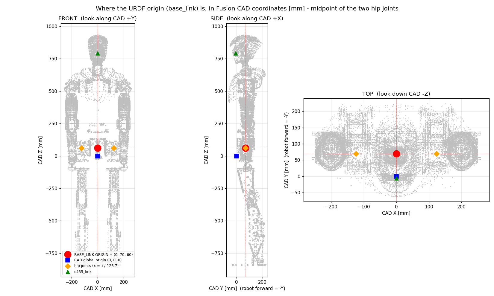
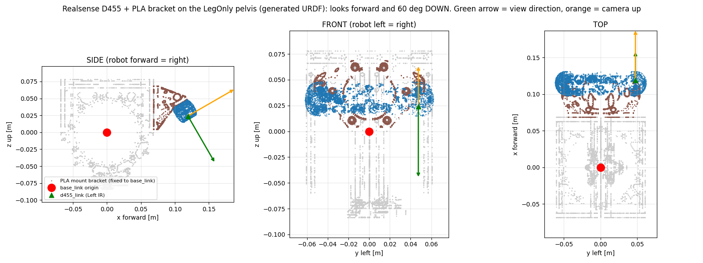
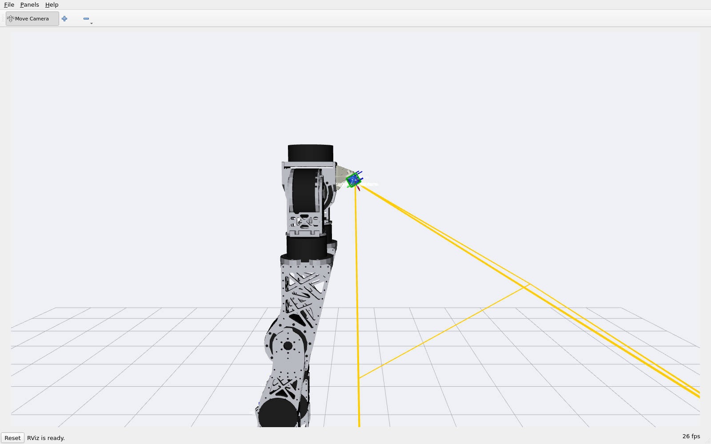
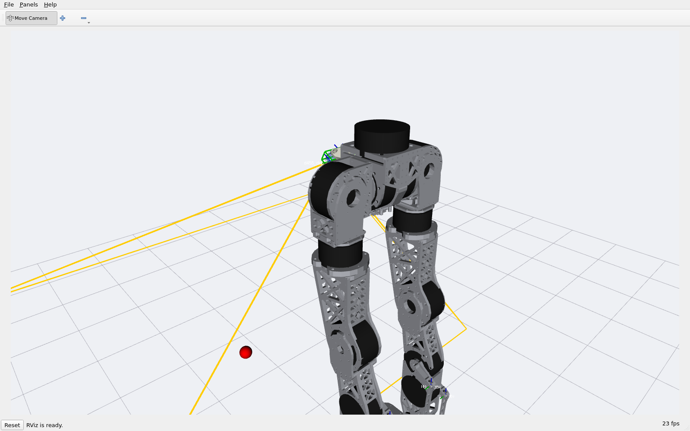
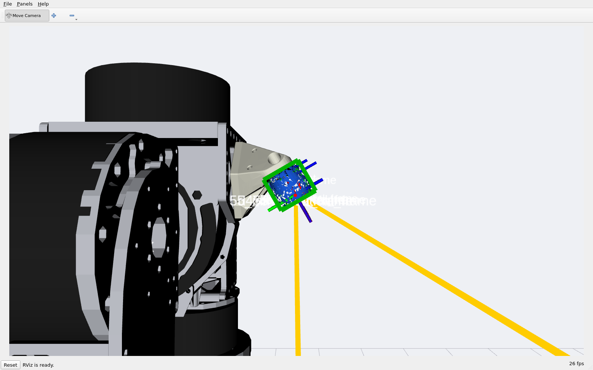
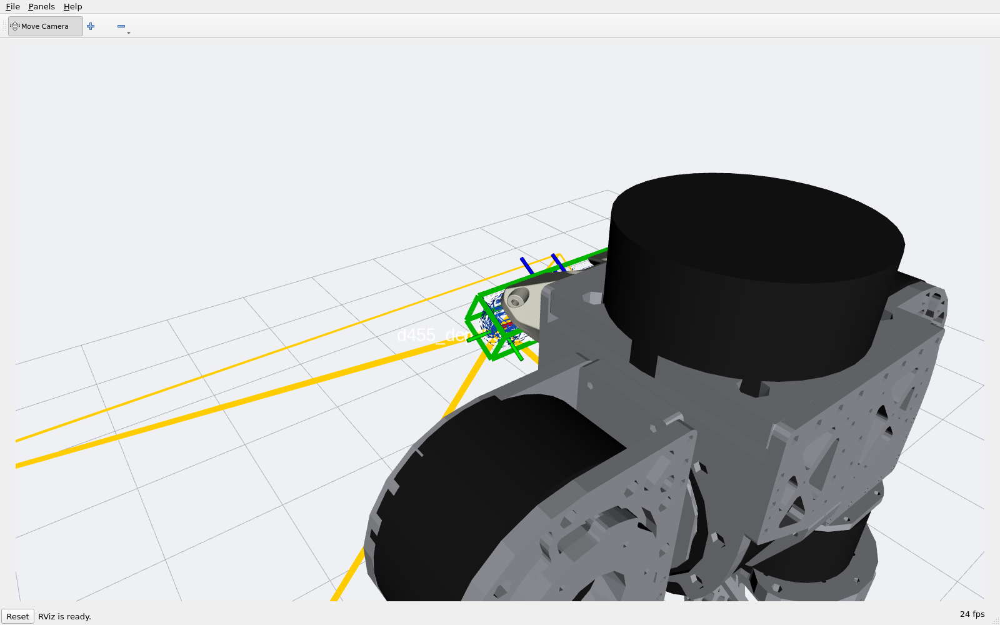
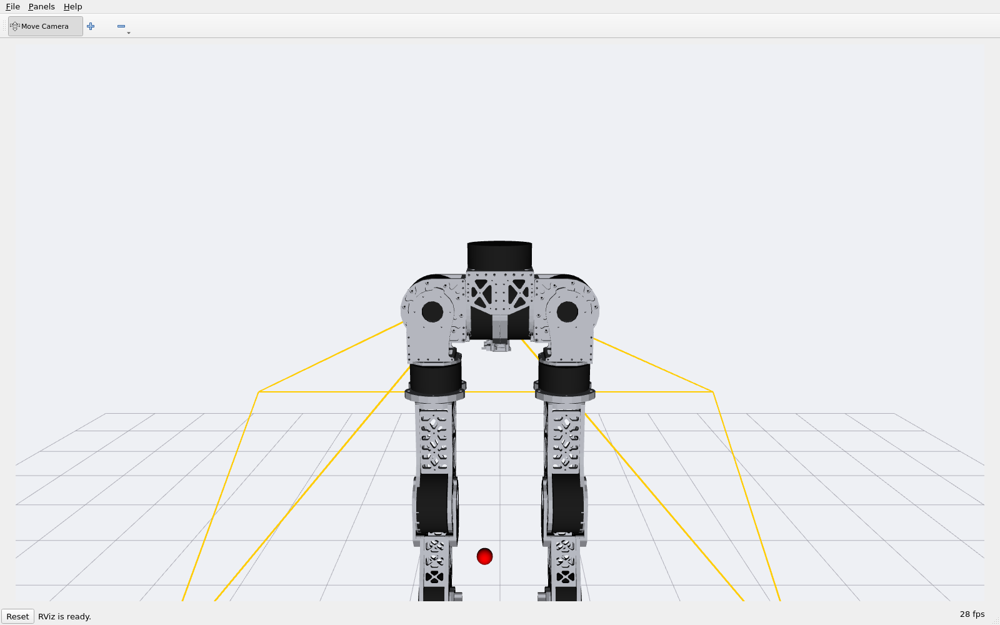
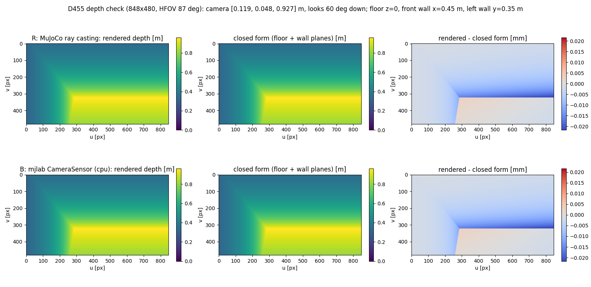
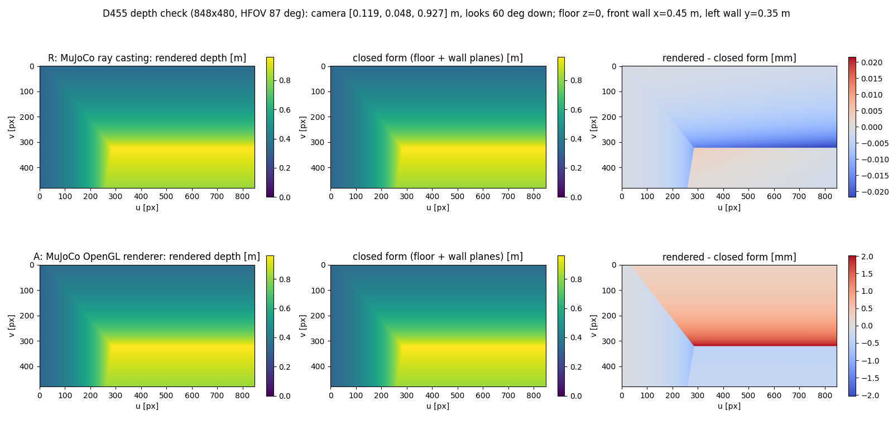
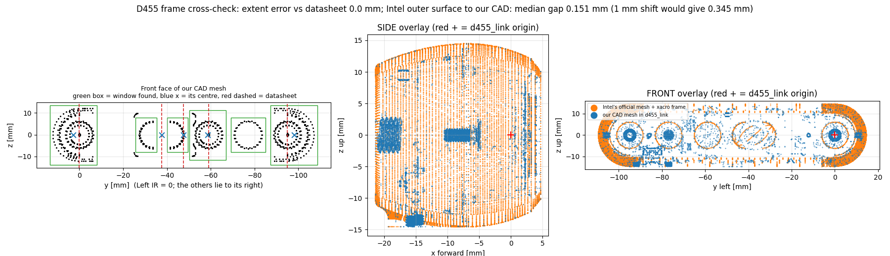

# 로봇 골반에 깊이 카메라(RealSense D455)를 붙이고, 제대로 붙었는지 증명하기

2026-10-27 · 사용자 요청: "Fusion 의 `Pelvis_Camera` 아래 D455 를 URDF 에 추가하라. 원본은 그대로 두고 카메라만 더하라. RViz 와 mujocolab(mjlab)
에서 깊이가 맞게 나오는지, 원점이 맞는지, 선례와 교차검증해 무결함을 증명하고 문서로 남겨라."
2026-10-28 추가 요청: "마운트 브래킷 `Pelvis_Camera_Mount` 도 있다. PLA 출력물이니 이전 밀도 규약으로 넣어라. `base_link` 에 단단히(solid) 고정하면 된다."

> 줄임말은 처음 나올 때 풀어 씁니다. 처음 보는 사람이 이 글 하나로 "무엇을 만들었고, 어디에 붙어 있고, 왜 믿어도 되는지"를 알 수 있게 쓰는 것이 목표입니다.
> 같은 주제의 앞선 글: [[157_shell_lidar_upper_body_overlay]] (상체 겉껍데기와 D435), 외부 자료: `docs/External/Intel Realsense D455*.md`.

---

# 0. 한 줄 요약

**하체 로봇(LegOnly, 발목이 2-RSU 연결 구조인 AB 방식) 골반 앞쪽 위에, 아래로 60° 숙인 D455 카메라와 그것을 잡아 주는 PLA 마운트 브래킷을 붙인 URDF 와 MJCF 를 만들었습니다.**
원본 URDF·MJCF 는 한 글자도 고치지 않았고, 카메라와 브래킷만 더한 **새 파일**입니다. 브래킷은 `base_link` 에 고정 관절(떨림 없이 단단히)로 붙어 있고, 질량은 **61.97 g**(PLA 밀도 0.8874 g/cm³)입니다. 깊이 영상은 수식으로 구한 정답과 **0.023 mm 이내**로 일치했습니다.

| 만든 것 | 파일 |
|---|---|
| URDF (카메라 추가판) | `pygmalion_locomotion/assets/pygmalion_v2/LegOnly_prototype-tempmass-motormeasured-armfix_v30_proxyfix_d455_loop.urdf` |
| 카메라·브래킷 외형 메시 | `pygmalion_locomotion/assets/pygmalion_v2/meshes_d455/` 의 `d455.stl`, `pelvis_camera_mount.stl`, `pelvis_camera_mount_hull.stl`(충돌용 볼록 껍질) — 이 URDF 가 상대 경로로 읽음 |
| 모터 값 보조 파일 | 같은 이름의 `.motor_params.json` (원본 것을 복사. 모터는 안 바뀌었으니 내용도 같음) |
| MJCF (카메라 추가판) | `mujoco-sim/mjlab/src/mjlab/asset_zoo/robots/pygmalion/xmls/LegOnly_..._v30_proxyfix_d455_loop.xml` (메시는 링크 `xmls/assets_v30_d455` 하나로 연결 — 원본의 `meshdir` 는 그대로) |
| 위치·방향 기록 | `pygmalion_locomotion/assets/pygmalion_v2/d455_overlay_report.json` |
| 만드는 도구 | `tools/robot_model/camera_overlay/` (`extract_d455.py` → `build_d455.py` → `build_d455_mjcf.py`) |
| 검증 도구 | 같은 폴더의 `rviz_check.py`, `depth_check.py`, `cad_crosscheck.py`, `mount_check.py`, `d455_figure.py` |

> **AB 방식만 만들었습니다.** 사용자 결정(2026-10-27)으로 RP(직렬 발목) 판은 만들지 않았고, 한 번 만들었던 RP 판은 지웠습니다.

---

# 1. "원본은 그대로, 카메라만" — 모터는 어디 갔나?

RViz 로 처음 띄웠을 때 **모터가 보이지 않아** 사용자가 물었습니다. 결론부터: **아무것도 사라지지 않았습니다.**

| 확인 | 원본 | 카메라 추가판 |
|---|---|---|
| URDF 에서 원본과 다른 줄 | — | 로봇 이름 한 줄 + 끝에 붙인 카메라·브래킷 블록뿐 |
| MJCF 의 모터 원통(`*_motor`) | 13개 | **13개 (그대로)** |
| MJCF 에서 원본과 다른 부분 | — | 카메라 몸체·카메라, 브래킷 몸체, 메시 2개 등록뿐 (`meshdir` 같은 기존 설정은 그대로) |
| 원본 파일 상태 (`git status`) | 변경 없음 | — |
| 전체 질량 (MJCF) | 23.630 kg | 23.808 kg (**+0.178 kg = 카메라 0.116 + 브래킷 0.062**) |
| 전체 질량 (URDF) | 23.634 kg | 23.812 kg (같은 +0.178 kg) |

모터가 안 보인 이유: **원본 URDF 에는 처음부터 모터 모양이 없습니다.** 원본 URDF 의 그림 요소는 링크 메시 31개뿐이고 원통은 0개입니다.
모터 13개는 **원본 MJCF 안에 검은 원통으로만** 들어 있습니다. RViz 는 URDF 만 읽기 때문에 원통이 안 보였습니다.

그래서 이 글의 RViz 그림에는, MJCF 의 모터 원통을 **표시용으로만** 따로 그려 넣었습니다(URDF 는 건드리지 않았습니다). 아래 §4 그림의 검은 원통이 그것입니다.

---

# 2. 카메라는 어디서 가져왔나 (Fusion 360, 읽기만)

CAD 문서 `260923_Huphy_1.0_wShell`(버전 39)의 `Pelvis_Camera` 컴포넌트 안에 두 가지가 있습니다.

| 안에 있는 것 | 처리 |
|---|---|
| `Realsense D455` (제조사 CAD, 부품 25개) | **사용**. 외형 메시로 합쳤습니다. |
| 시야 표시용 거대 입체 4개 (`…_FOV`, 폭 ±800 mm) | 카메라 부품이 아니라 제외 |
| `Pelvis_Camera_Mount` (골반에 고정하는 PLA 출력 브래킷, 몸체 1개) | **사용** (2026-10-28 추가 요청). 질량은 §3.4 |

- Fusion 에는 **읽기만** 했습니다. 저장·수정은 없습니다. 안전 수칙에 따라 가장 가벼운 확인 호출(`host_alive`)부터 보낸 뒤 부품 이름·경계 상자·메시만 읽었습니다.
- ⚠️ 이 CAD 문서에는 **저장하지 않은 수정이 있었습니다**(`modified_unsaved: true`). 읽은 위치는 그 시점의 화면 상태입니다.
- 처음 읽은 뒤 문서가 v39 → **v40** 으로 바뀌어서(읽기 도구의 안전장치가 감지) 전부 다시 읽었습니다. 카메라 25개 몸체의 경계 상자와 변환 행렬, 브래킷 메시 모두 **0.0 mm 차이**였습니다. 즉 위치는 그대로이고 문서의 다른 곳이 바뀐 것입니다. 아래 모든 숫자는 v40 기준입니다.
- 카메라 방향: 제조사 부품의 변환 행렬이 X 축 둘레 150° 회전이고, 메시를 재면 **26.0 × 124.0 × 29.0 mm** 로 데이터시트(깊이 26, 폭 124, 높이 29)와 정확히 같습니다.
  X 축 둘레로 기울었으므로 **카메라는 정면이 아니라 60° 아래를 봅니다.**

---

# 3. 원점이 정확히 어디인가

## 3.1 로봇 전체의 원점 (`base_link`)



*그림 1 — 빨간 원이 URDF·MJCF 의 원점(`base_link`)입니다. 파란 네모는 CAD 전역 원점, 주황 마름모는 두 엉덩이 관절입니다.*

- **`base_link` 원점 = 두 엉덩이 관절의 정중앙 = CAD 전역 좌표 (X 0, Y 70, Z 60) mm.**
- 로봇 앞쪽은 CAD 의 **−Y** 방향입니다. 변환식은 `시뮬레이터 좌표 = (−CAD_y, CAD_x, CAD_z)` 이며, 시뮬레이터에서 +X 는 앞, +Y 는 왼쪽, +Z 는 위입니다(ROS 표준).
- CAD 전역 원점 (0,0,0) 은 `base_link` 보다 앞으로 70 mm, 아래로 60 mm 떨어진 점이라 **같은 점이 아닙니다.**

## 3.2 카메라의 위치



*그림 2 — 생성된 URDF 로 그린 옆·정면·위 모습입니다. 파란 점은 카메라, 갈색 점은 PLA 마운트 브래킷, 초록 화살표는 보는 방향(앞쪽 아래), 주황 화살표는 카메라의 위쪽입니다.*

| 항목 | 값 |
|---|---|
| `d455_mount` (카메라 뒷판 중앙, 설계 원점) 위치 — `base_link` 기준 | 앞 **0.1085 m**, 옆 0, 위 **0.0425 m** |
| 자세 | `rpy = (0, 1.0472, 0)` 즉 **아래로 60°** 숙임 |
| `d455_link` (왼쪽 적외선 렌즈 중심 = 깊이 영상의 원점) — `base_link` 기준 | 앞 0.1192 m, **왼쪽 0.0475 m**, 위 0.0240 m |
| 같은 점의 CAD 좌표 | (47.5, −49.175, 84.01) mm |
| 서 있을 때(다리를 편 영점, `base_link` 높이 0.903 m) 지면 위 높이 | 약 0.927 m |
| 카메라 정중앙 시선이 바닥과 만나는 점 | `base_link` 앞 **0.654 m** |

카메라 몸체는 **골반 앞쪽 위**에 있고, 위에서 보면 몸 가운데선(왼쪽 0 m)을 중심으로 폭 124 mm 가 걸쳐 있습니다. 왼쪽 적외선 렌즈가 0.0475 m 왼쪽인 이유는 렌즈가 몸체 중앙이 아니라 **몸체 왼쪽 끝 쪽**에 있기 때문입니다(데이터시트의 깊이 원점 = 왼쪽 렌즈).

## 3.3 프레임 구성 (RealSense 공식 규약과 같음)

```
base_link
 └─ d455_mount            설계 원점 = 뒷판 가운데
     └─ d455_link         깊이 프레임 = 왼쪽 적외선 렌즈 중심 (x 앞, y 왼쪽, z 위 — 로봇 표준 축)
         ├─ d455_depth_optical_frame    카메라 영상 축 (x 오른쪽, y 아래, z 앞)  rpy(−90°, 0, −90°)
         ├─ d455_color_frame  / _optical_frame    (0, −0.059, 0)   색깔 렌즈
         ├─ d455_infra2_frame / _optical_frame    (0, −0.095, 0)   오른쪽 적외선 렌즈
         └─ d455_imu_frame               (−0.01602, −0.03022, +0.0074)  관성 센서
```

- 질량 0.116 kg(데이터시트, ±10 %)을 균일한 상자로 근사한 관성과 함께 넣었습니다. 충돌 모양은 상자(26 × 124 × 29 mm)입니다.
- ROS 에서 RealSense 드라이버(realsense-ros)가 내보내는 `camera_link` 를 이 `d455_link` 에 연결하면 됩니다.

## 3.4 마운트 브래킷 (PLA 출력물)

| 항목 | 값 |
|---|---|
| 붙이는 방식 | `base_link` 에 **고정 관절**(`pelvis_camera_mount_joint`, 움직이지 않는 관절). MJCF 에서는 관절 없는 하위 몸체 — 로봇 몸통과 한 덩어리 |
| CAD 부피 | 69.83 cm³ |
| CAD 가 가정한 재질 / 질량 | 강철 / 548 g (**출력물이 아니므로 쓰지 않음**, 약 9배 무거움) |
| 쓴 밀도 | **0.8874 g/cm³** — 이 프로젝트의 "구조용 출력물" 규약. 실측한 출력물 11개가 알루미늄 질량의 0.329 배였고 2.70 × 0.329 = 0.887. 팔꿈치 브래킷 등 이전 출력 부품과 같은 값(`shell_overlay/manifest.json` 의 `structural_printed`, [[89_printed_parts_density_ratio]]) |
| **질량** | 69.83 cm³ × 0.8874 g/cm³ = **61.97 g** |
| 무게중심 (`base_link` 기준) | 앞 87.3 mm, 옆 0.6 mm, 위 43.3 mm |
| 크기 | 49 × 107 × 65 mm |
| 관성 | CAD 의 관성 텐서를 같은 비율(61.97 / 548)로 줄이고 무게중심 둘레로 옮겨 `base_link` 축으로 돌림. 세 주관성이 양수이고 삼각 부등식을 만족함을 코드에서 확인 |

- 브래킷 충돌 모양은 URDF 에서는 볼록 껍질(`..._hull.stl`, 다른 링크와 같은 규약)이고, MJCF 에서는 카메라와 같이 **보이기만 하고 충돌은 없습니다**(원본 MJCF 가 자체 충돌 모양을 따로 가지고 있어서, 학습 중 접촉이 바뀌지 않게 하기 위함).
- 출력물의 실제 밀도는 채움률 등에 따라 부품마다 다릅니다(같은 규약의 `estimated` 범위: 질량 ×0.60 ~ ×1.60). 브래킷 질량은 **추정값**이고, 실물을 저울로 재면 바꿔야 합니다. 61.97 g 은 로봇 전체의 0.26 % 입니다.

브래킷과 카메라가 같은 자리에 있는지도 확인했습니다. 두 부품은 서로 다른 변환 경로로 놓입니다(브래킷: CAD → `base_link`, 카메라: CAD → `d455_link` → URDF 사슬 → `base_link`).

| 확인 | 결과 |
|---|---|
| 카메라 메시의 모든 꼭짓점을 두 경로로 변환했을 때 최대 차이 | **0.0002 mm** |
| 카메라와 브래킷 사이 가장 가까운 거리: CAD 에서 / URDF 를 거쳐서 | 0.006 mm / 0.002 mm (**맞닿아 있음**) |
| 질량 재계산 (부피 × 밀도) | 61.97 g (보고서와 같음) |

---

# 4. RViz 에서 확인 (카메라가 제대로 나오나)

3090 가상 머신(`10.8.0.14`)의 가상 화면에서 RViz 를 띄워 찍었습니다. 로봇 모델은 URDF 에서, 검은 원통(모터)은 MJCF 에서 읽은 표시용 마커입니다.

| 옆에서 | 앞쪽 비스듬히 |
|---|---|
|  |  |

*그림 3 — 노란 선은 카메라 깊이 시야(가로 87° × 세로 58°, 0.8 m)입니다. 시야 중심선이 바닥과 만나는 점을 빨간 공으로 표시했습니다.*

가까이서 보면 카메라 외형(파란색)이 **데이터시트 상자(초록 선)** 안에 정확히 들어가 있고, 축 화살표가 보입니다.

| 가까이 (옆) | 가까이 (비스듬히) |
|---|---|
|  |  |

*그림 4 — 카메라가 골반 앞 위에 60° 숙여 달려 있고, 시야(노란 선)가 앞쪽 바닥을 향합니다. **연한 베이지색 쐐기가 PLA 마운트 브래킷**으로, 골반 판에 붙어 카메라를 60° 기울여 받치고 있습니다. 검은 원통은 모터입니다(옆 그림의 왼쪽이 엉덩이 모터, 비스듬히 본 그림의 위쪽이 허리 회전 모터).*


*그림 5 — 정면에서 본 모습. 카메라가 몸 가운데선에 걸쳐 있고 왼쪽 렌즈 쪽이 로봇의 왼쪽입니다.*

확인한 것: ① 카메라가 골반 앞 위에 있다 ② 보는 방향이 앞·아래다 ③ 외형이 데이터시트 상자와 겹친다 ④ 프레임 이름·축이 RealSense 규약대로 나온다 ⑤ 브래킷이 골반과 카메라 사이를 잇는다.
(아래 §5 가 숫자로 같은 것을 다시 확인합니다.)

---

# 5. mjlab 에서 깊이 영상이 맞게 나오는가

## 5.1 어떻게 시험했나 (쉬운 설명)

"카메라 위치·방향·화각이 맞으면, 평평한 바닥과 벽이 있는 방에서 **픽셀마다 깊이를 수식으로 정확히 계산**할 수 있다"는 점을 이용했습니다.

1. 로봇을 다리를 편 채 세웁니다(`base_link` 높이 0.903 m). 방에는 **바닥, 앞쪽 벽(0.45 m 앞), 왼쪽 벽(0.35 m 옆)** 이 있습니다.
2. 수식 정답: 픽셀 (u, v) 를 지나는 빛줄기를 바닥·벽 평면과 교차시켜 깊이를 구합니다. 이때 카메라 위치·방향은 **MJCF 가 아니라 URDF 의 프레임 사슬**(`base_link → d455_mount → d455_link → 광학 프레임`)에서 따로 계산합니다. 그래서 "URDF 와 MJCF 가 같은 자리를 가리키는지"까지 한 번에 확인됩니다.
3. 세 가지 깊이 출처를 정답과 비교합니다.
   - **R** MuJoCo 광선 투사(`mj_multiRay`, 그래픽 없이 기하만)
   - **A** MuJoCo 의 OpenGL 그래픽 렌더러(`mujoco.Renderer`)
   - **B** mjlab 의 `CameraSensor`(`mujoco_warp`) — **학습 환경이 실제로 쓰는 경로**
4. 848 × 480 화소, 가로 시야각 87°(데이터시트). MJCF 에는 mjlab 의 i2rt YAM D405 카메라와 같은 방식(`sensorsize` + `focal`)으로 내부 파라미터를 넣었습니다(초점 거리 446.8 화소).

## 5.2 결과



*그림 6 — 위: 광선 투사, 아래: mjlab `CameraSensor`. 왼쪽부터 렌더링한 깊이, 수식 정답, 둘의 차이입니다. 오른쪽 아래 영역이 바닥, 위쪽이 앞 벽, 왼쪽이 왼쪽 벽입니다. 차이 그림의 눈금은 ±0.02 mm 입니다.*

| 깊이 출처 | 비교한 화소 | 최대 차이 | 평균 차이 | 제곱평균 차이 |
|---|---:|---:|---:|---:|
| R 광선 투사 | 407,040 | 0.023 mm | 0.004 mm | 0.006 mm |
| **B mjlab `CameraSensor`** (CPU) | 407,040 | **0.023 mm** | 0.004 mm | 0.006 mm |
| A OpenGL 렌더러 (3090 VM) | 407,040 | 2.0 mm | 0.50 mm | 0.63 mm |

- 카메라 위치·방향 차이(MJCF 가 만든 것 vs URDF 사슬): **0.00014 mm, 0.0004°**.
- 로봇 자신이 시야를 가린 화소: 0개 (다리·발은 시야 밖).
- A 의 2 mm 는 OpenGL 깊이 버퍼의 정밀도 한계로, 아래 민감도 표의 "0.1° 기울기(4.7 mm)"보다 작아서 판정에는 지장이 없습니다.


*그림 7 — A(OpenGL 렌더러) 단독 비교. 차이 눈금이 ±2 mm 입니다(깊이 버퍼 양자화 모양이 보임).*

## 5.3 이 시험이 틀린 걸 잡아내긴 하는가 (민감도)

"전부 일치"는 시험이 둔하면 아무 의미가 없습니다. 그래서 **일부러 틀린 자세를 넣었을 때 시험이 얼마나 크게 어긋나는지**를 같이 쟀습니다.

| 만약 카메라가 이렇게 틀렸다면 | 최대 어긋남 |
|---|---:|
| 위로 1 mm 올라감 | 1.04 mm |
| 앞으로 5 mm 이동 | 14.6 mm |
| 0.1° 더 숙임 | 4.7 mm |
| 1° 더 숙임 | 44.9 mm |
| **좌우가 뒤집힘** (왼쪽 렌즈가 반대편) | **230.7 mm** |
| 위아래가 뒤집힘 (180° 회전) | 648.2 mm |

실제 어긋남(0.023 mm)은 이 값들보다 40~1000배 작습니다. 즉 **1 mm 높이 오차, 0.1° 기울기, 좌우 뒤집힘까지 이 시험으로 잡힙니다.**
(왼쪽 벽을 넣은 이유: 바닥과 앞 벽만 있으면 옆으로 47.5 mm 틀려도 영상이 똑같아서 좌우 오류를 못 잡습니다.)

---

# 6. 원점·방향 교차검증 (CAD ↔ 데이터시트 ↔ RealSense 공식 자료)

세 가지 독립된 출처로 `d455_link` 의 위치·방향을 확인했습니다. 모두 **우리 `d455_link` 좌표(앞 x, 왼쪽 y, 위 z, 원점 = 왼쪽 적외선 렌즈 중심)** 안에서 비교한 값입니다.


*그림 8 — 왼쪽: 우리 CAD 메시의 앞면(초록 상자 = 찾은 유리창, 파란 x = 그 중심, 빨간 점선 = 데이터시트). 가운데·오른쪽: 인텔 공식 메시(주황)와 우리 CAD 메시(파랑)를 겹친 옆·정면 모습입니다.*

| 확인 항목 | 기준값(출처) | 우리 CAD 에서 잰 값 | 차이 |
|---|---|---|---:|
| 몸체 범위 앞뒤 x | −21.35 ~ +4.65 mm (데이터시트: 깊이 26 mm. 깊이 원점 면에서 앞판까지 4.65 mm, 뒷면까지 21.35 mm) | −21.35 ~ +4.65 | **0.00 mm** |
| 몸체 범위 좌우 y | −109.5 ~ +14.5 mm (폭 124, 몸 중심 −47.5) | −109.5 ~ +14.5 | **0.00 mm** |
| 몸체 범위 상하 z | ±14.5 mm (높이 29) | ±14.5 | **0.00 mm** |
| 색깔 렌즈 창 중심 y | −59.0 mm (데이터시트) | −58.62 | 0.38 mm |
| 적외선 투사기 창 중심 y | −37.5 mm | −37.62 | 0.12 mm |
| 두 적외선 창의 중점 y | −47.5 mm (= 몸 중심) | −47.62 | 0.12 mm |
| USB-C 단자 y / 위치 | −84.51 mm (삼각대 구멍 −47.5 에서 오른쪽 37.01 mm) / **아랫면** | −84.51 / 아랫면(z −9.5) | **0.00 mm** |
| 인텔 공식 메시를 공식 URDF 위치에 놓았을 때, 그 바깥면에서 우리 CAD 면까지 거리 | 0 | 중앙값 **0.15 mm**, 90 %가 0.30 mm 이하 | — |

방향(왼쪽·오른쪽·위·아래)은 이렇게 가려냈습니다.

- **왼쪽/오른쪽**: 색깔 창(−58.6)과 투사기 창(−37.6)은 몸 중심에서 **한쪽으로 치우쳐** 있습니다. 데이터시트의 "왼쪽 적외선 렌즈에서 투사기 37.5, 색깔 59, 오른쪽 적외선 95 mm" 순서와 **0.4 mm 안**에서 맞으므로 왼쪽/오른쪽이 확정됩니다. USB-C 가 0.00 mm 로 맞는 것도 같은 증거입니다.
- **위/아래**: USB-C 는 아랫면에 있어야 하는데, 우리 `d455_link` 에서 z = −9.5 mm(아래쪽)입니다.
- **앞/뒤**: 앞면 유리창이 +4.65 mm 쪽에 있습니다.

표면 거리 시험도 민감도를 확인했습니다. 일부러 **1 mm 밀면 중앙값이 0.35 mm(90 %: 0.80 mm)**, **1° 돌리면 0.27 mm(0.75 mm)**, **위아래를 뒤집으면 35 mm** 로 늘어납니다. 다만 몸체가 좌우 대칭이라 **이 시험만으로는 좌우 뒤집힘을 못 잡습니다**(뒤집어도 0.15 mm). 그래서 좌우는 위의 창 위치·USB-C·§5 의 옆벽 깊이 시험으로 확정했습니다.

> 처음에는 우리 CAD 와 인텔 메시를 ICP(두 점들을 가장 잘 겹치는 이동·회전 찾기)로 맞춰 봤습니다. 그러나 우리 CAD 는 나사·기판·케이블까지 든 전체 조립품이고 인텔 메시는 매끈한 겉모양뿐이라, ICP 가 평평한 면을 따라 미끄러져 **엉뚱하게 7° 비틀린 답**을 냈습니다. 이 방법은 버리고, 위의 "인텔 바깥면 → 우리 면 거리"로 바꿨습니다.

---

# 7. 선례 조사 — D455 를 URDF·MJCF 에 넣은 사례

| 선례 | 무엇인가 | 우리와 비교 |
|---|---|---|
| **realsense-ros `_d455.urdf.xacro` + `d455.stl`** (인텔 공식, 거의 모든 ROS 로봇이 씀) | 프레임 규약: 깊이 프레임 = 왼쪽 적외선, 광학 프레임 rpy(−90°, 0, −90°), 색깔 −0.059 m, 적외선2 −0.095 m, 관성 센서 (−0.01602, −0.03022, +0.0074) m. 몸체 0.124 × 0.029 × 0.026 m. 메시는 깊이 프레임에서 (0.00465, −0.0475, 0), rpy(90°, 0, 90°) | 같은 규약을 그대로 썼고(§3.3), 공식 메시와 우리 CAD 가 0.15 mm 안에서 겹침(§6). 질량은 공식이 0.072 kg 이지만 파일 주석이 "믿을 수 없다"고 하므로 **데이터시트 116 g** 사용 |
| **NVIDIA Isaac Sim D455 에셋** (`RealSense/D455/rsd455.usd`) | 인텔 인증 USD. 카메라 4개(깊이·색·왼쪽·오른쪽) | 문서의 치수가 124 × **25** × 29 mm 로 데이터시트(26 mm)와 1 mm 다름 → 기구 간섭 계산은 데이터시트·CAD 값(26 mm)을 사용. 이번 작업은 Isaac 용 USD 를 만들지 않음 |
| **mjlab 저장소의 i2rt YAM 로봇** (`yam.xml`) | 같은 mjlab 안에 있는 **RealSense D405** MJCF 카메라. `sensorsize` + `focal` 로 내부 파라미터를 넣고 `CameraSensorCfg(camera_name=…)` 로 감쌈. 깊이는 `enabled_geom_groups=(0, 3)`(시각 메시 제외) | 같은 방식으로 D455 를 넣음. 시각 메시(그룹 2)를 깊이에서 제외하는 규칙도 같게 시험(§5) |
| D455 전용 MuJoCo MJCF | **웹 검색으로는 공개된 것을 찾지 못했습니다** (MuJoCo Menagerie 등 포함) | 그래서 mjlab 안의 D405 선례와 인텔 URDF 를 바탕으로 직접 만들었음 |

출처: realsense-ros [`_d455.urdf.xacro`](https://github.com/IntelRealSense/realsense-ros/blob/ros2-master/realsense2_description/urdf/_d455.urdf.xacro) ·
[`d455.stl`](https://github.com/IntelRealSense/realsense-ros/blob/ros2-master/realsense2_description/meshes/d455.stl) ·
Isaac Sim [Depth Sensors](https://docs.isaacsim.omniverse.nvidia.com/latest/assets/usd_assets_depth_sensors.html#realsense-d455-certified) ·
인텔 D400 데이터시트(문서 337029-017) · 내부: `mujoco-sim/mjlab/src/mjlab/asset_zoo/robots/i2rt_yam/xmls/yam.xml`.

---

# 8. 무엇이 증명되었고, 무엇은 아닌가

**증명한 것**

1. 원본 URDF·MJCF 는 그대로이고, 모터 13개도 그대로 있다. (§1)
2. URDF 와 MJCF 의 카메라 위치·방향이 같다(0.00014 mm, 0.0004°). (§5)
3. mjlab `CameraSensor` 깊이가 수식 정답과 0.023 mm 이내로 일치한다. 0.1° 기울기·1 mm 높이·좌우 뒤집힘이 있었다면 잡혔을 시험이다. (§5)
4. `d455_link` 의 원점과 네 방향이 데이터시트·인텔 공식 자료·우리 CAD 세 곳에서 0.4 mm 안에 일치한다. (§6)
5. RViz 에서 프레임, 외형, 시야가 기대한 자리에 나온다. (§4)

**증명하지 못했거나, 가정한 것 (정직하게)**

- **뒷판 M4 나사 구멍의 중점을 CAD 에서 직접 재지는 않았습니다.** `d455_mount`(설계 원점)는 "좌우·높이 중앙, 뒷면"이라는 데이터시트 가정이며, 카메라가 실제로 쓰는 `d455_link` 는 위 검증으로 확정이라 깊이에는 영향이 없습니다. 브래킷 설계에 쓸 때는 STEP 에서 구멍 위치를 직접 재 주세요.
- **질량**은 카메라가 데이터시트 값(±10 %), 브래킷이 출력물 규약 밀도(0.8874 g/cm³)로 계산한 **추정값**입니다. CAD 값이 아닙니다(CAD 는 이 부품을 강철로 가정해 548 g, 부품 대부분이 20~40 배 무겁다고 알려져 있음, [[157_shell_lidar_upper_body_overlay]]). 실물을 재면 교체하세요.
- **실제 카메라의 내부 파라미터**(초점, 주점, 개체별 보정)는 모릅니다. 시뮬레이션은 공칭 시야각 87° 의 핀홀 모델이고 렌즈 왜곡·잡음·깊이 결측은 넣지 않았습니다. 실기에서 읽은 값으로 바꾸는 방법은 `docs/External/Intel Realsense D455 - URDF 센서 통합.md` 5장에 있습니다.
- **mjlab 깊이는 CPU 에서 확인했습니다.** 이 PC 에는 그래픽카드가 안 붙어 있어서(할 일 #88) GPU 경로는 돌려 보지 못했습니다. OpenGL 렌더러만 3090 VM 에서 확인했습니다.
- **브래킷의 나사·카메라 고정 나사 질량**은 넣지 않았습니다(CAD 에 나사 몸체가 없음).
- 브래킷의 MJCF 충돌 모양은 만들지 않았습니다(보이기만 함). 접촉이 필요하면 추가해야 합니다.
- **MuJoCo 로 URDF 를 불러오면** 로봇 몸통을 월드에 고정할 때 카메라 질량이 월드 몸체에 합쳐져 `body_mass` 합계가 안 늘어나 보입니다(원본도 같은 방식). 떠 있는 몸통(free base)에서는 +0.116 kg 이 더해집니다(MJCF 로 확인).
- **CAD 문서 v40 에는 저장 안 된 수정**이 있습니다(v39 도 같았음).
- 학습에 쓰는 모델은 아직 **이 카메라 판이 아니라 원본**입니다. 카메라 판은 별도 파일이라 기존 학습·측정에 영향이 없습니다.

---

# 9. 다시 만드는 법

```bash
# 1) CAD 읽기 (Fusion 360 필요, 읽기 전용)  — 연결: FUSION_MCP=http://192.168.20.161:27182/mcp FUSION_MCP_HOST=127.0.0.1:27182
mujoco-sim/mjlab/.venv/bin/python3 tools/robot_model/camera_overlay/extract_d455.py --out tools/robot_model/camera_overlay/snapshot_20261028
mujoco-sim/mjlab/.venv/bin/python3 tools/robot_model/camera_overlay/extract_d455.py --out tools/robot_model/camera_overlay/snapshot_20261028 --props-only   # 브래킷 부피·무게중심·관성
# 2) URDF 와 메시 만들기 → 3) MJCF 만들기
mujoco-sim/mjlab/.venv/bin/python3 tools/robot_model/camera_overlay/build_d455.py --snapshot tools/robot_model/camera_overlay/snapshot_20261028
mujoco-sim/mjlab/.venv/bin/python3 tools/robot_model/camera_overlay/build_d455_mjcf.py
# 4) 검증 (CPU)
CUDA_VISIBLE_DEVICES="" mujoco-sim/mjlab/.venv/bin/python3 tools/robot_model/camera_overlay/depth_check.py --device cpu
mujoco-sim/mjlab/.venv/bin/python3 tools/robot_model/camera_overlay/mount_check.py        # 브래킷·카메라 위치와 질량
mujoco-sim/mjlab/.venv/bin/python3 tools/robot_model/camera_overlay/cad_crosscheck.py     # 인텔 공식 메시가 필요: tools/robot_model/camera_overlay/reference/ 에 d455.stl 내려받기
```

- `cad_crosscheck.py` 가 쓰는 인텔 공식 메시·xacro 는 저장소에 넣지 않았습니다(인텔 저장소, Apache-2.0). 위 §7 의 링크에서 `reference/` 로 내려받으면 됩니다.
- RViz 확인은 ROS 2 Humble 과 가상 화면(Xvfb)이 있는 3090 VM 에서 `ROS_DOMAIN_ID=71` 로 돌렸습니다(그 기계의 다른 시연과 TF 가 섞이지 않게 번호를 따로 씀): `rviz_check.py --urdf … --mjcf … --out-dir …`.
