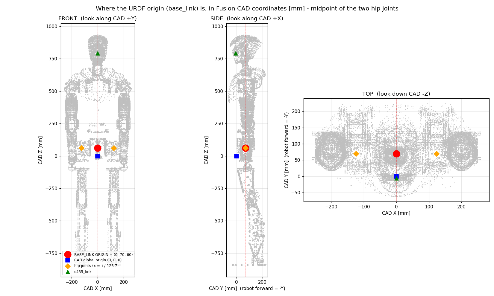

# 로봇 모델 파일(MJCF · URDF) 한눈에 — 무엇이 있고, 어떻게 만들고, 무엇이 바뀌었나

2026-10-28 · 짧은 안내서입니다. 자세한 근거는 각 절의 문서 번호를 따라가 주세요.

---

# 1. 한 줄 설명

- **MJCF** (`.xml`): MuJoCo 와 mjlab(학습·시뮬레이션)이 읽는 로봇 설명서.
- **URDF** (`.urdf`): ROS, RViz, Isaac Sim, Gazebo 같은 **다른 도구**가 읽는 로봇 설명서.
- 둘 다 **손으로 고치지 않습니다.** CAD(Fusion 360)에서 읽은 값으로 `tools/robot_model/` 의 빌더가 **생성**합니다. 고칠 일이 있으면 빌더나 입력을 고치고 다시 만듭니다([[156_mjlab_and_robot_modeling_guide]] B 부).

# 2. 어디에 있나

| 무엇 | 위치 |
|---|---|
| MJCF | `mujoco-sim/mjlab/src/mjlab/asset_zoo/robots/pygmalion/xmls/` (mjlab 저장소 안) |
| URDF | `pygmalion_locomotion/assets/pygmalion_v2/` |
| 메시(모양) | 같은 폴더의 `meshes_v30_armfix/`(기본), `meshes_v30_armfix_shell/`(겉껍데기판), `meshes_d455/`(카메라판) |
| 모터 값 보조 파일 | URDF 옆의 `*.motor_params.json` (URDF 에는 회전자 관성 칸이 없어서 따로 둠, [[144_urdf_motor_params_portability]]) |

# 3. 파일 이름 읽는 법

`LegOnly_prototype-tempmass-motormeasured-armfix_v30_proxyfix_d455_loop.urdf`

| 조각 | 뜻 |
|---|---|
| `FullDoF` / `SemiFullDoF` / `LegOnly` | 몸통 3종. 전신(허리 + 양 어깨) / 허리까지 / **다리만**(허리 회전 모터의 *질량*만 골반에 남기고 관절은 없음) |
| `prototype-tempmass-motormeasured-armfix` | 질량 규약: 임시 알루미늄 부품 반영, 모터는 저울로 잰 값, 팔 수정판 |
| `v30` | CAD 버전. `proxyfix` 는 엉덩이 피치 모터 위치를 바로잡은 판(2026-09-02) |
| `_loop` | **AB** 발목(2-RSU 폐루프, 크랭크 A/B 가 구동). 없으면 **RP**(직렬 발목) |
| `_shell` | 머리·몸통·팔 겉껍데기 + 라이다 + D435 (전신·허리까지만, [[157_shell_lidar_upper_body_overlay]]) |
| `_d455` | 골반에 D455 카메라 + PLA 마운트 브래킷 (**다리만 · AB 만**, [[180_d455_camera_on_legonly]]) |

# 4. 좌표와 원점 (공통)

- 원점 `base_link` = **두 엉덩이 관절의 정중앙** = CAD 전역 (0, 70, 60) mm. 축은 **+x 앞, +y 왼쪽, +z 위**(ROS 표준).
- 변환: `시뮬레이터 = (−CAD_y, CAD_x, CAD_z)`. 이름은 **실제 몸 기준**(`L_` = 진짜 왼쪽, 2026-09-12 에 바로잡음, [[136_left_right_naming_history]]).

# 5. MJCF 와 URDF 는 무엇이 다른가

| | MJCF | URDF |
|---|---|---|
| **모터 모양** | 검은 원통 13개(다리만 판). **있음** | **없음** (링크 메시뿐). 겉껍데기판은 따로 원통을 추가함([[157_shell_lidar_upper_body_overlay]] §12.5) |
| 충돌 모양 | 캡슐·상자(발바닥은 상자 3개) | 링크별 볼록 껍질 |
| 폐루프 발목(AB) | `equality/connect` 로 진짜 닫힘 | **표현 불가** — 주석으로만 남음. 크랭크·로드가 서로 독립인 가지로 나열됨 |
| 모터 게인·한계 | mjlab 코드(`pygmalion_constants.py`)가 주입 | 보조 json 에 값만 |
| 카메라 | `<camera>` (깊이 영상 가능) | 프레임(링크)만. 영상 설정은 시뮬레이터 쪽에서 |
| 전체 질량 | 23.630 kg (다리만 AB) | 23.634 kg (약 4 g 차이는 URDF 규격 탓, [[145_model_parameter_provenance]] §3) |

→ URDF 만 열어서 "모터가 없다"고 보이는 것은 **정상**입니다. 모터는 MJCF 에만 있습니다.

# 6. 어떻게 만드나 (요약)

1. CAD → 부품별 질량·관성·메시 읽기 (`tools/fusion/`, 읽기 전용).
2. `tools/robot_model/build_robot.py` 가 MJCF 와 URDF 를 한 소스에서 생성(6종: 몸통 3 × 발목 2).
3. **추가 기능은 원본을 건드리지 않고 "덧붙인 새 파일"로**: `shell_overlay/`(겉껍데기), `camera_overlay/`(D455).
4. 학습 전 검사: 구성 점검, 폐루프 닫힘, 질량 합계, 렌더 확인.

# 7. 수정 이력

> **정본은 모델 폴더의 `pygmalion_locomotion/assets/pygmalion_v2/MODEL_VERSION_LEDGER.md`(버전 대장)** 입니다([[186_urdf_mjcf_version_ledger]] 는 안내만 남음). 처음 모델부터 "무엇이 왜 바뀌었나"를 항목별로 적었고, 파일 이름이 빠지면 `tools/robot_model/check_model_ledger.py` 가 알려 줍니다. 아래 표는 최근 덧붙임 요약입니다.

| 날짜 | 무엇이 바뀌었나 | 근거 |
|---|---|---|
| 2026-08-22 | 모델 v2: 질량·관성을 CAD 에서 읽음, 폐루프 이전 구조 | [[87_robot_model_v2]] |
| 2026-08-23 | **출력물 질량 반영**(v3_printed 35.35 kg), **AB 폐루프 발목** 모델 추가 | 커밋 `f7be394`, `c1dadc2`, [[89_printed_parts_density_ratio]], [[91_closed_loop_ankle_rl]] |
| 2026-08-26 | v4 (31.316 kg), IMU 위치 310 mm 오류 수정 | 커밋 `834f226`, `a1d5b53` |
| 2026-09-01 | CAD v30 로 3종 재구축 | [[111_fusion_v30_urdf_rebuild]] |
| 2026-09-02 | `proxyfix`: 엉덩이 피치 모터 위치가 75.8 mm 틀렸던 것 수정 | [[114_huphy_proxyfix_rotation_dr_audit]], [[117_model_finalization_and_oneleg_training_plan]] |
| 2026-09-03 | 관절 부호·가동범위·부품 귀속 오류 수정, 발바닥을 상자 3개로, 다리만 판은 허리 모터 질량 유지, 6종 재생성 | 커밋 `7cb25dc`, `bc2526d`, [[117_model_finalization_and_oneleg_training_plan]] |
| 2026-09-12 | **좌우 이름 맞바꿈**(`L_` 이 실제 왼쪽) | 커밋 `a98d0d9`, [[136_left_right_naming_history]] |
| 2026-09-15 | **실측 모터 값을 URDF 에도** 넣음(보조 json) | 커밋 `987e2ab`, `2a18235`, [[144_urdf_motor_params_portability]] |
| 2026-10-06~07 | **겉껍데기판**(`_shell`): 머리·몸통·팔 껍데기, 라이다, D435, 팔꿈치. 원본 메시는 지우지 않고 추가만, URDF 에 모터 원통 추가 | [[157_shell_lidar_upper_body_overlay]] |
| **2026-10-27~28** | **D455 판**(`_d455_loop`, 다리만·AB): D455 카메라(0.116 kg, 아래로 60° 숙임) + **PLA 마운트 브래킷**(61.97 g, `base_link` 에 고정). 원본 URDF·MJCF 는 그대로, 전체 +0.178 kg. mjlab 깊이 영상이 수식 정답과 0.023 mm 이내로 일치 | [[180_d455_camera_on_legonly]], `tools/robot_model/camera_overlay/` |
| **2026-10-31** | **발 v5 판**(`_footv5_loop`, 다리만·AB): 발 링크 두 개만 바꿈 — v5 밑창(캐리어·테이프·고무 4 mm) 시각 메시, 볼록 조각 29개 충돌, 질량 0.845 → 1.186 kg/발(사용자 수정 캐리어 + 발등 덮개 Feet_Up PLA 80 g, 둘 다 CAD 형상, Feet_Up 은 충돌 없음). 원본 URDF·MJCF 는 그대로, 발 링크 밖 글자 동일(assert) | `tools/robot_model/foot_overlay/build_footv5.py`, `Feet_design/Feet_Design_Workspace/notes/발 v5 URDF 반영과 충돌 모델 검토.md` |
| **2026-11-04** | **발 v5 판 검토**(읽기 전용): CAD STEP 에서 질량·무게중심·관성을 다시 계산해 URDF 와 일치 확인(질량 4 mg, 무게중심 0.01 mm), MJCF `v5fullm` 과 URDF 의 발 관성 동일. 캐리어 밀도 0.744 는 추정, 파일은 미추적 | [[184_foot_v5_model_review]] |
| **2026-11-04** | **발 v5 + D455 합본**(`_footv5_d455_loop`, 다리만·AB): 발 v5 판과 D455 판을 이어 붙인 새 URDF·MJCF(원본 불변). 발 1.18617 kg·카메라 116 g·브래킷 61.97 g, 전체 +0.85995 kg, 검증 30개 통과, 깊이 영상 오차 0.023 mm. `meshes_v30_*` 심볼릭 링크를 상대 경로로 변경, 발 v5 파일을 git 에 추가 | [[185_footv5_d455_combined_model]], `tools/robot_model/foot_overlay/build_footv5_d455.py` |
| **2026-11-04** | **보강재 반영본**(`_footv5_d455_reinf_loop`, 다리만·AB): 합본에 엉덩이 보강재 160 g(`hip_roll_link`), 무릎 보강재 158.2 g(`shin_link`) 을 양다리에 합치고, Pelvis_Camera 를 166 g(카메라 116 + 브래킷 50)으로 갱신. 전체 +0.6244 kg(25.119 kg), 무게중심 3.3 mm 상승, 검증 60개 통과. 보강재 충돌 모양 없음(시각만). 이전 판은 그대로 | [[185_footv5_d455_combined_model]] §10, `tools/robot_model/reinforce_overlay/build_reinforce.py` |
| **2026-11-04** | **알루미늄 부품판**(`_reinf_alparts_loop`, 다리만·AB): 보강재판에 발목 크랭크 4개(프린트 → Al 6061, 체적 × 2.70)와 엉덩이 마운트 2개(67.0 g → 164.59 g)를 알루미늄 질량으로, 관성도 같은 비율. 전체 +0.3913 kg(25.51 kg), 검증 53개 통과. 크랭크 커버는 프린트 그대로 | [[185_footv5_d455_combined_model]] §11, [[186_urdf_mjcf_version_ledger]] M18 |
| **2026-11-04** | **알루미늄 부품 추가판**(`_reinf_alparts2_loop`, 다리만·AB): 사용자가 이름을 말한 8종(Yaw2KneePlateA(원본 모양·체적), HipRoll2Yaw A/B, Knee2Ankle_IdleSide_1·RotorSide_1, AnkleFeetPillow A/B, 새 AnkleUniversalJointCore-Revised)을 알루미늄 질량(체적 × 2.70)으로, 좌우 둘 다. 다리 한쪽 +703 g, 전체 +1.405 kg(26.91 kg), 검증 107개 통과. Knee2Ankle 의 `_2` 판·Connector·나사는 알루미늄이 아니라 바꾸지 않음. 알루미늄 빨강 / 나머지 반투명 시각화 | [[185_footv5_d455_combined_model]] §12, 모델 폴더 `MODEL_VERSION_LEDGER.md` M19 |
| **2026-11-04** | **발 충돌 캡슐판**(`v5cap`, `v5cap3`, MJCF 만): v5fullm 에서 발 충돌만 볼록 조각 29개 → 캡슐 50개(또는 30개) + 받침 상자로 교체. 질량·관성·시각은 v5fullm 그대로. 같은 정책으로 6지형 비교해 침투·미끄러짐이 줄고 넘어짐은 같거나 적음(재학습 전) | [[185_foot_collision_capsule_vs_mesh]], `tools/foot_sole/build_v5cap.py` |
| **2026-11-04** | **발 충돌 둘레 캡슐판**(`v5rim` 82개, `v5rimL` 57개, MJCF 만): 발바닥 윤곽을 따르는 둘레 캡슐 40개 + 기울인 상자 + 판 상자. 가장자리 띠 오차 RMS 1.2 mm, 안쪽 0.38 mm. 같은 정책 6지형 비교는 v5cap 과 같은 수준. [[186_foot_collision_rim_contour]] | 할 일 #207 |
| **2026-11-04** | **발 충돌 구역판**(`v5clean`, MJCF 만): v5rim 의 안쪽 상자 41개를 이름 붙은 구역 8개(뒤꿈치 판·바깥쪽 단·아치 오르막/내리막·앞발 판·발끝 굴림 등)로 정리. 발당 도형 49개, 같은 정책 6지형 결과는 v5rim 과 같은 수준. [[187_foot_collision_clean_zones]] | 할 일 #208 |

# 8. 알아 둘 것

- **원본은 불변**: 새 기능은 별도 파일로 만듭니다. D455 판은 학습에 쓰는 원본과 무관합니다.
- 겉껍데기판 URDF 에는 모터 원통이 추가돼 있지만 **D455 판은 원본 규약대로 모터 모양이 없습니다.** 필요하면 겉껍데기판의 방식(MJCF 원통을 URDF 시각 요소로 복사)을 같이 적용할 수 있습니다.
- 출력물(PLA) 부품 질량은 **추정 밀도 0.8874 g/cm³**(구조용)입니다. 실물을 재면 바꿔야 합니다.
- 질량·위치를 바꾸는 작업을 하면 **이 표 맨 아래에 한 줄 추가**해 주세요.
