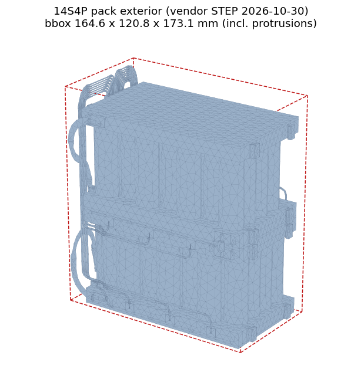

# 182. 배터리 팩 CAD 검토 체크리스트 — 파워크래프트 대화(2026-10-29~30) 설계 정보 전수 정리
작성 2026-10-31 · 원문: `Battery_design/KakaoTalkChats.txt` (gitignore, 사적 폴더) · 업체 제공물: `14S4P_PACK_EXTERIOR_20261030.step`, `DMOP-504LI80-B300-CAN.pdf`(치수 표기 양식 참고용) · 선행 설계: [[163_battery_bms_design]], [[166_battery_regen_and_commercial_packs]], [[167_battery_inquiry_for_powercraft]]

그림: 업체 STEP 렌더. 빨간 점선 = 돌출부 포함 bbox (그림 제목은 메시 근사값, 정확값은 §2의 166.3 × 122.6 × 174.5). 왼쪽 측면의 배선 다발과 아래 브라켓이 "돌출부 끝 기준 5 mm 여유" 규칙이 가리키는 돌출부다.

## 0. 결론 먼저 — 공이 우리 쪽에 있는 것 7건
업체는 "정리되면 회신 바람" 상태로 대기 중이다. 우리가 CAD에서 정하고 보내야 할 것:

| # | 회신 항목 | 비고 |
|---|---|---|
| 1 | **냉각팬 흡기구·배기구 방향** | 팬은 하우징 **외부** 장착. 공기 채널은 STEP 형상 그대로 |
| 2 | **충전·출력 커넥터의 삽입(돌출) 위치와 방향** | 커넥터 달면 내부 돌출부·결선 공간 때문에 하우징이 더 커짐 |
| 3 | **하우징 외형 치수** | DMOP-504LI80 도면의 치수 표기 양식을 참고해 전달 |
| 4 | **M4 고정 홀 위치** | 프로파일 고정용. 위치 확정 후 STEP에 기입해 송부하기로 함. ★내가 임시로 찍은 위치가 셀 브라켓과 간섭 의심 — CAD에서 확인 |
| 5 | **하우징 근처 여유 공간** | 업체가 "여유 공간을 알려주면 그쪽으로 하우징을 늘려 커넥터·팬을 배치해 보겠다"고 함 |
| 6 | **팬 사양 + 제약조건** | 업체 요청 항목 |
| 7 | **커넥터 선정 + 제약조건** | 업체가 AliExpress 후보 1종 제시(대화 링크). 모델은 우리가 찾아 배치 시도하기로 함 |

## 1. 확정된 사항
- **셀 구성 14S4P.** 만충 58.8 V (4.2 V × 14). ← [[163_battery_bms_design]]의 13S 결론과 다름. §4-1 참조.
- **알루미늄 하우징 가능.** 구조: 팩 외곽 기준 6면 각 **5 mm 완충재** + **2T 알루미늄** 덮개.
- **STEP 파일은 배터리팩만** 표현 (절연·충격보호·냉각 미적용 상태).
- **여유 공간 규칙: STEP 돌출부 끝 기준 6면 각 최소 5 mm** (배선·절연·고정 작업용).
- **금속 케이스(판금) 구조로 진행** — 업체가 제안한 "기본 절연+BMS만 한 팩" 노출형은 냉각·충격·진동을 우리 구조물이 다 받아야 해서 기각(사용자 결정).
- **전원공급 라인과 충전 라인은 공통 단자 1개가 기본.** 커넥터 2개로 나눌 수는 있으나 물리적으로는 병렬.
- **동시 충·방전 기술적으로 가능.** 방전 전류에 따라 충전/방전/유지가 됨. 충전기 전압은 셀 최대 기준(58.8 V).
- **12/24 V DC-DC 컨버터는 팩에 미포함.** 요구 스펙 전달함: 24 V@8~10 A, 12 V@5~8 A, 가능하면 절연. 내장 가능 여부는 업체 검토 중(§3).
- 홈페이지 협력업체 로고 게재 완료 (robopwr.com).

## 2. CAD 검토 항목 (수치 포함)
- **팩 bbox(돌출부 포함): 166.3 × 122.6 × 174.5 mm** (STEP 실측).
- **하우징 외형 추정: 약 190 × 147 × 199 mm** = bbox + 면당 12 mm (여유 5 + 완충재 5 + 알루 2). **커넥터·팬 돌출과 결선 공간은 미포함** — 커넥터 면은 더 커진다.
- 토르소 공동(docs/163 §캐비티)과 위 외형이 들어가는지, 커넥터 돌출 방향까지 포함해 확인.
- M4 홀 임시 위치가 **셀 고정 브라켓과 간섭**하는지 STEP 열어 확인(사용자 본인이 간섭 의심을 이미 표명).
- 팬 흡·배기 방향: 토르소 내 공기 흐름(쉘 환기구)과 정합되게 지정.

## 3. 업체 확인 대기 (우리가 재촉할 것)
1. **초소형 DC-DC 컨버터 내장 가능 여부** — 제조사 자료 검토 중, 시간 소요 예고.
2. **2T 알루에 마찰 드릴링(flow drill)으로 M4 탭 가능 여부** — "진행해 본 적 없음, 확인 필요".
3. **셀 고정 브라켓 축소 최적화** — 공간 협소해서 요청해 둠. 회신 오면 STEP 갱신본 받아야 함.
4. (미회신) 팬을 하우징 내부 빈 공간(BMS 옆 등)에 넣는 안 — 질문 5번은 답을 받지 못한 채 판금 구조 결정으로 넘어감. 필요하면 재질문.

## 4. 설계 주의사항
### 4-1. ★14S 만충 58.8 V vs RobStride 입력 한계 60 V — 여유 1.2 V
[[163_battery_bms_design]]은 RobStride 한계 60 V 때문에 **13S**로 결론냈는데 업체 팩은 **14S**다(변경 경위 확인 필요). 만충 직후에는:
- 모터 입력 여유가 1.2 V뿐이고,
- **회생(낙하 시 0.3초 ~5 kW, [[166_battery_regen_and_commercial_packs]])이 버스 전압을 위로 밀면 60 V를 넘을 수 있다.** 만충 팩은 회생 전류를 받기도 어렵다.
→ 할 일: ①RobStride 절대 최대 입력 재확인 ②BMS의 만충 시 회생(역전류) 허용 여부를 업체에 질문 ③안 되면 만충 상한을 낮춰 쓰는 운용(예: 4.1 V/셀 = 57.4 V) 검토.
### 4-2. 절곡 마운트는 스틸 전용
업체 표준 고정부(절곡 탭)는 **스틸 재질만 가능** — 우리는 알루 하우징이라 표준 마운트를 못 쓴다. 그래서 M4 홀 방식으로 갔는데 그 가공(마찰 드릴링)이 미확인(§3-2). **고정 방법이 아직 확정이 아니다.** 대안(리벳 너트, 내부 보스, 스틸 하우징 전환)을 CAD 단계에서 비교해 둘 것.
### 4-3. 치수는 자랄 일만 남았다
현재 외형 추정치(§2)는 커넥터 결선 공간·팬·브라켓 최적화 전 값. 토르소 공동은 **여유를 두고** 잡을 것. 완충재 기준이 "외곽"임을 재확인했으므로 셀 기준으로 잘못 계산하지 말 것.
### 4-4. 충전 시나리오
충·방전 동시 사용은 가능하나 커넥터를 2개로 나눠도 내부는 병렬이다. 외부 충전기(58.8 V)가 붙은 채 구동하는 시나리오의 안전(커넥터 정격, 충전 중 회생 중첩)은 별도 검토.

## 5. 원문 타임라인 요약
- 10-29: 알루 하우징 가능 / 커넥터·팬은 하우징 밖, 여유 공간 알려달라 / DC-DC 미포함·스펙 전달 / 충방전 공통단자, 분리 시 병렬 / 충전기 58.8 V / 로고 게재.
- 10-30: STEP 수령(팩만, 절연·냉각 미적용) / 완충재 5 mm(외곽 기준)+2T 알루 / 돌출부 기준 6면 5 mm 여유 / 팬 외부 장착·방향 지정 요청 / 커넥터 방향 지정 요청·추가 공간 필요 / 절곡 마운트=스틸만 / DMOP 도면 양식으로 외형 회신 요청 / AliExpress 커넥터 후보 / M4 홀 위치는 추후 STEP 기입해 송부 / 셀 브라켓 간섭 의심(우리) / 브라켓 축소 요청(우리) / 컨버터 내장 검토 중.
