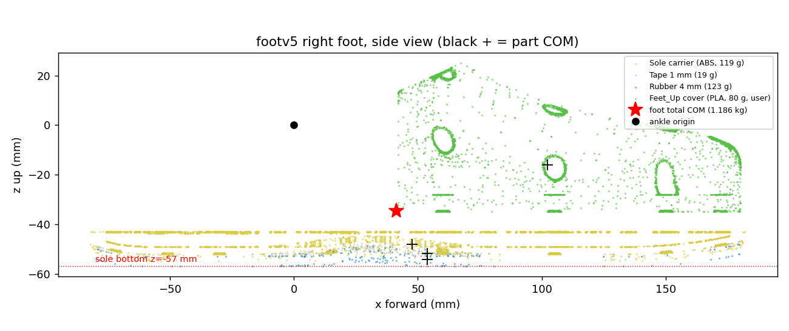

# 발 v5 모델(URDF · MJCF) 위치와 검토 — 질량·관성이 CAD 와 맞는가

2026-11-04 · 할 일 #190 · 읽기 전용 검토(원본·연구 큐·다른 세션 파일은 수정하지 않았습니다)

---

# 0. 결론

- **질량·무게중심·관성은 올바르게 들어 있습니다.** CAD 원본 STEP 에서 다시 계산한 값과 URDF 값이 질량 4 mg, 무게중심 0.01 mm 이내로 맞습니다.
- **URDF 와 MJCF(`v5fullm`)의 발 질량·무게중심·관성은 글자 그대로 같습니다.** 둘 다 발 하나 1.18617 kg 입니다.
- 사용자가 준 값(Feet_Up 80 g, 고무 1.15 g/cm³)은 그대로 쓰였습니다. 다만 **캐리어(ABS) 밀도 0.744 g/cm³ 는 추정값**입니다(사용자가 준 값이 아닙니다).
- 고칠 오류는 **발견하지 못했습니다.** 손볼 점은 파일 관리 쪽 3가지입니다(§5).

# 1. 무엇이 어디에 있나

| 무엇 | 위치 |
|---|---|
| CAD 원본(Fusion 에서 받은 STEP 4개) | `Feet_design/Feet_Design_Workspace/inputs/fusion_upload_20261101/` — `Sole_Carrier_v5_ABS.step`, `DS_Tape_1mm.step`, `Rubber_Sole_4mm.step`, `Feet_Up.step` |
| 원 발판(Al6061 8 mm) | `…/inputs/FEET.step` |
| 부품별 STL(발 좌표로 변환) | `…/foot_cad/v5/review_cad/{L,R}_{carrier,tape,sheet,sole,feet_up}_v5cad_MedialPlusX.stl` |
| **URDF**(질량 반영) | `pygmalion_locomotion/assets/pygmalion_v2/LegOnly_…_v30_proxyfix_footv5_loop.urdf` (+ `.motor_params.json`, `_report.json`, 메시 `meshes_footv5/`) |
| URDF 생성기 | `tools/robot_model/foot_overlay/build_footv5.py` |
| **MJCF**(학습·평가용) | `…/mjcf_sim/union_branch/mjlab_policy/pygmalion_mjlab/assets/pygmalion_legonly_ab_v5fullm.xml` 과 `pygmalion_legonly_ab_v5_*.xml` 변형 |
| 연구 진행 상태 | `…/mjcf_sim/study/RECOVERY_STATUS_2026-11-02.md` |

- MJCF `v5fullm` 은 `v5full` 에서 두 발의 `<inertial>` 한 줄만 URDF 값으로 바꾼 파일입니다(`tools/foot_sole/foot_inertial_from_urdf.py`). 다른 줄은 한 글자도 다르지 않습니다.
- mjlab 의 `xmls/` 폴더에는 footv5 MJCF 가 **없습니다**(D455 판만 있음).

# 2. 사용자 지정값과 출처

| 부품 | 질량 | 밀도 | 출처 | 신뢰 |
|---|---|---|---|---|
| Feet_Up(덮개, PLA) | 80 g | 0.164 g/cm³(솔리드 균일 가정) | **사용자 지정** | 높음 |
| 고무 밑창 4 mm | 122.7 g | 1.15 g/cm³ | **사용자 지정** 밀도 × CAD 체적 106.7 cm³ | 높음 |
| 양면테이프 1 mm | 19.2 g | 0.72 g/cm³ | 폼 테이프 가정 × CAD 체적 26.7 cm³ | 중간 |
| 캐리어(ABS 출력) | 119.1 g | 0.744 g/cm³ | 출력 구조 밀도 0.8874(docs/89) × ABS/PLA 1.04/1.24, **추정** × CAD 체적 160.1 cm³ | 낮음(실측 없음) |
| 기존 발 링크(판 + 브래킷 + 볼 소켓) | 845.2 g | — | 원본 모델 그대로 | — |
| **합계** | **1186.2 g** | | | |

# 3. 검증 결과 (모두 다시 계산, 통과/실패)

스크립트: `tools/robot_model/foot_overlay/review_footv5.py`(mjlab venv), STEP 값은 `~/.venvs/pyg_foot` 의 cadquery 로 읽었습니다.

| 검사 | 결과 |
|---|---|
| STEP 체적 ↔ URDF 메시 체적(4부품) | 통과. 차이 0.003~0.114 cm³(최대 0.03 %) |
| STEP 무게중심 ↔ URDF 메시 무게중심(발목 좌표) | 통과. 차이 0.002~0.01 mm. 캐리어는 아래 참고 |
| 5부품 재합산(평행축 정리) ↔ URDF `<inertial>` | 통과. 질량 4 mg, 무게중심 0.00003 mm, 관성 상대오차 5×10⁻⁷ |
| 관성 텐서가 물리적인가 | 통과. 주관성 모멘트 1.557e-3 / 6.605e-3 / 7.316e-3 kg·m², 삼각부등식 만족 |
| 왼발 = 오른발의 y 거울(질량·무게중심·관성 부호) | 통과. 차이 0 |
| MJCF `v5fullm` ↔ URDF (질량·무게중심·관성, 양발) | 통과. 차이 0 |
| MuJoCo 로 읽기: 몸체 위치·발 외 링크 | 통과. 위치 차이 0, 질량 변화는 두 발뿐(+0.34099 kg), 전체 18.276 → 18.958 kg(URDF) |
| MJCF 전체 질량 | 23.630 → 24.312 kg(`v5fullm`) |
| STEP → 발 좌표 변환(뒤꿈치 +80 mm = 발목, z = −800) | 통과. Feet_Up 무게중심 (102.2, 0, −16.1)·테이프 z −51.72 가 STEP 에서 다시 나옴 |

- 캐리어 메시는 **열린 메시**(`watertight` 거짓)로 나옵니다. 원인은 주 몸체 외에 **면 1개짜리 0.1 mm 조각**이 붙어 있어서입니다. 주 몸체는 닫혀 있고, 체적 차이는 0.047 cm³(0.03 %), 무게중심 차이는 0.01 mm 라 질량·관성에는 영향이 없습니다. (처음 내 검사가 "실패"로 나온 것은 열린 메시에 표면 중심을 쓴 내 검사 실수였고, 닫힌 몸체 기준으로 다시 하면 통과합니다.)
- Feet_Up 80 g 을 솔리드로 가정한 것이 얼마나 영향이 있나: 덮개가 얇은 껍질이라면 자기 관성이 약 40 % 커집니다(Ixx 7.8e-5 → 1.13e-4). **발 전체 관성에는 0.8~2.2 % 차이**, 무게중심은 약 1 mm 이내입니다. 무시해도 됩니다.

# 4. 이 검토에서 확인한 연구 쪽 사실

- MJCF 변형 29개 중 `v5_*` 와 `v5fullm` 은 모두 발 1.18617 kg 입니다. **`v5full`(1.09718)과 `v3full`(1.10318)은 예전 질량**입니다.
- 연구 계획의 0단계 평가(상자 발 0.845 / v3full 1.103 / v5full 1.097 kg)는 **발 질량이 서로 달라** 형상 효과에 질량 차이(최대 0.25 kg)가 섞여 있습니다. 1단계(`v5_*`, 1.186 kg 통일)는 이 문제가 없습니다. 0단계 결과를 논문에 쓸 때 각주가 필요합니다.
- 실행 중인 평가 큐 3개(PID 1874436, 2485228, 2503540)는 건드리지 않았습니다.

# 5. 손볼 점 (오류는 아니고 파일 관리)

1. footv5 URDF·`meshes_footv5/`·생성기·보고서는 **git 에 올라가 있지 않습니다**(미추적). 올리라는 지시가 있으면 올립니다.
2. URDF 가 쓰는 `meshes_v30_armfix` 는 이 PC 절대경로로 가는 심볼릭 링크입니다. 다른 PC 에서는 기존 판·브래킷 메시가 안 열립니다(D455 판과 같은 문제).
3. 캐리어 질량은 추정입니다. **실제 출력물을 저울에 재면** 값을 바로 바꿀 수 있습니다(`PRINTED_PLA`/밀도비를 질량 고정으로 바꾸면 됨).

# 6. 하지 않은 것

- Fusion 은 열지 않았습니다. 정본(`260923_Huphy_1.0_wShell_restored_v40`)과의 위치 대조는 2026-10-31 기록(0.085 mm)을 믿었고, 여기서는 받아 둔 STEP 과 발 링크 원본 메시의 좌표 일치(Feet_Up 무게중심, 테이프·고무 z)로 간접 확인했습니다.
- 충돌 조각 29개의 형상 정확도(바닥 높이 오차 P99 0.10 mm)는 `Feet_design/.../notes/발 v5 URDF 반영과 충돌 모델 검토.md` 의 결과를 다시 계산하지 않았습니다.
- mujoco_warp(GPU) 접촉은 이 PC 에 GPU 가 없어 직접 시험하지 못했습니다.

# 7. 후속

- 2026-11-04: 발 v5 + D455 합본 모델을 만들어 동료에게 전달할 수 있게 정리했습니다. §5 의 2번(절대 경로 심볼릭 링크)과 1번(미추적 파일)은 이 작업에서 처리했습니다. [[185_footv5_d455_combined_model]]
