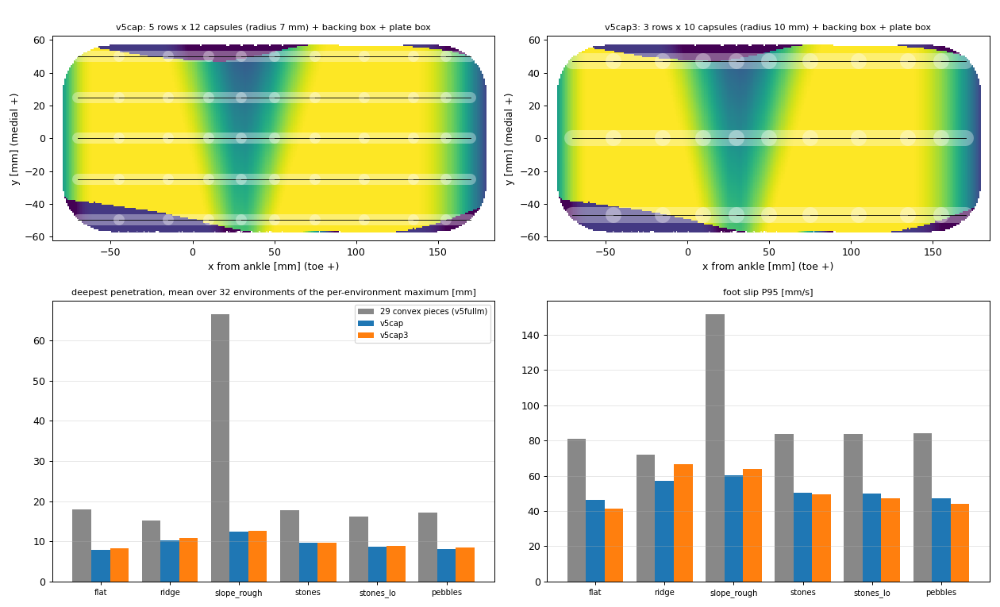

# 발 충돌 형상: 볼록 조각 29개 대 캡슐 — 같은 정책으로 맞비교

2026-11-04 · 할 일 #192 · 근거 조사는 `docs/research_raw/2026-11-04_foot_collision_shape_sources.md`

---

# 0. 결론

- **캡슐 발이 볼록 조각 발보다 침투가 얕고 미끄러짐이 적습니다.** 평지·굴곡·돌·자갈 6개 지형 모두에서 그렇습니다. 침투 깊이의 최대값은 15~18 mm에서 8~10 mm로 줄고, 발 미끄러짐 P95는 72~84 mm/s에서 42~57 mm/s로 줄었습니다.
- **넘어짐 수는 평지·굴곡·돌·자갈에서 차이가 없습니다**(32개 중 0~2개, 모두 p=1.0). 6° 경사 지형만 23개에서 3개로 줄었지만, 이 숫자는 정책 저장본의 운이 섞여 있어 그대로 믿을 수 없습니다(§5).
- 경계에서 관통 때문에 정책이 불안정해지지 않을까 하는 걱정은 이 시험에서 **볼록 조각 쪽에서 더 크게 나타났습니다.** 볼록 조각 발은 경사 지형에서 침투가 평균 66 mm까지 갔습니다(캡슐은 12.5 mm).
- 한계가 있습니다. 정책은 볼록 조각 발로 학습한 것이라 캡슐 발에는 처음 보는 접촉입니다. **캡슐 발로 다시 학습한 결과는 아직 없습니다.**

위 그림의 윗줄은 두 캡슐 모델의 배치입니다. 색은 CAD 발바닥이 가장 낮은 점보다 얼마나 높은지를 뜻하고(노랑 = 가장 낮음), 검은 선이 캡슐 축입니다. 아랫줄은 두 지표를 지형마다 비교한 막대입니다.

# 1. 무엇을 만들었나

| 이름 | 발마다 구성 | 파일 |
|---|---|---|
| v5fullm (기준) | 볼록 메시 조각 29개(바닥판 1개 + 밑창 띠 28개) | `pygmalion_legonly_ab_v5fullm.xml` |
| **v5cap** | 캡슐 50개(5줄 × 12개, 반지름 7 mm) + 받침 상자 1개 + 판 상자 1개 | `pygmalion_legonly_ab_v5cap.xml` |
| **v5cap3** | 캡슐 30개(3줄 × 10개, 반지름 10 mm) + 받침 상자 1개 + 판 상자 1개 | `pygmalion_legonly_ab_v5cap3.xml` |

- 만든 도구: `tools/foot_sole/build_v5cap.py`. v5fullm의 발 바닥 높이(1 mm 격자)를 읽어 캡슐 줄이 같은 높이를 따라가게 합니다. 질량·관성·시각 메시·위쪽 상자 3개는 v5fullm 그대로입니다. 새 파일이고 기존 파일은 바꾸지 않았습니다.
- 캡슐 줄만 세우면 줄 사이에 판 높이(발바닥에서 14 mm 위)까지 빈틈이 생깁니다. 받침 상자 없는 시험(v5capnb)에서 돌기 아래 발바닥 높이를 재니 −43 mm(판)가 나왔습니다. 그래서 캡슐 바닥에서 4~6 mm 위에 받침 상자를 넣었습니다.
- 모양 오차(v5cap): 평균 +1.9 mm(캡슐 쪽이 높음), 범위 −5.4 ~ +8.5 mm. 안쪽 앞발 모서리 3 cm² 안팎(바깥 가장자리 5 mm 높은 단)은 캡슐이 실제에 없는 지지를 만듭니다.
- 평지 접촉 면적(가장 낮은 점에서 0.2 mm 이내)은 29조각 156 cm², 캡슐 14 cm²입니다. 캡슐은 줄로 닿기 때문이고, 하중을 받으면 침투 5 mm쯤에서 넓어집니다.

# 2. 어떻게 비교했나

- 정책: 같은 저장본(`sole_ft_v5fullm_2500` 의 51,000회)을 세 발에 모두 씁니다. **다시 학습하지 않았습니다.** 그래서 차이는 접촉 모델에서만 옵니다.
- 지형 6종, 환경 32개, 명령 9개 × 15 초, 무작위화·잡음·밀기 없음. `docs/…/study/README.md` §1.3과 같은 평가기(`tools/foot_sole/foot_variant_eval.py`)를 썼습니다.
- **3090 서버의 GPU에서 세 발 모두 같은 조건으로 돌렸습니다.** 이 PC의 CPU 결과와 GPU 결과는 시뮬레이터 백엔드가 달라 값이 다릅니다(v5cap 경사 넘어짐 CPU 9개, GPU 3개). 그래서 CPU와 GPU를 섞어 비교하지 않았습니다.
- 지표 계산: `tools/foot_sole/v5cap_compare.py`(환경 하나가 표본, 평균 차이의 95 % 부트스트랩 구간). 결과 `study/compare_cap_gpu.json`.

# 3. 결과: v5cap (기준 → v5cap)

| 지형 | 넘어짐 | 침투 최대 [mm] | 침투 P99 [mm] | 미끄러짐 P95 [mm/s] | 발당 접촉 수 | 착지 최대 힘 [BW] |
|---|---|---|---|---|---|---|
| 평지 | 0 → 0 | 17.9 → 8.0 | 9.3 → 5.4 | 81 → 46 | 5.0 → 23.1 | 3.56 → 3.50 |
| 굴곡 1~2 cm | 0 → 0 | 15.1 → 10.3 | 7.6 → 6.0 | 72 → 57 | 3.1 → 5.1 | 3.31 → 3.46 |
| 6° 경사 + 굴곡 | 23 → 3 (p<0.001) | 66.5 → 12.5 | 17.7 → 6.6 | 152 → 60 | 2.6 → 5.0 | 3.68 → 3.64 |
| 돌 2 cm | 1 → 1 | 17.7 → 9.7 | 9.4 → 5.6 | 84 → 50 | 5.1 → 19.6 | 3.37 → 3.38 |
| 돌 1 cm | 1 → 2 | 16.2 → 8.6 | 9.2 → 5.5 | 84 → 50 | 5.2 → 20.5 | 3.43 → 3.45 |
| 자갈 3~8 mm | 0 → 0 | 17.2 → 8.1 | 9.5 → 5.5 | 84 → 47 | 4.3 → 17.1 | 3.51 → 3.50 |

- v5cap3(캡슐 30개)도 같은 방향입니다: 침투 최대 8.2~12.6 mm, 미끄러짐 42~66 mm/s, 발당 접촉 수 4~16개. 평지·돌·자갈에서 넘어짐 0~2개입니다. 굴곡에서 1개(기준 0개)로 차이는 통계로 구별되지 않습니다.
- 평지에서 이동 비용(양의 일)은 0.32 → 0.28(v5cap)·0.29(v5cap3)로 낮아졌고, 착지 최대 힘은 거의 같습니다(−0.06 ~ +0.15 BW).
- 불리한 점 하나: 발끝과 뒤꿈치 두 점만 닿는 시간 비율(분할 접촉)이 v5cap은 4 % → 23 %로 늘었습니다. v5cap3는 평지 3 %로 기준과 비슷합니다. 줄 위에서 구르는 윤곽이 달라진 효과로 보입니다. 원인은 확인하지 않았습니다.
- 접촉 수가 늘었습니다. v5cap은 평지·돌에서 발당 P99 42개로, 평가기가 발마다 기록하는 상한(64개) 안이지만 학습 설정(`nconmax 150`, 두 발 + 몸)에서는 여유가 줄어듭니다. v5cap3은 P99 24개입니다.

# 4. 정적 돌기 시험 (정책 없음)

`tools/foot_sole/static_bump_test.py`(캡슐을 읽도록 확장), 150건 × 3모델, `study/static_bump_v5cap.csv`.

- 폭주나 관통은 없었습니다.
- 돌기 높이 3~10 mm에서 기울기 차이는 평균 0.6~1.6°입니다.
- 20 mm 돌기에서는 최대 14° 다릅니다. 좁은 점 위의 평형이라 시작 기울기 0.5°에도 결과가 바뀝니다. 모델 오차로 보기 어렵습니다.

# 5. 믿으면 안 되는 것 (읽을 때 주의)

1. **경사 지형 넘어짐 23 → 3은 접촉 모델의 효과만이 아닙니다.** 같은 볼록 조각 발의 다른 저장본은 경사에서 넘어짐 5~8개입니다(같은 발, 시드 44의 51,000회 8개, 52,498회 5개). 이 저장본(23개)이 유독 나쁩니다. 캡슐이 3개로 낮춘 것은 부분적으로 이 저장본의 운을 되돌린 것입니다. 침투 최대 66 → 12.5 mm 같은 접촉 지표는 넘어짐 이후 충돌도 섞여 있습니다.
2. **정책이 볼록 조각 발로 학습됐습니다.** 캡슐 발이 이 정책에서 낫다면 처음 보는 접촉에서도 안정하다는 뜻이지만, 다시 학습한 성능이 더 낫다는 뜻은 아닙니다.
3. 지표 일부는 접촉점 개수에 따라 정의가 달라집니다. 압력 중심 여유와 바깥쪽 하중 비율은 비교하지 않았습니다.
4. 이 시험은 상자로 만든 지형(굴곡·돌·자갈)입니다. 높이장(hfield)은 쓰지 않습니다(`study/README.md` §1.3).
5. 평가 환경 32개, 시드 1개입니다. 지표 차이가 구간 밖이어도 시드 잡음(§5 첫 항목의 23 대 8)을 넘는지는 별도입니다. 평지·돌·자갈의 침투와 미끄러짐 차이는 모든 지형에서 같은 방향이라 잡음으로 보기 어렵습니다.

# 6. 이 PC의 CPU 결과 (참고)

같은 v5cap을 이 PC CPU로 돌린 평지·굴곡·경사 결과가 있습니다(`study/eval_cap/`): 넘어짐 0·1·9개. GPU(0·0·3개)와 다릅니다. 같은 모델·같은 정책이라도 백엔드가 다르면 경사에서 넘어짐 수가 달랐다는 뜻이므로, 이 연구의 비교는 한 백엔드 안에서만 해야 합니다. 29조각 쪽의 CPU 짝 결과는 평지만 있습니다(침투 최대 18.1 → 8.0 mm 로 GPU와 같은 방향).

# 7. 다음 단계 (사용자 결정 필요)

- **캡슐 발로 2,500회 다시 학습(3090).** 지금 비교가 "처음 보는 접촉" 효과를 잴 수 없어서, 공정한 비교는 이 학습 뒤에만 가능합니다. 시작하라는 말씀이 있기 전에는 하지 않습니다.
- 접촉 수 확인: 학습 설정(`nconmax 150`)에서 v5cap의 접촉이 잘리는지 학습 시작 전에 시험해야 합니다. v5cap3이 더 안전합니다.
- 연구 계획(`study/STUDY_PLAN.md`)의 형상 매개변수 훑기(아치 깊이 등)는 29조각 기준입니다. 캡슐로 바꾸면 모델 오차(±1.9 mm)가 훑는 범위(아치 2~12 mm)와 같은 자릿수라 훑기 해석이 흔들립니다. 형상 훑기는 29조각으로 하고, 캡슐은 접촉 안정성용 대안으로 따로 두는 것을 권합니다.

# 8. 하지 않은 것

- 캡슐 발 재학습, 정지·밀기 시험, 보폭이 큰 보행 시험.
- v5cap의 접촉 수를 학습 버퍼 크기로 시험.
- 이 PC의 CPU 돌·자갈 평가(3090 GPU 결과로 대체하고 중단).
