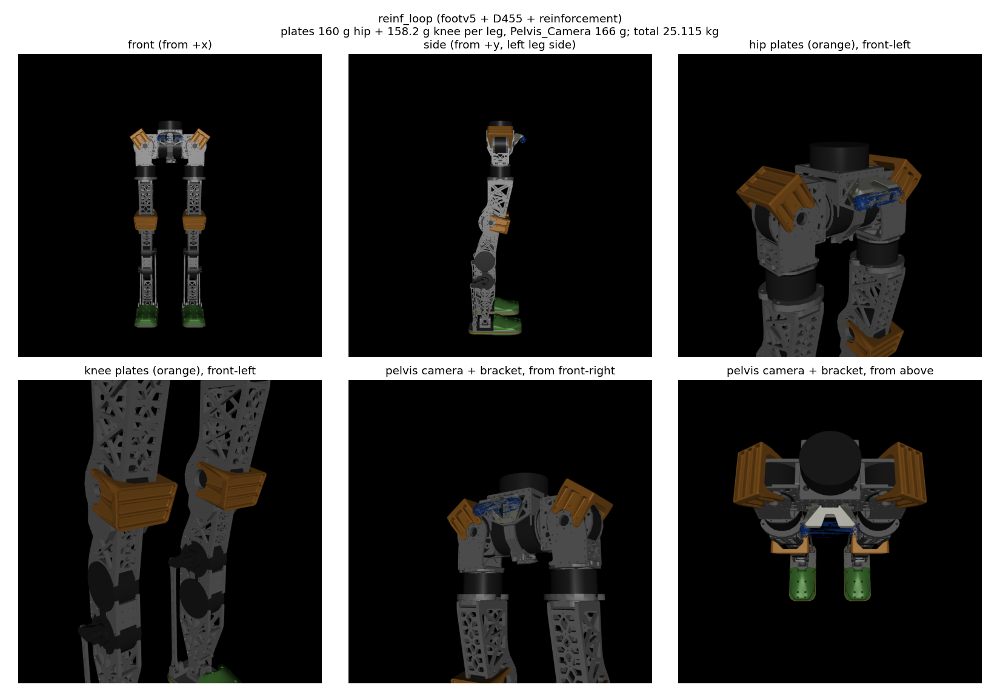
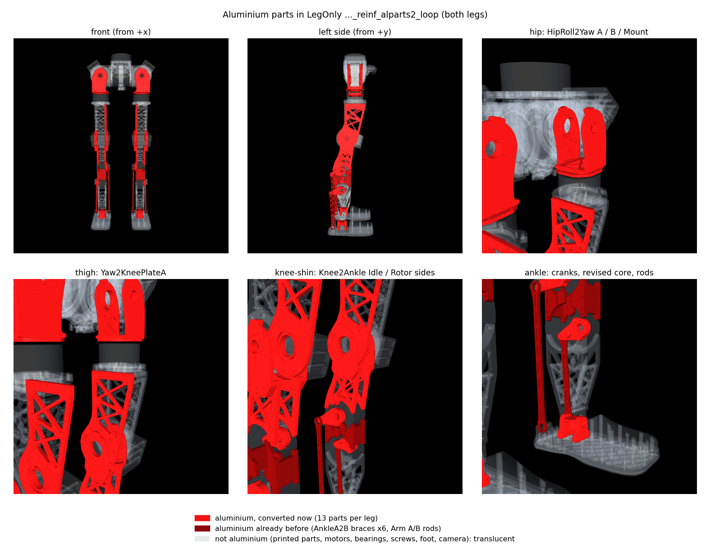
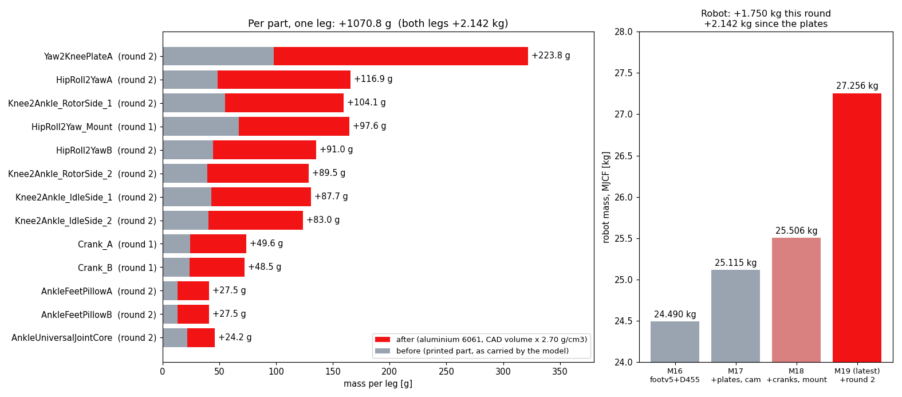
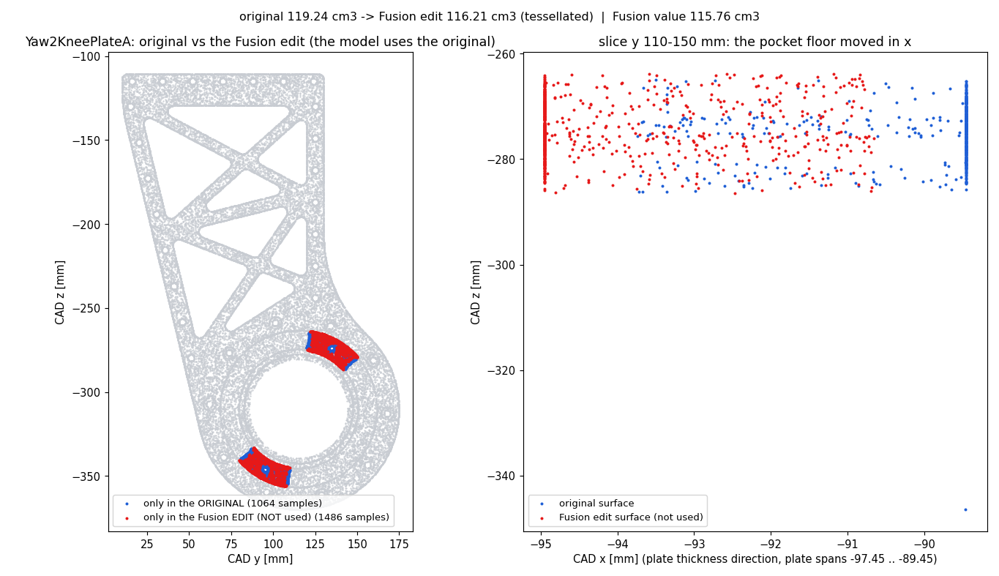

# 발 v5 + 골반 D455 합본 모델 (동료 전달용)

2026-11-04 · 할 일 #193 · 대상: `stairs_slopes12_union_dr_99998` 체크포인트를 학습한 동료

---

# 0. 한 줄 요약

- CAD 원본 발바닥·Feet_Up 과 골반 카메라(D455 + PLA 브래킷)가 **모두 들어간** URDF 와 MJCF 를 새 파일로 만들었습니다. 원본 파일은 건드리지 않았습니다.
- 두 모델을 따로 만든 기존 결과(발 v5 판, D455 판)와 **값이 글자 그대로 같은지** 30가지를 다시 계산해 확인했고, 모두 통과했습니다.

# 1. 파일 위치

| 무엇 | 위치 | 비고 |
|---|---|---|
| **URDF** | `pygmalion_locomotion/assets/pygmalion_v2/LegOnly_prototype-tempmass-motormeasured-armfix_v30_proxyfix_footv5_d455_loop.urdf` | 옆의 `.motor_params.json`(모터 값 보조 파일)과 한 벌 |
| **MJCF (GitHub 에 올라가는 사본)** | 같은 폴더의 `…_footv5_d455_loop.xml` | 일반 MuJoCo 에서 바로 열림. 메시 폴더를 상대 경로로 찾음 |
| MJCF (mjlab 사본) | `mujoco-sim/mjlab/src/mjlab/asset_zoo/robots/pygmalion/xmls/…_footv5_d455_loop.xml` | mjlab 저장소 안이라 **이 저장소의 GitHub 에는 없음** |
| 검증 보고서 | 같은 폴더의 `…_footv5_d455_loop_report.json` | 30개 검사의 숫자 |
| 메시 폴더 | `meshes_v30_armfix/`(기본 링크), `meshes_footv5/`(발 CAD 부품), `meshes_d455/`(카메라, 브래킷) | 3개 모두 필요 |
| 생성기 | `tools/robot_model/foot_overlay/build_footv5_d455.py` | 손으로 고치지 말고 이것을 고쳐 다시 만듭니다 |
| 검증기 | `tools/robot_model/foot_overlay/verify_footv5_d455.py` | |
| 깊이 영상 검사 | `docs/img/footv5_d455/depth_check.{png,json}` | |

이름 읽는 법: `…_footv5_d455_loop` = 다리만(LegOnly) + 발 v5 + 카메라 + AB 발목(2-RSU 폐루프). 자세한 규칙은 [[181_mjcf_urdf_models]] §3.

# 2. 어떻게 합쳤나

- 발 v5 판은 발 링크 두 개만 바꾸고, D455 판은 `base_link` 에 몸체를 덧붙이기만 합니다. 서로 겹치는 곳이 없어서 **이어 붙이면 그대로 합본**이 됩니다.
- **URDF**: 발 v5 URDF 에 D455 URDF 의 덧붙인 블록을 그대로 붙였습니다. D455 URDF 가 "원본 + 블록"인지 먼저 확인하고(아니면 중단), 블록만 가져왔습니다.
- **MJCF**: 원본 MJCF 에서 발마다 관성과 충돌 형상 32개(위쪽 상자 3 + 밑창 조각 29)를 `v5fullm` 에서 가져오고, CAD 시각 메시 4개(캐리어, 테이프, 고무, Feet_Up)를 더한 뒤 카메라를 D455 판과 같은 방식으로 얹었습니다.
- 충돌 형상 이름은 `R_foot1_collision … R_foot32_collision`(왼발은 `L_`)입니다. 학습 코드의 접촉 설정(`^(L|R)_foot\d+_collision$`: condim 3, 마찰 0.6, 우선순위 1)이 그대로 적용됩니다.

# 3. 검증 결과

| 검사 | 결과 |
|---|---|
| 발 링크 질량·무게중심·관성 = 발 v5 판 (URDF), = `v5fullm` (MJCF), 양발 | 통과. 차이 0. 발 1.18617 kg, 무게중심 (41.397, ∓0.012, −34.599) mm |
| URDF 발 = MJCF 발 | 통과. 질량·무게중심·관성 차이 0 |
| 카메라 몸체: 질량 116.00 g, 브래킷 61.97 g, 위치·관성 = D455 판 | 통과 (URDF, MJCF 둘 다). 카메라 위치 (119.18, 47.5, 24.01) mm, `base_link` 기준 |
| URDF 카메라 = MJCF 카메라 | 통과. 위치 차이 0.0001 mm, 시선 방향 일치 |
| **전체 질량** = 원본 + 2 × 0.34099 + 0.116 + 0.06197 | 통과. URDF 23.634 → 24.494 kg, MJCF 23.630 → 24.490 kg (+0.85995 kg) |
| 그 밖의 몸체·관절·폐루프(등식 구속 4개) 변화 없음 | 통과 |
| 충돌 형상 64개(양발) = `v5fullm` | 통과. 최대 차이 1e-9 |
| 밑창 가장 낮은 점 = 발목 아래 −57 mm | 통과 (URDF, MJCF 둘 다) |
| MJCF 1초 시뮬레이션에서 NaN 없음 | 통과 |
| **카메라 깊이 영상**(848×480, 평면 바닥·벽 정답과 비교) | 통과. 광선 추적 최대 오차 0.023 mm, mjlab 카메라 센서(CPU) 0.023 mm, 로봇 자기 몸이 찍힌 픽셀 0 |

- 처음에 "전체 질량이 원본 + 0.34099 kg 근처"라고 적었지만, 0.34099 kg 은 **발 하나**의 증가분입니다. 양발이면 +0.68198 kg 이고 카메라 +0.178 kg 을 더해 +0.85995 kg 이 맞습니다.
- MuJoCo 의 URDF 읽기는 고정 관절 링크를 합쳐 버립니다. 카메라 몸체를 따로 보려면 `fusestatic="false"` 로 읽어야 합니다(검증기는 그렇게 읽습니다).

# 4. 동료가 알아야 할 주의사항

1. **밑창이 14 mm 낮아졌습니다.** 가장 낮은 점이 −43 mm → −57 mm 입니다. 시작 높이를 그만큼 올리지 않으면 시작할 때 땅에 박힙니다.
2. **99998 정책은 상자 발로 학습한 정책입니다.** 이 합본 발로 평가하면 처음 보는 발(zero-shot)이고, 질량도 발 하나 0.845 → 1.186 kg 으로 늘었습니다. 성능 변화에는 형상, 높이, 질량이 섞여 있습니다.
3. **접촉 개수 버퍼.** 발 하나에 충돌 조각이 32개입니다. 발 연구의 평가는 `nconmax` 640 / `njmax` 3072 로 돌렸고, 학습 설정은 150 / 1500 입니다. 학습 버퍼에서 접촉이 잘리지 않는지 직접 확인하지 않았습니다. 확인이 필요합니다.
4. **URDF 와 MJCF 의 충돌 형상이 완전히 같지는 않습니다.** MJCF 는 `v5fullm` 의 32개(위쪽 상자 3 + 조각 29)입니다. URDF 는 기존 발 껍질(볼록 껍질 1개) + 조각 29개입니다. 질량·관성·밑창 높이는 같습니다.
5. **카메라와 브래킷은 MJCF 에서 시각 요소뿐입니다**(충돌 없음, 원래 D455 판과 같은 규약). URDF 에는 카메라 상자와 브래킷 껍질 충돌이 있습니다.
6. **Feet_Up(발등 덮개)은 충돌이 없습니다.** 질량 80 g(사용자 지정)을 CAD 형상에 고르게 퍼뜨린 값입니다. 얇은 껍질이라면 발 관성이 0.8~2.2 % 달라집니다([[184_foot_v5_model_review]] §3).
7. **추정값이 둘 있습니다.** 캐리어(ABS 출력물) 밀도 0.744 g/cm³ 와 카메라 브래킷 61.97 g(PLA 구조 밀도 × CAD 체적)입니다. 실제 부품 질량을 재면 바꿀 수 있습니다. 카메라 116 g 은 데이터시트 값(±10 %)입니다.
8. **카메라는 60° 아래로 숙여 `base_link` 에 단단히 붙어 있습니다.** 정책 관측에는 넣지 않았습니다(이 합본은 모델 파일만 만듭니다).
9. **이름은 실제 몸 기준입니다.** `L_` = 진짜 왼쪽(2026-09-12 에 바로잡음, [[136_left_right_naming_history]]).
10. **동료의 `robot.py` 접촉 설정을 고쳐야 합니다.** `pygmalion_mjlab/robot.py` 의 `COLLISION` 이 발 충돌 형상 이름을 `^(L|R)_foot[1-7]_collision$` 로 잡습니다. 새 발은 `foot1`~`foot32` 라서 그대로 쓰면 `foot8`~`foot32` 가 condim 1, 마찰 기본값, 우선순위 0 이 됩니다(학습 때와 다른 접촉). `\d+` 로 바꿔야 합니다(발 연구 브랜치는 이미 그렇게 되어 있습니다). viser 스크립트는 이 값을 대신 바꿔서 실행합니다.
11. **확인하지 못한 것**: 동료의 학습 환경(`generalized-union-dr` 브랜치 등)에서 직접 불러 보지 않았습니다. 이 PC 에는 GPU 가 없어 OpenGL 렌더러와 GPU 접촉은 시험하지 못했습니다(깊이는 광선 추적과 CPU 카메라 센서로 확인).

# 5. 쓰는 법

- **일반 MuJoCo**: 저장소를 받아 `…_footv5_d455_loop.xml`(GitHub 사본)을 그대로 엽니다. 메시는 같은 폴더의 `meshes_*` 를 상대 경로로 찾습니다.
- **mjlab**: mjlab 사본을 `xmls/` 에 두고, 같은 폴더에 `assets_v30_armfix`(기본 메시), `assets_v30_d455`, `assets_v30_footv5` 링크가 있어야 합니다. 생성기를 돌리면 `assets_v30_footv5` 링크는 자동으로 만들어집니다(상대 경로).
- **URDF**: 같은 폴더의 `meshes_*` 를 상대 경로로 읽습니다. 모터 회전자 관성은 `.motor_params.json` 에 있습니다([[144_urdf_motor_params_portability]]).
- 이 PC 에서 다시 만들 때(mjlab 가상환경): `tools/robot_model/foot_overlay/build_footv5_d455.py`, 이어서 `verify_footv5_d455.py`.

# 6. 파일 관리 (이번에 같이 한 것)

- `meshes_v30_armfix`, `meshes_v30_legonly` 심볼릭 링크를 이 PC 절대 경로에서 **상대 경로**로 바꿨습니다(`../../../tools/robot_model/fusion_snapshots/v30_inspection/…`). 다른 PC 에서도 열립니다. 대상 메시 57개는 이미 git 에 있습니다.
- 발 v5 판 URDF, `meshes_footv5/`(12 MB), 생성기, 보고서, 검토 스크립트를 git 에 올렸습니다(이전에는 미추적).
- mjlab `xmls/` 폴더는 mjlab 포크 안이라 우리 GitHub 에 없습니다. 그래서 GitHub 사본(자산 폴더)을 전달 대상으로 삼았습니다.
- 다른 모델 파일의 `xmls/assets_*` 링크(절대 경로)는 건드리지 않았습니다.

# 7. 검증 이미지

전체 렌더는 OpenGL 없이 광선 추적으로 그렸습니다(이 PC 에 GPU 가 없음). 생성기: `tools/robot_model/foot_overlay/report_footv5_d455_figs.py`.

**7-1. 합본 모델 모습** — 전신(앞·옆·3/4), 오른발 CAD 밑창(캐리어 노랑, 테이프 흰색, 고무 파랑, Feet_Up 초록), 골반의 D455(파랑)와 PLA 브래킷. D455 메시는 이 광선 추적 그림에서만 점무늬로 보입니다.


**7-2. 발 충돌 형상**(위쪽 상자 3 + 조각 29, 조각마다 다른 색)


**7-3. 전신 URDF ↔ MJCF 대조** — 몸체 23개의 질량과 무게중심, 관절 24개의 축 방향을 선 자세 1개와 무작위 자세 3개에서 비교했습니다. 최대 차이: 질량 4e-7 g, 무게중심 1.4e-4 mm, 축 3.3e-6°, 관절 범위 4.9e-6 rad. 전체 질량의 4.0 g 차이(24.4901 vs 24.4941 kg)는 원본 모델 둘 사이에 이미 있던 값이고, 합본이 더한 것이 아닙니다([[181_mjcf_urdf_models]] §5).


**7-4. 검사 30개 목록**


**7-5. 카메라 깊이 영상** — 평면 바닥·벽의 정답과 비교. 광선 추적과 mjlab 카메라 센서 모두 최대 0.023 mm.


# 8. viser 에서 99998 정책과 깊이 영상 보기

- **정책**: 동료 브랜치 `generalized-union-dr` 의 `mjlab_policy/checkpoints/stairs_slopes12_union_dr_99998/model_99998.pt` 를 그대로 씁니다(별도 git 작업 폴더 `.claude/worktrees/union_dr_99998`, 커밋 `a742fc6`). 작업은 `Pygmalion-Velocity-Generalized-StairsSlopes12-UnionDR`.
- **로봇**: 이 문서의 합본 MJCF. **지형**: 폭 2 m 한 줄 코스 — 평지 3 m, 15° 오르막, 윗면 1 m, 12 cm 계단 5개 내려가기, 평지 1.5 m, 12 cm 계단 5개 올라가기, 윗면 1 m, 15° 내리막, 평지 8 m. 한 환경에 평지·경사·계단이 모두 있습니다.
- **명령**: 앞으로 0.5 m/s 로 5초, 이후 1.0 m/s (동료의 `--staged-forward`). 15초마다 처음부터 다시 시작합니다.
- **깊이 영상**: 오른쪽 패널 `Camera Feeds` 의 `robot/d455_depth`(424×240)와 3D 화면의 카메라 시야 선(frustum). 깊이는 **표시용**이고 정책은 보지 않습니다(정책 입력은 44개, 카메라·높이 지도 없음).
- 실행(mjlab 가상환경, mjlab 은 동료가 지정한 `20f10e96` 판):

```bash
PYTHONPATH=Feet_design/Feet_Design_Workspace/mjcf_sim/stock_mjlab/src CUDA_VISIBLE_DEVICES="" \
  mujoco-sim/mjlab/.venv/bin/python3 tools/robot_model/viser_policy_footv5_d455.py
```

- 서버는 모든 주소(`0.0.0.0`)에서 받습니다. 8080 이 이미 쓰이고 있어 **`http://192.168.20.177:8081`** 로 열렸습니다(시작 때 viser 가 찍는 포트를 보세요). 옵션: `--slope-deg`, `--step-cm`, `--num-steps`, `--cam-width/--cam-height`, `--model`(예: 원래 상자 발 `…_proxyfix_loop` 으로 비교), `--no-camera`, `--rollout <초> --out <폴더>`(화면 없이 궤적·깊이 저장).
- **바꾼 것**: 로봇 MJCF, 위 §4 의 10번 접촉 설정, 시작 높이 +14 mm, 지형, 카메라 센서. 정책·관측·액추에이터·체크포인트는 그대로입니다.


위 화면은 헤드리스 브라우저로 찍은 것입니다. 왼쪽 3D 에 오르막 위의 로봇, 카메라 시야 선, 정책의 지형 스캔 점(비판자 전용)이 보이고, 오른쪽 아래에 깊이 영상이 있습니다. 깊이 영상이 검거나 흰색으로 포화돼 보이면 `Depth Scale` 슬라이더를 움직이세요.

# 9. 정책이 합본 모델에서 코스를 걷는가 (화면 없이 3번 실행)


- 3번 중 **2번은 코스 전체(오르막, 계단 내리기, 계단 오르기, 내리막)를 넘어지지 않고 지났고, 1번은 계단을 내려온 직후 평지(약 9.8 초)에서 넘어졌습니다.** 같은 설정인데 결과가 갈린 것은 시작 자세의 무작위성 때문으로 보이나 원인을 따로 확인하지는 않았습니다. 표본이 3개라 성공률을 말할 수는 없습니다.
- 위 그림은 넘어지지 않은 실행입니다. 깊이 영상에서 7~8초에 내려가는 계단이, 10초에 올라가는 계단이 보입니다.
- 새 발(처음 보는 발, 질량 +0.34 kg)로 99998 정책이 대체로 걷는다는 정도만 확인한 것이고, 성능 평가가 아닙니다. 발 형상 효과를 따지려면 같은 조건에서 상자 발과 비교해야 합니다(`--model` 로 가능).
- 이 PC 는 GPU 가 없어 CPU 로 돌립니다. 다른 세션 작업이 겹치면 viser 실시간 배율이 0.05~0.1배까지 떨어집니다(1배가 실시간). 카메라를 끄거나(`--no-camera`) 해상도를 줄이면 빨라집니다.

# 10. 보강재 반영본 `_footv5_d455_reinf_loop` (2026-11-04, 할 일 195)

합본 모델에 **엉덩이 보강재, 무릎 보강재, 새 카메라 질량**을 더한 최신 판입니다. 이전 판 `_footv5_d455_loop` 는 그대로 있습니다. 동료가 학습에 쓰는 모델은 이 판으로 바꾸면 됩니다.



(주황색이 보강재입니다. 렌더는 3090 서버에서 EGL 로 했습니다.)

## 10.1 무엇이 바뀌었나

| 부품 | 질량 | 붙는 링크 | 한 다리당 |
|---|---|---|---|
| Hip-Reinforcement | 160.0 g | `hip_roll_link` (CAD 의 HipRoll2Yaw 에 볼트로 고정, 같이 움직임) | 1개 |
| Knee-Reinforcement | 158.2 g | `shin_link` (CAD 의 Knee2Ankle 에 볼트로 고정, 같이 움직임) | 1개 |
| Pelvis_Camera (카메라 + 브래킷) | 166 g 합계 | `base_link` | 카메라 116 g + 브래킷 50 g |

- 질량은 사용자가 준 값입니다. Fusion 의 재질은 강철 자리표시자라서 CAD 질량(1143 g, 1242 g, 499 g)은 쓰지 않았습니다.
- 모양, 무게중심, 관성은 CAD 에서 읽었습니다. 관성은 "CAD 질량 대비 사용자 질량" 비율로 줄였습니다(밀도가 균일하다고 보는 것이며, 모터 자리표시자에 쓰던 규칙과 같습니다).
- 보강재는 새 링크를 만들지 않고 `hip_roll_link`, `shin_link` 의 질량·무게중심·관성에 합쳤습니다. 몸체 수와 관절 수는 그대로입니다. 모양(visual)만 주황색 메시로 더했습니다.
- CAD 에는 다리가 한쪽(`R_`, 몸 안쪽 기준 −y)만 있습니다. 반대쪽은 y 를 뒤집어 만들었습니다(`build_robot.py` 의 `mirror` 와 같은 규칙).
- 카메라 브래킷은 CAD 가 바뀌었습니다(체적 69.83 → 63.57 cm³). 카메라 위치와 방향은 이전과 같음을 Fusion 에서 다시 확인했습니다.

## 10.2 파일 위치

| 파일 | 위치 |
|---|---|
| URDF | `pygmalion_locomotion/assets/pygmalion_v2/LegOnly_prototype-tempmass-motormeasured-armfix_v30_proxyfix_footv5_d455_reinf_loop.urdf` |
| MJCF (저장소 사본, 일반 MuJoCo) | 같은 폴더의 `…_footv5_d455_reinf_loop.xml` |
| MJCF (mjlab 용) | `mujoco-sim/mjlab/src/mjlab/asset_zoo/robots/pygmalion/xmls/…_footv5_d455_reinf_loop.xml` (git 에 없음, 메시는 상대 링크 `assets_v30_reinforce`) |
| 메시 | `pygmalion_locomotion/assets/pygmalion_v2/meshes_reinforce/` (보강재 4개, 브래킷 + 충돌용 볼록 껍질) |
| 보고서, 검증 결과 | 같은 폴더의 `…_reinf_loop_report.json`, `…_reinf_loop_verify.json` |
| Fusion 읽은 값 | `tools/robot_model/fusion_snapshots/reinforce_20261104/` |
| 만드는 코드 | `tools/robot_model/reinforce_overlay/` (`extract_reinforce.py`, `build_reinforce.py`, `verify_reinforce.py`, `render_reinforce.py`) |

## 10.3 검증 (60개 중 60개 통과)

| 확인한 것 | 결과 |
|---|---|
| 링크 질량이 +160.0 g(엉덩이), +158.2 g(정강이) | 통과 (URDF, MJCF 2벌) |
| D455 + 브래킷 = 166 g | 통과 (116.000 + 50.000 g) |
| 전체 질량 변화 | +0.624434 kg. URDF 24.494 → 25.119 kg, MJCF 24.490 → 25.115 kg |
| 바꾼 5개 링크 외 나머지 몸체(URDF 30개, MJCF 19개) | 질량·무게중심·관성·위치가 한 글자도 안 바뀜 |
| 보강재 무게중심이 CAD 값과 같은 위치 (`base_link` 기준, 4개) | 통과. 오른쪽 엉덩이 (−0.24, −158.15, 47.79) mm 등 |
| 보강재 메시 크기·위치가 CAD 와 같음 | 통과 (차이 0.06 mm 이하) |
| 링크 관성 = 이전 링크 + 보강재 (평행축 정리, 코드와 별개로 다시 계산) | 통과 |
| URDF 와 MJCF 가 같은 만큼 바꿨는가 | 통과 |
| 관성이 물리적으로 가능한가, 200 스텝 뒤 NaN 이 없는가 | 통과 |

- 로봇 전체 무게중심(영점 자세, `base_link` 기준, URDF)은 (−26.7, −0.2, −301.2) mm 에서 (−25.9, −0.2, −297.9) mm 로 옮겨졌습니다. **3.3 mm 올라가고 0.8 mm 앞으로 갔습니다.** 보강재가 엉덩이 높이와 무릎 높이에 있어 몸이 약간 높은 곳에 무거워진 것입니다.

## 10.4 동료가 알아야 할 주의사항

1. **보강재에는 충돌 모양이 없습니다.** 보강재가 기존 링크 껍질 밖으로 엉덩이 51 mm, 무릎 57 mm 까지 튀어나옵니다(보강재 꼭짓점의 21 %, 15 % 만 기존 껍질 안). 지금은 발만 땅과 닿는 설정이라 학습에는 영향이 없지만, 다리끼리 또는 보강재가 몸에 닿는 것은 시뮬레이션되지 않습니다.
2. **166 g 의 나눔은 가정입니다.** 사용자가 "Pelvis_Camera 166 g" 이라고만 했습니다. 카메라 116 g(데이터시트, 변경 없음) + 브래킷 50 g 으로 나누었습니다. 166 g 이 카메라만의 값이면 알려 주세요. 코드 `MASS_G` 한 줄만 고치면 됩니다.
3. **이 모델은 동료의 학습 환경에서 아직 돌려 보지 않았습니다.** 이전 판과 같은 구조(몸체·관절 수 동일)이고 질량만 바뀌었으니 같은 방식으로 불러질 것입니다. 단, §4 의 10번 주의(`robot.py` 의 `COLLISION` 정규식을 `\d+` 로)는 여전히 필요합니다.
4. **질량이 약 0.62 kg 늘었습니다.** 정책(99998)은 이 질량으로 학습하지 않았습니다. 학습 때의 질량 무작위화 범위 안인지 확인하세요.
5. **Fusion 문서에 저장되지 않은 수정이 있습니다.** 읽은 문서는 `260923_Huphy_1.0_wShell_restored_v40` (버전 10)이고 저장 안 된 변경이 있는 상태였습니다. 저장된 값과 다를 수 있습니다.
6. 검증할 때 MuJoCo 가 저장된 관성 텐서를 주축으로 분해하는 과정에서 상대 오차 1e-6 정도가 생깁니다(정강이처럼 두 값이 가깝고 곱 항이 큰 경우). 그래서 관성 비교의 허용 오차를 1e-7 kg·m² 로 잡았습니다. 파일에 적은 값 자체는 9자리까지 정확합니다.

## 10.5 다시 만드는 법

```bash
export FUSION_MCP=http://192.168.20.161:27182/mcp FUSION_MCP_HOST=127.0.0.1:27182
PY=mujoco-sim/mjlab/.venv/bin/python3
$PY tools/robot_model/reinforce_overlay/extract_reinforce.py --out tools/robot_model/fusion_snapshots/reinforce_20261104   # Fusion 읽기 전용
$PY tools/robot_model/reinforce_overlay/build_reinforce.py --snapshot tools/robot_model/fusion_snapshots/reinforce_20261104
$PY tools/robot_model/reinforce_overlay/verify_reinforce.py
```

렌더와 학습은 3090 서버(`syaro@10.8.0.14`)에서 합니다(사용자 지시 2026-11-04). 렌더 스크립트는 `MUJOCO_GL=egl` 로 그 서버에서 돌렸습니다.

# 11. 알루미늄 부품판 `_reinf_alparts_loop` (2026-11-04, 할 일 198·199)

보강재판에 **발목 크랭크 4개와 엉덩이 마운트 2개를 알루미늄 질량으로** 바꾼 최신 판입니다. 전체 기록은 [[186_urdf_mjcf_version_ledger]] M18에 있습니다.

| 부품 | 전 | 후 | 질량 변화(다리마다) |
|---|---|---|---|
| 크랭크 A | 프린트 24.28 g | 알루미늄 73.89 g (체적 27.366 cm³ × 2.70) | +49.6 g |
| 크랭크 B | 프린트 23.72 g | 알루미늄 72.18 g (26.732 cm³ × 2.70) | +48.5 g |
| 크랭크 커버 A, B | 프린트 | 그대로(사용자: 커버 제외) | 0 |
| HipRoll2Yaw_Mount | 프린트 67.0 g | 알루미늄 164.59 g (60.961 cm³ × 2.70) | +97.6 g |

- 관성은 각 부품의 CAD 관성에 (새 질량 ÷ CAD 질량)을 곱했습니다(밀도가 균일하다고 봄). 크랭크 링크는 "프린트 밀도로 CAD에서 다시 만들면 옛 링크와 같아지는가"를 먼저 확인했고(질량 0.01 %, 무게중심 0.000 mm, 관성 0.07~0.13 % 차이), 그 다음 알루미늄 값을 넣었습니다.
- 전체: 25.118 → **25.510 kg**(URDF), 25.115 → **25.506 kg**(MJCF). 크랭크 +0.196 kg, 마운트 +0.195 kg. 엉덩이 회전 링크의 무게중심은 아래쪽 0.6 mm 이동에 그쳤습니다.
- 검증 53/53 통과(질량, 무게중심, 나머지 몸체 불변, 닫힌 발목 고리 유지, URDF와 MJCF 일치).
- 파일: `…_footv5_d455_reinf_alparts_loop.{urdf,xml,motor_params.json}`, `…_report.json`, `…_verify.json`. 코드: `tools/robot_model/al_parts_overlay/`.

**양다리 확인 결과**: Fusion CAD에는 `HipRoll2Yaw`, `Crank_A`, `Crank_B`가 **하나씩만** 있습니다(다리 한쪽). 반대쪽 다리 부품이 알루미늄인지 CAD로는 확인할 수 없어, 모델은 좌우가 같다고 보고 뒤집어 만들었습니다. 실물 양다리의 부품 재질을 확인해 주세요.

**말하지 않아서 바꾸지 않은 것**: 같은 엉덩이 부품 안의 `HipRoll2YawA`(48.6 g), `HipRoll2YawB`(44.5 g), `Body4`(13.4 g)도 CAD 재질은 알루미늄 6061로 표시되지만 모델에서는 프린트 질량입니다. 알루미늄이면 알려 주세요.

# 12. 알루미늄 부품 추가판 `_reinf_alparts2_loop` (2026-11-04, 할 일 202·203)

라운드 1(크랭크 4개, 엉덩이 마운트 2개) 위에 **사용자가 이름을 말한 부품 10종을 더 알루미늄으로** 바꾼 최신 판입니다. 항목별 기록은 모델 폴더의 `MODEL_VERSION_LEDGER.md` M19에 있습니다.

> **정정**: 이 절의 앞선 판(커밋 `44d6222`)은 이름을 말하지 않은 `Knee2Ankle_Connector_A/B`, `AnkleA2B_*` 6개까지 바꾸는 실수를 했습니다. 이 판에서 되돌렸습니다. Knee2Ankle 아래에서 바꾼 것은 `Knee2Ankle_IdleSide_1/_2`, `Knee2Ankle_RotorSide_1/_2` 네 개뿐입니다.



빨강 = 알루미늄(이번에 바뀐 13종: 크랭크 A/B, HipRoll2Yaw A/B/Mount, Yaw2KneePlateA, Knee2Ankle 판 4개, 새 십자 부품, AnkleFeetPillow A/B), 짙은 빨강 = 원래부터 알루미늄(AnkleA2B 6개, Arm A/B 막대), 반투명 회색 = 알루미늄이 아닌 것(출력물, Connector A/B, 모터, 베어링, 나사, 발, 카메라). 좌우 다리 모두입니다. 렌더는 3090 서버에서 했습니다.



| 부품(다리 한쪽) | 전 → 후 | 증가 |
|---|---|---|
| Yaw2KneePlateA (원본 모양·체적 119.24 cm³) | 98.10 → 321.95 g | +223.85 g |
| HipRoll2YawA / B | 48.58 → 165.48 g / 44.53 → 135.53 g | +116.90 / +91.00 g |
| Knee2Ankle RotorSide 1 / 2 | 55.25 → 159.34 g / 39.26 → 128.76 g | +104.09 / +89.51 g |
| Knee2Ankle IdleSide 1 / 2 | 42.90 → 130.57 g / 40.63 → 123.63 g | +87.67 / +83.00 g |
| AnkleFeetPillow A / B | 13.43 → 40.89 g 각각 | +27.46 g 각각 |
| AnkleUniversalJointCore-Revised | 22.02 → 46.21 g (모양도 24.8 → 17.1 cm³) | +24.19 g |

- 라운드 2만: 다리 한쪽 **+875.1 g**, 양다리 **+1.750 kg**. 라운드 1(+0.391 kg)과 합치면 보강재판보다 **+2.142 kg**입니다.
- 전체 질량: 25.510 → **27.260 kg**(URDF), 25.506 → **27.256 kg**(MJCF).
- 링크별(한쪽): 엉덩이 회전 +207.9 g, 허벅지 +223.8 g, 정강이 +364.3 g, 발목 피치 +24.2 g, 발 +54.9 g.
- 검증 107/107 통과. 부품별 CAD 값으로 질량·무게중심·관성 변화를 다시 계산한 값과 모델이 일치합니다(질량 합산 도구와 별개의 계산).

**Knee2Ankle 엄격 재확인**: Fusion에서 이 컴포넌트의 몸체 76개를 전부 읽어 원본 모델의 값과 하나씩 비교했습니다. 모양은 같습니다(체적 차이 ≤ 0.03 %, 무게중심 이동 ≤ 0.008 mm). 나사 64개는 질량·체적·위치가 모두 같습니다. 바뀐 것은 Fusion의 **재질 표시**뿐이고(Connector A/B: 프린트 → 알루미늄), 이름을 말씀하지 않은 부품이라 모델에는 반영하지 않았습니다.

**Yaw2KneePlateA: 원본 모양을 씁니다**



Fusion에서 이 부품이 수정되어 무릎 베어링 구멍 둘레에 호 모양 포켓 2곳(+x 면에서 약 5.5 mm 깊이)이 새로 파였고, 체적이 119.24 → 115.76 cm³가 됐습니다(위 그림의 빨강). 사용자가 **원본이 맞고 수정본이 잘못이라고 확인**해서, 모델은 **원본 메시와 체적**(119.2408 cm³ × 2.70 g/cm³ = 321.95 g, Fusion v5 보관본)을 씁니다. Fusion의 수정본 값은 쓰지 않습니다.

**확인이 필요한 것**
1. **`Knee2Ankle_IdleSide`, `_RotorSide`는 번호 붙은 몸체가 둘씩**(`_1`, `_2`) 있어 둘 다 바꿨습니다. 하나만 의도하셨다면 알려 주세요.
2. **반대쪽 다리**: CAD에는 다리가 한쪽뿐이라 반대쪽 부품 재질을 CAD로 확인할 수 없습니다. 좌우가 같다고 보고 뒤집어 만들었습니다.
3. 새 부품은 보이는 메시만 있고 충돌 모양은 없습니다.
