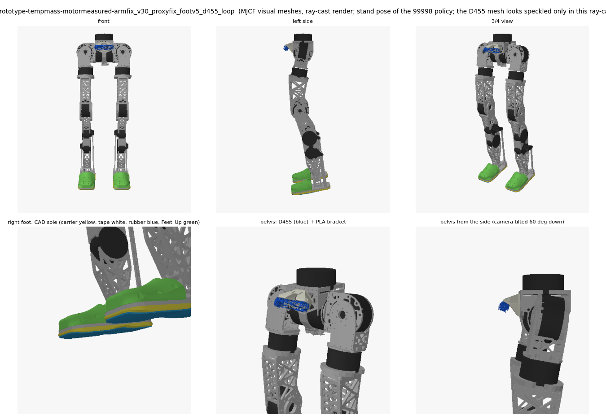
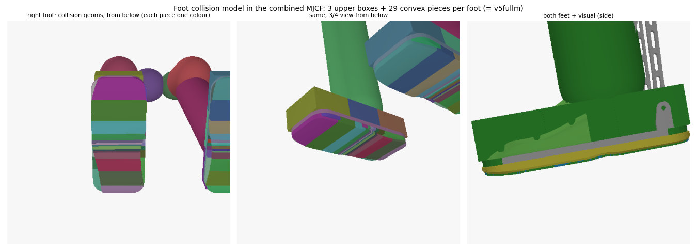
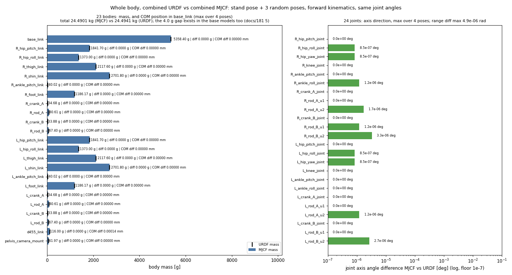
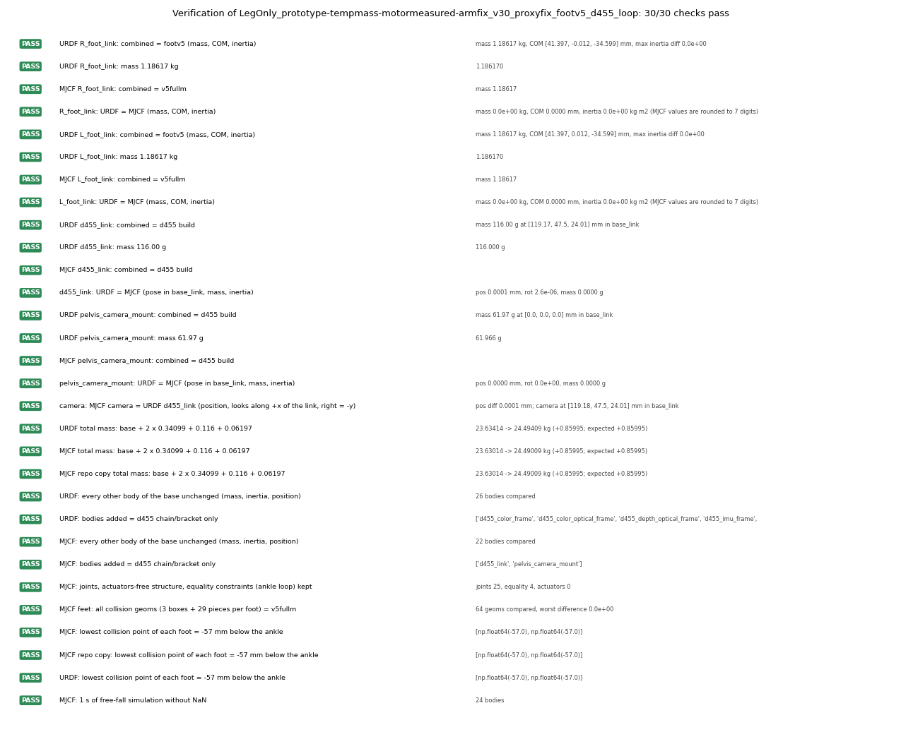
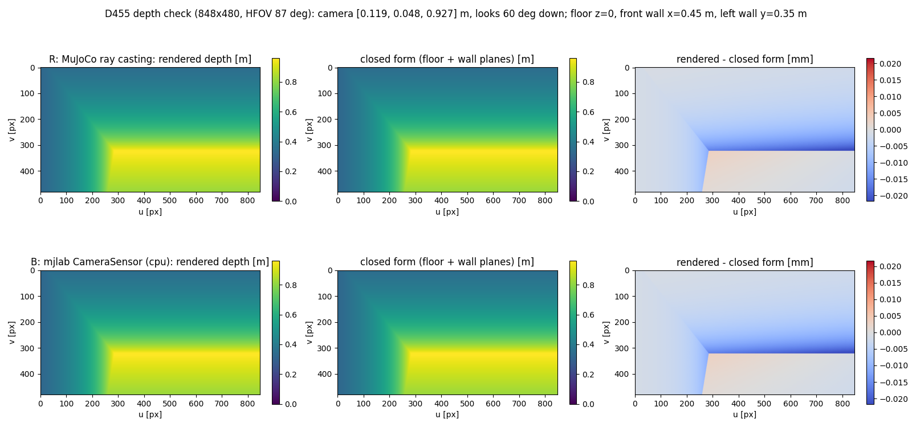
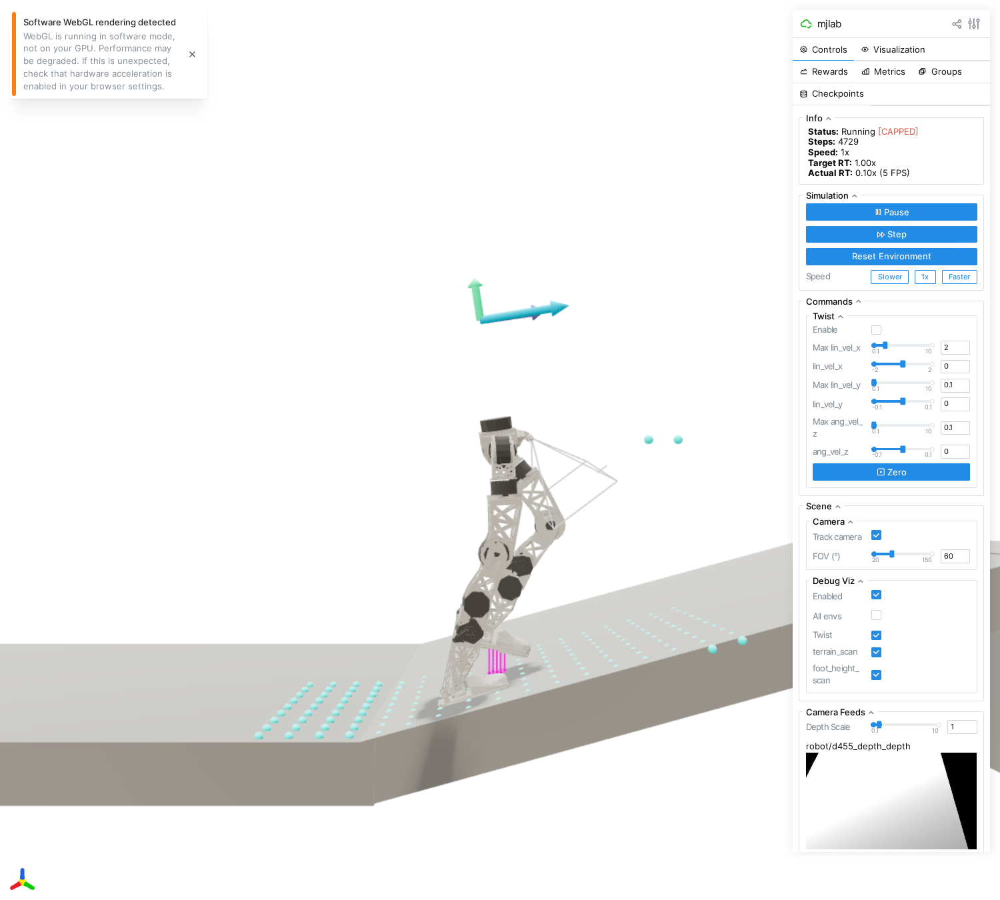
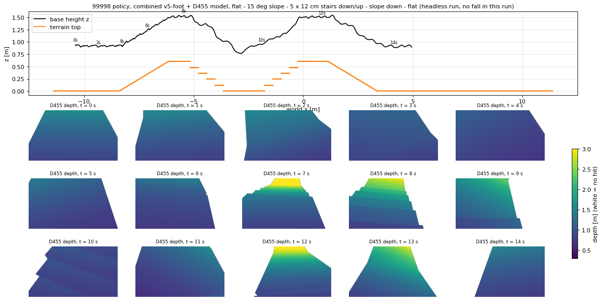

# 발 v5 + 골반 D455 합본 모델 (동료 전달용)

2026-11-04 · 할 일 #193 · 대상: `stairs_slopes12_union_dr_99998` 체크포인트를 학습한 동료

---

# 0. 한 줄 요약

- CAD 원본 발바닥·Feet_Up 과 골반 카메라(D455 + PLA 브래킷)가 **모두 들어간** URDF 와 MJCF 를 새 파일로 만들었습니다. 원본 파일은 건드리지 않았습니다.
- 두 모델을 따로 만든 기존 결과(발 v5 판, D455 판)와 **값이 글자 그대로 같은지** 30가지를 다시 계산해 확인했고, 모두 통과했습니다.

# 1. 파일 위치

| 무엇 | 위치 | 비고 |
|---|---|---|
| **URDF** | `pygmalion_locomotion/assets/pygmalion_v2/LegOnly_prototype-tempmass-motormeasured-armfix_v30_proxyfix_footv5_d455_loop.urdf` | 옆의 `.motor_params.json`(모터 값 보조 파일)과 한 벌 |
| **MJCF (GitHub 에 올라가는 사본)** | 같은 폴더의 `…_footv5_d455_loop.xml` | 일반 MuJoCo 에서 바로 열림. 메시 폴더를 상대 경로로 찾음 |
| MJCF (mjlab 사본) | `mujoco-sim/mjlab/src/mjlab/asset_zoo/robots/pygmalion/xmls/…_footv5_d455_loop.xml` | mjlab 저장소 안이라 **이 저장소의 GitHub 에는 없음** |
| 검증 보고서 | 같은 폴더의 `…_footv5_d455_loop_report.json` | 30개 검사의 숫자 |
| 메시 폴더 | `meshes_v30_armfix/`(기본 링크), `meshes_footv5/`(발 CAD 부품), `meshes_d455/`(카메라, 브래킷) | 3개 모두 필요 |
| 생성기 | `tools/robot_model/foot_overlay/build_footv5_d455.py` | 손으로 고치지 말고 이것을 고쳐 다시 만듭니다 |
| 검증기 | `tools/robot_model/foot_overlay/verify_footv5_d455.py` | |
| 깊이 영상 검사 | `docs/img/footv5_d455/depth_check.{png,json}` | |

이름 읽는 법: `…_footv5_d455_loop` = 다리만(LegOnly) + 발 v5 + 카메라 + AB 발목(2-RSU 폐루프). 자세한 규칙은 [[181_mjcf_urdf_models]] §3.

# 2. 어떻게 합쳤나

- 발 v5 판은 발 링크 두 개만 바꾸고, D455 판은 `base_link` 에 몸체를 덧붙이기만 합니다. 서로 겹치는 곳이 없어서 **이어 붙이면 그대로 합본**이 됩니다.
- **URDF**: 발 v5 URDF 에 D455 URDF 의 덧붙인 블록을 그대로 붙였습니다. D455 URDF 가 "원본 + 블록"인지 먼저 확인하고(아니면 중단), 블록만 가져왔습니다.
- **MJCF**: 원본 MJCF 에서 발마다 관성과 충돌 형상 32개(위쪽 상자 3 + 밑창 조각 29)를 `v5fullm` 에서 가져오고, CAD 시각 메시 4개(캐리어, 테이프, 고무, Feet_Up)를 더한 뒤 카메라를 D455 판과 같은 방식으로 얹었습니다.
- 충돌 형상 이름은 `R_foot1_collision … R_foot32_collision`(왼발은 `L_`)입니다. 학습 코드의 접촉 설정(`^(L|R)_foot\d+_collision$`: condim 3, 마찰 0.6, 우선순위 1)이 그대로 적용됩니다.

# 3. 검증 결과

| 검사 | 결과 |
|---|---|
| 발 링크 질량·무게중심·관성 = 발 v5 판 (URDF), = `v5fullm` (MJCF), 양발 | 통과. 차이 0. 발 1.18617 kg, 무게중심 (41.397, ∓0.012, −34.599) mm |
| URDF 발 = MJCF 발 | 통과. 질량·무게중심·관성 차이 0 |
| 카메라 몸체: 질량 116.00 g, 브래킷 61.97 g, 위치·관성 = D455 판 | 통과 (URDF, MJCF 둘 다). 카메라 위치 (119.18, 47.5, 24.01) mm, `base_link` 기준 |
| URDF 카메라 = MJCF 카메라 | 통과. 위치 차이 0.0001 mm, 시선 방향 일치 |
| **전체 질량** = 원본 + 2 × 0.34099 + 0.116 + 0.06197 | 통과. URDF 23.634 → 24.494 kg, MJCF 23.630 → 24.490 kg (+0.85995 kg) |
| 그 밖의 몸체·관절·폐루프(등식 구속 4개) 변화 없음 | 통과 |
| 충돌 형상 64개(양발) = `v5fullm` | 통과. 최대 차이 1e-9 |
| 밑창 가장 낮은 점 = 발목 아래 −57 mm | 통과 (URDF, MJCF 둘 다) |
| MJCF 1초 시뮬레이션에서 NaN 없음 | 통과 |
| **카메라 깊이 영상**(848×480, 평면 바닥·벽 정답과 비교) | 통과. 광선 추적 최대 오차 0.023 mm, mjlab 카메라 센서(CPU) 0.023 mm, 로봇 자기 몸이 찍힌 픽셀 0 |

- 처음에 "전체 질량이 원본 + 0.34099 kg 근처"라고 적었지만, 0.34099 kg 은 **발 하나**의 증가분입니다. 양발이면 +0.68198 kg 이고 카메라 +0.178 kg 을 더해 +0.85995 kg 이 맞습니다.
- MuJoCo 의 URDF 읽기는 고정 관절 링크를 합쳐 버립니다. 카메라 몸체를 따로 보려면 `fusestatic="false"` 로 읽어야 합니다(검증기는 그렇게 읽습니다).

# 4. 동료가 알아야 할 주의사항

1. **밑창이 14 mm 낮아졌습니다.** 가장 낮은 점이 −43 mm → −57 mm 입니다. 시작 높이를 그만큼 올리지 않으면 시작할 때 땅에 박힙니다.
2. **99998 정책은 상자 발로 학습한 정책입니다.** 이 합본 발로 평가하면 처음 보는 발(zero-shot)이고, 질량도 발 하나 0.845 → 1.186 kg 으로 늘었습니다. 성능 변화에는 형상, 높이, 질량이 섞여 있습니다.
3. **접촉 개수 버퍼.** 발 하나에 충돌 조각이 32개입니다. 발 연구의 평가는 `nconmax` 640 / `njmax` 3072 로 돌렸고, 학습 설정은 150 / 1500 입니다. 학습 버퍼에서 접촉이 잘리지 않는지 직접 확인하지 않았습니다. 확인이 필요합니다.
4. **URDF 와 MJCF 의 충돌 형상이 완전히 같지는 않습니다.** MJCF 는 `v5fullm` 의 32개(위쪽 상자 3 + 조각 29)입니다. URDF 는 기존 발 껍질(볼록 껍질 1개) + 조각 29개입니다. 질량·관성·밑창 높이는 같습니다.
5. **카메라와 브래킷은 MJCF 에서 시각 요소뿐입니다**(충돌 없음, 원래 D455 판과 같은 규약). URDF 에는 카메라 상자와 브래킷 껍질 충돌이 있습니다.
6. **Feet_Up(발등 덮개)은 충돌이 없습니다.** 질량 80 g(사용자 지정)을 CAD 형상에 고르게 퍼뜨린 값입니다. 얇은 껍질이라면 발 관성이 0.8~2.2 % 달라집니다([[184_foot_v5_model_review]] §3).
7. **추정값이 둘 있습니다.** 캐리어(ABS 출력물) 밀도 0.744 g/cm³ 와 카메라 브래킷 61.97 g(PLA 구조 밀도 × CAD 체적)입니다. 실제 부품 질량을 재면 바꿀 수 있습니다. 카메라 116 g 은 데이터시트 값(±10 %)입니다.
8. **카메라는 60° 아래로 숙여 `base_link` 에 단단히 붙어 있습니다.** 정책 관측에는 넣지 않았습니다(이 합본은 모델 파일만 만듭니다).
9. **이름은 실제 몸 기준입니다.** `L_` = 진짜 왼쪽(2026-09-12 에 바로잡음, [[136_left_right_naming_history]]).
10. **동료의 `robot.py` 접촉 설정을 고쳐야 합니다.** `pygmalion_mjlab/robot.py` 의 `COLLISION` 이 발 충돌 형상 이름을 `^(L|R)_foot[1-7]_collision$` 로 잡습니다. 새 발은 `foot1`~`foot32` 라서 그대로 쓰면 `foot8`~`foot32` 가 condim 1, 마찰 기본값, 우선순위 0 이 됩니다(학습 때와 다른 접촉). `\d+` 로 바꿔야 합니다(발 연구 브랜치는 이미 그렇게 되어 있습니다). viser 스크립트는 이 값을 대신 바꿔서 실행합니다.
11. **확인하지 못한 것**: 동료의 학습 환경(`generalized-union-dr` 브랜치 등)에서 직접 불러 보지 않았습니다. 이 PC 에는 GPU 가 없어 OpenGL 렌더러와 GPU 접촉은 시험하지 못했습니다(깊이는 광선 추적과 CPU 카메라 센서로 확인).

# 5. 쓰는 법

- **일반 MuJoCo**: 저장소를 받아 `…_footv5_d455_loop.xml`(GitHub 사본)을 그대로 엽니다. 메시는 같은 폴더의 `meshes_*` 를 상대 경로로 찾습니다.
- **mjlab**: mjlab 사본을 `xmls/` 에 두고, 같은 폴더에 `assets_v30_armfix`(기본 메시), `assets_v30_d455`, `assets_v30_footv5` 링크가 있어야 합니다. 생성기를 돌리면 `assets_v30_footv5` 링크는 자동으로 만들어집니다(상대 경로).
- **URDF**: 같은 폴더의 `meshes_*` 를 상대 경로로 읽습니다. 모터 회전자 관성은 `.motor_params.json` 에 있습니다([[144_urdf_motor_params_portability]]).
- 이 PC 에서 다시 만들 때(mjlab 가상환경): `tools/robot_model/foot_overlay/build_footv5_d455.py`, 이어서 `verify_footv5_d455.py`.

# 6. 파일 관리 (이번에 같이 한 것)

- `meshes_v30_armfix`, `meshes_v30_legonly` 심볼릭 링크를 이 PC 절대 경로에서 **상대 경로**로 바꿨습니다(`../../../tools/robot_model/fusion_snapshots/v30_inspection/…`). 다른 PC 에서도 열립니다. 대상 메시 57개는 이미 git 에 있습니다.
- 발 v5 판 URDF, `meshes_footv5/`(12 MB), 생성기, 보고서, 검토 스크립트를 git 에 올렸습니다(이전에는 미추적).
- mjlab `xmls/` 폴더는 mjlab 포크 안이라 우리 GitHub 에 없습니다. 그래서 GitHub 사본(자산 폴더)을 전달 대상으로 삼았습니다.
- 다른 모델 파일의 `xmls/assets_*` 링크(절대 경로)는 건드리지 않았습니다.

# 7. 검증 이미지

전체 렌더는 OpenGL 없이 광선 추적으로 그렸습니다(이 PC 에 GPU 가 없음). 생성기: `tools/robot_model/foot_overlay/report_footv5_d455_figs.py`.

**7-1. 합본 모델 모습** — 전신(앞·옆·3/4), 오른발 CAD 밑창(캐리어 노랑, 테이프 흰색, 고무 파랑, Feet_Up 초록), 골반의 D455(파랑)와 PLA 브래킷. D455 메시는 이 광선 추적 그림에서만 점무늬로 보입니다.



**7-2. 발 충돌 형상**(위쪽 상자 3 + 조각 29, 조각마다 다른 색)



**7-3. 전신 URDF ↔ MJCF 대조** — 몸체 23개의 질량과 무게중심, 관절 24개의 축 방향을 선 자세 1개와 무작위 자세 3개에서 비교했습니다. 최대 차이: 질량 4e-7 g, 무게중심 1.4e-4 mm, 축 3.3e-6°, 관절 범위 4.9e-6 rad. 전체 질량의 4.0 g 차이(24.4901 vs 24.4941 kg)는 원본 모델 둘 사이에 이미 있던 값이고, 합본이 더한 것이 아닙니다([[181_mjcf_urdf_models]] §5).



**7-4. 검사 30개 목록**



**7-5. 카메라 깊이 영상** — 평면 바닥·벽의 정답과 비교. 광선 추적과 mjlab 카메라 센서 모두 최대 0.023 mm.



# 8. viser 에서 99998 정책과 깊이 영상 보기

- **정책**: 동료 브랜치 `generalized-union-dr` 의 `mjlab_policy/checkpoints/stairs_slopes12_union_dr_99998/model_99998.pt` 를 그대로 씁니다(별도 git 작업 폴더 `.claude/worktrees/union_dr_99998`, 커밋 `a742fc6`). 작업은 `Pygmalion-Velocity-Generalized-StairsSlopes12-UnionDR`.
- **로봇**: 이 문서의 합본 MJCF. **지형**: 폭 2 m 한 줄 코스 — 평지 3 m, 15° 오르막, 윗면 1 m, 12 cm 계단 5개 내려가기, 평지 1.5 m, 12 cm 계단 5개 올라가기, 윗면 1 m, 15° 내리막, 평지 8 m. 한 환경에 평지·경사·계단이 모두 있습니다.
- **명령**: 앞으로 0.5 m/s 로 5초, 이후 1.0 m/s (동료의 `--staged-forward`). 15초마다 처음부터 다시 시작합니다.
- **깊이 영상**: 오른쪽 패널 `Camera Feeds` 의 `robot/d455_depth`(424×240)와 3D 화면의 카메라 시야 선(frustum). 깊이는 **표시용**이고 정책은 보지 않습니다(정책 입력은 44개, 카메라·높이 지도 없음).
- 실행(mjlab 가상환경, mjlab 은 동료가 지정한 `20f10e96` 판):

```bash
PYTHONPATH=Feet_design/Feet_Design_Workspace/mjcf_sim/stock_mjlab/src CUDA_VISIBLE_DEVICES="" \
  mujoco-sim/mjlab/.venv/bin/python3 tools/robot_model/viser_policy_footv5_d455.py
```

- 서버는 모든 주소(`0.0.0.0`)에서 받습니다. 8080 이 이미 쓰이고 있어 **`http://192.168.20.177:8081`** 로 열렸습니다(시작 때 viser 가 찍는 포트를 보세요). 옵션: `--slope-deg`, `--step-cm`, `--num-steps`, `--cam-width/--cam-height`, `--model`(예: 원래 상자 발 `…_proxyfix_loop` 으로 비교), `--no-camera`, `--rollout <초> --out <폴더>`(화면 없이 궤적·깊이 저장).
- **바꾼 것**: 로봇 MJCF, 위 §4 의 10번 접촉 설정, 시작 높이 +14 mm, 지형, 카메라 센서. 정책·관측·액추에이터·체크포인트는 그대로입니다.



위 화면은 헤드리스 브라우저로 찍은 것입니다. 왼쪽 3D 에 오르막 위의 로봇, 카메라 시야 선, 정책의 지형 스캔 점(비판자 전용)이 보이고, 오른쪽 아래에 깊이 영상이 있습니다. 깊이 영상이 검거나 흰색으로 포화돼 보이면 `Depth Scale` 슬라이더를 움직이세요.

# 9. 정책이 합본 모델에서 코스를 걷는가 (화면 없이 3번 실행)



- 3번 중 **2번은 코스 전체(오르막, 계단 내리기, 계단 오르기, 내리막)를 넘어지지 않고 지났고, 1번은 계단을 내려온 직후 평지(약 9.8 초)에서 넘어졌습니다.** 같은 설정인데 결과가 갈린 것은 시작 자세의 무작위성 때문으로 보이나 원인을 따로 확인하지는 않았습니다. 표본이 3개라 성공률을 말할 수는 없습니다.
- 위 그림은 넘어지지 않은 실행입니다. 깊이 영상에서 7~8초에 내려가는 계단이, 10초에 올라가는 계단이 보입니다.
- 새 발(처음 보는 발, 질량 +0.34 kg)로 99998 정책이 대체로 걷는다는 정도만 확인한 것이고, 성능 평가가 아닙니다. 발 형상 효과를 따지려면 같은 조건에서 상자 발과 비교해야 합니다(`--model` 로 가능).
- 이 PC 는 GPU 가 없어 CPU 로 돌립니다. 다른 세션 작업이 겹치면 viser 실시간 배율이 0.05~0.1배까지 떨어집니다(1배가 실시간). 카메라를 끄거나(`--no-camera`) 해상도를 줄이면 빨라집니다.
