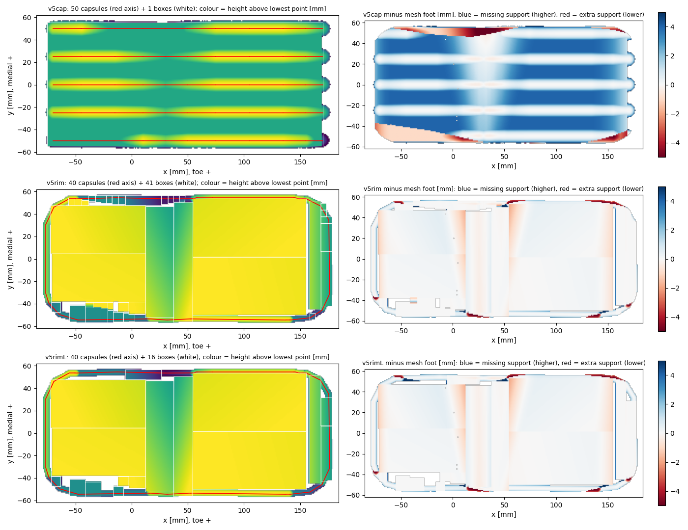
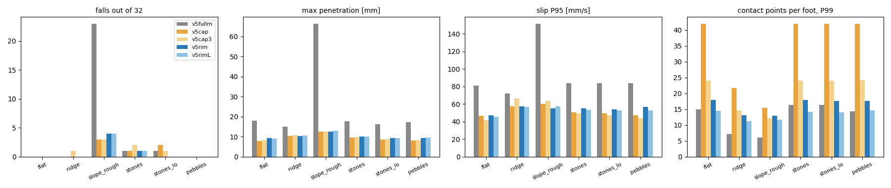

# 발 충돌 형상: 가장자리 윤곽을 따르는 둘레 캡슐(v5rim) — 같은 정책으로 맞비교

2026-11-04 · 할 일 #207 · 앞 문서 [[185_foot_collision_capsule_vs_mesh]] 의 후속

---

# 0. 결론

- **가장자리 윤곽을 정확히 따르는 모델은 만들 수 있고, 모양 오차는 크게 줄었습니다.** 가장자리 띠(윤곽에서 8 mm 이내) 높이 오차 RMS 가 v5cap 2.4 mm 에서 v5rim 1.2 mm 로, 안쪽은 2.75 mm 에서 0.38 mm 로 줄었습니다.
- **그러나 같은 정책으로 돌린 결과에서 v5cap 과 구별되는 이득은 없었습니다.** 넘어짐·침투 깊이·미끄러짐이 v5cap 과 같은 수준입니다(§3). 이 크기의 모양 오차에는 정책 결과가 둔감하다는 뜻입니다. 윤곽 정확도는 **발 설계 훑기(몇 mm 단위 비교)의 신뢰도**를 위한 것이지, 접촉 안정성을 위한 것이 아닙니다.
- **접촉 점 수는 오히려 줄었습니다.** 평지에서 발당 38점(v5cap) → 14점(v5rim) → 8점(v5rimL, CPU 정적 시험). 학습 버퍼(`nconmax 150`)에 대한 여유가 늘었습니다. 다만 GPU 학습 버퍼에서의 실제 값은 학습 전에 따로 확인해야 합니다.
- **정적 돌기 시험이 29조각과 가장 잘 맞습니다.** 기울기 차이가 평균 0.6°, 최대 4.2°입니다(v5cap 은 20 mm 돌기에서 최대 14°).
- 한계: 정책은 볼록 조각 발로 학습한 것입니다. **이 발로 다시 학습한 결과는 없습니다.**



윗줄 v5cap, 가운뎃줄 v5rim, 아랫줄 v5rimL 입니다. 오른쪽 열은 29조각 발과의 높이 차이입니다(파랑 = 지지가 없는 곳, 빨강 = 없는 지지를 만든 곳). v5cap 의 줄무늬(캡슐 사이 골, +3~4 mm)가 v5rim 에서 사라졌습니다.

# 1. 무엇을 만들었나

| 이름 | 발마다 구성 | 파일 |
|---|---|---|
| v5rim | 둘레 캡슐 40개(반지름 3 mm) + 기울인 상자 41개 + 판 상자 1개 = 82개 | `pygmalion_legonly_ab_v5rim.xml` |
| v5rimL | 둘레 캡슐 40개 + 기울인 상자 16개 + 판 상자 1개 = 57개 | `pygmalion_legonly_ab_v5rimL.xml` |

- 만든 도구: `tools/foot_sole/build_v5rim.py`(질량·관성·시각 메시는 v5fullm 그대로, 새 파일).
- **둘레**: 발바닥 윤곽(둘레 길이 720 mm)을 3 mm 안쪽으로 옮긴 선을 따라 캡슐을 잇습니다. 캡슐 바깥면이 윤곽에 닿습니다. 높이는 29조각 발의 바닥 높이를 따라가고, 꼭짓점은 3차원 단순화(허용 1.5 mm)로 골라서 직선 구간은 캡슐 하나가 됩니다.
- **안쪽**: 발바닥을 직사각형으로 재귀 분할해서, 한 직사각형 안의 바닥 높이가 한 평면(최소제곱, 허용 2 mm)이면 상자 하나로 만듭니다. 상자는 그 평면에 바닥면을 맞춰 기울입니다. 아치 경사도 기울인 상자가 됩니다.
- 한 변이 5 mm(v5rimL 은 8 mm)보다 짧은 조각은 버렸습니다. 둘레 캡슐이 가장자리 3 mm 를 덮기 때문입니다. 이 때문에 29조각 발바닥 중 8 cm²(v5rimL 12 cm²)가 비어 있고, 주로 가장자리 단 부근입니다.
- 모양 검사는 컴파일된 모델에 수직 광선을 쏘아 재고, 29조각 발도 같은 방법으로 재서 같은 기준으로 비교합니다(`--measure`).
- 정확한 설정(허용 0.6 mm·0.5 mm)은 오차가 더 작지만(가장자리 RMS 1.0, 안쪽 0.14) 한 발에 250개 가까운 도형이 되어 쓰지 않았습니다. 원인은 29조각 발바닥 자체가 가장자리에 5 mm 단과 많은 얇은 띠로 되어 있어서입니다.

# 2. 모양 오차와 접촉 점 수

| 항목 | v5cap | v5cap3 | v5rim | v5rimL |
|---|---|---|---|---|
| 발당 도형 수 | 52 | 32 | 82 | 57 |
| 가장자리 띠 오차 RMS [mm] | 2.41 | 3.08 | 1.17 | 1.28 |
| 안쪽 오차 RMS [mm] | 2.75 | 4.48 | 0.38 | 0.38 |
| 발바닥이 비어 있는 면적 [cm²] | 10.3 | — | 8.1 | 11.9 |
| 평지 접촉 점 수(CPU 정적) | 38 | 18 | 14 | 8 |
| 평지 접촉 점 수 P99(GPU 평가) | 42 | 24 | 18 | 14 |

- 접촉 점 수 시험: `tools/foot_sole/contact_count_test.py`. 평지 외에 돌기(10·20 mm 상자, 8 mm 구)를 건드리는 경우에도 v5rim 은 3~5점입니다(`study/contact_count_rim.json`).
- v5cap 의 모양 오차는 이번에 같은 광선 방식이 아니라 앞서 격자 계산으로 잰 값입니다. v5rim 이 두 값 모두 작다는 방향은 위 그림(오른쪽 열)에서도 보입니다.

# 3. 같은 정책으로 6개 지형 (3090 GPU, 환경 32개)



| 지형 | 넘어짐 (29조각 / v5cap / v5rim / v5rimL) | 침투 최대 [mm] | 미끄러짐 P95 [mm/s] | 접촉 점 P99 |
|---|---|---|---|---|
| 평지 | 0 / 0 / 0 / 0 | 17.9 / 8.0 / 9.4 / 9.2 | 81 / 46 / 47 / 46 | 15 / 42 / 18 / 14 |
| 굴곡 | 0 / 0 / 0 / 0 | 15.1 / 10.3 / 10.4 / 10.6 | 72 / 57 / 57 / 57 | 7 / 22 / 13 / 11 |
| 6° 경사 | 23 / 3 / 4 / 4 | 66.5 / 12.5 / 12.5 / 13.0 | 152 / 60 / 55 / 57 | 6 / 15 / 13 / 12 |
| 돌 2 cm | 1 / 1 / 1 / 1 | 17.7 / 9.7 / 10.0 / 10.0 | 84 / 50 / 55 / 54 | 16 / 42 / 18 / 14 |
| 돌 1 cm | 1 / 2 / 0 / 0 | 16.2 / 8.6 / 9.4 / 9.5 | 84 / 50 / 54 / 53 | 16 / 42 / 18 / 14 |
| 자갈 | 0 / 0 / 0 / 0 | 17.2 / 8.1 / 9.4 / 9.5 | 84 / 47 / 57 / 53 | 14 / 42 / 18 / 15 |

- 표의 모든 지형에서 v5rim·v5rimL 은 29조각 발보다 침투가 얕고 미끄러짐이 적으며, v5cap 과는 거의 같습니다. v5cap 보다 미끄러짐이 평지에서는 같고 돌·자갈에서 4~10 mm/s 더 큽니다(신뢰구간으로는 구별되지만 크기는 작습니다).
- 넘어짐은 6° 경사에서 23 → 4 입니다. 이 숫자는 앞 문서 §5 와 같은 이유로 저장본 운이 섞여 있어서 접촉 모델의 효과로 읽으면 안 됩니다. 다른 지형은 모두 0~2개이고 차이가 없습니다.
- 이동 비용(양의 일)은 평지에서 0.32 → 0.29로 v5cap 과 같습니다.

# 4. 정적 돌기 시험

`study/static_bump_v5rim.csv`(150건 × 3모델, 폭주·NaN 없음). 29조각 발과의 평형 기울기 차이: v5rim 평균 0.57°·중앙값 0.32°·최대 4.2°, v5rimL 평균 0.59°·최대 4.2°. 돌기 높이별 평균은 3 mm 0.4° → 20 mm 1.1° 로, 높을수록 늘지만 v5cap 의 최대 14° 보다 훨씬 작습니다.

# 5. 믿으면 안 되는 것

1. **압력중심 여유와 두 점 접촉 비율은 모델마다 정의가 달라집니다.** 압력중심 여유 5분위(평지)가 29조각 0.9 mm, v5cap 10.8 mm, v5rim 2.6 mm 이고, 두 점 접촉 비율이 29조각 4 %, v5cap 23 %, v5rim 57 %(v5rimL 43 %)입니다. 둘 다 접촉점 위치와 개수에서 계산되는 값이라, 둘레에 접촉이 몰리는 v5rim 에서 값이 달라졌을 가능성이 있습니다. 걸음이 실제로 바뀐 것인지 지표 정의의 차이인지는 확인하지 않았습니다. 이 두 지표로는 비교하지 않았습니다.
2. 정책이 29조각 발로 학습됐으므로, 이 결과는 "처음 보는 접촉에서도 버틴다"는 뜻이지 "다시 학습해도 낫다"는 뜻이 아닙니다.
3. 환경 32개·시드 1개. 6° 경사는 저장본 운이 섞여 있습니다([[185_foot_collision_capsule_vs_mesh]] §5).
4. 정적 접촉 점 수는 이 PC 의 CPU 시험이고 하중이 발 하나 몫입니다. GPU 학습(`nconmax 150`)에서의 값은 시험하지 않았습니다. 평가기(GPU, 버퍼 640)의 P99 값(v5rim 18)은 여유가 있습니다.
5. 가장자리 오차는 1.2 mm 가 남아 있습니다. 윤곽 바로 바깥 1~3 mm 는 캡슐 둥근 단면 때문에 실제보다 높고, 모서리·5 mm 단 근처에 −5 mm 쯤 낮은 곳이 남습니다(그림 오른쪽 열의 빨강).

# 6. 권고

- 발 설계 훑기(아치 깊이·뒤꿈치 높이 등)를 **캡슐 모델로 옮기고 싶다면 v5rim 이 가장 알맞습니다.** 모양 오차 0.4~1.2 mm 가 훑는 범위(2~12 mm)보다 한 자리 작습니다. v5cap 은 ±1.9 mm 라 안 됐습니다. 그래도 기준 모델은 29조각으로 유지하고, v5rim 은 접촉 안정성 점검용으로 병행하는 것을 권합니다.
- 접촉 안정성만 목적이라면 v5cap3(32개)이 가장 가볍고 결과도 같았습니다. 윤곽 정확도를 올려도 정책 지표는 나아지지 않았습니다.
- 캡슐 발로 다시 학습하는 시험(2,500회, 3090)은 여전히 사용자 결정 대기입니다. 하게 되면 v5rim 으로 하는 것을 권합니다(접촉 점이 적고 모양이 가장 정확).

# 7. 하지 않은 것

- 재학습, 정지·밀기 시험, 보폭이 큰 보행 시험.
- GPU 학습 버퍼(`nconmax 150`)에서의 접촉 잘림 시험.
- 두 점 접촉 비율과 압력중심 여유가 달라진 원인 확인.

# 8. 재현

```bash
mujoco-sim/mjlab/.venv/bin/python3 tools/foot_sole/build_v5rim.py <assets> v5rim --tol 1.5 --ztol 2.0 --minside 5
mujoco-sim/mjlab/.venv/bin/python3 tools/foot_sole/build_v5rim.py <assets> v5rimL --tol 1.5 --ztol 2.0 --minside 8
```

평가 큐는 `study/eval_jobs_rim_gpu.txt`, 결과 `study/eval_rim_gpu/`, 비교 `study/compare_rim_gpu.json`.
