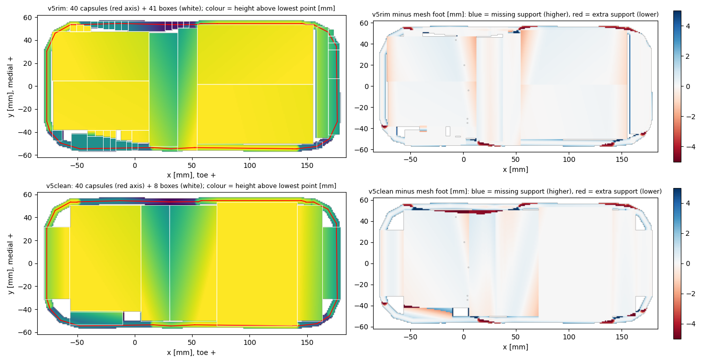
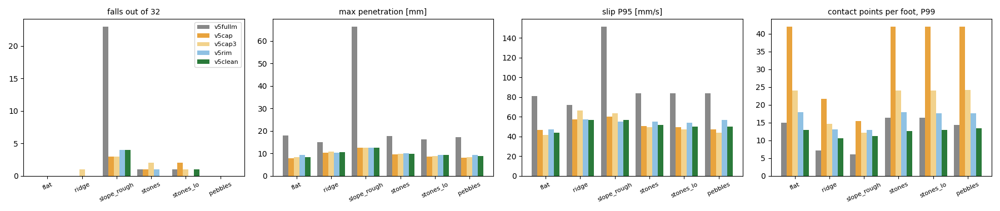

# 발 충돌 형상: 이름 붙은 구역으로 정리한 v5clean

2026-11-04 · 할 일 #208 · 앞 문서 [[186_foot_collision_rim_contour]] 의 후속

---

# 0. 결론

- 사용자 지적대로 v5rim 의 안쪽 상자 41개는 자동 분할이 만든 조각 모음이라 읽을 수 없었습니다. **v5clean 은 안쪽을 이름 붙은 구역 8개로 줄였습니다.** 발당 도형은 49개(둘레 캡슐 40 + 상자 8 + 판 1)입니다.
- **같은 정책으로 돌린 결과는 v5rim 과 같은 수준입니다**(§3). 6개 지형에서 넘어짐 0~4개, 침투 최대 8~12 mm, 미끄러짐 P95 44~57 mm/s. 접촉 점은 오히려 줄었습니다(평지 P99 13점, v5rim 18점).
- 모양 오차는 v5rim 보다 조금 큽니다. 가장자리 띠 RMS 1.43 mm(v5rim 1.17), 안쪽 0.45 mm(0.38), 비는 면적 9.2 cm²(8.1). 읽기 쉬움을 얻는 대신 낸 값입니다.
- 한계는 이전과 같습니다. 정책이 29조각 발로 학습한 것이라, **이 발로 다시 학습한 결과는 없습니다.**

# 1. 구성 (오른발, 단위 mm)

| 구역 | x 범위 | y 범위 | 설명 |
|---|---|---|---|
| 뒤꿈치 끝 | −78 ~ −57 | 자동 | 뒤꿈치 둥근 끝 |
| 뒤꿈치 판 | −56 ~ 6 | −42 ~ 50 | 평평 |
| 바깥쪽 뒤꿈치 단 | −56 ~ −10 | −53 ~ −42 | 5 mm 높은 단 |
| 아치 오르막 | 6 ~ 31 | −50 ~ 50 | 기울인 상자 |
| 아치 내리막 | 31 ~ 72 | −50 ~ 50 | 기울인 상자 |
| 앞발 판 | 72 ~ 142 | 자동 | 평평 |
| 발끝 굴림 | 142 ~ 164 | 자동 | 기울인 상자 |
| 발끝 끝 | 164 ~ 180 | 자동 | 둥근 끝 |

- 구역마다 상자 하나이고, 바닥면은 29조각 발의 바닥 높이를 최소제곱으로 맞춘 평면입니다. 구역 경계는 발바닥 높이 지도에서 읽은 것입니다(평평한 곳, 아치 봉우리 x≈30, 5 mm 단, 발끝 굴림).
- 둘레는 v5rim 과 같습니다. 윤곽을 3 mm 안쪽으로 옮긴 선을 따라 캡슐 40개(반지름 3 mm)를 잇습니다. 상자는 이 선 안쪽에 둡니다.
- 만드는 법: `build_v5rim.py <assets> v5clean --zones --tol 1.5 --minside 1`(구역 표는 코드의 `ZONES`).
- 겹침: 상자 가장자리와 둘레 캡슐이 3 mm 겹칩니다. 같은 링크 안 도형은 서로 충돌하지 않아 힘은 생기지 않지만, 땅에 같이 닿으면 접촉이 중복됩니다([[186_foot_collision_rim_contour]] §2).

# 2. 모양 오차와 접촉 점 수

| 항목 | v5cap | v5rim | v5clean |
|---|---|---|---|
| 발당 도형 수 | 52 | 82 | 49 |
| 가장자리 띠 오차 RMS [mm] | 2.41 | 1.17 | 1.43 |
| 안쪽 오차 RMS [mm] | 2.75 | 0.38 | 0.45 |
| 비는 면적 [cm²] | 10.3 | 8.1 | 9.2 |
| 평지 접촉 점 수(CPU 정적) | 38 | 14 | 3 |
| 평지 접촉 점 수 P99(GPU 평가) | 42 | 18 | 13 |

# 3. 같은 정책으로 6개 지형 (3090 GPU, 환경 32개)

| 지형 | 넘어짐 (29조각 / v5cap / v5rim / v5clean) | 침투 최대 [mm] | 미끄러짐 P95 [mm/s] |
|---|---|---|---|
| 평지 | 0 / 0 / 0 / 0 | 17.9 / 8.0 / 9.4 / 8.4 | 81 / 46 / 47 / 44 |
| 굴곡 | 0 / 0 / 0 / 0 | 15.1 / 10.3 / 10.4 / 10.5 | 72 / 57 / 57 / 57 |
| 6° 경사 | 23 / 3 / 4 / 4 | 66.5 / 12.5 / 12.5 / 12.5 | 152 / 60 / 55 / 57 |
| 돌 2 cm | 1 / 1 / 1 / 0 | 17.7 / 9.7 / 10.0 / 9.9 | 84 / 50 / 55 / 52 |
| 돌 1 cm | 1 / 2 / 0 / 1 | 16.2 / 8.6 / 9.5 / 9.5 | 84 / 50 / 54 / 50 |
| 자갈 | 0 / 0 / 0 / 0 | 17.2 / 8.1 / 9.4 / 8.9 | 84 / 47 / 57 / 50 |

- 정적 돌기 시험(`study/static_bump_v5clean.csv`): 29조각 발과의 기울기 차이 평균 0.42°, 최대 3.5°(폭주·NaN 없음).
- 압력중심 여유(평지 2.9 mm)와 두 점 접촉 비율(평지 51 %)은 v5rim 과 같은 경향입니다. 접촉점 위치로 계산하는 지표라 모델 간 비교에는 쓰지 않습니다([[186_foot_collision_rim_contour]] §5).

# 4. 믿으면 안 되는 것

- 정책이 29조각 발로 학습됐고(처음 보는 접촉), 환경 32개·시드 1개입니다. 6° 경사의 넘어짐 감소는 저장본 운이 섞여 있습니다([[185_foot_collision_capsule_vs_mesh]] §5).
- 정적 접촉 점 3개는 앞발 판 위주로 앉은 시험 결과입니다. 학습 버퍼(`nconmax 150`)에서의 값은 시험하지 않았습니다.
- 바깥쪽 뒤꿈치 단의 대각선 경계와 안쪽 가장자리 5 mm 단은 직사각형으로 근사해서, 가장자리에 −3.6 mm(없는 지지)·+1.7 mm(빠진 지지) 오차가 남습니다.

# 5. 권고

- 재학습(3090, 2,500회)을 한다면 **v5clean 으로** 하는 것을 권합니다. 도형이 가장 적고 접촉 점이 가장 적으며, 구성이 읽힙니다. 정책 지표는 v5rim 과 구별되지 않습니다.
- 발 설계 훑기(아치 깊이 등)를 캡슐 모델로 옮길 때는 구역 표(`ZONES`)의 높이 평면이 설계 변수를 바로 따라가므로 v5clean 방식이 다루기 쉽습니다.
- 재학습은 사용자가 허용했지만 아직 시작하지 않았습니다. 시작하려면 학습 이름·반복 수·비교 대상(29조각 2,500회 학습, `sole_ft_v5fullm_2500`)과 3090 자원 확인이 먼저입니다.

# 6. 하지 않은 것

재학습, 정지·밀기·보행 시험, 학습 버퍼 접촉 잘림 시험. 평가 큐 `study/eval_jobs_clean_gpu.txt`, 결과 `study/eval_clean_gpu/`, 비교 `study/compare_clean_gpu.json`.
