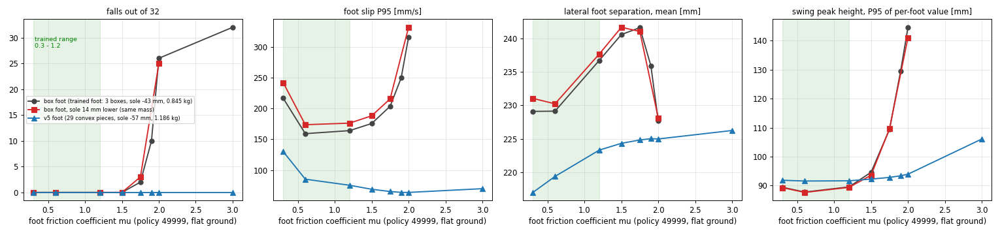

# 발 마찰: 학습 범위, 현재 MJCF, 카펫 + 돌기 고무 밑창 (할 일 #200)

2026-11-04 · 질문: 발바닥을 고무로 바꾼 뒤 걷기에서 다리가 모이고 턱턱 걸린다. 마찰 때문인가? 카펫 + 신발 고무 바닥이 학습 범위에 들어오는가? 지금 MJCF는 범위 안인가?
근거 조사: `docs/research_raw/2026-11-04_foot_friction_carpet_rubber_sources.md`

---

# 0. 결론

1. **학습한 발 마찰 범위는 0.3~1.2입니다.** 기본값은 0.6이고, 에피소드마다 0.3~1.2에서 균일하게 뽑습니다(§1).
2. **지금 MJCF 값은 범위 안입니다.** 학습·평가·viser에서는 0.6, 파일을 직접 읽으면 MuJoCo 기본값 1.0입니다. 둘 다 0.3~1.2 안입니다. 고무로 바꾼 것은 마찰 값에 반영된 적이 없습니다(§2).
3. **카펫 + 이 고무 밑창의 실제 마찰 계수는 모릅니다.** 문헌 검색 6회에서 수치를 못 찾았습니다. 직접 재야 하고, 재는 방법을 §5에 적었습니다. 판정 기준은 **1.2 이하면 안전, 1.5 초과면 위험**입니다(§3).
4. **시뮬레이션에서 마찰은 다리 모임의 원인이 아닙니다.** 마찰을 0.3에서 3.0까지 바꿔도 양발 사이 간격은 21~24 cm로 그대로입니다. 이 좁은 걸음(약 22 cm)은 마찰을 바꾸기 전부터 있던 정책의 성질입니다(§3-3, `docs/178`).
5. **높은 마찰은 시뮬레이션에서 "벽"을 만듭니다.** 기존 상자 발 + 배포 정책은 1.5까지 괜찮고 1.75부터 넘어집니다(2/32), 2.0에서 26/32입니다. 새 발(v5)은 3.0까지 0/32입니다. **새 발은 높은 마찰에 더 강합니다**(§4).
6. **발이 14 mm 낮아진 효과는 작습니다.** 스윙 때 바닥과의 거리는 같고, 발 미끄러짐이 4~9 % 늘 뿐입니다(§6).
7. 따라서 **실기의 "턱턱 걸림"은 시뮬레이션이 표현하지 못하는 것**일 가능성이 큽니다: 돌기 모서리, 카펫 털에 끼임, 고무 탄성, 방향성 마찰(§7). 마찰 계수 한 값으로 설명되지 않습니다.

# 1. 학습 때 마찰 조건 (배포 정책 49999)

| 항목 | 값 | 출처 |
|---|---|---|
| 발 기본 마찰 | 0.6 (발 접촉 조각 전부) | `robot.py` `CollisionCfg` |
| 무작위화 범위 | 0.3 ~ 1.2, 균일분포, 에피소드 시작마다 | `env.yaml` `foot_friction` |
| 적용 방식 | 값을 통째로 덮어씀(abs). **한 환경의 양발·모든 조각이 같은 값** | `shared_random: true` |
| 적용 축 | 미끄럼 마찰(축 0)만. 비틀림·구름 마찰 없음 | `geom_friction` 기본값 |
| 접촉 차원 | 3 (비틀림 마찰 없음) | `condim 3` |
| 지형 마찰 | **무시됨**. 발 접촉 우선순위가 1이라 MuJoCo가 발 값만 씀(직접 확인: 발 0.3·바닥 1.0 → 0.3) | 실험 |
| 정책이 마찰을 아는가 | 모름. 마찰 값은 critic(학습용 평가망)에만 들어가고 actor 입력 44개에는 없음 | `env.yaml` |
| 비교용 강화판 | `PYG_DR_STRONG` 은 하한 0.1, 상한 1.25 (Unitree G1 설정과 같게). 49999에는 쓰이지 않음 | `env_cfgs.py` |

# 2. 지금 MJCF의 마찰 값

- `…_footv5_d455_loop.xml`, `…_footv5_d455_reinf_loop.xml`, `…_reinf_alparts_loop.xml` 에는 `friction=` 속성이 없습니다. 파일을 MuJoCo로 직접 읽으면 기본값 **1.0**이 됩니다.
- mjlab(학습·평가)와 viser 재생(`tools/robot_model/viser_policy_footv5_d455.py`)은 발 조각 전부에 **0.6**을 덮어씁니다.
- 발 연구 문서도 "고무 마찰 계수는 학습 조건 0.6 고정, 시뮬레이터에서 볼 수 없음"이라고 적어 두었습니다(`study/README.md`). **고무 밑창으로 바꾼 것은 시뮬레이션에 마찰로 반영된 적이 없습니다.**
- 1.0, 0.6 모두 학습 범위 0.3~1.2 안입니다.

# 3. 카펫 + 이 고무 밑창이 범위 안인가

## 3-1. 사진에서 읽은 밑창

- 검은 고무 시트이고, 표면에 V자(화살표) 모양 돌기가 촘촘히 있습니다. 기준자로 재면 돌기 간격은 가로 약 6 mm, 세로 약 5 mm입니다. 돌기 윗면은 평평하고 모서리가 각져 있으며, 돌기 사이에 작은 원형 홈이 있습니다. 돌기 높이는 사진으로 알 수 없습니다.
- 바닥에 실제로 닿는 면적은 돌기 윗면뿐이라 판 전체의 절반 이하로 보입니다.
- 접촉 압력(판 전체 면적 기준)은 두 발 서기 약 8 kPa, 한 발 서기 약 15 kPa이고, 돌기 끝에서는 그보다 높습니다. 사람 신발보다 몇 배 낮은 압력입니다.
- V자 무늬는 **방향성**이 있습니다. 시뮬레이션은 방향과 상관없는 한 값만 씁니다.

## 3-2. 문헌에서 찾은 것과 못 찾은 것

- **못 찾은 것:** 신발 고무와 카펫 사이의 마찰 계수 실측값. 검색 6회(영어)에서 전부 없었습니다.
- **참고 값(카펫 아님):** 건조한 고무와 단단한 바닥은 약 0.6~1.0. 로봇 쪽 무작위화 범위는 0.4~1.0, 0.5~1.25, 배포용 0.2~1.7이고 "1.5 초과는 드묾"이라고 적힌 가이드가 있습니다(제3자 문서, 원문 미정독). 우리 범위 0.3~1.2는 이 일반 값 안입니다.
- **트레드 방향:** 트레드가 미끄럼 방향과 수직·비스듬하면 동적 마찰이 높고 평행이면 낮다는 보고가 있습니다. 카펫 위에서의 값은 아닙니다.
- 카펫은 털(파일)이 있어 마찰이 "계수 하나"로 잘 표현되지 않습니다. 돌기가 털 사이로 파고들면 마찰 계수 외에 **걸림**이 생깁니다.

## 3-3. 시뮬레이션에서 본 것

- 마찰 0.3~3.0에서 양발 간격 평균: 기존 발 229→241 mm(1.5까지), 새 발 217→226 mm. **마찰이 높아도 다리가 모이지 않습니다.**
- 실기에서 걷는 폭이 약 22 cm인 것은 `docs/178`이 이미 정책 49999의 성질로 판정했습니다(시뮬레이션 22~24 cm와 같음). 발바닥을 고무로 바꾸기 전부터 있던 문제입니다. 서 있을 때만 실기가 더 좁은 문제(22.5 대 27~29 cm)도 마찰이 주원인이 아니라고 적혀 있습니다.

## 3-4. 판정표 (실측 후 사용)

| 실측 마찰 계수 | 판정 |
|---|---|
| 0.3 이하 | 학습 범위 하한 밖. 미끄러운 쪽 시험 필요 |
| 0.3 ~ 1.2 | 학습 범위 안 |
| 1.2 ~ 1.5 | 학습 범위 밖이지만 시뮬레이션에서 괜찮음(§4) |
| 1.5 초과 | 시뮬레이션에서 걸려 넘어지는 영역의 입구. 위험 |

돌기 방향별로 값이 다르므로, 가장 높은 값으로 판정합니다.

# 4. 시뮬레이션 민감도 (3090, 평지, 정책 49999, 환경 32개)

같은 정책에서 발 마찰만 바꿔 평가했습니다(`PYG_FOOT_FRICTION`, `tools/foot_sole/friction_sensitivity.py`). 세 발: 기존 상자 발(0.845 kg), 같은 상자 발을 14 mm 낮춘 것(질량 같음), 새 발 v5(29조각, 1.186 kg).

| 마찰 | 상자 발 넘어짐 | 14 mm 낮춘 발 | 새 발 v5 | 상자 발 미끄러짐 P95 [mm/s] | 새 발 [mm/s] |
|---|---|---|---|---|---|
| 0.3 | 0 | 0 | 0 | 217 | 130 |
| 0.6 (기본) | 0 | 0 | 0 | 159 | 85 |
| 1.2 (학습 상한) | 0 | 0 | 0 | 164 | 75 |
| 1.5 | 0 | 0 | 0 | 176 | 69 |
| 1.75 | 2 | 3 | 0 | 204 | 65 |
| 1.9 | 10 | — | 0 | 250 | 64 |
| 2.0 | 26 | 25 | 0 | 316 | 64 |
| 3.0 | 32 | — | 0 | — | 70 |

- 상자 발은 **1.5와 2.0 사이에서 한꺼번에 무너집니다.** 서서히 나빠지지 않고 벽이 있습니다.
- 무너지는 모습(영상): 마찰 2.0에서는 걷기 명령(vx 0.6)인데 속도가 2.4 m/s까지 치솟고 발이 공중에 오래 떠다니다 앞으로 넘어집니다(41.3초). 마찰 3.0에서는 서기 명령인데 1.1초에 넘어집니다. 영상: `Feet_design/Feet_Design_Workspace/mjcf_sim/study/videos_mu/mu_runaway_side.mp4`, `mu_runaway_foot.mp4`, `mu3_stand_side.mp4`, `mu3_stand_foot.mp4`(실시간 25 fps).
- **새 발은 3.0까지 넘어지지 않습니다.** 높이를 같게 맞춘 상자 발은 기존 상자 발처럼 무너지므로(§6) 이유는 높이가 아닙니다. 발 모양(둥근 앞·뒤꿈치, 상자 모서리 없음)과 발 질량(0.85 → 1.19 kg) 중 어느 쪽인지는 가르지 못했습니다.
- 한계: 평지, 마찰 하나만 바꾼 시험입니다. 카펫의 털 걸림, 돌기 모서리, 고무 탄성은 반영돼 있지 않습니다. 정책은 29조각 이전의 상자 발로 학습됐습니다.

# 5. 카펫에서 이 밑창의 마찰 재기 (제안)

준비: 실제 카펫 조각(로봇이 걷는 것과 같은 것, 바닥에 깔린 상태 그대로 평평하게 고정), 실제 밑창 시트 조각(5 × 5 cm 이상), 추, 각도기 또는 휴대폰 기울기 앱, 푸시풀 게이지 또는 용수철저울.

1. **기울기 시험(정지 마찰).** 카펫을 판에 고정하고 밑창 조각을 얹습니다. 추를 올려 접촉 압력을 8 kPa(5 × 5 cm 조각에 약 2 kg)와 15 kPa(같은 조각에 약 3.8 kg)로 맞춥니다. 판을 천천히 기울여 미끄러지기 시작하는 각도 θ를 읽습니다. 정지 마찰 계수 = tan θ.
2. **당김 시험(운동 마찰).** 같은 조건에서 수평으로 약 10 mm/s로 일정하게 당기며 힘 F를 기록합니다. 운동 마찰 계수 = F ÷ (추 + 조각 무게). 일정하게 당기는 구간의 평균을 씁니다.
3. **방향 세 가지:** V자 돌기 끝이 가리키는 쪽, 반대쪽, 옆쪽. 각 5회.
4. 값을 §3-4 표에 대 보고, 가장 높은 값으로 판정합니다. 1.5를 넘으면 알려 주세요: 마찰 범위를 넓혀 다시 학습하는 안을 정리하겠습니다.
5. 같은 시험을 마른 매끈한 바닥(합판 등)에서도 하면 카펫의 효과만 따로 보입니다.

# 6. 발이 14 mm 낮아진 효과

- 새 발의 바닥은 발목에서 57 mm 아래, 학습한 상자 발은 43 mm 아래입니다.
- **스윙 중 바닥과 가장 가까운 발바닥 점의 높이는 두 발이 같습니다**(같은 정책, 평지, 최저점 높이 5% 지점 3.2 mm 대 3.1 mm, 중앙값 18.4 mm 대 21.6 mm). 정책은 몸 높이를 모르고 관절 각도만 맞추기 때문에, 발이 길어지면 로봇 전체가 14 mm 높아질 뿐 스윙 간격은 변하지 않습니다.
- 바뀌는 것은 발목에서 발바닥까지 거리가 43에서 57 mm로 33 % 길어져, 바닥의 수평 힘(마찰)이 발목에 거는 모멘트가 커지는 것입니다.
- 시험: 상자 발을 14 mm만 낮춘 모델(질량 같음, `pygmalion_legonly_ab_base14.xml`)을 같은 정책으로 비교했습니다. **마찰 벽의 위치와 넘어짐은 같고(§4), 미끄러짐만 4~9 % 늘었습니다**(굴곡 +3.5 mm/s, 자갈 +8.5 mm/s, 마찰 0.6). 넘어짐은 굴곡 0 → 1, 자갈 0 → 0, 돌 1 cm 0 → 2(모두 통계로 구별 안 됨).
- 결론: 14 mm는 카펫 걸림의 원인이 아니고, 높은 마찰에서 새 발이 더 강한 이유도 아닙니다.

# 7. 시뮬레이션에 없는 것 (실기 증상의 후보, 증명된 것은 아님)

| 후보 | 왜 시뮬레이션에 없나 | 확인 방법 |
|---|---|---|
| 돌기 모서리가 카펫 털에 걸림 | 발바닥이 매끈한 곡면 조각이고 돌기가 없음. 털(파일)도 없음 | 카펫 위에서 밑창 시트를 끌어 보고 걸리는 방향 확인(§5의 당김 시험에서 힘이 톱니처럼 튀는지) |
| 방향성 마찰 | 시뮬레이션은 방향 무관한 한 값 | §5의 세 방향 비교 |
| 비틀림 마찰 | 접촉 차원 3이라 없음. 발이 제자리에서 도는 저항이 시뮬레이션에서는 거의 없음 | 발을 카펫에 누른 채 비틀 때 필요한 토크 |
| 고무 탄성 | 강체 접촉. 4 mm 고무의 변형·밀림이 없음 | 발바닥 압력 시험(변위-힘) |
| 낮은 압력에서 마찰 증가 | 시뮬레이션은 압력과 무관한 쿨롱 마찰 | §5를 8 kPa와 15 kPa 두 압력에서 |
| 발 질량·관성 변화 | 새 발은 0.845 → 1.186 kg. 정책은 이전 발로 학습 | 같은 정책에서 새 발이 잘 걷는지는 시뮬레이션에서 확인됨(넘어짐 0/32) |

# 8. 하지 않은 것

- 카펫과 고무의 실측(로봇·카펫 시료가 필요).
- 새 발이 높은 마찰에 강한 이유가 모양인지 질량인지 가르는 시험.
- 마찰 범위를 넓혀 다시 학습(실측이 1.5를 넘는 경우에만 필요).
- 카펫 털과 돌기 모서리의 걸림을 모사하는 시뮬레이션.
