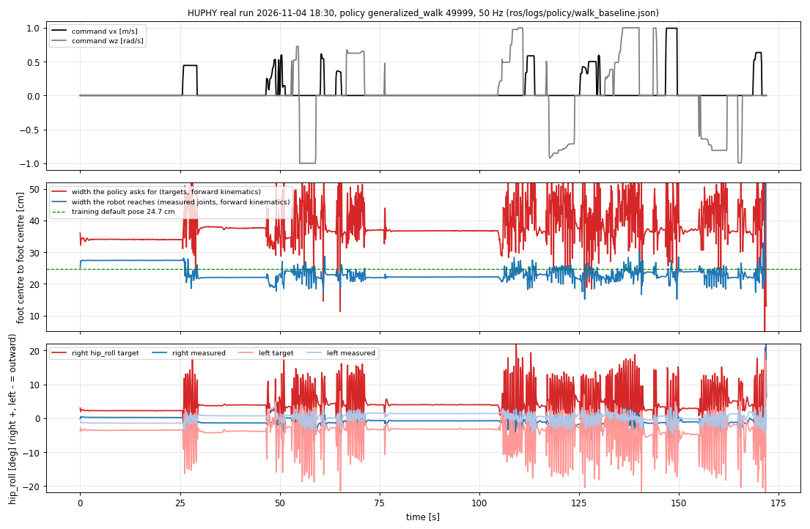

# 실기 로그 11-04: 발 간격이 좁은 원인 검토 (할 일 #200 후속)

2026-11-04 · 사용자 지시: "실제로 엄청 좁다. 데이터 로그 보고 검토해 줘."
이어서 읽을 문서: `docs/178`(10-30, 같은 문제의 첫 분석), `docs/187`(마찰 시험)

---

# 0. 결론

1. **실기에서 발 사이가 좁은 것은 오늘 처음 생긴 문제가 아닙니다.** 오늘 기록(11-04), 10-28 기록 2개, 11-02 기록 모두 걸을 때 발 중심 간격이 **21.4~22.5 cm**이고, 서 있을 때(걷고 난 뒤)는 **21.9~22.4 cm**입니다. 정책이 지시하는 폭은 걸을 때 40~43 cm, 서 있을 때 37~38 cm입니다.
2. **고무 밑창과 새 발로 바꾼 뒤 더 좁아지지 않았습니다.** 오늘 기록이 오히려 10-28 기록보다 1 cm 정도 넓습니다(걷기 22.5 대 21.4 cm). 정책 지시와 실제의 차이(관절 목표 − 측정)도 오늘이 10-28보다 같거나 작습니다.
3. **좁아지는 직접 원인은 엉덩이 좌우 관절(hip_roll)이 바깥으로 벌어지라는 목표를 따라가지 못하는 것입니다.** 서 있을 때 목표 +4.5°(오른쪽)/−3.9°(왼쪽)에 실제는 거의 0°(안쪽)에 머뭅니다. 걸을 때는 부족분이 5~6°입니다. 이 부족분은 4개 기록에서 서로 같습니다.
4. **마찰이 원인인지는 이 기록만으로 가를 수 없습니다.** 시뮬레이션에서 마찰은 폭을 바꾸지 못했습니다(`docs/187`). 하지만 시뮬레이션에서 폭이 29 cm까지 벌어지는 서기가 실기에서는 22 cm에 머무는 차이가 있고, 이 차이는 10-28 기록에도 있었습니다. 기록에 토크와 모터 전류가 없어서 가르지 못합니다. 가르는 시험 3가지를 §4에 적었습니다.

# 1. 기록

- 저장소: `HUPHY` `origin/main` e4f9694(2026-11-04 19:27)의 `ros/logs/policy/walk_baseline.json`(정책 generalized_walk, 가중치 49999, 18:30 실행, 172초, 정책 50 Hz·모터 100 Hz, 계약대로 돈 실행).
- 이 PC 사본: `Expr_Data/huphy_main_e4f9694/`(오늘 기록, 11-02 기록, README). 10-28 기록은 `Expr_Data/huphy_main_90bbd1f/`.
- 분석 도구: `tools/sim2real/walk/log_stance_width.py`(기록 → 순기구학). 결과 `Expr_Data/stance_logs_2026-11-04.json`.
- 11-02 기록은 정책이 100 Hz로 돈 실행이라(README) 정책 성능 비교에는 쓰지 않고 폭만 참고했습니다.

# 2. 숫자 (발 중심 사이 좌우 거리 [cm], 순기구학)

| 기록 | 걷기 실제 | 걷기 지시 | 서기 실제 (걷기 전) | 서기 실제 (걷고 난 뒤) | 서기 지시 (걷고 난 뒤) |
|---|--:|--:|--:|--:|--:|
| **11-04 walk_baseline** | **22.5** | 40.4 | 27.4 | 22.2 | 37.0 |
| 10-28 teleop | 21.4 | 40.7 | 26.7 | 22.0 | 38.5 |
| 10-28 teleop extra2 | 21.8 | 43.1 | 27.0 | 21.9 | 38.4 |
| 11-02 (100 Hz 실행) | 21.4 | 43.1 | 24.9 | 22.4 | 37.3 |

비교 숫자: 학습 기본 자세 24.7 cm, 시뮬레이터에서 같은 정책의 걸음 폭 22.1 cm와 서기 29 cm(`docs/178` §4-1).

| 기록 | hip_roll 목표 − 측정, 걷기 (오른 / 왼) | 같은 값, 서기 (오른 / 왼) | 걸을 때 안쪽 발 가장자리 간격 평균 / 최소 [cm] |
|---|---|---|---|
| **11-04** | **+6.2° / −5.0°** | +4.5° / −3.9° | 12.2 / 4.4 |
| 10-28 teleop | +7.3° / −4.7° | +5.8° / −4.0° | 13.6 / 6.1 |
| 10-28 extra2 | +7.1° / −4.8° | +5.4° / −4.2° | 12.3 / 5.2 |
| 11-02 | +7.7° / −5.3° | +5.1° / −4.5° | 14.3 / 7.8 |

부호는 오른쪽 +와 왼쪽 −가 바깥 벌림입니다. 발이 교차한 적은 없습니다(최소 간격 양수).

# 3. 읽은 것

- **걷기 시작 전 서기(25~27 cm)와 걷고 난 뒤 서기(22 cm)가 4개 기록에서 모두 같은 모양입니다.** 처음 선 자세는 넓은데, 한 번 걷고 나면 서 있어도 정책이 지시하는 37 cm로 돌아가지 못하고 22 cm에 머뭅니다. 시뮬레이터의 같은 정책은 서 있으면 발이 29 cm까지 벌어집니다.
- 정책은 넓게 서라고 지시합니다. 실기 hip_roll은 그 목표에 4.5~7.7° 못 미칩니다. Kp 135 N·m/rad에서 4.5°는 약 10 N·m입니다. 이 지점은 `docs/178` §4-2 항목 2, 3과 같습니다.
- 오늘 기록이 10-28보다 더 나쁘지 않습니다. (10-28 기록 때 로봇이 이전 발·이전 밑창이었다고 가정했습니다. 맞는지 알려 주세요.) 새 발의 질량 증가(+0.34 kg/발), 발이 14 mm 낮아진 것, 고무 밑창, 보강재가 폭을 더 좁게 만들었다는 증거는 이 기록에 없습니다.
- 서 있을 때 좌우 비대칭이 있습니다. 오른쪽 부족분(+4.5°)이 왼쪽(−3.9°)보다 큽니다. 10-28에도 같은 방향이었습니다(오른쪽이 더 큼).

# 4. 원인을 가르는 시험 (실기 필요)

기록에 모터 전류·토크가 없어서 아래 시험이 필요합니다.

1. **발을 띄운 시험 (마찰·하중 제거).** 로봇을 매단 채 hip_roll 목표를 오른 +5°, 왼 −5°로 줍니다. 측정이 목표를 따라가면 관절 강성과 영점은 문제가 아니고 발과 바닥의 접촉·하중이 원인입니다. 따라가지 못하면 관절 쪽(강성, 영점, 기계)이 원인입니다.
2. **바닥 비교.** 같은 걷기 시험을 매끈한 바닥(미끄러운 시트나 합판)과 카펫에서 각각 하고, 걷고 난 뒤 서기 폭을 비교합니다. 매끈한 바닥에서 서기 폭이 29 cm 쪽으로 넓어지면 바닥 마찰이 폭을 붙잡고 있는 것입니다. 이 기록들을 어느 바닥에서 찍었는지 알려 주세요.
3. **hip_roll 전류 기록.** 모터 응답에서 hip_roll의 토크(전류)를 기록에 넣으면, 목표 − 측정 부족분이 토크 한계인지 마찰에 붙잡힌 것인지 바로 보입니다.

처방 후보는 `docs/178` §5: hip_roll Kp ×1.2 시험, 영점 확인(줄자 시험), 다음 학습에 발 간격 보상 추가.

# 5. 새 발 형상이 걷기에 유리한가 (사용자 질문 답)

- 시뮬레이션에서 같은 정책(49999)에 발만 바꿨을 때, 마찰이 학습 범위 밖(1.75~3.0)이면 기존 상자 발은 넘어지고(2.0에서 26/32) 새 발(v5)은 넘어지지 않습니다(3.0까지 0/32).
- 발을 14 mm 낮춘 상자 발은 기존 상자 발처럼 넘어집니다. 그래서 새 발이 강한 이유는 높이가 아닙니다. 남은 후보는 둥근 앞·뒤꿈치 모양과 발 질량(0.85 → 1.19 kg)이고, 어느 쪽인지는 가르지 못했습니다.
- 보통 마찰(0.3~1.2)에서는 두 발 모두 넘어지지 않습니다. 새 발은 미끄러짐이 적고(P95 85 대 159 mm/s), 걸을 때 양발 간격이 약 1 cm 좁게 나옵니다(217~226 대 229~241 mm, 마찰 0.3~1.5).
- 그러므로 "새 발이 걷기에 전반적으로 낫다"고는 말할 수 없습니다. 말할 수 있는 것은 **높은 마찰 쪽 한계가 새 발에서 훨씬 넓다**는 것과 **폭이 좁아지는 문제는 새 발이 해결해 주지 않는다**는 것입니다.
