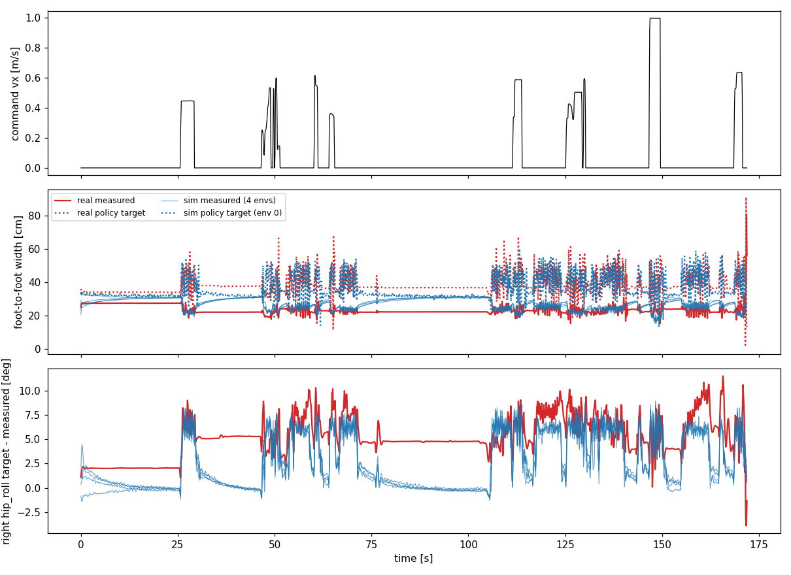

# 실기 대 Sim 같은 명령 재생: 다리가 안쪽으로 모이는 원인 (할 일 #206)

2026-11-04 · 사용자 질문: "실험 데이터와 Sim 데이터를 비교해 무엇이 문제여서 다리가 안쪽으로 모이는지 분석할 수 있나?"
앞 문서: `docs/178`(10-28 기록, 같은 방법), `docs/188`(11-04 기록 폭 숫자). 이 문서는 11-04 기록의 명령 순서를 Sim에 그대로 넣어 겹쳐 본 결과이다.

# 0. 결론

1. **걸을 때 좁아지는 것은 Sim도 똑같이 만든다.** 11-04 기록의 명령(vx, wz)을 그대로 Sim에 넣으면 걷기 폭이 실기 22.5 cm, Sim 22.3~22.7 cm 로 같다. hip_roll 목표 − 측정도 같다(실기 +6.2° / −5.0°, Sim +5.5~5.7° / −5.4~−5.5°). 정책이 지시하는 폭은 두 쪽 모두 약 40 cm 이다. 즉 **걸을 때 모이는 원인은 정책과 hip_roll 위치 제어(PD) 자체**이다. 지지 다리가 몸무게를 받으면 hip_roll 이 바깥 목표를 5~6° 못 따라간다. 이 성질은 학습된 정책에 이미 들어 있다.
2. **서 있을 때 모이는 것은 실기에만 있다.** 걷기를 멈추면 Sim의 발은 바깥으로 미끄러져 약 10 초 동안 목표 오차가 0 으로 줄고 폭이 29 cm 가 된다. 실기의 발은 전혀 움직이지 않는다. 폭 변화가 0.00x cm/s 이고 50 초 동안 22.2 → 22.2 cm 이다. 목표 오차는 +4.5~5.2° 에 그대로 남는다.
3. **이유는 정책 출력이 아니라 접촉이다.** 같은 정책이 실기에서는 오히려 더 바깥을 지시한다(서기 목표 폭 실기 36.6, Sim 32.8 cm). 그런데 실기만 안 벌어진다. hip_roll 이 내는 힘은 작다(10 N·m, 발 하나당 옆으로 밀기 약 13 N, 발 하중 약 116 N, 필요한 마찰계수 약 0.12). 실기 바닥은 이 정도 힘에는 발을 붙잡는다. Sim은 같은 힘에서 발이 조금씩 기어간다(서기 중 옆힘 대 수직힘 비 평균 0.11, 95 % 0.23, 마찰계수 설정 0.6 인데도 기어감).
4. **그래서 두 가지가 겹친다.** (가) 걸을 때 이미 22 cm 로 모인다(정책 + PD, Sim과 같음). (나) 걷고 멈춘 뒤 Sim은 정책이 발을 바깥으로 밀어 29 cm 로 회복하는데, 실기는 발이 붙어서 회복하지 못하고 22 cm 에 머문다. 학습은 (나)의 회복이 되는 세계에서 이루어졌다.
5. **고무 밑창·새 발 때문은 아니다.** 10-28(이전 발이라고 가정)과 11-04가 같은 모양이다(`docs/188`). 다만 발이 붙는 정도가 더 커졌는지는 이 기록으로 가를 수 없다.



그림 읽는 법: 위는 명령 vx. 가운데는 발 사이 폭(빨강 실기, 파랑 Sim 4개). 아래는 오른 hip_roll 목표 − 측정이다. 걷는 구간(명령 vx > 0)에서는 빨강과 파랑이 겹친다. 서는 구간에서 파랑은 오차가 0 쪽으로 지수적으로 줄고 폭이 올라간다. 빨강은 수평선이다. 0~25 초(걷기 전 서기)에서도 같다.

# 1. 숫자

| 구간 | 실기 | Sim (공칭, 환경 4개) |
|---|---|---|
| 걷기 폭 [cm] | 22.5 | 22.3 ~ 22.7 |
| 걷기 hip_roll 목표−측정 오른 / 왼 [°] | +6.2 / −5.0 | +5.5~5.7 / −5.4~−5.5 |
| 서기 폭 [cm] (5 초 후 전체) | 23.6 | 28.7 ~ 29.0 |
| 서기 목표 폭 [cm] | 36.6 | 32.6 ~ 32.8 |
| 서기 hip_roll 목표−측정 오른 / 왼 [°] | +4.5 / −3.9 | +0.8~0.9 / −1.6~−1.7 |
| 서기 구간 폭 변화율 [cm/s] (5 초 넘는 구간) | +0.001, −0.003, +0.001, −0.063 | +0.04~+0.10, +0.28~+0.34, +0.05~+0.09, +1.0~+1.4 |

- 걷기 전 첫 서기(0~25.6 초)도 실기는 폭 27.1 → 27.4 cm 로 그대로이고 목표 오차 +2.0° 로 평평하다. Sim은 이 구간에서도 오차가 줄어든다. 발이 붙는 성질은 걷기 이후에만 생기는 것이 아니다.
- Sim에서 서기 중 발 접촉 신호가 초당 약 10 번 켜졌다 꺼진다(분당 540~610 번, 한 발만 닿은 비율 25~30 %). 관절은 거의 움직이지 않으므로(표준편차 0.1~0.4°) 발을 드는 걸음이 아니라 접촉이 떨리는 것이다. 이 떨림이 발을 기어가게 하는지는 확인하지 않았다.
- 서기 구간 관절 표준편차는 실기가 Sim보다 작거나 비슷하다(예: hip_roll 0.11 대 0.29°). 실기가 더 흔들려서 모이는 것이 아니다.

# 2. 한계와 확인할 것

- Sim은 공칭 조건(무작위화·잡음·지연 끔)이다. 학습 무작위화 켠 결과는 `docs/178` §4-1 (서기 27.0 cm)과 같은 방향이었다.
- 발이 붙는 이유(바닥 종류, 고무 밑창, 발 하중 분포)는 이 기록으로 가르지 못한다. Sim 접촉을 단단하게 해도 서기 폭이 같았다는 `docs/178` §4-5 결과와 합치면, 단순한 접촉 설정 차이로는 설명되지 않는다.
- 실기에는 토크·전류가 없다. 서기 hip_roll 전류를 기록하면 "발이 붙어서 토크가 남는지"를 직접 볼 수 있다(`docs/178` §4-4 는 10-28 기록 2에서 +10.9 / −10.6 N·m 로 확인했다).
- 처방: (1) 다음 학습에서 폭 보상과 대칭 시작 외란을 넣는다(`docs/178` §5-3). 정책이 걸을 때부터 넓게 서도록 한다. (2) 서기 회복을 접촉 크리프에 맡기지 않도록, 서기 때 폭 목표를 보상에 넣는다. (3) hip_roll Kp ×1.2 → ×1.4 시험은 걷기 폭(원인 1)을 직접 줄인다(`docs/178` §5-2).

# 3. 재현

```bash
CUDA_VISIBLE_DEVICES="" MUJOCO_GL=egl mujoco-sim/mjlab/.venv/bin/python3 tools/sim2real/walk/sim_stance_record.py \
  --branch-root <ws>/union_branch/mjlab_policy --mjlab-src <ws>/stock_mjlab/src --trace <walk_baseline 을 csv 로 바꾼 파일> \
  --name W1104_nom --out <out> --num-envs 4          # CPU 8.5 분
mujoco-sim/mjlab/.venv/bin/python3 tools/sim2real/walk/real_vs_sim_stand.py <xml> Expr_Data/huphy_main_e4f9694/walk_baseline_policy.json <out>/csv <json>
mujoco-sim/mjlab/.venv/bin/python3 tools/sim2real/walk/real_vs_sim_stand_fig.py <xml> <real.json> <out>/csv docs/img/huphy_1104_real_vs_sim_width.png
```

결과 숫자: `Expr_Data/real_vs_sim_stand_2026-11-04.json`. 실기 서기 구간 도구: `tools/sim2real/walk/stand_drift_real.py`.
