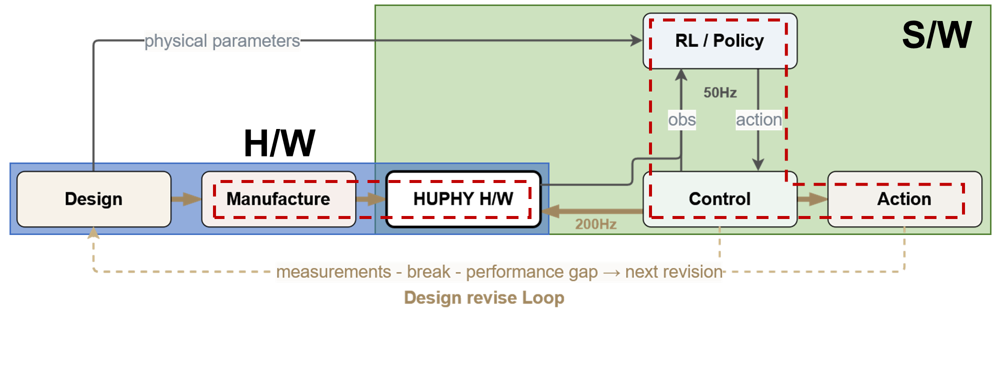
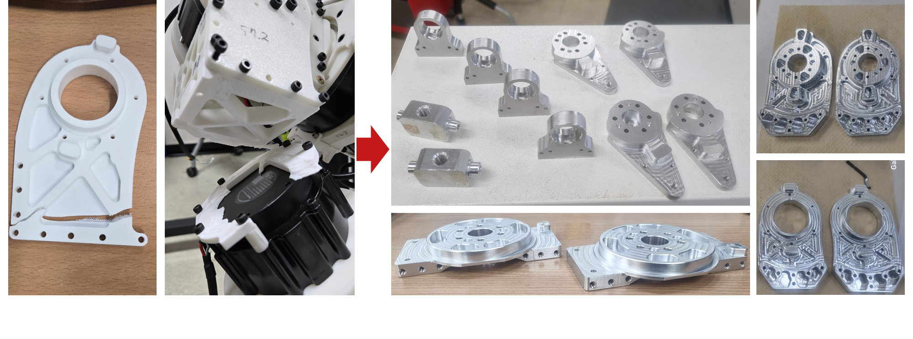
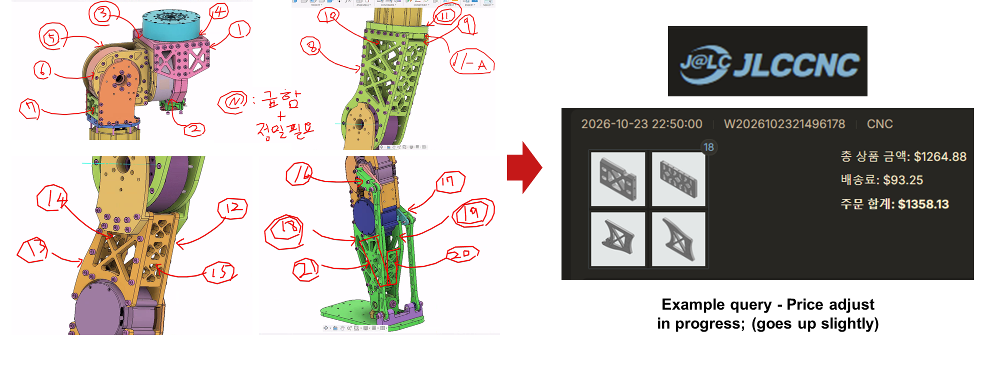

## Reference
- [[대학원 생활 관련/ARILab 관련/ARILab Meeting {2026-09-21}|ARILab Meeting {2026-09-21}]]
- [[ARILab Meeting {2026-10-06}]]
- [[ARILab Meeting {2026-10-13}]]

## 초안의 초안
- 내일 랩미팅 준비
	- 제어 : 걸었음,섰음, 스쿼팅했음 {주영(걷기) + 경록(스쿼트)} / 찬희(제어코드)
		- 왜 : Sim2Real 배포 w/ 제대로 된 Policy & DR 조건들 보정
		- 상세 : 스쿼트는 기-가 막히게 잘되는데, 걷기는 아직 많이 불안정(쏠림, 미끄러짐, 관절진동)
		- 다음 : 경록님 조건으로 재학습된 Policy 10/27 실험예정
	- 제작 : 알루미늄 가공 진척도 , 과기대 / 외주 예정 
		- 왜 : Policy OOD 에서 발산시 파츠가 계속 깨짐 + 강성문제로 진동생기는 부분 의심되어 강성추가필요
		- 상세 : 과기대에서 외주가공한것들 보고 &  기간문제로 외주(JLCCNC)할 것들 금액 이정도 나오고, 가공일정도 같이 보고.
		- 다음 : 견적 조정중; 상세견적 나오는대로 결제(해외플랫폼)
- ToDO
	- 제작 : 
		- 알루미늄 가공 - JLCCNC 가공 견적 확정 (~10/28)
		- 발바닥 프로토타입 설계 및 제작 (~11/03)
	- 전기 : 배터리 - 배터리 스펙 확정 (~10/29)
	- 제어 : 주영님이 학습한 개정 보행 Policy 실험 (~10/27)
	- 논문 리뷰 : [[ICRA2027 Paper Review]] (~11/03)

---
## 발표 Layout 
- 총 8p 정도로 진행 - 내용은?
	- Whole system **architecture**
		- From whole develop loop, today presentation includes below components
		- Today, I will report Sim2Real progress & H/W machining progress
		- 
	- Control : Sim2Real deploy - Walking, Standing & Squatting {Julia(walking) + Gyeongrok(squat) / Chanhue(control code)}
		- 왜 : Sim2Real 배포 w/ 제대로 된 Policy & DR 조건들 보정
		- Huphy walked, stood & squatted w/ the deployed policies
		- Squat works really well, but walking is still quite unstable (leaning, slipping, joint vibration)
		- Next : Policy retrained w/ Gyeongrok's conditions will be tested on 10/27
		- 
	- Mech : Aluminium parts machining progress @ SeoulTech
		- 왜 : Policy OOD 에서 발산시 파츠가 계속 깨짐 + 강성문제로 진동생기는 부분 의심되어 강성추가필요
		- Reporting the parts machined at SeoulTech
		- 
	- Mech : Outsourcing aluminium machining to JLCCNC
		- 기간문제로 외주(JLCCNC)할 것들의 금액, 가공일정 같이 보고
		- 견적 조정중; 상세견적 나오는대로 결제(해외플랫폼)
		- 
- ToDo : 
  - Mech : 
	  - 알루미늄 가공 - JLCCNC 가공 견적 확정 (~10/28)
	  - 발바닥 프로토타입 설계 및 제작 (~11/03)
  - Elec : 
	  - 배터리 - 배터리 스펙 확정 (~10/29)
  - Ctrl : 
	  - 주영님이 학습한 개정 보행 Policy 실험 (~10/27)
  - 논문 리뷰 : 
	  - [[ICRA2027 Paper Review]] (~11/03)

## ToC - 발표자료 
- P1 : Title 
	- Title - Lab Meeting
	- Sub-Title - Project Pygmalion : Building a Humanoid
	- Name : DongYeop Shin
	- Date : Oct. 27, 2026 (정확히 이 날짜로 할것)

- P2 : ToC 
	- Whole system **architecture**
	- Control - Sim2Real deploy: walking, standing & squatting
	- Mech - Aluminium parts machining @ SeoulTech
	- Mech - Outsourcing aluminium machining to JLCCNC
	- ToDo

- P3 : Whole system **architecture**
	- 내용 (영어로 번역하기)
		- From whole develop loop, today presentation includes below components
		- Today, I will report Sim2Real progress & H/W machining progress
	- IMG : 
		- (이미지1)

- P4 : Control - Sim2Real deploy: walking, standing & squatting
	- 내용 (영어로 번역하기)
		- To do Sim2Real, deployed the policies @Huphy and calibrated the DR conditions. (Walking: Julia, Squat: Gyeongrok, Control code: Chanhue)
		- Huphy walked, stood & squatted. Squat works really well, but walking is still quite unstable.
		- Next, the walking policy retrained w/ Gyeongrok's conditions will be tested on 10/27.
	- IMG : 
		- (이미지1)

- P5 : Mech - Aluminium parts machining @ SeoulTech
	- 내용 (영어로 번역하기)
		- When the policy diverges at OOD, parts keep breaking. 
		- Also, stiffness is suspected of causing the vibration, so stiffness needs to be added.
		- Reporting the aluminium parts machined at SeoulTech.
	- IMG : 
		- (이미지1)

- P6 : Mech - Outsourcing aluminium machining to JLCCNC
	- 내용 (영어로 번역하기)
		- Because of the schedule, the remaining parts will be outsourced to JLCCNC.
		- Reporting the estimated cost & machining schedule. 1400~2000$ (200~250만원)
		- The quote is being adjusted $\because$ they requires specific requirements; will pay via the overseas platform as soon as the detailed quote comes out.(한줄에 맞게 줄여라)
	- IMG : 
		- (이미지1)

- P7 : ToDo
	- 내용 (영어로 번역하기)
		- Mech : 
			- Aluminium machining - confirm the JLCCNC quote (~10/28)
			- Design & make a sole prototype (~11/03)
		- Elec : 
			- Battery - confirm the battery spec (~10/29)
		- Ctrl : 
			- Test the revised walking policy trained by Julia (~10/27)
		- Paper review : 
			- ICRA 2027 Paper Review (~11/03)

- P8 : 항상하던 Thank you
