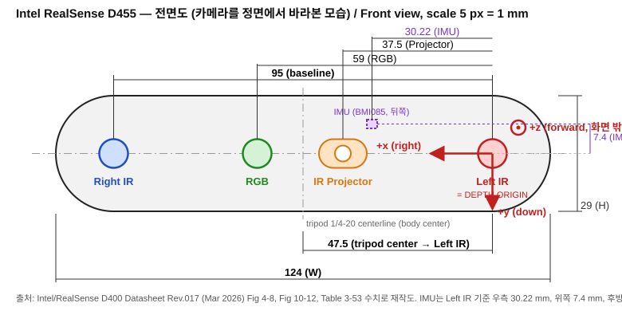
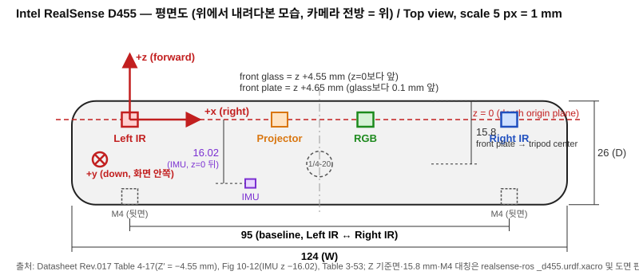
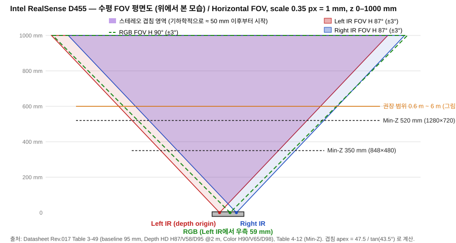

## 한눈에 보기

| 항목                            | 값                                                                         |
| ----------------------------- | ------------------------------------------------------------------------- |
| 본체 치수 / 무게                    | 124 × 29 × 26 mm (W×H×D) / 116 g ±10% [^ds67]                             |
| 베이스라인 (Left IR ↔ Right IR)    | 95 mm [^ds65]                                                             |
| Depth FOV (16:9, 1280×720 계열) | H 87° / V 58° / D 95° (±3°, 2 m 기준) [^ds65]                               |
| RGB FOV                       | H 90° / V 65° / D 98° (±3°) [^ds65]                                       |
| 권장 동작 거리                      | 0.6 m ~ 6 m, 깊이 오차 < 2 % @ 4 m [^prod]                                    |
| Min-Z                         | 1280×720에서 520 mm, 848×480에서 350 mm [^ds84]                               |
| **Depth 원점**                  | **Left IR 이미저 중심** (X-Y), Z=0 면은 전면 유리보다 4.55 mm 뒤 [^ds89][^ds91]         |
| 축 규약                          | +x 오른쪽, +y 아래, +z 전방 (OpenCV pinhole) [^lrs]                              |
| RGB 원점                        | RGB 센서 중심 (Left IR에서 +x 방향 공칭 59 mm) [^ds91][^forum1]                     |
| IMU                           | 6DoF (BMI055 또는 BMI085), SDK가 depth 좌표계로 변환해서 출력 [^ds94][^lrs]            |
| 마운트                           | 뒷면 M4 ×2 (95 mm 간격, 최대 삽입 4 mm, 0.4 N·m), 바닥 1/4-20 (최대 삽입 9 mm) [^ds142] |





> [!note] 도면 이미지에 대해
> 위 두 그림과 아래 FOV 그림은 데이터시트(Fig 4-8, Fig 10-12, Table 3-49 등)의 수치를 그대로 옮겨 **새로 그린 SVG**입니다. 데이터시트 원본 도면 크롭과 PDF 원본은 이번 세션에서 vault에 바이너리를 쓸 수 없어 아래 [[#6. 원본 PDF·공식 이미지]]의 링크 임베드로 대신했고, vault 폴더가 연결되면 로컬 파일로 교체할 예정입니다.

## 1. 주요 사양

### 1.1 기구 (치수·마운트)

| 항목 | 값 |
|---|---|
| 폭 × 높이 × 깊이 | 124 (123.5–124.5) × 29 (28.5–29.5) × 26 (25.5–26.5) mm [^ds67] |
| 무게 | 116 g (±10 %, USB 캡 2.3 g 별도) [^ds67] |
| 평탄도 허용 | 0 – 0.2 mm [^ds67] |
| D455f(NIR 필터형) 참고 | 깊이 약 26.8 mm, Z′ = −5.05 mm [^ds67][^ds89] |
| 뒷면 마운트 | M4 ×2, 도면 표기 간격 95 mm, 최대 삽입 깊이 4 mm, 권장 토크 0.4 N·m [^ds142] |
| 바닥 마운트 | 1/4-20 삼각대 홀, 최대 삽입 깊이 9 mm [^ds142] |
| 인터페이스 | USB 3.1 Gen 1 (USB-C 커넥터는 바닥면, 삼각대 홀 옆) [^ark][^ds142] |
| 삼각대 홀 중심 ↔ Left IR | 47.5 ±0.1 mm [^ds92] |
| 삼각대 홀 중심 ↔ 전면 플레이트 | 15.8 mm [^urdf][^ds142] |

### 1.2 광학

| 항목 | Depth (Left/Right IR) | RGB | IR 프로젝터 |
|---|---|---|---|
| FOV (HD 16:9) | H 87 / V 58 / D 95 | H 90 / V 65 / D 98 | H 90 / V 63 / D 99 [^ds65] |
| FOV (VGA 4:3) | H 75 / V 62 / D 89 | — | — [^ds65] |
| 센서 | OmniVision OV9782 급 와이드 이미저, 1280×800, f/2.0, f = 1.93 mm, 글로벌 셔터 | OV9782 | — [^ds41][^ds65] |
| 모듈 | Depth 모듈 D450 | — | — [^ds65] |

- 모든 FOV는 기구 공차 ±5 % 때문에 렌즈/모듈마다 약 ±3° 변할 수 있고, Depth FOV는 2 m 거리에서 규정됩니다. [^ds65]
- 출처마다 FOV 표기가 다릅니다 (Intel ARK 86×57, RealSense 제품 페이지 87°×58°, 일부 유통사 RGB 86×57). 이 노트는 데이터시트 Table 3-49 값을 기준으로 합니다. [^ark][^prod][^ds65][^mouser]



### 1.3 스트림 모드 (USB 3.1 Gen 1)

| 스트림 | 해상도 → 가능한 FPS |
|---|---|
| Depth (Z16) | 1280×720 → 5/15/30, 848×480·640×480·640×360·480×270·424×240 → 5/15/30/60/90 |
| Left/Right IR (Y8) | 1280×720 → 5/15/30, 그 외 해상도 → 최대 90 |
| RGB (YUY2) | 1280×800 → 5/15/30, 848×480·640×480 → 최대 60, 640×360·480×270·424×240 → 최대 90 |
| Left IR을 컬러처럼 (UYVY) | 1280×720 → 5/15/30, 그 외 → 최대 90 |

위 값은 모두 Table 4-3입니다. [^ds75]

Min-Z는 해상도별로 1280×720 520 mm, 848×480 350 mm, 640×480 320 mm, 640×360 260 mm, 480×270 200 mm, 424×240 180 mm입니다. [^ds84]

### 1.4 IMU

| 항목 | BMI085 (신형) | BMI055 (구형) |
|---|---|---|
| 자유도 | 6 | 6 |
| 가속도 범위 | ±4 g | ±4 g |
| 가속도 샘플레이트 | 100, 200 Hz | 62.5, 250 Hz |
| 자이로 범위 | ±1000 °/s | ±1000 °/s |
| 자이로 샘플레이트 | 200, 400 Hz | 200, 400 Hz |
| 타임스탬프 정확도 | 50 µs | 50 µs |

D455는 두 표에 모두 올라 있고, BMI055는 BMI085로 대체되었다고 데이터시트에 적혀 있습니다 (PCN 번호 118035-00). 개체에 따라 어느 쪽인지 다를 수 있습니다. [^ds94][^ds95]

IMU 패킷은 depth 센서 하드웨어 클럭으로 타임스탬프가 찍혀 gyro/accel/depth 프레임 사이 동기화가 가능합니다. [^lrs]

### 1.5 전력

최대 동작 모드(Depth 1280×720@30, Color 1280×720@30)에서 전체 소비전력 3.46 W, TDP 3.10 W입니다 (IR 프로젝터가 1.62 W로 가장 큼). [^ds105]

## 2. 좌표계와 원점

### 2.1 축 규약

SDK 전체 규약은 +x 오른쪽, +y 아래, +z 전방이고 OpenCV pinhole 모델과 호환됩니다. [^lrs]


가만히 놓인 정상 자세에서 가속도계 y축은 −9.8 m/s²로 읽히는데, 가속도계가 중력이 아니라 중력에 저항하는 힘(위쪽)을 재고 +y가 아래이기 때문입니다. [^lrs]

### 2.2 Depth 원점

- X-Y: Left 이미저 중심입니다. 삼각대 홀 중심선에서 Left 이미저까지 47.5 ±0.1 mm입니다. [^ds91][^ds92]
- Z: 깊이 측정이 시작되는 Z=0 면은 전면 커버 유리보다 4.55 mm 안쪽입니다 (Z′ = −4.55 mm). 전면 유리를 기준으로 거리를 재면 측정값에 |Z′|를 더해야 실제 값이 됩니다. [^ds89]
- 전면 유리는 알루미늄 전면 플레이트보다 0.1 mm 안쪽입니다 (ROS URDF의 주석). [^urdf]

### 2.3 RGB 원점

RGB 프레임의 원점은 RGB 센서 중심선입니다. [^forum1] 데이터시트 Fig 4-8에서 Left 이미저 기준 RGB까지 59 mm, 프로젝터까지 37.5 mm, Right 이미저까지 95 mm입니다. [^ds91]

주의할 점은 SDK가 depth ↔ color extrinsic을 쓰면 RGB 영상의 원점이 Left IR로 바뀔 수 있다는 점입니다. 직접 extrinsic으로 변환한다면 어느 프레임 기준인지 확인해야 합니다. [^forum2]

실제 extrinsic은 개체마다 캘리브레이션된 값이 EEPROM에 있고, URDF의 −0.059 m 같은 값은 근사치라고 URDF 주석에 적혀 있습니다. [^urdf]

### 2.4 IMU 원점

SDK는 IMU 샘플에 extrinsic 행렬을 곱해 depth 센서 좌표계로 변환한 뒤 내보내므로, 출력된 가속도/각속도는 depth 프레임 기준입니다. [^lrs]

물리적인 IMU 위치는 데이터시트 Fig 10-12의 표기값과 ROS URDF 값이 일치합니다. [^ds142][^urdf]

| 좌표계 | IMU 위치 (Left IR 원점 기준) |
|---|---|
| Depth optical (x 우, y 하, z 전) | (+30.22, −7.4, −16.02) mm |
| ROS body (x 전, y 좌, z 상) | (−16.02, −30.22, +7.4) mm |

### 2.5 정렬(align) 시 원점 변화

depth를 color에 정렬하면 depth의 원점이 RGB 센서 중심선으로 바뀝니다. 반대로 D455는 Left IR 영상을 컬러처럼 스트리밍하는 모드가 있고, Left IR이 depth의 원점이므로 이 영상은 depth와 픽셀 단위로 일치합니다. [^forum1]

### 2.6 ROS(realsense-ros) 프레임

- `camera_link`(= depth 프레임)은 x 전방, y 왼쪽, z 위쪽입니다. optical 프레임은 여기에 rpy(−π/2, 0, −π/2)를 곱한 것입니다. [^urdf]
- 공칭 오프셋은 infra1 0, infra2 −0.095 m, color −0.059 m (y축)입니다. [^urdf]
- URDF에서 `camera_link`는 바닥 나사 프레임 기준으로 (+11.15, +47.5, +14.5) mm (x 전, y 좌, z 상)에 놓입니다. 즉 삼각대 홀 중심에서 앞으로 11.15 mm, 왼쪽으로 47.5 mm, 위로 14.5 mm입니다. [^urdf]

## 3. 센서·형상 위치표 (Depth optical 프레임, mm)

원점은 Left IR 중심, +x 오른쪽, +y 아래, +z 전방입니다.

| 요소 | x | y | z | 근거 |
|---|---|---|---|---|
| Left IR (원점) | 0 | 0 | 0 | [^ds91] |
| IR 프로젝터 | +37.5 | 0 | 0 (공칭 가정) | [^ds91] |
| RGB | +59 (공칭) | 0 | 0 (공칭 가정) | [^ds91][^urdf] |
| Right IR | +95 | 0 | 0 (공칭 가정) | [^ds91] |
| IMU | +30.22 | −7.4 | −16.02 | [^ds142][^urdf] |
| 삼각대 홀 중심 (바닥면) | +47.5 | +14.5 | −11.15 | [^ds92][^urdf] |
| 전면 유리 | — | — | +4.55 | [^ds89] |
| 전면 플레이트 | — | — | +4.65 | [^urdf] |
| 후면 | — | — | −21.35 | 4.65 − 26 (계산) |
| 본체 x 범위 | −14.5 ~ +109.5 | | | 124 폭이 삼각대 중심(x=47.5)에 대칭이라는 가정 (계산) |
| 본체 y 범위 | | −14.5 ~ +14.5 | | 렌즈가 높이 중앙(29/2)이라는 URDF 값 (계산) |

센서 z가 0이라는 값은 URDF가 모두 같은 x(전방) 위치에 두고 있어서 쓴 공칭 가정이며, 프로젝터 렌즈의 z는 데이터시트에서 따로 확인하지 못했습니다. [^urdf]

## 4. 설계 적용 메모 (HUPHY Pelvis 장착용)

관련 노트: [[Project Human Pygmalion - 설계 Scratchpad]]

1. 고정 방식은 뒷면 M4 ×2(95 mm 간격)와 바닥 1/4-20 중에서 고르면 됩니다. 뒷면 M4는 최대 삽입 깊이가 4 mm이므로 브래킷 쪽에서 체결 길이를 4 mm 이하로 맞추고, 토크는 0.4 N·m 이하로 관리해야 합니다. [^ds142]
2. 뒷면 마운트 기준으로 환산하면 Left IR 중심은 뒷면보다 21.35 mm 앞, 높이 중앙입니다. 좌우로는 본체 중심에서 47.5 mm 왼쪽입니다. 도면상 M4 두 홀과 좌/우 IR 렌즈 x 위치가 같아 보이지만 이 정렬은 눈으로 읽은 것이므로 CAD/STEP으로 확인이 필요합니다. [^ds142][^urdf]
3. 로봇 URDF에는 `camera_link`를 Left IR 중심에 두고, depth/color/imu 오프셋은 위 3장 표 값(또는 SDK가 읽어주는 개체별 extrinsic)을 쓰는 방식이 realsense-ros 규약과 맞습니다. [^urdf]
4. 시야각 안에는 구조물을 두지 않아야 합니다. 기준값은 Depth H87/V58, RGB H90/V65, 프로젝터 H90/V63/D99이고, 렌즈와 프로젝터가 한 줄(전면 유리 뒤)에 있으므로 전면 유리와 프로젝터 창을 가리지 않아야 합니다. [^ds65]
5. Min-Z가 해상도별로 180–520 mm이므로 몸통·팔이 카메라 바로 앞에 오는 자세가 있다면 해당 거리 안쪽은 깊이가 나오지 않습니다. [^ds84]
6. 발열이 최대 3.1~3.5 W이고 프로젝터 비중이 크므로 밀폐 커버로 완전히 덮는 설계는 피하는 편이 좋습니다. 이는 소비전력 표에서 나온 판단이며 열 해석을 한 것은 아닙니다. [^ds105]
7. USB-C 커넥터가 바닥면(삼각대 홀 근처)에 있어 바닥 마운트를 쓰면 케이블 간섭을 확인해야 합니다. URDF 플러그 위치로는 삼각대 중심에서 카메라 기준 오른쪽(Right IR 쪽)으로 37.01 mm입니다. [^ds142][^urdf]

URDF·시뮬레이터(Isaac Lab, MuJoCo)에 depth 센서를 넣는 절차와 원본 자료 위치는 [[Intel Realsense D455 - URDF 센서 통합]]에 정리했습니다.

## 5. 확인 필요·불확실 항목

- 도면의 (4.06) 치수 해석은 확정하지 못했습니다. 도면에는 있지만 어느 기준에서 잰 값인지 읽히지 않았습니다. [^ds142]
- M4 홀과 IR 렌즈의 x 정렬, 프로젝터·RGB의 z 위치, 본체의 정확한 좌우 중심은 STEP/도면으로 재확인이 필요합니다.
- RGB와 IR 사이 extrinsic(회전 포함)은 개체별 캘리브레이션 값이라 `pyrealsense2`로 직접 읽어야 정확합니다. 아래는 SDK의 표준 API 사용 예이고 이번 세션에서 실행해 본 것은 아닙니다.

```python
import pyrealsense2 as rs
pipe, cfg = rs.pipeline(), rs.config()
cfg.enable_stream(rs.stream.depth, 848, 480, rs.format.z16, 30)
cfg.enable_stream(rs.stream.color, 848, 480, rs.format.rgb8, 30)
prof = pipe.start(cfg)
d = prof.get_stream(rs.stream.depth)
c = prof.get_stream(rs.stream.color)
ext = d.get_extrinsics_to(c)   # depth → color, 단위 m
print(ext.rotation, ext.translation)
print(d.as_video_stream_profile().get_intrinsics())
pipe.stop()
```

## 6. 원본 PDF·공식 이미지

- 데이터시트 PDF (D400 Series, Doc 337029-017, 2026-03): [원본 PDF](https://www.realsenseai.com/wp-content/uploads/2026/03/RealSense-D400-Series-Datasheet-Mar-2026.pdf)
- 이 노트가 쓴 페이지: p.65 (Table 3-49 사양 비교), p.67 (기구 치수), p.75 (스트림 모드), p.84 (Min-Z), p.89 (Depth Start Point), p.91–92 (Depth 원점 Fig 4-8), p.94–95 (IMU), p.105 (전력), p.142 (D455 기구 도면 Fig 10-12)

공식 제품 사진:


p.91 (Fig 4-8, Depth 원점):

<iframe src="https://www.realsenseai.com/wp-content/uploads/2026/03/RealSense-D400-Series-Datasheet-Mar-2026.pdf#page=91" width="100%" height="620"></iframe>

p.142 (Fig 10-12, D455 기구 도면):

<iframe src="https://www.realsenseai.com/wp-content/uploads/2026/03/RealSense-D400-Series-Datasheet-Mar-2026.pdf#page=142" width="100%" height="620"></iframe>

## 출처

[^ds65]: RealSense, *RealSense D400 Series Datasheet* (Doc 337029-017, 2026-03), p.65, Table 3-49 Depth Camera SKU Properties. https://www.realsenseai.com/wp-content/uploads/2026/03/RealSense-D400-Series-Datasheet-Mar-2026.pdf
[^ds41]: 같은 데이터시트 p.41, Table 3-14 Wide Left and Right Imager Properties – D450 (OV9782, 1280×800, f/2.0, f = 1.93 mm, 글로벌 셔터, H 90±1°/V 64±1°/D 98±1°).
[^ds67]: 같은 데이터시트 p.67, Table 3-53 D455/D455f/D456 Mechanical Dimensions.
[^ds75]: 같은 데이터시트 p.75, Table 4-3 Image Formats (USB 3.1 Gen 1) – D450/D455/D455f/D456.
[^ds84]: 같은 데이터시트 p.84, Table 4-12 Minimum-Z Depth (D455가 속한 열의 값을 채택; RealSense 스토어 표기 "Min-Z at max resolution ≈ 52 cm"와 일치).
[^ds89]: 같은 데이터시트 p.89, Table 4-17 Depth Cameras Depth Start Point (D455/D456 −4.55 mm, D455f −5.05 mm) 및 4.8.1 Depth Origin X-Y Coordinates.
[^ds91]: 같은 데이터시트 p.91, Figure 4-8 Depth Camera X-Y Depth Origin Reference – D455/D455f/D456 (Left IR 기준 프로젝터 37.5, RGB 59, Right IR 95 mm).
[^ds92]: 같은 데이터시트 p.92, Table 4-21 Depth Camera X-Y Depth Origin Coordinates D45x (삼각대 1/4-20 중심 → Left 이미저 47.5 ±0.1 mm).
[^ds94]: 같은 데이터시트 p.94, Table 4-25 IMU Specifications – BMI055 (및 BMI055 단종/BMI085 대체 주석).
[^ds95]: 같은 데이터시트 p.95, Table 4-26 IMU Specifications – BMI085.
[^ds105]: 같은 데이터시트 p.105, Table 7-9 Stereo Depth Camera (D455/D455f/D456) Component Power and TDP at Max Operating Mode.
[^ds142]: 같은 데이터시트 p.142, Figure 10-12 RealSense Depth Camera D455 (기구 도면: 124/29/26 mm, 95 mm 간격 M4 ×2, 1/4-20 삼각대 홀, IMU 30.22/7.4/−16.02, "Recommended torque for both M4 mounting points is 0.4 Nm").
[^urdf]: RealSense, *realsense-ros* `realsense2_description/urdf/_d455.urdf.xacro` (ros2-master). 오프셋 값은 근사치이며 실제 카메라 노드는 개체별 캘리브레이션 extrinsic을 발행한다고 파일 주석에 명시. https://raw.githubusercontent.com/IntelRealSense/realsense-ros/ros2-master/realsense2_description/urdf/_d455.urdf.xacro
[^lrs]: RealSense, *librealsense* `doc/d435i.md`, "Sensor origin and coordinate system" (development 브랜치). https://github.com/realsenseai/librealsense/blob/development/doc/d435i.md
[^forum1]: RealSense Support Community, "D455 the coordinate frames" 답변 (Depth 원점은 Left IR 중심선, RGB 원점은 RGB 센서 중심선, align 시 원점 변경, RGB-from-left-IR 모드). https://support.realsenseai.com/hc/en-us/community/posts/25688623923219/comments/25725719076755
[^forum2]: RealSense Support Community, "D455 extrinsic calibration" 답변 (extrinsic 사용 시 RGB 원점이 Left IR로 바뀔 수 있음). https://support.realsenseai.com/hc/en-us/community/posts/38408620529171/comments/38431439546515
[^prod]: RealSense, "D455" 제품 페이지 (FOV 87°×58°, 스테레오 간격 95 mm, 깊이 오차 < 2 % @ 4 m, Ideal Range 0.6–6 m). https://www.realsenseai.com/products/real-sense-depth-camera-d455f/ 및 Intel Store D455 페이지 https://store.intelrealsense.com/buy-intel-realsense-depth-camera-d455.html
[^ark]: Intel ARK, "Intel RealSense Depth Camera D455" (Depth FOV 86×57, 124×29×26 mm, USB 3.1). https://ark.intel.com/content/www/us/en/ark/products/205847/intel-realsense-depth-camera-d455.html
[^mouser]: Mouser, "Intel RealSense Depth Camera D455" (유통사 표기 86°±3° × 57°±3°, RGB FOV 동일 표기). https://www.mouser.co.uk/new/intel/intel-realsense-depth-camera-d455
