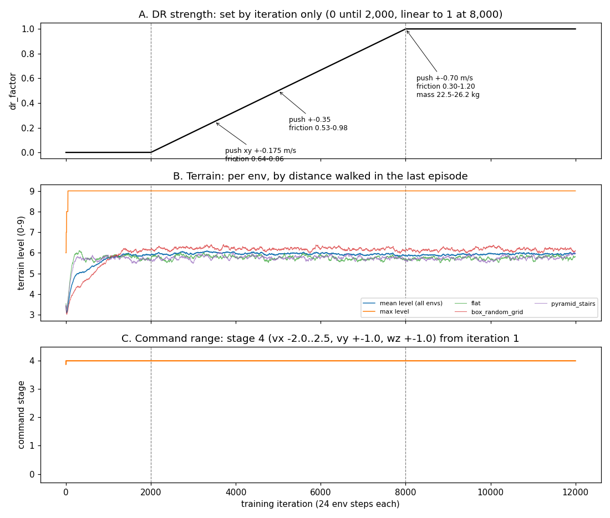

# Audit: `rough_box_main_v11a` 학습 구성

| 항목 | 내용 |
|---|---|
| 대상 | run `2026-10-11_23-35-20_rough_box_main_v11a`, checkpoint `model_11999.pt` |
| 독자 | RL·mjlab 을 아는 개발자. 이 저장소의 이력은 모른다고 가정한다. |
| 형식 | ASD-STE100 원칙(한 문장 한 사실, 능동형, 표 우선). 영어판: [README.md](README.md) |
| 작성일 | 2026-10-12 |
| 표기 | 모든 사실에 출처(`파일:줄`, commit, 문서)를 붙인다. "미검증" = 이 audit 이 확인하지 못함. "출처 없음" = 값의 근거 기록이 없음. |

---

## 0. 개요

### 0.1 로봇과 정책

- 로봇: Pygmalion 하체 이족. Actuated joint 12 개 (다리마다 hip pitch/roll/yaw, knee, ankle crank A/B).
- Ankle pitch/roll 은 passive joint 다. 두 crank 모터가 2-RSU 병렬 링크로 구동한다 (이 저장소에서 "AB mode").
- 모델 질량 23.63 kg.
- 정책: velocity-command 보행 정책. 입력 명령 (vx, vy, wz), 출력 joint position target, 50 Hz.
- 학습 순서: flat terrain 정책(30,000 iter)의 actor 를 가져와, box-only rough terrain 에서 12,000 iter 추가 학습했다.

### 0.2 경로 약칭

| 약칭 | 경로 |
|---|---|
| `MJ` | `mujoco-sim/mjlab` (git submodule, `github.com/mujocolab/mjlab` 의 fork) |
| `ENVCFG` | `MJ/src/mjlab/tasks/velocity/config/pygmalion/env_cfgs.py` |
| `CONST` | `MJ/src/mjlab/asset_zoo/robots/pygmalion/pygmalion_constants.py` |
| `XML` | `MJ/src/mjlab/asset_zoo/robots/pygmalion/xmls/LegOnly_prototype-tempmass-motormeasured-armfix_v30_proxyfix_loop.xml` |
| `RUN` | 10.8.0.14 의 `MJ/logs/rsl_rl/pygmalion_velocity/2026-10-11_23-35-20_rough_box_main_v11a/` |
| `ENV.yaml` | `RUN/params/env.yaml` (resolved env cfg) |
| `MANIFEST` | `RUN/repro/launch_manifest.json` (flag, command, parent, source hash) |

### 0.3 `PYG_*` flag

이 fork 는 Pygmalion 전용 기능을 환경변수 `PYG_*` 로 켜고 끈다.
Flag 는 import 시점에 `ENVCFG`·`CONST` 가 읽는다. 따라서 같은 task id 도 flag 에 따라 다른 env 가 된다.
이 run 의 flag 전체는 `MANIFEST` 가 정본이다 (§0.5).

### 0.4 식별 정보

| 항목 | 값 | 출처 |
|---|---|---|
| Task | `Mjlab-Velocity-Rough-Pygmalion` | `MANIFEST` |
| Launcher | `MJ/analysis/launch_rough_main.py` (commit `baccb01b`) | `MANIFEST` |
| Train script | `MJ/analysis/train_actor_warmstart.py` (actor-only load) | `MANIFEST` |
| Parent | `2026-10-02_23-52-14_legonly_ab_v11a_stand01_s43_p2/model_29998.pt` (flat task, 30,000 iter) | `MANIFEST` parent |
| 규모 | 12,000 iter, 4,096 env, 24 step/env/iter, seed 43 | `RUN/params/agent.yaml` |
| 하드웨어 | RTX 3090 1 장 (10.8.0.14) | console log |
| SW | mjlab 1.5.0 (fork, editable), rsl_rl 5.4.0, mujoco 3.10.0, mujoco_warp 3.10.0.1, warp 1.14.0, torch 2.9.0 | venv |
| 외부 패키지 수정 | rsl_rl·mujoco_warp 수정 없음 (RECORD hash 전부 일치) | survey A |

### 0.5 Flag 목록

| 분류 | Flag |
|---|---|
| 모델 | `V2=1`, `ANKLE_MODE=AB`, `MODEL_TAG=LegOnly_prototype-tempmass-motormeasured-armfix_v30_proxyfix`, `MOTOR_MEAS=1`, `TN=1`, `ARM_ABD_DEG=15` (LegOnly 에는 무효), `SAFE_TARGET_CLIP=1` |
| 초기 자세 | `INIT_BENT=1`, `INIT_MID=1` |
| Observation | `STUDENT_TEACHER=1`, `CRITIC_DR_OBS=1`, `OBS_NAN_GUARD=1` |
| DR | `INERTIAL_DR=1`, `MASS_DR_JSON=tools/robot_model/fusion_snapshots/v30_inspection/mass_dr_legonly_fastener50_prototype-tempmass.json`, `DR_START_ITER=2000`, `DR_END_ITER=8000` |
| Curriculum | `GATED_CURRICULUM=1`, `GATE_ERR_RATIO=1.1`, `GATE_FELL_MAX=0.005`, `GATE_MIN_DWELL=0`, `GATE_MAX_DWELL=0`, `GATE_MIN_EPISODES=64`, `GATE_WINDOW=100`, `CMD_VY_STAGES=1`, `FRESH_STEPS=1` |
| Command | `REL_STANDING=0.1`, `REL_HEADING=0.3` |
| Terrain | `BOX_TERRAIN=1` |
| Reward | `SOFT_LANDING=1`, `SOFT_LANDING_MODE=half`, `KNEE_EXT=1`, `KNEE_EXT_DEG=25`, `KNEE_EXT_W=2.0`, `REWARD_TERM_CLAMP=50` |
| Termination | `LOW_BASE_REL=1`, `NAN_TERM=1`, `BLOWUP_TERM=1`, `STAGNATION=1` |
| Optimizer | `ENTROPY_ANNEAL=1` (coef 0.002 고정), `CRITIC_WARMUP_ITERS=300` |

꺼진 flag: `NO_DR`, `DR_STRONG`, `DR_STARTUP`, `PD_GAIN_DR`, `ACTION_DELAY`, `ACTION_NOISE`, `RESET_JOINT_NOISE`, `RESET_TILT`, `BEYONDMIMIC`, `REL_YAW_ONLY`, `CMD_NORM_CAP`, `UNEVEN`.

### 0.6 모델 파일명 tag

| Tag | 의미 | 출처 |
|---|---|---|
| `LegOnly` | 하체만 (상체 body 없음). Waist-yaw 모터 질량은 base 에 포함 | `massprops_fusion.py:92-99` |
| `prototype-tempmass` | Aluminium body 9 개/다리의 질량이 실측이 아닌 CAD 밀도 추정값 | `tools/robot_model/prototype_tempmass.py` |
| `motormeasured` | 모터 질량 실측값 (RS04 1.514 kg, RS03 0.9195 kg). 이후 bench 측정 armature·friction 도 XML 에 기록됨 | `XML:9`; commit `691ea902` |
| `armfix` | 어깨 housing body 소속 수정. LegOnly 에는 영향 없음 | `docs/112` §1 |
| `v30` | Fusion 360 CAD revision v30 | `docs/111` §1 |
| `proxyfix` | Motor cylinder (visual, non-colliding) 위치를 live CAD 에서 재추출 | `docs/114` §1, §4 |
| `_loop` | Ankle 2-RSU 를 `equality/connect` 4 개로 닫은 버전 | `CONST:85-89` |

---

## 1. 학습 환경과 stock code 수정

### 1.1 Simulation

| 항목 | 값 | 출처 |
|---|---|---|
| timestep / decimation | 0.005 s / 4 → policy 50 Hz | `ENV.yaml:1,2357`; `velocity_env_cfg.py:455,460` |
| Episode | 20 s (1,000 step) | `ENV.yaml:2398` |
| Solver | Newton, implicitfast, pyramidal cone, impratio 1.0, iterations 10, ls_iterations 20, tolerance 1e-8 | `ENV.yaml:2358-2366` |
| Contact buffer | ccd_iterations 100, nconmax 150, njmax 1500, contact_sensor_maxmatch 500 | `ENVCFG:52-56` |
| Stock 기본값 (덮어씀) | timestep 0.002, iterations 100, ls_iterations 50, ccd 50 | `MJ/src/mjlab/sim/sim.py:90-104` |

### 1.2 Terrain

`PYG_BOX_TERRAIN=1` 이 `BOX_TERRAINS_CFG` 를 선택한다 (`MJ/src/mjlab/terrains/config.py:336-352`, commit `9af9bae3`). Heightfield sub-terrain 은 없다.

근거: MuJoCo-Warp heightfield contact 에서 보행 중 발이 미끄러진다. Flat heightfield 에서 64 대 중 28~43 대만 보행을 유지했고, flat box 에서는 64/64 였다 (`docs/experiments/2026-10-11_flat_vs_rough_policy_compare.md` §2b).

| Sub-terrain | 비율 | difficulty t (= row/9) 에 따른 형상 |
|---|---|---|
| flat | 0.2 | — |
| pyramid_stairs | 0.2 | step 0.1·t m, width 0.3 m, 총 높이 0.6·t m |
| pyramid_stairs_inv | 0.2 | 동일 step, pit 깊이 0.6·t m |
| box_random_grid | 0.2 | 0.4 m cell, 높이 U(±0.12·t) m |
| tilted_grid | 0.2 | 1.0 m plate, tilt U(±15·t)°, 높이 noise ±0.1·t m |

10 row × 5 col (curriculum mode 는 sub-terrain 당 1 col), tile 8×8 m, border 20 m (`config.py:338-352`; `primitive_terrains.py:79-81,449,507,1488-1489`).

### 1.3 Observation

**Actor (45 dim, `enable_corruption=True`):**

| Term | Dim | Noise (uniform ±) | 출처 |
|---|---|---|---|
| `base_ang_vel` (`robot/imu_ang_vel`) | 3 | 0.2 rad/s | `ENV.yaml:797-815` |
| `projected_gravity` (`robot/imu_upvector`, 부호 반전) | 3 | 0.05 | `ENV.yaml:816-834` |
| `motor_pos_history` (`joint_pos_rel`, motor joint 12 개, `history_length=2`, [q(t−1), q(t)]) | 24 | 0.01 rad | `ENV.yaml:835-908`; `ENVCFG:157-185` |
| `actions` (`last_action`, raw) | 12 | 없음 | `ENV.yaml:909` |
| `command` (twist) | 3 | 없음 | `ENV.yaml:923` |

`PYG_STUDENT_TEACHER` 가 actor group 을 위 5 개 term 으로 재구성한다. Base lin vel, joint vel, height scan 은 actor 에 없다 (`ENVCFG:150-185`; 근거 `docs/110` §2).

**Critic (269 dim, `enable_corruption=False`):** base lin/ang vel, projected gravity, joint pos/vel (16 joint), actions, command, height_scan (187 ray, scale 0.2), foot height/air time/contact/contact force, DR state (`dr_friction`, `dr_mass`, `dr_com`, `dr_push`, `dr_factor`) (`ENVCFG:857-884`; `MJ/src/mjlab/tasks/velocity/mdp/observations.py:55-215`).

### 1.4 Action

| 항목 | 값 | 출처 |
|---|---|---|
| Term | `JointPositionActionCfg`, 12 dim, `use_default_offset=True` | `ENV.yaml:1497-1548` |
| Target | `default_joint_pos + 0.25 × a` | `CONST:1121-1132`; `actions.py:157,218` |
| Clip | `PYG_SAFE_TARGET_CLIP`: joint 별 centre ± 0.9/2 × range | `ENVCFG:118-130`; `CONST:1074-1099` |
| Clip 값 (rad, R; L 은 mirror) | crank ±1.08, hip_yaw ±0.707, hip_pitch −1.968~0.310, hip_roll −0.340~1.388, knee 0.105~1.990 | `ENV.yaml:1499-1535` |
| Delay | 0 | actuator `delay_*` = 0 |

### 1.5 Command (`UniformVelocityCommand`)

| 항목 | 값 | 출처 |
|---|---|---|
| 학습에 실제 사용된 range | vx −2.0~2.5, vy ±1.0, wz ±1.0 (§2.3) | TensorBoard `Curriculum/command_vel/*` |
| resampling_time_range | 3~8 s | `ENV.yaml:3089-3117` |
| rel_standing_envs / rel_heading_envs / rel_forward_envs | 0.1 / 0.3 (stiffness 0.5) / 0.2 | `ENV.yaml`; `ENVCFG:218-228` |

### 1.6 Reward

22 term (weight ≠ 0 인 것 21). `PYG_REWARD_TERM_CLAMP=50`: reward manager 가 term 별 weighted 값을 step 당 ±50·dt (= ±1.0) 로 clamp 한다 (`MJ/src/mjlab/managers/reward_manager.py:65-67,134-135`).

| Term | Weight | 구분 | 주요 param |
|---|---|---|---|
| track_linear_velocity | 2.0 | stock | std 0.866 (stock 0.5, `ENVCFG:314`) |
| track_angular_velocity | 2.0 | stock | std 0.707 |
| upright | 1.0 | stock | std 0.447 |
| pose (variable_posture) | 1.0 | stock | standing std 0.05, walking std joint 별 |
| body_ang_vel | −0.05 | stock | |
| angular_momentum | −0.02 | stock | |
| dof_pos_limits | −1.0 | stock | |
| action_rate_l2 | −0.1 | stock | |
| air_time | 1.0 | stock | 0.05~0.5 s |
| foot_clearance | −2.0 | stock | target 0.1 m |
| foot_swing_height | −0.25 | stock | target 0.1 m |
| foot_slip | −0.1 | stock | |
| soft_landing | −1e-5 | stock | |
| track_lin_vel_progress | 1.0 | fork | `rewards.py:48` |
| stand_still_penalty | −1.0 | fork | deadband 0.3 (`rewards.py:77`) |
| knee_overspeed | −0.5 | fork | limit 19.9 rad/s (`rewards.py:121`) |
| self_collisions | −1.0 | stock | threshold 10 N |
| torque_limit | 0 | fork | 계산 안 함 |
| contact_force_cap | −0.01 | fork | threshold 420 N, clip 560 N (`ENVCFG:403-404`) |
| foot_impact_velocity | −0.5 | fork | half mode (`ENVCFG:389-424,557`) |
| thermal_effort | −0.02 | fork | rated torque table (`ENVCFG:411-433`) |
| stance_knee_extension | −2.0 | fork | target 25° (`ENVCFG:564-575`) |

### 1.6.1 Reward 합산 규칙

`RewardManager.compute` (`MJ/src/mjlab/managers/reward_manager.py:120-140`) 가 policy step (dt = 0.02 s) 마다 아래를 계산한다.

$$r_t = \sum_k \mathrm{clip}\big(\mathrm{nan2zero}(w_k\, f_k\, dt),\ \pm 50\,dt\big)$$

- $f_k$ = term 함수 출력 (env 별 scalar), $w_k$ = weight. Weight 0 인 term 은 계산하지 않는다.
- NaN/Inf 는 0 으로 바꾼다 (stock). ±50·dt clamp 는 fork 추가 (§1.10). $f_k$ 기준 상한은 $50/|w_k|$ 다.
- Total reward 자체에는 clip 이 없다.

### 1.6.2 Term 별 계산식

**기호.** 모든 값은 env 별, 매 policy step.

| 기호 | 정의 | 출처 |
|---|---|---|
| $c = (c_x, c_y, c_\omega)$ | twist command (body frame). Heading env (30 %) 는 $c_\omega = \mathrm{clip}(0.5\cdot e_{heading}, \pm1)$ | `velocity_command.py` `_update_command` |
| $s$ | $\lVert c_{xy}\rVert + \lvert c_\omega\rvert$ (command 크기) | |
| $g_{0.05}$ | $\mathbb{1}[s > 0.05]$. Standing env (10 %, $c = 0$) 에서 0 | |
| $v^b, \omega^b$ | base (root link) 선속도·각속도, body frame | |
| $i \in$ {R, L} | 발 index. Contact sensor, foot site, knee joint 의 순서가 모두 [R, L] 로 같다 (F12, 2026-10-12 확인) | |
| $F_i$ | 발 $i$ (foot subtree) 와 terrain 사이 net contact force 의 크기 [N], 마지막 physics substep | sensor `feet_ground_contact` (`reduce=netforce`) |
| $C_i$ | contact 여부 (`found > 0`) | 같은 sensor |
| $h_i$ | sole site 아래 terrain 까지 높이 [m] (ray, 최대 1 m) | sensor `foot_height_scan` |
| $u_i$ | sole site 선속도, world frame | `site_lin_vel_w` |
| $t^{air}_i$ | 발이 떨어진 뒤 경과 시간 (contact 중 0) | `current_air_time` |
| $L_i$ | 이번 step 에 착지 (contact 이고 contact 시간 < dt) | `compute_first_contact(dt)` |

**Tracking (양의 reward):**

| Term | $f$ | 비고 | 출처 |
|---|---|---|---|
| track_linear_velocity | $\exp\!\big(-(\lVert c_{xy} - v^b_{xy}\rVert^2 + (v^b_z)^2)/0.75\big)$ | $v_z$ 도 오차에 포함 | `REW:28-45` |
| track_angular_velocity | $\exp\!\big(-((c_\omega - \omega^b_z)^2 + \lVert\omega^b_{xy}\rVert^2)/0.5\big)$ | roll·pitch rate 도 오차에 포함 | `REW:145-162` |
| track_lin_vel_progress | $m = \lVert c_{xy}\rVert$, $p = (v^b_{xy}\cdot c_{xy})/(m+0.1)$. $f = \max(\min(p, m), 0)$, 단 $m \le 0.1$ 이면 0 | command 방향 진행 속도 [m/s]. Command 크기에서 포화. 역방향은 0 | `REW:48-74` |
| upright | $\exp(-\lVert g^b_{xy}\rVert^2/0.2)$, $g^b$ = base_link frame 의 단위 중력 벡터 | 기준은 world 수직 (terrain normal 아님) | `REW:165-208` |
| pose | $\exp\!\big(-\frac{1}{12}\sum_j (q_j - q^0_j)^2/\sigma_j^2\big)$ | 아래 표 참고 | `REW:892-972` |
| air_time | $\mathbb{1}[s > 0.5]\sum_i \mathbb{1}[0.05 < t^{air}_i < 0.5]$ | 공중에 있는 step 마다 발 당 1. 최대 2 | `REW:360-389` |

`pose` 대상 joint 는 12 개다: hip pitch/roll/yaw, knee, passive ankle pitch/roll (좌우). Crank 는 없다. $q^0$ = 초기 자세 (§4.3). $\sigma_j$ 는 $s$ 로 고른다:

| 구간 | hip_pitch | hip_roll | hip_yaw | knee | ankle_pitch | ankle_roll |
|---|---|---|---|---|---|---|
| standing ($s < 0.05$) | 0.05 | 0.05 | 0.05 | 0.05 | 0.05 | 0.05 |
| walking ($0.05 \le s < 1.5$) | 0.3 | 0.4 | 0.15 | 1.2 | 0.25 | 0.1 |
| running ($s \ge 1.5$) | 0.5 | 0.2 | 0.2 | 1.5 | 0.35 | 0.15 |

**Penalty (weight < 0, $f \ge 0$):**

| Term | $f$ | 비고 | 출처 |
|---|---|---|---|
| stand_still_penalty | $\mathbb{1}\big[(m > 0.3 \wedge p' < 0.3m) \vee (\lvert c_\omega\rvert > 0.3 \wedge \mathrm{sgn}(c_\omega)\,\omega^b_z < 0.3\lvert c_\omega\rvert)\big]$, $p' = v^b_{xy}\cdot c_{xy}/(m+10^{-6})$ | 움직이라는 command 를 받고 command 의 30 % 미만으로 진행하면 1 | `REW:77-118` |
| body_ang_vel | $\lVert\omega_{xy}\rVert^2$, base_link, world frame | yaw rate 는 제외 | `REW:335-344` |
| angular_momentum | $\lVert \mathbf{L}\rVert^2$, $\mathbf{L}$ = base_link subtree 의 CoM 기준 각운동량 | MuJoCo `subtreeangmom` (`XML:275`) | `REW:347-357` |
| dof_pos_limits | $\sum_j \big[\max(q^{lo}_j - q_j, 0) + \max(q_j - q^{hi}_j, 0)\big]$ | Soft limit = centre ± 0.9/2 × range. Motor 12 + passive ankle 4. Rod joint 는 limit 없음 (±inf) → 0 | `EREW:81-96` |
| action_rate_l2 | $\sum_{j=1}^{12}(a_{t,j} - a_{t-1,j})^2$ | Raw policy output (scale 0.25 적용 전) | `EREW:58-65` |
| knee_overspeed | $\sum_{knee}\max(\lvert\dot q\rvert - 19.9, 0)^2$ | 19.9 rad/s = RS04 무부하 속도 실측 | `REW:121-142` |
| self_collisions | 이번 policy step 의 4 substep 중, robot 내부 contact force > 10 N 이 하나라도 있는 substep 수 (0~4) | sensor `self_collision` (`history_length=4`) | `REW:260-279` |
| foot_clearance | $g_{0.05}\sum_i \lvert h_i - 0.1\rvert\cdot\lVert u_{i,xy}\rVert$ | 발이 수평으로 빠를수록 0.1 m 높이에서 벗어난 만큼 비례 | `REW:392-419` |
| foot_swing_height | 공중에서 $h_i$ 의 최대값 $\hat h_i$ 를 추적. $g_{0.05}\sum_i L_i\,(\hat h_i/0.1 - 1)^2$ 후 착지한 발의 $\hat h_i$ 를 0 으로 | 착지 step 에서만 0 아님 | `REW:422-474` |
| foot_slip | $g_{0.05}\sum_i C_i\,\lVert u_{i,xy}\rVert^2$ | Contact 중 발 미끄러짐 | `REW:477-504` |
| soft_landing | $g_{0.05}\sum_i L_i\, F_i$ [N] | 착지 step 의 contact force. Weight −1e-5 | `REW:507-533` |
| contact_force_cap | $\sum_i \mathrm{clip}(F_i - 420, 0, 560)$ [N] | 420 N = 1.81 BW (23.63 kg). 매 step 적용. Command gate 없음 | `REW:867-889` |
| foot_impact_velocity | $g_{0.05}\sum_i \mathbb{1}[h_i < 0.10 \wedge F_i < 7]\,\max(-u_{i,z}, 0)^2$ | 착지 직전 (지면 0.1 m 이내, 아직 비접촉) 하강 속도의 제곱. "half" mode = weight −0.5 | `REW:660-705` |
| thermal_effort | $\sum_j (\tau_j/\tau^{rated}_j)^2$, $\tau$ = `qfrc_actuator` | Rated: hip pitch/roll·knee 40, hip yaw·crank 20 N·m. Passive joint 는 $\tau = 0$. Command gate 없음 | `REW:604-636`; `ENVCFG:411-433` |
| stance_knee_extension | $g_{0.05}\sum_{i}\mathbb{1}[F_i > 7]\,\max(\lvert q_{knee,i}\rvert - 25°, 0)^2$ [rad²] | 지지 중인 다리의 무릎이 25° 보다 더 굽으면 제곱 penalty. Swing 다리는 제외 | `REW:783-825` |
| torque_limit | — | Weight 0 → 계산 안 함 | `REW:282-332` |

`REW` = `MJ/src/mjlab/tasks/velocity/mdp/rewards.py`, `EREW` = `MJ/src/mjlab/envs/mdp/rewards.py`.

**Command gate 요약:** foot_clearance, foot_swing_height, foot_slip, soft_landing, foot_impact_velocity, stance_knee_extension 은 $s > 0.05$ 일 때만, air_time 은 $s > 0.5$ 일 때만 0 이 아니다. Standing env 에서는 이 7 개가 꺼지고 pose 가 standing σ (0.05) 를 쓴다.

**Clamp 상한 ($50/|w|$, $f$ 기준):** tracking 4 term 25~50, pose·upright 50, stand_still 50, dof_pos_limits 50, self_collisions 50 (최대 4), stance_knee_extension 25, foot_clearance 25, knee_overspeed·foot_impact_velocity 100, foot_swing_height 200, action_rate·foot_slip 500, body_ang_vel 1,000, angular_momentum·thermal_effort 2,500, contact_force_cap 5,000 (식의 최대 1,120 이므로 닿지 않음), soft_landing 5×10⁶.

### 1.7 Termination

| Term | 조건 | time_out | 출처 |
|---|---|---|---|
| time_out | 20 s | yes | stock |
| fell_over | tilt > 70° | no | `ENV.yaml:3056-3060` |
| out_of_terrain_bounds | grid 밖 (margin 0.3 m) | yes | stock |
| low_base | 발 아래 terrain 대비 base < 0.7 m (반경 0.25 m ray 의 median) | no | fork, `terminations.py:152` |
| nan_detection | state NaN | no | `ENVCFG:918-919` |
| physics_blowup | joint vel > 100 rad/s, base vel > 10 m/s, 또는 non-finite | no | fork, `terminations.py:175` |
| stagnation | 3 s window, cmd ≥ 0.2 m/s 인데 progress < 0.10 m 이고 < 0.2 × commanded | no | fork, `terminations.py:105` |

### 1.8 PPO / network

| 항목 | 값 | 출처 |
|---|---|---|
| Actor / critic | MLP 512-256-128, ELU, obs normalization on | `agent.yaml`; `rl_cfg.py:12-70` |
| Algorithm | stock rsl_rl `PPO` (fork 의 SmoothPPO 미사용) | `agent.yaml` |
| epochs / mini-batches | 5 / 4 | 같음 |
| LR | 1e-3, adaptive (desired_kl 0.01, bounds 1e-5~1e-2) | 같음; `ppo.py:246-249` |
| gamma / lam / clip | 0.99 / 0.95 / 0.2 | 같음 |
| entropy_coef | 0.002 고정 (§2.4). `agent.yaml` 의 0.01 은 runner 가 매 update 덮어씀 | `MJ/src/mjlab/rl/runner.py:167-225`; console line 275 |

### 1.9 Warm start (`train_actor_warmstart.py`)

1. `MjlabOnPolicyRunner.load` 를 patch 해 actor 만 load 한다. Critic, optimizer, iteration 은 새로 시작한다. 이유: rough critic 입력(269)이 flat parent 와 다르다 (`train_actor_warmstart.py:23-42`).
2. `PYG_FRESH_STEPS=1`: load 후 `common_step_counter` 를 0 으로 되돌린다. Step 기준 schedule 이 모두 처음부터 시작한다 (`:47-51`).
3. `PYG_CRITIC_WARMUP_ITERS=300`: 처음 300 update 동안 PPO update 후 actor `state_dict` 를 복원한다. Actor weight 와 action std 는 고정되고 critic 만 학습한다 (`:56-86`).
   - 확인: checkpoint 0·100·200 의 actor weight 가 parent 와 동일 (차이 0.0).
   - 예외: obs normalizer 통계는 rollout 중 계속 갱신된다 (최대 drift 8e-4). 코드 주석은 normalizer 도 고정된다고 적었으나 틀리다 (F13).

### 1.10 Stock mjlab 대비 수정

기준: upstream `20f10e96` (2026-06-28). Fork 는 이후 137 commit. 기존 `src/` 파일 27 개 수정 (+1,379/−80), 나머지는 신규 파일.

**이 run 에서 active:**

| 파일 | 변경 | Flag | Commit |
|---|---|---|---|
| `rl/runner.py` | `learn()` override, entropy coef schedule | `ENTROPY_ANNEAL` | `ba200351` |
| `managers/reward_manager.py:65-67,134-135` | term 별 per-step clamp | `REWARD_TERM_CLAMP` | `19b63f6e` |
| `envs/mdp/events.py:340-398` | `push_by_setting_velocity_logged`, `push_age_tracker` (critic 용 push 기록) | `CRITIC_DR_OBS` | `ba200351` |
| `tasks/velocity/velocity_env_cfg.py` | terrain set 선택자; actor `height_scan` 제거 (flag 없음) | `BOX_TERRAIN` | `e4b1f6ff`, `9af9bae3` |
| `terrains/config.py:301-352` | `BOX_TERRAINS_CFG` | `BOX_TERRAIN` | `9af9bae3` |
| `tasks/velocity/mdp/terminations.py:105-195` | `stagnation`, `base_height_above_terrain_below`, `physics_blowup` | `STAGNATION`, `LOW_BASE_REL`, `BLOWUP_TERM` | `ea1b6373`, `19b63f6e` |
| `tasks/velocity/mdp/curriculums.py` | `dr_levels`, `commands_vel_gated` | `DR_*`, `GATED_CURRICULUM` | `e4b1f6ff` 외 |
| `tasks/velocity/mdp/rewards.py` | 신규 reward 8 개 (§1.6 "fork") | 여러 개 | 여러 개 |
| `tasks/velocity/mdp/observations.py` | critic DR-state term | `CRITIC_DR_OBS` | `e4b1f6ff`, `ba200351` |
| `tasks/velocity/mdp/velocity_command.py` | gate 용 error metric | 없음 | `0f330399` |
| `analysis/train_actor_warmstart.py` (`src/` 밖) | actor-only load, step reset, critic warm-up | `FRESH_STEPS`, `CRITIC_WARMUP_ITERS` | `7b2bc390` 외 |

**Inactive:** `rl/smooth_ppo.py`, `rl/connectome_policy.py`, `config/pygmalion/delayed_action.py`, `evaluation/` package, 꺼진 flag (§0.5) 에 묶인 코드.

**Upstream 의 의도치 않은 revert (F6):** commit `d0c85448` (2026-09-05, 일괄 snapshot commit) 이 stock 파일 4 개를 이전 내용으로 되돌렸다. Upstream `MeshCfg`(#1076), `ls_parallel` 제거(#1063), #1069 가 사라졌다. 이 run 은 해당 기능을 쓰지 않는다. `tests/test_spec_config.py:13` 이 아직 `MeshCfg` 를 import 한다 (test 실패 여부 미검증).

**신규 파일:** `config/pygmalion/` (task cfg), `asset_zoo/robots/pygmalion/` (XML 31, STL 15), evaluation 도구.

### 1.11 재현성

| 확인 | 결과 |
|---|---|
| `MANIFEST` source hash 10 개 vs local·remote 파일 | 전부 일치 |
| `src/**/*.py`, `*.xml` local vs remote | 일치 (미사용 untracked `*_shell*.xml` 4 개만 다름) |
| Mass DR json, keyframe json, `validation.json` | 일치 |
| Launch 이후 변경된 source | 없음 |
| Run 의 git 기록 | 없음. Remote 사본은 git repo 가 아니고 `RUN/git/` 이 비어 있다 (F7) |
| 상위 repo 의 submodule pointer | `27d16f82` — run 코드보다 오래됨 (F7) |

---

## 2. Curriculum

### 2.0 요약

이 run 에는 학습 중 바뀌는 것이 세 가지 있다. 바뀌는 기준이 각각 다르다.

| Curriculum | 무엇이 바뀌나 | 무엇을 기준으로 | 적용 단위 | 이 run 에서 실제로 |
|---|---|---|---|---|
| DR ramp (§2.1) | 외란·모델 오차의 크기 (push, 마찰, encoder bias, link 질량·CoM·관성) | **학습 iteration 수만**. 성능은 보지 않는다 | 모든 env 공통 | iter 2,000 까지 0 → iter 8,000 에 최대 |
| Terrain (§2.2) | 지형 난이도 level (0~9) | **그 env 가 직전 episode 에 걸은 거리** | env 별 | iter 1,000 이후 평균 level 약 6 에서 정체 |
| Command (§2.3) | 명령 속도 범위 | gate (성능 판정) | 모든 env 공통 | iter 1 부터 최종 범위로 고정. 사실상 curriculum 없음 |

**학습 구간별로 바뀌는 것:**

| Iteration | Actor | DR | Terrain | Command 범위 |
|---|---|---|---|---|
| 0~300 | 고정 (critic warm-up, §2.5). Critic 만 학습 | 없음 (f = 0) | level 0~5 에서 시작해 오르기 시작 | vx −2.0~2.5, vy ±1.0, wz ±1.0 |
| 300~2,000 | 학습 | 없음 (f = 0) | 평균 level 5.8 까지 상승 (iter 1,000) | 같음 |
| 2,000~8,000 | 학습 | 0 → 1 선형 증가 | 평균 5.8~6.1 유지 | 같음 |
| 8,000~12,000 | 학습 | 최대 (f = 1) 유지 | 평균 약 6.0 유지 | 같음 |

### 2.1 DR ramp (`dr_levels`, `curriculums.py:112-202`; `ENVCFG:671-693`)

**기준.** 학습 시간만 본다. 넘어짐·추종 오차 같은 성능 지표는 쓰지 않는다. 모든 env 가 같은 세기를 쓴다.

**계산.** DR 세기 $f$ 는 env step counter (= iteration × 24) 로 정한다.

$$f = \begin{cases} 0 & \text{iter} \le 2{,}000 \\ (\text{iter} - 2{,}000)/6{,}000 & 2{,}000 < \text{iter} < 8{,}000 \\ 1 & \text{iter} \ge 8{,}000 \end{cases}$$

Warm start 후 step counter 를 0 으로 되돌리므로 (`PYG_FRESH_STEPS=1`, §1.9) iteration 은 이 run 의 0 부터 센다.

**적용 시점.**
1. Env 하나가 reset 될 때마다 curriculum 이 $f$ 를 다시 계산한다 (`MJ/src/mjlab/envs/manager_based_rl_env.py:553-554`).
2. 각 DR event 의 범위를 "최대 범위 × $f$" 로 덮어쓴다.
3. Reset 되는 env 는 이 범위에서 다음 episode 의 값 (마찰, bias, 질량 등) 을 새로 뽑는다. 그 값은 episode 가 끝날 때까지 유지된다.
4. Push 는 episode 중 1~3 s 마다 그 시점의 범위로 뽑는다.

**$f$ 에 따른 값.** 모두 "중심값 ± 폭 × $f$" 다. 아래는 각 항목이 iteration 별로 실제로 갖는 범위다.

| 항목 | iter ≤ 2,000 ($f$=0) | 3,500 (0.25) | 5,000 (0.5) | 6,500 (0.75) | ≥ 8,000 (1.0) |
|---|---|---|---|---|---|
| Push, 수평 속도 변화 | 없음 | ±0.175 m/s | ±0.35 | ±0.525 | ±0.70 |
| Push, 수직 / roll·pitch / yaw rate | 없음 | ±0.1 / ±0.13 / ±0.195 | ±0.2 / ±0.26 / ±0.39 | ±0.3 / ±0.39 / ±0.585 | ±0.4 m/s / ±0.52 / ±0.78 rad/s |
| 발 마찰 계수 (양발 같은 값) | 0.75 고정 | 0.64~0.86 | 0.53~0.98 | 0.41~1.09 | 0.30~1.20 |
| Encoder bias (joint 별) | 0 | ±0.21° | ±0.43° | ±0.64° | ±0.86° |
| 로봇 총질량 | 23.63 kg | 23.33~24.24 | 23.04~24.86 | 22.75~25.50 | 22.47~26.15 |
| Base 질량 배율 | 1 | 0.987~1.036 | 0.975~1.072 | 0.962~1.111 | 0.950~1.150 |
| Base CoM 이동 (축별) | 0 | ±5 mm | ±10 | ±15 | ±20 |
| 다리 link CoM 이동 (축별) | 0 | ±1.25 mm | ±2.5 | ±3.75 | ±5 |
| Link 관성 모양 $d$ | 0 | ±0.005 | ±0.01 | ±0.015 | ±0.02 |

- 질량은 link 마다 $e^{2\alpha f}$ 배다. $\alpha$ 의 최대 범위는 §3.3 의 link 별 값이다. 총질량 범위는 모든 link 가 동시에 하한·상한일 때의 값이다 (`계산`).
- 마찰은 중심 0.75 에서 폭만 넓어진다. 그래서 $f = 0$ 구간에도 발 마찰은 XML 의 0.6 이 아니라 0.75 다. 이 event 는 매 reset 에 절대값을 쓴다 (`operation="abs"`).
- Push 는 base 속도에 더하는 값이다 (`events.py:335-337`). $f = 0$ 이면 0 을 더하므로 push 가 없다.

**$f$ 와 무관하게 iter 0 부터 고정인 것:** observation noise (gyro ±0.2 rad/s, gravity ±0.05, joint ±0.01 rad), push 간격 1~3 s, reset 자세 (xy ±0.5 m, yaw ±180°), terrain 형상.

**Critic 이 보는 것.** Critic observation 에 $f$ 와 이번 episode 의 마찰·질량·CoM·push 값이 들어간다 (§1.3). Actor 는 보지 않는다.

**근거.** Parent run 은 DR window 를 iter 15,999 이후로 잡았다. 이 run 은 iteration 을 0 부터 세므로 그 값을 그대로 쓰면 DR 이 켜지지 않는다. 실제로 앞선 rough run 들은 3,000 iter 내내 $f = 0$ 으로 학습했다. 그래서 2,000~8,000 으로 다시 잡았다 (`launch_rough_main.py:8-11`). 시작점 2,000 과 ramp 길이 6,000 을 고른 정량 근거 기록은 없다 (출처 없음).

### 2.2 Terrain (`terrain_levels_vel`, `curriculums.py:26-81`)

**기준.** 그 env 가 직전 episode 동안 걸은 거리다. Env 마다 따로 판정한다.

**구조.** Terrain 은 10 row × 5 col 의 tile (8 × 8 m) 격자다. Col 은 terrain 종류 5 개 (flat, stairs, inverted stairs, random box, tilted plate), row 는 난이도 level 0~9 다. Env 하나의 종류는 처음에 정해지고 바뀌지 않는다. Level 만 바뀐다.

**절차** (episode 가 끝나 reset 될 때마다, timeout 이든 넘어짐이든):
1. 거리 $d$ = base 의 xy 위치와 tile 중심 사이의 거리.
2. $d > 4$ m (tile 절반) 이면 level +1.
3. 그렇지 않고 $d < 0.5 \times \lVert c_{xy}\rVert \times 20$ s 이면 level −1. $c_{xy}$ 는 reset 시점의 명령이다.
4. 둘 다 아니면 유지.
5. Level 9 에서 더 오르면 0~9 중 무작위 level 로 보낸다 (`terrain_entity.py:225-230`).
6. 처음 level 은 0~5 중 무작위다 (`max_init_terrain_level=5`).

**예:**

| 상황 | 판정 |
|---|---|
| 명령 1.0 m/s, 20 s 다 걷고 5 m 이동 | +1 ($d > 4$) |
| 명령 1.0 m/s, 3 s 만에 넘어져 1 m 이동 | −1 ($1 < 0.5 \times 1.0 \times 20 = 10$) |
| 명령 0.2 m/s, 3 m 이동 | 유지 ($3 \le 4$, $3 \ge 2$) |
| 서 있으라는 명령 ($c = 0$) | 내려가지 않는다. 4 m 넘게 흘러가면 +1 |

명령이 0.4 m/s 이상이면 오르지 못한 env (4 m 이하) 는 모두 내려간다. Yaw 명령은 판정에 쓰지 않는다 (legged_gym·Isaac Lab 과 같은 규칙).

**Level 별 지형** ($t$ = level / 9):

| Level | 계단 한 단 높이 | Random box 높이 | Tilted plate 기울기 |
|---|---|---|---|
| 0 | 0 | 0 | 0° |
| 3 | 0.033 m | ±0.04 m | ±5° |
| 6 | 0.067 m | ±0.08 m | ±10° |
| 9 | 0.10 m | ±0.12 m | ±15° |

**이 run 의 실제 진행** (그림 B). 초반에 level 이 빠르게 오른다.

| iter | 0 | 10 | 20 | 42 | 84 | 126 | 200 | 300 | 1,000 | 4,000 | 11,999 |
|---|---|---|---|---|---|---|---|---|---|---|---|
| 평균 level | 3.43 | 3.15 | 3.10 | 3.33 | 3.92 | 4.36 | 4.82 | 5.01 | 5.76 | 5.97 | 5.97 |
| 최대 level | 6 | 7 | 8 | 8 | 9 | 9 | 9 | 9 | 9 | 9 | 9 |

구간별 원인:
1. **iter 0: 2.49 → 3.43 (한 번만 일어나는 가짜 승급).** Env 생성 직후 robot 은 아직 자기 tile 위에 있지 않다. Tile 중심까지 평균 21.6 m 떨어져 있고, 94 % 가 4 m 를 넘는다. 첫 reset 은 robot 을 tile 로 옮기기 전에 curriculum 을 계산하므로, 이 94 % 가 걷지 않고도 +1 을 받는다. 생성 직후 평균 2.486 / 최대 5 가 첫 reset 후 3.430 / 6 이 된다. 이 값은 원 run 의 iter 0 값 (3.43 / 6) 과 같다 (이 꾸러미 env 512 개로 재현, 2026-10-12). Stock mjlab 의 동작이다 (`manager_based_rl_env.py:553-554`; `curriculums.py:42-45`).
2. **iter 0~20: 소폭 하락 (3.43 → 3.10).** 학습 시작 시 episode 길이를 무작위로 잘라 시작한다 (`init_at_random_ep_len=True`, `MJ/src/mjlab/scripts/train.py:176`). 일찍 끝난 episode 는 이동 거리가 짧아 대부분 내려간다.
3. **iter 42~300: 빠른 상승 (3.33 → 5.01).** 한 episode 는 20 s = 1,000 step ≈ 42 iter 다. Actor 는 이미 평지를 잘 걷는 parent (30,000 iter) 에서 가져왔다. 낮은 level 은 거의 평지라 대부분의 env 가 매 episode 4 m 를 넘게 걸어 episode 마다 +1 을 받는다.
4. **iter 1,000 이후: 약 6 에서 정체.** 높은 level 에서 넘어지거나 4 m 를 못 가 내려가는 env 와, level 9 를 넘어 무작위 level 로 돌아가는 env 가 균형을 이룬다.

- Flat 종류의 평균 level 도 다른 종류와 같다 (그림 B). Flat 은 level 이 바뀌어도 지형이 같으므로, 이 정체값은 지형 능력이 아니라 위 규칙의 균형점이다. 지형 능력은 `terrain_eval.py` 로 따로 잰다 (F14).

### 2.3 Command 범위 (`commands_vel_gated`, `curriculums.py:255-397`)

**설계.** 명령 범위를 5 단계로 넓히는 gate 다 (`ENVCFG:466-488`):

| Stage | vx (m/s) | vy (m/s) | wz (rad/s) |
|---|---|---|---|
| 0 | ±0.8 | ±0.5 | ±0.5 |
| 1 | ±1.2 | ±0.6 | ±0.8 |
| 2 | ±1.6 | ±0.7 | ±1.0 |
| 3 | ±2.0 | ±0.85 | ±1.0 |
| 4 | −2.0~+2.5 | ±1.0 | ±1.0 |

Gate 는 최근 100 iter 의 정상상태 속도 오차와 넘어짐 비율로 승급을 판정한다. 오차 ≤ 1.1 × 직전 baseline, 넘어짐 ≤ 0.5 %, episode ≥ 64 개이면 승급한다. 한 stage 에 `max_dwell_iters` 이상 머물면 판정 없이 승급한다.

**이 run 의 실제 동작:** gate 가 꺼져 있다.
- `GATE_MAX_DWELL=0` 이라 매 호출이 "최대 체류 초과" 로 처리된다. Iter 0 에서 4 번 연속 승급해 iter 1 부터 끝까지 stage 4 다 (그림 C; console line 237, 278-280).
- 이유: gate 상태는 checkpoint 에 저장되지 않는다. Parent 가 이미 stage 4 까지 학습했으므로 새 process 에서 stage 0 부터 다시 오르지 않게 했다 (`docs/103_v2_training_plan.md:124,129`).
- Parent (flat) 에서는 gate 가 실제로 동작했다: iter 800·1,600·2,400 에 성능 승급, 5,400 에 강제 승급.
- `ENV.yaml:3102-3112` 의 command range 는 stage 1 값 (vx ±1.2) 이다. 첫 승급 직후 dump 되었기 때문이다. 학습 범위 판단에 쓰지 말 것 (F5).
- 범위 근거: vx 2.5 m/s 는 하중 측정용 최대 속도 (`docs/reward_research/2026-07-10_vx25_curriculum.md`). vy 단계와 최종 ±1.0 은 `docs/reward_research/2026-08-24_command_box_and_transient.md` §3, §5.

### 2.4 Entropy coefficient (curriculum 아님, 고정)

전 구간 0.002 고정 (`runner.py:197-206`).
근거: 0.01 에서는 action std 가 0.13 → 0.60 으로 증가하고 제자리 회전 추종이 무너졌다. 0.002 에서 회복했다 (`docs/reward_research/2026-10-11_turn_in_place_recovery_literature.md` §7-4).
결과: action std 0.130 (iter 0) → 0.190 (iter 11,999).

### 2.5 Critic warm-up (iter 0~300)

§1.9-3 참고. 근거: 새 critic + 낮은 entropy 조합에서 standing 이 나빠졌다 (foot-off 29 %). Warm-up 300 으로 2.2 % (같은 문서 §7-3, §7-4).

---

## 3. Domain randomization / noise

### 3.1 적용 항목

"Ramp" = `dr_factor` (§2.1) 곱함. 범위는 `dr_factor = 1` 기준.

| 대상 | 범위 | 샘플 시점 | Ramp | 구현 | 값의 근거 |
|---|---|---|---|---|---|
| Gyro noise (actor) | U(±0.2) rad/s | 매 step | 아니오 | `ENV.yaml:797-815` | upstream 기본값 (`velocity_env_cfg.py:90`, commit `a61e0fff`). Pygmalion IMU 근거 출처 없음 |
| Gravity noise (actor) | U(±0.05) | 매 step | 아니오 | `ENV.yaml:816-834` | upstream 기본값 (`velocity_env_cfg.py:94`). 출처 없음 |
| Joint pos noise (actor) | frame 별 U(±0.01) rad | 매 step | 아니오 | `ENVCFG:173-179` | upstream 기본값 (`velocity_env_cfg.py:98`). Encoder 분해능 근거 출처 없음 |
| Critic noise | 없음 (corruption off) | — | — | `observation_manager.py:436-437` | 설계상 clean critic (`docs/101` §1b) |
| Encoder bias | joint 별 U(±0.015) rad (±0.86°) | reset | 예 | `MJ/src/mjlab/envs/mdp/dr/joint.py:209-241` | upstream 기본값 (`velocity_env_cfg.py:251-258`). 실측 zero offset 은 최대 9.4° (F2) |
| Foot friction | U(0.3, 1.2), 양발 공통 | reset | 예 (중심 0.75) | `dr/geom.py:117-147` | upstream 기본값 (`docs/16_dr_expansion.md` 가 legged_gym 인용). 실측 근거 출처 없음 |
| Push (root velocity) | xy ±0.7 m/s, z ±0.4, roll/pitch ±0.52 rad/s, yaw ±0.78 | 1~3 s interval | 예 | `events.py:353-377`; `ENVCFG:614-622` | 2026-07-06 사용자 지시로 ±0.5 → ±0.7 (`ENVCFG:611-613`). 하드웨어 측정 출처 없음 |
| Link mass / CoM / inertia | §3.3 | reset | 예 | `dr/body.py:423-541` (`pseudo_inertia`); `ENVCFG:803-845` | `tools/robot_model/mass_dr.py` (§3.3) |
| Reset base pose | xy ±0.5 m, z +0.01~0.05 m, yaw ±180°, tilt·velocity 0 | reset | 아니오 | `events.py:111-190` | upstream 기본값 |
| Reset joint pose | 없음 (keyframe) | reset | 아니오 | `events.py:279-313` | `RESET_JOINT_NOISE` off |

### 3.2 미적용 항목

| 항목 | 상태 | 저장소 내 권고 |
|---|---|---|
| Action latency / motor delay | 0 | 0~20 ms (`docs/70_sim2real_pd_gains.md` §5.3; `docs/148` §3a) |
| IMU bias / drift / mount 각도 | 없음 (ideal sensor, `XML:84,270-274`) | 측정 TODO (`docs/113:181`; `docs/114` §6) |
| Kp / Kd | 고정 | Kp ×0.9~1.1, Kd ×0.7~1.3 (`docs/70` §5.3) |
| Effort limit / motor strength | 고정 | 없음 |
| Joint friction / damping / armature | 고정 (실측값, §4.4) | armature ×0.9~1.1, friction +0~1.5 (`docs/70` §5.3) |
| Contact solref / solimp | MuJoCo 기본값 | 출처 없음 |
| Crank / rod mass | 없음 | 없음 |

### 3.3 Mass DR (`PYG_MASS_DR_JSON`)

생성: `tools/robot_model/mass_dr.py`.

1. CAD body 별 1σ 질량 불확도를 class 로 부여한다: printed 실측 0.03, printed 평균 0.10 (`docs/89` §1 의 part 편차), printed 공통 0.03, motor 0.02, bearing 0.02, fastener 0.02, aluminium 0.02.
2. Fastener completeness ("fastener50"): CAD 에 실제 나사의 50~100 % 만 있다고 보고, c ~ U(0.5, 1.0) 으로 CAD fastener 질량에 1/c 를 곱한다 (`docs/114` §5).
3. 4,000 robot 을 샘플링해 link 별 95 % 구간을 구한다.
4. 고정 floor 로 넓힌다: link mass ±5 %, CoM ±5 mm, trunk mass +10 %, trunk CoM ±20 mm, d cap 0.02. 코드가 "judgment" 로 명시 (`mass_dr.py:56-69`). 측정 근거 출처 없음.

적용 범위 (mass scale = e^(2α)):

| Link | Mass scale | CoM shift | d |
|---|---|---|---|
| base_link | 0.950~1.150 | ±0.02 m | ±0.0154 |
| hip_pitch_link | 0.950~1.076 | ±0.005 m | ±0.02 |
| hip_roll_link | 0.950~1.078 | ±0.005 m | ±0.02 |
| thigh_link | 0.950~1.095 | ±0.005 m | ±0.0146 |
| shin_link | 0.950~1.107 | ±0.005 m | ±0.02 |
| ankle_pitch_link | 0.889~1.117 | ±0.005 m | ±0.02 |
| foot_link | 0.950~1.138 | ±0.005 m | ±0.02 |

상한이 하한보다 크다. 평균적으로 로봇을 무겁게 만든다. 전체 질량 약 22.5~26.2 kg (nominal 23.63 kg).

### 3.4 Encoder bias 적용 방식

1. Reset 시 joint 별 bias 를 `encoder_bias` 에 기록한다.
2. `JointPositionAction.apply_actions` 가 target 에서 bias 를 뺀다 (`actions.py:222-224`).
3. Observation 은 bias 를 포함하지 않는다 (`joint_pos_rel(biased=False)`, `envs/mdp/observations.py:50-61`).

즉 sensor offset 이 아니라 actuation target offset 이다 (F2).

---

## 4. Robot model

### 4.1 형식

학습은 MJCF 를 쓴다. `CONST:428` 이 `MjSpec.from_file` 로 XML 을 load 한다. URDF loader 는 없다.
Build script 가 같은 데이터로 URDF 도 생성하지만 학습은 읽지 않는다 (`pygmalion_locomotion/assets/pygmalion_v2/LegOnly_..._proxyfix_loop.urdf`; URDF·MJCF 일치 확인 `docs/145` §2).
XML sha256 `5a02f8f9…` 는 local, remote, viewer 용 model contract (`~/pyg_demo/cache_trail/LegOnly-AB.model_contract.json`) 에서 동일하다.

### 4.2 Build pipeline (CAD → MJCF)

| 단계 | 작업 | 도구 | 출처 |
|---|---|---|---|
| 0 | CAD master v30 (Fusion 360, 2026-09-01). Master 는 수정하지 않음 | Fusion 360 (MCP) | `docs/111` §1 |
| 1 | Body 별 mass, CoM, inertia, material dump | `tools/fusion/dump_bodies.py` | |
| 2a | Printed part 밀도 보정 (CAD 대비 평균 0.3287, 실측 part 기준) | `printed_density_snapshot.py` | `docs/89` §1 |
| 2b | Aluminium body 9 개/다리를 CAD 밀도 추정값으로 설정 (tempmass, 미실측) | `prototype_tempmass.py` | `docs/aluminium_parts_3dprint_masses.xlsx` |
| 2c | Motor solid 을 실측 질량으로 scale (RS04 1.514, RS03 0.9195 kg) | `massprops_fusion.py:60-70` | commit `c394c34` |
| 3 | Body → rigid link 집계 | `massprops_fusion.py` | commit `bc2526d` |
| 4 | Motor cylinder 위치 재추출 (proxyfix) | `motor_proxies_fusion.py` | `docs/114` §4 |
| 5 | Visual / hull mesh | `meshes_fusion_full.py` | `docs/156` B4 |
| 6 | Mesh sweep 으로 joint range 측정 + design cap | `rom_check.py`; `build_robot.py:121-191` | `docs/107` |
| 7 | MJCF·URDF 생성 (capsule, 3-box sole, loop 4 개) | `build_robot.py` | |
| 8 | L/R 이름 swap, 실측 모터 값 기록 | `swap_leg_names.py`; `write_motor_params_xml.py` | `docs/136_left_right_naming_history.md` §5; commit `691ea902` |
| 9 | 검증 (validation, URDF cross-check, loop, keyframe, motor param) | `tools/robot_model/*` | `docs/145` |
| 10 | Mass DR json 생성 | `mass_dr.py` | `docs/117` §2 |

### 4.3 Kinematics

| 항목 | 값 | 출처 |
|---|---|---|
| Frame | +X forward, +Y left, +Z up | `build_robot.py:11-13` |
| Hip | pitch/roll/yaw 3 축이 한 점 (0, ±0.1237, 0) 에서 교차. 좌우 간격 247.4 mm | `XML:87-101`; commit `42afc086` |
| Thigh / shank | 0.3727 m / 0.4909 m | `XML:106,138-143` |
| Hip → sole | 0.903 m | 계산; `validation.json` |
| Foot collision | box 3 개, sole 0.260 × 0.100 m | `XML:146-148`; `docs/119` §3 |
| 기타 collision | capsule·box 15 개. Rod, crank, ankle link 는 collision 없음 | `docs/119` §1 |
| Toe | 없음 (rigid foot) | `XML` |
| Ankle linkage | 2-RSU: crank 반경 65.0 / 61.9 mm, rod 289.0 / 195.0 mm | `XML:115-151`; `/home/syaro/pyg_fea/fusion/ankle_loop_points_v3_printed.json` |
| Loop closure | `connect` 4 개, solref 0.002 (MuJoCo 가 10 ms 로 상향), solimp 0.999/0.9999/0.0001 | `XML:264-267`; `CONST:506-509` |
| Lever ratio | pitch −1.21, roll −1.42 (ankle 1° 당 crank °) | `docs/91` §4.1 |
| DOF | ankle 당 2. 전체 nq 31, nv 30, nu 12 | 계산 |
| Init pose | hip 0.175, knee 0.35, ankle 0.175 rad, base z 0.8975 m (sole 이 바닥 위 5 mm) | `CONST:809-858` |

### 4.4 Mass / joint 특성

**Mass:** 23.630 kg (다리 9.136 kg × 2, base 5.358 kg). 실측 하체 23.25 ± 0.5 kg 대비 +1.6 % (`docs/120` §0). Class 별: motor 16.115, printed 2.839, fastener 1.820, aluminium 1.851, bearing 0.865, 기타 0.204 kg (`docs/120` §1).
Foot 0.845 kg 에 미실측 aluminium 추정값 0.618 kg 이 포함된다. 실측 printed plate 는 0.182 kg 이다 (`docs/89` §1; F10).

**Joint range** (R; L 은 mirror. `docs/107`):

| Joint | Range |
|---|---|
| hip_pitch | −120~+25° |
| hip_roll | −25~+85° |
| hip_yaw | ±45° |
| knee | 0~120° |
| crank A, B | ±68.75° |
| ankle_pitch (passive) | −50~+30° |
| ankle_roll (passive) | ±20° |

**Joint dynamics:**

| Joint | Motor | armature (kg·m²) | damping (N·m·s/rad) | frictionloss (N·m) | 출처 |
|---|---|---|---|---|---|
| hip_pitch, hip_roll, knee | RS04 | 0.0773 | 0.0275 | 0.519 | bench 실측 2026-09-09/10 |
| hip_yaw, crank A/B | RS03 | 0.0638 | 0.0252 | 0.251 | bench 실측 2026-09-10 |
| rod hinge (8) | — | 0.0005 | 0.02 | 0 | placeholder, `build_robot.py:464-465`, 출처 없음 |
| ankle pitch/roll (passive) | — | 0 | 0 | 0 | 미측정 (F8) |

Bench 측정: 무부하 output shaft, CAN 약 4 kHz. Inertia 는 coast-down, torque–accel slope, torque-limited accel 3 방법 (RS04 77.3 ± 0.6 g·m²). 공진 검증 2.48 Hz 실측 vs 2.56 Hz 예측.
출처: `docs/experiments/2026-09-09_motor_friction_retest.md`, `2026-09-09_motor_rotor_inertia.md`, `2026-09-10_motor_value_validity.md`, `2026-09-10_rs03_friction_correction.md`; `docs/131` §2-3.

### 4.5 Actuator

| Joint | Motor | Gear | Effort limit | Torque-speed curve |
|---|---|---|---|---|
| hip_pitch, hip_roll, knee | RS04 | 9:1 (output-shaft 모델, gear 미모델링) | ±120 N·m | 48 V: 95 rpm 까지 120.09 N·m, 200 rpm 에서 0 |
| hip_yaw, crank A/B | RS03 | 9:1 | ±60 N·m | 48 V: 120 rpm 까지 59.68 N·m, 200 rpm 에서 0 |

`TnPdActuator` 가 5 ms physics step 마다 PD torque 를 계산하고, motoring quadrant 에서 T-N curve 로 clamp 한다 (`asset_zoo/robots/pygmalion/tn_actuator.py:55-86`; curve `Motor_Spec/RS0{3,4}_TN_curve_48V.csv`, commit `9fb807f`).

### 4.6 Contact

| 항목 | 값 | 출처 |
|---|---|---|
| Foot geom | condim 3, friction 0.6, priority 1 | `CONST:1024-1036` |
| 기타 collision geom | condim 1 (self-collision 용) | 같음 |
| solref / solimp | MuJoCo 기본값 | calibration 출처 없음 |
| soft_joint_pos_limit_factor | 0.9 | `ENV.yaml:630` |

---

## 5. Joint 별 Kp / Kd

### 5.1 적용 값 (L/R 동일, gain DR 없음)

| Joint | Motor | Kp (N·m/rad) | Kd (N·m·s/rad) | Effort (N·m) | Action scale | 출처 |
|---|---|---|---|---|---|---|
| hip_pitch | RS04 | 150 | 6 | 120 | 0.25 | `ENV.yaml:465-481`; `CONST:731-744` |
| hip_roll | RS04 | 150 | 6 | 120 | 0.25 | 같음 |
| hip_yaw | RS03 | 150 | 6 | 60 | 0.25 | `ENV.yaml:338-353`; `CONST:670-681` |
| knee | RS04 | 220 | 6 | 120 | 0.25 | `ENV.yaml:548-562`; `CONST:750-757` |
| crank_A / crank_B | RS03 | 22.2656 | 1.4141 | 60 | 0.25 | `ENV.yaml:210-225`; `CONST:720-729` |
| ankle_pitch / roll | (passive) | — | — | — | — | `CONST:1059-1065` |

τ = Kp (q_target − q) − Kd q̇, 이후 T-N curve 와 effort limit 로 clamp.

### 5.2 결정 방법

**Hip / knee:** reference robot gain 을 질량비로 scale 한 값이다. Inertia 로 계산하지 않았다.
- Unitree G1·K-Bot gain × (51.5 / 35 = 1.47).
- Hip: G1 Kp 100, K-Bot Kp 100 → 150. Knee: G1 Kp 150 → 220.
- Kd 6 은 G1 환산값(3)과 K-Bot 환산값(15) 사이.
- 출처: `CONST:672-676, 736-739, 746-749`; `docs/mujoco/2026-07-06_kp_kd_history.md` §1a. 51.5 / 35 의 각 값이 무엇인지는 코드 주석에 명시되지 않았다 (미검증).

**Crank:** ankle gain 을 linkage 로 환산했다.
1. 목표 ankle gain: Kp 28.5 N·m/rad, Kd 1.81 (G1 ankle spec, `CONST:627-628`).
2. Crank 2 개가 lever ratio r = 1.25 (CAD) 로 ankle 1 축을 구동한다.
3. Virtual work: $K_{ankle} = 2K_{crank}/r^2$ → $K_{crank} = K_{ankle} r^2/2$.
4. Kp = 28.5 × 1.5625 / 2 = 22.2656, Kd = 1.81 × 1.5625 / 2 = 1.4141 (`CONST:713-721`).

**실효 ankle 강성** (loop Jacobian 으로 계산): pitch 30.5 N·m/rad (목표 대비 +7 %), roll 22.2 N·m/rad (−22 %). 사용한 Jacobian 파일은 v3 모델 기준이다. v30 적용은 미검증 (F16).

**Dead code:** `NATURAL_FREQ` (10 Hz), `DAMPING_RATIO` (2.0), `STIFFNESS_0x`/`DAMPING_0x` (`CONST:593-604`) 는 어디서도 읽지 않는다.

### 5.3 현재 값의 근거가 된 검증

- Critical damping Kd (hip pitch/roll 35, hip_yaw 14, knee 16; `PYG_BEYONDMIMIC`, `CONST:658-667`) 는 A/B 에서 joint torque 2.2~3.5 배, foot force peak 2.1 → 6.1 BW 로 기각되었다 (`docs/53_bc_kd_controlled_ab.md`).
- Motor armature 갱신 (2026-09-11) 후에도 Kp/Kd 를 유지하기로 했다 (`docs/137_training_handoff_motor_params.md` §1, §4-§5).

결과 동특성 (`docs/137` §5 inertia 기준 계산):

| Joint | Natural freq. | Damping ratio |
|---|---|---|
| hip_pitch | ~1.5 Hz | ~0.19 |
| knee | 3.9 Hz | 0.33 |
| hip_roll | 6.4 Hz | 0.80 |

### 5.4 Validation

| 확인 | 결과 | 출처 |
|---|---|---|
| 이 run 의 PD regression | 없음 | (F20) |
| 동일 gain 의 이전 run PD regression | 전 joint R² = 1.00, fit Kp/Kd = 설정값 | `docs/53` 55-62 줄; `docs/55` |
| Sim vs bench motor (kp 20, Kd 1, 무부하) | 공진 2.5 Hz 양쪽 일치, peak 1.41 (실측) / 1.32 (sim) | `docs/129` |
| Bench knee step, kp 220 / Kd 6 (무부하) | overshoot 1.3 %, 90 % 도달 39 ms | `docs/137` §4 |

**Sim / 실기 gain 차이 (F1):** 실기 설정은 12 joint 모두 kp 10 / kd 1 로 문서화되어 있다 (`docs/136_legonly_ab_v3_keyfix_sim2real_gaps.md:37-38`; `docs/150_real_vs_sim_joint_response_plan.md:20`). 학습 gain 의 1/15~1/22 이다. 해당 설정 파일 `config/robot_v1.0.yaml` 은 이 저장소에서 찾지 못했다 (미검증). 결정 기록은 없다 (`docs/150` §5-1 에 선택지만 있음).

---

## 6. Findings

심각도: High = 실기 실패 가능. Medium = 결과·재현성 신뢰 저하. Low = 문서·경미한 오류. Info = 정리 대상.

| ID | 심각도 | 내용 | 근거 | 권고 |
|---|---|---|---|---|
| F1 | High | 문서상 실기 gain (kp 10 / kd 1) 이 학습 gain (150~220) 의 1/15~1/22. 결정 기록 없음 | §5.4 | 배포 전 실기 gain 확정. `config/robot_v1.0.yaml` 확인 |
| F2 | High | Encoder bias DR ±0.86° vs 실측 zero offset 최대 9.4° (left knee). Bias 는 target 에만 작용, observation 에 없음 | §3.1, §3.4; `ENVCFG:706-709`; `docs/109:56` | Zero calibration 적용 후 잔차만큼 DR 확대 |
| F3 | High | Latency, IMU bias, Kp/Kd, motor strength, joint dynamics DR 없음 | §3.2 | Latency·IMU bias 측정 후 DR 추가 (대부분 코드 존재) |
| F4 | Medium | Observation noise 값이 upstream 기본값. Pygmalion sensor 측정 근거 없음 | §3.1 | IMU gyro·encoder noise 측정 후 비교 |
| F5 | Medium | Command gate 무력화 (`GATE_MAX_DWELL=0`). `ENV.yaml` 에는 학습 range 가 아닌 stage 1 range 가 기록됨 | §2.3 | Run note 에 실제 range 기록. Gate state 를 checkpoint 에 저장하거나 최종 range 를 log |
| F6 | Medium | Commit `d0c85448` 이 upstream 변경 3 건을 의도치 않게 revert. Test 1 개 import 실패 가능 | §1.10 | Upstream 코드 복원, `tests/test_spec_config.py` 실행 |
| F7 | Medium | Run 의 git 기록 없음. 상위 repo 의 submodule pointer 가 오래됨 (`27d16f82`) | §1.11 | Submodule pointer commit. Launch 시 mjlab commit hash 를 `MANIFEST` 에 기록 |
| F8 | Medium | Passive ankle joint 의 friction/damping/armature = 0. Rod hinge 는 placeholder | §4.4 | Ankle bearing friction 측정, placeholder 교체 |
| F9 | Medium | Ankle loop 형상이 v3 파일 기반. v30 CAD 에서 재추출하지 않음 | `build_robot.py:70,412` | v30 에서 loop point 재추출·비교 |
| F10 | Medium | Foot 질량에 미실측 aluminium 추정 0.618 kg 포함. 실측 printed plate 0.182 kg | §4.4; `docs/112` §5 | 실제 foot part 계량 후 모델 갱신. tempmass checkpoint 는 실기 미사용 (`docs/114` §5) |
| F11 | Medium | 실기 motor map 은 12 joint 전부 RS03. 모델은 hip pitch/roll·knee 에 RS04 | `docs/136` §3 | 실기 joint 별 motor 확인 |
| F12 | Info | Site `left_foot` 이 `R_foot_link`, `right_foot` 이 `L_foot_link` 에 있음 (이름만 반대). Reward 영향 없음: contact sensor (`R_foot_link`, `L_foot_link`), site (`left_foot`, `right_foot`), knee joint (`R_knee`, `L_knee`) 순서가 모두 물리적 [R, L] 로 같아 발 별 짝이 맞는다 (2026-10-12, 생성된 env 에서 확인). 모든 foot term 은 두 발 합이다 | `XML:149,222`; §1.6.2 | Site 이름 정정 (모델 변경이므로 승인 필요) |
| F13 | Low | Critic warm-up 주석은 obs normalizer 도 고정한다고 하나 실제로는 갱신됨 (drift ≤ 8e-4) | §1.9 | 주석 수정 또는 normalizer 고정 |
| F14 | Low | Terrain level 은 terrain 능력보다 이동 거리 규칙의 균형점을 반영 (flat 도 같은 level). iter 0 의 level 상승 (2.49 → 3.43) 은 첫 reset 이 robot 을 tile 로 옮기기 전에 거리를 재서 생기는 가짜 승급이다 (stock 동작, 2026-10-12 재현) | §2.2 | Terrain 능력은 `terrain_eval.py` 로 평가. 필요하면 첫 reset 에서 terrain curriculum 을 건너뛴다 |
| F15 | Low | Mass DR json 의 nominal mass 가 XML 과 다름 (base 5.42 vs 5.36 kg). 최종 build 입력 massprops 파일이 repo 에 없음 | §3.3 | Build 입력을 repo 에 추가, 같은 snapshot 으로 DR json 생성 |
| F16 | Low | 실효 ankle roll 강성이 목표 대비 약 −22 % (두 축에 단일 lever ratio 사용) | §5.2 | 필요 시 v30 loop Jacobian 으로 crank gain 설정 |
| F17 | Low | Contact solref/solimp 미보정 (MuJoCo 기본값) | §4.6 | 모델 한계로 기록 |
| F18 | Info | Dead code: `NATURAL_FREQ`, `DAMPING_RATIO`, `STIFFNESS_0x`, `DAMPING_0x`, `ElectricActuator.velocity_limit` | §5.2 | 제거 또는 미사용 표시 |
| F19 | Low | 일부 문서에 구 값: 21.086 kg (`docs/111`, `docs/156`), RS03 friction 0.250 (코드 0.251) | survey D | 문서 수정 |
| F20 | Low | 이 run 의 PD regression / q-q_target 분석 없음 | §5.4 | 하중 측정 데이터로 `analysis/analyze_qtarget.py` 실행. 해당 도구 commit (현재 untracked) |

---

## 7. Evidence

2026-10-12 read-only survey 5 건 (A 환경·stock 수정, B curriculum, C DR, D robot model, E Kp/Kd) 이 이 문서의 사실을 수집했다. 주요 입력: `ENV.yaml`, `agent.yaml`, `git diff 20f10e96 HEAD -- src/`, source hash, `curriculums.py`, TensorBoard·console log, `MJ/src/mjlab/envs/mdp/dr/*`, `XML`, `tools/robot_model/*`, `CONST`, `docs/53`, `docs/107`~`docs/120`, `docs/137`, `docs/145`, `docs/146`, `docs/150`.
"계산" 표기 값은 compiled model (mujoco 3.10.0) 또는 survey 의 산술 결과이며, 프로젝트 문서의 값이 아니다.
