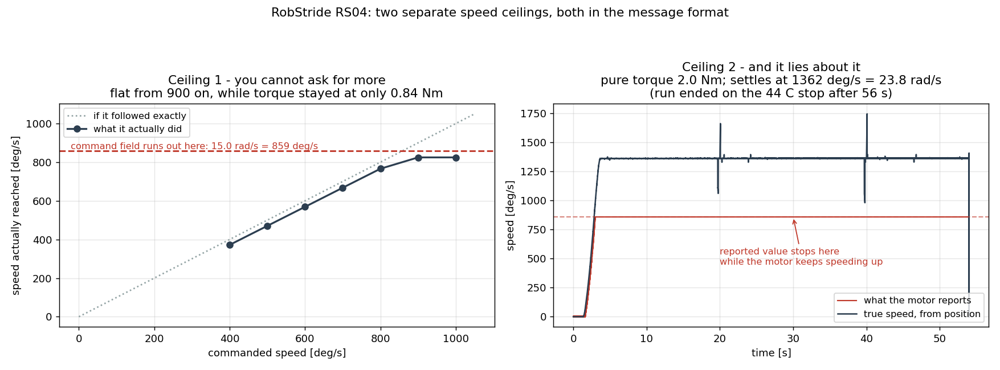
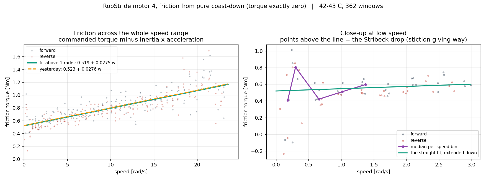

# 마찰을 지금 셋업에서 다시 쟀습니다 — 어제 값이 그대로 맞습니다
<!-- SPEC-TABLES: 해당 없음 — 학습 런이 아니라 **벤치 모터 측정**입니다. §1b-2(액추에이터 한계)·§1b-3(ROM/행동창)·§1b-4(PYG_* 플래그)는 학습 설정에서 나오는 표라 대응하는 런 디렉터리가 없어 채울 근거가 없습니다. 대신 이 노트 머리에 실험 조건(모터 번호·모델·이득·진폭·온도·경계·표본 수)을 적었습니다. -->

날짜: 2026-09-09 (같은 날 밤) · 기계: 라즈베리파이 4 (모터와 직결, 초당 3300회) ·
모터: 벤치 무릎(RS04, 번호 4), 출력축에 아무것도 안 달림

사용자 지시 둘: **"마찰을 지금 셋업에서 다시 재봐. 이제 지연 없잖아."** 그리고
**"최고속도로 웜업했으면 좋겠는데."**

## 한 줄 결론

**어제 값은 틀리지 않았습니다.** 통신이 8배 빨라진 기계에서, 어제와 **아무것도 공유하지 않는
방법**으로 다시 재니 움직일 때 마찰 **0.519**(어제 0.523), 점성 **0.0275**(어제 0.0276) 이
나왔습니다. 0.8% 와 0.4% 차이입니다.

다만 그 과정에서 **속도에 관한 천장 두 개**를 새로 찾았습니다. 하나는 명령을 못 담는 것이고,
하나는 **모터가 틀린 속도를 보고하는 것**입니다.

## 1. "600 도/s 가 최고속도인가" — 아니었습니다

아침 웜업은 600 도/s 로 했습니다. 사용자가 최고속도인지 물어 확인했더니, 두 개의 천장이
차례로 나왔습니다.



### 천장 1 — 시킬 수가 없다

속도 명령을 400 부터 100씩 올렸습니다. 800 까지는 정확히 따라옵니다(한 계단에 +98.5).
900 부터 **825 도/s 에 붙어 움직이지 않습니다.** 그런데 그때 쓰는 토크는 **0.84 뉴턴미터**
뿐입니다 — 모터가 힘이 부친 게 전혀 아닙니다.

범인은 **명령의 그릇**이었습니다. MIT 방식 명령의 속도 칸이 담을 수 있는 최대가
**15.0 라디안/s = 859.4 도/s** 입니다. 비례 제어의 처짐 34 도/s 를 빼면 **825** — 관측값과
정확히 같습니다.

> 처음에는 "시킨 값과 실제의 차이가 벌어지면 상한"으로 판정했는데 400 도/s 에서 바로
> 걸렸습니다. **그 차이(69 도/s)는 포화가 아니라 비례 제어의 당연한 처짐**이었습니다 —
> 마찰을 이길 토크 0.65 를 내려면 반드시 0.65/kd 만큼 오차가 있어야 합니다. 판정을
> "명령을 올렸을 때 실제도 따라 올라가는가"로 바꿔 고쳤습니다.

### 천장 2 — 그리고 틀린 값을 답한다 ★

속도를 시키지 않고 **토크만** 주면 명령 그릇을 안 씁니다. 그렇게 밀어 보니 모터가 보고하는
속도는 **또 859.4 에 붙었습니다.** 이번엔 **읽는 쪽** 그릇이 같은 자리에서 잘린 것입니다.

위치를 이어 붙여 미분해 진짜 속도를 구했습니다:

| 시킨 토크 | 모터가 보고한 속도 | 위치에서 구한 진짜 속도 |
|---|---|---|
| 0.9 뉴턴미터 | 731.9 도/s | **732.4** ← 천장 아래에서는 정확히 일치 |
| 1.3 | 859.4 | **984.5** |
| 1.5 | 859.4 | **1059.4** |
| 2.0 (자리잡음) | 859.4 | **1362** (23.8 라디안/s) |

★ **이것이 더 위험합니다.** 천장 1 은 "더 못 시킨다"이지만 천장 2 는 **"틀린 값을 준다"**
입니다. 859 도/s 위에서 보고 속도를 믿는 안전장치·기록·식별은 전부 틀립니다.

### 덤 — 전원 전압이 48 볼트가 아닌 것 같습니다

2.0 뉴턴미터로 밀었을 때 자리잡은 속도가 **1362 도/s = 23.77 라디안/s** 였습니다. 그 속도에서
모터가 실제로 내고 있는 토크는 마찰과 같으므로 0.523 + 0.0276 × 23.77 = **1.18 뉴턴미터**
입니다. 즉 **토크-속도 곡선 위의 한 점**입니다.

그런데 우리가 가진 실측 곡선(`Motor_Spec/RS04_TN_curve_48V.csv`)은 190 rpm 에서 11.2
뉴턴미터로 끝나고, 외삽하면 **무부하가 약 191.5 rpm = 20.05 라디안/s** 입니다. 우리는
**227 rpm** 에서 아직 1.18 뉴턴미터를 내고 있었습니다.

무부하 속도는 전압에 비례합니다. 227 / 191.5 = 1.185 → **48 × 1.185 ≈ 57 볼트**.

★ **이것은 추론이지 측정이 아닙니다.** 전원 표시를 직접 읽거나 모터의 전압 파라미터를
읽어서 확인해야 합니다. 맞다면 벤치의 속도 여유가 사양 곡선보다 **약 19% 넓다**는 뜻이고,
"고속 무릎 수요 22 라디안/s 는 실현 불가"라고 적어 둔 앞선 판정을 다시 봐야 합니다.

## 2. 최고속도 웜업

토크 2.0 뉴턴미터로 밀어 **평균 1366 도/s** 로 돌렸습니다.

| | 600 도/s (아침) | **최고속도 1366 도/s** |
|---|---|---|
| 걸린 시간 | 300초 | **56초** |
| 온도 | 32 → 40도 | **37 → 44도** |

같은 온도 상승을 **5분의 1 시간**에 냅니다. 44도에서 자동으로 멈췄습니다(상한 44).

> 고친 것: 표본이 한 번 빠지면(58 밀리초 구멍을 실제로 겪었습니다) 위치 되감김이 어긋나
> 진짜 속도가 한 점만 치솟습니다. 처음엔 그 한 점 때문에 상한 판정이 걸려 21초 만에
> 멈췄습니다. **이어질 때만** 멈추도록 고쳤습니다.

## 3. 마찰 다시 재기 — 세 가지 방법

어제 방법의 약점이 오늘 드러났습니다. 어제는 **속도를 붙잡아 놓고 모터가 보고하는 토크**를
읽었는데, 오늘 둘 다 흔들린다는 것을 알았습니다 — 보고 토크는 도는 중에 회전 방향을 따라
±0.3~0.4 만큼 치우치고, 보고 속도는 859 에서 잘립니다. 그래서 **그 둘을 안 쓰는** 방법으로
다시 쟀습니다.

### 방법 A — 자리잡은 속도 (부분 성공)

토크를 하나 정해 두면 모터는 마찰과 맞비기는 속도에서 멈춥니다. 그 자리에서
`시킨 토크 = 마찰 + 점성 × 속도` 이고, 가속도가 0 이라 **관성이 식에 안 들어옵니다.**

결과: 마찰 0.489 · 점성 0.0282 (결정계수 0.9915) — 다만 **4점뿐**입니다.

★ **낮은 토크는 14초로 안 잡힙니다.** 시간상수가 약 3.7초라, 0.60 뉴턴미터짜리는 14초 뒤에도
4초마다 65 도/s 씩 계속 느려지고 있었습니다(측정값 99.6, 외삽하면 약 74 — **35% 과대**).
게다가 측정 자체가 모터를 데워 47도에서 잘렸습니다. **이 방법은 버립니다.**

### 방법 B — 감속 구간 전체를 쓰기 ★

기다릴 필요가 없습니다. **회전자 관성을 이미 정확히 알기 때문입니다.**

    시킨 토크 − 관성 × (속도 변화율) = 마찰(속도)

왼쪽이 전부 아는 값이므로, 속도가 변하는 **매 순간**이 마찰 한 점을 줍니다. 한 번 감속시키면
그 속도 범위 전체가 한꺼번에 나옵니다. 여전히 미분은 안 하고 짧은 창(0.05~0.06초)마다
적분 꼴로 계산하며, 속도도 위치를 이어 붙여 구합니다.

### 방법 C — 순수 타성 감속 (가장 깨끗함) ★★

방법 B 에서 **토크를 정확히 0** 으로 두면 시킨 토크조차 식에서 사라집니다. 남는 것은

    마찰(속도) = 관성 × 감속률

뿐입니다. 최고 속도에서 놓아 정지까지 2.3~2.5초 만에 **0~24 라디안/s 전 구간**을 훑습니다.
양방향 4회씩, 매번 42도까지 식힌 뒤에 했습니다.

## ★ 결과 — 어제 값이 그대로 맞습니다

| | 움직일 때 마찰 | 점성 | 온도 | 방법 |
|---|---|---|---|---|
| **어제** (가상머신, 초당 224회) | 0.523 | 0.0276 | 37도 | 속도 붙잡고 보고 토크 읽기 |
| 방법 A (자리잡은 속도) | 0.489 | 0.0282 | 42~46도 | 4점뿐 |
| 방법 B (감속 구간 전체) | 0.532 | 0.0247 | 42~46도 | 2555창 |
| **방법 C (순수 타성 감속)** | **0.519** | **0.0275** | 42~43도 | 334창, 양방향 8회 |

**방법 C 와 어제 값의 차이: 마찰 0.8%, 점성 0.4%.**



초록(오늘)과 주황(어제) 선이 0 부터 24 라디안/s 까지 겹칩니다.

### 붙어 있다 떨어지는 힘 (정지 마찰)

양방향 8회씩, 초당 0.10 뉴턴미터로 천천히 올리며:

| | 오늘 (43도, 파이) | 어제 (37도, 가상머신) |
|---|---|---|
| + 방향 | 0.725 | 0.984 |
| − 방향 | 1.076 | 0.780 |
| **양쪽 평균** | **0.901** | **0.882** |

평균은 잘 맞습니다. 그런데 **방향 차이의 부호가 뒤집혔습니다** — 어제는 + 가 무거웠고
오늘은 − 가 무겁습니다.

★ 그래서 앞서 "+ 쪽이 늘 더 무겁다"고 적은 것을 **정정합니다.** 그 비대칭은 모터의 성질이
아니라 **회전자가 그때 어디에 서 있었는가**(자석에 걸리는 톱니 힘)일 가능성이 큽니다.
한 판 안에서는 흩어짐이 작지만(+ 0.685~0.752), 판이 바뀌면 부호까지 바뀝니다.
**방향 비대칭을 모형에 넣으면 안 됩니다.**

### 모터가 보고하는 토크 눈금도 다시 확인

멈춰 있는 순간의 보고 / 시킨 = **1.049** (어제 0.995~1.053). 그대로입니다.

## 이 실험이 답한 질문

**"초당 224회라는 한계가 어제 마찰 값을 망쳤는가?"** — **아닙니다.** 어제 그렇게 예상했고
(마찰은 정상 상태 성질이라 주고받는 횟수가 결과를 안 바꿉니다), 실제로 8배 빠른 기계에서
확인됐습니다. 처리량이 막았던 것은 **회전자 관성 하나**뿐이었습니다.

## 이 숫자로 할 수 없는 말

* **아주 느린 구간(0.5 라디안/s 아래)은 아직 못 잡았습니다.** 멈추기 직전 몇십 밀리초라
  창이 몇 개 안 되고 잡음이 큽니다. 붙어 있던 힘이 풀리는 그 구간(Stribeck)을 제대로 보려면
  1·2·5·10 도/s 같은 아주 느린 속도를 따로 붙잡아 재야 합니다.
* **온도가 42~46도로 어제(37도)보다 높습니다.** 마찰이 온도를 타는데도 값이 거의 같게
  나온 것은, 어제 확인한 대로 이 모터의 마찰이 이 범위에서 온도에 둔하다는 뜻입니다.
* **전원 전압 57 볼트는 추론입니다.** 직접 읽어야 합니다.
* 여전히 **무릎 한 대**, 축에 아무것도 안 달린 상태입니다.

## 재현

라즈베리파이에서:

```
python3 -u speed_probe.py      --motor-id 4 --model RS04 --start 400 --step 100
python3 -u topspeed_torque.py  --motor-id 4 --model RS04 --torques 0.9,1.1,1.3,1.5
python3 -u warmup.py --mode torque --torque 2.0 --seconds 300 --v-cap 1550 --temp-stop 44
python3 -u coast_max.py        --motor-id 4 --model RS04 --repeats 4 --cool-to 42 --tag hot
python3 -u friction_id.py breakaway --motor-id 4 --model RS04 --trials 8 --rate 0.10
```

이 컴퓨터에서:

```
cd System_ID
python3 friction_from_decay.py --glob 'data/coastmax_4_*_hot.csv' --tau-col none \
        --skip-s 0.05 --win-s 0.05 --out ../docs/img/motor_friction_curve.png
python3 plot_speed_ceiling.py
```

프로그램: `System_ID/speed_probe.py`, `topspeed_torque.py`, `coast_max.py`,
`friction_curve.py`, `friction_from_decay.py`, `plot_speed_ceiling.py`,
`warmup.py`(토크 방식 추가).
원자료: `System_ID/data/coastmax_*.csv`, `fcurve_*.csv`, `speed_probe.csv`, `brk_pi_hot.csv`.

관성 측정은 `2026-09-09_motor_rotor_inertia.md`, 어제 마찰은
`2026-09-09_motor_sysid_attempt.md` 에 있습니다. 로봇 프로그램(HUPHY)은 한 줄도
고치지 않았습니다.
