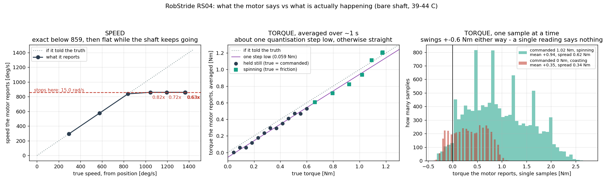

# 모터가 말하는 값 대 실제 값, 그리고 명령 주기의 진짜 천장

날짜: 2026-09-09 (같은 날 밤) · 기계: 라즈베리파이 4, 모터와 직결 · 무릎 RS04(번호 4),
엉덩이 회전 RS03(번호 3), 출력축에 아무것도 안 달림

사용자 지시 셋: **"보고 값, 실제 값 비교도 준비해 줘"**, **"지금 명령 주기는 얼마인가?
이론적 상한인가?"**, **"BOOT0 2핀 찾았는데 점프해볼까?"**

## 한 줄 결론

**속도 칸은 859 도/s 위에서 거짓말하고, 토크 칸은 한 점만 보면 못 씁니다(±0.6 뉴턴미터로
흔들림). 명령 주기는 지금 551 마이크로초인데 이론 상한이 아니고, 겹쳐 보내면 305 마이크로초
(선 천장의 73~85%)까지 갑니다. 그리고 어댑터 펌웨어를 바꿀 이유가 없습니다 — 우리에게
필요한 양의 5.5배가 이미 나옵니다.**

---

# 1. 모터가 말하는 값 대 실제 값

## 실제 값을 어디서 가져오는가

이게 이 실험의 전부입니다. 칸마다 다릅니다.

| 칸 | 실제 값을 얻는 방법 |
|---|---|
| **위치** | 바깥 자가 없어 절대값은 못 봅니다. **기준으로 삼습니다.** 근거: 이 칸을 미분한 값과 속도 칸이 859 도/s 아래에서 **0.07% 안에** 맞습니다(732.4 대 731.9). 서로 다른 두 칸이 우연히 맞기는 어렵습니다. |
| **속도** | 위치 칸을 이어 붙여 미분한 값. |
| **토크** | 세 자리에서 실제 값을 압니다. ① **멈춰 있으면** 실제 = 시킨 값(움직이지 않으니 아무 데도 안 쓰였음) ② **타성으로 돌면** 실제 = 정확히 0 ③ **일정 속도로 돌면** 실제 = 그 속도의 마찰(오늘 두 번 쟀음). |
| **온도** | 바깥 온도계가 없습니다. 대신 **두 모터를 나란히** 두고 하나만 돌립니다. |



## 속도 — 859 도/s 아래는 완벽, 위는 거짓

| 진짜 속도 (위치에서) | 모터가 말하는 값 | 비 |
|---|---|---|
| 294.8 도/s | 294.6 | **0.999** |
| 577.2 | 576.9 | **1.000** |
| 839.2 | 839.0 | **1.000** |
| 1044.2 | 859.4 | 0.823 |
| 1194.2 | 859.4 | 0.720 |
| **1367.4** | 859.4 | **0.629** |

부호화 상한이 15.0 라디안/s = 859.4 도/s 입니다. **그 아래에서는 완벽하고, 그 위에서는
최대 37% 낮게 말합니다.** 오류를 내지도, 표시를 남기지도 않습니다 — 그냥 859 라고 답합니다.

## 토크 — 평균은 쓸 만하고, 한 점은 못 쓴다

**평균(1초 이상)**: 실제보다 **한 계단(0.059 뉴턴미터)쯤 낮게** 말합니다. 그것 말고는
곧습니다.

    멈춘 채로:  시킨 0.600 → 말한 0.529    (차이 0.071)
    멈춘 채로:  시킨 0.462 → 말한 0.411    (차이 0.051)
    도는 중:    실제 0.922 → 말한 0.823    (차이 0.099)
    도는 중:    실제 1.174 → 말한 1.199    (차이 +0.025)

토크 칸은 ±120 뉴턴미터를 12비트로 담으므로 한 계단이 **0.0586 뉴턴미터**입니다.
차이가 대체로 그 한 계단입니다.

**한 점(한 번의 응답)**: 못 씁니다.

| 상황 | 실제 토크 | 말한 값 평균 | 말한 값 흩어짐 | 5%~95% |
|---|---|---|---|---|
| 1.02 뉴턴미터로 도는 중 | 1.02 | +0.94 | **0.62** | +0.03 ~ +2.02 |
| **타성 (토크 정확히 0)** | **0** | **+0.35** | **0.34** | −0.3 ~ +1.0 |

타성 감속에서는 실제 토크가 **정확히 0** 인데 말하는 값은 **+0.32(정방향) / −0.44(역방향)**
을 가운데로 ±0.7 뉴턴미터에 걸쳐 거의 고르게 퍼집니다. 계단마다 400회씩 고르게 앉는 것을
확인했습니다 — 무엇을 재는 값이 아니라 **떨림**입니다.

★ 정리하면: **토크 칸은 0.5초 이상 평균 내면 0.06 뉴턴미터 안에서 믿을 수 있고, 한 번의
응답으로 판단하면 안 됩니다.** 안전 차단을 순간 토크로 걸면 헛발질합니다.

## 위치 — 되감김 하나만 조심

값이 ±720도에서 되감깁니다(1440도 주기). 표본이 촘촘하면 문제가 없지만, **표본이 한 번
빠지면**(실제로 58 밀리초 구멍을 겪었습니다) 되감김을 잘못 풀어 속도가 한 점 치솟습니다.
연속 조건으로 판정해야 합니다.

## 온도 — 옆 모터가 증인

무릎만 최고속도로 돌린 뒤: **무릎 44도, 엉덩이 회전 30도.** 돌린 쪽만 올랐습니다.
이 두 모터에서는 온도 칸이 말이 됩니다.

> 다만 이 프로젝트에는 **무릎이 3308.8도를 보고한 기록**이 있습니다. 지금은 재현되지
> 않습니다. 원인은 아직 모릅니다 — 계속 지켜봐야 합니다.

---

# 2. 명령 주기 — 지금 얼마이고, 천장은 어디인가

## 이론 상한부터

CAN 선의 초당 100만 비트에서, 자료 8바이트 표준 프레임 하나는

    시작 1 + 번호 11 + 3 + 길이 4 + 자료 64 + 검사 15 + 1 + 응답 1 + 1 + 끝 7 + 사이 3
    = 111 비트  (같은 비트가 이어질 때 끊어 넣는 채움 비트까지 세면 최대 130)

**111~130 마이크로초**입니다. 한 번 주고받는 것은 명령 1 + 응답 1 = **2개**이므로 선 위에서만
따진 천장은 **222~260 마이크로초, 곧 초당 3,846~4,505번**입니다.

## 실측

| 방식 | 주고받기/초 | 한 번에 | 잃음 |
|---|---|---|---|
| 하나 보내고 답 기다리기 (지금 쓰는 방식) | 1,994 | **501 마이크로초** | 0% |
| 한 모터에 2개씩 몰아서 | 2,579 | 388 | 0% |
| 한 모터에 3개씩 몰아서 | 2,864 | 349 | 0% |
| **한 모터에 4개씩 몰아서** | **210** | 4,762 | **22.2%** ← 무너짐 |
| 모터 둘에 1개씩 | 2,463 | 406 | 0% |
| 모터 둘에 2개씩 | 3,006 | 333 | 0% |
| **모터 둘에 3개씩 (6개 동시)** | **3,281** | **305 마이크로초** | **0%** |

## ★ 3개 제한은 모터마다다

한 모터에 4개를 연달아 보내면 4번째가 버려집니다. **호스트에서는 보내기 실패가 0건**이므로
(errno 를 세어 확인) 우리 쪽 문제가 아니라 **모터의 수신 칸이 3개짜리**인 것입니다.

모터가 여럿이면 각자 자기 번호만 보므로 이 제한에 안 걸립니다 — 실제로 모터 둘에 3개씩,
곧 **6개를 동시에 띄워도 손실 0%** 입니다.

## 답: 이론 상한인가

**지금 쓰는 501 마이크로초는 아닙니다.** 선이 노는 동안 USB 를 왕복하느라 절반쯤 놀고
있습니다. 겹쳐 보내면 **305 마이크로초**가 되고, 이건 선 천장(222~260)의 **73~85%** 입니다.
남은 몫은 USB 왕복 시간이고, 선 자체가 바닥이라 크게는 못 줄입니다.

## 우리에게 필요한 양

정책은 **초당 50번** 돕니다. 관절 12개면 한 번에 12번 주고받으므로 **초당 600번**입니다.

    필요:  초당   600번   (관절 12개 x 초당 50번)
    가능:  초당 3,281번   (지금, 겹쳐 보내기)
    여유:  5.5배

제어를 초당 200번으로 올려도 2,400번이라 여전히 들어갑니다.

---

# 3. BOOT0 을 점프할까 — 권하지 않습니다

## 어댑터의 정체 (스스로 밝힙니다)

    Bus 001 Device 003: ID ad50:60c4
    Protofusion Labs CANable 9fddea4 github.com/normaldotcom/canable-fw.git
    cdc_acm 1-1.4:1.0: ttyACM0 · slcan on ttyACM0

**CANable 1.0** 입니다. `canable-fw` 저장소는 **STM32F042C6** 를 대상으로 빌드합니다.
"3" 도 "303" 도 아닙니다. 다른 물건이면 꽂는 순간 이렇게 스스로 밝히므로, 한 줄로 확인됩니다.

## BOOT0 자체는 위험하지 않습니다

STM32 의 BOOT0 을 높게 잡고 리셋하면 **칩에 원래 들어 있는 DFU 부트로더**로 들어갑니다.
아무것도 지우지 않고, 아무것도 쓰지 않습니다. **되돌리는 길**이기도 합니다 — 잘못 구운
펌웨어를 살리는 게 정확히 이 핀의 용도입니다.

위험한 것은 점프가 아니라 **그 다음에 무엇을 쓰느냐**입니다.

## 그런데 바꿔서 얻을 것이 없습니다

| | |
|---|---|
| 지금 (겹쳐 보내기) | 초당 3,281번 |
| 선 위에서의 천장 | 초당 3,846~4,505번 |
| 펌웨어를 바꿔 얻을 수 있는 최대 | **+17~37%** |
| 우리가 필요한 양 | 초당 600번 |

이진 방식 펌웨어(candleLight/gs_usb)로 바꾸면 글자 22개로 부풀리는 단계와 tty 계층이
빠집니다. 그건 **호스트 부담**을 줄이지 선을 빠르게 하지 않습니다. 그리고

* **3개 제한은 모터 안에 있습니다.** 어댑터 펌웨어로 못 바꿉니다.
* **CAN-FD 는 이 칩으로 불가능합니다.** STM32F042 의 CAN 주변장치는 고전 CAN 전용입니다.
  더 필요해지면 그건 **다른 실리콘**(CANable 2.0 = STM32G431 등)이지 펌웨어가 아닙니다.
* 지금 이 어댑터가 **모터로 가는 유일한 길**입니다.

## 권고

1. **지금은 굽지 않습니다.** 공짜로 얻을 수 있는 1.6배(1,994 → 3,281)를 아직 안 썼고,
   그것만으로 필요치의 5.5배입니다.
2. **정말 확인하고 싶다면**: BOOT0 을 점프해 주시면 제가 **읽기만** 해서 칩이 무엇인지
   알려 드리겠습니다(DFU 로 뜨면 칩 번호가 그대로 나옵니다). 쓰지 않습니다.
3. **"303cannable3" 이 무엇인지 알려 주십시오.** 지금 붙어 있는 물건은 F042 이고,
   F303/G431 용 이미지를 F042 에 쓰면 벽돌이 됩니다(BOOT0 으로 되살릴 수는 있습니다).
   대상 칩을 확인하지 않은 이미지는 굽지 않겠습니다.
4. 나중에 정말 더 필요해지면 살 것은 **CAN-FD 되는 어댑터**이거나 **버스를 하나 더**
   두는 것입니다.

---

## 이 숫자로 할 수 없는 말

* 위치 칸의 **절대 정확도**는 못 봤습니다. 바깥 각도계가 필요합니다. 확인한 것은 위치와
  속도가 서로 맞는다는 것뿐입니다.
* 온도 칸은 **두 모터에서만** 확인했고, 3308.8도 사건의 원인은 여전히 모릅니다.
* 주고받기 횟수는 **모터 두 대**로 잰 것입니다. 12대를 한 선에 물리면 중재(누가 먼저
  말하는가) 때문에 달라질 수 있습니다. 다만 필요치의 5.5배 여유가 있어 여유는 큽니다.
* 펌웨어를 바꿔 실제로 얼마가 나오는지는 **안 해 봤습니다.** 위 표의 "+17~37%"는
  선 천장에서 나온 상한이지 측정값이 아닙니다.

## 재현

```
python3 -u timing_probe.py                      # 겹침별 주기
python3 -u report_vs_truth.py --motor-id 4 --model RS04 --tag hot
lsusb | grep -i canable                          # 어댑터가 스스로 밝히는 정체
```

이 컴퓨터에서: `cd System_ID && python3 plot_report_vs_truth.py`

프로그램: `System_ID/timing_probe.py`, `report_vs_truth.py`, `plot_report_vs_truth.py`,
`rs_direct_socket.py`(겹쳐 보내기 `exchange()` 추가 — 4개를 넘기면 거부합니다).
원자료: `System_ID/data/rvt_still_4_hot.csv`, `rvt_spin_4_hot.csv`.
