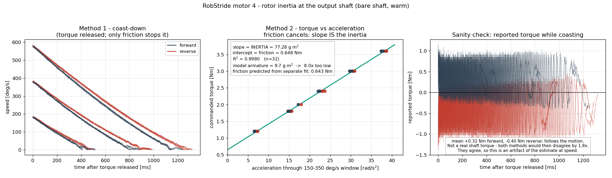
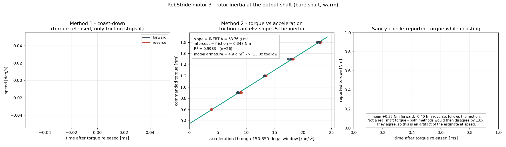
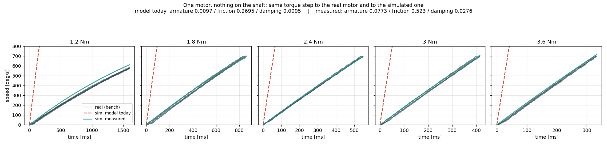

# 회전자 관성을 쟀습니다 — 모형이 8배 가볍게 잡고 있었습니다
<!-- SPEC-TABLES: 해당 없음 — 학습 런이 아니라 **벤치 모터 측정**입니다. §1b-2(액추에이터 한계)·§1b-3(ROM/행동창)·§1b-4(PYG_* 플래그)는 학습 설정에서 나오는 표라 대응하는 런 디렉터리가 없어 채울 근거가 없습니다. 대신 이 노트 머리에 실험 조건(모터 번호·모델·이득·진폭·온도·경계·표본 수)을 적었습니다. -->

날짜: 2026-09-09 · 기계: 라즈베리파이 4 (maido@192.168.0.16) · 모터: 벤치의 무릎(RS04, 번호 4),
엉덩이 회전(RS03, 번호 3) · 두 모터 모두 출력축에 아무것도 안 달린 상태

## 한 줄 결론

**무릎 모터의 회전자 관성은 감속기 뒤 기준 0.0773 kg·m² 입니다. 시뮬레이터는 0.0097 로 잡고
있었습니다 — 8.0배 가볍습니다.** 엉덩이 회전 모터는 0.0638 인데 모형은 0.0049 로, 13.0배
가볍습니다. 시뮬레이터에 모터 한 대만 세우고 실물과 같은 토크를 주면, 지금 모형은 실물보다
**9~14배 빠르게** 가속합니다. 실측값을 넣으면 두 곡선이 겹칩니다.

## 왜 이제야 쟀는가

마찰과 점성은 어제 쟀지만(`2026-09-09_motor_sysid_attempt.md`) 관성은 못 쟀습니다. 관성은
**속도가 빠르게 변할 때만** 드러나는데, 그때 쓰던 통신 경로가 초당 230번에서 막혀 있었기
때문입니다. 그 병목이 가상머신 통과라는 것을 세 차례 확인했고, 이번에 통신 어댑터를
**라즈베리파이에 직접 꽂아** 같은 측정을 다시 했습니다.

| 기계 | 명령 보내고 응답 받는 왕복 | 왕복에 걸리는 시간 |
|---|---|---|
| 가상머신 | 초당 230회 | 중앙 0.927 밀리초 |
| **라즈베리파이** | **초당 1814회** | **중앙 0.544 밀리초** (최대 0.764) |

같은 어댑터, 같은 모터, 같은 통신 방식입니다. 바뀐 것은 **가상머신을 안 거친다**는 것뿐입니다.

## 준비 — 데우기

마찰은 온도를 크게 탑니다. 어제 마찰을 잰 것이 **데운 상태(37도)** 였으므로 온도를 맞췄습니다.
한 방향으로 577 도/s 로 5분: **32도 → 40도**.

덤으로 검산이 하나 나왔습니다. 그 속도(10.07 라디안/s)에서 실제로 필요했던 토크는
**0.73 뉴턴미터**였고, 어제 맞춘 마찰식이 예측하는 값은 0.80 입니다 — 9% 차이. 어제의 맞춤
범위(최고 385 도/s) **바깥에서도** 그 식이 버팁니다.

## 방법 1 — 타성 감속

모터를 한 방향으로 돌린 뒤 **토크를 정확히 0 으로 놓고 손을 뗍니다.** 남는 힘은 마찰뿐입니다.

    관성 x (속도 변화율) = -(움직일 때 마찰) - (점성) x 속도

마찰과 점성은 어제 쟀으니 미지수는 관성 하나입니다. **미분은 하지 않습니다** — 모터가
보고하는 속도는 잡음이 ±6.5 도/s 라 미분하면 잡음이 몇 배로 커집니다. 대신 위 식을 시간으로
적분하면

    관성 = (마찰 x 걸린 시간 + 점성 x 그동안 돈 각도) / (처음 속도 - 나중 속도)

오른쪽은 전부 직접 잰 값입니다. 시작 속도 200 / 400 / 600 도/s 로 각각 3번씩, 양방향.

| 방향 | 관성 (중앙값) | 흩어짐 |
|---|---|---|
| + 방향 (9회) | 73.3 g·m² | 2.9 |
| − 방향 (9회) | 81.4 g·m² | (자료 한 벌은 위치가 한 바퀴 넘어가 버려 제외) |

**이 답에는 약점이 있습니다.** 어제 잰 마찰값이 맞다는 전제 위에 서 있습니다. 마찰이 20%
틀리면 관성도 20% 틀립니다.

## 방법 2 — 마찰이 식에서 사라지는 방법 ★

같은 속도 구간을 **서로 다른 토크**로 지나가게 합니다. 속도가 같으면 마찰도 같습니다.

    관성 x 가속도₁ = 토크₁ − 마찰
    관성 x 가속도₂ = 토크₂ − 마찰
    ────────────────────────────── 빼면
    관성 x (가속도₂ − 가속도₁) = 토크₂ − 토크₁

**마찰이 통째로 빠졌습니다.** 모터가 몰래 더하는 치우침이 있어도 그것까지 같이 빠집니다.
실제로는 토크를 다섯 단계로 주고 **토크 대 가속도** 직선을 맞췄습니다 — 기울기가 관성이고,
세로 절편은 그 속도 구간의 마찰입니다.

가속도는 정해 둔 속도 창(150~350 도/s)을 **지나는 데 걸린 시간**으로 구합니다. 역시 미분
없습니다.

### 무릎 (RS04, 토크 1.2 / 1.8 / 2.4 / 3.0 / 3.6 뉴턴미터, 각 3회, 양방향)

| | 관성 = 기울기 | 마찰 = 절편 | 결정계수 | 점 수 |
|---|---|---|---|---|
| + 방향 | 77.78 ± 0.53 g·m² | 0.667 뉴턴미터 | 0.9994 | 15 |
| − 방향 | 76.95 ± 0.53 | 0.625 | 0.9994 | 15 |
| **양쪽 합침** | **77.26 ± 0.64 g·m²** | **0.648** | 0.9981 | 30 |

★ **절편이 검산입니다.** 이 창의 가운데 속도(250 도/s = 4.36 라디안/s)에서 어제 맞춘
마찰식이 예측하는 값은 0.523 + 0.0276 × 4.36 = **0.643 뉴턴미터**. 이번에 완전히 다른
방법으로 나온 절편은 **0.648** — **1% 안에서 일치**합니다. 어제의 마찰값이 독립적으로
확인된 셈입니다.

### 엉덩이 회전 (RS03, 토크 0.6 / 0.9 / 1.2 / 1.5 / 1.8, 각 3회, 양방향)

| | 관성 | 마찰 절편 | 결정계수 | 점 수 |
|---|---|---|---|---|
| + 방향 | 63.79 ± 0.68 g·m² | 0.358 뉴턴미터 | 0.9989 | 12 |
| − 방향 | 63.41 ± 0.45 | 0.341 | 0.9994 | 14 |
| **양쪽 합침** | **63.76 ± 0.53 g·m²** | **0.347** | 0.9983 | 26 |

## 두 방법이 만납니다

| | 무릎 (RS04) |
|---|---|
| 방법 1 (타성 감속, 마찰값을 빌림) | 73~81 g·m² |
| 방법 2 (마찰 소거, 아무것도 안 빌림) | **77.3 ± 0.6 g·m²** |

전제가 전혀 다른 두 방법이 같은 자리에 떨어집니다.




## 시뮬레이터에 모터 한 대만 세워 견주기

사용자 지시대로, MuJoCo 에 **경첩 하나 + 토크 하나**만 있는 모형을 세웠습니다. 다리도 중력도
접촉도 없습니다 — 벤치의 실물이 축에 아무것도 안 달린 맨 모터이므로 모형도 그래야 같은 것을
견줍니다. 실물에 준 것과 **똑같은 토크**를 주고 속도가 올라가는 모습을 겹쳤습니다.

같은 토크에서 150~350 도/s 를 지나는 가속도 [라디안/s²]:

| 토크 | 실물 | 지금 모형 | 실측값을 넣은 모형 |
|---|---|---|---|
| 1.2 뉴턴미터 | 6.76 | 91.63 (**13.6배**) | 7.18 |
| 1.8 | 15.05 | 153.47 (10.2배) | 14.95 |
| 2.4 | 22.66 | 215.32 (9.5배) | 22.72 |
| 3.0 | 30.57 | 277.17 (9.1배) | 30.48 |
| 3.6 | 37.80 | 339.01 (**9.0배**) | 38.24 |



초록 선(실측값)이 실물 위에 그대로 얹힙니다. 빨간 점선(지금 모형)은 그림 위로 뚫고 나갑니다.

## ★ 모형이 고쳐야 할 값 — 세 개 전부

| 값 | 지금 모형 | 실측 | 배수 |
|---|---|---|---|
| 회전자 관성 (`armature`) — 무릎 RS04 | 0.0097 | **0.0773** | **8.0배 낮음** |
| 회전자 관성 (`armature`) — 엉덩이 회전 RS03 | 0.0049 | **0.0638** | **13.0배 낮음** |
| 움직일 때 마찰 (`frictionloss`) | 0.2695 | 0.523 | 1.9배 낮음 |
| 점성 (`damping`) | 0.0095 | 0.0276 | 2.9배 낮음 |

값이 있는 자리: `pygmalion_locomotion/assets/biped_lower_body_mjcf/biped_cfg.py:83, 92`

**세 값이 모두 같은 방향으로 틀려 있습니다** — 시뮬레이터의 관절은 실물보다 가볍고, 덜
뻑뻑하고, 덜 끈적합니다. 그래서 같은 토크에 훨씬 쉽게 움직이고, 한 번 움직이면 잘 안
멈춥니다. **이것이 "시뮬레이터는 넘어가는데(overshoot) 실물은 못 따라간다"는 관찰의 물리적
설명입니다.**

앞서 같은 관찰의 다른 두 원인을 이미 찾았습니다(`2026-09-09_sim_vs_real_sine_sweep.md`):
세기 값이 가는 길에 7.3배 깎이던 것과 80 밀리초 지연. 관성은 **세 번째이자 물리 쪽 원인**입니다.

### 상식 검산

모터가 무부하 최고 속도까지 도달하는 데 걸리는 시간(최대 토크로 밀 때):

| | 실측값으로 | 지금 모형으로 |
|---|---|---|
| 무릎 RS04 (120 뉴턴미터, 19.9 라디안/s) | **12.8 밀리초** | 1.6 밀리초 |
| 엉덩이 회전 RS03 (60 뉴턴미터, 23.0 라디안/s) | **24.4 밀리초** | 1.9 밀리초 |

감속기가 들어간 이런 크기의 모터에서 10~30 밀리초는 흔한 값입니다. 1.6 밀리초는 물리적으로
말이 안 됩니다.

## 검산과 반증 시도

1. **속도 눈금이 맞는가** — 8배는 큰 정정이라, 속도 자체가 틀렸을 가능성을 확인했습니다.
   기록된 속도를 시간으로 적분한 값과 위치 변화를 견주면: 309.09 대 308.68도, 144.30 대
   143.99, 38.10 대 37.98 — **0.3% 안에서 일치**합니다.
2. **양방향** — 방법 2 를 + 와 − 양쪽에서 따로 맞췄고 관성이 1% 안에서 같습니다.
3. **절편** — 위에 적은 대로 어제의 마찰값과 1% 안에서 맞습니다.
4. **두 방법** — 전제가 다른 두 방법이 같은 답을 냅니다.

## ★ 걸렸다가 풀린 것 — 놓은 뒤 0 이 아닌 보고 토크

타성 감속에서 토크를 0 으로 놓았는데도 모터가 **+0.32 뉴턴미터**(+ 방향), **−0.40**(− 방향)을
보고했습니다. 0 이어야 하므로 측정 전체를 의심했습니다.

* 그 값은 **회전 방향을 따라 부호가 바뀝니다.** 즉 늘 "미는 쪽"으로 보고됩니다.
* 그것이 **진짜 축에 걸리는 토크였다면** 타성 감속으로 얻은 관성과 방법 2 의 답이
  **1.8배 어긋나야** 합니다. 두 답은 어긋나지 않았습니다.
* 정지 상태에서는 이 치우침이 없습니다(−0.01 뉴턴미터).

따라서 **속도가 붙었을 때 토크 추정값에 생기는 겉보기 값**이며, 실제 힘이 아닙니다.
방법 2 는 이런 치우침이 저절로 소거되므로 애초에 영향받지 않습니다.

## 고친 것 둘

* **모터 3 은 고장 표시가 없어도 "고장 지우기"를 먼저 보내야 켜집니다.** 처음 측정에서
  모터 3 이 2.4 뉴턴미터를 줘도 꼼짝하지 않았고(위치 변화 0.02도), 보고 토크가 −0.01 로
  붙박이였습니다 — 전류가 아예 안 흘렀다는 뜻입니다. 고장 지우기를 조건 없이 먼저 보내도록
  고치니 정상 동작했습니다.
* **위치는 한 바퀴를 넘어가면 되감깁니다.** RS04 의 위치 표현 범위가 ±720도라, 타성 감속
  한 벌에서 돈 각도가 22.94 라디안으로 잘못 계산됐습니다(실제 4.6). 방법 2 는 속도만 쓰므로
  영향이 없고, 방법 1 을 다시 쓸 일이 있으면 되감김을 풀어야 합니다.

## 안전 — 지킨 것

* 지속 토크 시험에는 **속도 상한**을 걸었습니다(700 도/s에서 즉시 토크 0). 어제 위치 제한
  없이 계단 토크를 줘서 무릎이 92도 돈 일이 있었습니다.
* **도는 중에 방향을 뒤집지 않았습니다.** 방향 전환은 반드시 완전히 선 뒤에 했습니다.
  어제 600 도/s 에서 뒤집다가 저전압 고장(17초)을 냈습니다.
* 감속은 늘 **마찰이** 시켰습니다 — 제동을 걸지 않으므로 모터가 발전기가 되지 않습니다.
* 온도 상한 45도. 실제로는 37~40도를 넘지 않았습니다.
* 출력축이 맨 상태인지 **카메라로 확인**했습니다(볼트 원이 비어 있음).

## 이 숫자로 할 수 없는 말

* **모터 두 대뿐**입니다. 발목의 RS03 과 RS00 은 아직 안 쟀습니다. 모형의 그 값들도 같은
  비율로 틀렸는지는 **모릅니다.**
* 잰 것은 **감속기 뒤(출력축) 기준**입니다. 무릎에 벨트가 들어가는 설정이라면 벨트비의
  제곱을 다시 곱해야 합니다.
* 데운 온도는 **37~40도 한 점**입니다. 관성은 온도를 거의 안 타지만 절편(마찰)은 탑니다.
* **정지 마찰(0.88 뉴턴미터)은 여전히 모형에 자리가 없습니다.** MuJoCo 의 `<dcmotor>` +
  `lugre` 를 쓰면 자리가 생기는데, 그러려면 Stribeck 속도와 미끄러지기 전 강성을 더 재야
  합니다. 아직 안 쟀습니다.
* 이 값을 **학습 설정에 넣을지는 결정하지 않았습니다.** 관성을 8배 올리면 지금까지 학습한
  모든 정책의 전제가 바뀝니다. 측정은 끝났고, 반영 여부는 별도 판단입니다.

## 재현

라즈베리파이(`maido@192.168.0.16`, 로봇 `10.8.0.14` 를 거쳐 접속)에서:

```
sudo slcand -o -c -s8 /dev/serial/by-id/usb-Protofusion_Labs_CANable_*-if00 can0
sudo ip link set can0 up
sudo ip link set can0 txqueuelen 1000

cd ~/System_ID
python3 -u warmup.py    --seconds 300 --speed 600 --motor-id 4 --model RS04
python3 -u inertia_id.py --motor-id 4 --model RS04 --speeds 200,400,600 --repeats 3 --tag warm
python3 -u accel_id.py   --motor-id 4 --model RS04 --torques 1.2,1.8,2.4,3.0,3.6 --repeats 3 --max-s 1.6 --tag warm
python3 -u accel_id.py   --motor-id 3 --model RS03 --torques 0.6,0.9,1.2,1.5,1.8 --repeats 3 --max-s 1.6 --tag rs03
```

이 컴퓨터에서 그림과 시뮬레이터 대조:

```
cd System_ID && python3 plot_inertia.py --motor 4 --out ../docs/img/motor_inertia_rs04.png
cd mujoco-sim/mjlab && .venv/bin/python3 ../../System_ID/sim_vs_real_accel.py --data ../../System_ID/data
```

프로그램: `System_ID/rs_direct_socket.py` (파이썬 기본 기능만 쓰는 구동부),
`inertia_id.py`, `accel_id.py`, `plot_inertia.py`, `sim_vs_real_accel.py`.
원자료: `System_ID/data/coast_*.csv`, `accel_*.csv` (86벌).

로봇 프로그램(HUPHY)은 **한 줄도 고치지 않았습니다.** 프레임을 만들고 푸는 부분만 그 코드를
라즈베리파이로 **복사**해 썼고(`~/System_ID/rscodec/`), 바꾼 것은 불러오기 경로 한 줄뿐입니다.
