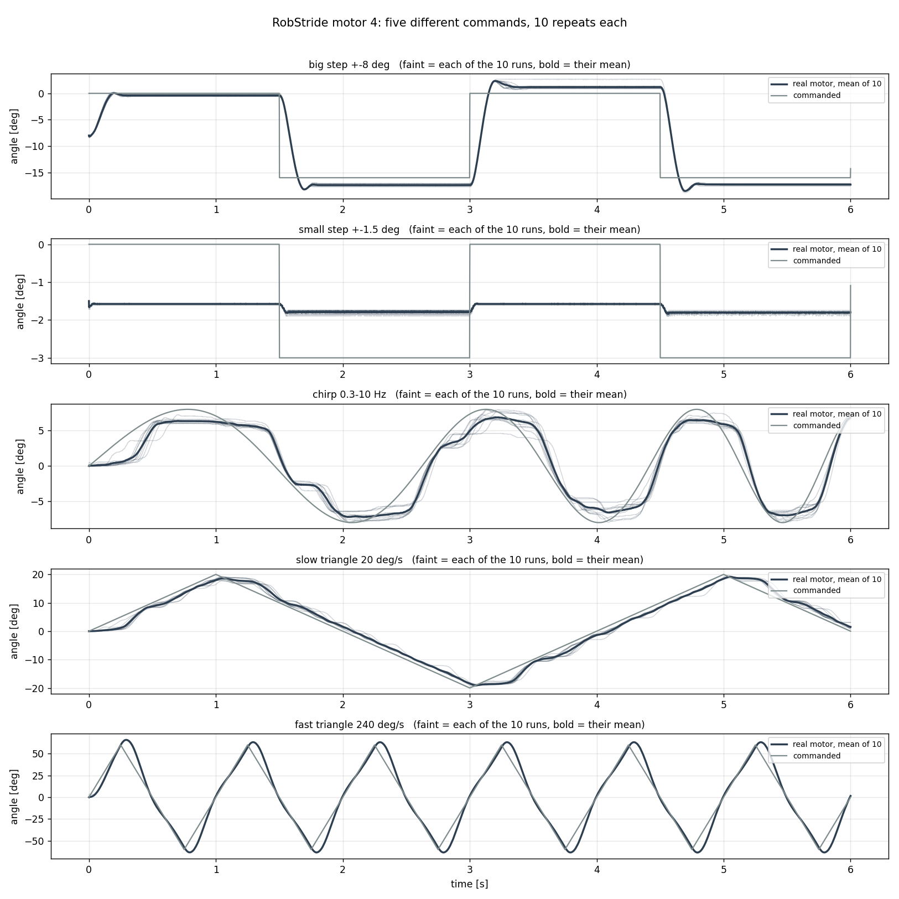
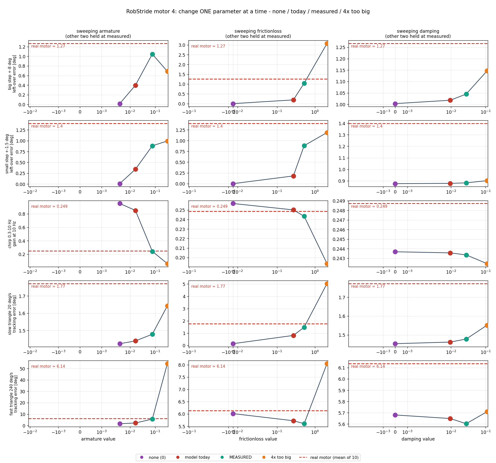
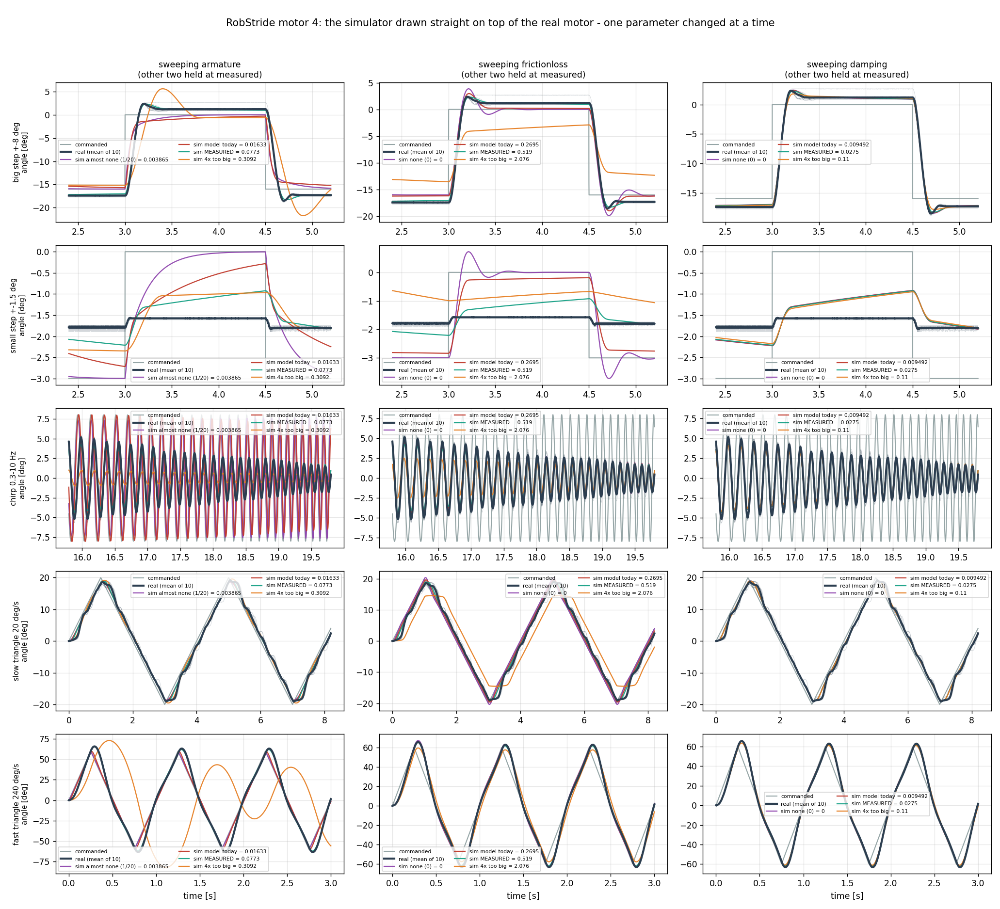
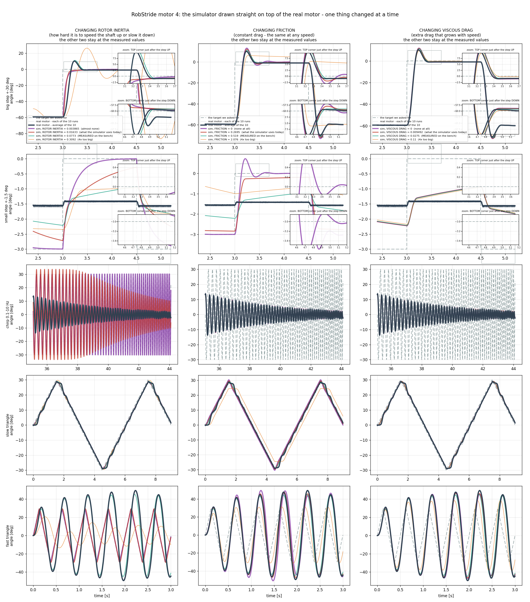

# 다섯 가지 명령 × 10회, 그리고 값을 하나씩만 바꿔 본 대조
<!-- SPEC-TABLES: 해당 없음 — 학습 런이 아니라 **벤치 모터 측정**입니다. §1b-2(액추에이터 한계)·§1b-3(ROM/행동창)·§1b-4(PYG_* 플래그)는 학습 설정에서 나오는 표라 대응하는 런 디렉터리가 없어 채울 근거가 없습니다. 대신 이 노트 머리에 실험 조건(모터 번호·모델·이득·진폭·온도·경계·표본 수)을 적었습니다. -->

날짜: 2026-09-09 밤 · 모터: 무릎 RS04(번호 4), 축에 아무것도 안 달림 · 35~37도 ·
라즈베리파이 직결(초당 약 4000회) · kp=20, kd=1.0, 토크 상한 8 뉴턴미터, 되먹임 지연 0.5 밀리초

사용자 지시: **"좀 더 다양한 명령을 넣어줘. 대조군으로 각 armature / damping / frictionloss
값들이 너무 크거나 아예 없을 때랑도 비교해줘. 샘플 수 10번으로 늘리고, 백그라운드에 알파
빼서 넣고, 평균값을 비교해서 보여줘."**

## 한 줄 결론

**세 값 중 둘은 각각 자기 명령에서 또렷이 드러나고, 실측값이 그 자리에 정확히 앉습니다.**
`armature` 는 처프가, `frictionloss` 는 삼각파와 계단이 골라냅니다. **`damping`(점성)은
어느 명령에서도 거의 안 보입니다** — 이 방식으로는 못 재고, 타성 감속으로 재는 것이 맞습니다.
그리고 **작은 계단 하나만 실측값으로 안 맞는데, 그 자리가 바로 정지 마찰이 빠진 자리**입니다.

## 어떻게 했는가

명령마다 드러나는 값이 다르도록 다섯 가지를 골랐습니다.

| 명령 | 무엇을 겨냥했나 |
|---|---|
| 큰 계단 ±8도 | 뜨는 속도(관성)와 끝내 못 지운 오차(마찰)를 한 번에 |
| 작은 계단 ±1.5도 | 마찰의 죽은구간(0.519÷20 = 1.49도) **안에서만** 논다 |
| 처프 0.3~10 Hz | 주파수 응답. 고유진동수가 √관성에 반비례 |
| 느린 삼각파 20 도/s | 일정 속도. 점성 몫이 0.0096 뉴턴미터라 **쿨롱 마찰만** 보임 |
| 빠른 삼각파 240 도/s | 일정 속도. 점성 몫이 0.115 뉴턴미터로 커짐 |

각 명령을 **10회씩**, 매번 원점 복귀부터 다시 했습니다. 회차 사이 흩어짐(제곱평균):
작은 계단 0.027도 · 빠른 삼각파 0.178도 · 큰 계단 0.330도 · 처프 0.444도 · 느린 삼각파
0.560도. **되풀이가 잘 겹칩니다.**



대조는 **하나씩만** 바꿉니다. 나머지 둘은 실측값에 고정합니다. 셋을 한꺼번에 바꾸면 어느
값이 무엇을 했는지 알 수 없습니다.

| | 없음 | 지금 모형 | **실측** | 4배 과다 |
|---|---|---|---|---|
| `armature` | 0.00387 (1/20)* | 0.016333 | **0.0773** | 0.309 |
| `frictionloss` | 0 | 0.269456 | **0.519** | 2.076 |
| `damping` | 0 | 0.009492 | **0.0275** | 0.110 |

\* `armature` 만 0 을 못 씁니다 — 관절에 관성이 하나도 없으면 계산이 발산합니다.



## ★ 시뮬레이터를 실물 위에 그대로 겹치면

지표만으로는 감이 안 오니, 같은 대조를 **곡선 그대로** 겹쳐 봅니다. 굵은 남색이 실물 10회
평균, 옅은 남색이 개별 10회, 색선이 시뮬레이터입니다.



눈으로 바로 보이는 것 넷:

* **처프 줄, 왼쪽 칸** — 관성을 지금 모형 값(빨강)이나 더 작게(보라) 두면 시뮬레이터가
  **±7.5도로 끝까지 따라갑니다.** 실물(남색)은 같은 구간에서 **±2.5도**밖에 못 움직입니다.
  초록(실측)만 실물 위에 겹칩니다. **시뮬레이터 속 관절이 실물이 못 내는 빠른 동작을 내는
  장면이 그대로 보입니다.**
* **작은 계단 줄** — 실물(남색)은 −1.6과 −1.8 사이에서 **거의 평평합니다.** 어떤 시뮬레이터
  설정도 그만큼 갇히지 않습니다. 마찰을 4배(주황)로 키운 것이 그나마 가장 가깝습니다.
* **마찰 4배(주황), 큰 계단** — 내려간 뒤 −12도에 **주저앉아 못 돌아옵니다.** 마찰이 너무
  크면 제어기가 아예 못 이깁니다.
* **오른쪽 칸(점성) 다섯 줄 전부** — 네 색선이 서로 **겹쳐서 구분이 안 됩니다.** 값을 0에서
  4배까지 바꿔도 곡선이 안 움직인다는 뜻입니다.

## 결과 1 — 처프가 `armature` 를 골라냅니다

**초당 10번 흔들 때 명령의 몇 %가 살아남는가** (실물 10회 평균 **0.249**):

| 바꾼 값 | 없음 | 지금 모형 | **실측** | 4배 과다 |
|---|---|---|---|---|
| **`armature`** | **0.954** | **0.851** | **0.243** ← | **0.060** |
| `frictionloss` | 0.257 | 0.250 | 0.243 | 0.194 |
| `damping` | 0.2437 | 0.2436 | 0.2434 | 0.2424 |

공진 봉우리가 어디에 서는가 (실물 **2.477 Hz**):

| `armature` | 없음(1/20) | 지금 모형 | **실측** | 4배 |
|---|---|---|---|---|
| 봉우리 | 9.65 Hz | 4.39 Hz | **2.31 Hz** ← | 1.50 Hz |

관성을 20배 줄이면 봉우리가 √20 = 4.5배 높은 데로, 4배 키우면 2배 낮은 데로 갑니다.
**실측값만 실물 자리에 앉습니다.** `frictionloss` 와 `damping` 은 봉우리 자리를 거의 못
옮깁니다(둘 다 2.306 Hz 고정).

## 결과 2 — 삼각파와 계단이 `frictionloss` 를 골라냅니다

**느린 삼각파의 추종 오차** (실물 **1.772도**):

| 바꾼 값 | 없음 | 지금 모형 | **실측** | 4배 과다 |
|---|---|---|---|---|
| `armature` | 1.423 | 1.439 | 1.478 | 1.643 |
| **`frictionloss`** | **0.144** | **0.814** | **1.478** ← | **5.038** |
| `damping` | 1.454 | 1.462 | 1.478 | 1.552 |

마찰을 빼면 오차가 **12분의 1**로 줄고, 4배 키우면 3.4배로 늡니다. 나머지 둘은 15% 안에서만
움직입니다. **완전히 갈립니다.**

**큰 계단에서 끝내 못 지운 오차** (실물 **1.266도**):

| 바꾼 값 | 없음 | 지금 모형 | **실측** | 4배 과다 |
|---|---|---|---|---|
| **`frictionloss`** | **0.0005** | **0.190** | **1.045** ← | **3.074** |
| `armature` | 0.016 | 0.397 | 1.045 | 0.687 |
| `damping` | 1.003 | 1.018 | 1.045 | 1.147 |

★ **마찰이 없으면 오차가 0.0005도** — 시뮬레이터가 목표를 완벽하게 맞춥니다. 실물은 절대
그러지 못합니다.

큰 계단의 나머지 두 지표도 실측값이 맞춥니다:

| | 실물 | **실측값** | 지금 모형 |
|---|---|---|---|
| 목표를 지나친 양 | 31.1% | **30.1%** | 35.6% (마찰) / 9.4% (관성) |
| 목표의 90%까지 걸린 시간 | 123.8 밀리초 | **125.2** | 119 (마찰) / 170 (관성) |

## 결과 3 — ★ `damping`(점성)은 어느 명령에서도 안 보입니다

| 명령 | 지표 | 점성 0 → 4배(0.110) 로 바뀌는 폭 |
|---|---|---|
| 처프, 초당 10번 | 0.2437 → 0.2424 | **0.5%** |
| 큰 계단, 남은 오차 | 1.003 → 1.147 | 14% |
| 느린 삼각파, 추종 오차 | 1.454 → 1.552 | 7% |
| **빠른 삼각파**, 추종 오차 | 5.68 → 5.71 | **0.5%** |

빠른 삼각파(240 도/s)를 넣은 것은 **점성이 거기서 드러나라고** 넣은 것인데, 실제로는
**관성이 압도**했습니다(관성을 20배 줄이면 1.55, 4배 키우면 54.4). 방향이 바뀌는 자리의
가속이 일정 속도 구간보다 훨씬 크기 때문입니다. 설계 의도가 빗나갔고, 그대로 적습니다.

★ 이유는 크기입니다. 240 도/s 에서도 점성 몫은 0.0275 × 4.19 = **0.115 뉴턴미터**로, 쿨롱
마찰 0.519 의 **22%**밖에 안 됩니다. **위치 제어 시험으로는 점성을 못 가려냅니다.**
점성은 **타성 감속**(토크 0, 마찰만으로 정지)으로 재야 하고, 실제로 그렇게 쟀습니다
(`2026-09-09_motor_friction_retest.md`, 0.0275 ± 0.0012).

## 결과 4 — ★★ 작은 계단만 안 맞습니다. 그 자리가 정지 마찰입니다

**작은 계단 ±1.5도에서 끝내 못 지운 오차** (실물 **1.398도**):

| `frictionloss` | 없음 | 지금 모형 | **실측 0.519** | 4배(2.076) |
|---|---|---|---|---|
| 남은 오차 | 0.00008 | 0.179 | **0.882** | **1.188** ← 실물에 더 가까움 |

명령 진폭이 1.5도인데 실물이 **1.398도**를 못 지웁니다 — 사실상 **거의 안 움직입니다.**
그런데 실측 마찰(0.519)을 넣은 시뮬레이터는 0.882 만 남깁니다. **실물이 더 끈적합니다.**

★ 이것이 **정지 마찰**입니다. 이 모터의 붙어 있다 떨어지는 힘은 **0.901 뉴턴미터**로 움직일
때 마찰(0.519)의 **1.7배**입니다. 작은 계단은 그 힘을 못 이기고 갇힙니다. 큰 계단과
삼각파는 한 번 떨어진 뒤 계속 움직이므로 0.519 로 맞고, **작은 움직임만 0.901 이 지배합니다.**

MuJoCo 의 관절 `frictionloss` 는 값이 하나뿐이라 **둘 다 담을 수 없습니다.** 그래서:

* **큰 동작 위주라면 0.519** — 큰 계단·삼각파·처프가 다 맞습니다.
* **작은 동작(1~2도)의 갇힘까지 재현하려면** `<dcmotor>` + `lugre` 로 구조를 바꾸고
  Stribeck 속도와 미끄러지기 전 강성을 더 재야 합니다. 아직 안 쟀습니다.
* 걷기에서 관절이 1도 안팎으로만 움직이는 구간(예: 디딤발 유지)이 있다면 **그 구간은 지금
  모형이 실제보다 부드럽습니다.**

## 한눈에 — 어느 명령이 어느 값을 재는가

| | `armature` | `frictionloss` | `damping` |
|---|---|---|---|
| 큰 계단 | 보통 | **강함** | 약함 |
| 작은 계단 | 보통 | **강함**(정지 마찰이 더 맞음) | 없음 |
| **처프** | **아주 강함** | 약함 | 없음 |
| 느린 삼각파 | 약함 | **아주 강함** | 약함 |
| 빠른 삼각파 | **아주 강함** | 보통 | 없음 |
| 타성 감속(별도) | (관성을 씀) | 강함 | **강함** |

**세 값을 다 재려면 세 종류의 시험이 필요합니다.** 처프로 관성, 삼각파로 마찰, 타성 감속으로
점성.

## 이 숫자로 할 수 없는 말

* **kp=20, kd=1.0 한 조건**입니다. 이득이 다르면 죽은구간 크기(마찰÷kp)가 달라져 계단 지표가
  통째로 옮겨집니다.
* **모터 한 대, 축에 아무것도 안 달림.** 다리를 달면 링크 관성이 더해져 `armature` 의 몫이
  줄고 차이가 작아집니다.
* 작은 계단의 "90%까지 걸린 시간"은 **뜻이 없습니다** — 실물이 90%에 아예 도달하지 못해서
  잡음이 문턱을 스치는 순간이 잡힙니다(실물 9 밀리초).
* `armature` 의 "없음"은 진짜 0 이 아니라 1/20 입니다.
* **RS03 은 아직 이 대조를 안 했습니다.** 같은 배터리가 준비돼 있습니다.

## 고친 것 — 숨기지 않고 적습니다

1. **패치가 조용히 빗나갔습니다.** `pd_profiles.py` 에 삼각파와 10회 반복을 넣는 수정이
   앞선 수정 때문에 원문과 안 맞아 **적용되지 않았는데 확인을 안 했습니다.** 그래서 첫
   배터리는 삼각파가 전부 처프로 돌았고 반복도 1회였습니다. 블록을 통째로 갈아끼우고
   **확인문(assert)** 을 붙여 다시 했습니다.
2. **계단 모서리 검출이 틀렸습니다.** 회차를 같은 시각 격자에 올릴 때 계단이 한 칸 번지는데
   "값이 달라진 곳"으로 모서리를 잡아 수백 개가 잡혔고, 지나친 양이 **195%** 로 나왔습니다.
   "크게 뛴 곳(폭의 40% 이상)"으로 바꿔 고쳤습니다.
3. **처프 봉우리 탐색 범위.** 한 토막이 0.4초라 1.5 Hz 아래는 사이클이 반도 안 들어가
   진폭 추정이 못 믿을 값이 됩니다. 1.5 Hz 위에서만 찾도록 했습니다.

## 재현

```
# 라즈베리파이
./run_battery.sh                    # 다섯 명령 x 10회

# 이 컴퓨터 (mjlab 가상환경)
cd mujoco-sim/mjlab && .venv/bin/python3 ../../System_ID/pd_ablation.py \
    --data ../../System_ID/data --motor 4 \
    --out-prefix ../../docs/img/pd_ablation_rs04
```

전체 표: `System_ID/data/ablation_rs04.txt`.
값을 모형에 넣는 방법은 `docs/129_mujoco_motor_parameters.md`.


---

# ★ 30도로 다시 — 그리고 처프를 더 느긋하게

2026-09-10, 사용자 지시: **"실험에 사용된 각도가 너무 작아. 30도로 다시 실험."** 그리고
**"Chirp 할때, 시작 주파수가 너무 커. 좀더 느긋하게 시작해."**

바꾼 것: 진폭 **8도 → 30도**, 처프 **0.3~10 Hz 20초 → 0.1~10 Hz 45초**. 각도를 키우면 계단
직후 추종 오차가 60도까지 벌어지므로(명령이 −30 에서 +30 으로 뛰므로) 안전 경계도 25 → 80도로
넓혔습니다. 작은 계단(±1.5도)은 그대로 뒀습니다 — 마찰의 죽은구간 안에서만 노는 유일한
명령이고, 정지 마찰이 빠진 자리를 찾아낸 것이 이 명령입니다.



## 처프 — 차이가 더 크게 벌어집니다

| | 공진 자리 | 봉우리 높이 | **9 Hz 에서 남는 양** |
|---|---|---|---|
| **실물** | **2.121 Hz** | 1.627 | **0.0856** |
| 실측값 | **2.121 Hz** ← 정확히 일치 | 1.557 | **0.0796** |
| 지금 모형 | 4.095 Hz | 1.123 | **0.376** (**4.4배 과대**) |
| 관성 1/20 | 7.906 Hz | 1.008 | 1.007 |
| 관성 4배 | 1.099 Hz | 2.137 | 0.0199 |

8도에서는 지금 모형이 3.4배 과대였는데 **30도에서는 4.4배**로 더 벌어집니다. 진폭이 크면
토크 상한(8 뉴턴미터)에 더 자주 닿는데, **관성이 가벼우면 그 상한 안에서도 훨씬 많이
움직일 수 있기 때문**입니다. 걷기처럼 크게 움직이는 동작일수록 차이가 커진다는 뜻입니다.

> 실물의 공진 자리가 8도일 때 2.48 Hz 였는데 30도에서 2.12 Hz 로 내려갔습니다. 진폭이 커져
> 토크 상한에 걸리면 실효 세기가 줄기 때문입니다. **시뮬레이터도 똑같이 내려갑니다**
> (2.31 → 2.12 Hz) — 토크 상한까지 포함해 같은 것을 재고 있다는 증거입니다.

## 큰 계단 — 세 지표가 한꺼번에 맞습니다

| | 남은 오차 | 지나친 양 | 90%까지 걸린 시간 |
|---|---|---|---|
| **실물** | **0.678도** | **41.2%** | **149.1 ms** |
| **실측값** | **0.723도** | **43.2%** | **148 ms** |
| 지금 모형(관성) | 0.391 | 15.7% | 107 ms |
| 관성 4배 | 2.335 | 79.3% | 273 ms |

세 지표 모두 **7% 안에서** 맞습니다.

## 삼각파 — 진폭을 바꿔도 지연이 그대로입니다 (좋은 검산)

마찰이 만드는 지연은 **마찰 ÷ 세기**이고 진폭과 무관해야 합니다.

| 삼각파 진폭 | 실물 지연 | 이론값(0.519÷20) |
|---|---|---|
| 20도 (8도 실험) | 1.49도 | 1.487도 |
| **30도 (이번)** | **1.46도** | 1.487도 |

**진폭을 1.5배로 키워도 지연이 그대로입니다.** 마찰 모형이 맞다는 독립적인 증거입니다.

## 그림도 고쳤습니다

사용자 지시: **"데이터 선들이 다 겹쳐있어서 제대로 안보여"**, **"레전드 좀 수정해"**.

* **알파와 굵기 층** — 시뮬레이터 선을 굵기 2.6 → 1.0 으로 층지게 하고 반투명으로 둡니다.
  완전히 겹쳐도 밑에 것이 비칩니다.
* **모서리 확대창 두 개** — 계단이 올라간 뒤 **위쪽 모서리**, 내려간 뒤 **아래쪽 모서리**.
  지나쳐 가는 양과 자리잡는 모습이 보입니다. 확대창은 **보이는 구간 안에 있는 모서리**만
  고릅니다(처음엔 기록 전체에서 골라 화면 밖을 가리켰습니다).
* **범례를 쉬운 말로** — `armature` 대신 `ROTOR INERTIA (how hard it is to speed the shaft
  up or slow it down)`, 각 선은 `almost none` / `what the simulator uses today` /
  `MEASURED on the bench` / `4x too big`.
