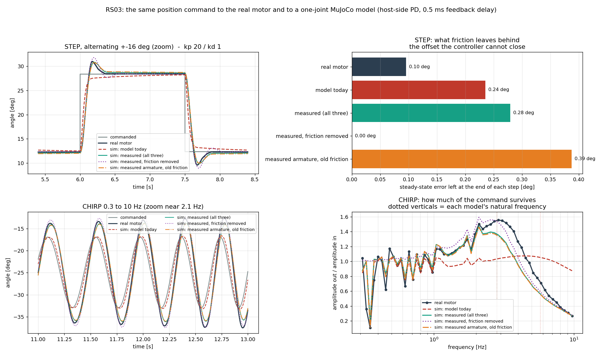

# 같은 지령을 실물과 시뮬레이터에 넣고 겹쳐 봤습니다 — 계단과 처프
<!-- SPEC-TABLES: 해당 없음 — 학습 런이 아니라 **벤치 모터 측정**입니다. §1b-2(액추에이터 한계)·§1b-3(ROM/행동창)·§1b-4(PYG_* 플래그)는 학습 설정에서 나오는 표라 대응하는 런 디렉터리가 없어 채울 근거가 없습니다. 대신 이 노트 머리에 실험 조건(모터 번호·모델·이득·진폭·온도·경계·표본 수)을 적었습니다. -->

날짜: 2026-09-09 밤 · 기계: 라즈베리파이 4 (모터 직결, 초당 약 4000회) ·
모터: 무릎 RS04(번호 4), 엉덩이 회전 RS03(번호 3), 출력축에 아무것도 안 달림 ·
온도 37~40도 · 과전압 블리더 모듈 부착 상태

사용자 지시: **"실제로 모터를 그 파라미터로 만들어서, 똑같은 지령 넣어서(Kp/Kd/armature,
damping...) 응답 비교해 줘. 계단 위치 입력(위아래 역전), 처프(sine sweep). 정지/동 마찰을
넣고 안 넣고에 대한 응답도 비교하라."**

## 한 줄 결론

**실측값을 넣은 시뮬레이터는 실물 위에 얹히고, 지금 모형은 안 얹힙니다.** 가장 크게 갈리는
곳은 **빠른 움직임**입니다 — 지금 모형은 초당 10번 흔들 때 명령의 86%를 따라가는데
**실물은 22%밖에 못 따라갑니다.** 그리고 **마찰을 빼면 계단에서 오차가 0이 되는데, 실물은
절대 0이 되지 않습니다.**

## 어떻게 "똑같이" 맞췄는가

세 가지를 맞췄습니다.

1. **같은 제어식.** 실물은 **호스트에서 PD 를 계산해 순수 토크로** 내보냈습니다. 시뮬레이터도
   매 물리 걸음마다 같은 식을 계산합니다.

       tau = kp x (목표각 − 지금각) + kd x (목표속도 − 지금속도),  그 뒤 ±8 뉴턴미터로 자름

2. **같은 목표.** 시뮬레이터가 쓰는 목표는 실물이 그때 받은 값을 **기록에서 그대로** 읽습니다.
3. **같은 되먹임 지연 0.5 밀리초.** 실물은 명령을 보내고 응답이 오기까지 그만큼 걸리고, 그만큼
   **낡은 상태**로 PD 를 계산합니다. 시뮬레이터에도 같은 지연을 넣었습니다. 안 넣으면
   시뮬레이터가 부당하게 유리합니다.

그러니 두 응답이 갈리면 원인은 **관성·마찰·점성 세 값**뿐입니다.

> ★ 왜 모터 내부 PD 를 안 썼는가 — **지금 고장 나 있습니다.** 목표를 지금 위치와 똑같이 주어
> 오차가 0.000도인데도, kp 칸이 0 이 아니게 되는 순간 1.5 밀리초 만에 토크가 −5.7 → −57.8 →
> −90.6 뉴턴미터로 터집니다(가속도로 역산해도 실제로 약 100 뉴턴미터가 걸렸습니다). 목표를
> 1~2도 어긋나게 줘도 토크가 비례하지 않습니다 — **모터가 우리가 보낸 목표각을 쓰고 있지
> 않습니다.** 토크 명령과 속도 명령은 하루 종일 정확했으므로, 검증된 길만 썼습니다.
> **이건 따로 조사해야 합니다** (뷰어는 모터에 kp 를 실어 보냅니다).

## 넣은 값

| | RS04 지금 모형 | RS04 실측 | RS03 지금 모형 | RS03 실측 |
|---|---|---|---|---|
| `armature` (회전자 관성) | 0.016333 | **0.0773** (4.7배) | 0.015265 | **0.0638** (4.2배) |
| `frictionloss` (움직일 때 마찰) | 0.269456 | **0.519** (1.9배) | 0.285370 | **0.400** (1.4배) |
| `viscous_damping` (점성) | 0.009492 | **0.0275** (2.9배) | 0.022342 | **0.0025** (모형이 **8.9배 높음**) |
| (모형에 자리 없음) 정지 마찰 | — | 0.901 | — | 미측정 |

★ RS03 의 점성은 **모형이 오히려 너무 큽니다.** 세 값이 다 같은 방향으로 틀린 게 아닙니다.
독립 확인: RS03 을 1.2 뉴턴미터로 돌리면 23.2 라디안/s 에서 자리잡는데, 실측식이 예측하는
그때의 토크는 0.458 이고 모터가 보고한 값은 0.45 였습니다. 모형 값(0.0223)이 맞다면 그
속도에서 마찰이 0.92 라 애초에 그 속도까지 못 갑니다.

## 결과 1 — 무릎 RS04


### 처프 — 여기서 제일 크게 갈립니다

명령을 초당 0.2번에서 10번까지 점점 빠르게 흔들며, **명령 진폭 중 얼마가 살아남는지** 봅니다.

| | 공진 봉우리 | 봉우리 높이 | 초당 10번에서 남는 양 |
|---|---|---|---|
| **실물** | **2.5 Hz** | **1.41** | **0.22** |
| 실측값 넣은 모형 | 2.5 Hz | 1.32 | 0.21 |
| **지금 모형** | 봉우리 없음 (5.6 Hz 예측) | 1.15 | **0.86** |
| 마찰 뺀 것 | 2.5 Hz | 1.65 (너무 높음) | 0.23 |
| 정지마찰 값(0.901) 넣은 것 | 2.5 Hz | 1.05 (너무 낮음) | 0.19 |

★ **초당 10번에서 지금 모형은 0.86, 실물은 0.22 — 4배 차이입니다.** 시뮬레이터 속 다리는
실물이 절대 못 내는 빠른 움직임을 낼 수 있고, 학습은 그걸 쓰는 걸음걸이를 배웁니다.
**그게 실물로 안 옮겨지는 이유의 물리적 몫입니다.**

봉우리 자리도 그렇습니다. 실물은 2.5 Hz 에서 공진하는데 지금 모형은 5.6 Hz 로 예측합니다.
관성이 4.7배 가벼우니 고유진동수가 √4.7 = 2.2배 높게 나옵니다.

### 계단 — 마찰이 남기는 것

목표를 위아래로 뒤집으며(±8도) 자리잡을 때까지 두고, **끝내 못 지운 오차**를 봅니다.

| | 남은 오차 |
|---|---|
| **실물** | **1.29도** |
| 실측값 넣은 모형 | **1.07도** ← 가장 가까움 |
| 정지마찰 값 넣은 것 | 0.63도 |
| 지금 모형 | 0.22도 |
| **마찰 뺀 것** | **0.00도** |

★ **마찰을 빼면 오차가 딱 0 이 됩니다.** 시뮬레이터가 명령을 완벽히 맞춘다는 뜻인데,
실물은 절대 그러지 못합니다. 이유는 간단합니다 — 제어기가 낼 수 있는 힘이 마찰보다 작아지는
순간 움직임이 멈추고, 그 자리에 오차가 남습니다. 남는 양은 대략 **마찰 ÷ kp** 입니다
(0.519 ÷ 20 = 0.026 라디안 = 1.49도, 실측 1.29도).

**마찰을 안 넣으면 시뮬레이터는 "위치를 완벽히 맞추는 로봇"을 배웁니다.** 실물에는 그런
것이 없습니다.

## 결과 2 — 엉덩이 회전 RS03



| | 공진 봉우리 | 봉우리 높이 |
|---|---|---|
| **실물** | **2.7 Hz** | **1.57** |
| 실측값 넣은 모형 | 2.8 Hz | 1.35 |
| 지금 모형 | 봉우리 없음 (5.8 Hz 예측) | 1.08 |

처프는 RS04 와 같은 이야기입니다 — **관성을 고치면 봉우리 자리가 맞고, 안 고치면 두 배 높은
데를 가리킵니다.**

### ★ 계단에서는 안 맞습니다 — 숨기지 않고 적습니다

| | 남은 오차 |
|---|---|
| **실물** | **0.05도** |
| 지금 모형 | 0.24도 |
| 실측값 넣은 모형 | **0.73도** ← 실물보다 훨씬 큼 |

RS04 에서는 실측값이 가장 가까웠는데, RS03 에서는 **실측 마찰이 오차를 과하게 예측합니다.**
실물 RS03 은 마찰이 0.400 인데도 오차를 0.05도까지 지웁니다.

짐작되는 이유(확인 안 함): RS04 는 **붙어 있는 힘(0.901)이 움직일 때 마찰(0.519)보다 훨씬**
커서 한 번 서면 잘 안 떨어지는데, RS03 은 그 차이가 작아 초당 4000번 도는 제어 고리의 미세한
떨림만으로 계속 미끄러지는 것으로 보입니다. **RS03 의 정지 마찰을 아직 안 쟀습니다.**
재야 결론이 납니다.

## 그래서 마찰은 넣어야 하는가 — 넣어야 합니다

* **처프(빠른 움직임)**: 마찰을 빼면 공진 봉우리가 1.65 로 과하게 솟습니다(실물 1.41).
  마찰이 공진을 눌러 주는 몫이 실제로 있습니다.
* **계단(느린 정착)**: 마찰을 빼면 오차가 0 이 되어 **실물에 없는 완벽함**이 생깁니다.
* 다만 **어느 마찰 값을 넣느냐**가 중요합니다. 정지 마찰(0.901)을 넣으면 계단에서 과하게
  묵직해지고 공진이 과하게 눌립니다. **움직일 때 마찰(0.519)이 맞습니다.**
  MuJoCo 의 기본 관절 모형에는 정지·동 마찰을 나눠 담을 자리가 없습니다.

## 이 숫자로 할 수 없는 말

* **kp=20, kd=1.0, ±8도 한 조건**입니다. 다른 이득에서도 같은 결론인지는 안 봤습니다.
* **모터 한 대씩, 축에 아무것도 안 달린 상태**입니다. 다리를 달면 링크 관성이 더해져 관성비가
  달라지고 차이가 줄어듭니다 — 이 실험은 **모터 자체**의 차이를 봅니다.
* 실물의 PD 는 **호스트에서** 돌았습니다(초당 4000회, 지연 0.5 밀리초). 모터 내부 PD 로
  돌리면 지연이 더 짧아 응답이 조금 빨라질 수 있습니다.
* **RS03 의 정지 마찰을 안 쟀습니다.** 계단이 안 맞는 이유를 못 닫았습니다.
* 실물 처프의 낮은 주파수(1 Hz 아래) 값은 흔들립니다 — 한 토막에 사이클이 몇 개 안 들어가서
  진폭을 재기 어렵습니다.

## 재현

라즈베리파이에서:

```
python3 -u pd_profiles.py step  --motor-id 4 --model RS04 --kp 20 --kd 1.0 --amp 8 --cycles 6 --tag rs04
python3 -u pd_profiles.py chirp --motor-id 4 --model RS04 --kp 20 --kd 1.0 --amp 8 --f0 0.2 --f1 10 --chirp-s 40 --tag rs04
python3 -u pd_profiles.py step  --motor-id 3 --model RS03 --kp 20 --kd 1.0 --amp 8 --cycles 6 --tag rs03
python3 -u pd_profiles.py chirp --motor-id 3 --model RS03 --kp 20 --kd 1.0 --amp 8 --f0 0.2 --f1 10 --chirp-s 40 --tag rs03
```

이 컴퓨터에서 (mjlab 가상환경):

```
cd mujoco-sim/mjlab && .venv/bin/python3 ../../System_ID/pd_sim_vs_real.py \
  --step-csv ../../System_ID/data/pd_step_4_kp20_kd1_a8_rs04.csv \
  --chirp-csv ../../System_ID/data/pd_chirp_4_kp20_kd1_a8_rs04.csv \
  --family RS04 --out ../../docs/img/pd_sim_vs_real_rs04.png
```

값을 모형에 넣는 방법은 `docs/129_mujoco_motor_parameters.md` 에 정리했습니다.
