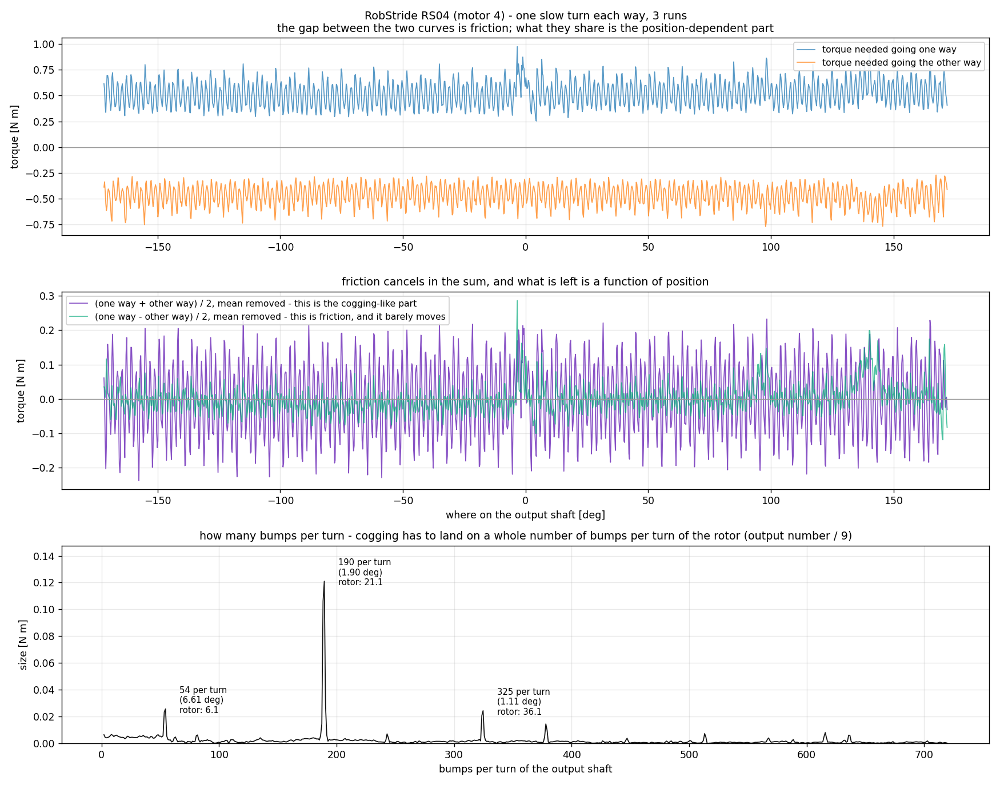
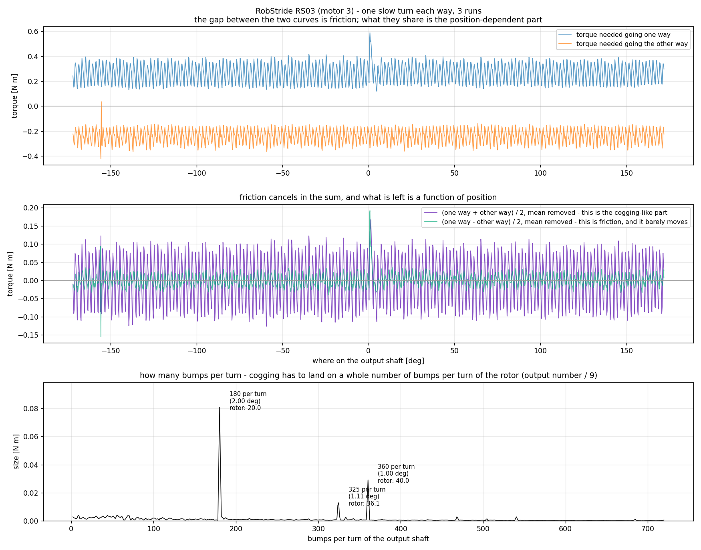

# 한 바퀴를 훑어 코깅을 확인하다

<!-- SPEC-TABLES: 해당 없음 — 학습 런이 아니라 **벤치 모터 측정**입니다. §1b-2·§1b-3·§1b-4 는 학습 설정에서 나오는 표라 대응하는 런 디렉터리가 없어 채울 근거가 없습니다. -->

2026-09-10 · 사용자 지시: **"한 바퀴 촘촘히 훑어서 코깅 맞는지 확인해줘."**

## 한 줄 결론

**코깅 맞습니다.** 자리에 따라 변하는 힘이 **회전자 한 바퀴에 정확히 정수 개**로 되풀이됩니다
— 무릎(RS04)은 **21개**, 엉덩이 회전(RS03)은 **20개**. 두 모터가 서로 다른 정수라는 점,
그리고 **2배 하모닉**(42·40)이 같이 나온다는 점이 결정적입니다. 크기도 작지 않습니다 —
봉우리에서 골까지 **0.47 / 0.29 뉴턴미터**로, 각 모터 마찰의 **90% / 117%** 입니다.

---

## 1. 어떻게 갈랐나 — 마찰을 지우는 뺄셈

**아주 느린 일정 속도**(초당 20도)로 한 바퀴를 왕복합니다. 느리면 관성이 안 끼고 점성도
미미해서, 제어기가 내는 힘이 곧 **그 자리에서 필요한 힘**입니다.

    필요한 힘(θ) = 마찰 x 진행방향 + 자리에 매인 힘(θ)

마찰은 **방향을 따라 부호가 뒤집히고**, 자리에 매인 힘은 **안 뒤집힙니다.** 그래서 같은 자리를
양방향으로 지나가 두 값을 더하고 빼면 둘이 갈립니다.

    자리에 매인 힘(θ) = (갈 때 + 올 때) ÷ 2      마찰(θ) = (갈 때 − 올 때) ÷ 2

회전자 무게감을 잴 때 쓴 것과 **같은 수법**입니다 — 두 상황을 만들어 원하지 않는 항을 소거.

측정: ±180도 삼각파, 한 변에 초당 20도(한 왕복 36초), 2주기 × 3회 → **자리마다 방향별로
6번씩** 지나갑니다. 0.25도 칸으로 묶으면 칸마다 **270~285 표본**. 방향이 바뀌는 ±172도 바깥은
가속이 끼므로 버립니다.

★ 한 가지 처리: 방향을 바꾸면 같은 출력축 각도라도 회전자는 조금 다른 자리에 있습니다
(감속기 헐거움·비틀림·자기 이력). 그대로 더하면 마찰 쪽에도 톱니가 남습니다 — 실제로 처음엔
그렇게 나왔습니다. 그래서 두 곡선을 **가장 잘 겹치는 자리로 밀어 맞춘 뒤** 갈랐습니다.
민 양 자체는 **주기의 배수만큼 모호**하므로 절대값으로 읽지 않습니다.

## 2. 결과





| | 주 주기 (회전자 한 바퀴에) | 2배 하모닉 | 주 주기 세기 | 봉우리~골 | 마찰 대비 |
|---|---|---|---|---|---|
| **RS04** (무릎) | **21.06 → 21** | 42.01 → 42 | 0.121 N·m | **0.469 N·m** | 90% |
| **RS03** (엉덩이 회전) | **20.01 → 20** | 40.03 → 40 | 0.081 N·m | **0.294 N·m** | 117% |

출력축 기준으로는 각각 **한 바퀴에 189.6개(주기 1.899도)**, **180.1개(주기 1.999도)** 입니다.
9:1 감속기를 거치므로 9로 나누면 회전자 기준 개수가 됩니다.

### 왜 이것이 코깅의 증거인가

1. **회전자 한 바퀴에 정수 개**로 떨어집니다 — 21.06, 20.01. 출력축 기준으로는 189.6과
   180.1인데, 이 값들은 **9의 배수**(189 = 21×9, 180 = 20×9)입니다. 즉 이 힘은 출력축이
   아니라 **회전자에 매여** 있습니다. 감속기 이빨이나 축에 매달린 짐 때문이라면 출력축 기준
   정수로 떨어져야 합니다.
2. **2배 하모닉이 같이** 나옵니다(42, 40). 톱니 모양의 힘이면 당연히 따라오는 것입니다.
3. **두 모터가 서로 다른 정수**입니다(21 대 20). 벤치·전선·프로그램 탓이면 같아야 합니다.
   모터마다 다른 것은 **자석과 철심의 배치**입니다.

### 덤 ① 마찰이 따로 잰 값과 맞습니다

이 방법은 마찰도 같이 내놓습니다. 전혀 다른 방법(타성 감속)으로 잰 값과 견주면:

| | 이 방법 | 따로 잰 값 | 차이 |
|---|---|---|---|
| RS04 | 0.4949 | 0.519 | 4.6% |
| RS03 | **0.2524** | **0.251** | **0.6%** |

### 덤 ② 두 모터에 **똑같이** 나오는 선 하나

회전자 기준 **36.07개** 자리에 두 모터 **모두** 봉우리가 섭니다(RS04 0.024 · RS03 0.013
뉴턴미터). 자석 배치는 서로 다른데 이 선만 같다는 것은, 출처가 **두 모터가 공유하는 것** —
즉 **같은 9:1 감속기** 쪽이라는 뜻입니다. 코깅과 기어 맞물림이 이렇게 갈라져 보입니다.

## 3. ★ 앞선 ±10도 실험이 이걸로 설명됩니다

±10도 실험에서 **무릎은 자리에 따라 쏠림의 부호까지 바뀌었는데 엉덩이 회전은 일정**했습니다.
그때는 이유를 몰랐습니다. 이제 알겠습니다.

| | 톱니 한 개의 폭 (출력축) | ±10도 계단이 지나는 톱니 수 |
|---|---|---|
| RS04 | 1.899도 | **5.27개** — 정수가 아님 |
| RS03 | 1.999도 | **5.00개** — 거의 정확히 정수 |

* **RS03 은 10도가 딱 다섯 톱니**입니다. 그래서 어디서 출발하든 **도착점이 톱니의 같은 자리**에
  놓입니다 → 쏠림이 자리와 무관하게 일정합니다.
* **RS04 는 5.27개**라 도착점이 톱니의 다른 자리에 놓입니다 → 출발 자리를 바꾸면 쏠림이
  달라지고, 부호까지 바뀝니다.

측정 두 개가 서로를 설명합니다. 우연으로 보기 어렵습니다.

## 4. 이 실험으로 할 수 없는 말

* **슬롯 수·극 수를 확정할 수는 없습니다.** 21, 20 이라는 수가 곧 슬롯 수라는 보장은
  없습니다(코깅의 기본 주기는 보통 슬롯 수와 극 수의 최소공배수이고, 제작 편차 때문에 더 낮은
  주기가 강하게 나오기도 합니다). 확정하려면 제조사 자료나 분해가 필요합니다.
* **36.07 선이 감속기라는 것도 정황**입니다. 두 모터에 같이 나온다는 점이 근거이고, 이빨 수를
  확인한 것은 아닙니다.
* 초당 20도, 세기 kp=20 조건입니다. 더 빠르면 관성과 점성이 끼어 이 방법이 안 통합니다.
* **모형에는 아직 안 들어가 있습니다.** 넣으려면 관절마다 "회전자 각도의 주기 함수"가 필요하고,
  그것이 학습에 이로운지는 별도 판단입니다. 다만 **크기가 마찰과 맞먹으므로**(90~117%)
  무시할 수 있는 양은 아닙니다.

## 5. 되풀이하는 방법

```
# 벤치 — 한 바퀴 왕복을 아주 느리게, 자리마다 방향별 6번
python3 ~/System_ID/pd_profiles.py triangle --motor-id 4 --model RS04 --kp 20 --kd 1.0 \
        --amp 180 --period-s 18 --cycles 2 --repeats 3 --bound-deg 25 --cool-to 40 --tag cog

# 분석 (이 컴퓨터)
python3 pd_cogging.py --motor 4 --family RS04
python3 pd_cogging.py --motor 3 --family RS03
```
