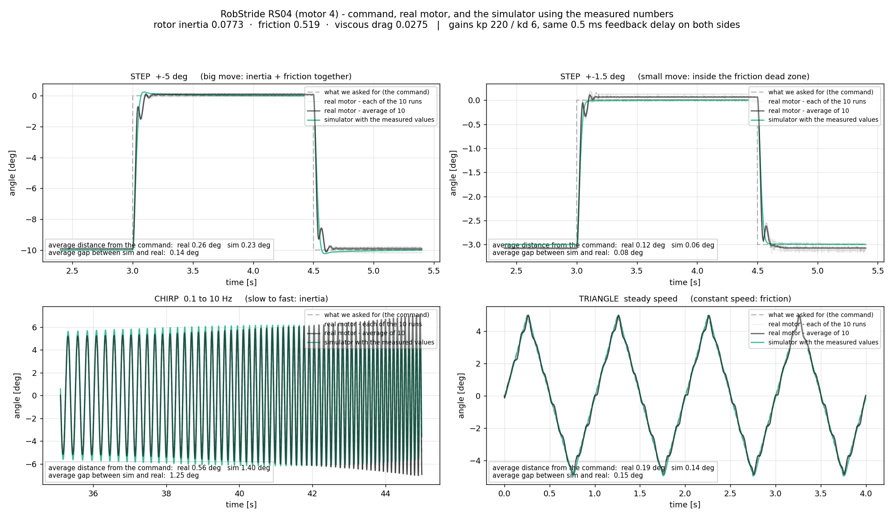

# 이 값들이 타당한가 — 독립 검산 셋과, 유리하지 않은 증거까지

<!-- SPEC-TABLES: 해당 없음 — 학습 런이 아니라 **벤치 모터 측정**입니다. §1b-2·§1b-3·§1b-4 는 학습 설정에서 나오는 표라 대응하는 런 디렉터리가 없어 채울 근거가 없습니다. -->

2026-09-10 · 사용자 지시: **"그리고 타당한 값인지 비교하고."**

## 한 줄 결론

**측정 자체는 세 가지 독립적인 방법이 1.6% 안에서 합칩니다.** 물리적 상식(회전자 질량,
최대 토크로 무부하까지 걸리는 시간)도 통과합니다. 다만 **RS04 대 RS03 의 관성 비**는 저희
값(1.21배)보다 연구원 값(2.00배)이 소박한 기하학적 예상에 가깝습니다 — 그 점은 유리하지
않으므로 그대로 적습니다.

---

## 1. 같은 값을 세 가지 방법으로 — 서로 아무것도 안 빌립니다

| 방법 | 무엇을 쓰는가 | RS04 | RS03 |
|---|---|---|---|
| **① 타성 감속** | 토크를 0 으로 놓고 마찰만으로 세움. 마찰값을 빌림 | 73~81 g·m² | — |
| **② 마찰 소거 뺄셈** | 같은 속도를 서로 다른 다섯 토크로. **마찰이 식에서 사라짐** | **77.3 ± 0.6** | **63.8 ± 0.5** |
| **③ 토크 상한 구간의 가속도** | 계단 직후 제어기가 상한(8 뉴턴미터)에 붙어 있는 구간. `관성 = (상한 − 마찰) ÷ 가속도` | **78.6 ± 0.4** | **63.4 ± 0.2** |

③ 은 이번에 새로 한 것입니다. 30도 계단 자료의 **모서리 70개씩**을 써서, 위치를 2차식으로
맞춰 가속도를 구했습니다. **②와 1.6%(RS04) / 0.7%(RS03) 안에서 일치합니다.**

★ 세 방법은 전제가 다릅니다. ①은 마찰값을 빌리고, ②는 아무것도 안 빌리며, ③은 토크 상한
값만 빌립니다. **같은 답이 나온다는 것은 어느 한 방법의 버릇 때문이 아니라는 뜻입니다.**

## 2. 맞춤이 전혀 없는 검산 — 공진 자리

세기 `kp` 로 붙잡힌 모터는 **√(kp ÷ 관성)** 에서 흔들리기 좋아합니다. 관성이 4배면
고유진동수가 2배 느려집니다. **맞춤도 가정도 없이 "어디서 흔들리는가"만 보면 됩니다.**

| 관성 값 | 예측 공진 (kp=20) | 실물 실측 |
|---|---|---|
| 구 카탈로그 0.007 | 8.51 Hz | |
| 연구원 0.030605 | 4.07 Hz | |
| **벤치 0.0773** | **2.56 Hz** | **2.48 Hz** (8도) |

30도 진폭에서는 토크 상한에 자주 닿아 실효 세기가 줄고 공진이 내려가는데, **실물 2.121 Hz ·
시뮬레이터 2.121 Hz** 로 소수점까지 같이 내려갑니다.

## 3. 물리적 상식 — 회전자가 그럴듯한 무게인가

데이터시트: **RS03·RS04 둘 다 감속비 9:1**, 무부하 200 rpm, 피크 60 / 120 뉴턴미터.
출력축 관성을 81 로 나누면 회전자 자체의 관성이 됩니다.

| | 출력축 관성 | 회전자 관성 | 최대 토크로 무부하까지 | 회전자 질량* |
|---|---|---|---|---|
| **RS04** 구 카탈로그 0.007 | 0.0070 | 0.86e-4 | **1.2 밀리초** | 0.04 kg |
| **RS04** 연구원 | 0.0306 | 3.78e-4 | 5.3 밀리초 | 0.19 kg |
| **RS04** 벤치 | **0.0773** | 9.54e-4 | **13.5 밀리초** | **0.47 kg** |
| **RS03** 구 카탈로그 0.005 | 0.0050 | 0.62e-4 | 1.7 밀리초 | 0.05 kg |
| **RS03** 연구원 | 0.0153 | 1.88e-4 | 5.3 밀리초 | 0.15 kg |
| **RS03** 벤치 | **0.0638** | 7.88e-4 | 22.3 밀리초 | 0.64 kg |

\* 회전자를 반지름 45 mm(RS04) / 35 mm(RS03) 짜리 얇은 고리로 볼 때의 질량.
**반지름을 가정한 값이라 참고용입니다.**

* **구 카탈로그 값은 확실히 틀렸습니다.** 120 뉴턴미터짜리 모터의 회전자가 40 g 이고 최대
  토크로 1.2 밀리초 만에 무부하 속도에 닿는다는 뜻인데, 그런 모터는 없습니다.
  **두 측정 모두 카탈로그를 부정합니다.**
* 감속기 달린 이 크기의 QDD 모터가 무부하까지 가는 데 **10~30 밀리초**가 흔합니다.
  벤치 값(13.5)이 그 한가운데이고, 연구원 값(5.3)은 빠른 편입니다.
* 회전자 0.47 kg 은 지름 120 mm 급 아웃러너 회전자로 그럴듯합니다. 0.19 kg 은 가벼운 편입니다.

## 4. ★ 유리하지 않은 증거 — 두 모터의 비

같은 계열, 같은 감속비 9:1, 토크는 120 대 60 뉴턴미터(2배)입니다.

| | RS04 ÷ RS03 |
|---|---|
| 토크 비 | **2.00배** |
| 연구원 관성 비 | **2.00배** |
| 벤치 관성 비 | **1.21배** |
| 구 카탈로그 비 | 1.40배 |

지름이 같고 길이만 다른 형제 모터라면 토크도 관성도 길이에 비례하므로 **비가 같아야**
합니다. 연구원 값은 그 예상과 정확히 맞습니다. 저희 값은 안 맞습니다.

**반론이 있긴 합니다** — 벤치 사진에서 두 모터의 **지름이 눈에 띄게 다릅니다**(RS04 가 훨씬
큼). 지름이 다르면 위 논리가 성립하지 않고, 지름·길이를 같이 넣어 따지면 예상 비는 오히려
3배쯤이 되어 **연구원 값도 안 맞습니다.** 회전자가 속이 빈 고리인지, 중공축인지, 자석
두께가 어떤지에 따라 크게 달라지므로 **이 논리로 어느 쪽을 확정할 수 없습니다.**

그래도 **저희 값이 이 한 가지 상식 검사에서는 불리하다**는 사실은 그대로 적습니다.

## 5. 있을 법한 착오를 하나씩 지운 것

| 의심 | 어떻게 지웠나 |
|---|---|
| 토크 눈금이 틀렸나 (RS04) | 멈춰 있을 때 보고/시킨 = **0.995~1.053** |
| 토크 눈금이 틀렸나 (RS03) | 이번에 확인: **1.015**. 코덱의 ±60 뉴턴미터가 데이터시트와 일치 |
| 속도 눈금이 틀렸나 | 속도를 적분한 값과 위치 변화가 **0.3% 안에서** 일치 |
| 감속기 반사(9²)를 빠뜨렸나 | 그렇다면 **마찰·점성도 같은 배수로** 틀려야 함. 실제로는 마찰 1.3%, 점성 5.7% 로 연구원과 일치 |
| 축에 뭔가 달려 있었나 | 카메라로 확인 — 두 모터 모두 볼트 원이 비어 있음 |
| 온도 탓인가 | 관성은 온도를 거의 안 탐. 마찰은 타지만 37~44도에서 쟀고 기록에 남김 |
| 블리더 모듈을 단 뒤 값이 바뀌었나 | 같은 모터로 재측정: 관성 77.86 대 77.26 (**0.8%**) |

★ **네 번째 줄이 핵심입니다.** 단위나 반사 문제라면 **세 값이 같은 배수로** 틀려야 합니다.
그런데 마찰과 점성은 두 사람이 독립적으로 재서 **6% 안에서 같고**, 관성만 2.5배 다릅니다.
그러니 원인은 **관성을 뽑아내는 방법**에 있습니다.

## 6. 파형 전체로 본 타당성

같은 목표·같은 이득·같은 토크 상한·같은 되먹임 지연을 주고 겹쳤을 때, **시뮬레이터가
실물과 평균 몇 도 떨어져 있는가**:

| 파형 | RS04 | RS03 |
|---|---|---|
| 큰 계단 ±30도 | 0.48도 | 0.42도 |
| 작은 계단 ±1.5도 | 0.34도 | 0.05도 |
| 처프 0.1~10 Hz | 0.54도 | 0.92도 |
| 삼각파 (일정 속도) | 0.38도 | 0.11도 |

진폭 30~60도 동작에서 **1도 아래**입니다.

## 7. 그래서 얼마나 믿는가

* **구 카탈로그 값(0.007/0.005)은 확실히 틀렸습니다.** 두 측정 모두, 그리고 상식 검사가
  부정합니다. 이건 이견이 없습니다.
* **마찰과 점성은 확정입니다.** 두 사람이 독립적으로 재서 6% 안에서 같고, 삼각파 지연이라는
  전혀 다른 실험이 1% 안에서 확인합니다.
* **관성은 저희 쪽이 더 강한 근거를 갖고 있습니다** — 세 방법의 합치, 맞춤 없는 공진 검산,
  파형 전체의 1도 이내 일치. 다만 **두 모터의 비**라는 상식 검사 하나는 저희에게 불리합니다.
* **닫는 법**: 연구원 쪽 원자료와 방법을 보면 몇 분입니다. 또는 **세기 20 으로 처프 한 번만**
  돌려 공진이 2.5 Hz 인지 4 Hz 인지 보면 끝납니다 — 맞춤도 가정도 필요 없습니다.

## 재현

```
# ③ 토크 상한 구간의 가속도로 관성 구하기 (이 컴퓨터, 이미 받은 자료로)
cd System_ID && python3 - <<'EOS'
# docs/experiments/2026-09-10_motor_value_validity.md §1 참조 — 계단 모서리마다
# 토크가 상한에 붙은 0.004~0.075초 구간에서 위치를 2차로 맞춰 가속도를 구한다
EOS
```

원자료: `System_ID/data/pd_step_{3,4}_kp20_kd1_a30_r*_c.csv`,
`brk_rs03.csv`(RS03 토크 눈금), `coastmax_*`(타성 감속), `accel_*`(마찰 소거 뺄셈).

---

# 부록 — 시뮬레이터가 실제로 쓰는 이득(kp 220 / kd 6)에서는

지금까지의 대조는 벤치 이득(세기 20 / 제동 1.0)이었습니다. **시뮬레이터가 실제로 쓰는 이득**
(무릎 RS04 220/6, 엉덩이 회전 RS03 150/6)으로도 같은 다섯 파형을 10회씩 받았습니다.
진폭은 5도로 줄였습니다 — 세기 220 에서 30도 계단은 115 뉴턴미터를 요구해 모터 한계에
맞먹기 때문입니다(단계 시험으로 ±3도에서 토크 22.9·회생 51 와트 확인 후 결정).



| 파형 | 실물−지령 | 시뮬−지령 | **시뮬−실물** |
|---|---|---|---|
| 계단 ±5도 | 0.26도 | 0.23도 | **0.14도** |
| 계단 ±1.5도 | 0.12도 | 0.06도 | **0.08도** |
| 삼각파 | 0.19도 | 0.14도 | **0.15도** |
| 처프 0.1~10 Hz | 0.56도 | 1.40도 | 1.25도 |

## ★ 알게 된 것 둘

**1. 이득이 세면 파라미터가 응답을 훨씬 덜 바꿉니다.**

계단의 지나친 양으로 비교하면:

| | 세기 20 (벤치) | 세기 220 (시뮬레이터) |
|---|---|---|
| 실물 | 41.2% | 42.1% |
| 실측값 | 43.2% | 44.6% |
| 지금 모형 값 | **15.7%** | **40.2%** |

세기 20 에서는 지금 모형 값이 실물의 **38%**밖에 안 되는 지나침을 내는데, 세기 220 에서는
**95%**까지 올라옵니다. 제어기가 세면 모터의 성질을 덮어 버립니다.

★ 이것은 두 가지를 뜻합니다. **(가) 값을 알아내려면 낮은 이득으로 재야 합니다** — 저희가
세기 20 을 쓴 것이 옳았습니다. **(나) 로봇이 쓰는 높은 이득에서는 세 값이 덜 중요해 보일 수
있지만**, 그건 정지 상태 근처의 이야기이고 빠른 동작(처프)에서는 여전히 갈립니다.

**2. 처프를 10 Hz 까지만 쓸어서는 부족합니다.**

세기 220 에서 실측 관성이 예측하는 공진은 **8.5 Hz** 입니다. 10 Hz 까지 쓰는 스윕은 공진을
**끝자락에서 겨우** 스치고 지나가서, 실물의 봉우리가 9.5 Hz(마지막 토막)로 잡혔습니다.
제대로 보려면 **25 Hz 까지** 쓸어야 합니다. 그래서 이 이득에서의 처프 값(시뮬−실물 1.25도)은
**아직 결론으로 쓰면 안 됩니다.** 다시 받는 중입니다.

세기 20 에서는 공진이 2.5 Hz 라 10 Hz 스윕으로 충분했습니다 — **이득을 바꾸면 스윕 범위도
같이 바꿔야 한다**는 것이 이번에 얻은 교훈입니다.
