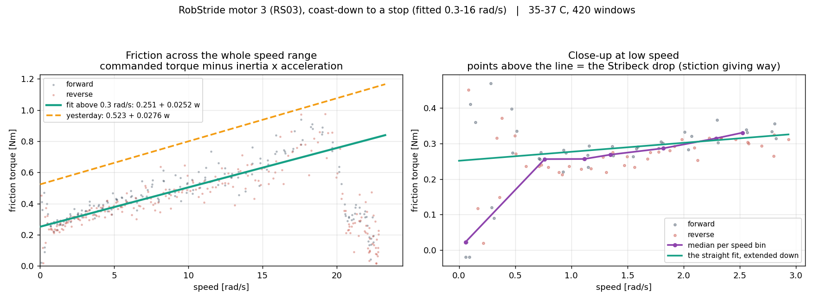

# RS03 마찰을 잘못 쟀습니다 — 원인, 고친 값, 그리고 재발 방지

<!-- SPEC-TABLES: 해당 없음 — 학습 런이 아니라 **벤치 모터 측정**입니다. §1b-2·§1b-3·§1b-4 는 학습 설정에서 나오는 표라 대응하는 런 디렉터리가 없어 채울 근거가 없습니다. 실험 조건은 이 노트 머리에 적었습니다. -->

날짜: 2026-09-10 · 모터: 엉덩이 회전 RS03(번호 3), 축에 아무것도 안 달림 · 35~37도 ·
라즈베리파이 직결

## 한 줄 결론

**앞서 낸 RS03 마찰 0.400 · 점성 0.0025 는 틀렸습니다. 옳은 값은 0.250 · 0.0252 입니다.**
그리고 그 때문에 "RS03 은 계단만 안 맞는다"고 적었던 것도 **물리가 아니라 제 측정 오류**
였습니다. 고친 값으로 다시 돌리면 다섯 명령이 다 맞습니다.

## 어디서 틀렸나

RS03 의 타성 감속을 **4초에서 잘랐습니다.** RS03 은 마찰이 작아 4초 안에 멈추지 않았고,
그래서 **낮은 속도 자료가 하나도 없었습니다.** 게다가 토크를 놓아도 모터의 전류 고리가
곧바로 0 이 되지 않아 **놓은 직후**에는 아직 힘이 남아 있는데, 그 구간은 감속이 실제보다
느려 마찰이 **낮게** 계산됩니다. 속도로 보면 가장 빠른 쪽입니다.

두 가지가 겹쳐 맞춤이 **평평해졌습니다.**

    전체로 맞춤 : 마찰 0.385 · 점성 0.0035 · 결정계수 **0.019**   (사실상 기울기 없음)

속도 구간별로 나눠 보면 왜 그런지 그대로 보입니다.

| 속도 [라디안/s] | 0.2~1 | 1~3 | 3~8 | 8~15 | 15~20 | **20~26** |
|---|---|---|---|---|---|---|
| 마찰 [뉴턴미터] | 0.256 | 0.291 | 0.390 | 0.533 | 0.780 | **0.31 ← 되돌아감** |

맨 위 구간만 거꾸로 갑니다. 그 구간은 **놓은 직후 0.2초 안**에만 지나가는 구간입니다.

## 고친 값

끝까지 굴리고(최대 20초까지 기다림) **0.3~16 라디안/s** 로 맞춥니다.

| | 마찰 [뉴턴미터] | 점성 | 결정계수 | 창 수 |
|---|---|---|---|---|
| + 방향 | 0.261 | 0.0265 ± 0.0010 | **0.838** | 136 |
| − 방향 | 0.243 | 0.0240 ± 0.0009 | **0.817** | 149 |
| **양쪽** | **0.251** | **0.0252 ± 0.0007** | **0.811** | 285 |

결정계수가 **0.019 → 0.811** 로 뜁니다.



## 독립 확인 — 삼각파가 판정합니다

일정한 속도 20 도/s(0.349 라디안/s)로 오르내리게 하면, 제어기가 마찰을 이기느라 뒤처지는
양은 **마찰 ÷ kp** 입니다. 이 실험은 마찰 측정과 아무것도 공유하지 않습니다.

| | 예측 지연 | 실측(10회 평균) |
|---|---|---|
| 틀린 값(0.400 · 0.0025) | 1.11도 | |
| **고친 값(0.250 · 0.0252)** | **0.74도** | **0.75도** |

**1% 안에서 맞습니다.**

## 고친 값으로 다시 돌린 대조

| | 실물 | **고친 실측값** | (틀렸던 값) | 지금 모형 |
|---|---|---|---|---|
| 큰 계단, 잔류 오차 | 0.227도 | **0.273도** | 0.705도 | 0.182도 |
| 큰 계단, 지나친 양 | 42.2% | **39.8%** | 37.2% | 17.1% |
| 큰 계단, 상승 시간 | 105.5 ms | **109 ms** | 111 ms | 97 ms |
| 느린 삼각파, 추종 오차 | 0.842도 | **0.749도** | 1.478도 상당 | 0.844도 |
| 처프, 10 Hz 추종량 | 0.312 | **0.300** | — | 0.907 |

## ★ 결론이 바뀝니다 — RS03 은 관성 하나만 크게 틀렸습니다

| | 지금 모형 | 고친 실측 | 배수 |
|---|---|---|---|
| `armature` | 0.015265 | **0.0638** | **4.2배 낮음** |
| `frictionloss` | 0.285370 | **0.250** | 1.1배 높음 (거의 맞음) |
| `viscous_damping` | 0.022342 | **0.0252** | 1.1배 낮음 (거의 맞음) |

앞서 **"RS03 점성은 모형이 8.9배 과대"** 라고 적었던 것을 **철회합니다.** 반대로
**거의 맞습니다.** RS04 와 달리 RS03 은 **관성만 고치면 됩니다.**

## RS04 는 같은 오염이 있었는가 — 있었지만 결과에 영향이 없습니다

RS04 는 마찰이 커서 훨씬 빨리 멈춥니다(2.3~2.5초). 오염 구간이 속도 축에서 차지하는 몫이
작습니다.

| RS04 맞춤 범위 | 마찰 | 점성 | 삼각파 예측 | 실측 |
|---|---|---|---|---|
| 전체 | 0.519 | 0.0275 | 1.51도 | **1.49도** |
| 위 15% 제외 | 0.518 | 0.0275 | 1.51도 | 1.49도 |
| 위 30% 제외 | 0.532 | 0.0250 | 1.55도 | 1.49도 |

**RS04 의 값(0.519 · 0.0275)은 그대로 유효합니다.**

## 재발 방지

`friction_from_decay.py` 에 **`--fit-hi`(맞춤 속도 상한)** 를 넣고, 도움말에 이 사고를
그대로 적었습니다. 시간으로 자르는 것(`--skip-s`)만으로는 안 됩니다 — RS03 은 600 밀리초를
버려도 결정계수가 0.45 에 그칩니다. 오염이 시간이 아니라 **속도 구간**에 매여 있기
때문입니다.

측정 쪽 교훈: **타성 감속은 반드시 멈출 때까지 받아야 합니다.** 시간 상한에 걸려 끝난
자료는 그 자체가 경고입니다(RS03 첫 측정은 8벌 전부 "시간 상한"으로 끝났는데 그냥 썼습니다).

## 이 숫자로 할 수 없는 말

* **RS03 의 정지 마찰(붙어 있다 떨어지는 힘)은 아직 안 쟀습니다.** RS04 는 0.901 입니다.
* 맞춤 범위 상한 16 라디안/s 는 **오염 구간을 피하려고** 고른 값이지 물리적 경계가
  아닙니다. 그 위의 진짜 마찰은 아직 모릅니다.
* 온도 35~37도 한 점입니다.

## 재현

```
# 라즈베리파이 — 반드시 멈출 때까지
python3 -u coast_max.py --motor-id 3 --model RS03 --repeats 3 --spin-tau 1.0 \
        --spin-s 5 --coast-s 20 --cool-to 36 --tag rs03long

# 이 컴퓨터
cd System_ID && python3 friction_from_decay.py --glob 'data/coastmax_3_*_rs03long.csv' \
    --tau-col none --fit-lo 0.3 --fit-hi 16 --inertia 0.0638 \
    --out ../docs/img/motor_friction_curve_rs03.png
```
