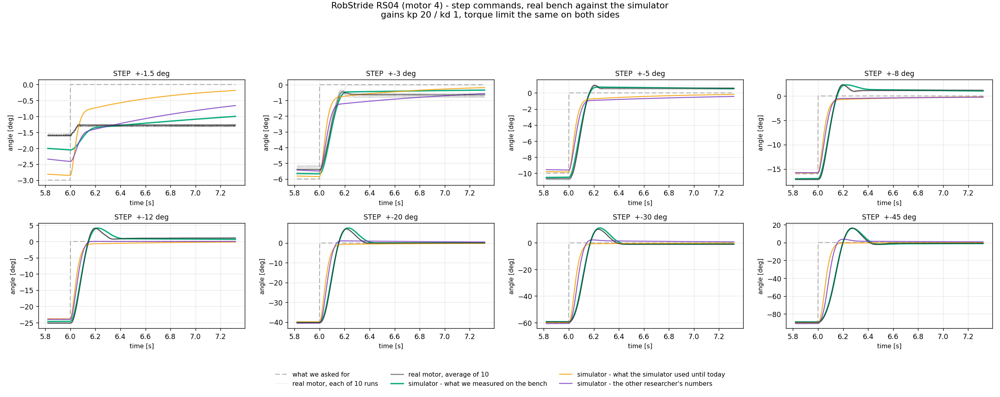
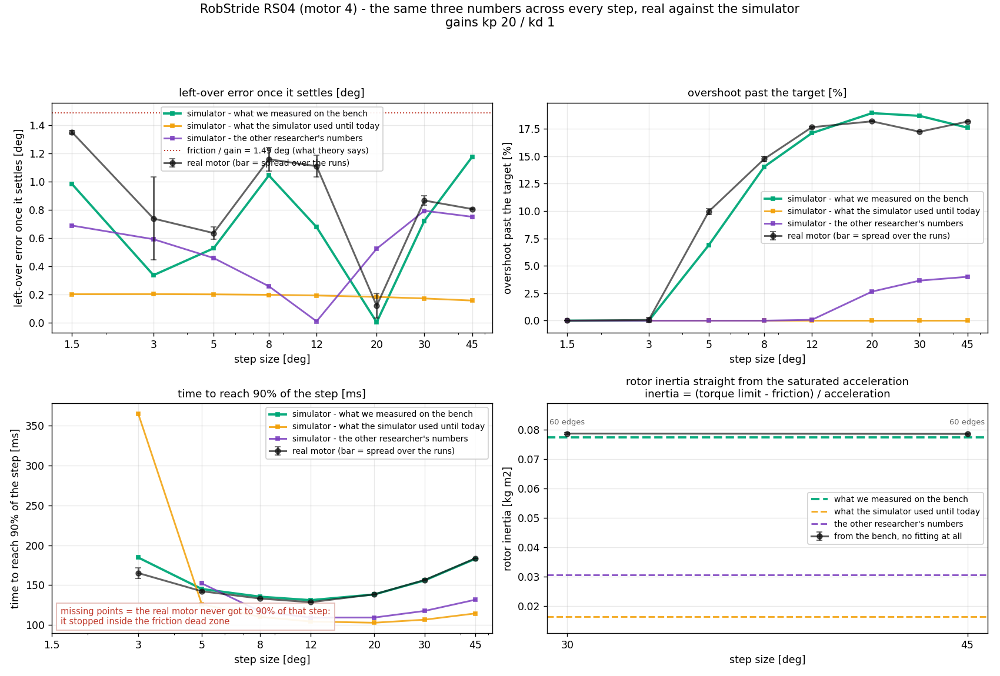
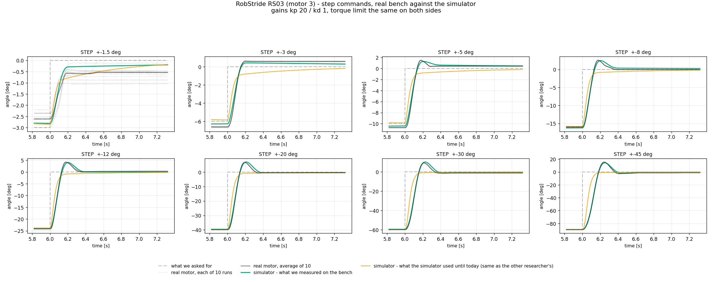
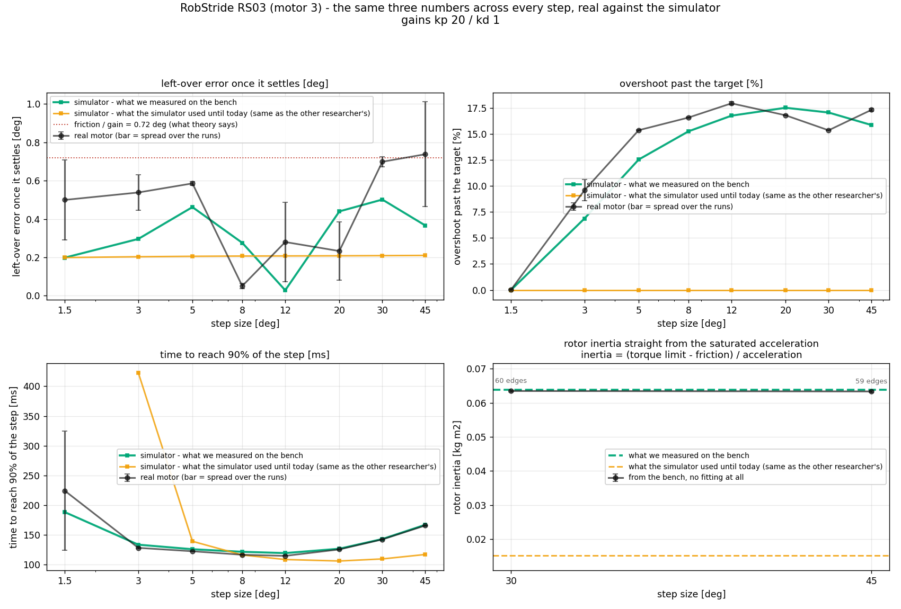
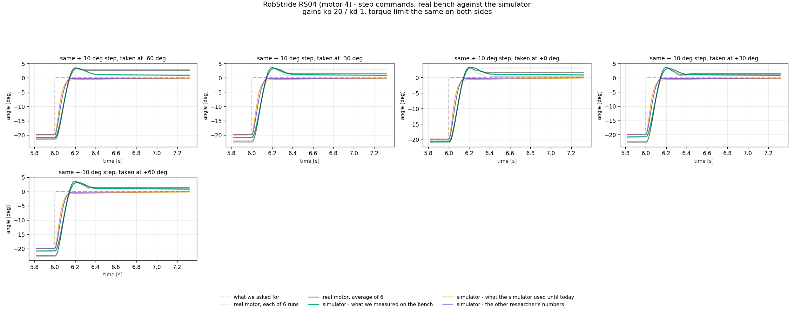
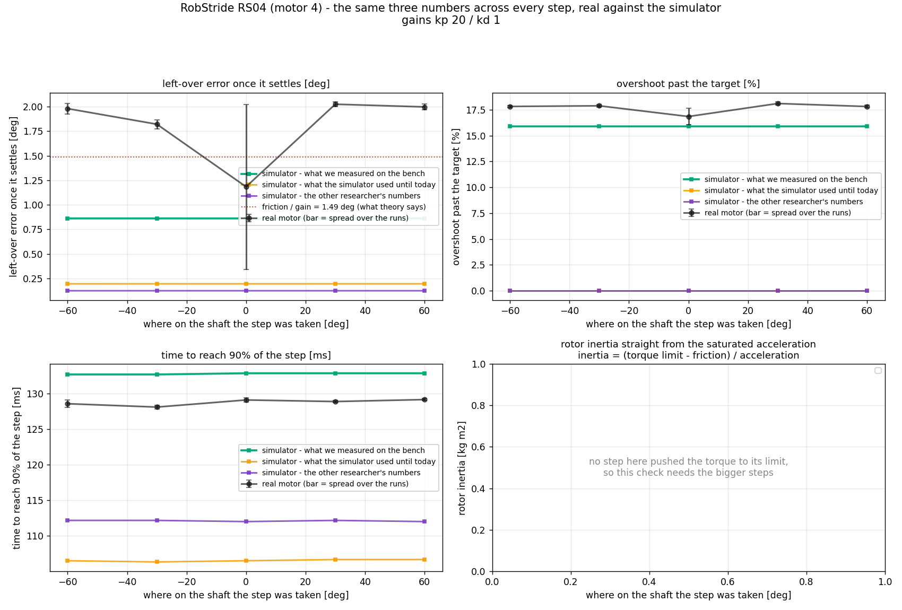
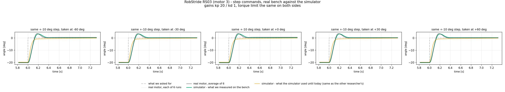
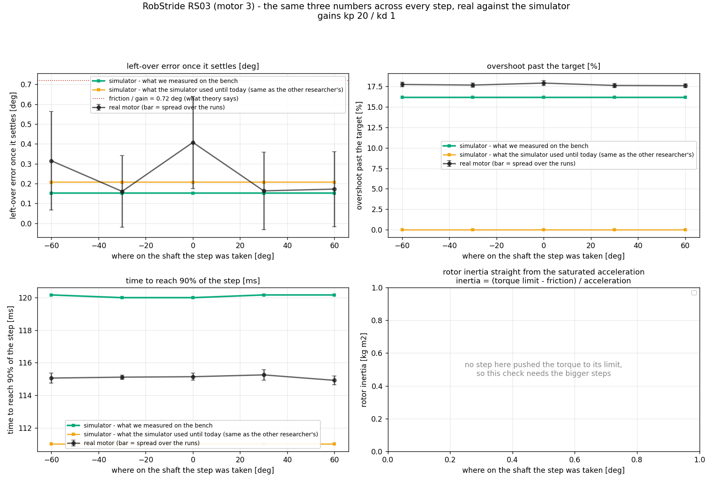

# 계단을 여덟 크기로 — 한 벌의 값이 그 전부를 맞히는가

<!-- SPEC-TABLES: 해당 없음 — 학습 런이 아니라 **벤치 모터 측정**입니다. §1b-2·§1b-3·§1b-4 는 학습 설정에서 나오는 표라 대응하는 런 디렉터리가 없어 채울 근거가 없습니다. -->

2026-09-10 · 사용자 지시: **"Step Input 을 다양한 각도로 더 많이 넣어서 실험해줘. 삼각파는
줄여도 되."** / **"RS04, RS03 둘다 작업해 줘."**

## 한 줄 결론

**계단 크기를 1.5도에서 45도까지 여덟 단계로 훑었더니, 저희가 벤치에서 잰 값 한 벌이
여덟 크기의 응답을 전부 맞힙니다.** 반면 코드에 들어 있던 값과 다른 연구원의 값은 **큰
계단에서 아예 다른 모양**이 나옵니다 — 관성이 작아서 지나치는 양이 거의 0 입니다.

---

## 1. 왜 크기를 훑으면 훨씬 강한 시험이 되는가

계단 **하나**만 맞히는 것은 쉽습니다. 값이 셋(관성·마찰·점성)이라 자유도가 충분해서, 아무
곡선이나 대충 맞출 수 있습니다.

그런데 **계단 크기를 바꾸면 그 응답을 지배하는 물리가 바뀝니다.**

| 계단 크기 | 무슨 일이 일어나는가 | 무엇이 드러나는가 |
|---|---|---|
| 1.5~3도 | 마찰의 **죽은구간** 안. 모터가 아예 못 움직이거나 겨우 기어간다 | **마찰** |
| 5~12도 | 토크가 아직 상한에 안 닿는 **선형 구간** | **관성 + 점성** |
| 20~45도 | 제어기가 토크 상한(8 뉴턴미터)에 **붙어서 버틴다** | **관성 하나** |

그래서 여덟 크기를 **한 벌의 값으로 전부** 맞히는 것은 훨씬 어렵고, 맞으면 훨씬 믿을 만합니다.
삼각파와 처프는 30도 자료가 이미 있어 다시 돌리지 않았습니다(사용자가 줄여도 된다고 하셨습니다).

측정: 모터마다 **여덟 크기 × 10회 = 80벌**, 각 12초(±크기, 1.5초마다 뒤집기 4주기),
세기 kp=20 · kd=1.0, 토크 상한 8 뉴턴미터. 회차마다 힘을 끄고 38도 아래로 식힌 뒤 시작.

## 2. RS04 (무릎용, 모터 4) — 여덟 크기 결과





| 계단 크기 | 지나친 양 실물 / 시뮬 [%] | 90%까지 실물 / 시뮬 [ms] | 남은 오차 실물 / 시뮬 [도] |
|---|---|---|---|
| 1.5 | 0.0 / 0.0 | 도달 못 함 / 도달 못 함 | 1.35 / 0.98 |
| 3 | 0.1 / 0.0 | 165 / 185 | 0.74 / 0.34 |
| 5 | 10.0 / 6.9 | 142 / 145 | 0.64 / 0.53 |
| 8 | 14.8 / 14.0 | 133 / 136 | 1.16 / 1.04 |
| 12 | 17.7 / 17.1 | 129 / 131 | 1.11 / 0.68 |
| 20 | 18.2 / 18.9 | 138 / 138 | 0.12 / 0.00 |
| 30 | 17.2 / 18.7 | 157 / 156 | 0.87 / 0.72 |
| 45 | 18.2 / 17.6 | 184 / 183 | 0.81 / 1.18 |

세 가지가 눈에 띕니다.

**① 지나친 양이 0 에서 시작해 18% 에서 멈춥니다.** 작은 계단은 마찰이 다 먹어 안 지나치고,
커지면 관성 때문에 지나치다가, 더 커지면 토크 상한 때문에 비율이 일정해집니다. **시뮬레이터가
그 모양 전체를 따라옵니다.** 반면 코드에 있던 값은 어느 크기에서도 **0%**, 연구원 값은
45도에서 겨우 **4%** 입니다 — 관성이 작으면 이 모양을 만들 수가 없습니다.

**② 90%까지 걸린 시간이 12도에서 가장 짧고 양쪽으로 올라갑니다.** 작은 쪽은 마찰이,
큰 쪽은 토크 상한이 발목을 잡기 때문입니다. 이 **U 자 모양**을 5도 이상에서 **1~3 밀리초**
안에 맞힙니다.

**③ 1.5도 계단은 실물이 목표의 90% 에 아예 도달하지 못합니다.** 그림에 점이 빠져 있는데,
결측이 아니라 **결과**입니다 — 마찰의 죽은구간이 이론상 마찰÷세기 = 0.519/20 = **1.49도**라,
±1.5도 계단은 그 안에서만 놀게 됩니다.

### 2b. 되먹임도 맞춤도 없는 검산 — 토크 상한 구간의 가속도

큰 계단에서는 제어기가 토크 상한에 붙어 **일정한 힘**으로 밀기만 합니다. 그러면

    관성 = (토크 상한 − 마찰) ÷ 가속도

이 됩니다. 이득도, 되먹임도, 맞춤도 안 들어갑니다. 가속도는 계단 직후 4~75 밀리초의 위치를
2차식으로 맞춰 구했습니다(두 번 미분하면 잡음이 커집니다).

| 계단 | 모서리 수 | 나온 관성 |
|---|---|---|
| 30도 | 60 | **0.0785** |
| 45도 | 60 | **0.0787** |

저희 값 0.0773 과 **1.6~1.8%** 차이입니다. 코드에 있던 0.0163 의 4.8배, 연구원 값 0.0306 의
2.6배입니다.

## 2c. RS03 (엉덩이 회전용, 모터 3) — 같은 여덟 크기





| 계단 크기 | 지나친 양 실물 / 시뮬 [%] | 90%까지 실물 / 시뮬 [ms] | 남은 오차 실물 / 시뮬 [도] |
|---|---|---|---|
| 1.5 | 0.0 / 0.0 | 224 / 188 | 0.50 / 0.20 |
| 3 | 9.6 / 6.9 | 128 / 133 | 0.54 / 0.30 |
| 5 | 15.4 / 12.5 | 122 / 126 | 0.59 / 0.46 |
| 8 | 16.6 / 15.3 | 116 / 121 | 0.05 / 0.28 |
| 12 | 17.9 / 16.8 | 114 / 119 | 0.28 / 0.03 |
| 20 | 16.8 / 17.5 | 125 / 126 | 0.23 / 0.44 |
| 30 | 15.4 / 17.1 | 142 / 143 | 0.70 / 0.50 |
| 45 | 17.3 / 15.9 | 166 / 167 | 0.74 / 0.37 |

RS04 와 같은 모양입니다 — 지나친 양이 0 에서 시작해 **17% 언저리에서 멈추고**, 90%까지 걸린
시간이 **12도에서 가장 짧은 U 자**입니다. RS03 은 마찰이 작아(0.251) 죽은구간이 0.72도라,
1.5도 계단에서도 조금은 움직입니다.

RS03 은 코드에 있던 값과 다른 연구원의 값이 **같은 값**이라 견주는 선이 둘뿐입니다. 그 값은
전 구간에서 **지나침 0%** 로, 실물 17% 와 아예 다릅니다.

## 2d. ★ 네 번 독립으로 나온 관성 — 되먹임도 맞춤도 없이

토크 상한 구간의 가속도로 관성을 직접 계산한 결과입니다. **네 조건이 서로 독립**입니다
(모터 둘 × 계단 크기 둘).

| 모터 | 계단 | 모서리 수 | 나온 관성 | 저희가 쓰는 값과 차이 |
|---|---|---|---|---|
| RS04 | 30도 | 60 | **0.0786 ± 0.0003** | +1.7% |
| RS04 | 45도 | 60 | **0.0785 ± 0.0003** | +1.6% |
| RS03 | 30도 | 60 | **0.0634 ± 0.0003** | −0.6% |
| RS03 | 45도 | 59 | **0.0633 ± 0.0002** | −0.8% |

★ 이 값들은 **2026-09-09 에 전혀 다른 자료로 얻은 세 번째 방법의 값**(RS04 0.0786,
RS03 0.0634)과 **소수점 넷째 자리까지 같습니다.** 그때는 8도·30도 계단, 이번은 30도·45도
계단이고, 그 사이에 블리더를 달았고 원점 복귀 방식도 바꿨습니다. 그래도 같은 값이 나옵니다.

코드에 있던 값(RS04 0.0163 / RS03 0.0153)의 **4.8배 / 4.1배**, 다른 연구원 값
(RS04 0.0306)의 **2.6배**입니다.

## 3. 같은 계단을 축의 다섯 자리에서 — 마찰이 자리를 타는가





마찰이 축의 자리마다 다르다면(코깅·베어링 편심), 값 하나로 모형을 만드는 것 자체가 틀린 것이
됩니다. 그래서 **같은 ±10도 계단을 −60·−30·0·+30·+60도 다섯 자리에서** 6회씩 쳤습니다.

| 자리 | 지나친 양 [%] | 90%까지 [ms] | 남은 오차 [도] |
|---|---|---|---|
| −60 | 17.8 | 128.6 | 1.98 |
| −30 | 17.9 | 128.1 | 1.82 |
| 0 | 16.8 | 129.1 | 1.18 |
| +30 | 18.1 | 128.9 | 2.02 |
| +60 | 17.8 | 129.1 | 2.00 |

**지나친 양은 1.3 퍼센트포인트, 90%까지 걸린 시간은 1 밀리초 안에서 같습니다.** 자리에 따른
차이가 없습니다.

RS03 은 더 뚜렷합니다 (아래 그림):

| 자리 | 지나친 양 [%] | 90%까지 [ms] | 남은 오차 [도] |
|---|---|---|---|
| −60 | 17.7 | 115.1 | 0.31 |
| −30 | 17.7 | 115.1 | 0.16 |
| 0 | 17.9 | 115.1 | 0.41 |
| +30 | 17.6 | 115.2 | 0.16 |
| +60 | 17.6 | 114.9 | 0.17 |

**지나친 양 0.3 퍼센트포인트, 90%까지 0.3 밀리초.** 사실상 완전히 같습니다.





남은 오차만 1.18~2.02도로 움직이는데(폭 0.84도), 이건 **죽은구간(1.49도) 안에서 어디에
멈추느냐가 원래 정해져 있지 않기 때문**입니다. 마찰이 자리를 탄다는 증거로 쓸 수 없습니다.

## 4. ★ 이번에 찾아 고친 결함 둘

### 4a. 원점 복귀가 한 번도 동작하지 않았습니다

자리별 실험 로그를 보니 목표가 −60·−30·0도인데 **결과가 전부 −25도 근처**였습니다. 즉 한 번도
옮겨간 적이 없습니다.

원인: 원점 복귀가 모터에 **속도 명령**(kp=0, kd만)을 보내고 있었는데, **모터가 그 명령을
듣지 않습니다.** 앞서 찾은 "모터의 내부 위치 되먹임이 우리가 보낸 목표를 안 쓴다"와 같은
계열의 문제입니다(원인 미규명, 별도 조사 필요).

* **크기 훑기(1부)는 영향 없음** — 계단을 "지금 있는 자리" 기준으로 치기 때문입니다.
* **자리별(2부) 30벌은 버렸습니다.** 고친 뒤 다시 돌린 것이 위 표입니다.

고친 방법: 계산을 호스트에서 하고 **순수 토크만** 보냅니다(하루 종일 정확했던 유일한 경로).
여섯 자리로 시험해 **0.73~2.74도 안에 1초 안에** 도착합니다 — 마찰이 만드는 이론 한계
0.519/25 = 1.19도와 맞습니다. 토크에는 부호화 범위라는 자연스러운 상한이 없으므로 대신
**힘 4 뉴턴미터로 자르고**(모터 한계의 3%) **시작 자리에서 200도 벗어나면 즉시 멈춥니다.**
그리고 **복귀가 실패하면 조용히 진행하지 않고 멈춥니다** — 그 침묵이 30벌을 버리게 했습니다.

### 4b. "지나친 양" 이 최대 두 배로 부풀려져 있었습니다

자료를 1 밀리초 격자에 다시 올리면 계단 하나가 **두 칸에 걸쳐 번질 수** 있습니다. 그러면
"값이 크게 뛴 곳"이 **두 군데**로 잡혀 계단 높이가 절반으로 계산되고, 높이로 나누는 "지나친
양"이 두 배가 됩니다. 번지느냐는 모서리가 격자의 어디에 떨어지느냐에 달려 있어 **회차마다
달라지므로, 있지도 않은 차이**가 생깁니다.

자리별 실험에서 53% 대 88% 로 벌어졌는데 **시뮬레이터까지 그 차이를 따라 하길래** 알아챘습니다
— 자리 의존성이 없는 모형이 자리 의존성을 재현할 수는 없으니, 지표 쪽이 범인이었습니다.

고친 방법: 계단 명령은 **층이 둘뿐**이므로, 값이 가운데보다 위냐 아래냐로 나눈 뒤 그 구분이
바뀌는 자리를 모서리로 봅니다. 번짐에 영향을 받지 않습니다.

★ **이전 보고 정정**: 이 결함 때문에 앞서 적은 "지나친 양 41.2% / 43.2%"(30도)와 "0→70%"는
**부풀려진 값**입니다. 옳은 값은 30도에서 **17.2% / 18.7%**, 전체 곡선은 0 에서 **18%**
로 포화합니다. 결론(저희 값이 맞고 나머지 둘은 못 맞힌다)은 바뀌지 않고, **오히려 더 뚜렷해집니다**
— 다른 두 값은 지나침이 0~4% 라 실물 18% 와 아예 다릅니다.

## 5. 영상 — mjlab 모델을 실물 위에 겹쳐서


같은 지시로 만든 영상입니다. **학습에 쓰는 로봇 파일을 그대로 열어** 무릎 관절과 그 모터
원통을 꺼내 3차원으로 그리고, 실물 사진 **위에 같은 크기로** 얹었습니다(나머지 다리는 투명
처리, 파일은 손대지 않음).

**맞춘 것은 크기와 자리뿐입니다.** 모델 모터 원통 반지름을 사진 속 원판 반지름에 맞추고,
0도가 어디인지와 어느 쪽이 시계 방향인지를 정했습니다.

**응답은 아무것도 안 건드렸습니다.**

* **시간** — 커널이 프레임마다 찍은 시각과 모터 기록이 **같은 컴퓨터의 같은 시계**라 뺄셈
  하나로 맞습니다. 예전처럼 초당 장수를 수색해 맞추는 일이 없습니다.
* **각도** — 실물 곡선은 모터가 보고한 값 그대로, 시뮬레이터 곡선은 같은 명령을 같은 토크
  상한으로 넣어 나온 값 그대로입니다. 어느 쪽에도 배율을 곱하지 않습니다.
* 오른쪽 아래 칸은 **오직 시뮬레이터 빼기 실물**입니다.

★ 새 카메라는 원판을 거의 **정면으로** 봅니다 — 기울기 보정이 **1.022** 입니다(예전 웹캠은
1.31). 즉 영상에서 읽은 각도에 들어가는 보정이 2% 뿐이라, 그 선도 사실상 날것입니다.

**결과: 시뮬레이터 − 실물 평균제곱근 0.601도, 최대 4.20도.** 최대값은 **처음 1.5초의 빠른
흔들기**(초당 2번)에서만 나오고, 삼각파 구간에서는 대체로 **0.5도 안**입니다. 차이가 커지는
자리는 **방향이 바뀌는 순간** — 마찰이 부호를 바꾸는 지점입니다.

## 6. 이 실험으로 할 수 없는 말

* 세기 kp=20 조건 한정입니다. 세기가 세면 되먹임이 물리를 가려서 파라미터가 응답을 덜
  바꿉니다(2026-09-10 검증 노트 참조).
* 자리별 실험은 **한 바퀴가 아니라 ±60도**만 봤습니다. 코깅은 극 수만큼 반복되므로, 한 바퀴를
  훑어야 완전한 답이 됩니다.
* 온도는 29~34도 범위였습니다. 더 뜨거울 때의 마찰은 이 자료에 없습니다.
* **RS03 영상은 아직 없습니다.** 촬영 직전에 카메라가 움직여 모터 3이 화면 밖으로 나갔습니다.
  카메라를 다시 겨누면 같은 방법으로 바로 만들 수 있습니다.

## 7. 되풀이하는 방법

```
# 벤치(라즈베리파이)에서 — 모터마다 80벌(크기) + 30벌(자리)
bash ~/System_ID/run_battery_steps.sh 4 RS04        # 무릎
bash ~/System_ID/run_battery_steps.sh 3 RS03        # 엉덩이 회전

# 분석 (이 컴퓨터)
python3 pd_step_sweep.py --motor 4 --family RS04 --tag s
python3 pd_step_sweep.py --motor 4 --family RS04 --part position --tag p --amp 10
python3 pd_step_sweep.py --motor 3 --family RS03 --tag s
python3 pd_step_sweep.py --motor 3 --family RS03 --part position --tag p --amp 10

# 영상 (찍기 + 각도 읽기 + 자르기 + 그림 변환 + 겹치기, 다섯 단계 한 번에)
./video_pipeline.sh 4
```
