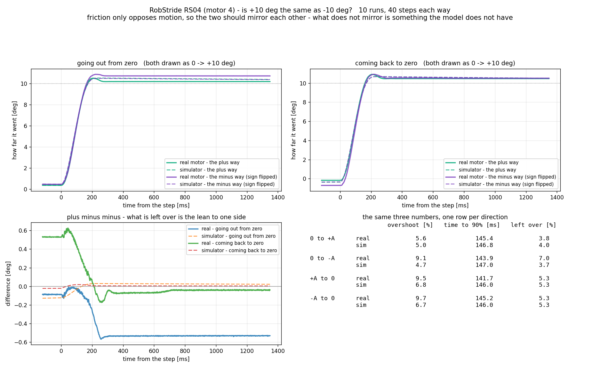
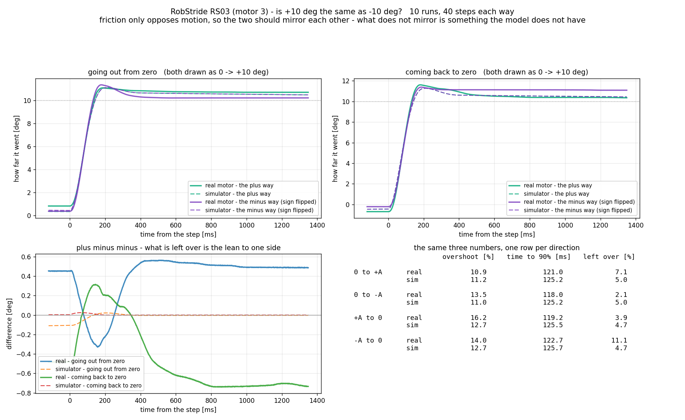
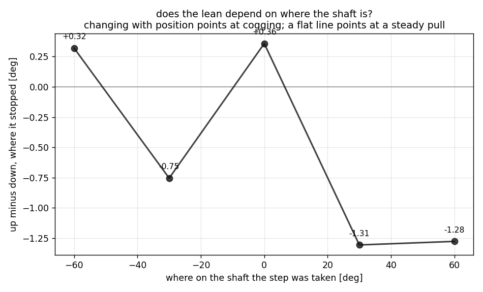
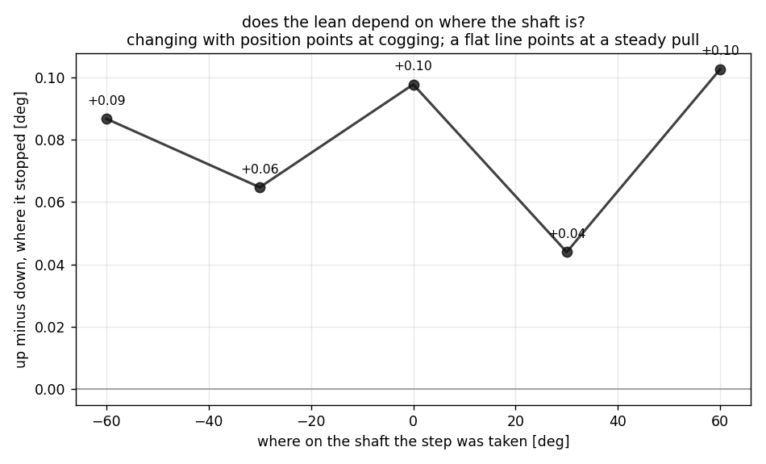

# +10도로 갈 때와 −10도로 갈 때가 같은가

<!-- SPEC-TABLES: 해당 없음 — 학습 런이 아니라 **벤치 모터 측정**입니다. §1b-2·§1b-3·§1b-4 는 학습 설정에서 나오는 표라 대응하는 런 디렉터리가 없어 채울 근거가 없습니다. -->

2026-09-10 · 사용자 지시: **"Step Input 실험 +10, -10 도로 여러번 해서 비교해 줘."**

## 한 줄 결론

**같지 않습니다.** 10도 계단에서 **0.4~0.5도**만큼 한쪽으로 쏠립니다. 그리고 **시뮬레이터는
이 쏠림을 만들 수 없습니다** — 관성·마찰·점성 셋 중 어느 것도 방향을 가리지 않기 때문입니다.
쏠림의 성격은 두 모터가 다릅니다: **무릎(RS04)은 축의 자리에 따라 바뀌고**(코깅으로 보임),
**엉덩이 회전(RS03)은 자리와 무관하게 일정**합니다(한쪽으로 당기는 힘).

---

## 1. 왜 이걸 보는가

마찰은 **방향만 거스르는 힘**입니다. 관성도 점성도 방향을 안 가립니다. 그러니 우리가 쓰는
모형이 맞다면 **+10 으로 가는 것과 −10 으로 가는 것이 거울처럼 같아야** 합니다.

다르다면, 그 차이가 곧 **모형에 없는 무엇**입니다.

## 2. 어떻게 쟀나 — 한쪽씩 치는 계단

지금까지 쓰던 계단은 **−10 과 +10 사이를** 오갔습니다. 그러면 매번 같은 크기의 뒤집기라
방향을 갈라 볼 수가 없습니다. 그래서 **0 에서 출발해 한쪽으로만** 갔다가 돌아오는 파형을
새로 만들었습니다.

```
0 → +10 → 0 → −10 → 0 → ...      각 구간 1.5초, 4주기 = 24초, 10회
```

이러면 네 가지가 분리됩니다.

| | |
|---|---|
| 0 → +10 | 플러스로 **나감** |
| +10 → 0 | 플러스에서 **돌아옴** |
| 0 → −10 | 마이너스로 **나감** |
| −10 → 0 | 마이너스에서 **돌아옴** |

견주는 방법: 마이너스 쪽 곡선의 **부호를 뒤집어** 플러스 쪽 위에 포갭니다. 남는 틈이 곧
쏠림입니다. 모터마다 방향별 **40개**의 모서리가 나옵니다. 세기 kp=20 · kd=1.0.

## 3. 결과





### 3a. 무릎 (RS04, 모터 4)

| 구간 | 지나침 실물/시뮬 [%] | 90%까지 실물/시뮬 [ms] | 멈춘 자리 실물/시뮬 [%] |
|---|---|---|---|
| 0 → +10 | 5.6 / 5.0 | 145.4 / 146.8 | 3.8 / 4.0 |
| 0 → −10 | 9.1 / 4.7 | 143.9 / 147.0 | **7.0** / 3.7 |
| +10 → 0 | 9.5 / 6.8 | 141.7 / 146.0 | 5.3 / 5.3 |
| −10 → 0 | 9.7 / 6.7 | 145.2 / 146.0 | 5.3 / 5.3 |

**나갈 때** 마이너스 쪽이 플러스 쪽보다 **0.53도 더 갑니다.** 시뮬레이터는 두 쪽 다 같습니다
(4.0 대 3.7%).

### 3b. 엉덩이 회전 (RS03, 모터 3)

| 구간 | 지나침 실물/시뮬 [%] | 90%까지 실물/시뮬 [ms] | 멈춘 자리 실물/시뮬 [%] |
|---|---|---|---|
| 0 → +10 | 10.9 / 11.2 | 121.0 / 125.2 | **7.1** / 5.0 |
| 0 → −10 | 13.5 / 11.0 | 118.0 / 125.2 | 2.1 / 5.0 |
| +10 → 0 | 16.2 / 12.7 | 119.2 / 125.5 | 3.9 / 4.7 |
| −10 → 0 | 14.0 / 12.7 | 122.7 / 125.7 | 11.1 / 4.7 |

여기서는 **반대**입니다 — **플러스 쪽이 0.49도 더 갑니다.**

★ **두 모터의 쏠림 방향이 서로 반대**라는 점이 중요합니다. 프로그램이나 통신 부호화 때문이라면
둘이 **같은 쪽**으로 나와야 합니다(같은 제어식, 같은 토크 부호화를 씁니다). 반대로 나왔다는
것은 원인이 **모터마다 다른 무엇**이라는 뜻입니다.

## 4. 그럼 무엇인가 — 자리를 바꿔 보면 갈립니다





자리별 실험(같은 계단을 −60·−30·0·+30·+60도에서) 자료를 **올라간 뒤**와 **내려간 뒤**로
갈라 다시 읽었습니다.

| 축의 자리 | −60 | −30 | 0 | +30 | +60 |
|---|---|---|---|---|---|
| **RS04** 올라간뒤 − 내려간뒤 [도] | +0.32 | −0.75 | +0.36 | **−1.31** | **−1.28** |
| **RS03** 같은 값 [도] | +0.09 | +0.06 | +0.10 | +0.04 | +0.10 |

* **RS04 는 자리에 따라 부호까지 바뀝니다** (+0.36 ↔ −1.31). 이것은 **코깅** — 자석과 철심이
  만드는 톱니 같은 힘 — 의 모양입니다. 자리마다 톱니의 어느 비탈에 앉느냐가 달라집니다.
* **RS03 은 자리와 상관없이 +0.08도 언저리로 일정**합니다. 이것은 코깅이 아니라 **한쪽으로
  꾸준히 당기는 힘**입니다. 전선 장력이나, 축이 살짝 기울어 생기는 중력 성분이 후보입니다.

★ **주의**: 자리별 자료는 −10 과 +10 을 오가는 **대칭** 계단이라, 0 에서 한쪽으로만 가는 §3 의
실험과 **같은 동작이 아닙니다.** 그래서 숫자를 곧바로 견주면 안 되고, **자리에 따라 변하는가**
만 읽어야 합니다.

## 5. 크기가 어느 정도인가

멈춘 자리가 0.5도 어긋난다는 것은, 그만큼의 **일정한 힘**이 걸려 있다는 뜻입니다.

    쏠림 힘 ≈ 세기 x 어긋난 각도 = 20 뉴턴미터/라디안 x 0.5도(=0.0087 라디안) ≈ **0.17 뉴턴미터**

견줄 대상은 각 모터의 마찰입니다.

| | 마찰 [뉴턴미터] | 쏠림 힘 | 마찰 대비 |
|---|---|---|---|
| RS04 | 0.519 | ≈ 0.17 | **33%** |
| RS03 | 0.251 | ≈ 0.17 | **68%** |

RS03 에서는 마찰의 3분의 2에 이릅니다. 작지 않습니다.

## 6. 앞선 결론 다듬기

2026-09-10 자리별 실험에서 **"자리에 따른 차이가 없다"**고 적었습니다. 그 말은 **지나친 양과
반응 시간**에 대해서는 그대로 맞습니다(1.3 퍼센트포인트, 1 밀리초 안). 다만 그때는 올라간
경우와 내려간 경우를 **평균해서** 봤기 때문에, 방향에 따른 쏠림이 서로 상쇄되어 안 보였습니다.
**멈추는 자리의 위/아래 쏠림은 RS04 에서 자리를 탑니다.** 위 §4 가 그 부분을 채웁니다.

## 7. 이 실험으로 할 수 없는 말

* **코깅이라고 단정할 수 없습니다.** 자리에 따라 변한다는 것까지가 측정이고, 코깅은 그 모양에
  가장 잘 맞는 설명입니다. 확인하려면 **한 바퀴를 촘촘히** 훑어 톱니의 주기가 극 수와 맞는지
  봐야 합니다. 지금은 다섯 자리, ±60도뿐입니다.
* **RS03 의 일정한 쏠림이 무엇인지도 미확정**입니다. 전선을 풀고 다시 재면 갈립니다.
* 세기 kp=20 조건입니다. 세기가 세면 같은 쏠림 힘이 만드는 각도 어긋남은 그만큼 작아집니다
  (0.17 ÷ 220 = 0.044도).
* 이 쏠림은 **모형에 아직 안 들어가 있습니다.** 넣으려면 관절마다 상수 하나(또는 자리의
  함수)가 필요하고, 그것을 넣는 것이 학습에 이로운지는 별도 판단입니다.

## 8. 되풀이하는 방법

```
# 벤치 — 모터마다 24초 파형 10회 (방향별 40 모서리)
python3 ~/System_ID/pd_profiles.py pmstep --motor-id 4 --model RS04 --kp 20 --kd 1.0 \
        --amp 10 --period-s 1.5 --cycles 4 --repeats 10 --bound-deg 30 --cool-to 38 --tag pm

# 분석 (이 컴퓨터) — 두 번째 그림은 자리별 자료(태그 p)가 있어야 나옵니다
python3 pd_updown.py --motor 4 --family RS04
python3 pd_updown.py --motor 3 --family RS03
```
