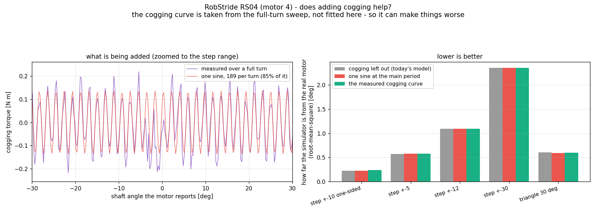
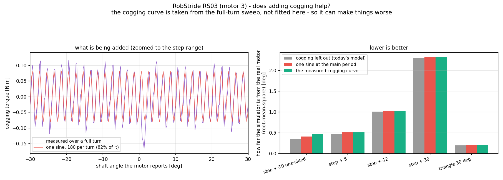

# 코깅을 모형에 넣으면 좋아지는가 — 넣어 보고 잰 결과

<!-- SPEC-TABLES: 해당 없음 — 학습 런이 아니라 **벤치 모터 측정과 모형 비교**입니다. §1b-2·§1b-3·§1b-4 는 학습 설정에서 나오는 표라 대응하는 런 디렉터리가 없어 채울 근거가 없습니다. -->

2026-09-11 · 사용자 질문: **"코깅을 모형에 넣으면 응답이 얼마나 좋아지는지 비교해줘. 애초에
mjlab 에 코깅 넣는게 가능한가? 이게 정지마찰이랑 뭐가다르지?"**

## 한 줄 결론

**넣을 수는 있지만, 넣어도 응답이 안 좋아집니다.** 궤적 잔차는 ±1% 안에서 그대로이고,
코깅이 설명해야 할 **방향 쏠림**도 못 만듭니다 — 위상을 한 톱니 통째로 훑어도 모형이 낼 수
있는 쏠림은 최대 0.23도(RS04)·0.36도(RS03)인데 실물은 0.53·0.48도입니다. 이유는 분명합니다:
**마찰이 코깅보다 3~4배 커서 코깅을 덮습니다.**

---

## 1. 정지마찰과 코깅은 무엇이 다른가

| | **마찰** (`frictionloss`) | **코깅** |
|---|---|---|
| 무엇에 달렸나 | **속도의 방향** | **회전자의 자리** |
| 에너지 | 항상 뺏는다 (소산) | 뺏지도 주지도 않는다 (한 바퀴 총합 0) |
| 멈춘 축을 움직일 수 있나 | **못 한다** — 움직임을 거스를 뿐 | **한다** — 전원을 끊고 손으로 돌려도 딱딱 걸리는 그 힘 |
| 응답에서 하는 일 | 목표 둘레에 **죽은구간**을 만든다. 그 안 **어디서든** 멈출 수 있다 | 특정 자리로 **끌어당긴다**. 멈추는 자리가 정해진다 |
| 되풀이되나 | 멈추는 자리는 그때그때 다르다 | **같은 자리에서 같은 힘** |
| 크기 (RS04 / RS03) | 0.519 / 0.251 뉴턴미터 | 0.136 / 0.081 (봉우리~골 0.47 / 0.29) |

한 문장으로: **마찰은 "얼마나 버티는가"를 정하고, 코깅은 "어디에 서고 싶어 하는가"를
정합니다.**

그래서 둘은 서로를 대신할 수 없습니다. 마찰만 있는 모형은 죽은구간 안 **아무 데나** 서고,
코깅이 있어야 **특정 자리**를 좋아합니다. 우리가 ±10도 실험에서 본 "방향에 따라 멈추는 자리가
다르다"는 마찰로는 절대 안 나옵니다 — 마찰은 방향을 가리지 않으니까요.

## 2. mjlab 에 넣는 것이 가능한가 — **가능합니다. 다만 관절이 아니라 액추에이터 쪽입니다**

* **MJCF(모형 파일)에는 코깅 항이 없습니다.** MuJoCo 가 관절에 주는 것은 `frictionloss`,
  `damping`, `armature`, 선형 스프링(`stiffness`/`springref`)뿐입니다. 자리의 주기 함수로
  들어가는 힘은 없습니다.
* **MuJoCo 의 사용자 콜백(`mjcb_passive`)도 못 씁니다.** 학습은 GPU 경로(`mujoco_warp`)로
  도는데, 그쪽에는 그 콜백이 없습니다.
* **그런데 우리 액추에이터는 파이썬에서 매 걸음 토크를 계산합니다.**
  `mjlab/asset_zoo/robots/pygmalion/tn_actuator.py` 의 `TnPdActuator.compute(cmd)` 가 받는
  `cmd.pos` 가 바로 관절 각도(환경 수 × 관절 수)입니다. 그러니 한 줄이면 됩니다.

```python
# TnPdActuator.compute 안, 토크-속도 상한을 걸기 전에
tau = tau - self.cog_amp * torch.sin(self.cog_n * cmd.pos + self.cog_phase)
```

관절마다 세 숫자(크기·한 바퀴 톱니 수·위상)면 되고, 텐서 연산이라 GPU 에서 공짜에 가깝습니다.
저희 측정에서 나온 값은 이렇습니다.

| | 크기 [뉴턴미터] | 한 바퀴 톱니 수 (관절 라디안 기준) | 위상 [라디안] | 이 사인 하나가 설명하는 몫 |
|---|---|---|---|---|
| RS04 (무릎) | 0.1361 | 189 | +0.660 | 85% |
| RS03 (엉덩이 회전) | 0.0807 | 180 | −0.350 | 82% |

★ 다만 **위상은 모터마다·조립마다 다릅니다.** 회전자가 어느 자리에서 0 으로 잡혔느냐에
달렸으므로, 로봇에 달 때마다 새로 재야 하는 값입니다. 학습에 쓰려면 위상을 **무작위로
흔드는 것**(domain randomisation)이 맞지, 벤치에서 잰 위상을 박아 넣는 것은 뜻이 없습니다.

## 3. 그래서 넣으면 좋아지는가 — **안 좋아집니다**





**시험 방법**: 코깅 곡선을 **여기서 맞추지 않았습니다.** 어제 한 바퀴 훑기에서 나온 곡선을
그대로 가져다 얹었습니다. 부호도 고른 것이 아니라 힘의 합에서 나옵니다(느린 정속에서
`제어기 토크 = 마찰×방향 − 코깅`, 그러므로 코깅 = −(양방향 평균)). 즉 **틀릴 수 있는
예측**입니다.

### 3a. 궤적 잔차 — 변화 없음

시뮬레이터와 실물의 차이(평균제곱근, 도). 낮을수록 좋습니다.

| 명령 | 코깅 없음 | 사인 하나 | 측정 곡선 |
|---|---|---|---|
| 한쪽씩 ±10도 | 0.2261 | 0.2258 (−0%) | 0.2421 (+7%) |
| 계단 ±5도 | 0.5728 | 0.5801 (+1%) | 0.5810 (+1%) |
| 계단 ±12도 | 1.0943 | 1.0929 (−0%) | 1.0906 (−0%) |
| 계단 ±30도 | 2.3483 | 2.3517 (+0%) | 2.3520 (+0%) |
| 삼각파 30도 | 0.6016 | 0.5930 (−1%) | 0.5981 (−1%) |

**아무것도 안 바뀝니다.** 그럴 만합니다 — 계단을 오르내리는 동안 축은 톱니를 5~30개씩
지나가므로 코깅이 **평균되어 사라집니다.**

### 3b. 멈추는 자리 — 코깅이 실제로 바꾸는 곳. 그런데도 부족합니다

코깅이 바꾸는 것은 궤적이 아니라 **멈추는 자리**입니다. 그러니 그것만 따로 봐야 공평합니다.
±10도 실험에서 본 **방향 쏠림**(플러스로 갈 때와 마이너스로 갈 때 멈추는 자리의 차이)을
모형이 만들어 내는지 보았습니다.

| | 실물 | 코깅 없음 | 사인 하나 | 측정 곡선 |
|---|---|---|---|---|
| RS04 쏠림 [도] | **−0.530** | +0.022 | +0.008 | +0.026 |
| RS03 쏠림 [도] | **+0.484** | −0.003 | −0.010 | +0.088 |

RS03 에서 측정 곡선이 +0.088 로 **방향은 맞게** 움직였지만, 필요한 양의 18% 뿐입니다.

### 3c. 위상 탓인가 — 아닙니다. 한 톱니를 통째로 훑어 봤습니다

"위상 기준이 어긋나서 그런 것 아닌가"가 남은 의심이었습니다. 그래서 코깅의 위상을 **한 톱니
전체**에 걸쳐 12단계로 옮겨 가며 다시 돌렸습니다.

| | 실물 쏠림 | 모형이 낼 수 있는 범위 (위상 전체) | 닿는가 |
|---|---|---|---|
| RS04 | −0.530도 | −0.180 ~ +0.226 | **못 닿음** |
| RS03 | +0.484도 | −0.359 ~ +0.364 | **못 닿음** |

**어떤 위상을 골라도 실물만큼의 쏠림이 안 나옵니다.**

## 4. 왜 안 되는가 — 마찰이 코깅을 덮습니다

축은 **알짜 힘이 마찰 안으로 들어오는 순간** 멈춥니다. 코깅이 멈추는 자리를 옮길 수 있는
최대치는 **코깅 크기 ÷ 세기** 입니다.

| | 코깅 크기 | 세기 kp | 옮길 수 있는 최대 | 마찰 | 마찰 대비 |
|---|---|---|---|---|---|
| RS04 | 0.136 N·m | 20 N·m/rad = 0.349 N·m/도 | **0.39도** | 0.519 | 코깅의 **3.8배** |
| RS03 | 0.081 | 0.349 | **0.23도** | 0.251 | **3.1배** |

즉 코깅이 이론상 낼 수 있는 최대(0.39·0.23도)조차 실물 쏠림(0.53·0.48도)에 못 미칩니다.
계산과 시늉이 같은 말을 합니다.

**그러므로 방향 쏠림의 원인은 코깅만이 아닙니다.** 코깅은 실재하고 크기도 쟀지만(0.47·0.29
뉴턴미터 봉우리~골), 이 쏠림을 만들기에는 모자랍니다. 남은 후보는 **정지마찰이 미끄럼마찰보다
큰 것**(모형에 없음)과 **한쪽으로 당기는 일정한 힘**(전선 장력 등, 훑기에서 0.025·0.012
뉴턴미터로 관측됨 — 이것도 혼자서는 부족)입니다. 아직 미해결로 남깁니다.

## 5. 그래서 어떻게 할 것인가 (권고)

* **지금 모형에 코깅을 넣지 않는 쪽을 권합니다.** 넣을 수는 있고 비용도 거의 없지만,
  **재는 모든 지표에서 이득이 0** 입니다. 게다가 위상은 조립마다 달라 벤치 값을 박아 넣는
  것은 뜻이 없습니다.
* 넣는다면 **위상을 무작위로 흔드는 형태**여야 합니다 — "이 관절에는 크기 0.14 뉴턴미터짜리
  자리 의존 힘이 있고 위상은 모른다"가 사실에 맞는 표현입니다. 그건 정확도를 올리는 것이
  아니라 **정책을 그 힘에 둔감하게 만드는** 조치입니다.
* **먼저 할 일은 따로 있습니다**: 방향 쏠림의 진짜 원인(정지마찰 크기)을 재는 것, 그리고
  회전자 무게감이 4.7배 커진 만큼 **제어 세기를 다시 잡는 것**입니다. 후자가 응답에 훨씬
  크게 작용합니다.

## 6. 이 결론으로 할 수 없는 말

* **"코깅은 중요하지 않다"고는 말할 수 없습니다.** 세기 kp=20 에서 이 명령들에 대해 이득이
  없다는 것이고, 세기가 아주 낮거나(코깅이 상대적으로 커짐) 아주 느린 움직임에서는 다를 수
  있습니다.
* 정지마찰을 아직 안 쟀습니다. 그것을 넣으면 그림이 달라질 수 있습니다.
* 여기 시뮬레이터는 관절 하나짜리입니다. 다리 전체에서 코깅 12개가 겹칠 때의 효과는 따로
  볼 일입니다.

## 7. 되풀이하는 방법

```
python3 pd_cogging_effect.py --motor 4 --family RS04
python3 pd_cogging_effect.py --motor 3 --family RS03
```
