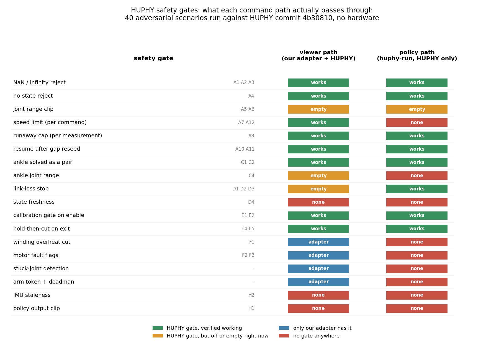

<!-- SPEC-TABLES: 해당 없음 — 로봇 프로그램의 **안전 장치를 읽고 시험한 기록**입니다 — 시뮬레이터 학습이 아닙니다. §1b-2(액추에이터 한계)·§1b-3(ROM/행동창)·§1b-4(PYG_* 플래그)는 학습 설정에서 나오는 표라 대응하는 런 디렉터리가 없어 채울 근거가 없습니다. 억지로 넣으면 근거 없는 표가 남습니다. 대신 이 노트에 검사 조건(가지와 커밋·가짜 모터 계층·시나리오 40가지)을 적었습니다. -->

# 로봇 프로그램의 안전 장치 전수 검사 — 40가지 상황을 일부러 만들어 봄

**날짜** 2026-09-11 · **대상** 로봇 컴퓨터의 HUPHY, 가지 `bench-rate-limit`, 커밋 `4b30810`
(작업 사본 깨끗함) · **하드웨어 없이 실행** · **로봇 프로그램은 한 글자도 고치지 않음**

---

## 0. 한 줄로

**막는다고 되어 있는 것은 25가지 중 거의 다 실제로 막습니다. 문제는 "막는 장치가
아예 없는 자리" 8군데이고, 그중 넷은 우리 쪽 중계 프로그램이 이미 덮고 있으며,
나머지 넷은 아직 아무도 덮지 않습니다.** 가장 위험한 것은 **정책을 실물에서 돌리는
길(`huphy-run`)** 입니다. 그 길은 우리 중계 프로그램을 지나지 않아서, 우리가 만들어
둔 과열 차단·고장 감시·손떼기 장치가 **하나도 걸리지 않습니다.**



위 그림이 이 문서의 요약입니다. 왼쪽은 "명령이 지나가야 할 관문" 목록이고, 가운데
칸은 뷰어로 관절을 움직이는 길, 오른쪽 칸은 학습한 정책을 돌리는 길입니다.

* 초록 `works` — 로봇 프로그램에 있고, **일부러 건드려 봤더니 실제로 막았습니다.**
* 주황 `empty` — 장치는 있는데 **지금 설정에서는 꺼져 있거나 채울 값이 비어 있습니다.**
* 파랑 `adapter` — 로봇 프로그램에는 없고 **우리 중계 프로그램에만 있습니다.**
* 빨강 `none` — **어디에도 없습니다.**

---

## 1. 어떻게 검사했나

문서를 읽고 판단하지 않았습니다. 로봇 프로그램을 그대로 돌리되, 진짜 모터 대신
가짜 모터가 답하게 해 두고 **일부러 나쁜 상황을 만들어 결과를 쟀습니다.**

가짜 모터는 진짜 모터가 하는 일을 그대로 흉내냅니다 — 명령을 받으면 각도·속도·힘·
온도·고장표시를 돌려줍니다. 대신 우리가 스위치를 켜서 이런 상황을 만들 수 있습니다.

| 만든 상황 | 실물에서 하면 |
|---|---|
| 답을 아예 안 함 | 통신선을 뽑아야 함 |
| 명령대로 안 움직임 | 관절을 손으로 붙잡아야 함 |
| 권선 온도 95도라고 답함 | 모터를 태워야 함 |
| 고장 표시를 켠 채 답함 | 고장을 일부러 내야 함 |

그래서 **실물로는 만들면 안 되는 상황까지 전부 확인했습니다.**

검사 하나하나는 셋으로 이루어집니다 — *넣은 것 · 기대한 것 · 나온 것*. 판정은
세 가지입니다.

* **지킴** — 기대한 대로 막았습니다 (25건)
* **주의** — 막기는 하는데 조건부이거나, 사람이 알고 써야 합니다 (7건)
* **구멍** — 막는다고 되어 있는데 안 막거나, 애초에 막는 장치가 없습니다 (8건)

재현:

```bash
rsync -a --exclude .git syaro@10.8.0.14:/home/syaro/Human-Pygmalion/HUPHY/ /tmp/huphy/
PYTHONPATH=/tmp/huphy/src mujoco-sim/mjlab/.venv/bin/python3 tools/huphy_audit/safety_probe.py
```

* 검사 프로그램 — `tools/huphy_audit/safety_probe.py` (40가지 상황)
* 가짜 모터 — `tools/huphy_audit/fake_can.py`
* 그림 — `tools/huphy_audit/plot_gate_coverage.py`
* 이번에 나온 결과 원본 — `docs/assets/huphy_safety_probe_2026-09-11.txt`

---

## 2. 안전 장치는 모두 어디에 있나 (전수 목록)

로봇 프로그램에서 "명령을 걸러내는 자리" 를 전부 찾으면 여섯 군데입니다.

| 어디 | 파일 | 무엇을 하나 |
|---|---|---|
| 값 검사 | `src/huphy/safety/guards.py` | 숫자가 아닌 값 거부, 가동범위·속도·폭주 자르기 |
| 범위 계산 | `src/huphy/safety/limits.py` | 하드스톱에서 얼마나 남았나 |
| 응답 감시 | `src/huphy/safety/link.py` | 몇 주기째 답이 없나 |
| 힘 넣고 빼는 순서 | `src/huphy/control/loop.py` | 관찰 모드 진입 시 차단, 끝낼 때 붙잡고 끊기 |
| 관절↔모터 경계 | `src/huphy/robots/leg.py` | 발목 짝 맞추기, 재개 처리, 이름 검사 |
| 설정 검사 | `src/huphy/config/schema.py` | 번호 중복·뒤집힌 범위·말 안 되는 값 거부 |

여기에 **바이트로 바꾸는 자리**(`codec/mit.py`)의 범위 자르기가 최후 방어선으로
붙습니다. 그리고 로봇 프로그램 **바깥**, 즉 우리 중계 프로그램
(`tools/pygviewer/pygviewer/bridge/`)에 과열 차단·고장 조회·멈춘관절 감지·
무장토큰·손떼기가 따로 있습니다.

---

## 3. 실제로 막는 것 25가지 (요약)

숫자가 아닌 값은 확실히 막힙니다. NaN 목표, 무한대 목표, NaN 측정값 셋 다 전송
자체가 안 됩니다(A1·A2·A3). 이것이 중요한 이유는 **바이트로 바꾸는 마지막 단계가
NaN을 못 막기 때문**입니다 — 크다·작다 비교가 NaN에 대해 전부 거짓이라 그냥
통과하고, 그러면 최대값인 720도 명령이 됩니다(B1에서 실제로 확인). 즉 A1의 검사가
**유일한** 방어선이고, 순서를 바꾸면 안 됩니다.

가동범위 자르기는 값이 채워져 있을 때 정확히 동작합니다. 무릎을 60도에 둔 채 200도를
명령하니 하드스톱(74.79도)에서 3도 안쪽인 **71.79도로 잘렸습니다**(A5).

속도 제한과 폭주 상한은 서로 다른 자리를 기준으로 삼는데, 둘 다 의도대로 돕니다.
0도에 있다가 300도를 명령하면 한 주기에 **9.02도만** 나아갑니다(A7 — 초당 902도 ×
10밀리초). 관문 순서도 설계대로입니다: 500도 목표가 한계로 77도까지 잘린 뒤 속도
제한으로 9.02도가 되었고, 기록에는 `limit`과 `rate`가 순서대로 남았습니다(A9).

**2026-09-07 벤치에서 40도·44도가 한 번에 나갔던 사고**의 자리도 고쳐진 것을
확인했습니다. 0.7초 끊겼다 재개하면 그동안 벌어진 간격이 한꺼번에 나가지 않고 한
주기분(9.02도)만 나갑니다(A10). 다리를 세운 직후 첫 명령도 똑같이 제한됩니다(A11).

통신이 끊기면 실제로 멈춥니다. 세 번째 주기에 모든 응답을 끊었더니 **8주기 만에
스스로 종료**했고, 종료 사유에 어느 모터가 몇 주기째 무응답인지가 남았습니다(D2).

끝내는 순서도 지켜집니다. 제어 도중 일부러 오류를 냈더니 **자세를 붙잡는 명령을
보낸 뒤에** 정지 명령이 나갔습니다(E4). 서 있는 다리에서 힘이 갑자기 빠지면
주저앉기 때문에 이 순서가 중요합니다. 통신선을 닫을 때도 정지 명령이 먼저입니다(E5).

발목은 두 모터가 두 축을 같이 만들어서 따로 다루는데, 닿을 수 없는 자세를 주면
**둘 다 안 나갑니다**(C1). 한쪽만 나가면 두 로드가 서로 다른 자세를 요구해 관절이
비틀립니다. 한쪽 축만 명령하거나 없는 관절 이름을 섞으면 거부합니다(C2·C3).

실측 전에 힘을 넣으려 하면 막힙니다(E1). 설정 파일의 번호 중복, 뒤집힌 가동범위,
0 이하의 폭주 상한도 전부 거부됩니다(G1·G2·G3).

---

## 4. 막지 못하는 것 8가지

### 4-1. 권선이 아무리 뜨거워져도 로봇 프로그램은 힘을 끊지 않는다 (F1)

모든 모터가 **95도**라고 답하는 상태로 20주기를 돌렸습니다. 온도는 정확히 읽혀
기록에도 나오는데, 루프는 끝까지 돌았고 멈춤 사유도 없었습니다.

온도 값으로 무언가를 하는 코드가 로봇 프로그램 어디에도 없습니다. 남는 것은 모터
자체의 보호(RS04 기준 145도)뿐입니다. 우리가 정한 50도 차단은 **우리 중계
프로그램에만** 있습니다(`motor_fault.py`의 `ThermalCutoff`, 50도 차단 / 45도 재개,
읽은 값이 -20~150도 밖이면 판정을 보류). 따라서 뷰어로 움직일 때는 지켜지지만,
**정책을 돌릴 때는 지켜지지 않습니다.**

### 4-2. 모터가 "고장" 이라고 답해도 루프가 모른다 (F2·F3)

무릎이 매 응답마다 고장·경고 표시를 켠 채로 답하게 했는데, 20주기가 정상 종료됐고
관찰 항목에 그 칸 자체가 없습니다.

고장·경고·동작모드 세 가지는 **모든 응답에 공짜로 실려 옵니다.** 그것을 푸는
함수(`codec/mit.py`의 `decode_flags`)까지 만들어져 있고 시험도 있는데, **실제로
응답을 받는 자리(`bus.collect`)가 그 함수를 부르지 않습니다.** 고장을 알려면 따로
물어봐야 하고(`read_fault`), 그건 사람이 커미셔닝 화면에서만 합니다.

같은 이유로 "힘이 정말 켜졌나" 도 확인하지 못합니다(F3). `is_torque_on`은 *내가
켜기 명령을 보냈다* 만 뜻하고, 모터가 실제로 켜졌는지는 응답의 동작모드에 들어
있는데 안 봅니다. **벤치에서 "명령은 나가는데 안 움직인다" 를 진단할 때 정확히 이
값이 필요했습니다.**

### 4-3. 발목만은 가동범위 보호가 전혀 없는 채로 실물에 올라간다 (C4)

발목 가동범위를 ±5도로 좁혀 놓고 pitch 20도를 명령했습니다.

* **각도로 보낼 때** — 한계에 걸려 잘림 (3회)
* **힘으로 보낼 때** — 잘리지 않고 **-3.72 N·m 가 그대로** 나감

힘 명령에는 자를 각도가 없어 가드가 통째로 건너뜁니다. 코드 주석에도 그렇게 적혀
있습니다(`robots/leg.py`의 `_ankle_torque`). 그런데 **정책 실행(`huphy-run`)은
발목을 반드시 이 방식으로 몹니다** — 모터 두 개가 로드로 두 축을 만들어서 모터
각도에 게인을 걸면 자세마다 강성이 달라지기 때문입니다. 즉 정책을 돌리는 순간
발목은 보호 없이 돕니다.

### 4-4. 가동범위 검사가 "켜짐" 이라고 적혀 있어도 지켜 주는 것이 없다 (A6)

A5와 똑같은 상황에서 실측값만 지금 저장소 상태(전부 "안 잼")로 두었습니다. 설정
파일에는 `enforce_limits: true`가 적혀 있습니다.

* A5(실측값 있음) — 71.79도로 잘림
* A6(실측값 없음) — **한계 클리핑 0회**, 폭주 상한만 걸려 **109.99도** (한계보다
  38도 밖)

한계값이 비어 있으면 자르는 함수가 첫 줄에서 그냥 통과시킵니다. 양쪽 다리의
실측 파일(`config/calibration/*_v1.0.json`)은 **지금 전부 비어 있습니다.**

다행히 힘을 넣는 문이 따로 막습니다(E1 — 실측 전에는 거부). 다만 그 문은
`--allow-uncalibrated` 한 줄로 열리고(E2), 열면 **가동범위 보호가 전혀 없는 채로**
돕니다. 커미셔닝에는 그 길이 필요하므로 없앨 수는 없고, 대신 "지금 무엇이 꺼져
있는지"가 화면에 보여야 합니다.

### 4-5. 실물 설정에는 속도 제한이 아직 없다 (A12)

벤치 설정에는 관절별 속도 제한이 있습니다(무릎 초당 902도, 엉덩이 회전 초당 972도 —
데이터시트 정격에서 공차 10%를 뺀 값). **실물 설정(`robot_v1.0.yaml`)에는 그 줄이
없습니다.** 무릎의 속도 제한을 물으면 "없음"이 나옵니다.

남는 것은 폭주 상한 50도 하나인데, 그것은 **속도가 아니라 힘을 자르는 장치**입니다.
기준점이 측정 위치라서 명령과 현재각의 차이가 그 값으로 묶이고, 모터 계산식이
`토크 = kp × (명령각 − 현재각) + …` 이므로 힘이 함께 묶입니다. 2026-09-07 벤치에서
이 성질 때문에 초당 300도를 의도한 설정이 실측 초당 49도로 나왔습니다.

### 4-6. 힘을 낮추다 보면 0이 되는 지점이 있다 (B2)

RS03·RS04는 힘의 세기(kp)를 0~5000 범위의 12비트로 싣습니다. 한 칸이 **1.221**이고
버림이라, **1.221 미만은 전부 0** — 즉 힘이 아예 안 나갑니다.

| 적은 값 | 실제로 나가는 값 |
|---|---|
| 10 | 9.768 |
| 5 | 4.884 |
| 2 | 1.221 |
| 1.5 | 1.221 |
| **1.0** | **0** |
| 0.5 | 0 |

설정 파일의 기본값은 kp 10이고, **같은 파일이 "처음 만질 때는 `--gain-scale 0.1`로
더 낮춰 시작할 것" 이라고 권합니다.** 그대로 하면 kp 10 → 1.0 → **0**입니다. 오류도
경고도 없이 "명령은 나가는데 안 움직임" 이 됩니다. 감쇠(kd)에도 같은 구조가
있는데(한 칸 0.0244) 지금 쓰는 값들은 아직 여유가 있습니다(B3).

### 4-7. 몇 초 전 측정값을 "지금 위치" 로 믿는다 (D4)

무릎 측정값이 **5초 전 것**인 상태에서 60도를 명령했더니, 그 5초 전 값을 기준으로
폭주 상한을 계산해 목표 50도를 만들었습니다.

"제어에 쓸 만큼 최신인가" 를 판정하는 함수(`MotorState.is_fresh`)가 만들어져 있고
그 설명에 바로 이 위험이 적혀 있는데, **아무도 부르지 않습니다.** 지금 쓰는 것은
"한 번이라도 답한 적 있나" 뿐이라, 한 번 답한 뒤 죽은 모터는 영원히 "유효"합니다.

응답 끊김 감시가 5주기(50밀리초)에 잡아 주므로 실제로는 겹겹이 막히지만,
**그 감시를 끈 벤치 설정에서는 이것이 마지막 방어선입니다**(아래 4-8과 D3).

### 4-8. 자세 센서가 멎어도 정책이 계속 돈다 (H2)

정책은 매 주기 자세 센서를 읽어 각속도와 중력 방향을 입력에 넣습니다. 센서가 멎으면
**얼어붙은 값**이 계속 들어가고, 정책은 로봇이 가만히 서 있다고 믿습니다. 값이
얼마나 묵었는지는 잴 수 있고 기록에도 나가지만, 판정에 쓰는 곳이 없습니다.

---

## 5. 알고 써야 하는 것 7가지 (주의)

* **B1** 바이트로 바꾸는 단계는 NaN을 못 막습니다. A1의 검사가 유일한 방어선이므로
  순서를 바꾸면 안 됩니다.
* **B3** 감쇠(kd)도 한 칸이 0.0244라 그 밑은 0이 됩니다. 정책이 쓰는 0.502는
  20칸이라 안전합니다.
* **D3** 벤치 설정은 통신 끊김 판정을 **꺼 두었습니다**(`link_loss_cycles: 0`).
  여섯 관절을 선언하고 두 대만 물려 있어 없는 네 대가 매 주기 무응답이기
  때문입니다. **실물로 갈 때 반드시 되살려야 하고**, 되살리는 순간 배선이 하나라도
  빠져 있으면 즉시 멈춥니다.
* **E2** `--allow-uncalibrated`는 가동범위 보호를 끄는 스위치입니다(4-4 참조).
* **F3** "힘이 켜졌다"는 보낸 명령 기준이지 물어본 값이 아닙니다.
* **G5** 정책 실행은 화면 앞이 아니면 **Enter 확인 없이 곧바로 시작합니다.**
  우리는 원격으로 걸 계획이므로 이 경로가 실제로 쓰입니다.
* **H1** 정책 출력에는 자르는 곳이 없습니다. 모델이 모든 관절에 50을 내면 관절
  목표가 716도가 되고, 막는 것은 다음 단계의 가드뿐입니다. 시뮬레이터는 행동을
  ±100으로 자르고 들어갑니다.

---

## 6. 그래서 실물 전에 무엇을 해야 하나

순서대로 적습니다. 위쪽이 더 급합니다.

1. **커미셔닝(sweep + zero)을 먼저 끝낸다.** 가동범위를 채우기 전에는 4-4의
   상태이고, `--allow-uncalibrated`로 그 문을 열면 가동범위 보호가 없습니다.
2. **실물 설정에 관절별 속도 제한을 적는다**(4-5). 벤치 설정에 이미 있는 줄을 그대로
   옮기면 됩니다.
3. **통신 끊김 판정을 5로 되살린다**(D3). 되살린 직후 배선이 전부 살아 있는지
   확인할 것 — 하나라도 빠져 있으면 즉시 멈춥니다.
4. **힘의 세기를 낮출 때 2.0 밑으로 내리지 않는다**(4-6). 더 낮추고 싶으면
   `--gain-scale` 대신 kp를 직접 적고, 실제로 나가는 값이 0이 아닌지 확인할 것.
5. **정책은 우리 중계 프로그램을 지나게 하거나, 지나지 않는다면 과열 차단·고장
   감시·손떼기가 없다는 것을 알고 사람이 옆에서 지킨다**(4-1·4-2·G5).
6. **발목은 정책을 돌리는 동안 가동범위 보호가 없다**(4-3). 첫 실행에서는 발목
   움직임을 작게 잡고 시작할 것.

이 여섯 중 2·3·4·6은 **설정과 운용으로 오늘 해결할 수 있고**, 1은 절차이고,
5는 구조 문제입니다. 로봇 프로그램 자체를 고쳐야 하는 것은 4-1·4-2·4-7이며,
그건 남의 저장소이므로 **새 가지에서만** 하고 `docs/128`에 적어야 합니다.

---

## 7. 이 검사로 말할 수 없는 것

* **하드웨어 없이 했습니다.** 가짜 모터는 진짜 모터의 응답 형식을 흉내낼 뿐,
  실제 펌웨어가 이상한 프레임에 어떻게 반응하는지는 모릅니다.
* **가동범위 숫자는 예시입니다.** 실측 파일이 비어 있어서 0.5 판의 값을 썼습니다.
  A5·A6에서 비교한 것은 "값이 있을 때와 없을 때의 동작 차이" 이지 그 숫자 자체가
  아닙니다.
* **두 다리를 묶은 경우는 안 봤습니다.** 이번 검사는 다리 하나짜리입니다.
* **우리 중계 프로그램의 안전 장치는 이번에 다시 검사하지 않았습니다.** "있다"는
  것만 확인했고, 그쪽 검증은 별도 항목입니다.
