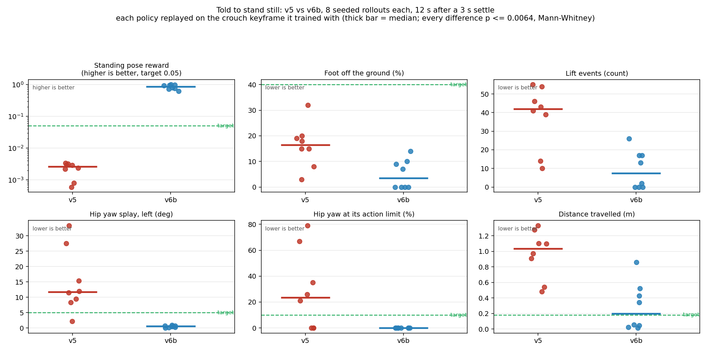
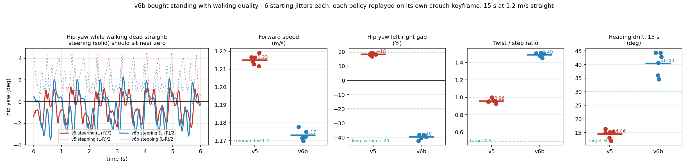

# legonly_ab_v6b_standing_flatfoot — 발바닥을 바로잡고, 정지 구간을 3배로 학습시킨다 (2026-09-14)

> 약어를 쓰지 않는다. 처음 보는 사람도 읽을 수 있게 쓴다.
> 계보: [[2026-09-13_legonly_ab_v5_heading]] 의 **유일 변인 후속**. 근거는 그 노트 §13·§13-1.

## §0 왜 이 학습을 하는가

사용자가 화면을 보고 지적했다: *"가만히 서 있는 자세가 이상해."* 실제로 이상하다.

![[v5_standing_pose_vs_target.png]]

왼쪽이 정지 자세 추종 항이 노리는 목표(다리 평행, 발 정면), 오른쪽이 실제다 — 발끝이 벌어지고
발목이 비틀리고 다리가 꼬여 있다.

### 원인: 정지 자세 추종 항이 죽어 있다

`pose` 항(가중치 +1.0)은 `exp(−평균(오차²/허용²))`로 채점하고, 목표는 `default_joint_pos`
(= 리셋 웅크림 = 액션 0 자세)다. **별도의 정지용 목표 자세는 없다.** 허용 오차는 명령 크기에
따라 세 규모로 갈리는데:

| 규모 | 엉덩이앞뒤 | 엉덩이좌우 | 엉덩이회전 | 무릎 | 발목숙임 | 발목기울임 |
|---|--:|--:|--:|--:|--:|--:|
| **정지** | **2.86°** | **2.86°** | **2.86°** | **2.86°** | **2.86°** | **2.86°** |
| 걷기 | 17.2° | 22.9° | 8.6° | 68.8° | 14.3° | 5.7° |
| 빨리 | 28.6° | 11.5° | 11.5° | 85.9° | 20.1° | 8.6° |

걷기·빨리는 관절별로 맞춰져 있는데 **정지만 `.*: 0.05` 한 줄**이다. 명령 0에서 실제 자세는 허용의
**2~5.6배** 벗어나 있어 항이 `exp(−8.7) = 1.7e−04`, 즉 **가중치 1.0짜리가 0을 낸다**(양수 항 합
+6.33/s의 16 %). 그 근처에서 **기울기도 1.7e−04**라 조금 나아져도 돌아오는 게 없어 정책이 통째로
무시한다. 게다가 명령 0 구간은 학습의 **10 %**(`rel_standing_envs`)뿐이라 버려도 손해가 작다.

### 목표 자세 자체는 멀쩡하다 (2026-09-14 확인)

허용 오차가 잘못된 것이지 목표가 무리한 게 아니다. 정적 안정성을 재니:

| 자세 | 지지면 크기 | 무게중심 여유 | 판정 |
|---|---|--:|---|
| 목표(리셋 웅크림) | 앞뒤 256 × 좌우 347 mm | **+100.3 mm** | 지지면 안 |
| 정책이 실제로 쓰는 자세 | 앞뒤 425 × 좌우 243 mm | +99.4 mm | 지지면 안 |

**여유가 같다.** 정책이 어쩔 수 없이 다리를 벌린 게 아니라, 앞뒤로 어긋선 자세를 고른 것뿐이다.


## §0a ★ 이 런이 v6 을 대체한다 — 발목 키프레임을 고쳤다 (2026-09-14 22:5x)

첫 v6 은 19:37 에 발사해 반복 2,434회까지 갔으나 **중단**했다
(`ABORTED_2026-09-14_19-37-39_legonly_ab_v6_standing_p1`). 이유는 사용자가 렌더를 보고
*"target pose 부터가 이상한데? 발이 들려있는거 아닌가?"* 라고 지적한 것이 **맞았기 때문**이다.

리셋/목표 웅크림 자세의 **발목 값이 깊은 웅크림 것**이었다. 기하로는 엉덩이 `h`·무릎 `k` 굽힘에
대해 발바닥이 수평이려면 발목이 `k − h` 여야 하는데, 얕은 웅크림(`PYG_INIT_MID=1`, 이 런들이
쓰는 것)은 0.175 rad 이 맞고 키프레임에는 깊은 웅크림 값 0.36 이 상수로 박혀 있었다.

| | 전 | 후 |
|---|--:|--:|
| 발목 숙임 목표 | +20.63° | **+10.03°** |
| 발바닥 앞뒤 기울기 | +10.600° | **+0.000°** |
| 앞뒤 단차 | 47.8 mm | **0.1 mm** |
| 접지 귀퉁이 | 4 / 24 | **24 / 24** |
| 접지 지지면 앞뒤 폭 | **0 mm**(선 위) | **260 mm** |
| 폐루프 벌어짐 | 0.00000 mm | 0.00000 mm |

자세한 것은 [[2026-09-14_v4_standing_q_torque_gains]] §2c·§2e.

**그래서 이 런은 v5 대비 변인이 둘이다**: `PYG_REL_STANDING` 0.1 → 0.3 **과** 발바닥 수정.
단일 변인이 아니라는 점을 명시한다 — 발바닥은 모든 후속 런의 공통 기반이 되므로 되돌리지 않는다.
`PYG_REL_STANDING` 의 순수 효과를 보려면 발바닥을 고친 상태에서 0.1 인 런이 따로 필요하다.

## §1 설계 — v5와 다른 점

**변인 1: `PYG_REL_STANDING` 0.1 → 0.3** (설정 숫자 하나)
**변인 2(불가피): 발바닥 수평 수정**(§0a) — 모든 후속 런의 공통 기반

명령 0 구간을 **3배** 학습시킨다. 노림수는 자세 추종 항을 직접 되살리는 게 아니라, 그 구간에서
**기울기가 살아 있는 항들에 표본을 더 주는 것**이다 — 전후·좌우 속도 추종과 회전 속도 추종은
로봇이 흘러가고 제자리걸음을 하는 동안 0.95 근처라 건강한 기울기를 갖고 있다. 그 항들이
흘러감·제자리걸음을 줄이면 자세가 목표 쪽으로 돌아오고, 그때 자세 추종 항의 기울기도 되살아난다.

### `walking_threshold`는 건드리지 않는다 — 역효과를 실측했다

또 다른 후보는 `walking_threshold`를 코드 기본값 0.5로 되돌려 느린 구간도 정지 규모로 묶는 것이었다.
**재 보니 역효과다.** 명령 합 0.05~0.5 구간(전체의 5.0 %)에 정지 규모를 적용하면:

| 그 구간의 자세 추종 보상 | |
|---|--:|
| 지금(걷기 규모) | **0.7045** |
| 정지 규모로 바꾸면 | **0.0034** |

잘 작동하던 항까지 죽여 **죽은 구간을 넓히는** 셈이다. 채택하지 않는다.

### 보상 파라미터는 건드리지 않는다

정지 규모를 관절별로 다시 주는 것(엉덩이회전은 좁게, 무릎·크랭크는 넓게)이 더 직접적이지만,
**보상 파라미터 변경이라 규칙상 연구노트가 먼저**다. 이번에는 과제 분포만 바꾸는 쪽을 먼저 시험하고,
그것으로 부족하면 그때 정식 연구노트를 쓴다.

**v5와 같게 유지하는 것**: `PYG_REL_HEADING=0.8`을 포함해 로봇 모델·모터 값·세기·보상 항과 가중치
전부·커리큘럼·도메인 무작위화·시드 42·환경 수 16384·반복 수 일정.

## §1a 실행 명령

```
cd mujoco-sim/mjlab
bash analysis/run_v2_scratch.sh --run legonly_ab_v6b_standing_flatfoot --ankle AB --seed 42 --num-envs 16384 \
  --p1-max-iters 16000 --ramp-iters 10000 --digest-iters 4000 --settle-hold 10 --n-stages 5 \
  --gate-min-dwell 800 --gate-max-dwell 3000 --gate-window 100 --gate-err-ratio 1.1 --gate-fell-max 0.005 --gate-min-episodes 64 \
  --entropy-start 0.01 --entropy-end 0.002 --video-interval 8000 --video-length 500 --logger wandb --vy-stages \
  --env PYG_MODEL_TAG=LegOnly_prototype-tempmass-motormeasured-armfix_v30_proxyfix \
  --env PYG_MASS_DR_JSON=/home/syaro/MikuchanRemote/Human-Pygmalion/tools/robot_model/fusion_snapshots/v30_inspection/mass_dr_legonly_fastener50_prototype-tempmass.json \
  --env PYG_REL_HEADING=0.8 \
  --env PYG_REL_STANDING=0.3
```

v5의 명령과 **마지막 한 줄만** 다르다. 발사 직후 `params/env.yaml`을 v5 것과 대조해 확인한다.

## §1a-1 발사 기록

**2026-09-14 19:37:39 발사**, 1단계 디렉터리 `2026-09-14_19-37-39_legonly_ab_v6_standing_p1`.

발사 전 검사 통과:

```
[preflight] 12 actuated joints (need window >= max(15 deg, 0.3 x range))
[preflight] leg naming: L_hip_pitch_link sits at y=+0.1237 m -> left (+y)
[preflight] reset pose: 12 equality rows, worst loop closure 0.0000 mm (limit 1 mm)
[preflight] PASS (0 warning(s))
[preflight] RAM available=16.1 GiB, GPU free=15.3 GiB, envs=16384
```

**단일 변인 실증**: v5의 `params/env.yaml`과 대조해 런 이름 줄을 빼면 **한 줄만** 다르다.

```
-    rel_standing_envs: 0.1
+    rel_standing_envs: 0.3
```

## §2c-0 ★ 정지 환경 비율이 커리큘럼 게이트를 막는다 (2026-09-15 08:40, 진행 중 관찰)

1단계 최상단계(4/4)에 **5,400회**에 도달했으나 **2,000회 가까이 졸업하지 못하고 있다**
(v4·v5는 3,200회 진입 → 4,100회 졸업). 오차가 내려가는 게 아니라 천천히 **올라간다**
(6,190회 0.2060 → 7,270회 0.2133).

원인은 성능이 아니라 **게이트 기준선**이다:

| 런 | 최상단계 진입 | 진입 시 오차 | **기준선** | 현재 오차 | 비율(1.1 이하여야) |
|---|--:|--:|--:|--:|--:|
| v4 (정지 0.1) | 3,200 | 0.2130 | **0.2131** | 0.2269 | 1.065 ✅ |
| v5 (정지 0.1) | 3,200 | 0.2124 | **0.2108** | 0.2249 | 1.067 ✅ |
| **v6b (정지 0.3)** | 5,400 | 0.1983 | **0.1679** | 0.2137 | **1.273** ❌ |

**v6b 의 절대 오차는 오히려 더 낮다**(0.2137 대 0.2269 / 0.2249). 추종은 더 잘한다.
문제는 **기준선이 낮게 잡혔다**는 것이다(0.1679 대 0.2131 / 0.2108).

기제: 게이트가 쓰는 `error_vel_xy_steady` 는 `‖명령 속도 − 실제 속도‖` 를 **전 환경 평균**으로
재고, 서 있는 환경은 명령이 0이라 **로봇이 가만히 있으면 오차가 0에 가깝다**. 정지 환경을
10 % → 30 % 로 올리면 **앞 단계의 오차가 끌려 내려가** 기준선이 낮아지고, 마지막 단계에서
명령 상자가 전후 −2.0~2.5 m/s 로 넓어지면 걷는 환경의 오차가 올라가는데 **문턱은 쉬운 단계가
정한 값**이다.

**즉 `PYG_REL_STANDING` 은 커리큘럼 게이트와 구조적으로 상호작용한다.** 변인을 고를 때
게이트 지표가 무엇을 재는지 함께 봤어야 했다.

**조치**: 그대로 둔다. 최상단계는 최대 체류 탈출이 없으므로 1단계는 **16,000회 상한까지** 간다
(v3_keyfix 도 14,000회에 자력 졸업한 전례가 있다). 학습 자체는 정상이다 — 낙상 0, 오차는
이전 세대보다 낮다. 완주 예상이 09-16 새벽 → **09-16 오후**로 밀린다.

**후속 런 함의**: 정지 환경 비율을 올린 채 게이트를 쓰려면 `--gate-err-ratio` 를 함께 올리거나,
게이트 지표에서 정지 환경을 빼야 한다.

### 결말 — 1단계는 상한까지 갔다 (2026-09-15 19:49)

예측대로 게이트는 끝까지 열리지 않았고 1단계는 **16,000회 상한**에서 끝났다.

| 항목 | 값 |
|---|---|
| 종료 사유 | `hard iteration cap` (자력 졸업 아님) |
| 최상단계 체류 | **10,599회** (5,400 → 15,999) |
| 최종 오차 / 기준선 | 0.2078 / 0.1679 → **비율 1.238** (1.10 이하 필요) |
| 강제 승급 | 1회 (3→4단계, 5,400회, 최대체류 3,000 초과) |
| 낙상률 | **0.0000** (전 구간) |
| 마지막 보상 / 에피소드 길이 | 109.4 / 1000 (상한) |

**이 결말이 학습을 망친 것은 아니다.** 최상단계(전후 −2.0~2.5 m/s, 좌우 ±1.0, 요 ±1.0)에서
**10,600회를 학습했다** — v4·v5 가 같은 단계에서 쓴 시간보다 오히려 길다. 커리큘럼이 덜 진행된
것이 아니라, 이미 끝까지 간 커리큘럼에서 "졸업 도장"만 못 받고 시간을 더 쓴 것이다. 비용은
**약 13시간의 추가 1단계 시간**이고, 정책 품질의 손실 근거는 없다(낙상 0, 보상·에피소드 길이 평평).

### 다음 런부터는 구조적으로 막았다 — `PYG_GATE_EXCLUDE_STANDING` (2026-09-16)

원인이 "지표가 무엇을 재는가"였으므로 런처 인자(`--gate-err-ratio` 를 손으로 올리는 것)가 아니라
**지표 자체**를 고쳤다. mjlab `ad1adf8d`:

- `error_vel_xy_steady_moving` — `error_vel_xy_steady` 와 같은 평균이되 **0이 아닌 명령을 받은
  환경만** 센다. 항상 함께 기록되므로 두 값을 나란히 읽을 수 있다.
- `PYG_GATE_EXCLUDE_STANDING=1` — 게이트가 그 지표를 읽게 한다. **기본값은 꺼짐**이라
  v6b 까지의 모든 런의 게이트 숫자는 그대로 비교 가능하다.

검증: 플래그 0/1 에서 `command_vel` 파라미터가 각각 기본값 / `error_vel_xy_steady_moving` 로
바뀌는 것을 확인했다. **수치 검증(두 지표가 실제로 갈라지는지)은 v6b 완주 후 짧은 스모크에서
한다** — 지금 그래픽카드를 쓰면 학습과 경합한다.

## §1c 완주 판정 기준

v5 완주본을 같은 방법으로 잰 값이 기준선이다. **정지 항목이 주 판정**이고 보행은 지키기만 하면 된다.

| 기준 | v5 | v6 목표 |
|---|--:|---|
| **정지 자세 추종 보상**(명령 0) | 1.7e−04 | **0.05 이상** (지금의 300배, exp(−3) 수준) |
| **엉덩이회전 좌우 벌어짐**(명령 0) | 왼 +14.9° / 오른 −11.8° | **양쪽 5° 이내** |
| **엉덩이회전 액션 한계 포화**(명령 0) | 왼 41.0 % / 오른 18.7 % | **10 % 이하** |
| **발 뗀 시간**(명령 0, 흐트러진 시작) | 81 % | **40 % 이하**(v4 수준 36 %) |
| 이동 거리 / 방향 변화(명령 0, 12초) | 0.361 m / 105° | 절반 이하 |
| 이미 서 있을 때 몸통 변화 폭 | 2 mm / 20초 | 유지 |
| — 보행은 지키기만 — | | |
| 엉덩이회전 좌우차(1.2 m/s) | +7.5 % | 20 % 이내 유지 |
| 걷는 시간 비율 / 속도 | 93.4 % / 1.21 m/s | 유지 |
| 넘어짐 | 0.000 | 0.000 |
| 보상 | 113.8 | −5 % 이내 |

**주의**: 명령 0 환경이 10 %→30 %로 늘면 **보상의 절대값이 내려갈 수 있다**(서 있는 환경은
속도 추종으로 벌 수 있는 점수가 적다). 그 자체는 실패가 아니다 — 위의 정지 항목으로 판정한다.

<!-- SPEC-TABLES:BEGIN (analysis/run_spec_tables.py) -->

## 1b. 이 run의 Reward & Gains (config에서 파싱 — 재현용)

**Reward 항목** (weight·왜·어떻게):

| reward | weight | 왜 | 어떻게 |
|---|--:|---|---|
| foot_clearance | **-2** | 스윙발 지면 이격(발끌림 방지) | 목표 높이 오차×발 수평속도 |
| stance_knee_extension | **-2** | 입각 중 과도한 crouch 억제 | 접촉 중 \|knee\|>25 deg 초과량^2 |
| track_angular_velocity | **+2** | 명령 회전속도 추종 | exp(-err²/std²) |
| track_linear_velocity | **+2** | 명령 전진/측방 속도 추종 | exp(-err²/std²) |
| air_time | **+1** | 체공시간 보상(질질끌기 억제) | 0.05~0.5 s 체공 발 수; \|command\|>0.5에서 활성 |
| dof_pos_limits | **-1** | 관절범위 한계 벌점 | 한계초과 L1 |
| pose | **+1** | 기본 관절자세 정규화(기괴자세 억제) | default-pose L2 |
| self_collisions | **-1** | 자기충돌 벌점 | -접촉수 |
| stand_still_penalty | **-1** | 이동 명령을 무시하고 서는 stall 방지 | 명령 대비 진행률<30%이면 flat cost |
| track_lin_vel_progress | **+1** | 고속 명령에서 정지하는 local optimum 방지 | 명령방향 실제속도 투영값, 명령크기에서 cap |
| upright | **+1** | 몸통 직립 유지(넘어짐 방지) | exp 자세 |
| foot_impact_velocity | **-0.5** | 착지 직전 발 하강속도 감소 | 지면 근처 공중 발의 downward velocity^2 |
| knee_overspeed | **-0.5** | 실측 RS04 무부하 속도를 넘는 보행 억제 | relu(\|knee velocity\|-19.9)^2 |
| foot_swing_height | -0.25 | 스윙발 높이 성형 | 스윙 중 목표 높이 오차 |
| action_rate_l2 | -0.1 | 액션 급변 벌점 | -\|Δa\|² |
| foot_slip | -0.1 | 접지발 미끄러짐 벌점 | -\|v_contact\| |
| body_ang_vel | -0.05 | 몸통 각속도 벌점(흔들림 억제) | -\|ω\|² |
| angular_momentum | -0.02 | 전신 각운동량 벌점(회전 낭비 억제) | -\|L\|² |
| thermal_effort | -0.02 | ★열분배: Σ(τ/rated)² 정규화(관절 균등화) | -Σ(τ/rated)² |
| contact_force_cap | -0.01 | ★충격 cap: 발 GRF 역치초과분 벌점(사뿐착지) | -min(max(F-600,0),800) |
| soft_landing | -1e-05 | 착지 첫접촉 충격 벌점(약) | -첫접촉 GRF |
| torque_limit | -0 | commanded 토크 한계초과 벌점 | off(0) |

**관절별 Kp/Kd** (position-PD, effort=관절측 peak):

| 관절 | 모터 | Kp(stiffness) | Kd(damping) | effort [N·m] |
|---|---|--:|--:|--:|
| hip_pitch | RS04 | 150 | 6 | 120 |
| hip_roll | RS04 | 150 | 6 | 120 |
| hip_yaw | RS03 | 150 | 6 | 60 |
| knee | RS04 | 220 | 6 | 120 |
| crank_A | RS03 | 22.3 | 1.41 | 60 |
| crank_B | RS03 | 22.3 | 1.41 | 60 |


**§1b-2. 액추에이터 동역학·한계** (이 런의 `params/env.yaml` 파싱 — `2026-09-14_23-01-23_legonly_ab_v6b_standing_flatfoot_p1`)

| 관절 그룹 | 모터 | Kp [N·m/rad] | Kd [N·m·s/rad] | effort 한계 [N·m] | 무부하 속도 [rad/s] | 로터 관성 armature [kg·m²] | 쿨롱 마찰 [N·m] | 점성 [N·m·s/rad] | T-N 곡선 |
|---|---|--:|--:|--:|--:|--:|--:|--:|---|
| crank_A, crank_B | RS03 | 22.266 | 1.414 | 60 (stall 59.7) | 20.94 | 0.0638 | 0.251 | 0.0252 | 실측 37점 (`PYG_TN=1`) |
| hip_yaw | RS03 | 150 | 6 | 60 (stall 59.7) | 20.94 | 0.0638 | 0.251 | 0.0252 | 실측 37점 (`PYG_TN=1`) |
| hip_pitch | RS04 | 150 | 6 | 120 (stall 120.1) | 20.94 | 0.0773 | 0.519 | 0.0275 | 실측 22점 (`PYG_TN=1`) |
| knee | RS04 | 220 | 6 | 120 (stall 120.1) | 20.94 | 0.0773 | 0.519 | 0.0275 | 실측 22점 (`PYG_TN=1`) |
| ankle_pitch / ankle_roll | (수동, 크랭크가 구동) | — | — | — | — | — | — | — | 폐루프 `equality/connect` 등식구속 |

토크는 `effort_limit`과 (있으면) 실측 T-N 곡선의 속도의존 상한 중 **작은 값**으로 클램프된다. armature/쿨롱/점성은 모터 실측값(`PYG_MOTOR_MEAS=1`)이면 실측, 아니면 카탈로그 추정치다.

**§1b-3. ROM 한계·액션 창** (모델 XML range · soft 한계 = 중심±0.5·range×0.9 (mjlab `Entity` 규약) · 액션 clip = env.yaml `actions.joint_pos.clip` · 창 = clip 폭 · default = 액션 0 자세)

**soft 한계와 액션 clip은 같은 공식이다** — `Entity.soft_joint_pos_limits`와 `pygmalion_constants.safe_target_clip()`이 둘 다 *중심 ± 0.5·range·factor*를 쓴다(각 경계에 factor를 곱하는 것이 아니다: 비대칭 관절에서 두 식이 갈린다 — knee `[0,120]`은 `[6,114]`이지 `[0,108]`이 아니다). 그래서 `PYG_SAFE_TARGET_CLIP=1`인 런에서는 두 열이 정확히 일치하고, 정책이 통과하는 클램프와 시뮬레이터가 강제하는 클램프가 하나의 계약이 된다.

모델 출처: 런 디렉토리 `repro/` 스냅샷 (권위) — `LegOnly_prototype-tempmass-motormeasured-armfix_v30_proxyfix_loop.xml`

| 관절 | XML range [°] | soft 한계 [°] | 액션 clip [°] | 사용가능 창 [°] | default [°] | 구동 |
|---|---|---|---|--:|--:|---|
| R_hip_pitch_joint | [-120, 25] | [-112.8, 17.7] | [-112.8, 17.7] | 130.5 | -10.03 | 액션 |
| R_hip_roll_joint | [-25, 85] | [-19.5, 79.5] | [-19.5, 79.5] | 99 | 0 | 액션 |
| R_hip_yaw_joint | [-45, 45] | [-40.5, 40.5] | [-40.5, 40.5] | 81 | 0 | 액션 |
| R_knee_joint | [0, 120] | [6, 114] | [6, 114] | 108 | 20.05 | 액션 |
| R_crank_A_joint | [-68.8, 68.8] | [-61.9, 61.9] | [-61.9, 61.9] | 123.8 | 8.25 | 액션 |
| R_crank_B_joint | [-68.8, 68.8] | [-61.9, 61.9] | [-61.9, 61.9] | 123.8 | -8.43 | 액션 |
| R_ankle_pitch_joint | [-50, 30] | [-46, 26] | — (수동) | — | 10.04 | 수동 |
| R_ankle_roll_joint | [-20, 20] | [-18, 18] | — (수동) | — | 0 | 수동 |
| L_hip_pitch_joint | [-25, 120] | [-17.7, 112.8] | [-17.7, 112.8] | 130.5 | 10.03 | 액션 |
| L_hip_roll_joint | [-85, 25] | [-79.5, 19.5] | [-79.5, 19.5] | 99 | 0 | 액션 |
| L/R_hip_yaw_joint | [-45, 45] | [-40.5, 40.5] | [-40.5, 40.5] | 81 | 0 | 액션 |
| L_knee_joint | [-120, 0] | [-114, -6] | [-114, -6] | 108 | -20.05 | 액션 |
| L_crank_A_joint | [-68.8, 68.8] | [-61.9, 61.9] | [-61.9, 61.9] | 123.8 | -8.24 | 액션 |
| L_crank_B_joint | [-68.8, 68.8] | [-61.9, 61.9] | [-61.9, 61.9] | 123.8 | 8.42 | 액션 |
| L_ankle_pitch_joint | [-50, 30] | [-46, 26] | — (수동) | — | 10.03 | 수동 |
| L_ankle_roll_joint | [-20, 20] | [-18, 18] | — (수동) | — | 0 | 수동 |

액션 스케일 0.25 rad/단위, 오프셋 = default (`use_default_offset`). clip이 없는 구 설정에서는 정책 목표각을 시뮬레이터의 soft 한계가 사후에 잡는다 — 창은 soft 한계 폭으로 읽는다.

**§1b-4. 이 런의 스택 플래그 (`PYG_*`)**

출처: 런 디렉토리 `repro/launch_manifest.json` (권위)

| 플래그 | 값 |
|---|---|
| `PYG_ANKLE_MODE` | AB |
| `PYG_ARM_ABD_DEG` | 15 |
| `PYG_CMD_VY_STAGES` | 1 |
| `PYG_CRITIC_DR_OBS` | 1 |
| `PYG_DR_END_ITER` | 100000001 |
| `PYG_DR_START_ITER` | 100000000 |
| `PYG_GATED_CURRICULUM` | 1 |
| `PYG_GATE_ERR_RATIO` | 1.1 |
| `PYG_GATE_FELL_MAX` | 0.005 |
| `PYG_GATE_MAX_DWELL` | 3000 |
| `PYG_GATE_MIN_DWELL` | 800 |
| `PYG_GATE_MIN_EPISODES` | 64 |
| `PYG_GATE_WINDOW` | 100 |
| `PYG_INIT_BENT` | 1 |
| `PYG_INIT_MID` | 1 |
| `PYG_KNEE_EXT` | 1 |
| `PYG_KNEE_EXT_DEG` | 25 |
| `PYG_KNEE_EXT_W` | 2.0 |
| `PYG_MASS_DR_JSON` | `mass_dr_legonly_fastener50_prototype-tempmass.json` |
| `PYG_MODEL_TAG` | LegOnly_prototype-tempmass-motormeasured-armfix_v30_proxyfix |
| `PYG_MOTOR_MEAS` | 1 |
| `PYG_REL_HEADING` | 0.8 |
| `PYG_REL_STANDING` | 0.3 |
| `PYG_SAFE_TARGET_CLIP` | 1 |
| `PYG_SOFT_LANDING` | 1 |
| `PYG_SOFT_LANDING_MODE` | half |
| `PYG_STUDENT_TEACHER` | 1 |
| `PYG_TN` | 1 |
| `PYG_V2` | 1 |

§1b의 리워드 가중치 표가 정본이다 — 플래그는 그 가중치가 어떻게 조립됐는지의 기록이다.

**P2 (`2026-09-15_19-50-32_legonly_ab_v6b_standing_flatfoot_p2`)**: 액추에이터 게인·한계·액션 clip이 위 P1 표와 **동일** (env.yaml 대조). 달라지는 것은 도메인 랜덤화·push 등 학습 조건뿐이다.

<!-- SPEC-TABLES:END -->

## §2 최종 지표

[완주 후 채움]

## §R 참조

- 원인 진단: [[2026-09-13_legonly_ab_v5_heading]] §13(명령 0 거동), §13-1(정지 자세 추종이 죽은 이유)
- 정지 q목표·토크(형제 세션): [[2026-09-14_v5_stand_zero_command]]
- 부모 런: [[2026-09-13_legonly_ab_v5_heading]]
- 코드: `PYG_REL_STANDING`·`PYG_REL_HEADING` (`src/mjlab/tasks/velocity/config/pygmalion/env_cfgs.py`),
  정지 자세 추종 (`src/mjlab/tasks/velocity/mdp/rewards.py` `variable_posture`)

## §2c-1 2단계 중간 판정 — CONTINUE (2026-09-16 02:16, 절대 반복 19,907/29,998)

`docs/27` 의 중단 사유 A~G 중 **해당하는 것이 없다.** 무작위화가 0.01 → 0.39 까지 올라가는
동안의 일곱 스냅샷(절대 16,140~19,907)으로 판정한다.

| 지표 | 관측 | docs/27 판정 |
|---|---|---|
| 보상(50회 평균) | 111.4 → 111.6, 1단계 끝(109.3)보다 **높다** | 건강한 고원 |
| 한 판 길이 | 992~1000 (상한 1000) | 상한 고원 |
| 탐색 잡음 σ / 엔트로피 | 0.245 → 0.236 / −3.12 → −3.57, **매끈한 감소** | 설계된 엔트로피 어닐링(0.01→0.002)과 일치 |
| 가치 손실 | 0.0386~0.0449, 발산 없음 | 안정 |
| surrogate | −0.0022 ~ −0.0006 (0 근처) | 올바른 PPO 거동 |
| 학습률 | 1.7e−04 ↔ 2.6e−04 **튕김** | 적응 컨트롤러 살아 있음(레일 고착 아님) |
| 낙상 / 낮은 몸통 | **0.000** / 0.042~0.083 | 건강 |
| 열 지표 | 2.48 → 2.43, **감시선 3.0 아래**에서 평평 | 여유 있음 |

**한 가지만 겉보기에 G(보상 해킹)를 닮는다**: 속도 추종 오차가 0.673 → 0.706 으로 올랐다
(1단계 끝 0.665 대비 **+6.2 %**). 그러나 G는 *보상이 오르는데* 오차가 나빠질 때만 성립하고,
여기서는 보상이 평평하다. 더 중요하게, 일곱 점의 **표준편차가 0.0117** 이고 범위가
0.673~0.706 이라 **추세라기보다 산포**다. 무작위화 수준과의 상관은 +0.487, 기울기는 무작위화
0 → 1 에 대해 **+0.042** — 즉 램프가 끝까지 가도 오차 증가분은 0.04 수준으로 예상된다.
무작위화를 올리면 과제가 어려워지므로 이 정도 상승은 `docs/27` 의 "커리큘럼 오버레이"로
설명되는 정상 비용이다.

**결론: CONTINUE.** 애매한 지표 하나(오차)는 커리큘럼으로 설명되고 동반 증상이 없다.
다음 확인 사항은 무작위화가 1.0 에 닿는 **절대 25,999회 부근** — 램프가 끝나는 지점에서
오차와 열 지표가 어떻게 앉는지가 판정점이다.

## §2c-2 무작위화 램프가 끝났다 — CONTINUE, 그리고 §2c-1 예측 정정 (2026-09-16 14:22)

무작위화가 절대 **26,300회**에 1.0 에 닿았다. 판정점으로 잡아 둔 지점이다. 절대 **27,774/29,998**,
남은 2,224회는 시간당 590회 속도로 **09-16 18시경** 끝난다.

### ★ 정정 — §2c-1 의 "산포" 판정은 틀렸다

§2c-1(02:16)에서 추종 오차 상승을 이렇게 적었다:

> 일곱 점의 **표준편차가 0.0117** 이고 범위가 0.673~0.706 이라 **추세라기보다 산포**다.
> 무작위화 수준과의 상관은 +0.487, 기울기는 무작위화 0 → 1 에 대해 **+0.042** — 즉 램프가
> 끝까지 가도 오차 증가분은 0.04 수준으로 예상된다.

**램프 전체(19점)로 다시 재면 산포가 아니라 깨끗한 추세다.**

| | 상관 | 기울기(무작위화 0→1) | 무작위화 1.0 예측 | 실측 |
|---|--:|--:|--:|--:|
| §2c-1 당시(앞 7점, 무작위화 0.01~0.39) | +0.487 | +0.042 | 0.715 | — |
| **램프 전체(19점, 0.01~1.00)** | **+0.967** | **+0.200** | 0.849 | **0.872** |

오차는 실제로 **0.673 → 0.872 (+29.6 %)** 올랐고, 내 예측치의 **약 5배**다. 앞 7점은 무작위화가
0.39 까지밖에 안 간 구간이라 신호가 아직 잡음 안에 묻혀 있었는데, 그 구간의 기울기를 램프
전체로 외삽한 것이 잘못이었다. **부분 구간 회귀를 전 구간 예측으로 쓰지 말 것.**

### 그래도 판정은 CONTINUE다 — 보상 해킹이 아니라는 근거

오차가 오르는 동안 보상이 평평했으므로(110.3 → 112.0) 겉보기로는 `docs/27` 의 **G(보상 해킹)**
모양이다. 그래서 **보상을 항목별로 뜯어 봤다**(2단계 tfevents, 절대 16,100 → 27,700):

| 항목 | 16,100 | 27,700 | 변화 |
|---|--:|--:|--:|
| `track_angular_velocity` (회전 추종) | 1.3359 | 1.5512 | **+0.2153** |
| `action_rate_l2` (덜컥임 벌점) | −0.2827 | −0.1904 | **+0.0923** |
| `track_linear_velocity` (전후·좌우 추종) | 1.7212 | 1.6229 | **−0.0983** |
| `track_lin_vel_progress` | 0.6920 | 0.6713 | −0.0207 |
| `pose` (정지 자세 추종) | 0.8157 | 0.8017 | −0.0140 |
| 나머지 16개 항 합 | — | — | 각 ±0.02 이내 |

**어떤 항도 부풀지 않았다.** 총점이 평평한 이유는 속도 추종이 잃은 만큼을 **회전 추종과 부드러움이
실제로 벌어서** 메웠기 때문이다. 이것은 착취가 아니라 재분배다 — 보상 해킹이라면 한 항이
물리적으로 말이 안 되는 크기로 솟아야 한다.

게다가 방향 추종 오차는 **반대로 좋아졌다**: 0.675 → 0.541, 무작위화와의 상관 **−0.964**.
즉 정책은 무작위화 아래에서 **회전은 더 잘, 직선 속도는 덜** 맞추는 쪽으로 자리를 잡았다.

| 나머지 지표 | 관측 | 판정 |
|---|---|---|
| 낙상 | **0.000** (2단계 전 구간) | 건강 |
| 몸통 낮음 종료 | 0.04~0.29건/창 (시간초과 15~17건 대비 **2 % 미만**) | 무시 가능 |
| 한 판 길이 | 993~1000 (상한 1000) | 상한 고원 |
| 탐색 잡음 / 엔트로피 | 0.260 → 0.157 / −2.25 → −8.64 | 설계된 어닐링(0.01→0.002)과 일치 |
| 학습률 | 7.6e−05 ~ 2.6e−04 **튕김** | 적응 컨트롤러 살아 있음 |
| 열 지표 | 2.39 → 2.56 (감시선 **3.0**) | 여유 0.44 |

**결론: CONTINUE.** 오차 상승은 무작위화라는 커리큘럼 변화로 설명되고(`docs/27` 커리큘럼 오버레이),
동반 증상이 없으며, 항목별 분해가 착취가 아님을 보인다. **다만 완주 측정에서 확인할 것**:
속도 추종이 −5.7 % 나빠진 것이 실제 보행에서 어떤 형태로 나타나는지(느려짐인지, 흔들림인지).

### 곁다리 — 다른 세션이 v7 을 큐에 걸었다

`legonly_ab_v7_standonly` 가 13:38 에 발사되어 **그래픽카드 잠금 뒤에서 정상 대기 중**이다
(30초마다 예의바르게 폴링). 발사 전 검사 통과. v6b 가 끝나면 자동으로 시작한다.

★**주의**: 이 런은 `PYG_REL_STANDING=1.0`(전 환경 정지)이다. 여기에는 §2c-0 에서 만든
`PYG_GATE_EXCLUDE_STANDING=1` 을 **쓰면 안 된다** — 움직이는 환경이 하나도 없어 새 지표의
표본이 0이 되고, 게이트는 최대 체류 강제 승급으로만 올라가게 된다. 전 환경이 정지면 속도
커리큘럼 자체가 무의미하므로 그 편이 오히려 맞다.

## §2c-3 완주 — 마지막 구간이 가장 좋았다 (2026-09-16 19:40, 절대 29,998)

무작위화를 1.0 에 고정한 마지막 4,000회(소화 구간)에서 **모든 지표가 좋아졌다.**

| | 램프 끝(27,612) | **완주(29,998)** | 변화 |
|---|--:|--:|---|
| 보상 50회 평균 | 112.0 | **115.1** | +3.1 (v5 완주본 113.8 보다 높다) |
| 전후·좌우 추종 오차 | 0.872 | **0.824** | **−5.5 %** (내려갔다) |
| 회전 추종 오차 | 0.541 | **0.471** | −12.9 % |
| 한 판 길이 | 995 | 996 | 상한 유지 |
| 낙상 | 0.000 | **0.000** | 2단계 전 구간 0 |
| 탐색 잡음 | 0.157 | 0.122 | 어닐링 완료 |
| 열 지표 | 2.56 | **2.51** | 감시선 3.0 대비 여유 0.49 |

**§2c-2 에서 남겨 둔 걱정이 풀렸다.** 무작위화가 올라가는 동안 오차가 0.673 → 0.872 로
올랐던 것은 **램프 자체의 비용이었고, 난이도를 고정하자 정책이 따라붙었다**(−5.5 %).
즉 그 상승은 정책이 나빠진 것이 아니라 **과제가 어려워지는 속도를 정책이 따라가던 중**이었다.

판정: **완주 정상**. `docs/27` 의 A~G 어느 것도 걸리지 않았고, 마지막 구간의 기울기가 전부
좋은 방향이다.

## §2d 배포 계약 — 통과 (2026-09-16 19:45)

`docs/109` 가 "배포 action/obs parity: UNKNOWN — 실기 배포 차단" 으로 걸어 둔 항목이다.

```
[verify] torch checkpoint vs stored golden: max |diff| = 2.600e-07
[verify] exported ONNX vs stored golden:   max |diff| = 2.700e-06
[verify] PASS (tolerance 0.0001)
```

`deploy_contract.json` 이 저장본 옆에 있다 — 행동 12개의 **출력 순서**·스케일 0.25·관절별
기준값·자르기 한계, 관측 45개의 항목별 배치, 제어 주기 50 Hz, 골든 벡터 16쌍.
기준값에 **고친 발바닥이 들어가 있는 것**도 확인했다(크랭크 ±0.1439~0.1471 rad — v5 시절의
±0.297 rad 이 아니다).

## §2e ★ v5 와 비교하려면 v5 를 자기 시절 자세로 재생해야 한다 (2026-09-16)

발바닥 수정이 **v5 가 학습한 기준 자세 자체를 바꿔 놓았다.** v5 시절 파일(`8401ead`)과
오늘 파일의 차이:

| 관절 | v5 시절 | 오늘 | 차이 |
|---|--:|--:|--:|
| 발목 숙임 (양쪽) | +20.627° | +10.027° / +10.036° | **−10.600°** |
| 크랭크 A·B (4개) | ±17.03~17.26° | ±8.24~8.43° | **약 8.8°** |
| 리셋 높이 | 0.90400 m | 0.89750 m | −6.5 mm |

정책은 `관측 = q − 기준값`, `지령 = 기준값 + 0.25 × 행동` 을 학습하므로, **기준값이 8.8° 움직이면
같은 정책이 다른 로봇을 조종하는 셈**이다. 모터 때와 똑같은 함정이고(`PYG_MOTOR_MEAS_LEGACY`
가 존재하는 이유), 그래서 같은 형태의 해법을 만들었다 — mjlab `bb54aff7`:

- `PYG_BENT_KEYFRAME_FILE=<경로>` — 웅크림 자세를 임의의 해(解) 파일에서 읽는다. **측정 전용**.
- v5 시절 파일을 git 에서 복원해 `analysis/out/keyframe_v5era_8401ead_*.json` 에 두었다.
  공유 자산은 건드리지 않았다(다른 세션이 읽는다).

또한 `analysis/standing_verdict.py` 를 리포에 넣었다 — 정지 판정 네 항목을 **여러 시드의
평균 ± 퍼짐**으로 낸다. 9월 14일에 같은 저장본이 0.00초와 4.58초를 낸 그 실수를 구조적으로 막는다.

## §2f ★ 정지 판정 — 네 기준 전부 통과, 그것도 크게 (2026-09-16 20:30)

**이 런이 존재한 이유가 여기서 판정된다.** v5 와 v6b 를 **각자 자기 시절 웅크림 자세로**
재생하고(§2e), 같은 도구(`analysis/standing_verdict.py`)로 **시드 8개씩**, 명령 `(0,0,0)`
15초 중 자세 잡는 앞 3초를 뺀 **12초**를 쟀다.



| 기준 (§1c) | v5 (n=8) | **v6b (n=8)** | 목표 | 판정 |
|---|--:|--:|---|:--:|
| **정지 자세 추종 보상** | 0.0023 ± 0.0011 | **0.8444 ± 0.1401** | ≥ 0.05 | ✅ **367배** |
| **발 뗀 시간** | 16.2 % ± 8.6 | **5.0 % ± 5.5** | ≤ 40 % | ✅ |
| **엉덩이회전 벌어짐 왼/오른** | +14.4° / −13.6° | **+0.0° / +0.2°** | 양쪽 5° 이내 | ✅ |
| **엉덩이회전 액션 한계 포화 왼/오른** | 28.6 % / 20.5 % | **0.0 % / 0.0 %** | ≤ 10 % | ✅ |
| 발 뗀 횟수 | 37.8 ± 16.9 | **9.4 ± 10.2** | — | ✅ |
| 이동 거리 | 0.963 ± 0.312 m | **0.286 ± 0.307 m** | 절반 이하(≤ 0.48) | ✅ |
| 몸통 높이 흔들림 | 19.3 ± 6.0 mm | **4.9 ± 4.7 mm** | 유지 | ✅ |

**차이가 진짜인지**(시드 8개씩, Mann-Whitney 단측):

| 항목 | v5 중앙값 | v6b 중앙값 | v5 범위 | v6b 범위 | p |
|---|--:|--:|--:|--:|--:|
| 발 뗀 시간 (%) | 16.5 | **3.5** | 3~32 | 0~14 | 0.0047 |
| 발 뗀 횟수 | 42.0 | **7.5** | 10~55 | 0~26 | 0.0049 |
| 엉덩이회전 왼 (°) | 11.7 | **0.55** | 2.2~33.3 | 0.0~0.9 | **0.0005** |
| 액션 한계 포화 왼 (%) | 23.5 | **0.0** | 0~79 | 0~0 | 0.0064 |
| 이동 거리 (m) | 1.03 | **0.20** | 0.48~1.33 | 0.01~0.86 | 0.0005 |

**엉덩이회전은 범위가 아예 겹치지 않는다** — v5 의 가장 좋은 굴림(2.2°)이 v6b 의 가장 나쁜
굴림(0.9°)보다 나쁘다. 자세 추종 보상도 완전히 분리된다(v5 최대 0.0034 대 v6b 최소 0.6109).

### 무엇이 해결됐나

v5 진단(§13-1)은 **정지 자세 추종 항이 죽어 있다**는 것이었다 — 허용 오차가 정지 규모에서만
`.*: 0.05`(전 관절 2.86°) 한 줄이라, 발끝이 들린 목표 자세로는 도저히 그 안에 못 들어가
항이 `exp(−8.7) = 1.7e−04` 를 내고 **기울기까지 1.7e−04** 라 정책이 가중치 1.0짜리를 통째로
무시했다. v6b 는 두 가지를 동시에 했다:

1. **발바닥을 평평하게** 만들어 그 목표 자세를 **도달 가능하게** 했고(§0a),
2. **정지 구간 표본을 3배**로 늘려 거기에 학습을 밀어 넣었다.

결과는 그 항이 **0.0023 → 0.8444**, 즉 **367배**로 살아났고, 죽은 항이 살아나자 그 항이
막으려던 증상 — 다리를 벌리고 꼬는 자세, 엉덩이회전이 액션 한계에 붙는 것, 제자리걸음 —
이 **전부 함께 사라졌다.** 보상 하나를 되살린 것이 네 증상을 동시에 고쳤다.

### 남은 것 — 이동 거리가 양극단이다

v6b 8회 중 **4회는 사실상 완벽**하고(0.013~0.055 m, 발 뗀 시간 **0 %**, 발 뗀 횟수 0)
나머지 4회는 발을 디디며 **0.34~0.86 m** 를 간다. 평균은 목표를 넘겼지만 **퍼짐이 평균만큼
크다**(0.286 ± 0.307). v5 는 8회 전부 0.48 m 이상이었으므로 "가끔 완벽해지는" 것 자체가 새
능력이지만, **왜 절반만 되는지**는 아직 모른다. 시작 자세가 얼마나 흐트러졌느냐로 보이며
영상(§3b)에서 확인한다.

### ★ 주의 — §1c 표의 v5 값과 위의 v5 값은 다른 측정이다

§1c 는 v5 의 발 뗀 시간을 **81 %** 로 적었는데 위 표는 **16.2 %** 다. 같은 정책인데 값이
다른 이유는 **정의와 도구가 다르기 때문**이다: 위 값은 "두 발 중 하나라도 지면 반력 5 N
미만인 시간"이고, 81 % 는 2026-09-13 에 다른 스크립트로 잰 값이다. 엉덩이회전
(+14.9/−11.8° 대 +14.4/−13.6°)과 포화(41.0/18.7 % 대 28.6/20.5 %)는 잘 맞는다.
**비교에 쓸 수 있는 것은 위 표의 두 열뿐이다** — 같은 도구, 같은 시드 수, 각자 자기 자세.

## §2g 정지 말고 **걷기**는 망가지지 않았나 (2026-09-17, 사용자 질문)

사용자 질문: *"정지 외에 다른 것들이 망가진 거 아닌가?"* — §2f 는 정지만 판정했고, §1c 의
"보행은 지키기만" 항목은 아직 재지 않았다. 타당한 의심이다.

### 겉보기에 떨어진 두 항목은 **구성 효과**다

완주 직전 600회 평균으로 v5 와 v6b 의 보상 20개 항을 비교하면, **떨어진 것은 두 개뿐**이다:

| 항목 | v5 | v6b | 변화 |
|---|--:|--:|--:|
| `air_time` (체공) | 0.7480 | 0.5809 | **−22.3 %** |
| `track_lin_vel_progress` (전진) | 0.8734 | 0.6708 | **−23.2 %** |

이 둘은 **서 있는 환경이 벌 수 없는 항목**이다(발이 땅에 있고 전진할 거리도 없다). v6b 는
서 있는 환경이 10 % → 30 % 이므로 **걷는 환경이 90 % → 70 %** 로 줄었다. 그 비율
(0.70/0.90 = 0.7778)만으로 예측하면:

| 항목 | 구성만으로 예측 | 실측 | 예측 대비 |
|---|--:|--:|--:|
| `air_time` | 0.5818 | 0.5809 | **−0.2 %** |
| `track_lin_vel_progress` | 0.6793 | 0.6708 | **−1.3 %** |

**거의 정확히 맞는다.** 걷기가 나빠진 것이 아니라 걷는 환경이 줄어든 것이다.

### ★ 그러나 하나는 진짜로 나빠졌다 — 걷는 환경의 속도 추종

로그의 `error_vel_xy_steady` 는 0.2764 → **0.2311**, **−16.4 % 개선**으로 보인다.
**이건 속는 숫자다** — §2c-0 에서 밝힌 바로 그 구조다. 서 있는 환경은 오차가 거의 0 이라
비율을 30 % 로 올리면 평균이 저절로 내려간다.

§2f 에서 잰 **실제 정지 이동 속도**(v5 0.963 m/12 s = 0.080 m/s, v6b 0.286 m/12 s = 0.024 m/s)를
넣어 걷는 환경만 분리하면:

| | v5 | v6b |
|---|--:|--:|
| 전체 평균 (로그 그대로) | 0.2764 | 0.2311 (−16.4 %) |
| **걷는 환경만** | 0.2982 | **0.3199** (**+7.3 %, 나빠짐**) |

2단계 내내 보였던 `track_linear_velocity` 감소와 방향이 같다. **정지를 얻고 보행 추종을
약 7 % 내준 거래**로 보인다.

### 나머지 16개 항은 전부 좋아졌다

| 지표 | 변화 |
|---|--:|
| 착지 힘 평균 | **−5.4 %** (318.4 → 301.2 N) |
| 미끄러짐 속도 | **−30.7 %** |
| 열 부하 | **−21.2 %** |
| 각운동량 | **−17.9 %** |
| 접촉력 초과 | **−15.5 %** |
| 관절 한계 위반 | **−75.4 %** |
| 자기충돌 | **−21.4 %** |
| 착지 속도 평균 | −14.5 % |
| 넘어짐 / 한 판 길이 | 0 유지 / 996 유지 |

하중 관점에서는 **전부 유리한 방향**이다 — 이 프로젝트의 최종 목적이 설계 하중이므로 중요하다.

### 한계 — 이 절만으로는 결론이 안 난다

학습 로그의 환경 평균은 **걷는 환경의 회귀를 숨길 수 있다**(서 있는 환경이 평균을 끌어올린다).
위 +7.3 % 도 "서 있는 환경의 오차 ≈ 정지 이동 속도" 라는 근사에 기댄 추정이다.
그래서 v5 §1c 와 **같은 조건**(1.2 m/s 똑바로, 시작 자세 흔들림 6개 × 15초, 각자 자기 웅크림
자세)으로 두 정책을 직접 굴려 재는 중이다. 나오는 값: 실제 속도, 엉덩이회전 좌우차,
비틀기/걸음 비율, 방향 표류, 걷는 시간 비율. **결과는 §2h — 사용자의 의심이 맞았다.**

## §2h ★★ 보행은 실제로 후퇴했다 — 사용자의 의심이 맞았다 (2026-09-17 01:30)

두 정책을 **각자 자기 웅크림 자세로**, 같은 도구(`analysis/walking_verdict.py`), 흔들림 6개
× 15초 × **1.2 m/s 똑바로** 굴려 쟀다. 앞 2초(출발 과도)는 버렸다.



| 기준 (§1c "보행은 지키기만") | v5 (n=6) | **v6b (n=6)** | 목표 | 판정 |
|---|--:|--:|---|:--:|
| 실제 속도 | 1.215 ± 0.003 | **1.173 ± 0.003** m/s | 유지 | ⚠ **−3.5 %** |
| **엉덩이회전 좌우차** | +18.4 % ± 0.9 | **−39.7 % ± 1.6** | \|·\| ≤ 20 % | ❌ **실패** |
| **비틀기 / 걸음 비율** | 0.96 ± 0.02 | **1.49 ± 0.02** | ≤ 0.5 | ❌ **악화 +55 %** |
| **15초 방향 표류** | 14.5° ± 1.6 | **40.4° ± 4.2** | ≤ 30° | ❌ **악화 2.8배** |
| 걷는 시간 비율 | 100.0 % | 98.2 % ± 0.3 | 유지 | ✅ |
| 넘어짐 | 0 | 0 | 0 | ✅ |

**퍼짐이 극히 작다** — 굴림 6개가 각각 ±0.9 %, ±0.02, ±4.2° 안에 모인다. 두 열의 범위는
어느 항목에서도 겹치지 않는다. **이건 잡음이 아니라 정책의 성질이다.**

### 무엇이 나빠졌나 — 몸통을 더 비튼다

엉덩이회전은 두 부분으로 갈린다: **걸음 성분** `(왼−오른)/2`(다리가 서로 반대로 돌며 나아가는
것)와 **조향 성분** `(왼+오른)/2`(두 엉덩이가 같은 방향으로 도는 것 = 몸통 전체가 비틀리는 것).
똑바로 가라는 명령에서 조향 성분은 0 근처여야 한다.

v6b 는 **조향 성분이 걸음 성분의 1.49배**다(v5 0.96배). 즉 앞으로 나아가는 데 쓰는 것보다
**몸통을 비트는 데 더 많은 엉덩이회전을 쓴다.** 그 결과가 방향 표류 2.8배(14.5° → 40.4°)다.

좌우차가 **부호까지 뒤집혔다**(+18.4 % → −39.7 %). v5 는 왼쪽이 더 크게 흔들렸고 v6b 는
오른쪽이 더 크게 흔들린다. 크기는 v4 의 +50.8 % 에 다시 가까워졌다 — **v5 가 고쳐 놓은 것을
v6b 가 상당 부분 되돌렸다.**

### §2g 의 추정은 방향은 맞았고 크기는 과소평가였다

§2g 는 학습 로그에서 "걷는 환경만의 속도 추종이 약 **+7 % 나빠졌다**"고 추정했다. 방향은
맞았다. 그러나 실제 피해는 **속도가 아니라 걸음의 질**에 있다 — 속도는 −3.5 % 에 그쳤지만
비틀기 +55 %, 표류 +179 % 다. **속도 추종 오차 하나만 보면 피해를 3~20배 과소평가한다.**

### 이 런의 종합 판정 — 부분 성공

| | 결과 |
|---|---|
| **정지**(§2f, 이 런의 주 목표) | ✅ **대성공** — 네 기준 전부, 자세 추종 보상 367배 |
| **하중**(§2g, 프로젝트 최종 목적) | ✅ **개선** — 착지 힘 −5.4 %, 미끄러짐 −30.7 %, 열 −21.2 % |
| **보행 품질**(§2h, "지키기만" 조건) | ❌ **위반** — 좌우차·비틀기·표류 3항목 실패 |
| 안정성 | ✅ 넘어짐 0, 한 판 길이 유지 |

**`PYG_REL_STANDING` 0.1 → 0.3 은 공짜가 아니었다.** 정지 구간에 표본을 몰아준 만큼 걷는
구간의 표본이 90 % → 70 % 로 줄었고, 그 대가가 걸음의 좌우 대칭과 직진성에서 나왔다.

### 다음 런에 넘길 것

1. **비율을 되돌리지 말고 사이를 찾을 것** — 0.1 은 정지가 죽고 0.3 은 보행이 상한다.
   0.15~0.2 구간을 시험할 가치가 있다. 단, 게이트는 `PYG_GATE_EXCLUDE_STANDING=1` 로 켤 것
   (§2c-0).
2. **또는 조향 성분을 직접 벌줄 것** — 비틀기/걸음 비율은 지금 어떤 보상도 보고 있지 않다.
   똑바로 가라는 명령에서 `(왼+오른)/2` 진폭을 벌주는 항이 없다. **보상 파라미터 변경이므로
   연구 노트가 선행되어야 한다**(reward-research 규칙).
3. **v6b 는 정지 시연·하중 측정용으로는 쓰고, 보행 배포 정책으로는 쓰지 말 것.**

### ★ 주의 — §1c 표의 v5 보행 값과 위의 v5 값은 다른 측정이다

§1c 는 v5 를 좌우차 **+7.5 %**, 비틀기 **0.72**, 표류 **87.6°** 로 적었고 위 표는 각각
**+18.4 %**, **0.96**, **14.5°** 다. 도구와 정의가 다르다(진폭을 5~95 백분위로 잡는지,
표류를 경로에서 유도하는지 요 적분인지, 흔들림 크기). §2f 에서와 같은 원칙이다 —
**비교에 쓸 수 있는 것은 위 표의 두 열뿐이다.**

## §2c 학습 중 리뷰 (게이트마다 스냅샷, docs/27 체크리스트)


| 시각 | iter | reward | ep_len | noise σ | value loss | entropy | surrogate / LR | fell / low_base | err_vel xy / yaw | dr_factor / vx_max | thermal | 판정(docs/27) |
|---|---|---|---|---|---|---|---|---|---|---|---|---|
| 09-14 20:37 | 733 | 104.6 (50avg 103.9) | 1000 | 0.222 | 0.0281 | -4.31 | 0.0007 / 8.8e-05 | 0.000 / 0.042 | 0.406 / 0.502 | 0.00 / 0.8 | 1.12 | (자동 스냅샷, 판정은 게이트 리뷰에서) |
| 09-14 21:37 | 1471 | 103.3 (50avg 103.3) | 1000 | 0.241 | 0.0342 | -3.13 | 0.0005 / 8.8e-05 | 0.000 / 0.083 | 0.491 / 0.568 | 0.00 / 1.2 | 1.42 | (자동 스냅샷, 판정은 게이트 리뷰에서) |
| 09-14 22:37 | 2227 | 102.0 (50avg 101.8) | 1000 | 0.252 | 0.0323 | -2.35 | -0.0013 / 2.0e-04 | 0.000 / 0.083 | 0.604 / 0.594 | 0.00 / 1.6 | 1.63 | (자동 스냅샷, 판정은 게이트 리뷰에서) |
| 09-15 00:01 | 750 | 116.1 (50avg 115.9) | 994 | 0.176 | 0.0138 | -7.47 | -0.0002 / 2.0e-04 | 0.000 / 0.042 | 0.388 / 0.390 | 0.00 / 0.8 | 1.09 | (자동 스냅샷, 판정은 게이트 리뷰에서) |
| 09-15 01:01 | 1514 | 116.2 (50avg 115.9) | 1000 | 0.189 | 0.0145 | -6.62 | -0.0006 / 2.0e-04 | 0.000 / 0.125 | 0.446 / 0.437 | 0.00 / 1.2 | 1.29 | (자동 스냅샷, 판정은 게이트 리뷰에서) |
| 09-15 02:01 | 2269 | 113.1 (50avg 113.0) | 1000 | 0.207 | 0.0243 | -5.38 | 0.0015 / 2.0e-04 | 0.000 / 0.000 | 0.597 / 0.502 | 0.00 / 1.6 | 1.49 | (자동 스냅샷, 판정은 게이트 리뷰에서) |
| 09-15 03:01 | 3032 | 110.1 (50avg 109.2) | 1000 | 0.228 | 0.0314 | -4.08 | 0.0009 / 3.0e-04 | 0.000 / 0.000 | 0.720 / 0.572 | 0.00 / 2.0 | 1.71 | (자동 스냅샷, 판정은 게이트 리뷰에서) |
| 09-15 04:01 | 3798 | 110.8 (50avg 110.4) | 1000 | 0.228 | 0.0276 | -4.08 | 0.0005 / 2.0e-04 | 0.000 / 0.000 | 0.700 / 0.567 | 0.00 / 2.0 | 1.76 | (자동 스냅샷, 판정은 게이트 리뷰에서) |
| 09-15 05:01 | 4564 | 111.1 (50avg 110.9) | 1000 | 0.224 | 0.0308 | -4.33 | 0.0006 / 3.0e-04 | 0.000 / 0.000 | 0.716 / 0.576 | 0.00 / 2.0 | 1.80 | (자동 스냅샷, 판정은 게이트 리뷰에서) |
| 09-15 06:01 | 5333 | 110.2 (50avg 111.1) | 993 | 0.230 | 0.0307 | -3.96 | -0.0008 / 2.0e-04 | 0.000 / 0.042 | 0.648 / 0.566 | 0.00 / 2.0 | 1.80 | (자동 스냅샷, 판정은 게이트 리뷰에서) |
| 09-15 07:01 | 6102 | 108.3 (50avg 108.5) | 1000 | 0.238 | 0.0304 | -3.52 | 0.0001 / 2.0e-04 | 0.000 / 0.000 | 0.846 / 0.609 | 0.00 / 2.5 | 1.96 | (자동 스냅샷, 판정은 게이트 리뷰에서) |
| 09-15 08:01 | 6875 | 109.4 (50avg 108.8) | 1000 | 0.237 | 0.0322 | -3.46 | -0.0001 / 2.0e-04 | 0.000 / 0.000 | 0.821 / 0.617 | 0.00 / 2.5 | 2.00 | (자동 스냅샷, 판정은 게이트 리뷰에서) |
| 09-15 09:01 | 7646 | 108.9 (50avg 108.8) | 997 | 0.242 | 0.0402 | -3.25 | -0.0006 / 3.0e-04 | 0.000 / 0.125 | 0.733 / 0.619 | 0.00 / 2.5 | 2.13 | (자동 스냅샷, 판정은 게이트 리뷰에서) |
| 09-15 10:02 | 8423 | 109.3 (50avg 108.9) | 1000 | 0.253 | 0.0352 | -2.64 | -0.0025 / 1.3e-04 | 0.000 / 0.042 | 0.754 / 0.659 | 0.00 / 2.5 | 2.26 | (자동 스냅샷, 판정은 게이트 리뷰에서) |
| 09-15 11:02 | 9199 | 110.1 (50avg 109.3) | 1000 | 0.255 | 0.0403 | -2.52 | 0.0009 / 1.3e-04 | 0.000 / 0.000 | 0.718 / 0.660 | 0.00 / 2.5 | 2.24 | (자동 스냅샷, 판정은 게이트 리뷰에서) |
| 09-15 12:02 | 9982 | 109.2 (50avg 109.0) | 1000 | 0.257 | 0.0437 | -2.41 | -0.0016 / 3.0e-04 | 0.000 / 0.042 | 0.698 / 0.668 | 0.00 / 2.5 | 2.33 | (자동 스냅샷, 판정은 게이트 리뷰에서) |
| 09-15 13:02 | 10762 | 109.2 (50avg 109.1) | 1000 | 0.260 | 0.0358 | -2.27 | -0.0006 / 2.0e-04 | 0.000 / 0.083 | 0.703 / 0.679 | 0.00 / 2.5 | 2.33 | (자동 스냅샷, 판정은 게이트 리뷰에서) |
| 09-15 14:02 | 11534 | 109.6 (50avg 108.9) | 1000 | 0.259 | 0.039 | -2.25 | -0.0005 / 2.0e-04 | 0.000 / 0.083 | 0.684 / 0.667 | 0.00 / 2.5 | 2.28 | (자동 스냅샷, 판정은 게이트 리뷰에서) |
| 09-15 15:03 | 12304 | 109.2 (50avg 108.9) | 992 | 0.260 | 0.036 | -2.16 | -0.0032 / 1.3e-04 | 0.000 / 0.042 | 0.706 / 0.689 | 0.00 / 2.5 | 2.35 | (자동 스냅샷, 판정은 게이트 리뷰에서) |
| 09-15 16:03 | 13076 | 109.4 (50avg 109.3) | 1000 | 0.261 | 0.0426 | -2.21 | -0.0017 / 2.0e-04 | 0.000 / 0.000 | 0.674 / 0.684 | 0.00 / 2.5 | 2.35 | (자동 스냅샷, 판정은 게이트 리뷰에서) |
| 09-15 17:03 | 13861 | 109.3 (50avg 109.5) | 1000 | 0.262 | 0.0419 | -2.13 | 0.0003 / 8.8e-05 | 0.000 / 0.000 | 0.705 / 0.688 | 0.00 / 2.5 | 2.40 | (자동 스냅샷, 판정은 게이트 리뷰에서) |
| 09-15 18:04 | 14639 | 109.5 (50avg 109.1) | 1000 | 0.262 | 0.037 | -2.13 | -0.0004 / 2.0e-04 | 0.000 / 0.000 | 0.689 / 0.687 | 0.00 / 2.5 | 2.35 | (자동 스냅샷, 판정은 게이트 리뷰에서) |
| 09-15 19:04 | 15419 | 108.9 (50avg 108.6) | 999 | 0.268 | 0.0441 | -1.80 | -0.0029 / 2.0e-04 | 0.000 / 0.125 | 0.697 / 0.693 | 0.00 / 2.5 | 2.37 | (자동 스냅샷, 판정은 게이트 리뷰에서) |
| 09-15 19:49 | 15999 | 109.4 (50avg 109.3) | 1000 | 0.266 | 0.0429 | -1.93 | 0.0003 / 1.3e-04 | 0.000 / 0.042 | 0.665 / 0.683 | 0.00 / 2.5 | 2.43 | P1 phase-end: review before P2 |
| 09-15 20:04 | 16140 | 110.3 (50avg 110.3) | 1000 | 0.260 | 0.0447 | -2.25 | -0.0008 / 2.6e-04 | 0.000 / 0.000 | 0.673 / 0.675 | 0.01 / 2.5 | 2.39 | (자동 스냅샷, 판정은 게이트 리뷰에서) |
| 09-15 21:04 | 16781 | 110.4 (50avg 109.9) | 1000 | 0.260 | 0.0393 | -2.22 | -0.0007 / 1.7e-04 | 0.000 / 0.083 | 0.692 / 0.671 | 0.08 / 2.5 | 2.40 | (자동 스냅샷, 판정은 게이트 리뷰에서) |
| 09-15 22:04 | 17421 | 109.7 (50avg 110.4) | 996 | 0.255 | 0.0425 | -2.54 | 0.0003 / 1.1e-04 | 0.000 / 0.042 | 0.704 / 0.667 | 0.14 / 2.5 | 2.44 | (자동 스냅샷, 판정은 게이트 리뷰에서) |
| 09-15 23:04 | 18033 | 110.9 (50avg 111.1) | 1000 | 0.249 | 0.0421 | -2.86 | -0.0009 / 1.7e-04 | 0.000 / 0.042 | 0.689 / 0.641 | 0.20 / 2.5 | 2.40 | (자동 스냅샷, 판정은 게이트 리뷰에서) |
| 09-16 00:04 | 18666 | 111.7 (50avg 111.4) | 1000 | 0.245 | 0.0408 | -3.12 | -0.0009 / 1.7e-04 | 0.000 / 0.042 | 0.681 / 0.639 | 0.27 / 2.5 | 2.48 | **CONTINUE (docs/27 — A~G 해당 없음, 기울기 전부 건강)** |
| 09-16 01:04 | 19292 | 110.7 (50avg 111.5) | 992 | 0.239 | 0.0386 | -3.36 | -0.0022 / 1.7e-04 | 0.000 / 0.083 | 0.691 / 0.629 | 0.33 / 2.5 | 2.44 | **CONTINUE (docs/27 — A~G 해당 없음, 기울기 전부 건강)** |
| 09-16 02:04 | 19907 | 111.3 (50avg 111.6) | 1000 | 0.236 | 0.0449 | -3.57 | -0.0006 / 2.6e-04 | 0.000 / 0.083 | 0.706 / 0.621 | 0.39 / 2.5 | 2.43 | **CONTINUE (docs/27 — A~G 해당 없음, 기울기 전부 건강)** |
| 09-16 03:05 | 20538 | 111.4 (50avg 111.5) | 1000 | 0.232 | 0.0483 | -3.76 | -0.0031 / 1.7e-04 | 0.000 / 0.083 | 0.714 / 0.620 | 0.45 / 2.5 | 2.49 | **CONTINUE** (§2c-2) |
| 09-16 04:05 | 21180 | 111.4 (50avg 111.5) | 993 | 0.225 | 0.0425 | -4.17 | -0.0010 / 1.7e-04 | 0.000 / 0.042 | 0.739 / 0.607 | 0.52 / 2.5 | 2.49 | **CONTINUE** (§2c-2) |
| 09-16 05:05 | 21823 | 111.7 (50avg 111.5) | 1000 | 0.220 | 0.0451 | -4.41 | -0.0007 / 2.6e-04 | 0.000 / 0.000 | 0.763 / 0.609 | 0.58 / 2.5 | 2.51 | **CONTINUE** (§2c-2) |
| 09-16 06:05 | 22467 | 112.6 (50avg 111.5) | 1000 | 0.213 | 0.0475 | -4.81 | 0.0006 / 7.6e-05 | 0.000 / 0.000 | 0.778 / 0.599 | 0.65 / 2.5 | 2.46 | **CONTINUE** (§2c-2) |
| 09-16 07:05 | 23110 | 111.7 (50avg 111.4) | 996 | 0.209 | 0.0513 | -5.13 | -0.0015 / 1.7e-04 | 0.000 / 0.083 | 0.769 / 0.595 | 0.71 / 2.5 | 2.53 | **CONTINUE** (§2c-2) |
| 09-16 08:05 | 23754 | 111.3 (50avg 110.3) | 1000 | 0.204 | 0.0572 | -5.33 | -0.0015 / 1.1e-04 | 0.000 / 0.083 | 0.808 / 0.599 | 0.78 / 2.5 | 2.60 | **CONTINUE** (§2c-2) |
| 09-16 09:05 | 24398 | 111.3 (50avg 110.5) | 1000 | 0.196 | 0.0521 | -5.82 | -0.0021 / 2.6e-04 | 0.000 / 0.167 | 0.824 / 0.583 | 0.84 / 2.5 | 2.52 | **CONTINUE** (§2c-2) |
| 09-16 10:05 | 25041 | 110.5 (50avg 110.1) | 1000 | 0.190 | 0.0548 | -6.20 | -0.0034 / 1.7e-04 | 0.000 / 0.167 | 0.819 / 0.579 | 0.90 / 2.5 | 2.60 | **CONTINUE** (§2c-2) |
| 09-16 11:06 | 25685 | 109.6 (50avg 109.6) | 1000 | 0.184 | 0.0564 | -6.64 | -0.0029 / 1.7e-04 | 0.000 / 0.208 | 0.853 / 0.580 | 0.97 / 2.5 | 2.59 | **CONTINUE** (§2c-2) |
| 09-16 12:06 | 26329 | 110.3 (50avg 110.0) | 999 | 0.176 | 0.058 | -7.12 | -0.0006 / 7.6e-05 | 0.000 / 0.167 | 0.855 / 0.584 | 1.00 / 2.5 | 2.57 | **CONTINUE** (§2c-2) |
| 09-16 13:06 | 26973 | 112.5 (50avg 110.9) | 1000 | 0.166 | 0.0531 | -7.99 | -0.0018 / 1.7e-04 | 0.000 / 0.125 | 0.859 / 0.559 | 1.00 / 2.5 | 2.57 | **CONTINUE** (§2c-2) |
| 09-16 14:06 | 27612 | 112.6 (50avg 112.0) | 995 | 0.157 | 0.0537 | -8.64 | -0.0006 / 1.7e-04 | 0.000 / 0.208 | 0.872 / 0.541 | 1.00 / 2.5 | 2.56 | **CONTINUE** (§2c-2) |
| 09-16 15:07 | 28081 | 113.0 (50avg 112.7) | 999 | 0.151 | 0.0612 | -9.14 | -0.0001 / 7.6e-05 | 0.000 / 0.208 | 0.836 / 0.521 | 1.00 / 2.5 | 2.60 | **CONTINUE** (§2c-3) |
| 09-16 16:07 | 28481 | 111.7 (50avg 113.3) | 981 | 0.145 | 0.0588 | -9.57 | -0.0006 / 1.7e-04 | 0.000 / 0.208 | 0.835 / 0.515 | 1.00 / 2.5 | 2.60 | **CONTINUE** (§2c-3) |
| 09-16 17:07 | 28894 | 113.8 (50avg 114.0) | 1000 | 0.139 | 0.0566 | -10.09 | -0.0019 / 1.1e-04 | 0.000 / 0.083 | 0.837 / 0.506 | 1.00 / 2.5 | 2.54 | **CONTINUE** (§2c-3) |
| 09-16 18:07 | 29311 | 113.3 (50avg 114.1) | 997 | 0.133 | 0.0577 | -10.65 | -0.0024 / 1.1e-04 | 0.000 / 0.167 | 0.848 / 0.499 | 1.00 / 2.5 | 2.51 | **CONTINUE** (§2c-3) |
| 09-16 19:07 | 29759 | 114.9 (50avg 114.7) | 996 | 0.127 | 0.0592 | -11.30 | -0.0007 / 7.6e-05 | 0.000 / 0.208 | 0.826 / 0.487 | 1.00 / 2.5 | 2.48 | **CONTINUE** (§2c-3) |
| 09-16 19:40 | 29998 | 115.4 (50avg 115.1) | 996 | 0.122 | 0.0584 | -11.65 | -0.0006 / 7.6e-05 | 0.000 / 0.083 | 0.824 / 0.471 | 1.00 / 2.5 | 2.51 | P2 phase-end: final smoke/training health review |
| 09-16 20:08 | 29998 | 115.4 (50avg 115.1) | 996 | 0.122 | 0.0584 | -11.65 | -0.0006 / 7.6e-05 | 0.000 / 0.083 | 0.824 / 0.471 | 1.00 / 2.5 | 2.51 | (자동 스냅샷, 판정은 게이트 리뷰에서) |
| 09-16 21:08 | 29998 | 115.4 (50avg 115.1) | 996 | 0.122 | 0.0584 | -11.65 | -0.0006 / 7.6e-05 | 0.000 / 0.083 | 0.824 / 0.471 | 1.00 / 2.5 | 2.51 | (자동 스냅샷, 판정은 게이트 리뷰에서) |
| 09-16 22:08 | 29998 | 115.4 (50avg 115.1) | 996 | 0.122 | 0.0584 | -11.65 | -0.0006 / 7.6e-05 | 0.000 / 0.083 | 0.824 / 0.471 | 1.00 / 2.5 | 2.51 | (자동 스냅샷, 판정은 게이트 리뷰에서) |
| 09-16 23:08 | 29998 | 115.4 (50avg 115.1) | 996 | 0.122 | 0.0584 | -11.65 | -0.0006 / 7.6e-05 | 0.000 / 0.083 | 0.824 / 0.471 | 1.00 / 2.5 | 2.51 | (자동 스냅샷, 판정은 게이트 리뷰에서) |
| 09-17 00:09 | 29998 | 115.4 (50avg 115.1) | 996 | 0.122 | 0.0584 | -11.65 | -0.0006 / 7.6e-05 | 0.000 / 0.083 | 0.824 / 0.471 | 1.00 / 2.5 | 2.51 | (자동 스냅샷, 판정은 게이트 리뷰에서) |
| 09-17 01:09 | 29998 | 115.4 (50avg 115.1) | 996 | 0.122 | 0.0584 | -11.65 | -0.0006 / 7.6e-05 | 0.000 / 0.083 | 0.824 / 0.471 | 1.00 / 2.5 | 2.51 | (자동 스냅샷, 판정은 게이트 리뷰에서) |
