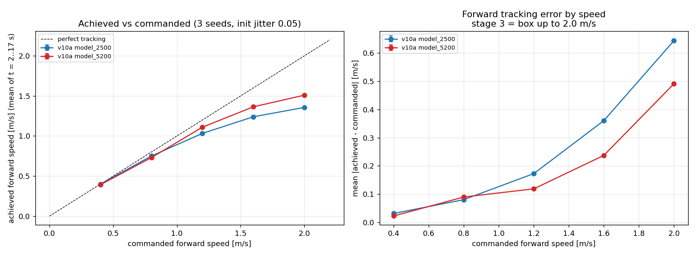

# A/B v10 — 서기를 보상으로 지킬 수 있는가 (서기 전용 L1 항 유무)

작성: 2026-09-25 (발사 전 사전 등록)
두 팔: [[2026-09-25_legonly_ab_v10a_stand01]] (대조) · [[2026-09-25_legonly_ab_v10b_stand01_l1]] (처리)
근거 조사: [[../reward_research/2026-09-25_isaac_asimov_teardown]] §3-2, §9 1순위

---

## ELI5

지금까지 "가만히 서 있기"를 잘하게 하려고 **서 있으라는 명령을 받는 환경의 비율**을
0.1 → 0.3 으로 올렸습니다. 서기는 좋아졌지만 걷기 학습 표본이 줄어 커리큘럼이 막히고 걷기가
나빠졌습니다. Menlo Research 의 Asimov 는 같은 문제를 **보상 하나**로 풉니다 — 서 있을 때만
"기본 자세에서 벗어난 만큼" 일정한 세기로 벌하는 항입니다. 이 A/B 는 **비율을 0.1 로 되돌려도
그 보상 하나로 서기를 지킬 수 있는지**를 가립니다.

---

## §1 두 팔 — 차이는 한 줄

| 설정 | v7 (참고) | **v10a 대조** | **v10b 처리** |
|---|---|---|---|
| 서 있는 환경 비율 `PYG_REL_STANDING` | 0.3 | **0.1** | **0.1** |
| 방향유지 비율 `PYG_REL_HEADING` | 0.3 | 0.3 | 0.3 |
| 서기 전용 L1 편차 `PYG_STAND_L1` | 없음 | **없음** | **1.0** |
| 나머지(모델·질량 불확실성·좌우 단계·게이트 3,000·16,000/10,000/4,000) | — | v7 과 같음 | v7 과 같음 |

**v10a 와 v10b 의 차이는 `PYG_STAND_L1` 한 줄뿐**입니다(단일 변인). v7 과 비교하면 두 줄이
다르므로 v7 은 참고값으로만 씁니다.

**두 팔을 같은 그래픽카드에서 동시에** 돌립니다. 같은 기계·같은 시각·같은 씨앗(42)이라 끝나는
시점도 같고, 측정 조건이 어긋날 여지가 없습니다. 16 GB 중 한 판이 약 6.6 GB 라 둘이 들어갑니다
(사용자 지시 2026-09-18 "남는 그래픽 메모리는 써라").

> **실제 발사**: v10a 2026-09-25 16:55:46, v10b 17:01:13(5분 27초 늦음 — 첫 시도가 그래픽 메모리 12 GiB
> 기준에 막혀, 그 기준만 바꾸는 `--min-gpu-free 7.5` 를 추가해 재발사). 두 팔 합쳐 13.4 / 16.3 GB 사용.
> 발사 직후 `env.yaml` 차이 = 새 보상항 블록 하나, 발사 플래그 차이 = `PYG_STAND_L1` 한 줄 — **단일 변인 확인**.
>
> **★ 17:50 계획 변경 — 두 팔을 다른 카드로 (사용자 지시 "3090 / 5060 나눠쓰라고")**: 한 카드 공유로 반복당
> 약 11초(완주 약 90시간)라 v10b 를 원격 3090 으로 옮겨 처음부터 다시 띄웠습니다(17:50:51, 이 PC 의
> 301회 시도는 보존 후 중단). **위의 "같은 기계·같은 시각" 전제는 더 이상 성립하지 않습니다.** 학습 내용
> (환경 수 16,384·씨앗 42·반복 수·보상·게이트)은 같고, 원격 v10b 와 이 PC v10a 의 설정 차이는 다시 비교해
> 새 보상항 하나뿐임을 확인했습니다(기록 방식 wandb→tensorboard 는 학습에 무관). 끝나는 시각이 달라지므로
> **판정은 반복 수 기준으로 맞춰** 비교합니다 — 먼저 끝나는 v10b 를 기다리게 하지 않고, 같은 반복의 저장본끼리 잽니다.

### 새 항 — `standing_joint_deviation_l1`

  비용 = Σ\|관절각 − 기본자세\| (엉덩이 6 + 무릎 2 + 발목 4 = 12 관절), 명령 합 ≤ 0.1 일 때만

가중치 −1.0 (Asimov 와 같음; 그들은 23 관절이라 같은 관절당 편차에서 우리 항이 약 절반 크기).
기울기가 **거리와 무관하게 일정**하다는 것을 발사 전에 확인했습니다 — CPU 에서 모든 관절을 같은
만큼 틀었을 때 서 있는 환경의 비용이 0.05 rad → 0.60, 0.2 → 2.40, 0.5 → 6.00 (= 12 × 편차),
걷는 환경은 전부 0.

규모 감: v7 이 잘 서 있을 때(자세추종 0.903 → 관절당 평균 편차 약 0.016 rad) 비용은 약 0.19,
v5 처럼 허용폭의 2~5.6 배를 벗어나면 약 1.2~3.4 — 속도 추종 보상(+2)과 같은 자릿수입니다.

---

## §2 ★ 사전 등록한 예측 (발사 전 2026-09-25 14:4x)

| # | 예측 | 틀렸다고 볼 조건 |
|---|---|---|
| P1 | **두 팔 모두** 커리큘럼 3→4 단계를 **자력 통과**(≈3,200 회) — v6b·v7·v8 의 5,400 강제 승급과 달리 | 한쪽이라도 강제 승급 → 서 있는 비율 0.1 만으로는 정체가 안 풀린다 / v10b 만 막히면 L1 항이 학습을 방해 |
| P2 | **v10b 의 서기가 v10a 보다 낫다** — 흘러감이 작고 자세추종 보상이 높다 | v10b ≈ v10a → L1 항이 서 있는 비율을 대신하지 못한다 |
| P3 | v10b 서기가 **v7 수준**: 자세추종 ≥ 0.5, 발 뗀 시간 ≤ 10 %, 12초 흘러감 ≤ 0.5 m | |
| P4 | 두 팔 모두 **회전이 v7 수준**(중앙값 ≥ 40 %) — 방향유지 0.3 은 같으므로 | 떨어지면 서 있는 비율이 회전에도 관여한다 |
| P5 | 두 팔 모두 **걷기가 v7 보다 낫다**(걷는 표본이 70 % → 90 %) | |

### ★ 대조군이 따로 답하는 질문

**v10a 자체가 오래된 질문 하나에 답합니다.** v5 의 나쁜 서기(자세 항이 죽어 있음)는 **발끝이 든
옛 기준자세**(발바닥 +10.6° 기울어짐)에서 측정됐습니다. v6b 는 발바닥 수정과 서 있는 비율 인상을
**동시에** 했고(변인 둘), 그래서 "서기가 살아난 것이 어느 쪽 덕분인가"는 지금까지 **나눠진 적이
없습니다**(중단된 v6 의 부분 분리만 있음: 비율만 올렸을 때 0.53, 발바닥까지 고쳤을 때 0.81~0.83).

v10a 는 **평평한 발 + 서 있는 비율 0.1 + L1 없음**입니다. 여기서 서기가 이미 괜찮다면, v5 의
진단("자세 항이 죽어서")은 **옛 발바닥에 섞여 있던 것**이고 L1 항은 필요 없을 수도 있습니다.
**그 경우 P2 가 틀려도 결과는 쓸모 있습니다.**

---

## §3 판정 도구 — v7·v8 과 같은 것

| 판정 | 도구 | 조건 |
|---|---|---|
| 정지 | `analysis/standing_verdict.py` | 씨앗 8개 × 15초(앞 3초 버림), `measure_stand.py` 기록 |
| 보행 | `analysis/walking_verdict.py` | `gait_kinematics_probe.py`, 1.2 m/s, 씨앗 11~16, 흔들림 ±0.05 rad |
| 회전 | `analysis/turn_verdict.py` | `measure_turn.py`, 8 회전속도 × 15초 |
| 게이트 | 런처 로그 | 승급 시점·강제 여부 |
| 떨림 | 서기 굴림의 관절속도 합 | L1 은 기본자세에서 꺾여 있어 영점 근처에서 떨 수 있음 — **처리군 위험** |

---

## §4 결과

### §4-1 ★ P1 판정 (2026-09-26 01:42) — **두 팔 모두 틀림**

| | v10a 대조 | v10b 처리 |
|---|---|---|
| 3→4 | **5,400 회 강제 승급** (오차 0.2400 > 문턱 0.2195) | 5,400 회 강제 승급 (오차 0.2408 > 문턱 0.2196) |

- 사전 등록 조건 "한쪽이라도 강제 승급 → 서 있는 비율 0.1 만으로는 정체가 안 풀린다" 에 해당합니다. v10b 만 막힌 것이 아니므로 **"L1 항이 학습을 방해"는 아닙니다** — 두 팔의 오차가 0.001 차이입니다.
- 따라서 v6b·v7·v8 의 3→4 정체 원인이 **서 있는 비율 0.3** 이라던 2×2 결론은 **틀렸습니다**(비율 0.1 에서도 같은 자리, 같은 오차). 원인 후보는 §4-0 의 ①②③ — 이를 가르는 속도별 측정이 진행 중(§4-2).

### §4-2 ★ 정체 원인 조사 1 — 속도별 추종 (2026-09-26 01:28~02:05, 원격 3090 기계 CPU)

**방법**: v10a 의 3 단계 **초반** 저장본(`model_2500`)과 **후반**(`model_5200`)을, 학습과 같은 `PYG_*` 로,
명령 하나당 17 초(앞 2 초 버림), 초기 자세 흔들림 0.05 로 굴렸습니다. 앞으로는 씨앗 3 개(11~13) — 씨앗 간
흩어짐이 0.00~0.003 이라 뒤로는 씨앗 1 개. 도구 `analysis/gait_kinematics_probe.py`, 스크립트
`analysis/run_v10_speed_probe.sh`, `run_v10_speed_probe_back.sh`, 표 `analysis/v10_speed_table.py`.

| 명령 [m/s] | 실제 (2,500) | 실제 (5,200) | 오차 (2,500) | 오차 (5,200) |
|--:|--:|--:|--:|--:|
| −2.0 | −1.52 | −1.56 | 0.479 | 0.444 |
| −1.6 | −1.39 | −1.39 | 0.224 | 0.215 |
| −0.8 | −0.79 | −0.81 | 0.071 | 0.064 |
| 0.4 | 0.40 | 0.39 | 0.031 | 0.023 |
| 0.8 | 0.75 | 0.73 | 0.080 | 0.090 |
| 1.2 | 1.03 | 1.11 | 0.173 | 0.119 |
| 1.6 | 1.24 | 1.36 | 0.360 | 0.237 |
| 2.0 | 1.36 | 1.51 | 0.644 | 0.491 |

넘어짐 0 / 24 굴림.

**관절이 한계에 닿는가** (씨앗 11, 명령별 가장 빠른·가장 힘든 관절):

| 명령 | 가장 빠른 관절 99백분위수 속도 | 실측 무부하 속도 19.9 의 90 % 초과 시간 | 가장 힘든 관절 99백분위수 토크 / 한계 | 한계의 95 % 이상 시간 |
|--:|---|--:|---|--:|
| 2.0 (5,200) | 왼무릎 8.0 rad/s | 0 % | 오른 엉덩이 비틀기 0.64 | 0 % |
| 2.0 (2,500) | 왼무릎 7.8 rad/s | 0 % | 오른 엉덩이 비틀기 0.64 | 0 % |

**판정**
1. ★ **가설 ③(물리 한계) 기각.** 앞뒤 1.5 m/s 근처에서 속도가 막히지만, 그때 관절 속도는 한계의 40 %, 토크는
   64 % 입니다. 모터에는 여유가 있고, **정책이 더 빨리 걷기를 고르지 않는 것**입니다(학습된 한계).
2. ★ **순수 앞뒤 추종은 체류 중 오히려 좋아졌습니다** (2.0 m/s 오차 0.644 → 0.491, −2.0 에서 0.479 → 0.444).
   그런데 같은 기간 게이트 오차는 0.2185 → 0.2400 으로 **늘었습니다.** 게이트 오차는 앞뒤·좌우 합이고 모든
   환경의 명령 분포를 따르므로, 늘어난 부분은 **좌우 이동이나 섞인 명령(회전 포함)** 쪽에 있어야 합니다.
3. 그래서 3 단계 명령 상자 전체(111 명령 × 15 초)를 두 저장본으로 재는 중입니다(§4-3, `run_v10_box_probe.sh`).

**왜 정책이 더 빨리 걷지 않는가 — 검증 전 가설**: 앞뒤 추종 보상 $\exp(-e^2/0.866^2)$ 은 오차 0.5 m/s 에서도
0.72 를 줍니다(최대의 72 %). 더 빨리 걸으려면 착지 충격·접촉력 상한·열 부하·행동 변화 벌점을 더 내야 하므로,
0.5 m/s 모자라는 편이 보상 합으로 더 이득일 수 있습니다. 이 가설은 아직 검증하지 않았습니다(보상 항별 기여를
속도별로 나눠 보면 가릴 수 있음).

### §4-0 중간 기록 (2026-09-25 23:20, 완주 전)

| | v10a 대조 (5060) | v10b 처리 (3090) |
|---|---|---|
| 0→1, 1→2, 2→3 | 800 · 1,600 · 2,400 회 **자력** (최소 체류 그대로) | 800 · 1,600 · 2,400 회 **자력** |
| 단계 기준 오차 | 0.1788 · 0.1835 · 0.1995 | 0.1802 · 0.1828 · 0.1997 |
| 3→4 | 진행 중: 3,874 회(체류 1,474), 오차 0.2308 > 문턱 0.2195 (= 0.1995 × 1.1) | ★ **5,400 회 강제 승급**(최대 체류 3,000, 그때 오차 0.2408 > 문턱 0.2196) |
| 넘어짐 | 0 | 0 |

- **v10b 에서 P1 이 틀렸습니다** (사전 등록 조건: "한쪽이라도 강제 승급 → 서 있는 비율 0.1 만으로는 정체가 안 풀린다 / v10b 만 막히면 L1 항이 학습을 방해").
  어느 쪽 해석인지는 **v10a 의 5,400 회**(약 01:40 예상 — 반복당 5.5 초)가 가릅니다.
- ★ 두 팔의 3 단계 오차가 **같은 체류에서 거의 같습니다** — v10b 체류 1,351 회 0.2306, v10a 체류 1,474 회 0.2308.
  L1 항이 원인이라면 두 팔이 갈라져야 하는데 갈라지지 않았습니다. 그래서 지금은 **v10a 도 강제 승급할 가능성이 높다**고 봅니다(판정은 5,400 회에서).
- ★ **3 단계 안에서 오차가 줄지 않고 늘었습니다** (v10b: 체류 598 → 1,351 → 2,104 → 2,863 에서 0.2185 → 0.2306 → 0.2368 → 0.2403). 게이트는 "넓힌 뒤 원래 실력으로 돌아온다"를 가정하는데, 돌아오지 않고 멀어집니다.
- 그렇다면 v6b·v7·v8 의 정체 원인이 "서 있는 비율 0.3"이라던 2×2 결론은 **다시 봐야** 합니다. v10a 는 서 있는 비율 0.1 인데도 같은 모양이기 때문입니다. 남은 후보(검증 전 가설): ① v6b 부터 바뀐 **평평한 발바닥**(v5 는 옛 발끝 든 기준자세에서 자력 통과) ② 방향유지 0.3 ③ 3 단계 명령(앞뒤 ±2.0 m/s)이 이 로봇의 **물리 한계**(무릎 실측 무부하 속도 19.9 rad/s, 토크-속도 곡선)에 걸려 절대 오차가 커지는 것 — 이 경우 "직전 단계 × 1.1" 문턱 자체가 도달 불가. ③은 **속도별 추종 오차**를 보면 가릴 수 있습니다.

<!-- SPEC-TABLES:BEGIN (analysis/run_spec_tables.py) -->

**§1b-2 / §1b-3 / §1b-4 (설정 명세 표)** — 이 노트는 A/B v10 두 팔(v10a·v10b) 비교이라 단일 런의 config가 없다. 리워드 가중치·모터 게인·토크 한계·ROM/액션 창·`PYG_*` 플래그는 **각 런 노트의 §1b~§1b-4**에 있다(모두 그 런의 `params/env.yaml`에서 기계 생성).

<!-- SPEC-TABLES:END -->
